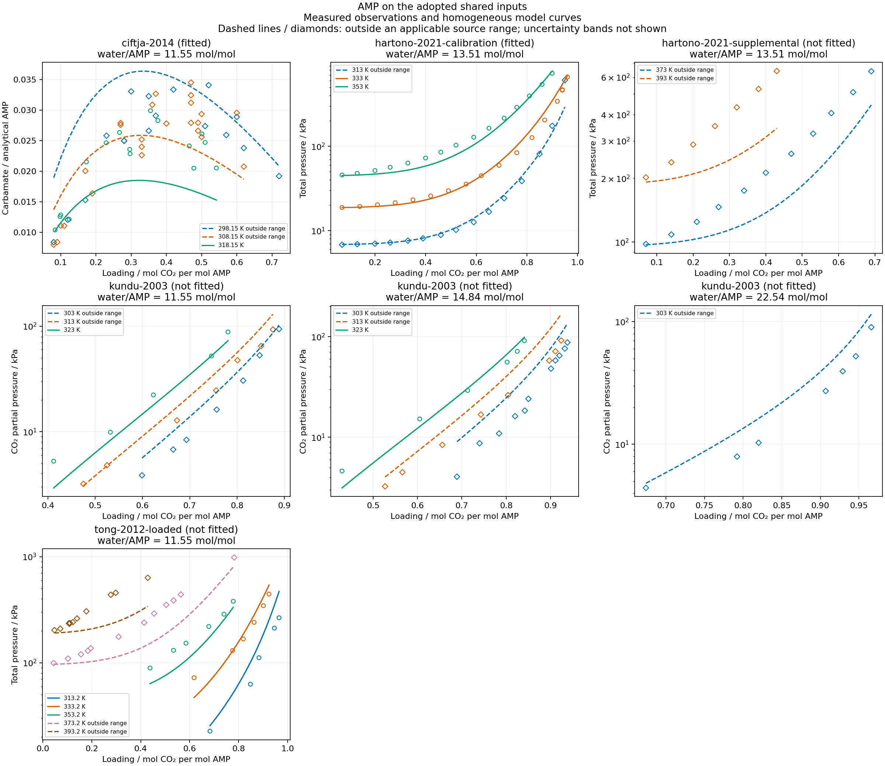
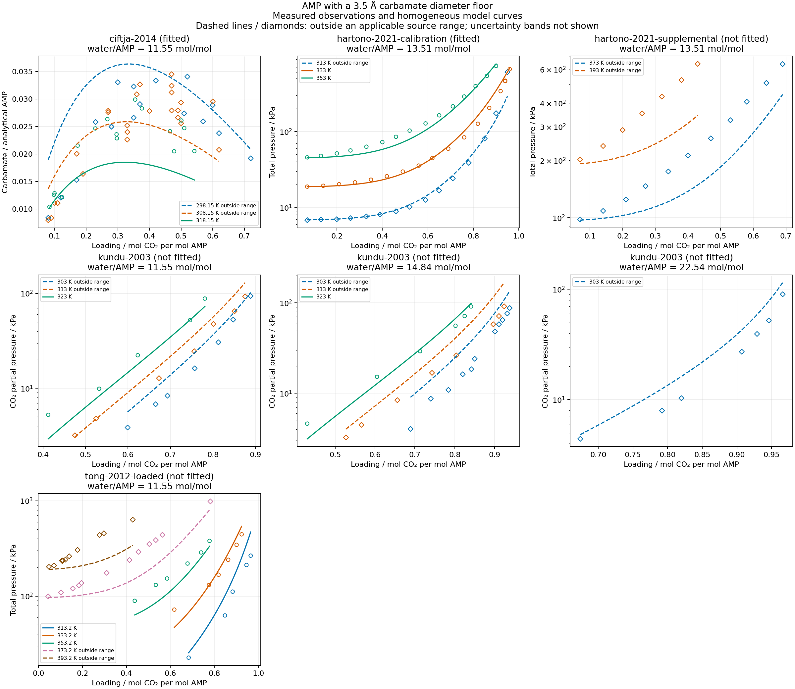

## AMP on the adopted shared record

**OWNER DECISION 2026-11-19 (question tool, answered by the owner): "Unpenalized + stable shown".** This notebook reports unpenalized main start 0 as the AMP fit and unpenalized start 1 for the 3.5 Å sensitivity. Reporting the unpenalized endpoints is an AMP-only exception to the #337 penalty rule, stated openly. The main start-0 retreat is shown alongside as the stability-constrained alternative. The decision began as an orchestrator decision taken while the owner was away and was confirmed by the owner on 2026-11-19. [Reporting decision](https://github.com/tannerpolley/Amine-Thermodynamics/issues/344#issuecomment-7002669137); [owner confirmation](https://github.com/tannerpolley/Amine-Thermodynamics/issues/344#issuecomment-7019544983)

| Evidence | Reported AMP fit | Stability-constrained retreat |
|---|---:|---:|
| Reloaded fitted cost on 156 observations | 61.70003837 | 124.72679408 |
| Point construction | Optimizer converged | Interpolated at $t=0.5699081420898438$ |
| Full search available / total | 666/666 | 666/666 |
| Full search descending entries, lower bound | 90 | 0 |
| Separate two-liquid equilibria confirmed, lower bound | 74 | — |
| Liquid-directed descents with unresolved coexistence | 16 | — |
| Compressed search available / total | — | 862/862 |
| Compressed search descending entries, lower bound | — | 0 |
| Minimum supplied $\mathrm{TPD}/RT$ in full search | $-5.2232\times10^{-3}$ | $+5.9801\times10^{-8}$ |

The #337 cost rule compares starts of the same fit. The main unpenalized starts tied at their relative function tolerance, and start 0 has the numerically lower cost within that fit. Both full checks had zero unavailable entries or supplied trials. Finite searches give lower bounds on descents. [Same-row comparison](results/retransfer-344-05e94210/campaign/start-0/retreat-comparison.json) · [Unpenalized start 0 search](results/retransfer-344-05e94210/campaign/selected-supplied-check.json) · [Retreat search](results/retransfer-344-05e94210/campaign/start-0/retreated-supplied-check.json)

The shared file and adopted parameter record match their declared SHA-256 hashes. Water–bicarbonate and water–carbonate have fixed interaction coefficients 0.7650000233694618 and −0.25. AMP ion Born and segment diameters are tied. The installed Engine files match the pinned 05e94210 wheel. The two declared starts were projected to the 5.34799141560911 Å AMP carbamate floor without changing the completed reaction laws. Start 0 moved from 5.31999516 Å and start 1 from 5.3 Å. The optimizer replayed their initial weighted costs of 229.23720904 and 3663.10577953, respectively. The diameter floor is 3.5 Å in the sensitivity. [Start projections](inputs/retransfer-344/phase-2/start-projections.json)

## Optimizer results

| Floor | Stage | Fitted cost | Penalty cost | Iterations | Termination | Native fit / s |
|---|---|---|---|---|---|---|
| Adopted floor | start-0/unpenalized/stage-0 | 61.70003837321 | 0 | 55 | converged | 84.265 |
| Adopted floor | start-1/unpenalized/stage-0 | 61.70003837447 | 0 | 52 | converged | 76.819 |
| 3.5 Å floor | start-0/unpenalized/stage-0 | 61.80354149983 | 0 | 29 | converged | 40.971 |
| 3.5 Å floor | start-1/unpenalized/stage-0 | 61.70003837448 | 0 | 52 | converged | 73.023 |

Both main unpenalized endpoints hit the carbamate diameter upper bound of 6.5 Å and the hydrolysis enthalpy increment lower bound of −5000 J/mol. At the 3.5 Å floor, start 0 ended at the diameter lower bound and start 1 at the 6.5 Å upper bound. Both hit the −5000 J/mol lower enthalpy-increment bound. The second start lowered the unpenalized sensitivity cost by 0.103503. The available searches at both sensitivity endpoints triggered the penalty. Only fitted data contributed residuals and ranked the starts. Not fitted observations did not choose the fit or the reporting point. Their states were included in the stability searches. Ties use the declared relative function tolerance of $10^{-10}$ and retain the numerical lowest-cost ordering. [Main fit histories](results/retransfer-344-05e94210/campaign/fits.json) and [sensitivity fit histories](results/retransfer-344-05e94210/sensitivity-3.5/fits.json) preserve the exact stopping messages, continuation costs and endpoint replay checks.

| Fitted coordinate | Unit | Limits | Reported AMP fit | On limit | Retreat | On limit | Reported conditional standard error |
| --- | --- | --- | --- | --- | --- | --- | --- |
| AMP-water-k | 1 | -0.5 to 0.5 | -0.13040209 | — | -0.12952812 | — | 0.00616473 |
| AMP-water-slope | K | -1000 to 1000 | -55.107523 | — | -52.047959 | — | 16.2546 |
| AMPH-water-k | 1 | -0.5 to 0.5 | -0.25635217 | — | -0.27691493 | — | 0.0215499 |
| AMPH-water-slope | K | -1000 to 1000 | -215.47264 | — | -221.36834 | — | 82.6918 |
| AMPH-CO2-k | 1 | -1 to 1 | 0.75840445 | — | 0.75990956 | — | 0.0760056 |
| AMPH-segment-diameter | Å | 4.5 to 6.5 | 5.7729841 | — | 5.7768063 | — | 0.656281 |
| AMPCOO-segment-diameter | Å | 5.3479914 to 6.5 | 6.5 | upper | 6.0045305 | — | unavailable |
| AMP-hydrolysis-a | 1 | 6.6346367 to 11.634637 | 11.114486 | — | 9.8706669 | — | 0.245682 |
| AMP-hydrolysis-enthalpy-increment | J/mol | -5000 to 5000 | -5000 | lower | -5000 | lower | unavailable |

Conditional standard errors at the retreat point are unavailable because it is interpolated. The reported fit's conditional standard errors use the local weighted residual Jacobian with shared coefficients, model and active bounds fixed. They exclude model-form error, source systematic error, and uncertainty from extrapolation or competing phases. The conditional calculation checks predictions against endpoint replay at relative tolerance $10^{-8}$. [Conditional information](results/retransfer-344-05e94210/campaign/conditional-uncertainty.json) and [sensitivity conditional information](results/retransfer-344-05e94210/sensitivity-3.5/conditional-uncertainty.json) and [sensitivity parameter values](results/retransfer-344-05e94210/sensitivity-3.5/parameters.json) are retained separately.

The [compact parameter table](results/retransfer-344-05e94210/campaign/parameter-table.json) includes the five fixed pure-AMP coefficients. The retained pure-AMP vapour-pressure deviations are 1.8853% on 15 Klepáčová rows, 1.7698% on nine Belabbaci rows and 1.1848% on 23 Pappa rows. The three density residuals are +0.011923, −0.030034 and +0.018162 kg/m³. The retained AMP–water prefit has 1.0462% deviation and +0.9834% bias on 26 total pressures, and 3.6328% deviation and +0.5515% bias on 26 vapour fractions. Both prefits retain their original producing wheel and observations. [Pure AMP](results/pure/summary.json) · [AMP–water](results/binary-dielectric.json)

## Completed penalty stages

| Floor | Start | Penalty scale | Fitted cost | Penalty cost | Iterations | Termination | Active bounds | Diagnostic available / entries | Descending entries, lower bound |
|---|---:|---:|---:|---:|---:|---|---|---:|---:|
| Adopted | 0 | 0.01 | 61.80748795255 | 0.02667616046 | 22 | converged | Carbamate diameter upper 6.5 Å, hydrolysis enthalpy increment lower -5000 J/mol | 666/666 | 38 |
| Adopted | 1 | 0.01 | 61.80748795283 | 0.02667616018 | 22 | converged | Carbamate diameter upper 6.5 Å, hydrolysis enthalpy increment lower -5000 J/mol | 666/666 | 38 |
| Adopted | 0 | 0.003 | 61.87105115758 | 0.01772181911 | 8 | converged | Carbamate diameter upper 6.5 Å, hydrolysis enthalpy increment lower -5000 J/mol | 666/666 | 17 |
| Adopted | 1 | 0.003 | 61.87105115759 | 0.01772181911 | 8 | converged | Carbamate diameter upper 6.5 Å, hydrolysis enthalpy increment lower -5000 J/mol | 666/666 | 17 |
| 3.5 Å | 1 | 0.01 | 61.80748795284 | 0.02667616019 | 22 | converged | Carbamate diameter upper 6.5 Å, hydrolysis enthalpy increment lower -5000 J/mol | 666/666 | 38 |
| 3.5 Å | 0 | 0.01 | 62.58003861675 | 0.13004238940 | 16 | converged | Carbamate diameter lower 3.5 Å, hydrolysis enthalpy increment lower -5000 J/mol | 666/666 | 48 |
| 3.5 Å | 1 | 0.003 | 61.87105115758 | 0.01772181911 | 8 | converged | Carbamate diameter upper 6.5 Å, hydrolysis enthalpy increment lower -5000 J/mol | 666/666 | 17 |
| 3.5 Å | 0 | 0.003 | 61.87105318261 | 0.01771979600 | 55 | converged | Carbamate diameter upper 6.5 Å, hydrolysis enthalpy increment lower -5000 J/mol | 666/666 | 17 |

The two main 0.01 stages took 37.0 and 37.3 minutes including their diagnostic searches, against projections of 33.5 and 38.1 minutes. Each native replay returned 862 of 862 entries and 40 descents as a lower bound. Each expanded diagnostic returned 666 of 666 and 38 native liquid descents, including two data and 36 grid entries. The supplied trials also found negative distances at those 38 states. Their density branches are unknown. At the 3.5 Å start-0 scale-0.01 endpoint the expanded diagnostic found 48 descending entries, including 47 with a native liquid descent and one with only a negative supplied trial. [Completed stage timings and counts](results/retransfer-344-05e94210/completed-penalty-stages.json)

The 3.5 Å start-0 scale-0.003 fit converged in 55 iterations on the relative function tolerance of $10^{-10}$. The native stage took 64.61 minutes with 57 residual and 38 Jacobian evaluations. Its compressed native replay and the supplied-trial diagnostic found 17 descending entries each, with 862 and 666 available entries, respectively. The diameter moved from the prior stage's 3.5 Å lower limit to the 6.5 Å upper limit. The enthalpy increment remained at its −5000 J/mol lower limit. The previous 3,450 s attempt and its memory trace are retained separately. [Sensitivity fit history](results/retransfer-344-05e94210/sensitivity-3.5/fits.json) · [Prior timeout](results/retransfer-344-05e94210/sensitivity-3.5/start-0/penalized-1-timeout.json)

## Fitted cost by observation group

Cost is half the sum of squared weighted residuals. The reported fit and the retreat use the same 156 fitted rows and residual scales. The loaded Hartono pressures account for the increase of 63.02676 cost units. Their contribution rises by 63.08674 while each other group contributes slightly less.

| Fitted observations | Rows | Reported fit cost | Retreat cost | Change |
| --- | --- | --- | --- | --- |
| Hartono binary total pressure | 26 | 0.01835 | 0.01608 | -0.00227 |
| Hartono binary vapor AMP mole fraction | 26 | 0.23462 | 0.22580 | -0.00882 |
| Hartono loaded total pressure | 47 | 59.04387 | 122.13061 | +63.08674 |
| Ciftja carbamate fraction | 57 | 2.40320 | 2.35430 | -0.04890 |
| Total | 156 | 61.70004 | 124.72679 | +63.02676 |

[Group totals and individual fitted row costs](results/retransfer-344-05e94210/campaign/start-0/retreat-comparison.json)

## Deviation and signed bias by reaction range

Every calculation uses 298.15–393.20 K. The measured AMP dissociation interval is 293.12–353.22 K (Hamborg and Versteeg 2009, Table 16). The 313.15–373.15 K carbamate-hydrolysis interval comes from source estimates (Xu et al. 1992, Table 2 and Eqs. 7–11). 273.15–498.15 K is the source-correlation range stated by Austgen 1991 Table V p.547 (citing Edwards 1978), not verified measured coverage.

Each pressure cell gives the mean absolute relative deviation (AARD) and the mean signed relative prediction error (bias), in percent. The comparison uses identical observations and range marks for the reported fit, the retreat and the retained `refit-306-floor` record. All 156 pressure observations represented below have a prediction from each point and a nonzero measured pressure. Each reaction range partitions those rows separately. All are inside the R1–R3 source-correlation interval.

| Range | Pressure observations | Role | Coverage | Rows | Reported fit AARD / bias | Retreat AARD / bias | Previous AARD / bias |
| --- | --- | --- | --- | --- | --- | --- | --- |
| AMP dissociation | Hartono loaded | fitted | inside | 47 | 10.364 / -1.214 | 20.043 / +13.898 | 10.333 / -0.900 |
| AMP dissociation | Kundu | not fitted | inside | 51 | 44.070 / +38.166 | 94.192 / +92.899 | 42.847 / +37.791 |
| AMP dissociation | Tong | not fitted | inside | 17 | 29.169 / +8.406 | 52.990 / +42.078 | 28.663 / +8.114 |
| AMP dissociation | Tong | not fitted | outside | 23 | 27.418 / -27.418 | 24.727 / -24.694 | 27.365 / -27.365 |
| AMP dissociation | Hartono supplemental | not fitted | outside | 18 | 28.131 / -28.131 | 24.417 / -24.417 | 27.922 / -27.922 |
| Hydrolysis source estimates | Hartono loaded | fitted | inside | 32 | 11.138 / -1.546 | 19.784 / +13.016 | 10.851 / -1.200 |
| Hydrolysis source estimates | Hartono loaded | fitted | outside | 15 | 8.713 / -0.505 | 20.597 / +15.778 | 9.226 / -0.261 |
| Hydrolysis source estimates | Kundu | not fitted | inside | 11 | 17.879 / -8.609 | 30.913 / +24.918 | 16.351 / -7.094 |
| Hydrolysis source estimates | Kundu | not fitted | outside | 40 | 51.272 / +51.029 | 111.593 / +111.593 | 50.134 / +50.134 |
| Hydrolysis source estimates | Tong | not fitted | inside | 17 | 29.169 / +8.406 | 52.990 / +42.078 | 28.663 / +8.114 |
| Hydrolysis source estimates | Tong | not fitted | outside | 23 | 27.418 / -27.418 | 24.727 / -24.694 | 27.365 / -27.365 |
| Hydrolysis source estimates | Hartono supplemental | not fitted | inside | 11 | 26.421 / -26.421 | 21.553 / -21.553 | 26.182 / -26.182 |
| Hydrolysis source estimates | Hartono supplemental | not fitted | outside | 7 | 30.820 / -30.820 | 28.917 / -28.917 | 30.655 / -30.655 |
| R1–R3 source correlations | Hartono loaded | fitted | inside | 47 | 10.364 / -1.214 | 20.043 / +13.898 | 10.333 / -0.900 |
| R1–R3 source correlations | Kundu | not fitted | inside | 51 | 44.070 / +38.166 | 94.192 / +92.899 | 42.847 / +37.791 |
| R1–R3 source correlations | Tong | not fitted | inside | 40 | 28.162 / -12.192 | 36.739 / +3.684 | 27.917 / -12.286 |
| R1–R3 source correlations | Hartono supplemental | not fitted | inside | 18 | 28.131 / -28.131 | 24.417 / -24.417 | 27.922 / -27.922 |

[Exact same-row comparisons](results/retransfer-344-05e94210/campaign/start-0/retreat-comparison.json) · [Retreat predictions and range marks](results/retransfer-344-05e94210/campaign/start-0/retreated-data-rows.json) · [Unpenalized deviations for all data groups](results/retransfer-344-05e94210/deviations.json) · [Previous deviations for all data groups](results/retransfer-344-05e94210/previous/deviations.json)

[Published model comparisons](results/retransfer-344-05e94210/published-model-comparisons.json) identify the data roles and row counts cited by each source. [Source measurement uncertainty](results/retransfer-344-05e94210/source-measurement-uncertainties.json) distinguishes reported measurement uncertainty from the residual scales used in fitting.

[Exact curve values and range marks](results/retransfer-344-05e94210/curve-data.json) and [270 observation predictions and range marks](results/retransfer-344-05e94210/data-rows.json) underlie the figure and table. The figure separates loading-dependent reactive data by temperature and stock. The tables also retain the binary pressure and vapour fraction predictions.

The reported 3.5 Å sensitivity, unpenalized start 1, retains the same data roles and range marks. Across the five pressure groups separated by the AMP dissociation range, its mean absolute relative deviation differs from the unpenalized main start 0 by at most 0.00044 percentage points. The full sensitivity comparisons cover all 270 observations and use the same retained previous model. [Sensitivity deviations](results/retransfer-344-05e94210/sensitivity-3.5/deviations.json) · [Sensitivity observations and predictions](results/retransfer-344-05e94210/sensitivity-3.5/data-rows.json) · [Sensitivity curve values](results/retransfer-344-05e94210/sensitivity-3.5/curve-data.json) · [Sensitivity range checks](results/retransfer-344-05e94210/sensitivity-3.5/checks.json)

## Finite stability searches and execution limits

| Case | Search | Entries | Available | Unavailable | Native liquid lower bound | Any descent lower bound | Supplied evaluated | Supplied unavailable | Supplied not applicable |
|---|---|---|---|---|---|---|---|---|---|
| campaign | search-0.json | 666 | 666 | 0 | 90 | 90 | 3590055 | 0 | 336015 |
| campaign | search-1.json | 666 | 666 | 0 | 90 | 90 | 3724035 | 0 | 348555 |
| campaign | search-2.json | 666 | 666 | 0 | 90 | 90 | 3724035 | 0 | 348555 |
| campaign | search-3.json | 666 | 666 | 0 | 90 | 90 | 3858015 | 0 | 361095 |
| sensitivity-3.5 | search-0.json | 666 | 666 | 0 | 114 | 114 | 3858015 | 0 | 361095 |
| sensitivity-3.5 | search-1.json | 666 | 666 | 0 | 114 | 114 | 4032189 | 0 | 377397 |
| sensitivity-3.5 | search-2.json | 666 | 666 | 0 | 90 | 90 | 4032189 | 0 | 377397 |
| sensitivity-3.5 | search-3.json | 666 | 666 | 0 | 90 | 90 | 4166169 | 0 | 389937 |

Unavailability includes the native cause by state in the [main search counts](results/retransfer-344-05e94210/campaign/search-counts.json) and [sensitivity search counts](results/retransfer-344-05e94210/sensitivity-3.5/search-counts.json). Any evaluated negative supplied tangent-plane distance rejects single-phase stability at that state. Finite searches give lower bounds on descents. An unavailable search cannot establish stability.

All eight unpenalized searches returned zero native vapor descents. The four main searches each found 90 states with negative supplied trials. The sensitivity searches found 98 and 114 at start 0, and 90 in each search at start 1. The raw supplied evaluations do not identify a density branch. The pressure-closure diagnosis below identifies the branch of each most negative trial at main start 0 and at 3.5 Å sensitivity start 1. The [supplied-negative witnesses](results/retransfer-344-05e94210/supplied-negative-witnesses.jsonl) retain each minimum in units of $RT$, the actual search pressure and the model bubble pressure.

The retained #391/#392 qualification used 1,906 entries and 5,895 AMP supplied trials at the prior search-106 point. It took 369.3 s on three workers and returned 1,905 available entries and no descents. The entry at 393.15 K, loading 0.9 mol CO₂/mol AMP and $1.05 P_{\rm bubble}$ was unavailable because trial 1 stalled at residual $1.349\times10^{-10}$ against the declared $10^{-10}$ equilibrium-row tolerance (epcsaft#87). The first six unpenalized searches took 141–148 s each on three workers. [Completed diagnostic search timings](results/retransfer-344-05e94210/runtime-profile.json) retain the individual measurements.

### Penalty evaluation timing

The earlier one-iteration wrapper took 344.6 s. Its 56.6 s optimizer timer missed the initial Jacobian, endpoint Jacobian and serial stability replay. The detailed trace used the same 862 compressed-liquid rows, 156 fitted observations, wheel and three workers.

| Phase | Wall time / s | Native stability / s | Bubble pressure and derivatives / s | Supplied trials / s | Process startup / s | Serialization / s | Worker receive and wait / s | Rest / s |
|---|---:|---:|---:|---:|---:|---:|---:|---:|
| Native setup | 2.421 | 0.000 | 0.000 | 0.000 | 0.458 | 0.010 | 0.000 | 1.952 |
| Initial jacobian | 67.008 | 43.650 | 10.136 | 0.000 | 0.000 | 0.042 | 0.004 | 13.176 |
| Residual | 56.890 | 43.989 | 7.583 | 0.000 | 0.000 | 0.034 | 0.003 | 5.281 |
| Endpoint jacobian | 67.326 | 43.747 | 10.159 | 0.000 | 0.000 | 0.035 | 0.002 | 13.382 |
| Serial endpoint replay | 149.966 | 120.015 | 19.439 | 0.000 | 0.000 | 0.000 | 0.000 | 10.513 |

The breakdown partitions the fit process’s elapsed time. Two workers compute concurrently during each residual or Jacobian sweep. The final replay does all 862 native searches in the fit process and shares 431 distinct bubble solves between pressure copies. The separate supplied-trial checks use the recorded compositions. The optimizer does not evaluate that bank.

The projection uses the lighter timing trace, with 55.03 s per residual, 64.43 s for the first Jacobian, 65.44 s per later Jacobian, and 149.53 s for native setup and the serial replay. It counts setup and replay once, includes construction and two measured searches, and uses the historical number of residual and Jacobian evaluations for each scale.

| Stage | Residual evaluations | Jacobian evaluations | Projected stage / min |
|---|---:|---:|---:|
| Main start 0, scale 0.01 | 13 | 13 | 33.54 |
| Main start 1, scale 0.01 | 18 | 13 | 38.13 |
| Scale 0.003 | 8 | 9 | 24.59 |

The one-iteration profiling runs returned identical predictions, residuals, optimizer coordinates and costs. The optimizer, penalty, trial families and stopping controls are unchanged. The completed main 0.01 fits actually used 23 residual and 16 Jacobian evaluations each. The completed main 0.003 fits used nine residual and eight Jacobian evaluations each. The projection is local to its measured point and evaluation counts. [Penalty profile and planning inputs](results/retransfer-344-05e94210/penalty-evaluation-profile.json)

### Retreat runtime

The full compressed anchor search found zero descents across 862 available entries with 7,150 supplied trials. The 209.4 s sweep gave a 73.3-minute projection for 21 sweeps before any expansion. Compact output reduced the same anchor sweep to 156.8 s, or 54.9 minutes for 21 sweeps. Every retained state summary matched, including counts and minimum tangent-plane distances. An additional check matched all 18 state summaries at the penalty endpoint, including 17 descents.

The retreat writes state summaries and witnesses at intermediate points. When a point already has a descent or an unavailable search, additional local trials cannot make that point admissible under the finite-search criterion. The retreat reuses checks at identical coordinates within one frozen set of supplied trials. The full diagnostic and supplied-trial checks still write detailed records. The old and new routes returned bit-identical residuals, predictions and weighted Jacobians across 1,018 fit rows and nine optimizer coordinates. [Retreat runtime and equivalence checks](results/retransfer-344-05e94210/retreat-runtime-checks.json)

With 7,301 supplied trials, the attempted compact retreat for main start 0 spent 175.8 s on its first compressed sweep. The fitted-data replay took 3.1 s. The updated projection for 21 sweeps and their replays was 62.5 minutes, so the one-hour guard stopped the run before the bracket was bisected. That attempt produced no interpolated endpoint. [Retreat stopping point](results/retransfer-344-05e94210/campaign/start-0/retreat-disposition.json)

The second runtime check used the enlarged bank of 10,230 trial declarations. The compressed anchor evaluated 8,184,000 applicable trial combinations, with 634,260 outside the feasible support and zero unavailable. Exact duplicate trials shared evaluations. The Engine returned 7,582,400 distinct state–trial result records before the repeat map restored duplicate entries. All 862 states returned results, with zero descents detected. The corresponding 666-state unpenalized endpoint searches evaluated 6,230,070 supplied trials each.

In the three-worker profile, accumulated worker elapsed time was 574.6 s. Trial preparation took 212.4 s, native searches with pressure references took 158.2 s, supplied-trial tests took 101.4 s, and the supplied-parent solves took 8.5 s. Declaration, result reduction and other work accounted for 94.2 s. The profiled sweep took 193.4 s wall time and used 2.94 cores on average.

A probe extracted the native trial reports once, reduced the compact trial results, and ran the fitted-data replay on three workers while retaining observation order. The sweep took 189.8 s versus 193.2 s in the unprofiled baseline. Replay took 1.29 s versus 2.80 s. All 862 anchor summaries and all 18 penalty-endpoint summaries matched bit for bit, excluding elapsed time. The endpoint subset included 17 descents. The probe reproduced the fitted residuals, native penalty residuals, 1,018 fit predictions and the weighted Jacobian with nine columns bit for bit. The projection fell from 68.62 to 66.89 minutes over 21 sweeps with replays. The projection exceeded the one-hour limit then in effect. The tested cut was retained for the timed replay under the 75-minute limit. [Second runtime correction evidence](results/retransfer-344-05e94210/runtime-correction-2.json)

The exact 3.5 Å start-0 scale-0.003 probe took 317.29 s for one iteration, including a 59.79 s initial Jacobian, a 51.04 s residual, a 63.17 s endpoint Jacobian and 140.79 s of serial native replay. The earlier same-input timeout took 3,450 s without a fit report. Adding two diagnostics at 215.10 s each to that elapsed time gives 64.67 minutes. Applying the evaluation counts from the completed sensitivity sibling and preceding stage gives conditional projections of 25.62 and 34.53 minutes. Those counts describe different optimization paths. Those local counts underestimated the 57 residual and 38 Jacobian evaluations used by the completed run.

The declared main start 1 anchor returned 572 descents across all 666 available entries, so the eligibility search ruled out its bisection bracket. [Anchor search counts](results/retransfer-344-05e94210/campaign/start-1/retreat-disposition.json)

### Main start-0 retreat and full search

The owner set a 75-minute limit for the main start-0 retreat and the 3.5 Å start-0 scale-0.003 fit. The other stages retained their one-hour limit. The retreat finished in about 71.3 minutes, including anchor eligibility, with 21 compressed sweeps and a frozen bank of 10,230 supplied trial declarations. [Owner runtime decision](https://github.com/tannerpolley/Amine-Thermodynamics/issues/344#issuecomment-6999006070) · [Execution timings](results/retransfer-344-05e94210/runtime-execution.json)

| Point or check | Entries | Available | Unavailable | Descents, lower bound | Fitted cost |
|---|---:|---:|---:|---:|---:|
| Compressed accepted point, $t=0.5699081420898438$ | 862 | 862 | 0 | 0 | 124.72679408 |
| Compressed upper neighbor, $t=0.569915771484375$ | 862 | 861 | 1 | 0 | 124.72518141 |
| Full data and grid search with supplied trials at accepted point | 666 | 666 | 0 | 0 | 124.72679408 |

The upper neighbor was rejected at 363.15 K, loading 0.1 mol CO₂/mol AMP and $3P_{\rm bubble}$. Trial 1 stalled at residual $1.0570\times10^{-10}$ against the Engine's $10^{-10}$ equilibrium row limit. The accepted point has a carbamate segment diameter of 6.00453049 Å and retains the −5000 J/mol lower enthalpy-increment limit. Its conditional standard errors are unavailable because the point is interpolated. [Bracket](results/retransfer-344-05e94210/campaign/start-0/retreat.json) · [Parameter point](results/retransfer-344-05e94210/campaign/start-0/retreated-parameters.json) · [Sweep counts and failure causes](results/retransfer-344-05e94210/campaign/start-0/retreat-searches.json)

The full search covered 6,266,001 applicable supplied trial combinations and 586,473 inapplicable combinations, with zero unavailable trials. The smallest supplied $\mathrm{TPD}/RT$ was $+5.9801\times10^{-8}$. The supplied check reused the completed search with identical inputs because the full search added no new witness. The detected descent count is a lower bound under the model. [Full search and supplied check](results/retransfer-344-05e94210/campaign/start-0/retreated-supplied-check.json)

### Supplied split evidence at the unpenalized main endpoints

Each of the four unpenalized searches found a negative supplied trial at the same 90 states. Each value below is the most negative supplied tangent-plane distance divided by $RT$ at that state. A negative value demonstrates a descent from the homogeneous liquid under the model. The raw supplied evaluations leave the density branch unknown. These states overlap the 90 native liquid descents, so the two lower bounds are counted together by state. The [retained witnesses](results/retransfer-344-05e94210/supplied-negative-witnesses.jsonl) give full precision and the actual pressure for every search and state.

Show the 90 states and their supplied minima

| State | $T$ / K | Water / AMP, mol/mol | CO₂ / AMP, mol/mol | $P/P_{\rm bubble}$ | Start 0, search 0 | Start 0, search 1 | Start 1, search 2 | Start 1, search 3 | Carbamate-hydrolysis range |
|---|---:|---:|---:|---:|---:|---:|---:|---:|---|
| hartono-2021:54 | 373 | 13.5147 | 0.53 | 1.05 | -0.001056898 | -0.001056898 | -0.001057523 | -0.001057523 | Inside |
| hartono-2021:55 | 373 | 13.5147 | 0.58 | 1.05 | -0.001578113 | -0.001578113 | -0.00157884 | -0.00157884 | Inside |
| hartono-2021:56 | 373 | 13.5147 | 0.64 | 1.05 | -0.001752343 | -0.001752343 | -0.001753117 | -0.001753117 | Inside |
| hartono-2021:57 | 373 | 13.5147 | 0.69 | 1.05 | -0.001592428 | -0.001592428 | -0.001593185 | -0.001593185 | Inside |
| hartono-2021:63 | 393 | 13.5147 | 0.38 | 1.05 | -0.0007989757 | -0.0007989757 | -0.0007995574 | -0.0007995574 | Outside |
| hartono-2021:64 | 393 | 13.5147 | 0.43 | 1.05 | -0.00260722 | -0.00260722 | -0.002608099 | -0.002608099 | Outside |
| tong-2012:28 | 373.2 | 11.5454 | 0.455 | 1.05 | -0.0007465268 | -0.0007465268 | -0.0007469644 | -0.0007469644 | Outside |
| tong-2012:29 | 373.2 | 11.5454 | 0.504 | 1.05 | -0.001444293 | -0.001444293 | -0.001444871 | -0.001444871 | Outside |
| tong-2012:30 | 373.2 | 11.5454 | 0.534 | 1.05 | -0.001714195 | -0.001714195 | -0.00171483 | -0.00171483 | Outside |
| tong-2012:31 | 373.2 | 11.5454 | 0.564 | 1.05 | -0.001866624 | -0.001866624 | -0.001867296 | -0.001867296 | Outside |
| tong-2012:32 | 373.2 | 11.5454 | 0.782 | 1.05 | -0.0007688459 | -0.0007688459 | -0.0007693113 | -0.0007693113 | Outside |
| tong-2012:44 | 393.2 | 11.5454 | 0.429 | 1.05 | -0.002690812 | -0.002690812 | -0.002691611 | -0.002691611 | Outside |
| Grid | 373.15 | 13.5147 | 0.5 | 1.05 | -0.0006068978 | -0.0006068978 | -0.0006074373 | -0.0006074373 | Inside |
| Grid | 373.15 | 13.5147 | 0.5 | 3 | -0.0005783459 | -0.0005783459 | -0.0005788806 | -0.0005788806 | Inside |
| Grid | 373.15 | 13.5147 | 0.6 | 1.05 | -0.001723574 | -0.001723574 | -0.001724332 | -0.001724332 | Inside |
| Grid | 373.15 | 13.5147 | 0.6 | 3 | -0.001677179 | -0.001677179 | -0.00167793 | -0.00167793 | Inside |
| Grid | 373.15 | 13.5147 | 0.7 | 1.05 | -0.001566602 | -0.001566602 | -0.001567357 | -0.001567357 | Inside |
| Grid | 373.15 | 13.5147 | 0.7 | 3 | -0.001498199 | -0.001498199 | -0.001498943 | -0.001498943 | Inside |
| Grid | 373.15 | 13.5147 | 0.8 | 1.05 | -0.0007285314 | -0.0007285314 | -0.0007290991 | -0.0007290991 | Inside |
| Grid | 373.15 | 13.5147 | 0.8 | 3 | -0.0006383667 | -0.0006383667 | -0.0006389111 | -0.0006389111 | Inside |
| Grid | 383.15 | 13.5147 | 0.4 | 1.05 | -8.678739e-05 | -8.678739e-05 | -8.722741e-05 | -8.722741e-05 | Outside |
| Grid | 383.15 | 13.5147 | 0.4 | 3 | -5.755492e-05 | -5.755492e-05 | -5.798898e-05 | -5.798898e-05 | Outside |
| Grid | 383.15 | 13.5147 | 0.5 | 1.05 | -0.002843137 | -0.002843137 | -0.002844055 | -0.002844055 | Outside |
| Grid | 383.15 | 13.5147 | 0.5 | 3 | -0.002787655 | -0.002787655 | -0.002788567 | -0.002788567 | Outside |
| Grid | 383.15 | 13.5147 | 0.6 | 1.05 | -0.003856002 | -0.003856002 | -0.003857114 | -0.003857114 | Outside |
| Grid | 383.15 | 13.5147 | 0.6 | 3 | -0.00377078 | -0.00377078 | -0.003771882 | -0.003771882 | Outside |
| Grid | 383.15 | 13.5147 | 0.7 | 1.05 | -0.003471181 | -0.003471181 | -0.003472283 | -0.003472283 | Outside |
| Grid | 383.15 | 13.5147 | 0.7 | 3 | -0.003344181 | -0.003344181 | -0.003345267 | -0.003345267 | Outside |
| Grid | 383.15 | 13.5147 | 0.8 | 1.05 | -0.00237322 | -0.00237322 | -0.002374157 | -0.002374157 | Outside |
| Grid | 383.15 | 13.5147 | 0.8 | 3 | -0.002193193 | -0.002193193 | -0.0021941 | -0.0021941 | Outside |
| Grid | 383.15 | 13.5147 | 0.9 | 1.05 | -0.001217211 | -0.001217211 | -0.00121789 | -0.00121789 | Outside |
| Grid | 383.15 | 13.5147 | 0.9 | 3 | -0.0009917407 | -0.0009917407 | -0.0009923645 | -0.0009923645 | Outside |
| Grid | 383.15 | 13.5147 | 0.966 | 1.05 | -0.0006339251 | -0.0006339251 | -0.0006344217 | -0.0006344217 | Outside |
| Grid | 383.15 | 13.5147 | 0.966 | 3 | -0.0004038095 | -0.0004038095 | -0.0004042243 | -0.0004042243 | Outside |
| Grid | 393.15 | 13.5147 | 0.4 | 1.05 | -0.001585125 | -0.001585125 | -0.001585842 | -0.001585842 | Outside |
| Grid | 393.15 | 13.5147 | 0.4 | 3 | -0.001531717 | -0.001531717 | -0.001532427 | -0.001532427 | Outside |
| Grid | 393.15 | 13.5147 | 0.5 | 1.05 | -0.004358975 | -0.004358975 | -0.004360129 | -0.004360129 | Outside |
| Grid | 393.15 | 13.5147 | 0.5 | 3 | -0.004268803 | -0.004268803 | -0.004269949 | -0.004269949 | Outside |
| Grid | 393.15 | 13.5147 | 0.6 | 1.05 | -0.005223248 | -0.005223248 | -0.005224577 | -0.005224577 | Outside |
| Grid | 393.15 | 13.5147 | 0.6 | 3 | -0.005085938 | -0.005085938 | -0.005087255 | -0.005087255 | Outside |
| Grid | 393.15 | 13.5147 | 0.7 | 1.05 | -0.004744387 | -0.004744387 | -0.004745701 | -0.004745701 | Outside |
| Grid | 393.15 | 13.5147 | 0.7 | 3 | -0.004541743 | -0.004541743 | -0.004543035 | -0.004543035 | Outside |
| Grid | 393.15 | 13.5147 | 0.8 | 1.05 | -0.003619801 | -0.003619801 | -0.003620964 | -0.003620964 | Outside |
| Grid | 393.15 | 13.5147 | 0.8 | 3 | -0.00333584 | -0.00333584 | -0.003336964 | -0.003336964 | Outside |
| Grid | 393.15 | 13.5147 | 0.9 | 1.05 | -0.002410947 | -0.002410947 | -0.002411888 | -0.002411888 | Outside |
| Grid | 393.15 | 13.5147 | 0.9 | 3 | -0.002047196 | -0.002047196 | -0.002048071 | -0.002048071 | Outside |
| Grid | 393.15 | 13.5147 | 0.966 | 1.05 | -0.001727407 | -0.001727407 | -0.001728191 | -0.001728191 | Outside |
| Grid | 393.15 | 13.5147 | 0.966 | 3 | -0.001326511 | -0.001326511 | -0.001327206 | -0.001327206 | Outside |
| Grid | 363.15 | 11.5454 | 0.6 | 1.05 | -0.000264882 | -0.000264882 | -0.0002651965 | -0.0002651965 | Inside |
| Grid | 363.15 | 11.5454 | 0.6 | 3 | -0.0002499147 | -0.0002499147 | -0.0002502248 | -0.0002502248 | Inside |
| Grid | 363.15 | 11.5454 | 0.7 | 1.05 | -0.0001534708 | -0.0001534708 | -0.000153729 | -0.000153729 | Inside |
| Grid | 363.15 | 11.5454 | 0.7 | 3 | -0.0001350737 | -0.0001350737 | -0.0001353238 | -0.0001353238 | Inside |
| Grid | 373.15 | 11.5454 | 0.5 | 1.05 | -0.001390559 | -0.001390559 | -0.001391127 | -0.001391127 | Inside |
| Grid | 373.15 | 11.5454 | 0.5 | 3 | -0.001366105 | -0.001366105 | -0.001366669 | -0.001366669 | Inside |
| Grid | 373.15 | 11.5454 | 0.6 | 1.05 | -0.001901725 | -0.001901725 | -0.001902416 | -0.001902416 | Inside |
| Grid | 373.15 | 11.5454 | 0.6 | 3 | -0.001865078 | -0.001865078 | -0.001865763 | -0.001865763 | Inside |
| Grid | 373.15 | 11.5454 | 0.7 | 1.05 | -0.001435637 | -0.001435637 | -0.001436262 | -0.001436262 | Inside |
| Grid | 373.15 | 11.5454 | 0.7 | 3 | -0.001384506 | -0.001384506 | -0.001385122 | -0.001385122 | Inside |
| Grid | 373.15 | 11.5454 | 0.8 | 1.05 | -0.0006208411 | -0.0006208411 | -0.0006212602 | -0.0006212602 | Inside |
| Grid | 373.15 | 11.5454 | 0.8 | 3 | -0.0005590337 | -0.0005590337 | -0.0005594339 | -0.0005594339 | Inside |
| Grid | 373.15 | 11.5454 | 0.9 | 1.05 | -6.068337e-05 | -6.068337e-05 | -6.082422e-05 | -6.082422e-05 | Inside |
| Grid | 373.15 | 11.5454 | 0.9 | 3 | -2.256051e-05 | -2.256051e-05 | -2.265899e-05 | -2.265899e-05 | Inside |
| Grid | 383.15 | 11.5454 | 0.4 | 1.05 | -0.001009501 | -0.001009501 | -0.001009993 | -0.001009993 | Outside |
| Grid | 383.15 | 11.5454 | 0.4 | 3 | -0.0009835486 | -0.0009835486 | -0.0009840372 | -0.0009840372 | Outside |
| Grid | 383.15 | 11.5454 | 0.5 | 1.05 | -0.002875756 | -0.002875756 | -0.002876591 | -0.002876591 | Outside |
| Grid | 383.15 | 11.5454 | 0.5 | 3 | -0.002832086 | -0.002832086 | -0.002832916 | -0.002832916 | Outside |
| Grid | 383.15 | 11.5454 | 0.6 | 1.05 | -0.003211981 | -0.003211981 | -0.003212918 | -0.003212918 | Outside |
| Grid | 383.15 | 11.5454 | 0.6 | 3 | -0.003147679 | -0.003147679 | -0.003148608 | -0.003148608 | Outside |
| Grid | 383.15 | 11.5454 | 0.7 | 1.05 | -0.002534495 | -0.002534495 | -0.002535356 | -0.002535356 | Outside |
| Grid | 383.15 | 11.5454 | 0.7 | 3 | -0.002442858 | -0.002442858 | -0.002443705 | -0.002443705 | Outside |
| Grid | 383.15 | 11.5454 | 0.8 | 1.05 | -0.001503575 | -0.001503575 | -0.001504237 | -0.001504237 | Outside |
| Grid | 383.15 | 11.5454 | 0.8 | 3 | -0.001382617 | -0.001382617 | -0.001383253 | -0.001383253 | Outside |
| Grid | 383.15 | 11.5454 | 0.9 | 1.05 | -0.0006405142 | -0.0006405142 | -0.0006409289 | -0.0006409289 | Outside |
| Grid | 383.15 | 11.5454 | 0.9 | 3 | -0.0005079974 | -0.0005079974 | -0.0005083669 | -0.0005083669 | Outside |
| Grid | 383.15 | 11.5454 | 0.966 | 1.05 | -0.0002814755 | -0.0002814755 | -0.0002817374 | -0.0002817374 | Outside |
| Grid | 383.15 | 11.5454 | 0.966 | 3 | -0.0001664549 | -0.0001664549 | -0.0001666556 | -0.0001666556 | Outside |
| Grid | 393.15 | 11.5454 | 0.4 | 1.05 | -0.00199286 | -0.00199286 | -0.001993538 | -0.001993538 | Outside |
| Grid | 393.15 | 11.5454 | 0.4 | 3 | -0.001950038 | -0.001950038 | -0.00195071 | -0.00195071 | Outside |
| Grid | 393.15 | 11.5454 | 0.5 | 1.05 | -0.003757183 | -0.003757183 | -0.003758177 | -0.003758177 | Outside |
| Grid | 393.15 | 11.5454 | 0.5 | 3 | -0.003688634 | -0.003688634 | -0.003689621 | -0.003689621 | Outside |
| Grid | 393.15 | 11.5454 | 0.6 | 1.05 | -0.003950014 | -0.003950014 | -0.003951091 | -0.003951091 | Outside |
| Grid | 393.15 | 11.5454 | 0.6 | 3 | -0.003849162 | -0.003849162 | -0.003850229 | -0.003850229 | Outside |
| Grid | 393.15 | 11.5454 | 0.7 | 1.05 | -0.003199884 | -0.003199884 | -0.003200878 | -0.003200878 | Outside |
| Grid | 393.15 | 11.5454 | 0.7 | 3 | -0.003056956 | -0.003056956 | -0.003057931 | -0.003057931 | Outside |
| Grid | 393.15 | 11.5454 | 0.8 | 1.05 | -0.002143539 | -0.002143539 | -0.002144345 | -0.002144345 | Outside |
| Grid | 393.15 | 11.5454 | 0.8 | 3 | -0.001955175 | -0.001955175 | -0.001955948 | -0.001955948 | Outside |
| Grid | 393.15 | 11.5454 | 0.9 | 1.05 | -0.001214151 | -0.001214151 | -0.001214734 | -0.001214734 | Outside |
| Grid | 393.15 | 11.5454 | 0.9 | 3 | -0.0009955939 | -0.0009955939 | -0.0009961209 | -0.0009961209 | Outside |
| Grid | 393.15 | 11.5454 | 0.966 | 1.05 | -0.0006129733 | -0.0006129733 | -0.0006135562 | -0.0006135562 | Outside |
| Grid | 393.15 | 11.5454 | 0.966 | 3 | -0.0004868084 | -0.0004868084 | -0.000487215 | -0.000487215 | Outside |

: All 90 states lie above the measured AMP dissociation range (293.12–353.22 K). The last column marks each state against the carbamate-hydrolysis source-estimate range (313.15–373.15 K). [Retained range marks](results/retransfer-344-05e94210/descent-diagnosis/descent-states.csv)

### Pressure closure and two-liquid equilibrium

For each of the 90 descents at unpenalized main start 0 and the 90 at unpenalized 3.5 Å sensitivity start 1, the pressure-closure check held the most negative supplied trial's composition fixed and requested both density branches at the parent pressure. It used the pinned Engine's absolute log-density window of 0.00995033 to match the supplied point to a pressure root. The largest density correction was 0.0004383 on this log scale. All parent and trial roots were liquid-side. The native resolved witnesses also closed on liquid roots. After closing pressure, $\mathrm{TPD}/RT$ ranged from −0.00522325 to −0.00002256 at the main point and from −0.00522458 to −0.00002266 in the sensitivity. The largest absolute pressure-row residual was $2.55\times10^{-13}$ against the declared $10^{-10}$ limit. [Method used for MDEA](https://github.com/tannerpolley/Amine-Thermodynamics/commit/755d24ae5) · [Native density-root check](https://github.com/tannerpolley/epcsaft/blob/05e94210fa64cf69725e45babc0411d32139df5a/engine/native/equilibrium/phase_stability.cpp#L152).

| Unpenalized point | Source | Records / distinct calculations | Confirmed liquid–liquid, lower bound | Vapor-directed | Density branch unresolved | Liquid-directed, equilibrium unresolved |
|---|---|---:|---:|---:|---:|---:|
| Main start 0 | Rule (a) data | 12 / 12 | 9 | 0 | 0 | 3 |
| Main start 0 | Rule (b) grid | 78 / 78 | 65 | 0 | 0 | 13 |
| 3.5 Å sensitivity start 1 | Rule (a) data | 12 / 12 | 10 | 0 | 0 | 2 |
| 3.5 Å sensitivity start 1 | Rule (b) grid | 78 / 78 | 66 | 0 | 0 | 12 |

The separate equilibrium calculations held the feed, temperature and pressure fixed. Confirmation required two distinct liquid roots with positive amounts, the Engine's equilibrium-row tolerance, and a Gibbs decrease larger than the calculated numerical error estimate. The two-liquid solves that did not confirm coexistence coalesced or stalled, including when initialized from nearby confirmed splits. These states still have negative pressure-closed tangent-plane distances. The finite trials and initializations give lower bounds on confirmed coexistence. [Per-state classifications and range marks](results/retransfer-344-05e94210/descent-diagnosis/descent-states.csv) · [Pressure roots and equilibrium attempts](results/retransfer-344-05e94210/descent-diagnosis/phase-witnesses.jsonl).

The 74 confirmed main splits span 373.00–393.20 K. The 76 sensitivity splits span 363.15–393.20 K. Both cover the 26.8 and 30.0 wt% unloaded AMP stocks, loadings of 0.400–0.966 mol CO₂/mol AMP and search pressures of 0.168–12.522 MPa. Both pressure ratios, $1.05P_{\rm bubble}$ and $3P_{\rm bubble}$, occur among the confirmed cases. The largest main Gibbs decrease occurs at 393.15 K, 30.0 wt% AMP and loading 0.700 mol CO₂/mol AMP, at 1.214760 MPa ($1.05P_{\rm bubble}$). The two liquid densities are 44,685 and 31,704 mol/m³. Total $G/(RT)$ decreases by 0.016734 mol on the declared 13.2454 mol feed, with an estimated numerical error of $2.80\times10^{-9}$ mol. At the same nominal sensitivity state, $G/(RT)$ decreases by 0.016738 mol at 1.214751 MPa. The largest classified equilibrium residual for any confirmed solve was $4.44\times10^{-14}$.

The confirmed splits establish that the homogeneous AMP solution fails at those states. All 90 descents at each endpoint are above the measured AMP dissociation range. At each endpoint, 64 are also outside the carbamate-hydrolysis source-estimate interval. All fall inside the shared R1–R3 source-correlation interval. The evidence is numerical and concerns local model equilibria. Experimental coexistence measurements were not used. [Counts, numerical limits and timings](results/retransfer-344-05e94210/descent-diagnosis/summary.json).

## Reproducibility and scope

The frozen `refit-306-floor` fitted replay reproduced 156 predictions within 1.19e-13 relative and the cost within 7.31e-13 relative. The #344 replay and endpoint limit is $10^{-8}$ relative, following #255 reproducibility on identical inputs. Shared inputs and range marks use identity checks. 270 of 270 observations returned predictions. All 23 out-of-range loaded Tong observations were marked and 23 returned predictions. The [numerical checks](results/retransfer-344-05e94210/checks.json) record all checks and their basis.

The [reporting summary](results/retransfer-344-05e94210/summary-row.json) records the unpenalized main endpoint and the confirmed split lower bound. The [retreat comparison](results/retransfer-344-05e94210/campaign/start-0/retreat-comparison.json) retains the fitted cost contributions and finite-search evidence. The AMP-only exception to the series penalty rule is an owner decision of 2026-11-19. Independent review supported the delivered AMP results at commit 4cd96a272. On 2026-11-19 the owner selected the unpenalized fit for Part II with the stability-constrained alternative shown alongside. Parameter adoption is a separate decision.
