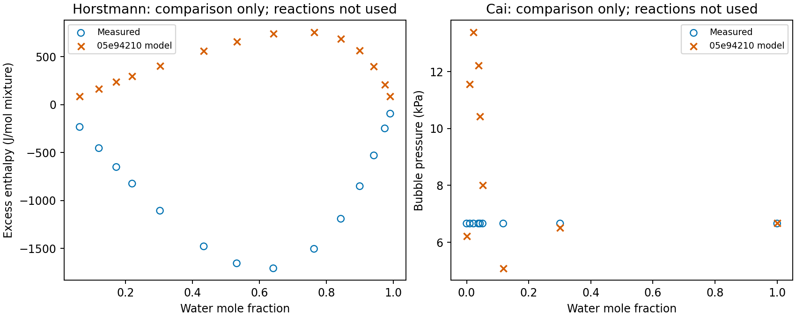

With the carbamate inputs of the adopted MEA fit F2 (#413), DEA's cost rises
from 8.0340 to 8.0830. Fitted pressure deviation is 28.51% (was 28.46%), and
not-fitted pressure deviation is 53.92% (was 54.19%), with the same
stability result. The #398 text below remains the replayed baseline.

For #398, both starts converged to tied costs. The selected fit differs from #346 by
less than $4\times10^{-11}$ relative in every retained observation prediction.
Each coarse-grid search returned 1,270 available states out of 1,271,
with zero resolved liquid splits found. One Lawson Table VIII stability
trial remained unavailable.

## Refit with the F2 carbamate inputs (#413)

On 2026-11-23 the owner decided that the DEA carbamate inputs come from the
adopted 11-parameter aqueous monoethanolamine model (fit F2). They previously
came from the 16-parameter calibration (F0), so
[#413](https://github.com/tannerpolley/Amine-Thermodynamics/issues/413)
refits DEA with only those inputs changed. The F2 values are in the
[MEA parameter details](../mea_parameter_bundle/results/reduced-refit/parameter-details.csv)
(SHA-256 `a391a1d0…`). The carbamate dispersion energy changes from
183.00063 K to 179.85787 K. The diameter rule is the one #398 used: the MEA
carbamate diameter times the cube root of the neutral DEA/MEA
$m^{\mathrm{seg}}\sigma^3$ ratio, 1.15925. That rule reproduces the #398
inputs from F0 exactly. Applied to the F2 diameter of 5.34799 Å, it gives
6.19966 Å for the segment, Debye–Hückel and Born diameters, against 6.16721 Å.
The packing diameter, $0.88\sigma$, becomes 5.45570 Å. The two
[start files](inputs/part-ii-346/f2-carbamate-413-route.json) differ from #398's
only in these five values and their provenance. Data, roles, weights,
starts, bounds, objective, wheel, shared record and stability grid are unchanged.

The #398 endpoint was replayed first on its own declaration. The 80 fitted
predictions match the native values within $1.17\times10^{-12}$ relative,
and all 299 observation predictions equal the retained #398 table exactly.

| Quantity | #398 (F0 carbamate) | #413 (F2 carbamate) |
| --- | ---: | ---: |
| Selected cost (both starts tie) | 8.03397189313 | 8.08296822832 |
| Start-1 cost difference | $9.1\times10^{-11}$ | $3.9\times10^{-11}$ |
| Iterations, both starts | 7 | 7 |
| Protonated DEA–water $k_{ij}$ (SE) | −0.188256 (0.003486) | −0.188343 (0.003485) |
| Carbamate–water $k_{ij}$ (SE) | −0.038549 (0.05432) | −0.047731 (0.05411) |
| Hydrolysis $a$ (SE) | 5.869411 (0.6151) | 5.883485 (0.6176) |
| Hydrolysis enthalpy increment SE (J/mol) | 1346.3 | 1344.1 |
| Coordinates on a bound | 0 | 0 |
| Fitted pressure AARD / bias (30), % | 28.464 / −0.661 | 28.512 / −0.653 |
| Fitted Carson heat AARD / bias (50), % | 0.947 / −0.115 | 0.943 / −0.119 |
| Not-fitted pressure AARD / bias (67), % | 54.187 / −3.345 | 53.916 / −2.334 |
| Stability states available / total, each endpoint | 1,270 / 1,271 | 1,270 / 1,271 |
| Resolved liquid splits (lower bound) | 0 | 0 |

By not-fitted set (AARD / bias, %): Lawson at 394.26 K 23.119 / −23.119 →
22.949 / −22.949; Seo and Hong 84.947 / +83.089 → 85.358 / +83.586; Lal
47.944 / −31.630 → 47.409 / −30.299. The carbamate–water interaction moves by
0.17 of its conditional standard error. The other fitted values move by
less than 0.03 of theirs. The correlation between the carbamate–water
interaction and hydrolysis $a$ stays 0.974. The largest paired prediction
change is 3.5% (Lawson Table VIII, comparison only). The same
`lawson-1976-viii:1:problem` search is unavailable at both endpoints, for
the same cause as in #398. The binary Cai and Horstmann comparisons use
no reactions and are unchanged. Differences between the two fits are small
compared with the deviations from the measurements. This is a
calibration-and-prediction comparison under the same data use, not a
validation.

Checks: the selected endpoint reloads within $3.08\times10^{-12}$ relative
in predictions and $1.98\times10^{-12}$ in cost. Both starts and the selected
endpoint carry the adopted shared values. All 299 observation marks and 750
curve-point marks match their declared ranges. Timings on 4 cores with the
host shared: one objective evaluation took 4.0 s, and one stability search
at start 0 took 137.9 s (endpoint searches 157.2 s and 113.7 s). Preflight
and campaign took 497.1 s, and endpoint checks and reporting took 130.3 s.
The fixed F2 carbamate inputs carry their own MEA-fit uncertainty, which the
conditional standard errors here exclude.

[Retained results](results/refit-413/) follow the #398 layout. The CSV model
labels are `F2-carbamate` and `F0-carbamate`. The
[manuscript handoff](results/refit-413/manuscript-handoff.md) lists every
manuscript value that changes. Reproduce from the repository root:

```bash
uv run --no-sync python analyses/dea_transfer/f2_carbamate.py prepare  # rewrites the five input files identically
run=analyses/dea_transfer/results/runs/413-reproduce
agent-heavy timeout 3600s uv run --no-sync python -u analyses/dea_transfer/f2_carbamate.py run "$run"
agent-heavy uv run --no-sync python analyses/dea_transfer/present_current.py "$run" "$run-paper" "$run-replay-398" \
  F2-carbamate F0-carbamate 413 inputs/part-ii-346/f2-carbamate-413-parameter-table-declarations.json
```

Independent delivered review and owner confirmation for manuscript use are pending.

## Conditions and data

[#398](https://github.com/tannerpolley/Amine-Thermodynamics/issues/398)
repeats the [#346 DEA transfer](part-ii-346.qmd) with the adopted aqueous
monoethanolamine shared values and ePC-SAFT 1.3.1, Engine commit
`05e94210fa64cf69725e45babc0411d32139df5a`. The wheel SHA-256 is
`c9fbf898b14d004f915f01ed77675867908dd30d77dc28544b2860e9195c80bb`.
[#340](https://github.com/tannerpolley/Amine-Thermodynamics/issues/340)
adopted the shared record `ae17803e1bcb2ca0a1970e05c7cc235d615c4d8a3a349b5afef0b0401dedefed`.
[#396](https://github.com/tannerpolley/Amine-Thermodynamics/issues/396)
retained it. The fixed water, CO₂ and inorganic-ion values and the R1–R3
laws come from that record. The [declaration](inputs/part-ii-346/route-current.json)
binds both starts and the existing chemistry, bounds and objective.
The objective is one-half the sum of squared weighted residuals.

The 299 observations comprise 80 fitted, 67 not fitted and 152 comparison only.
The objective includes 30 Lawson CO₂ partial pressures at 25 wt% DEA and 50
Carson integral heats at 298.15 K. The same-row comparison uses retained #346
predictions on Engine `391dfe5d`. Observations outside the objective were
available during study development. The comparisons assess calibration and
fixed-parameter predictions under the measured conditions. They provide no
independent validation. No agreement limit applies.

All reaction laws use the declared calculation interval of 293.15–458.64 K.
Bower's DEA dissociation measurements span 273.15–323.15 K (1962, p. 71
and Eq. 7, p. 73). The hydrolysis seed is the inverse of Aroua's carbamate
formation law (1997, p. 692 and Table 3 and Eq. 14, p. 695). Its 303–331 K
measurement range refers to the source, and the fitted law's validity remains
unestablished. The R1–R3 marks refer to the 273.15–498.15 K correlation range
in Austgen 1991, Table V, p. 547. The experimental coverage of that correlation
was unverified. Binary Cai and Horstmann comparisons use no reactions.

The bounded [#346 source check](results/retransfer-346/source-check.md) found
no DEA dissociation measurements above Bower's 323.15 K upper limit in the
inspected Zotero library. Hamborg and Versteeg (2009, Table 11, p. 1322 and
reference 32, p. 1328) cite Bower for DEA. All eight PDF hashes in the
[#346 source inventory](results/retransfer-346/source-hashes.json) matched
the corresponding Zotero attachments for #398.

## Fits and selected endpoint

Both starts reached the Engine's relative function-change tolerance of
$10^{-10}$ after seven iterations, with no continuation. Start 0 has the
lower fitted cost. The native costs differ by $9.45\times10^{-11}$, a tie
under the [#337](https://github.com/tannerpolley/Amine-Thermodynamics/issues/337)
start-selection rule.

| Start | Initial cost | Native fitted cost | Replayed cost | Final relative function change | Native fit wall time (s) |
| --- | ---: | ---: | ---: | ---: | ---: |
| 0 (selected) | 15.5750073452 | 8.03397189312992 | 8.03397189313348 | $3.0451\times10^{-12}$ | 11.10 |
| 1 | 14.8039521182 | 8.03397189322442 | 8.03397189322409 | $1.4255\times10^{-11}$ | 13.03 |

| Start | Protonated DEA–water interaction | Carbamate–water interaction | Hydrolysis coefficient $a$ before law completion | Hydrolysis enthalpy increment (J/mol) |
| --- | ---: | ---: | ---: | ---: |
| 0 | -0.188256471177 | -0.038548699161 | 5.778214151955 | 237.4460085 |
| 1 | -0.188256554598 | -0.038546398165 | 6.245297213818 | -978.6801028 |

The two ionic interaction coefficients are dimensionless. The two starts
use different initial reaction laws. The tabulated enthalpy increments
are relative to those laws. Law completion absorbs each increment into
its endpoint reaction coefficients and transports the original bounds.
[Selection and optimizer histories](results/retransfer-398/selection.json)
retain both completed endpoints, original optimizer coordinates, bounds
and full cost histories.

| Selected parameter | Completed-law value | Bounds | Conditional standard error |
| --- | ---: | ---: | ---: |
| Protonated DEA–water interaction | -0.188256471177 | [-1, 1] | 0.003486 |
| Carbamate–water interaction | -0.038548699161 | [-1, 1] | 0.05432 |
| Hydrolysis coefficient $a$ | 5.869410673218 | [4.188573, 10.188573] | 0.6151 |
| Hydrolysis enthalpy increment (J/mol) | 0 | [-18021.37, 21978.63] | 1346.32 |

No fitted coordinate is on a bound. The enthalpy origin is zero in the
completed chart because the fit's increment is included in the law.
The [parameter table](results/retransfer-398/parameter-values.csv) retains
full-precision values, units, bounds and provenance for the fitted and
fixed quantities. The [conditional information](results/retransfer-398/conditional-uncertainty.json)
uses the whitened residual Jacobian and 76 residual degrees of freedom.
These local standard errors are conditional on the fixed shared record,
objective and model. The correlation between the carbamate–water
interaction and hydrolysis coefficient $a$ is 0.974. Shared-input
uncertainty, source systematic errors and model discrepancy are outside this
calculation.

## Finite stability search

Both endpoints used the same declared 335 data states and 936 grid states.
The grid uses 10, 20, 25 and 30 wt% DEA, 313.15–393.15 K at 10 K increments,
and loadings of $10^{-5}$, 0.1 through 1.1 at 0.1 increments, and 1.167
mol CO₂/mol DEA. Liquid pressure is 1.05 or 3.0 times the model's bubble
pressure. The shared route reuses 101 identical data-state calculations
within each endpoint search.

| Start | Data states available / total | Grid states available / total | Liquid splits found, lower bound | Search wall time (s) |
| --- | ---: | ---: | ---: | ---: |
| 0 | 334 / 335 | 936 / 936 | 0 | 107.16 |
| 1 | 334 / 335 | 936 / 936 | 0 | 99.34 |

Both searches have one unavailable state, `lawson-1976-viii:1:problem`
(Table VIII row 2, 298.15 K, 54.5 wt% DEA, loading 0.602 mol/mol).
The Engine's first trial returned `CentralSolveUnavailable` because its
reconstruction destroys support. The pressure observation itself was
calculated. The unavailable phase search contributes no stability evidence.
DEA's earlier registry contains zero resolved split compositions, so there
were zero applicable supplied trials. No liquid split triggered a penalty.
The lower bounds describe numerical search results over the declared trial
families and states. Global stability and physical validation remain
unestablished.

The [#392 qualification](../stability_search/results/repin-05e94210/summary.json)
had 1,270 available out of 1,271 at the old selected endpoint on this same
wheel, with the same unavailable state and cause. The original #398 run
reused the qualified replay. The reproduction command now recomputes that
replay from the checked-in #346 endpoint. Fitting produced numerically
different endpoint parameters and completed laws, so both new endpoints
needed their own searches. The
[#346 selected endpoint after #380](part-ii-346.qmd#finite-stability-searches)
had 334 of 335 data states and all 3,456 finer-grid states available,
with a lower bound of zero splits. The grid-size change accounts for
2,520 fewer states.

## Correctness checks

| Check | Result | Limit and origin |
| --- | --- | --- |
| Retained #346 endpoint replay on the pinned wheel | Pass. Maximum relative prediction difference $1.94\times10^{-12}$ over 80 rows. Relative cost difference $5.42\times10^{-13}$. | $10^{-8}$ relative for replay, specified by #346 following #255. |
| Shared inputs | Pass. Adoption and shared-values hashes match. Both starts and the selected endpoint match the shared components, pair values, R1–R3 coefficients and reference states. | Exact identity to #340, with the declared DEA calculation interval verified on the serialized laws. |
| Selected endpoint reload | Pass. Native cost 8.03397189312992 and reloaded cost 8.03397189313348 differ by $4.43\times10^{-13}$ relative. Maximum relative prediction difference $1.17\times10^{-12}$. | $10^{-8}$ relative, same #346 and #255 replay criterion. |
| Reaction-range marks | Pass. All 299 observation marks and 750 retained curve-point marks match their declared ranges. | Exact identity to the declaration under #337 and #346. |

The first reporting pass compared completed-law temperature bounds directly
against the source bounds in the adoption file. The comparison was corrected
to verify the documented 293.15–458.64 K override explicitly. Its replay and
reporting resumed from the saved selection. [Checks](results/retransfer-398/checks.json)
retain the errors and hashes from the original run. The run on three
cores took 244.66 seconds for preflight, fits and searches, and 43.44 seconds
for endpoint verification, uncertainty and reporting calculations. These are
single-run wall times with the host shared. The run waited for admission
before timing began. [Timings](results/retransfer-398/timings.json) record the
same stages. The 220.90-second #392 qualification and the two #346 native
fit timings provided the pre-run estimates.

## Deviations from measurements

Fitted Lawson pressure deviation is 28.464%, and the 67 not-fitted pressure
observations have 54.187% deviation. Fitted Carson heat deviation is 0.947%.
The largest paired prediction change from #346 across the 299 observations
is $3.63\times10^{-11}$ relative. The maximum difference in mean absolute
relative deviation across the 74 populated dataset/range groups is
$1.86\times10^{-9}$ percentage points. Signed relative bias changes by
at most $1.27\times10^{-9}$ percentage points. Those differences are
negligible compared with the deviations from the measurements.

These are mean absolute relative deviation and mean signed relative error
(predicted minus observed, divided by the observation). Relative statistics
exclude observed zeros. Absolute deviations keep those rows.

| Observations | Role | DEA dissociation range | Count | Deviation / bias (%) on 05e94210 | Deviation / bias (%) on 391dfe5d |
| --- | --- | --- | ---: | ---: | ---: |
| Lawson CO₂ pressure | Fitted | Inside | 7 | 46.908 / +21.829 | 46.908 / +21.829 |
| Lawson CO₂ pressure | Fitted | Outside | 23 | 22.850 / −7.506 | 22.850 / −7.506 |
| Lawson CO₂ pressure at 394.26 K | Not fitted | Outside | 7 | 23.119 / −23.119 | 23.119 / −23.119 |
| Seo and Hong CO₂ pressure | Not fitted | Inside | 5 | 31.126 / +25.181 | 31.126 / +25.181 |
| Seo and Hong CO₂ pressure | Not fitted | Outside | 11 | 109.410 / +109.410 | 109.410 / +109.410 |
| Lal CO₂ pressure | Not fitted | Inside | 17 | 56.298 / −53.383 | 56.298 / −53.383 |
| Lal CO₂ pressure | Not fitted | Outside | 27 | 42.685 / −17.933 | 42.685 / −17.933 |
| Carson integral heat | Fitted | Inside | 50 | 0.947 / −0.115 | 0.947 / −0.115 |

All pressure rows shown in the table have the same classifications for
the hydrolysis source interval. All 50 Carson heats are outside it.
Overall, 183 reactive observations are inside the DEA dissociation range
and 93 outside, including 23 fitted outside. For the hydrolysis source
interval, 60 are inside and 216 outside, including 73 fitted outside.
All 276 reactive observations are within each shared R1–R3 correlation
range. All seven extrapolated Lawson rows at 394.26 K and every other
observation returned a value.

[Range-separated deviations](results/retransfer-398/range-deviations.csv)
include both wheels for every dataset and law, with counts, signed bias
and errors in source units. [Dataset deviations](results/retransfer-398/group-deviations.csv)
give the unstratified comparison. The [observation table](results/retransfer-398/paper-data.csv)
carries every source identity and mark. The
[curve data](results/retransfer-398/curve-data.json) retain 750 available
points with loading, temperatures, units, series identities and marks.


At 363.15 K and 1.75 MPa, Horstmann's 14 water–DEA excess enthalpies are
negative. The model predicts +86.24 to +758.49 J/mol mixture, for a mean
signed error of +1,313.14 J/mol on both wheels. This sign disagreement
remains much larger than the reported calorimeter uncertainty scale of
2 J/mol plus a 1% heat term (Horstmann 2002, p. 1497). The printed formula
leaves the sign of that term ambiguous. The same observations were fitted
by Horstmann's temperature-dependent NRTL correlation (Table 6, Fig. 4b,
and Table 7). They are comparison only here. The paper gives no scalar
deviation for these exact rows.



The [source comparison record](results/retransfer-346/source-check.md)
preserves paper locators, data roles and source uncertainties. Lawson's
9% scatter is against smoothed measurements, Carson reports approximately
1–2% heat uncertainty, and Seo and Hong report 2–3% loading uncertainty.
Lal reports approximately 15% pressure accuracy above 0.05 kPa with
larger errors below it. The available publications give no same-row scalar
model deviation for the fitted Lawson and Carson sets or for the exact
Seo and Hong and Lal sets. Lal's Figure 3 is a graphical comparison with
Kent–Eisenberg constants fitted to earlier data. No agreement threshold
was applied to these comparisons.

## Retained files and review

The [paper summary](results/retransfer-398/paper-summary.json) records the
selected start, bound count, pressure deviations and stability result.
The [run identity](results/retransfer-398/identity.json) binds the declaration
and wheel. [#346 on 391dfe5d](part-ii-346.qmd) and the
[earlier B-2 fit](historical-f0.qmd) remain available as historical results.

From the repository root with the locked environment and pinned wheel, choose
fresh output directories to preserve completed runs. The preflight compares
80 recomputed predictions and their cost with the checked-in #346 replay.

```bash
run=analyses/dea_transfer/results/runs/398-reproduce
out=analyses/dea_transfer/results/runs/398-reproduce-paper
agent-heavy timeout 1800s uv run --no-sync python -u \
  analyses/dea_transfer/rerun.py "$run"
agent-heavy uv run --no-sync python analyses/dea_transfer/present_current.py "$run" "$out"
```

Raw solver rows, per-state stability files and logs are in the ignored run
directory `analyses/dea_transfer/results/runs/398/`. Independent delivered
review and owner confirmation for manuscript use are pending.
