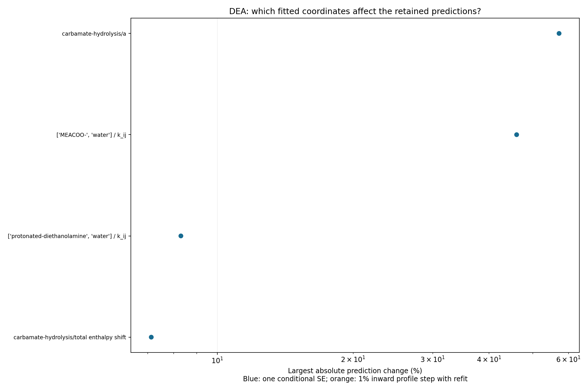

## Result

[#317](https://github.com/tannerpolley/Amine-Thermodynamics/issues/317) asks
whether the MEA paper's ePC-SAFT model describes CO₂ partial pressure and
absorption heat in aqueous diethanolamine (DEA). Water, CO₂, H₃O⁺, OH⁻, HCO₃⁻,
CO₃²⁻, every shared pair and reactions R1–R3 keep the adopted MEA record
unchanged. Only four DEA coordinates are fitted. The design is in
[comment 6836480110](https://github.com/tannerpolley/Amine-Thermodynamics/issues/317#issuecomment-6836480110),
and the owner decisions are in
[comment 6836628626](https://github.com/tannerpolley/Amine-Thermodynamics/issues/317#issuecomment-6836628626)
and in the owner's 2026-11-12 build decisions. This is a transfer case for the
amine-general paper. Nothing is adopted.

- **Fit (80 rows).** Integral heats (Carson 2000) fit within their stated
  1–2%: 0.98% mean absolute error, and 46 of 50 rows within 2%. CO₂ pressures
  (Lawson & Garst 1976, 25 wt%) do not reach the source's 9% scatter: 28.6% mean
  absolute error, and 10 of 30 rows within twice that scale. The error is
  mainly in the shape of pressure against loading. At high loading the
  model-to-measured ratio falls on every isotherm, ending 31–58% low at each
  isotherm's highest loading. A smaller temperature effect sits on top: near
  loading 0.4 the ratio runs from 1.26 at 100 °F to 0.88 at 225 °F.
- **Held out, Seo & Hong 1996 (30 wt%, 16 rows).** 79.5% mean absolute error,
  with a bias of +77.8%. The error grows with temperature: 28.5% at 40 °C,
  59.8% at 60 °C and 154% at 80 °C. 9 of 16 rows lie within twice their stated
  uncertainty components.
- **Held out, Lal 1985 (2.0 kmol/m³, 44 CO₂-only rows).** 44.2% mean absolute
  error, with a bias of −22.9%. At 40 °C and loading 0.04–0.20 (the carbamate
  region, below any fitted pressure) the model is 46–70% low, 59% on average.
  Above 0.05 kPa, where Lal states ±15%, 5 of 28 rows fall within that band.
- **Comparisons (predictions, never fitted).**

  | Set | Rows | Error |
  |:--|--:|:--|
  | Lawson Table VIII (50 wt%) | 10 | 41.7% mean absolute error (bias −33.0%) |
  | Böttinger 2008 speciation, clean states | 9 | within 0.0013–0.0017 in true mole fraction |
  | Cai 1996 bubble pressure | 9 | 40.8% error against 6.66 kPa |
  | Horstmann 2002 excess enthalpy | 14 | wrong sign: +89 to +759 J/mol against −93 to −1707 J/mol measured |
  | Weiland 1998 loaded density | 43 | 0.45% mean absolute error |

- **Phase census.** All 140 fitted and held-out states are single stable
  liquids: no dense split, gas phase, ambiguous or unresolved state.
- **Uncertainty.** Parameter uncertainty bands on the held-out pressures are
  5–19% (relative standard error). That is well below the observed errors, so
  the misses come from the model form or from disagreement between data sets,
  not from poorly determined coordinates.

Evidence type: a calibration, plus two held-out physical comparisons scored
once on a frozen endpoint, plus comparison-only predictions. No pass or fail
rule is applied to the held-out numbers (owner decision 2).

.](results/measured-vs-model.png)

## Model and data

**Pure DEA (design step 2).** Nasrifar & Tafazzol 2010, Table 2, 4C scheme:
two donor and two acceptor sites; m = 5.2048, σ = 2.9477 Å, ε/k = 269.00 K,
ε^AB/k = 1517.6 K, κ^AB = 0.1014. Their Eq. 34 carries σ³κ, the Engine
convention, so no conversion is needed. The pinned Engine accepts the
four-site scheme. Against 20 Horstmann 2002 and 5 Klepáčová 2011 vapour
pressures (401–541 K), the mean absolute error is **2.35%**. That is below the
**2.60%** mean disagreement between Klepáčová's rows and Horstmann's Antoine
fit, so the set is used as published.

**Binary and dielectric (step 3).**

- **DEA–water k_ij.** The temperature-independent value is **−0.0636** on the
  44 Horstmann 2002 Table 4 rows at 365.15 K: 1.16% mean absolute error, no
  limit active. Nasrifar's value is −0.04.
  - The fit starts at −0.04. At k_ij = 0 the Engine reported Table 4 row 22 as
    locally unstable (a liquid–liquid split), as AMP's start was. That message
    came from a probe and is not retained.
  - A start carries no data into the converged value.
- **DEA dielectric coefficients.** Fitted on Hsieh 2007's 30 values at fixed
  EOS densities: volume 0.7575 L/mol, temperature 1155.8 K, 3.05% mean absolute
  error. A second admissible branch (0.2925 L/mol) has a 2.3% higher cost.
- Results: [binary.json](results/binary.json).

**Ion forms (D2).**

- **Form A (the MEA record's form).** DEAH⁺ and DEACOO⁻ are single spheres.
  Their diameters are the MEA ion diameters times 1.1593, the cube root of the
  DEA/MEA neutral segment-volume ratio, giving 5.686 Å and 6.167 Å. Energies and
  Born diameters are the MEA ions' values.
- **Form B.** DEAH⁺ is a charged chain carrying the pure-DEA m, σ, ε and four
  sites, with zero self-association energy.
- New ion pairs are zero, except DEACOO⁻–water, which starts at the MEA value.

**Reactions (D1).**

- DEAH⁺ + H₂O ⇌ DEA + H₃O⁺: Bower 1962 Eq. 7, fixed. In Engine form,
  ln K = −9.27988 − 4214.08/T + 0.00996121 T.
- DEACOO⁻ + H₂O ⇌ DEA + HCO₃⁻: starts from the inverse of Aroua 1997 Eq. 14,
  ln K = 11.7892 − 4100.90/T, so ln K(313.15 K) = −1.306 and ΔH = 34.1 kJ/mol.
- Both laws are declared over 293.15–393.15 K.

**Caloric (D3).** The DEA ideal-gas heat capacity is Maham 1997 liquid Cp
minus the Engine's residual Cp of pure DEA at 1 bar:
Cp = 141.34 + 0.7642 (T − 313.15) J/(mol K), with fit residuals within
±1.8 J/(mol K). Changing it by ±10% moves the 50 isothermal Carson heats by at
most 8.9 × 10⁻¹³ (relative). CO₂ and water records are copied from
`solvent_specification_mea/inputs/caloric.json`.

**Data and objective (D4, D6).**

- Lawson & Garst Table II: 30 rows at 310.93–380.37 K. Partial pressure of CO₂
  from a methane-free bubble calculation, log-ratio residual, scale 9%.
- Carson 2000 Table 2: 50 integral heats at 298.15 K, scale 2% of the measured
  value.
- Each group is averaged, and cost = ½[mean (ln ratio/0.09)² + mean (ΔH error/2%)²].
- The seven Lawson rows at 394.26 K lie above the 393.15 K end of the shared
  R2 law, and the Engine reports them as outside the declared domain.

Source transcriptions with PDF hashes and locators are in
[`data/reference/DEA/`](../../data/reference/DEA/sources.json):

- Lawson and Lal are scans; every row was checked against the rendered page.
- The other tables come from typeset text layers.
- Lal's 2.0 kmol/m³ is converted to mass fraction 0.2058 (22.52 mol water per
  mol DEA) with Weiland 1998's unloaded densities at 298 K (linear between 20
  and 30 mass%). Böttinger 2008 quotes 0.20 g/g; the effect of that difference
  on the Lal scores is not computed.

## Fits (two forms, two starts each)

| Run | Cost | ln K(313.15 K) | ΔH carbamate (kJ/mol) | k DEAH⁺–water | k DEACOO⁻–water | Lawson error / bias (%) | Carson error / bias (%) | Limits hit |
|:--|--:|--:|--:|--:|--:|--:|--:|:--|
| A-1 | 10.140 | −2.786 | 22.72 | −0.384 | −0.047 | 30.55 / +0.75 | 1.14 / −0.12 | none |
| A-2 | 10.140 | −2.786 | 22.72 | −0.384 | −0.047 | 30.55 / +0.75 | 1.14 / −0.12 | none |
| B-1 | 7.971 | −2.477 | 21.88 | −0.215 | +0.006 | 28.64 / −0.76 | 0.98 / −0.14 | none |
| **B-2 (selected)** | **7.971** | **−2.477** | **21.88** | **−0.215** | **+0.006** | **28.63 / −0.76** | **0.98 / −0.14** | none |

**The form-B second start.**

- The design's start 2 for form B (DEAH⁺–water k = −0.5, DEACOO⁻–water 0,
  ln K + 0.35, ΔH − 11 kJ/mol) is unavailable. On Lawson's 100 °F isotherm it
  predicts 14 to 330 times the measured pressures, for example 4.67 MPa against
  0.32 MPa at loading 0.873. At loading 1.167 (3.6 MPa measured) it has no
  bubble point: the equilibrium is locally infeasible, with residual 0.011
  after 144 iterations.
  [B-2-k-0.5-start-rows.json](results/fit-runs/B-2-k-0.5-start-rows.json)
  holds all 80 rows at that start, from `reactive.py start-rows B 2`.
- The owner authorized a different second start for form B (2026-11-12):
  DEAH⁺–water k = −0.2, with the design's other start-2 offsets. It solves all
  80 rows ([B-2-start-rows.json](results/fit-runs/B-2-start-rows.json)) while
  differing from start 1 in every coordinate. Form A keeps the design's start 2.

**Starts agree.**

| Form | Cost difference | Largest scaled-coordinate difference | Largest prediction difference |
|:--|--:|--:|--:|
| A | 2.4 × 10⁻¹⁰ | 1.1 × 10⁻⁴ | 4.3 × 10⁻⁶ |
| B | 4.8 × 10⁻¹⁰ | 5.3 × 10⁻⁵ | 2.5 × 10⁻⁶ |

**Selection (D7).**

- Neither form has a coordinate on a limit, so the lower cost decides, and
  B-2 is lower than B-1 by 4.8 × 10⁻¹⁰. The selection was written and hashed
  before any held-out row was evaluated: [selection.json](results/selection.json),
  SHA-256 `9bcb4115…5d39609`, endpoint `91c2384e…18785cdd`.
- An earlier freeze, made before the new start existed, selected B-1. Its
  held-out scores, retained in [score-B-1.json](results/score-B-1.json), agree
  with B-2's to four significant figures. Every held-out number below is the
  same for both.

**Per isotherm, B-2 (Lawson).**

| °F | 100 | 150 | 175 | 200 | 225 |
|:--|--:|--:|--:|--:|--:|
| Mean absolute error (%) | 48.0 | 27.5 | 23.2 | 18.3 | 19.9 |
| Bias (%) | +24.1 | +1.5 | −4.6 | −16.4 | −19.9 |
| Within 2 × 9% | 0/7 | 4/9 | 1/3 | 3/8 | 2/3 |

The isotherms cover different loading ranges: 0.41–1.17 at 100 °F, but only
0.38–0.95 at 200 °F. Their biases therefore mix the loading-shape error with
temperature. Within each isotherm the ratio runs from 1.26–1.65 at low and
middle loading down to 0.42 at 100 °F (loading 1.167), and from 1.12–1.60 down
to 0.52 at 150 °F (loading 1.072). Carson per mass fraction (0.10, 0.20,
0.30): mean absolute error 0.61, 1.21 and 0.93%.

**Numerical checks (every converged endpoint).**

- A cold reload of the written endpoint and law reproduces the cost within
  8 × 10⁻¹³ (relative), and every weighted residual within 1.3 × 10⁻¹¹.
- The shared components, shared pairs, the water diameter correlation and
  R1–R3 are identical to the adopted MEA record.
- At a loaded Lawson state, |ln Q − ln K| ≤ 1.3 × 10⁻¹² for every reaction.
- The weighted, scaled 80 × 4 Jacobian has rank 4 at every start and
  endpoint. For B-2 the singular values run from 9.18 to 0.377 at the start
  (smallest-to-largest ratio 0.041), and from 7.78 to 0.266 at the endpoint.
- Results: [fits.json](results/fits.json).

**Physical reading.**

- The fitted hydrolysis constant, K(313.15 K) = 0.084, lies below every
  literature value (0.27–0.53). In other words, the model's carbamate is more
  stable than in any published law. The fitted enthalpy, 21.9 kJ/mol, lies
  inside the literature spread (12.3–34.1 kJ/mol).
- The constants are not directly comparable: these are ePC-SAFT activity-based
  laws, not the concentration-based or Pitzer laws of the sources. Böttinger's
  speciation (below) puts the model's carbamate high in 7 of 9 clean states,
  consistent with the low constant.
- The pressure misfit is largest where loading exceeds about 0.9, the
  bicarbonate and physically dissolved CO₂ region. All six such Lawson rows
  are 25–58% low, and there the carbamate law has least influence.
- The smaller temperature effect may involve the Bower protonation law, used
  above its 323 K measured range in 23 of 30 Lawson rows. This study tests
  neither cause.

## Held-out pressures (frozen endpoint, scored once)

**Seo & Hong 1996 (30 mass% DEA).** The row scale is
s² = (0.69 kPa/p)² + [½ ln(p(1.03α)/p(0.97α))]². It covers only the stated
components; the gas-chromatograph composition uncertainty is not stated.

| | All | 40 °C | 60 °C | 80 °C |
|:--|--:|--:|--:|--:|
| Rows | 16 | 5 | 6 | 5 |
| Mean absolute error (%) | 79.5 | 28.5 | 59.8 | 154.2 |
| Bias (%) | +77.8 | +22.9 | +59.8 | +154.2 |
| Mean ln(p_calc/p_obs) | 0.481 | 0.185 | 0.407 | 0.865 |

- 9 of 16 rows have |z| ≤ 2. The root mean square of z is 3.75, and
  Σz² = 224.8.
- At 80 °C the model overpredicts all five rows, by 1.4 to 4.2 times.
- **The source tables disagree with each other here.** At loading about 0.41,
  Lawson reads 16.0–16.7 kPa at 65.6 °C and 25 wt%. Seo & Hong reads 11.6 kPa
  at 80 °C and 30 wt%: hotter and more concentrated, yet lower. These are the
  transcribed rows themselves, not a model result.
- This points to disagreement between the two laboratories as part of the
  held-out miss. With one 30 wt% source, it cannot be separated from a
  concentration-transfer error in the model.

**Lal 1985 (2.0 kmol/m³, CO₂-only Table 2).** The source's stated accuracy is
±15% above 0.05 kPa, and "much larger" below.

| | All | 40 °C | 100 °C | p > 0.05 kPa | p ≤ 0.05 kPa |
|:--|--:|--:|--:|--:|--:|
| Rows | 44 | 17 | 27 | 28 | 16 |
| Mean absolute error (%) | 44.2 | 52.2 | 39.1 | 31.4 | 66.6 |
| Bias (%) | −22.9 | −48.6 | −6.8 | −29.2 | −12.0 |

- **Within the stated ±15%:** 5 of 28 rows above 0.05 kPa.
- **At 40 °C:** the model is 46–70% low (59% on average) for loadings
  0.04–0.20, where no fitted pressure exists (the fit starts at loading 0.376).
  Lawson's 100 °F rows at loading 0.41–0.87 are instead 26–65% high: the same
  loading-shape error seen from the other side.
- **At 100 °C:** the four lowest-loading rows (α ≤ 0.006, p ≤ 0.0074 kPa) are
  43–166% high. Lal says these four points are "probably in error" (PDF p.4,
  printed p.684). The other 23 are 3–51% low.

**Form A on the same rows (comparison only; it does not change the selection).**

- Seo & Hong: 82.0% mean absolute error (bias +81.3%), and 9 of 16 rows within
  |z| ≤ 2.
- Lal: 44.6% mean absolute error (bias −26.7%), and 4 of 28 rows above
  0.05 kPa within ±15%.
- The two ion forms' overall held-out errors and biases differ by at most 4
  points. By isotherm the largest difference is 8.8 points (Seo & Hong, 80 °C).

## Comparison-only predictions (frozen B-2, never fitted)

These four sets were run by owner decision (2026-11-12).

**Lawson & Garst Table VIII (same laboratory, 50 wt%; 54.5 wt% at 77 °F; 10
CO₂-only rows).** 41.7% mean absolute error, with a bias of −33.0%.

| °F | Rows | Mean absolute error (%) | Bias (%) |
|:--|--:|--:|--:|
| 77 | 2 | 36.6 | −5.4 |
| 100 | 4 | 29.5 | −23.4 |
| 200 | 4 | 56.5 | −56.5 |

At 200 °F the four rows (loading 0.19–0.41) are 31–77% low. At the same
laboratory and double the concentration, the model is low at low loading, as
it is against Lal at 40 °C, rather than high, as it is against Seo & Hong.

**Böttinger 2008 Table 4 speciation (true mole fractions).**

- Conditions: 293–333 K, 0.20–0.23 g/g, at an assumed 2.5 MPa. The cell ran
  at 5–25 bar and the per-row pressure is not tabulated.
- Clean states are the 9 without the oxazolidone byproduct.
- The model omits the byproduct, so the 16 byproduct states are shown apart.

| Quantity | Clean: mean absolute difference (bias) | Byproduct: mean absolute difference (bias) |
|:--|--:|--:|
| DEA + DEAH⁺ | 0.0017 (−0.0016) | 0.0032 (−0.0031) |
| DEACOO⁻ | 0.0013 (+0.0012) | 0.0050 (+0.0050) |
| HCO₃⁻ (model HCO₃⁻ + CO₃²⁻) | 0.0013 (−0.0009) | 0.0053 (−0.0048) |

- In the clean states the model's carbamate runs from 6% low to 27% high, and
  is high in 7 of 9 rows.
- The model's bicarbonate is lower than measured where it is measured: for
  example 0.0006 against 0.0025, and 0.0032 against 0.0065, at 293 K.
- Gravimetric composition is stated to better than 1%. No uncertainty is
  given for the NMR mole fractions.

**Cai 1996 Table 4 (water + DEA at 6.66 kPa, 9 rows).** The model bubble
pressure at the measured T and x is compared with 6.66 kPa.

- **Pure components:** within 7% (pure DEA −7%, pure water 0%).
- **DEA-rich mixtures** (water mole fraction 0.010–0.052, 399–456 K): 20–101%
  high. The vapour water fraction is off by up to 0.27.
- **Mean absolute pressure error:** 40.8%.
- These compositions lie far from absorber conditions, and the DEA–water k_ij
  was fitted to Horstmann's 365 K isotherm.

**Horstmann 2002 Table 6 (water + DEA excess enthalpy, 363.15 K, 1.75 MPa, 14
rows).** Computed from Engine residual enthalpies of the liquid. The
ideal-gas part is linear in composition and cancels. As a units check, the
residual enthalpy of water is −41.4 kJ/mol, close to its vaporization enthalpy.

- **Measured:** exothermic, −93 to −1707 J/mol.
- **Model:** endothermic, +89 to +759 J/mol. None of the 14 rows lies within
  twice the stated σ = 2 J/mol + 1% of the value.
- **Meaning:** the model has the wrong sign for the DEA–water mixing heat. The
  cross-association by combining rule, with a k_ij fitted only to pressures,
  does not carry the unlike hydrogen-bond energy.
- **Why the reactive heats still fit:** Carson's are at 298 K and small CO₂
  mole fraction, where this term largely cancels between the initial and
  final liquids.

**Weiland 1998 loaded densities at 298 K.** 0.45% mean absolute error (bias
−0.19%) on 43 rows. The misprinted 20 mass%, loading 0.50 value is excluded.

Lawson's seven 394.26 K rows are not computable, as declared.

Results: [score.json](results/score.json), [phases.json](results/phases.json).

## Uncertainty and sensitivity (#307 method)

B-2 has no coordinate on a limit. The #307 script
(`mea_parameter_bundle/scripts/uncertainty_307.py DEA`) refits from the
endpoint without moving (cost change 4 × 10⁻¹²) and uses the native
covariance. The variance factor is 0.210. These are local, linearized standard
errors conditional on the model, weights and inputs. They describe parameter
uncertainty, not model discrepancy.

| Rank | Coordinate | Value | Standard error | Largest prediction change per SE | Most affected |
|--:|:--|--:|--:|--:|:--|
| 1 | Carbamate law a | 5.926 | 0.597 | 57% | Lal, Lawson, Seo & Hong |
| 2 | k DEACOO⁻–water | 0.0057 | 0.053 | 46% | Lal, Seo & Hong, Lawson |
| 3 | k DEAH⁺–water | −0.2152 | 0.0034 | 8.3% | Seo & Hong, Lawson, Lal |
| 4 | Carbamate enthalpy shift (total) | −12.2 kJ/mol | 1.31 kJ/mol | 7.1% | Lal, Lawson, Seo & Hong |

- The carbamate level `a` and the DEACOO⁻–water k_ij are correlated at 0.972.
  Together they set the carbamate stability seen by the pressures, and the data
  do not separate them.
- Relative standard errors of the predictions:

  | Set | Relative standard error |
  |:--|:--|
  | Lawson | 3.3–10.3% |
  | Carson | 0.9–1.9% |
  | Seo & Hong | 5.4–11.6% |
  | Lal | 12.4–19.1% |

- Files: [ranking](results/uncertainty-307/ranking.csv),
  [covariance](results/uncertainty-307/covariance.json),
  [bands](results/uncertainty-307/prediction-bands.csv),
  [verification](results/uncertainty-307/verification.json).



## Limits

- **Composition coverage.** One fitted pressure source at one concentration
  (25 wt%), with no fitted pressure below loading 0.376 or above 380 K. The
  held-out sets and Table VIII test 20.6–54.5 wt%, and none of them supports
  transfer across DEA concentrations.
- **Temperature extrapolation.** The Bower law is used to 380 K in the fit
  (measured to 323 K). The model omits the oxazolidone byproduct and DEA
  degradation.
- **Unreported quantities.** The methane pressure in Lawson's cell is
  unreported, and its effect on the CO₂ fugacity is a source limit.
- **Mixing heat.** The DEA–water excess enthalpy has the wrong sign. Any use
  that needs heats away from Carson's conditions inherits that error.
- **Use.** The working fit is not qualified for absorber design.
- **Budget.**
  - Computation: under 15 minutes of admitted time against 3 hours. Each fit
    converged in 6–8 iterations and under 20 s.
  - Code: the size exceeds the 450 approved lines. The owner approved the
    overrun on 2026-11-12, including the B-2 restart and the four comparison
    sets. A DEA branch is added to the shared #307 script.

## Reproduce

Engine `391dfe5d`, wheel SHA-256 `0962e21d…9afab66b`, verified file-by-file
against the installed package. From the repository root:

```bash
agent-heavy env OMP_NUM_THREADS=1 uv run --no-sync python analyses/dea_transfer/binary.py
uv run --no-sync python analyses/dea_transfer/prepare.py
agent-heavy env OMP_NUM_THREADS=1 uv run --no-sync python analyses/dea_transfer/reactive.py fit
agent-heavy env OMP_NUM_THREADS=1 uv run --no-sync python analyses/dea_transfer/reactive.py score
agent-heavy env OMP_NUM_THREADS=1 uv run --no-sync python analyses/dea_transfer/reactive.py start-rows B 2
agent-heavy env OMP_NUM_THREADS=1 PYTHONPATH=src uv run --no-sync python analyses/mea_parameter_bundle/scripts/uncertainty_307.py DEA
uv run --no-sync python analyses/dea_transfer/present.py
```

`B-2-k-0.5-start-rows.json` came from the same `start-rows` command run with
the design's k = −0.5 before the owner decision.

This report has not been promoted for the manuscript's LaTeX route.
Independent delivered-result review: the first pass was Not supported; its
findings are corrected here, and the re-review result is recorded on the pull
request.
