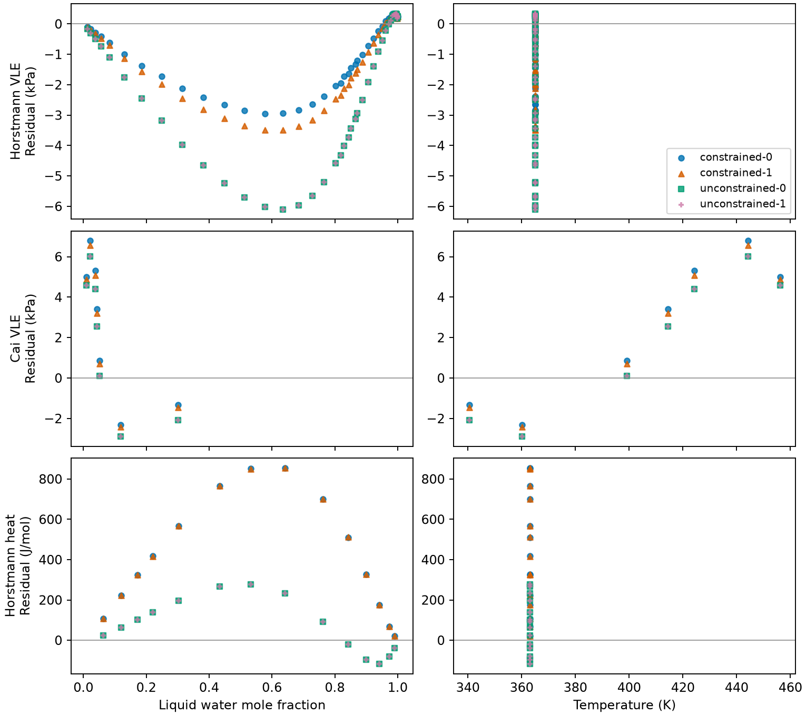

## Temperature-dependent DEA–water interaction (#425)

The two-coefficient DEA–water law recovered exothermic mixing at 363.15 K
and 1.75 MPa, but none of the four candidates met the fixed pressure and
heat limits together. The lowest-cost replay gave a minimum heat of
−1,480.25 J/mol of mixture at a liquid water mole fraction of 0.67.
The measured minimum was −1,707 J/mol at 0.6414. The same candidate gave
9.504843% pressure AARD on the 42 Horstmann mixtures, 4.504843 percentage
points above the 5.0% cap. The reactive refit stopped at the binary
decision. The [downstream record](results/binary-refit-425/downstream.json)
identifies #413 as the historical comparator for #424, #426 and #427.

The fit used $k(T)=a+b(1/T-1/365.15\ \mathrm{K})$, with $b$ in kelvin
and both endpoint values of $k$ bounded at 293.15 and 458.64 K.
The objective used 42 Horstmann Table 4 mixture pressures, seven Cai Table 4
mixture pressures and 14 Horstmann Table 6 heats. It sums half the mean
squared residual for each series. The pressure residual is the natural
logarithm of calculated over observed pressure. The heat residual is the
signed difference divided by 1,707 J/mol of mixture. Four pure-component
bubble points are reported separately. The fits hold the #413 pure
parameters, water diameter correlation, permittivity parameters and
Wolbach–Sandler association fixed.

| Point | $a$ | $b$ (K) | Binary cost | Horstmann AARD (%) | Cai AARD (%) | Heat RMSE (J/mol) | Heat minimum (J/mol) |
|---|---:|---:|---:|---:|---:|---:|---:|
| #413 constant | −0.06363352 | 0 | 0.4978609014 | 0.818291 | 51.490316 | 1,513.525 | — |
| #410 slope probe | −0.06363352 | −46.20553082 | 0.1696763414 | 0.818291 | 71.842875 | 124.600 | — |
| Unconstrained, zero-slope start | −0.08702964 | −32.25411092 | 0.1240703210 | 9.504485 | 48.553330 | 149.813 | −1,480.222 |
| Unconstrained, −46.2 K start | −0.08703060 | −32.25421243 | 0.1240703210 | 9.504843 | 48.552750 | 149.800 | −1,480.251 |
| Constrained, zero-slope start | −0.07552310 | −25.60993175 | 0.1593680407 | 5.000000001 | 53.707246 | 506.675 | −853.496175 |
| Constrained, −46.2 K start | −0.07743288 | −24.68397413 | 0.1566758267 | 5.778141 | 52.045913 | 506.611 | −853.499964 |

The physical bounds on $k(T)$ applied in both searches. The two
unconstrained costs agree to $1.56\times10^{-11}$, within the optimizer's
$10^{-10}$ stopping tolerance. The second point has the lower replayed cost.
Its scaled residual Jacobian has singular values 1.03244 and 0.52488.
The two values changed by less than $3\times10^{-10}$ when the difference
step was halved. The fitted coefficients were interior to the endpoint
bounds. Engine dispersion evaluations at both reference temperatures and
the two extreme Cai mixture temperatures agreed with constant-$k$
calculations set to the expected $k(T)$ at each temperature.

| Fixed requirement | Value at lowest cost | Margin toward passing |
|---|---:|---:|
| All 14 heats below zero | Largest −132.434 J/mol | 132.434 J/mol |
| Interior minimum at $0.50\le x_{\mathrm{w}}\le0.80$ | 0.67, closer adjacent heat 0.481395 J/mol higher | 0.17 and 0.13 to the composition limits |
| Minimum heat in [−3,414, −853.5] J/mol | −1,480.251 J/mol | 1,933.749 and 626.751 J/mol to the depth limits |
| Heat RMSE below 1,040.933 J/mol | 149.800 J/mol | 891.133 J/mol |
| Horstmann AARD at most 5.0% | 9.504843% | **−4.504843 percentage points** |
| Cai AARD below 51.490316% | 48.552750% | 2.937566 percentage points |
| Positive unlike dispersion energy | Minimum multiplier $1-k(T)=1.069025$ | 1.069025 above zero |
| Complete branch and measured-state search evidence | 63 of 63, zero confirmed or unresolved liquid splits | All required states resolved |

The pressure comparison uses $10^{-8}$ percentage points from the normalized
constraint stopping tolerance. Halving the bubble equation tolerance left
the pressure comparisons unchanged at that resolution.
Perturbing the heat calculation pressure by the largest observed
density-root pressure residual changed the heat by at most
$1.24\times10^{-9}$ J/mol over the four candidates. The recorded statistics
include the pure-endpoint denominators, absolute and signed errors and bias.
[Retained reductions and margins](results/binary-refit-425/disposition.json)

Both constrained starts stopped with SLSQP's positive directional derivative
message. At the zero-slope start's endpoint the Horstmann pressure result
ties the cap within numerical resolution, the heat minimum misses by
0.003825 J/mol and Cai misses by 2.216930 percentage points. The other
endpoint misses by 0.778141 percentage points for Horstmann, 0.000036 J/mol
for the minimum heat and 0.555597 percentage points for Cai.
An independent check solved for the two intercepts on the 5% Horstmann
contour, then sampled 17 intercepts between them and nine slopes between
the two heat-depth limits at each intercept. The lowest sampled Cai AARD
was 53.707275%. At that point, the scaled derivatives show that moving
toward the interior of both the Horstmann and the heat constraints increases
Cai AARD to first order. Halving the derivative step preserved the direction
and size of the tradeoff. The diagnosis supports failure for the tested
law, association rule, data and search. The finite sample does not bound
all possible coefficients or other ePC-SAFT parameterizations.
[Constraint diagnosis](results/binary-refit-425/constraint-diagnosis.json)



Horstmann's experimental section (p. 1497) gives 0.03 K and 0.0001 mole
fraction as estimated temperature and composition uncertainties for
the pressure apparatus. It reports a pressure uncertainty of 20 Pa
plus the stated pressure-dependent term. Its calorimeter uncertainty
uses a printed expression with an ambiguous sign for negative heats.
The objective weights are series weights. Cai et al. (Table 4,
p. 1102) give modified-UNIFAC mean absolute differences of 1.08 K
and 0.011 in vapor water mole fraction. The Cai vapor compositions
are retained at the calculated bubble points. These results measure
calibration quality for the stated conditions.

### Numerical controls and phase checks

- The 44-row [cross-wheel reproduction](results/binary-refit-425/controls/cross-wheel.json)
  recovered $k=-0.06363352262762448$, cost 0.0004118709373610573 and
  pressure AARD 1.163912%. The historical and study-wheel predictions
  agree row by row. The independently reduced fixed-point cost differs
  by $2.28\times10^{-14}$ relative. The #413 replay gives
  0.818291% on the 42 Horstmann mixtures, versus 12.665446% at
  the published $k=-0.04$.
- At 363.15 K and 1.75 MPa, the [#413 heat replay](results/binary-refit-425/controls/binary-controls.json)
  gives 152.449866% AARD and +1,313.142874 J/mol mean signed error.
  It predicts +739.312 J/mol at the measured minimum. The nine Cai
  pressures reproduce 40.816649% AARD and +33.587586% bias.
- For the derivative control at $b=-46.2$ K, the production heat at
  the measured minimum is −1,603.080742 J/mol. The [derivative check](results/binary-refit-425/controls/heat-derivative.json) uses 0.10, 0.05 and
  0.025 K centered differences and gives −1,603.081499, −1,603.080931 and
  −1,603.080789 J/mol. The finest result differs by
  $4.78\times10^{-5}$ J/mol, within the observed successive-step change
  of $1.42\times10^{-4}$ J/mol. Dividing that change by three gives a
  nominal second-order estimate of $4.72\times10^{-5}$ J/mol. Finer steps
  and an independent fixed-pressure Gibbs evaluation show numerical
  variation at the scale of the $5.4\times10^{-7}$ J/mol difference
  between the finest-step discrepancy and that nominal estimate.
  The pure limits are zero on all four candidate heat grids.
- The pinned Engine reproduces the [#413 reactive replay](results/binary-refit-425/controls/reactive-checks.json)
  at cost 8.082968228315 with zero relative difference against the
  299 retained CSV predictions. The 80 fitted predictions agree with
  the optimizer within $3.09\times10^{-12}$ relative. The retained
  #413 tally is 335 data and 936 grid searches, with 1,270 available
  and one unavailable, Lawson Table VIII problem 1. Zero descents
  were reported in the available #413 searches.
- The candidate branch checks use the calculated bubble pressure in
  VLE and 1.75 MPa for the calorimetry. The Part II phase searches use
  measured pressure for VLE and 1.75 MPa for calorimetry. Each candidate
  resolved all 63 liquid parents. The unconstrained endpoints showed
  16 vapor descents each and the constrained endpoints 18 each.
  Targeted repeats recovered the same counts, zero liquid witnesses and
  zero unresolved searches. The vapor descents are consistent with
  searching below the calculated bubble pressure. These counts describe
  the specific states and trials retained with each point.

One timed 63-row evaluation, on one core with single-threaded BLAS,
took 0.181 s. The [candidate records](results/binary-refit-425/disposition.json)
contain the row predictions, bounds, objective contributions, stopping
conditions, heat grids, singular values and phase searches. Delivered
scientific review and permission for manuscript use are pending.

## Reference DEA calculation

With the carbamate inputs of the adopted MEA fit F2 (#413), DEA's cost rises
from 8.0340 to 8.0830. Fitted pressure deviation is 28.51% (was 28.46%), and
not-fitted pressure deviation is 53.92% (was 54.19%), with the same
stability result. The #398 text below remains the replayed baseline.

For #398, both starts converged to tied costs. The selected fit differs from #346 by
less than $4\times10^{-11}$ relative in every retained observation prediction.
Each coarse-grid search returned 1,270 available states out of 1,271,
with zero resolved liquid splits found. One Lawson Table VIII stability
trial remained unavailable.

## Refit with the F2 carbamate inputs (#413)

On 2026-11-23 the owner decided that the DEA carbamate inputs come from the
adopted 11-parameter aqueous monoethanolamine model (fit F2). They previously
came from the 16-parameter calibration (F0), so
[#413](https://github.com/tannerpolley/Amine-Thermodynamics/issues/413)
refits DEA with only those inputs changed. The F2 values are in the
[MEA parameter details](../mea_parameter_bundle/results/reduced-refit/parameter-details.csv)
(SHA-256 `a391a1d0…`). The carbamate dispersion energy changes from
183.00063 K to 179.85787 K. The diameter rule is the one #398 used: the MEA
carbamate diameter times the cube root of the neutral DEA/MEA
$m^{\mathrm{seg}}\sigma^3$ ratio, 1.15925. That rule reproduces the #398
inputs from F0 exactly. Applied to the F2 diameter of 5.34799 Å, it gives
6.19966 Å for the segment, Debye–Hückel and Born diameters, against 6.16721 Å.
The packing diameter, $0.88\sigma$, becomes 5.45570 Å. The two
[start files](inputs/part-ii-346/f2-carbamate-413-route.json) differ from #398's
only in these five values and their provenance. Data, roles, weights,
starts, bounds, objective, wheel, shared record and stability grid are unchanged.

The #398 endpoint was replayed first on its own declaration. The 80 fitted
predictions match the native values within $1.17\times10^{-12}$ relative,
and all 299 observation predictions equal the retained #398 table exactly.

| Quantity | #398 (F0 carbamate) | #413 (F2 carbamate) |
| --- | ---: | ---: |
| Selected cost (both starts tie) | 8.03397189313 | 8.08296822832 |
| Start-1 cost difference | $9.1\times10^{-11}$ | $3.9\times10^{-11}$ |
| Iterations, both starts | 7 | 7 |
| Protonated DEA–water $k_{ij}$ (SE) | −0.188256 (0.003486) | −0.188343 (0.003485) |
| Carbamate–water $k_{ij}$ (SE) | −0.038549 (0.05432) | −0.047731 (0.05411) |
| Hydrolysis $a$ (SE) | 5.869411 (0.6151) | 5.883485 (0.6176) |
| Hydrolysis enthalpy increment SE (J/mol) | 1346.3 | 1344.1 |
| Coordinates on a bound | 0 | 0 |
| Fitted pressure AARD / bias (30), % | 28.464 / −0.661 | 28.512 / −0.653 |
| Fitted Carson heat AARD / bias (50), % | 0.947 / −0.115 | 0.943 / −0.119 |
| Not-fitted pressure AARD / bias (67), % | 54.187 / −3.345 | 53.916 / −2.334 |
| Stability states available / total, each endpoint | 1,270 / 1,271 | 1,270 / 1,271 |
| Resolved liquid splits (lower bound) | 0 | 0 |

By not-fitted set (AARD / bias, %): Lawson at 394.26 K 23.119 / −23.119 →
22.949 / −22.949; Seo and Hong 84.947 / +83.089 → 85.358 / +83.586; Lal
47.944 / −31.630 → 47.409 / −30.299. The carbamate–water interaction moves by
0.17 of its conditional standard error. The other fitted values move by
less than 0.03 of theirs. The correlation between the carbamate–water
interaction and hydrolysis $a$ stays 0.974. The largest paired prediction
change is 3.5% (Lawson Table VIII, comparison only). The same
`lawson-1976-viii:1:problem` search is unavailable at both endpoints, for
the same cause as in #398. The binary Cai and Horstmann comparisons use
no reactions and are unchanged. Differences between the two fits are small
compared with the deviations from the measurements. This is a
calibration-and-prediction comparison under the same data use, not a
validation.

Checks: the selected endpoint reloads within $3.08\times10^{-12}$ relative
in predictions and $1.98\times10^{-12}$ in cost. Both starts and the selected
endpoint carry the adopted shared values. All 299 observation marks and 750
curve-point marks match their declared ranges. Timings on 4 cores with the
host shared: one objective evaluation took 4.0 s, and one stability search
at start 0 took 137.9 s (endpoint searches 157.2 s and 113.7 s). Preflight
and campaign took 497.1 s, and endpoint checks and reporting took 130.3 s.
The fixed F2 carbamate inputs carry their own MEA-fit uncertainty, which the
conditional standard errors here exclude.

[Retained results](results/refit-413/) follow the #398 layout. The CSV model
labels are `F2-carbamate` and `F0-carbamate`. The
[manuscript handoff](results/refit-413/manuscript-handoff.md) lists every
manuscript value that changes. Reproduce from the repository root:

```bash
uv run --no-sync python analyses/dea_transfer/f2_carbamate.py prepare  # rewrites the five input files identically
run=analyses/dea_transfer/results/runs/413-reproduce
agent-heavy timeout 3600s uv run --no-sync python -u analyses/dea_transfer/f2_carbamate.py run "$run"
agent-heavy uv run --no-sync python analyses/dea_transfer/present_current.py "$run" "$run-paper" "$run-replay-398" \
  F2-carbamate F0-carbamate 413 inputs/part-ii-346/f2-carbamate-413-parameter-table-declarations.json
```

Independent delivered review and owner confirmation for manuscript use are pending.

## Conditions and data

[#398](https://github.com/tannerpolley/Amine-Thermodynamics/issues/398)
repeats the [#346 DEA transfer](part-ii-346.qmd) with the adopted aqueous
monoethanolamine shared values and ePC-SAFT 1.3.1, Engine commit
`05e94210fa64cf69725e45babc0411d32139df5a`. The wheel SHA-256 is
`c9fbf898b14d004f915f01ed77675867908dd30d77dc28544b2860e9195c80bb`.
[#340](https://github.com/tannerpolley/Amine-Thermodynamics/issues/340)
adopted the shared record `ae17803e1bcb2ca0a1970e05c7cc235d615c4d8a3a349b5afef0b0401dedefed`.
[#396](https://github.com/tannerpolley/Amine-Thermodynamics/issues/396)
retained it. The fixed water, CO₂ and inorganic-ion values and the R1–R3
laws come from that record. The [declaration](inputs/part-ii-346/route-current.json)
binds both starts and the existing chemistry, bounds and objective.
The objective is one-half the sum of squared weighted residuals.

The 299 observations comprise 80 fitted, 67 not fitted and 152 comparison only.
The objective includes 30 Lawson CO₂ partial pressures at 25 wt% DEA and 50
Carson integral heats at 298.15 K. The same-row comparison uses retained #346
predictions on Engine `391dfe5d`. Observations outside the objective were
available during study development. The comparisons assess calibration and
fixed-parameter predictions under the measured conditions. They provide no
independent validation. No agreement limit applies.

All reaction laws use the declared calculation interval of 293.15–458.64 K.
Bower's DEA dissociation measurements span 273.15–323.15 K (1962, p. 71
and Eq. 7, p. 73). The hydrolysis seed is the inverse of Aroua's carbamate
formation law (1997, p. 692 and Table 3 and Eq. 14, p. 695). Its 303–331 K
measurement range refers to the source, and the fitted law's validity remains
unestablished. The R1–R3 marks refer to the 273.15–498.15 K correlation range
in Austgen 1991, Table V, p. 547. The experimental coverage of that correlation
was unverified. Binary Cai and Horstmann comparisons use no reactions.

The bounded [#346 source check](results/retransfer-346/source-check.md) found
no DEA dissociation measurements above Bower's 323.15 K upper limit in the
inspected Zotero library. Hamborg and Versteeg (2009, Table 11, p. 1322 and
reference 32, p. 1328) cite Bower for DEA. All eight PDF hashes in the
[#346 source inventory](results/retransfer-346/source-hashes.json) matched
the corresponding Zotero attachments for #398.

## Fits and selected endpoint

Both starts reached the Engine's relative function-change tolerance of
$10^{-10}$ after seven iterations, with no continuation. Start 0 has the
lower fitted cost. The native costs differ by $9.45\times10^{-11}$, a tie
under the [#337](https://github.com/tannerpolley/Amine-Thermodynamics/issues/337)
start-selection rule.

| Start | Initial cost | Native fitted cost | Replayed cost | Final relative function change | Native fit wall time (s) |
| --- | ---: | ---: | ---: | ---: | ---: |
| 0 (selected) | 15.5750073452 | 8.03397189312992 | 8.03397189313348 | $3.0451\times10^{-12}$ | 11.10 |
| 1 | 14.8039521182 | 8.03397189322442 | 8.03397189322409 | $1.4255\times10^{-11}$ | 13.03 |

| Start | Protonated DEA–water interaction | Carbamate–water interaction | Hydrolysis coefficient $a$ before law completion | Hydrolysis enthalpy increment (J/mol) |
| --- | ---: | ---: | ---: | ---: |
| 0 | -0.188256471177 | -0.038548699161 | 5.778214151955 | 237.4460085 |
| 1 | -0.188256554598 | -0.038546398165 | 6.245297213818 | -978.6801028 |

The two ionic interaction coefficients are dimensionless. The two starts
use different initial reaction laws. The tabulated enthalpy increments
are relative to those laws. Law completion absorbs each increment into
its endpoint reaction coefficients and transports the original bounds.
[Selection and optimizer histories](results/retransfer-398/selection.json)
retain both completed endpoints, original optimizer coordinates, bounds
and full cost histories.

| Selected parameter | Completed-law value | Bounds | Conditional standard error |
| --- | ---: | ---: | ---: |
| Protonated DEA–water interaction | -0.188256471177 | [-1, 1] | 0.003486 |
| Carbamate–water interaction | -0.038548699161 | [-1, 1] | 0.05432 |
| Hydrolysis coefficient $a$ | 5.869410673218 | [4.188573, 10.188573] | 0.6151 |
| Hydrolysis enthalpy increment (J/mol) | 0 | [-18021.37, 21978.63] | 1346.32 |

No fitted coordinate is on a bound. The enthalpy origin is zero in the
completed chart because the fit's increment is included in the law.
The [parameter table](results/retransfer-398/parameter-values.csv) retains
full-precision values, units, bounds and provenance for the fitted and
fixed quantities. The [conditional information](results/retransfer-398/conditional-uncertainty.json)
uses the whitened residual Jacobian and 76 residual degrees of freedom.
These local standard errors are conditional on the fixed shared record,
objective and model. The correlation between the carbamate–water
interaction and hydrolysis coefficient $a$ is 0.974. Shared-input
uncertainty, source systematic errors and model discrepancy are outside this
calculation.

## Finite stability search

Both endpoints used the same declared 335 data states and 936 grid states.
The grid uses 10, 20, 25 and 30 wt% DEA, 313.15–393.15 K at 10 K increments,
and loadings of $10^{-5}$, 0.1 through 1.1 at 0.1 increments, and 1.167
mol CO₂/mol DEA. Liquid pressure is 1.05 or 3.0 times the model's bubble
pressure. The shared route reuses 101 identical data-state calculations
within each endpoint search.

| Start | Data states available / total | Grid states available / total | Liquid splits found, lower bound | Search wall time (s) |
| --- | ---: | ---: | ---: | ---: |
| 0 | 334 / 335 | 936 / 936 | 0 | 107.16 |
| 1 | 334 / 335 | 936 / 936 | 0 | 99.34 |

Both searches have one unavailable state, `lawson-1976-viii:1:problem`
(Table VIII row 2, 298.15 K, 54.5 wt% DEA, loading 0.602 mol/mol).
The Engine's first trial returned `CentralSolveUnavailable` because its
reconstruction destroys support. The pressure observation itself was
calculated. The unavailable phase search contributes no stability evidence.
DEA's earlier registry contains zero resolved split compositions, so there
were zero applicable supplied trials. No liquid split triggered a penalty.
The lower bounds describe numerical search results over the declared trial
families and states. Global stability and physical validation remain
unestablished.

The [#392 qualification](../stability_search/results/repin-05e94210/summary.json)
had 1,270 available out of 1,271 at the old selected endpoint on this same
wheel, with the same unavailable state and cause. The original #398 run
reused the qualified replay. The reproduction command now recomputes that
replay from the checked-in #346 endpoint. Fitting produced numerically
different endpoint parameters and completed laws, so both new endpoints
needed their own searches. The
[#346 selected endpoint after #380](part-ii-346.qmd#finite-stability-searches)
had 334 of 335 data states and all 3,456 finer-grid states available,
with a lower bound of zero splits. The grid-size change accounts for
2,520 fewer states.

## Correctness checks

| Check | Result | Limit and origin |
| --- | --- | --- |
| Retained #346 endpoint replay on the pinned wheel | Pass. Maximum relative prediction difference $1.94\times10^{-12}$ over 80 rows. Relative cost difference $5.42\times10^{-13}$. | $10^{-8}$ relative for replay, specified by #346 following #255. |
| Shared inputs | Pass. Adoption and shared-values hashes match. Both starts and the selected endpoint match the shared components, pair values, R1–R3 coefficients and reference states. | Exact identity to #340, with the declared DEA calculation interval verified on the serialized laws. |
| Selected endpoint reload | Pass. Native cost 8.03397189312992 and reloaded cost 8.03397189313348 differ by $4.43\times10^{-13}$ relative. Maximum relative prediction difference $1.17\times10^{-12}$. | $10^{-8}$ relative, same #346 and #255 replay criterion. |
| Reaction-range marks | Pass. All 299 observation marks and 750 retained curve-point marks match their declared ranges. | Exact identity to the declaration under #337 and #346. |

The first reporting pass compared completed-law temperature bounds directly
against the source bounds in the adoption file. The comparison was corrected
to verify the documented 293.15–458.64 K override explicitly. Its replay and
reporting resumed from the saved selection. [Checks](results/retransfer-398/checks.json)
retain the errors and hashes from the original run. The run on three
cores took 244.66 seconds for preflight, fits and searches, and 43.44 seconds
for endpoint verification, uncertainty and reporting calculations. These are
single-run wall times with the host shared. The run waited for admission
before timing began. [Timings](results/retransfer-398/timings.json) record the
same stages. The 220.90-second #392 qualification and the two #346 native
fit timings provided the pre-run estimates.

## Deviations from measurements

Fitted Lawson pressure deviation is 28.464%, and the 67 not-fitted pressure
observations have 54.187% deviation. Fitted Carson heat deviation is 0.947%.
The largest paired prediction change from #346 across the 299 observations
is $3.63\times10^{-11}$ relative. The maximum difference in mean absolute
relative deviation across the 74 populated dataset/range groups is
$1.86\times10^{-9}$ percentage points. Signed relative bias changes by
at most $1.27\times10^{-9}$ percentage points. Those differences are
negligible compared with the deviations from the measurements.

These are mean absolute relative deviation and mean signed relative error
(predicted minus observed, divided by the observation). Relative statistics
exclude observed zeros. Absolute deviations keep those rows.

| Observations | Role | DEA dissociation range | Count | Deviation / bias (%) on 05e94210 | Deviation / bias (%) on 391dfe5d |
| --- | --- | --- | ---: | ---: | ---: |
| Lawson CO₂ pressure | Fitted | Inside | 7 | 46.908 / +21.829 | 46.908 / +21.829 |
| Lawson CO₂ pressure | Fitted | Outside | 23 | 22.850 / −7.506 | 22.850 / −7.506 |
| Lawson CO₂ pressure at 394.26 K | Not fitted | Outside | 7 | 23.119 / −23.119 | 23.119 / −23.119 |
| Seo and Hong CO₂ pressure | Not fitted | Inside | 5 | 31.126 / +25.181 | 31.126 / +25.181 |
| Seo and Hong CO₂ pressure | Not fitted | Outside | 11 | 109.410 / +109.410 | 109.410 / +109.410 |
| Lal CO₂ pressure | Not fitted | Inside | 17 | 56.298 / −53.383 | 56.298 / −53.383 |
| Lal CO₂ pressure | Not fitted | Outside | 27 | 42.685 / −17.933 | 42.685 / −17.933 |
| Carson integral heat | Fitted | Inside | 50 | 0.947 / −0.115 | 0.947 / −0.115 |

All pressure rows shown in the table have the same classifications for
the hydrolysis source interval. All 50 Carson heats are outside it.
Overall, 183 reactive observations are inside the DEA dissociation range
and 93 outside, including 23 fitted outside. For the hydrolysis source
interval, 60 are inside and 216 outside, including 73 fitted outside.
All 276 reactive observations are within each shared R1–R3 correlation
range. All seven extrapolated Lawson rows at 394.26 K and every other
observation returned a value.

[Range-separated deviations](results/retransfer-398/range-deviations.csv)
include both wheels for every dataset and law, with counts, signed bias
and errors in source units. [Dataset deviations](results/retransfer-398/group-deviations.csv)
give the unstratified comparison. The [observation table](results/retransfer-398/paper-data.csv)
carries every source identity and mark. The
[curve data](results/retransfer-398/curve-data.json) retain 750 available
points with loading, temperatures, units, series identities and marks.


At 363.15 K and 1.75 MPa, Horstmann's 14 water–DEA excess enthalpies are
negative. The model predicts +86.24 to +758.49 J/mol mixture, for a mean
signed error of +1,313.14 J/mol on both wheels. This sign disagreement
remains much larger than the reported calorimeter uncertainty scale of
2 J/mol plus a 1% heat term (Horstmann 2002, p. 1497). The printed formula
leaves the sign of that term ambiguous. The same observations were fitted
by Horstmann's temperature-dependent NRTL correlation (Table 6, Fig. 4b,
and Table 7). They are comparison only here. The paper gives no scalar
deviation for these exact rows.


The [source comparison record](results/retransfer-346/source-check.md)
preserves paper locators, data roles and source uncertainties. Lawson's
9% scatter is against smoothed measurements, Carson reports approximately
1–2% heat uncertainty, and Seo and Hong report 2–3% loading uncertainty.
Lal reports approximately 15% pressure accuracy above 0.05 kPa with
larger errors below it. The available publications give no same-row scalar
model deviation for the fitted Lawson and Carson sets or for the exact
Seo and Hong and Lal sets. Lal's Figure 3 is a graphical comparison with
Kent–Eisenberg constants fitted to earlier data. No agreement threshold
was applied to these comparisons.

## Retained files and review

The [paper summary](results/retransfer-398/paper-summary.json) records the
selected start, bound count, pressure deviations and stability result.
The [run identity](results/retransfer-398/identity.json) binds the declaration
and wheel. [#346 on 391dfe5d](part-ii-346.qmd) and the
[earlier B-2 fit](historical-f0.qmd) remain available as historical results.

From the repository root with the locked environment and pinned wheel, choose
fresh output directories to preserve completed runs. The preflight compares
80 recomputed predictions and their cost with the checked-in #346 replay.

```bash
run=analyses/dea_transfer/results/runs/398-reproduce
out=analyses/dea_transfer/results/runs/398-reproduce-paper
agent-heavy timeout 1800s uv run --no-sync python -u \
  analyses/dea_transfer/rerun.py "$run"
agent-heavy uv run --no-sync python analyses/dea_transfer/present_current.py "$run" "$out"
```

Raw solver rows, per-state stability files and logs are in the ignored run
directory `analyses/dea_transfer/results/runs/398/`. Independent delivered
review and owner confirmation for manuscript use are pending.

## Causes of the pressure shape and the excess-enthalpy sign

[#410](https://github.com/tannerpolley/Amine-Thermodynamics/issues/410) asks
what produces two disagreements of the selected #398 endpoint. One is the wrong
sign of the water–DEA excess enthalpy. The other is the shape of CO₂ partial
pressure against loading. Every probe below uses the selected endpoint on the
pinned 05e94210 wheel. Each parameter change is a disposable perturbation and
no adopted value or result changed. The probes recompute the 97 pressure and
75 Böttinger speciation predictions with a maximum relative difference of 0
from the retained #398 values. The evidence is model sensitivity and
term-by-term decomposition, compared against measurements outside the
objective. It diagnoses causes and does not validate a corrected model.

These probes ran on the #398 endpoint.
[#413](https://github.com/tannerpolley/Amine-Thermodynamics/issues/413) refits
DEA with the carbamate values of the adopted MEA model, so the pressure-shape
numbers below need a rerun on that endpoint. The excess-enthalpy diagnosis does
not depend on the carbamate values. Its binary states contain no ions, and the
water–DEA $k_{ij}$ comes from the [binary stage](binary.py). That value,
−0.06363, is identical in `results/binary.json` and in both #398 starts, and it
is not a coordinate of the loaded fit.


### Excess enthalpy

Each Helmholtz contribution gives an internal-energy part
$U_k = -RT^2(\partial a_k/\partial T)_{\rho,x}$, evaluated by central difference
over ±0.01 K at the state density, plus $RT(Z-1)$. The four parts sum to the
Engine residual enthalpy within $10^{-3}$ relative. Ions are absent, so only
hard-chain, dispersion and association terms exist. At Horstmann's 363.15 K
and 1.75 MPa the selected model gives positive contributions from all three
terms at every composition. The pressure–volume part is at most 0.2 J/mol.

| Water mole fraction | Measured $H^E$ | Model $H^E$ | Hard chain | Dispersion | Association | Model $G^E$ |
| ---: | ---: | ---: | ---: | ---: | ---: | ---: |
| 0.0636 | −232 | +88.6 | +23.8 | +19.0 | +45.8 | −81.3 |
| 0.3032 | −1106 | +405.8 | +102.1 | +108.0 | +195.8 | −319.1 |
| 0.6414 | −1707 | +739.3 | +159.9 | +277.4 | +302.2 | −392.9 |
| 0.7630 | −1504 | +758.5 | +151.2 | +326.9 | +280.5 | −310.6 |
| 0.9415 | −529 | +401.4 | +69.0 | +215.2 | +117.1 | −75.2 |

All values are J/mol of mixture. The model reproduces Horstmann's 365.15 K bubble
pressures (Table 4, the 42 mixture rows; the binary fit also used the two
pure-component rows) with 0.82% mean absolute relative
deviation. Its excess Gibbs energy is therefore close to the measured one at
this temperature. At $x_\text{water}=0.6414$ the model gives
$TS^E = H^E - G^E = +1132$ J/mol, so mixing is driven by entropy. The measured
$H^E$ of −1707 J/mol requires $TS^E$ near −1300 J/mol if $G^E$ is as modeled.
The real mixture mixes by enthalpy against an entropy penalty, which is the
signature of strong water–DEA hydrogen bonds.

| Probe at 363.15 K | $H^E$ at 0.6414 | $G^E$ at 0.6414 | Mean signed $H^E$ error | 365.15 K bubble P, deviation / bias (%) | Cai 6.66 kPa bubble P, deviation / bias (%) |
| --- | ---: | ---: | ---: | ---: | ---: |
| Selected endpoint | 739 | −393 | +1313 | 0.82 / +0.43 | 51.5 / +44.1 |
| Water σ frozen at its 363.15 K value | 759 | −393 | +1324 | 0.81 / +0.42 | 51.5 / +44.2 |
| $k_{ij}$ slope −46.2 K, $k_{ij}$(365.15 K) unchanged | −1603 | −406 | +1 | 0.82 / +0.43 | 71.8 / +61.1 |
| $k_{ij}$ slope −200 K, $k_{ij}$(365.15 K) unchanged | −9406 | −448 | −4371 | 0.82 / +0.43 | 170.7 / +150.9 |
| Cross-association energy ×1.05 | 65 | −752 | +949 | 7.78 / −7.52 | 40.6 / +19.9 |
| Cross-association energy ×1.10 | −716 | −1157 | +546 | 14.65 / −14.42 | 35.6 / −0.9 |
| Cross-association energy ×1.15 | −1598 | −1606 | +110 | 20.48 / −20.27 | 36.5 / −18.2 |
| ×1.15 and $k_{ij}$ +0.02 | −1112 | −1240 | +382 | 15.15 / −14.69 | 36.1 / −4.8 |
| ×1.15 and $k_{ij}$ +0.04 | −627 | −875 | +653 | 10.79 / −8.12 | 40.2 / +11.6 |

Enthalpies are J/mol of mixture. The slope follows
$k_{ij}(T)=k_{ij}+b(1/T-1/313.15\ \text{K})$, the Engine form. The −46.2 K slope is
a linear estimate from the 0 and −200 K points, evaluated once and not fitted.
The explicit cross-association edges reproduce the combining-rule association
energy at 363.15 K exactly. They hold the association volume constant in
temperature, which alone changes $H^E$ by at most 0.28 J/mol.

The water–DEA $k_{ij}$ was fitted only to the 365.15 K isotherm
([binary fit](binary.py)), with no temperature slope. One isotherm fixes $G^E$
but not $H^E=-T^2\,\partial(G^E/T)/\partial T$, so the sign of $H^E$ is an
unconstrained prediction of the combining rules and the pure-component
parameters. Freezing the temperature-dependent water diameter makes $H^E$
slightly more positive, which rules it out as the cause. Raising the
cross-association energy gives the measured sign but moves $G^E$ with $H^E$.
Restoring the isotherm with a constant $k_{ij}$ then returns $H^E$ toward
positive values. Only a temperature-dependent cross interaction separates
$H^E$ from $G^E$. A slope of −46.2 K removes the mean signed $H^E$ error with
the 365.15 K isotherm unchanged. It worsens the Cai 6.66 kPa rows (340–456 K,
water mole fraction 0.01–0.30) from 51.5% to 71.8%. The model already
over-predicts those rows, so a corrected binary must be fitted to the isobaric
VLE and $H^E$ together.

Published DEA models handle the enthalpy the same way. Horstmann et al. (2002)
fitted NRTL parameters linear in temperature to the binary VLE and excess
enthalpies together (p. 1500, Table 7). Their fit agrees with the Maham et al.
298–338 K excess enthalpies except for small deviations (p. 1500 and
Fig. 4b, p. 1499).
Nasrifar and Tafazzol (2010) correlated DEA–water VLE alone with a
temperature-independent $k_{ij}=-0.04$ (Table 3 and Fig. 5) and reported no
excess enthalpy. Austgen et al. (1991) fitted DEA–water NRTL parameters
$\tau=a+b/T$ to binary VLE (p. 548, Table VII).

### CO₂ pressure against loading

At 310.9–313.15 K the measured pressure exceeds the model by a factor of 2.0–3.8
for Lal's loadings of 0.04–0.20. The model is 20–70% high at loadings of
0.37–0.87 in all three data sets, except Seo and Hong's two rows above 0.6,
which are within 20%. It is again low by factors of 1.4 and 2.5 at
Lawson's loadings of 1.01 and 1.17. Böttinger's NMR speciation at 313.15 K
agrees with the model's carbamate amount below a loading of 0.3. That agreement
does not discriminate because nearly all absorbed CO₂ is carbamate by mass
balance. At loadings of 0.40–0.89 the model carbamate is 1.3–2.0 times the
measured value, and the model bicarbonate is less than half the measured value at
0.29–0.40.

| Loading, Böttinger / model | ln of $x_\text{DEA}x_{\text{HCO}_3^-}/x_\text{carbamate}$, Böttinger 2008 | Same quotient, model at 20 wt% DEA |
| --- | ---: | ---: |
| 0.290 / 0.3 | −5.18 | −6.31 |
| 0.401 / 0.4 | −4.94 | −6.22 |
| 0.576 / 0.6 | −4.74 | −6.11 |

Free DEA in both columns comes from the charge balance (protonated DEA equals
bicarbonate plus carbamate). The measured apparent hydrolysis quotient exceeds
the model's by 1.13–1.37 ln units, and the gap grows with loading. Above a
loading of 0.7 the charge-balance free DEA is a small difference of larger
mole fractions (0.0019 and 0.0005), so those rows are omitted.

Linearized single-coordinate sensitivities on the 29 pressure rows at
310.9–313.15 K start from a root-mean-square ln residual of 0.776. The best
constant offset alone leaves 0.636.

| Coordinate | Step alone | ln-residual RMS | Step with offset | RMS with offset | Böttinger carbamate RMS after its own best step |
| --- | ---: | ---: | ---: | ---: | ---: |
| ln K carbamate hydrolysis | +0.90 | 0.401 | +0.82 | 0.393 | 0.0004 at +2.0 |
| ln K DEA dissociation | +0.55 | 0.604 | +0.99 | 0.594 | 0.0020 |
| $k_{ij}$ protonated DEA–water | −0.022 | 0.685 | +0.10 | 0.529 | 0.0019 |
| $k_{ij}$ carbamate–water | −0.089 | 0.446 | −0.078 | 0.427 | 0.0003 at −0.19 |
| $k_{ij}$ DEA–water | +0.025 | 0.521 | +0.035 | 0.507 | 0.0024 |
| Carbamate diameters (fractional change) | −0.117 | 0.438 | −0.102 | 0.415 | 0.0003 at −0.24 |

The Böttinger carbamate mole-fraction RMS is 0.0036 at the endpoint. The
pressures and the independent speciation both ask for less stable carbamate,
through a larger hydrolysis constant, a more negative carbamate–water $k_{ij}$
or a smaller carbamate. These three coordinates have nearly the same loading
profile. Across the seven DEA-specific coordinates the column-normalized
singular values are 2.23, 1.42, 0.158, 0.076, 0.039, 0.010 and 0.004, so these
data determine only two directions.

The fitted objective holds the carbamate constant where it is. Raising ln K
of hydrolysis by 0.5 and 0.9 with everything else fixed raises the fitted cost
from 8.034 to 9.386 and 12.271. Lawson rows account for 11.821 of the latter
and Carson heats for 0.450. In the linearized split at +0.9, every Lawson isotherm
gets worse, including the 310.9 K rows at loadings of 0.41–1.17. The objective has
no pressure below a loading of 0.41 and no speciation, so nothing in it asks for
less stable carbamate. A single hydrolysis constant also cannot satisfy Lal
below a loading of 0.37 and Lawson above 0.41 at the same temperature, although
the two sets agree where they meet. Raising the constant by 0.9 moves Lal's
residuals from +0.7–1.3 to −0.1–0.5 below a loading of 0.2 and to −0.4 to −0.8
near 0.3. The growing gap in the apparent quotient points to the loading
dependence of the carbamate activity term as well as the constant. The model's
activity term in ln K of hydrolysis falls from −0.02 to −0.70 between loadings
of 0.02 and 0.8 at 25 wt% DEA. These probes do not separate the two.

Above a loading of 1, nearly all DEA has reacted, so the molecular CO₂ amount
follows mostly from the mass balance. The reaction constants still move the
pressure there. At Lawson's loadings of 1.013 and 1.167, ln p changes by
−0.30 and −0.19 per unit of ln K of hydrolysis and by +0.32 and +0.21 per unit
of ln K of DEA dissociation. It changes by −11.1 and −8.9 per unit of the
protonated DEA–water $k_{ij}$. The hydrolysis constant and the carbamate–water
$k_{ij}$, adjusted to the 313 K rows, leave residuals of +0.42 and +0.96 at
these two loadings. That joint step (+4.6 in ln K, +0.39 in $k_{ij}$) is far
outside the linear range. The seven-coordinate linear fit brings the two
residuals to −0.05 and +0.05, but only with unphysical steps.

| Loading at 313.15 K, 25 wt% DEA | Model γ of CO₂ (molality, water infinite dilution) | Change in ln p for +0.05 in CO₂–DEA / CO₂–protonated DEA / CO₂–carbamate $k_{ij}$ |
| ---: | ---: | --- |
| 0.0001 | 0.542 | 0.000 / 0.000 / 0.000 |
| 0.5 | 0.359 | 0.001 / 0.004 / 0.002 |
| 1.0 | 0.326 | 0.000 / 0.112 / 0.007 |
| 1.1 | 0.319 | 0.000 / 0.132 / 0.006 |

The model's γ of CO₂ falls from 0.54 to 0.32 between loadings of 0.0001 and
1.1. Lawson's high-loading pressures would need γ near 0.45–0.8 at 313 K. Most
of the low value is present at a loading of 0.0001, so it comes from the amine
solution itself; only the fall from 0.54 to 0.32 is salting in by the ions. This
γ is a candidate cause of the high-loading residuals. CO₂ (or N₂O)
physical-solubility data for aqueous DEA are not among the repository inputs,
so it has not been checked against measurements.

### Causes and correction requirements

The wrong excess-enthalpy sign comes from a parameter: the water–DEA cross
interaction has no calibrated temperature dependence. It was fitted to one VLE
isotherm, which leaves $\partial G^E/\partial T$ free. The data are not
implicated.

At 313 K below a loading of about 0.9, the pressure shape comes from DEA
carbamate that is too stable. The controlling coordinates are the
carbamate-hydrolysis constant and the collinear carbamate–water $k_{ij}$. They
were set by an objective without low-loading pressures or speciation. The
measured quotient's growth with loading also implicates the activity term's
loading dependence. Above a loading of 1, the carbamate coordinates adjusted to
the 313 K rows leave the pressure 1.5–2.6 times too low. The model's CO₂
activity coefficient is a candidate cause, not checked against solubility
data.

Two statements are supported for the paper. First: "The water–DEA interaction
was fitted to vapor–liquid equilibrium at one temperature, which fixes the
excess Gibbs energy but not its temperature dependence, so the excess enthalpy
is an unconstrained prediction and comes out with the wrong sign (+739 against
−1707 J/mol). A temperature-dependent cross interaction fitted to
excess-enthalpy data would be needed; the one slope tested here worsens Cai's
isobaric VLE from 51.5% to 71.8%." Second: "The fitted carbamate parameters (the
hydrolysis constant and the carbamate–water interaction, which these data
cannot separate) leave DEA carbamate too stable at 313 K. CO₂ pressure is
under-predicted two- to four-fold below a loading of 0.2, and the NMR carbamate
fraction is over-predicted above 0.4. Above a loading of 1, these parameters
adjusted to the 313 K data leave the pressure under-predicted; the model's CO₂
activity coefficient is a candidate cause not yet checked against solubility
data."

A correction would be a separate fit, reported on all DEA data. It would first
fit the DEA–water $k_{ij}$ and its reciprocal-temperature slope, or a
temperature law on the cross-association energy, to Horstmann's 365.15 K VLE,
Cai's isobaric VLE and Horstmann's 363.15 K $H^E$. Maham's 298–338 K $H^E$ would
be added if transcribed. Because the DEA–water $k_{ij}$ enters every loaded
calculation (−46.2 K would move it to −0.085 at 313.15 K), the reactive fit
would then be repeated. That fit would add low-loading pressures and Böttinger
speciation to the objective and free the hydrolysis enthalpy with the constant.
It would test one CO₂ interaction coordinate against high-loading pressures,
after physical-solubility data are checked. Data added to the objective stop
being independent comparisons. Temperature trends outside 310–313 K, such as
Seo and Hong's two-fold over-prediction at 333–353 K, were not diagnosed here.

[Excess-enthalpy probes](diagnosis-410/excess-enthalpy.json),
[pressure probes and sensitivities](diagnosis-410/pressure-shape.json),
[objective split and CO₂ activity](diagnosis-410/co2-activity-and-objective.json),
[joint linearized reduction](diagnosis-410/joint-reduction.json) and
[figure values](diagnosis-410/figure-values.csv) retain every number above.
The scripts in `diagnosis-410/` regenerate them from the repository root with
`AGENT_HEAVY_CORES=1 uv run --no-sync python analyses/dea_transfer/diagnosis-410/<script>.py <scratch-dir>`,
followed by `joint.py` and `figure.py`. This diagnosis has not been
independently reviewed or promoted for manuscript use.
