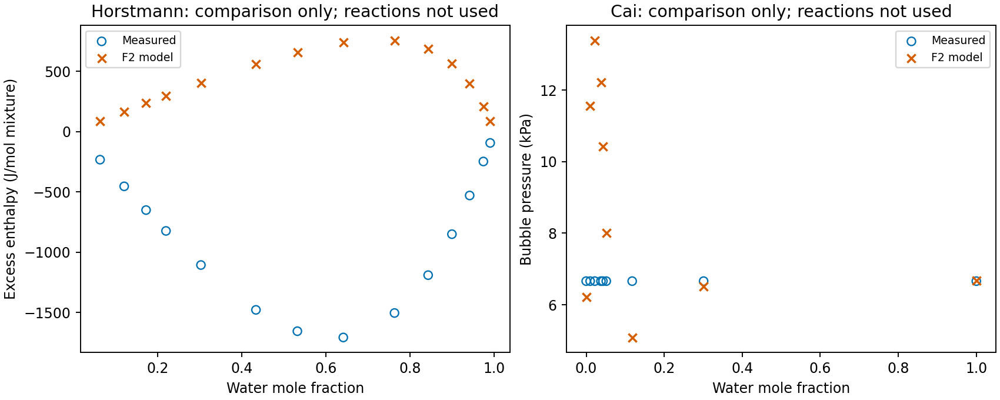

## Result and intended use

This notebook reports issue [#346](https://github.com/tannerpolley/Amine-Thermodynamics/issues/346), within [#337](https://github.com/tannerpolley/Amine-Thermodynamics/issues/337). DEA is re-fitted on F2 with the adopted MEA R1–R3 laws, water–bicarbonate interaction 0.7650000233694618 and water–carbonate interaction −0.25. Each DEA ion's Born diameter equals its segment diameter. The DEA cation–bicarbonate interaction remains the retained zero. No record is adopted.

Start 0 has the lowest fitted cost. The two starts are numerically tied at the optimizer's function-tolerance scale. F2 gives 28.46% mean absolute relative deviation for fitted pressures and 0.947% for fitted integral heats. The previous F0 model gives 28.63% and 0.977%, respectively. The change does not remove the pressure-shape discrepancy or the positive excess-enthalpy predictions against negative Horstmann measurements.

The evidence is calibration and comparisons against previously seen observations, plus numerical replay and finite stability searches. It does not establish independent physical validation or absorber suitability. Conditional standard errors use the corrected shared chart from [#365](https://github.com/tannerpolley/Amine-Thermodynamics/issues/365), merged in main 1cb771e. Independent CSE review supports the fit, comparisons and finite searches at commit 6840ca8fa1ec1d89e54476c1c852c97c51d3badf, and the completed uncertainty increment at commit 7dba15cdb56841e477b895721fd50b7fe9497ec5. A subsequent orchestrator review identified four reporting corrections; this revision supplies the source intervals, published NRTL comparison, current notebook entry point and complete parameter-table provenance. The numerical quantities and reporting corrections are reviewed Supported, including the stability refresh at d5889b1. The owner confirmed manuscript use of notebook commit fe4ee08 for calibration on the F2 shared parameters, comparisons, numerical replay and finite stability searches, subject to the stated limitations. The record is not adopted and all numbers remain provisional until the re-check on the re-pinned Engine wheel.

## Inputs, conditions and numerical method

The immutable input declaration is [`route-current.json`](inputs/part-ii-346/route-current.json); [DEA-current.toml](inputs/part-ii-346/DEA-current.toml) binds the chemistry and both complete starts. The shared calculation implements fitting, replay, stability searches, reductions and curve calculation. The fits and searches used main 781d8c2; endpoint transport and conditional uncertainty use the merged main 1cb771e calculation. The Engine wheel is commit 391dfe5d64ede5036bf160bc6ae037ad5e14af32, SHA-256 `0962e21d2fa7a8ba1ed4622f1110b3e8053bacd878fa41c999d85e8b9afab66b`. The F2 shared-value file SHA-256 is `4c27d47ea7b6e018b0603efb8a29fc2f3fe3c6f8fdc12ccc12cb10bb4b315334`, verified in [checks.json](results/retransfer-346/f2-current/checks.json). Historical F0 calculations remain frozen.

The single calculation interval for every DEA reaction law is 293.15–458.64 K. Extending a calculation interval supplies values without extending measured support. DEA dissociation uses Bower's measured 273.15–323.15 K range (Bower 1962, Eq. 7 p. 73, measurements 0–50 °C). Hydrolysis has a **303–331 K source measurement interval**: Aroua 1997 experimental procedure p. 692, Table 3 and Eq. 14 p. 695. The original seed is the inverse of its formation law. This interval is distinct from the fitted law's calibration and does not establish its validity. For R1–R3: **273.15–498.15 K is the source-correlation range stated by Austgen 1991 Table V p.547 (citing Edwards 1978), not verified measured coverage**. Binary comparisons mark reaction laws **not used**. Source checks and the bounded search for DEA dissociation evidence are retained in [source-check.md](results/retransfer-346/source-check.md); source PDF identities and hashes are retained without private paths.

All 299 observations remain: 80 fitted, 67 not fitted, 152 comparison only. All seven Lawson rows at 394.26 K are included. No out-of-range state is excluded. The objective and residual scales remain those of the declaration. No agreement threshold is used.

## Starts and convergence

| Start | Native fitted cost | Replay cost | Iterations | Continuations | Termination |
| --- | --- | --- | --- | --- | --- |
| start-0 | 8.03397189312412 | 8.03397189312541 | 7 | 0 | Function tolerance reached. abs(cost_change)/cost: 3.741329e-12 <= 1.000000e-10 |
| start-1 | 8.03397189322422 | 8.03397189322451 | 7 | 0 | Function tolerance reached. abs(cost_change)/cost: 1.429271e-11 <= 1.000000e-10 |

**start-0 cost history:** 15.57500734521 → 8.410963110298 → 8.038196149461 → 8.034038137164 → 8.033973531592 → 8.033971934709 → 8.03397189416 → 8.033971893124.

**start-1 cost history:** 14.80395211817 → 8.88798529956 → 8.048071393656 → 8.034278709356 → 8.033979468946 → 8.033972084868 → 8.03397189797 → 8.033971893222.

Start 0 is selected by the lowest cost; both starts are reported as ties at the function-tolerance scale. Neither needs a continuation. No endpoint continuation was attempted on the defective completed-law chart.

## Parameters and uncertainty

The table uses the completed-law endpoint chart consumed by the merged shared uncertainty route. The hydrolysis enthalpy shift is now an increment about the completed law, so its endpoint origin is zero. Its fitted stage-0 increment was 237.44600855562908 J/mol; that increment is already absorbed into the completed law. The coefficient-a origin and bounds carry the completion offset together. No physical parameter or original admissible interval is changed by this chart transport. The original fit coordinates and bounds remain in the retained native fit report.

| Parameter | Completed-chart value | Conditional standard error | Unit | Lower | Upper | On bound | Fitted or fixed | Source |
| --- | --- | --- | --- | --- | --- | --- | --- | --- |
| k-DEAH-water | -0.1882564711769 | 0.00348558731549735 | dimensionless | -1 | 1 | no | fitted | #346 selected fit |
| k-DEACOO-water | -0.0385486991653212 | 0.054321087209096 | dimensionless | -1 | 1 | no | fitted | #346 selected fit |
| hydrolysis-a | 5.8694106732018 | 0.615103977918651 | dimensionless | 4.18857294678198 | 10.188572946782 | no | fitted | #346 selected fit |
| hydrolysis-enthalpy-shift | 0 | 1346.32188185599 | J/mol | -18021.3742120259 | 21978.6257879741 | no | fitted | #346 selected fit |

The retained completed hydrolysis law has a = 5.869410673201805 and b = −2660.2065169272155 K, with all other temperature coefficients zero, in the shared Engine correlation and common-molality reference convention. The ion diameters are 2.9477 Å (DEAH⁺) and 6.167209298821595 Å (DEACOO⁻), fixed and tied to their Born diameters. [parameter-values.csv](results/retransfer-346/f2-report-1/parameter-values.csv) retains the completed-chart values, standard errors, units, bounds and chart basis.

The conditional information calculation uses the whitened residual Jacobian at the selected endpoint, with residual variance estimated using 80 fitted rows minus four free coordinates. No coordinate is active on a bound. These are local, residual-based standard errors conditional on the model, fixed shared parameters, data roles and residual scales. They do not include source systematic uncertainty, uncertainty in the adopted shared record or model discrepancy. The retained conditional correlation between DEACOO–water and hydrolysis a is approximately 0.974. No uncertainty band or absorber-performance claim follows from these parameter errors alone. Full standard errors, correlations and singular values are in [conditional-uncertainty.json](results/retransfer-346/f2-current/conditional-uncertainty.json).

The #365 shared correction transports the completed reaction-coordinate origin and bounds. Recomputing this endpoint through the merged calculation gives exactly the same model parameters, reaction laws, all 80 fitted predictions and replay cost 8.03397189312541 as before transport. The maximum relative replay difference is zero. The calculation's differentiated/replay identity assertion passes, and all four standard errors exactly reproduce the independently reviewed #365 result. [endpoint-identity-365.json](results/retransfer-346/f2-current/endpoint-identity-365.json) retains the before/after rows; [uncertainty-checks-365.json](results/retransfer-346/f2-current/uncertainty-checks-365.json) records the reference comparison. Earlier chart diagnostics remain historical evidence, not the current uncertainty result. No fit or continuation was needed.

### Fixed quantities and completed coefficients

The compact table and its CSV distinguish **fitted** from **fixed in #346**, and give the retained source for each quantity. A source carried by an inherited parameter is its recorded lineage, not a new literature validation. The fixed DEA and ion quantities below are taken directly from the selected parameter record, with no refit. The CSV also includes remaining DEA-specific fixed quantities, association site multiplicities and pair coefficients.

| Quantity | Value | Unit | Fitted or fixed | Source in retained record |
| --- | --- | --- | --- | --- |
| diethanolamine/dispersion_energy_over_k | 269 | kelvin | fixed | Nasrifar & Tafazzol 2010 Table 2 (Zotero CBRPAXQG), DEA 4C |
| diethanolamine/segment_count | 5.2048 | dimensionless | fixed | Nasrifar & Tafazzol 2010 Table 2 (Zotero CBRPAXQG), DEA 4C |
| diethanolamine/segment_diameter | 2.9477 | angstrom | fixed | Nasrifar & Tafazzol 2010 Table 2 (Zotero CBRPAXQG), DEA 4C |
| diethanolamine/dielectric_volume | 0.7574830287 | liter / mole | fixed | issue 317 Hsieh 2007 dielectric fit |
| diethanolamine/dielectric_temperature | 1155.783509 | kelvin | fixed | issue 317 Hsieh 2007 dielectric fit |
| protonated-diethanolamine/born_diameter | 2.9477 | angstrom | fixed | https://github.com/tannerpolley/Amine-Thermodynamics/issues/340#issuecomment-6871176306; Born diameter tied to segment diameter |
| protonated-diethanolamine/segment_count | 5.2048 | dimensionless | fixed | data/reference/epcsaft_datasets/MEA_CO2_H2O_phase2/pure/any_solvent.csv:component=MEAH+:family=segment_count:status=provisional-historical-evaluation |
| protonated-diethanolamine/segment_diameter | 2.9477 | angstrom | fixed | design D2: MEA ion diameter x (m sigma^3 DEA / MEA)^(1/3) |
| carbamate-anion/born_diameter | 6.167209299 | angstrom | fixed | https://github.com/tannerpolley/Amine-Thermodynamics/issues/340#issuecomment-6871176306; Born diameter tied to segment diameter |
| carbamate-anion/dispersion_energy_over_k | 183.0006313 | kelvin | fixed | https://github.com/tannerpolley/Amine-Thermodynamics/issues/170#issuecomment-6158000594 |
| carbamate-anion/segment_count | 1 | dimensionless | fixed | data/reference/epcsaft_datasets/MEA_CO2_H2O_phase2/pure/any_solvent.csv:component=MEACOO-:family=segment_count:status=provisional-historical-evaluation |
| carbamate-anion/segment_diameter | 6.167209299 | angstrom | fixed | design D2: MEA ion diameter x (m sigma^3 DEA / MEA)^(1/3) |
| association/diethanolamine/a/diethanolamine/b/energy_over_k | 1517.6 | kelvin | fixed | Nasrifar & Tafazzol 2010 Table 2 (Zotero CBRPAXQG), DEA 4C |
| association/diethanolamine/a/diethanolamine/b/volume | 0.1014 | dimensionless | fixed | Nasrifar & Tafazzol 2010 Table 2 (Zotero CBRPAXQG), DEA 4C |
| diethanolamine/water/k_ij | -0.06363352263 | dimensionless | fixed | https://github.com/tannerpolley/Amine-Thermodynamics/issues/170#issuecomment-6158000594 |
| bicarbonate-anion/protonated-diethanolamine/k_ij | 0 | dimensionless | fixed | data/reference/epcsaft_datasets/MEA_CO2_H2O_phase2/mixed/binary_interaction/k_ij.csv:row=MEAH+:column=HCO3-:status=explicit-diagnostic |

| Completed-law coefficient | Value | Unit | Fitted or fixed | Source |
| --- | --- | --- | --- | --- |
| DEA-dissociation/a | -9.2798784417846 | dimensionless | fixed | Bower 1962 Eq. 7 p.73; retained law |
| DEA-dissociation/b | -4214.0761079431 | K | fixed | Bower 1962 Eq. 7 p.73; retained law |
| DEA-dissociation/d | 0.0099612133708015 | 1/K | fixed | Bower 1962 Eq. 7 p.73; retained law |
| carbamate-hydrolysis/a | 5.8694106732018 | dimensionless | fitted | issue #346 selected fit; inverse Aroua 1997 Eq.14 used as original seed |
| carbamate-hydrolysis/b | -2660.2065169272 | K | fitted | issue #346 selected fit; inverse Aroua 1997 Eq.14 used as original seed |

The completed-law coefficients above are separate from the four optimizer-chart coordinates. The zero enthalpy chart origin is an increment about the completed law; it is not the completed law's enthalpy coefficient. Aroua's inverse correlation supplied the original hydrolysis seed; the current a and b are fitted, so the 303–331 K source measurement interval does not confer validity on them.

## Comparison with measurements and F0

AARD is mean |(model − measured)/measured| × 100; bias is mean (model − measured)/measured × 100. Negative measured heats reverse the intuitive direction of relative bias, so the CSV also retains signed errors in physical units. Zero observations have undefined relative deviations and remain included in absolute-error counts.

| Data group | Role | Rows (relative) | F2 AARD % | F2 bias % | F0 AARD % | F0 bias % |
| --- | --- | --- | --- | --- | --- | --- |
| Lawson | fitted | 30 (30) | 28.464 | -0.661 | 28.635 | -0.759 |
| Carson | fitted | 50 (50) | 0.947 | -0.115 | 0.977 | -0.138 |
| Lawson-394K | not fitted | 7 (7) | 23.119 | -23.119 | 23.545 | -23.545 |
| SeoHong | not fitted | 16 (16) | 84.947 | +83.089 | 79.536 | +77.796 |
| Lal | not fitted | 44 (44) | 47.944 | -31.630 | 44.173 | -22.930 |
| Weiland | comparison only | 44 (44) | 0.630 | -0.379 | 0.648 | -0.403 |
| Lawson-VIII | comparison only | 10 (10) | 37.787 | -20.769 | 41.742 | -33.024 |
| Bottinger-DEA_plus_DEAH | comparison only | 25 (25) | 7.465 | -7.304 | 7.356 | -7.185 |
| Bottinger-DEACOO | comparison only | 25 (23) | 59.209 | +58.354 | 58.913 | +58.009 |
| Bottinger-HCO3 | comparison only | 25 (19) | 33.081 | -33.081 | 32.407 | -32.407 |
| Cai | comparison only | 9 (9) | 40.817 | +33.588 | 40.817 | +33.588 |
| Horstmann | comparison only | 14 (14) | 152.450 | -152.450 | 152.450 | -152.450 |

All 44 Weiland density rows remain, including the source's suspected misprint at row 22 (1.167 adjacent to 1.062). This differs from the earlier 43-row statistic; the F0/F2 comparison here uses the same 44 rows. Böttinger covers three reported species quantities with 25 rows each; DEACOO has two zero observations and bicarbonate six. Their absolute-error statistics remain available in [group-deviations.csv](results/retransfer-346/f2-report-1/group-deviations.csv).

### Range-separated comparisons

The following counts refer to the DEA dissociation measured range. There are 183 reactive observations inside and 93 outside; the 23 binary observations do not use reaction laws. The 30 fitted pressures contain seven inside and 23 outside rows. All seven 394.26 K rows remain not fitted and outside. R1–R3 place all 276 reactive observations inside their source-correlation range, with measured coverage unverified. The separate hydrolysis source measurement interval, 303–331 K, contains 60 reactive observations; 216 are outside, including 73 fitted rows. This is source measurement coverage, not the fitted law's calibration domain or validity. The calculation interval covers every observation.

| Role | Inside measured DEA range | Outside measured DEA range | Reaction not used |
| --- | --- | --- | --- |
| fitted | 57 | 23 | 0 |
| not fitted | 22 | 45 | 0 |
| comparison only | 104 | 25 | 23 |

| Group | Role | DEA range | Count (relative) | F2 AARD % | F2 bias % | F0 AARD % | F0 bias % |
| --- | --- | --- | --- | --- | --- | --- | --- |
| Bottinger-DEACOO | comparison only | inside | 18 (17) | 53.485 | +52.327 | 53.435 | +52.213 |
| Bottinger-DEACOO | comparison only | outside | 7 (6) | 75.430 | +75.430 | 74.433 | +74.433 |
| Bottinger-DEA_plus_DEAH | comparison only | inside | 18 (18) | 6.476 | -6.253 | 6.395 | -6.158 |
| Bottinger-DEA_plus_DEAH | comparison only | outside | 7 (7) | 10.007 | -10.007 | 9.826 | -9.826 |
| Bottinger-HCO3 | comparison only | inside | 18 (14) | 34.951 | -34.951 | 34.242 | -34.242 |
| Bottinger-HCO3 | comparison only | outside | 7 (5) | 27.845 | -27.845 | 27.269 | -27.269 |
| Carson | fitted | inside | 50 (50) | 0.947 | -0.115 | 0.977 | -0.138 |
| Lal | not fitted | inside | 17 (17) | 56.298 | -53.383 | 52.248 | -48.607 |
| Lal | not fitted | outside | 27 (27) | 42.685 | -17.933 | 39.089 | -6.763 |
| Lawson | fitted | inside | 7 (7) | 46.908 | +21.829 | 47.969 | +24.073 |
| Lawson | fitted | outside | 23 (23) | 22.850 | -7.506 | 22.751 | -8.316 |
| Lawson-394K | not fitted | outside | 7 (7) | 23.119 | -23.119 | 23.545 | -23.545 |
| Lawson-VIII | comparison only | inside | 6 (6) | 31.267 | -2.904 | 31.904 | -17.373 |
| Lawson-VIII | comparison only | outside | 4 (4) | 47.567 | -47.567 | 56.500 | -56.500 |
| SeoHong | not fitted | inside | 5 (5) | 31.126 | +25.181 | 28.515 | +22.946 |
| SeoHong | not fitted | outside | 11 (11) | 109.410 | +109.410 | 102.728 | +102.728 |
| Weiland | comparison only | inside | 44 (44) | 0.630 | -0.379 | 0.648 | -0.403 |

The full [range-deviations.csv](results/retransfer-346/f2-report-1/range-deviations.csv) reports each group and role for each law, including not-used classifications, counts, signed bias and physical-unit errors for F0 and F2. [paper-data.csv](results/retransfer-346/f2-report-1/paper-data.csv) retains every observation and its marks. No range category was omitted from calculation.

### Hydrolysis source measurement interval: 303–331 K

Both F0 and F2 have the same counts: 60 reactive observations inside, 216 outside and 23 binary observations with reactions not used. The 73 fitted observations outside comprise all 50 Carson rows below 303 K and 23 Lawson rows above 331 K. All seven Lawson 394.26 K rows remain not fitted and outside. These marks do not establish calibration coverage or validity of the fitted hydrolysis law.

| Role | Inside | Outside | Reactions not used |
| --- | --- | --- | --- |
| fitted | 7 | 73 | 0 |
| not fitted | 22 | 45 | 0 |
| comparison only | 31 | 98 | 23 |

| Group | Role | Hydrolysis source interval | Count (relative) | F2 AARD % | F2 bias % | F0 AARD % | F0 bias % |
| --- | --- | --- | --- | --- | --- | --- | --- |
| Bottinger-DEACOO | comparison only | inside | 9 (8) | 33.996 | +32.909 | 33.662 | +32.493 |
| Bottinger-DEACOO | comparison only | outside | 16 (15) | 72.657 | +71.925 | 72.380 | +71.618 |
| Bottinger-DEA_plus_DEAH | comparison only | inside | 9 (9) | 3.819 | -3.374 | 3.761 | -3.286 |
| Bottinger-DEA_plus_DEAH | comparison only | outside | 16 (16) | 9.515 | -9.515 | 9.378 | -9.378 |
| Bottinger-HCO3 | comparison only | inside | 9 (6) | 32.574 | -32.574 | 31.800 | -31.800 |
| Bottinger-HCO3 | comparison only | outside | 16 (13) | 33.315 | -33.315 | 32.687 | -32.687 |
| Carson | fitted | outside | 50 (50) | 0.947 | -0.115 | 0.977 | -0.138 |
| Lal | not fitted | inside | 17 (17) | 56.298 | -53.383 | 52.248 | -48.607 |
| Lal | not fitted | outside | 27 (27) | 42.685 | -17.933 | 39.089 | -6.763 |
| Lawson | fitted | inside | 7 (7) | 46.908 | +21.829 | 47.969 | +24.073 |
| Lawson | fitted | outside | 23 (23) | 22.850 | -7.506 | 22.751 | -8.316 |
| Lawson-394K | not fitted | outside | 7 (7) | 23.119 | -23.119 | 23.545 | -23.545 |
| Lawson-VIII | comparison only | inside | 4 (4) | 28.959 | -13.615 | 29.544 | -23.365 |
| Lawson-VIII | comparison only | outside | 6 (6) | 43.673 | -25.539 | 49.874 | -39.463 |
| SeoHong | not fitted | inside | 5 (5) | 31.126 | +25.181 | 28.515 | +22.946 |
| SeoHong | not fitted | outside | 11 (11) | 109.410 | +109.410 | 102.728 | +102.728 |
| Weiland | comparison only | outside | 44 (44) | 0.630 | -0.379 | 0.648 | -0.403 |

### Horstmann residual excess enthalpy

At 363.15 K and 1.75 MPa, all 14 water–DEA observations are negative whereas the residual excess-enthalpy calculation is positive. F0 and F2 give identical values because this binary comparison uses no reaction laws or newly fitted ionic interactions. The mean signed physical error is +1313.14 J/mol mixture; the AARD is 152.45%. This is a sign disagreement, with no agreement threshold.

| Water mole fraction | Measured J/mol mixture | F2 J/mol mixture | F0 J/mol mixture | Role |
| --- | --- | --- | --- | --- |
| 0.0636 | -232.0 | 88.590 | 88.590 | comparison only |
| 0.1209 | -453.0 | 167.144 | 167.144 | comparison only |
| 0.1729 | -650.0 | 237.187 | 237.187 | comparison only |
| 0.2202 | -823.0 | 299.667 | 299.667 | comparison only |
| 0.3032 | -1106.0 | 405.757 | 405.757 | comparison only |
| 0.4339 | -1478.0 | 559.734 | 559.734 | comparison only |
| 0.5323 | -1655.0 | 658.903 | 658.903 | comparison only |
| 0.6414 | -1707.0 | 739.312 | 739.312 | comparison only |
| 0.7630 | -1504.0 | 758.492 | 758.492 | comparison only |
| 0.8429 | -1190.0 | 689.454 | 689.454 | comparison only |
| 0.8994 | -850.0 | 564.603 | 564.603 | comparison only |
| 0.9415 | -529.0 | 401.400 | 401.400 | comparison only |
| 0.9741 | -247.0 | 210.517 | 210.517 | comparison only |
| 0.9903 | -93.0 | 86.240 | 86.240 | comparison only |

### Published comparisons and limits

Lal 1985 pp. 683–684, Fig. 3 and Eqs. 9–13 compare a Kent–Eisenberg treatment with constants fitted to earlier data; the current Lal rows are not fitted here. A scalar deviation for the exact 44-row set is not reported there. Lawson's approximately 9% scatter refers to smoothed experimental curves, not a published thermodynamic-model score. Seo and Hong 1996 Table 1/Results p. 259 do not give a scalar DEA model score for these 16 rows. Carson 2000 Table 6 compares infinite-dilution quantities rather than the same 50 finite-loading rows. These published comparisons are qualitative or use different quantities; no same-row published scalar is fabricated. The source-specific reading and identities are retained in source-check.md and source-hashes.json.

Horstmann's published comparison uses the same 14 water–DEA heats in Table 6 (p. 1498). Its methods (p. 1496) fit binary VLE and excess-enthalpy data simultaneously with temperature-dependent NRTL interaction parameters. Figure 4(b) (p. 1499) compares these heats with NRTL; Table 7 (p. 1500) gives the water–DEA parameters. Its data role is **fitted in Horstmann's NRTL; comparison only here**. No same-row scalar deviation is reported, and none is created from the figure.

The calorimeter's stated uncertainties (p. 1497) are $\sigma(T)=0.03\,\mathrm{K}$, $\sigma(x_i)=0.0001$ and a heat uncertainty written as 2 J/mol plus a 1% excess-enthalpy term. The printed heat expression is $\sigma(H^E)=2\,\mathrm{J/mol}+0.01(H^E/(\mathrm{J/mol}))$, without absolute-value bars. That source ambiguity is retained; negative uncertainties are not computed. These source uncertainties describe measurement uncertainty for the comparison, not agreement thresholds.

## Finite stability searches

The selected start-0 endpoint has **3,790 available and one unavailable search out of 3,791 states**, after re-searching the 63 declarations restricted by [#379](https://github.com/tannerpolley/Amine-Thermodynamics/issues/379), as specified by [#380](https://github.com/tannerpolley/Amine-Thermodynamics/issues/380). There are no native liquid or vapor descents and no supplied-negative states. The remaining unavailable state is `lawson-1976-viii:1:problem`; it remains unresolved and is never counted stable. No native liquid descent triggered a penalty. No fit was rerun.

| Selected start-0 census | Before #379 | Current route |
| --- | ---: | ---: |
| Searched states | 3,791 | 3,791 |
| Available | 3,736 | 3,790 |
| Unavailable | 55 | 1 |
| Native liquid descent | 0 | 0 |
| Native vapor descent | 0 | 0 |
| Unresolved search or descent branch | 55 | 1 |
| Supplied-negative, not stable / branch unknown | 0 | 0 |

Unresolved here counts unavailable searches or resolved-descent witnesses without an identified density branch; it overlaps unavailable and is not an additional partition. Available searches have no descent within the trial set. This is numerical evidence at the fixed fitted endpoint, not physical validation or proof of global stability. No parameter or source uncertainty has been propagated.

The current data-state count is 334 available and one unavailable out of 335. All 3,456 grid states remain available. The grid covers four fitted stocks, 313.15–393.15 K in 10 K steps, 48 loadings from 1e−5 to 1.167, at 1.05 and 3.0 times the model bubble pressure. The earlier 3,819 count included 28 initial/final states for 14 Horstmann excess-enthalpy rows; the merged constructor does not add them.

### Restricted declarations and old/new results

All 63 restricted states are listed below. Inclusive index ranges expand to every integer with the displayed prefix and suffix. Rows combine only states with identical old/new minima and numerical uncertainty. A table makes the named-state availability changes explicit; no continuous relationship is inferred or plotted.

| State key(s) | Count | Availability old → new | Old raw minimum / RT | New minimum / RT | New numerical uncertainty / RT |
| --- | ---: | --- | ---: | ---: | ---: |
| `carson-2000:0:initial`–`carson-2000:9:initial`; `weiland-1998:0:problem` | 11 | unavailable → available | -346.9025920828497 | 0 | 5.783125598844468e-10 |
| `carson-2000:10:initial`–`carson-2000:29:initial`; `weiland-1998:11:problem` | 21 | unavailable → available | -346.688500625055 | -5.684341886080801e-14 | 5.415578937416499e-10 |
| `carson-2000:30:initial`–`carson-2000:49:initial`; `weiland-1998:22:problem` | 21 | unavailable → available | -346.6155290385042 | 2.842170943040401e-14 | 5.035376727565512e-10 |
| `weiland-1998:33:problem` | 1 | unavailable → available | -346.6005941958468 | 2.842170943040401e-14 | 4.655918422749186e-10 |
| `Cai:1:problem` | 1 | available → available | 3.608224830031759e-15 | 3.608224830031759e-15 | 1.288231962162904e-10 |
| `Cai:2:problem` | 1 | available → available | -3.996802888650564e-15 | -3.996802888650564e-15 | 1.305193307839713e-10 |
| `Cai:3:problem` | 1 | available → available | -6.25888230132432e-15 | -6.25888230132432e-15 | 1.629343564342196e-10 |
| `Cai:4:problem` | 1 | available → available | -1.243449787580175e-14 | -1.243449787580175e-14 | 6.255776726459943e-09 |
| `Cai:5:problem` | 1 | available → available | -2.464695114667848e-14 | -2.464695114667848e-14 | 1.544446859022531e-10 |
| `Cai:6:problem` | 1 | available → available | -8.881784197001252e-16 | -8.881784197001252e-16 | 1.635556936396309e-10 |
| `Cai:7:problem` | 1 | available → available | -6.217248937900877e-15 | -6.217248937900877e-15 | 1.917803202112934e-10 |
| `Cai:8:problem` | 1 | available → available | -8.881784197001252e-15 | -8.881784197001252e-15 | 2.774900426550558e-10 |
| `Cai:9:problem` | 1 | available → available | -2.575717417130363e-14 | -2.575717417130363e-14 | 5.961852514017727e-10 |

The old raw negative numbers for the 54 unavailable searches are unqualified optimizer output, with no available minimum or numerical uncertainty; they are not native descent evidence. For all 63 new searches, the Engine returns a qualified value of zero and no descent: the raw minima in the table lie within its numerical uncertainty. All native witness lists are empty, so native descent `density_side` is absent (branch **none**, not a liquid/vapor assignment). Before restriction, the 54 unavailable states had unknown branch; the nine Cai states already had no descent and retain exactly identical raw minima. Any supplied-negative state would be reported not stable with unknown branch; this census contains none. DEA's own split record is empty and contains no supplied trials.

The adapter uses the Engine compiler's certified-absent species only. It removes indices `[0,4,5,6]` for Carson/Weiland: carbon dioxide, carbamate, bicarbonate and carbonate. At zero analytical carbon the remaining reactive species are still searched. Cai binary parents also receive restricted families; each parent's exact certificate, temperature, feed, pressure basis and old/new declaration are retained locally. The original declared data pressures and the grid pressure ratios are unchanged; Cai uses 1.05 times model bubble pressure.

Every one of the 3,728 other declarations was compared with the pre-#379 constructor and found identical, including all loaded states. Their retained start-0 results are carried forward exactly without re-search. Within the 63 changed declarations, removing only the new trial-family list reproduces the old declaration exactly. Endpoint, route, baseline search and wheel hashes are recorded in [summary.json](results/research-380/summary.json). The wheel hash and installed bytes were verified by `Route.verify()`. The calculation uses main ce4f3c6 and pinned Engine 391dfe5d; it makes no Engine source changes.

The sole remaining refusal is `CentralSolveUnavailable`, “failed final trial optimizer or undetermined evidence: 1”, at `lawson-1976-viii:1:problem`. Its declaration is unchanged and it was not re-searched. The original start-1 census remains historical at 3,736 available / 55 unavailable; the refreshed census applies only to the selected start-0 endpoint.

Detailed records are in the main checkout's ignored `analyses/dea_transfer/results/runs/380/`: `restricted-states.json`, `comparison.csv`, `new-results.json`, `combined-search.json`, compressed declarations and the per-search gzip files. [`manifest.json`](results/research-380/manifest.json) gives each file's path, size and SHA-256. Only the aggregate summary and file inventory accompany this notebook in git. The #380 result was independently reviewed Supported at d5889b1; the owner confirmed its limited manuscript use with notebook commit fe4ee08. The record is not adopted and remains provisional until the re-check on the re-pinned Engine wheel. The notebook is rendered in isolation without changing the protected site registry.

## Correctness checks and retained paper values

- Historical F0 replay: fitted cost 7.97069988994228; relative difference 7.59e−13 from the historical value. Current F0 replay gives identical predictions to its frozen declaration.
- F2 shared coefficients and pair values, ion diameter ties, immutable input hashes and all data identities pass the retained checks. Calculation interval overrides are explicit.
- Cold selected-endpoint replay: maximum relative prediction difference 1.50e−12 and relative cost difference 1.61e−13.
- All 299 observations and 750 curve points are available and have matching declared range marks. Both binary groups mark reactions not used.
- Conditional uncertainty: the corrected shared-route identity assertion passes; all four standard errors exactly reproduce the independently reviewed #365 reference; no active bounds.

The original numerical evidence is in [checks.json](results/retransfer-346/f2-current/checks.json). Paper-facing values are [paper-summary.json](results/retransfer-346/f2-report-1/paper-summary.json), [parameter-values.csv](results/retransfer-346/f2-report-1/parameter-values.csv), [paper-data.csv](results/retransfer-346/f2-report-1/paper-data.csv), [curve-data.json](results/retransfer-346/f2-report-1/curve-data.json) and [horstmann.csv](results/retransfer-346/f2-report-1/horstmann.csv). The 130-line presentation script reads retained outputs only. Production additions are 130 gross lines; test additions are zero. No Engine, manuscript or adoption record is changed.

The conditional uncertainty gate is resolved on main 1cb771e. Independent delivered review found the completed uncertainty increment Supported at 7dba15c, with no required corrections; the prior scientific review remains applicable to the unchanged fit, comparisons and finite searches. The four reporting corrections are supplied for renewed owner review of PR #367; it was merged on 2026-11-14 as commit 62bdbc30be7dd94ddef17e1f1e76ae6e26272557. No parameter record is adopted. The notebook is rendered in isolation because changing the analysis-site registry is explicitly prohibited for this task. The canonical [DEA notebook](notebook.qmd) links directly to this current record and labels the earlier F0 record as historical.

## Reporting provenance for correction round 1

The original campaign declarations are retained as `route-campaign.json` and `previous-route-campaign.json`, matching the immutable campaign identities. The current declarations change only reporting source-range metadata and their output directories. `f2-report-1/` and `previous-report-1/` contain refreshed marks and full `deviations.json` reductions from the retained predictions; no fits, stability searches or thermodynamic predictions were rerun. Historical campaign files retain their original range metadata and are superseded for current reporting. [reporting-checks.json](results/retransfer-346/f2-report-1/reporting-checks.json) records unchanged values, new source-range counts, parameter provenance and the existing check results.
