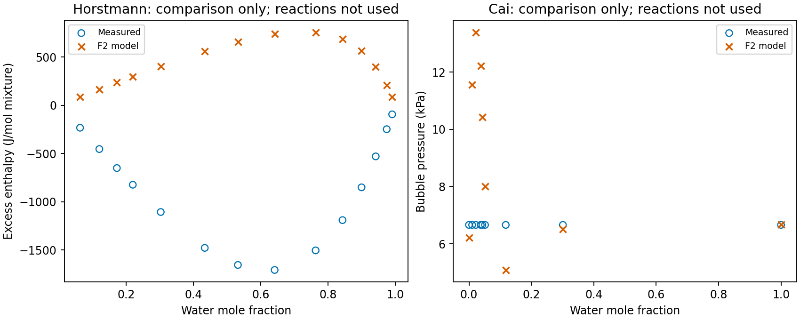

## Result and intended use

This notebook reports issue [#346](https://github.com/tannerpolley/Amine-Thermodynamics/issues/346), within [#337](https://github.com/tannerpolley/Amine-Thermodynamics/issues/337). DEA is re-fitted on F2 with the adopted MEA R1–R3 laws, water–bicarbonate interaction 0.7650000233694618 and water–carbonate interaction −0.25. Each DEA ion's Born diameter equals its segment diameter. The DEA cation–bicarbonate interaction remains the retained zero. No record is adopted.

Start 0 has the lowest fitted cost. The two starts are numerically tied at the optimizer's function-tolerance scale. F2 gives 28.46% mean absolute relative deviation for fitted pressures and 0.947% for fitted integral heats. The previous F0 model gives 28.63% and 0.977%, respectively. The change does not remove the pressure-shape discrepancy or the positive excess-enthalpy predictions against negative Horstmann measurements.

The evidence is calibration and comparisons against previously seen observations, plus numerical replay and finite stability searches. It does not establish independent physical validation or absorber suitability. Conditional standard errors are unavailable pending the shared chart correction [#365](https://github.com/tannerpolley/Amine-Thermodynamics/issues/365). Independent CSE review supports the bounded partial result at commit 6840ca8fa1ec1d89e54476c1c852c97c51d3badf against main 781d8c2. It does not establish full issue completion, parameter adoption or manuscript readiness. The convergence-table delimiter correction changes presentation only. The result has not been promoted for manuscript use.

## Inputs, conditions and numerical method

The immutable input declaration is [route-current.json](inputs/part-ii-346/route-current.json); [DEA-current.toml](inputs/part-ii-346/DEA-current.toml) binds the chemistry and both complete starts. The shared route on main 781d8c2 owns fitting, replay, stability searches, reductions and curve calculation. The Engine wheel is commit 391dfe5d64ede5036bf160bc6ae037ad5e14af32, SHA-256 `0962e21d2fa7a8ba1ed4622f1110b3e8053bacd878fa41c999d85e8b9afab66b`. The F2 shared-value file SHA-256 is `4c27d47ea7b6e018b0603efb8a29fc2f3fe3c6f8fdc12ccc12cb10bb4b315334`, verified in [checks.json](results/retransfer-346/f2-current/checks.json). Historical F0 routes remain frozen.

The single calculation interval for every DEA reaction law is 293.15–458.64 K. Extending a calculation interval supplies values without extending measured support. DEA dissociation uses Bower's measured 273.15–323.15 K range (Bower 1962, Eq. 7 p. 73, measurements 0–50 °C). Hydrolysis has **source range unknown**. For R1–R3: **273.15–498.15 K is the source-correlation range stated by Austgen 1991 Table V p.547 (citing Edwards 1978), not verified measured coverage**. Binary comparisons mark reaction laws **not used**. Source checks and the bounded search for DEA dissociation evidence are retained in [source-check.md](results/retransfer-346/source-check.md); source PDF identities and hashes are retained without private paths.

All 299 observations remain: 80 fitted, 67 not fitted, 152 comparison only. All seven Lawson rows at 394.26 K are included. No out-of-range state is excluded. The objective and residual scales remain those of the declaration. No agreement threshold is used.

## Starts and convergence

| Start | Native fitted cost | Replay cost | Iterations | Continuations | Termination |
| --- | --- | --- | --- | --- | --- |
| start-0 | 8.03397189312412 | 8.03397189312541 | 7 | 0 | Function tolerance reached. abs(cost_change)/cost: 3.741329e-12 <= 1.000000e-10 |
| start-1 | 8.03397189322422 | 8.03397189322451 | 7 | 0 | Function tolerance reached. abs(cost_change)/cost: 1.429271e-11 <= 1.000000e-10 |

**start-0 cost history:** 15.57500734521 → 8.410963110298 → 8.038196149461 → 8.034038137164 → 8.033973531592 → 8.033971934709 → 8.03397189416 → 8.033971893124.

**start-1 cost history:** 14.80395211817 → 8.88798529956 → 8.048071393656 → 8.034278709356 → 8.033979468946 → 8.033972084868 → 8.03397189797 → 8.033971893222.

Start 0 is selected by the lowest cost; both starts are reported as ties at the function-tolerance scale. Neither needs a continuation. No endpoint continuation was attempted on the defective completed-law chart.

## Parameters and uncertainty

The four native stage-0 coordinates and original bounds are below. These are the fit chart before completing the enthalpy shift into the hydrolysis law. In particular, the enthalpy coordinate is an increment relative to this start's transported anchor, rather than a completed-law coefficient. Each value lies strictly inside its declared bounds.

| Parameter | Value | Unit | Lower | Upper | On bound |
| --- | --- | --- | --- | --- | --- |
| k-DEAH-water | -0.188256471177 | dimensionless | -1 | 1 | no |
| k-DEACOO-water | -0.0385486991653 | dimensionless | -1 | 1 | no |
| hydrolysis-a | 5.7782141519 | dimensionless | 4.09737642548 | 10.0973764255 | no |
| hydrolysis-enthalpy-shift | 237.446008556 | J/mol | -17783.9282035 | 22216.0717965 | no |

The retained completed hydrolysis law has a = 5.869410673201805 and b = −2660.2065169272155 K, with all other temperature coefficients zero, in the shared Engine correlation and common-molality reference convention. The ion diameters are 2.9477 Å (DEAH⁺) and 6.167209298821595 Å (DEACOO⁻), fixed and tied to their Born diameters. [parameter-values.csv](results/retransfer-346/f2-current/parameter-values.csv) retains coordinate values, units and bounds. Conditional standard errors are unavailable, rather than zero. The native covariance field is not used for a scientific uncertainty claim.

The shared endpoint chart fails to transport the reaction-a origin and bounds when completing the enthalpy shift. A disposable diagnostic reproduces a 4.738% mismatch between differentiated and replayed pressures; the chart translation removes that mismatch without changing the replayed cost. This diagnosis is retained in [endpoint-chart-probe.json](results/retransfer-346/f2-current/endpoint-chart-probe.json). The probe is not a local production fix. #365 owns the correction; standard errors and any subsequent continuation must use its merged route.

## Comparison with measurements and F0

AARD is mean |(model − measured)/measured| × 100; bias is mean (model − measured)/measured × 100. Negative measured heats reverse the intuitive direction of relative bias, so the CSV also retains signed errors in physical units. Zero observations have undefined relative deviations and remain included in absolute-error counts.

| Data group | Role | Rows (relative) | F2 AARD % | F2 bias % | F0 AARD % | F0 bias % |
| --- | --- | --- | --- | --- | --- | --- |
| Lawson | fitted | 30 (30) | 28.464 | -0.661 | 28.635 | -0.759 |
| Carson | fitted | 50 (50) | 0.947 | -0.115 | 0.977 | -0.138 |
| Lawson-394K | not fitted | 7 (7) | 23.119 | -23.119 | 23.545 | -23.545 |
| SeoHong | not fitted | 16 (16) | 84.947 | +83.089 | 79.536 | +77.796 |
| Lal | not fitted | 44 (44) | 47.944 | -31.630 | 44.173 | -22.930 |
| Weiland | comparison only | 44 (44) | 0.630 | -0.379 | 0.648 | -0.403 |
| Lawson-VIII | comparison only | 10 (10) | 37.787 | -20.769 | 41.742 | -33.024 |
| Bottinger-DEA_plus_DEAH | comparison only | 25 (25) | 7.465 | -7.304 | 7.356 | -7.185 |
| Bottinger-DEACOO | comparison only | 25 (23) | 59.209 | +58.354 | 58.913 | +58.009 |
| Bottinger-HCO3 | comparison only | 25 (19) | 33.081 | -33.081 | 32.407 | -32.407 |
| Cai | comparison only | 9 (9) | 40.817 | +33.588 | 40.817 | +33.588 |
| Horstmann | comparison only | 14 (14) | 152.450 | -152.450 | 152.450 | -152.450 |

All 44 Weiland density rows remain, including the source's suspected misprint at row 22 (1.167 adjacent to 1.062). This differs from the earlier 43-row statistic; the F0/F2 comparison here uses the same 44 rows. Böttinger covers three reported species quantities with 25 rows each; DEACOO has two zero observations and bicarbonate six. Their absolute-error statistics remain available in [group-deviations.csv](results/retransfer-346/f2-current/group-deviations.csv).

### Range-separated comparisons

The following counts refer to the DEA dissociation measured range. There are 183 reactive observations inside and 93 outside; the 23 binary observations do not use reaction laws. The 30 fitted pressures contain seven inside and 23 outside rows. All seven 394.26 K rows remain not fitted and outside. R1–R3 place all 276 reactive observations inside their source-correlation range, with measured coverage unverified. Hydrolysis marks all 276 reactive observations source range unknown. The calculation interval covers every observation.

| Role | Inside measured DEA range | Outside measured DEA range | Reaction not used |
| --- | --- | --- | --- |
| fitted | 57 | 23 | 0 |
| not fitted | 22 | 45 | 0 |
| comparison only | 104 | 25 | 23 |

| Group | Role | DEA range | Count (relative) | F2 AARD % | F2 bias % | F0 AARD % | F0 bias % |
| --- | --- | --- | --- | --- | --- | --- | --- |
| Bottinger-DEACOO | comparison only | inside | 18 (17) | 53.485 | +52.327 | 53.435 | +52.213 |
| Bottinger-DEACOO | comparison only | outside | 7 (6) | 75.430 | +75.430 | 74.433 | +74.433 |
| Bottinger-DEA_plus_DEAH | comparison only | inside | 18 (18) | 6.476 | -6.253 | 6.395 | -6.158 |
| Bottinger-DEA_plus_DEAH | comparison only | outside | 7 (7) | 10.007 | -10.007 | 9.826 | -9.826 |
| Bottinger-HCO3 | comparison only | inside | 18 (14) | 34.951 | -34.951 | 34.242 | -34.242 |
| Bottinger-HCO3 | comparison only | outside | 7 (5) | 27.845 | -27.845 | 27.269 | -27.269 |
| Carson | fitted | inside | 50 (50) | 0.947 | -0.115 | 0.977 | -0.138 |
| Lal | not fitted | inside | 17 (17) | 56.298 | -53.383 | 52.248 | -48.607 |
| Lal | not fitted | outside | 27 (27) | 42.685 | -17.933 | 39.089 | -6.763 |
| Lawson | fitted | inside | 7 (7) | 46.908 | +21.829 | 47.969 | +24.073 |
| Lawson | fitted | outside | 23 (23) | 22.850 | -7.506 | 22.751 | -8.316 |
| Lawson-394K | not fitted | outside | 7 (7) | 23.119 | -23.119 | 23.545 | -23.545 |
| Lawson-VIII | comparison only | inside | 6 (6) | 31.267 | -2.904 | 31.904 | -17.373 |
| Lawson-VIII | comparison only | outside | 4 (4) | 47.567 | -47.567 | 56.500 | -56.500 |
| SeoHong | not fitted | inside | 5 (5) | 31.126 | +25.181 | 28.515 | +22.946 |
| SeoHong | not fitted | outside | 11 (11) | 109.410 | +109.410 | 102.728 | +102.728 |
| Weiland | comparison only | inside | 44 (44) | 0.630 | -0.379 | 0.648 | -0.403 |

The full [range-deviations.csv](results/retransfer-346/f2-current/range-deviations.csv) reports each group and role for each law, including unknown and not-used classifications, counts, signed bias and physical-unit errors for F0 and F2. [paper-data.csv](results/retransfer-346/f2-current/paper-data.csv) retains every observation and its marks. No range category was omitted from calculation.

### Horstmann residual excess enthalpy

At 363.15 K and 1.75 MPa, all 14 water–DEA observations are negative whereas the residual excess-enthalpy calculation is positive. F0 and F2 give identical values because this binary comparison uses no reaction laws or newly fitted ionic interactions. The mean signed physical error is +1313.14 J/mol mixture; the AARD is 152.45%. This is a sign disagreement, with no agreement threshold.

| Water mole fraction | Measured J/mol mixture | F2 J/mol mixture | F0 J/mol mixture | Role |
| --- | --- | --- | --- | --- |
| 0.0636 | -232.0 | 88.590 | 88.590 | comparison only |
| 0.1209 | -453.0 | 167.144 | 167.144 | comparison only |
| 0.1729 | -650.0 | 237.187 | 237.187 | comparison only |
| 0.2202 | -823.0 | 299.667 | 299.667 | comparison only |
| 0.3032 | -1106.0 | 405.757 | 405.757 | comparison only |
| 0.4339 | -1478.0 | 559.734 | 559.734 | comparison only |
| 0.5323 | -1655.0 | 658.903 | 658.903 | comparison only |
| 0.6414 | -1707.0 | 739.312 | 739.312 | comparison only |
| 0.7630 | -1504.0 | 758.492 | 758.492 | comparison only |
| 0.8429 | -1190.0 | 689.454 | 689.454 | comparison only |
| 0.8994 | -850.0 | 564.603 | 564.603 | comparison only |
| 0.9415 | -529.0 | 401.400 | 401.400 | comparison only |
| 0.9741 | -247.0 | 210.517 | 210.517 | comparison only |
| 0.9903 | -93.0 | 86.240 | 86.240 | comparison only |

### Published comparisons and limits

Lal 1985 pp. 683–684, Fig. 3 and Eqs. 9–13 compare a Kent–Eisenberg treatment with constants fitted to earlier data; the current Lal rows are not fitted here. A scalar deviation for the exact 44-row set is not reported there. Lawson's approximately 9% scatter refers to smoothed experimental curves, not a published thermodynamic-model score. Seo and Hong 1996 Table 1/Results p. 259 do not give a scalar DEA model score for these 16 rows. Carson 2000 Table 6 compares infinite-dilution quantities rather than the same 50 finite-loading rows. These published comparisons are qualitative or use different quantities; no same-row published scalar is fabricated. The source-specific reading and identities are retained in source-check.md and source-hashes.json.

## Finite stability searches

Each start has 3,791 searched states: 335 data states and 3,456 grid states. Of these, 3,736 searches are available and 55 unavailable. The entire grid is available; 280 data-state searches are available. Native resolved descent count is **0**, a lower bound. No penalized refit or retreat is triggered because no split is found. DEA has its own [split-record.json](results/retransfer-346/f2-current/split-record.json); no MEA registry is used. There are no earlier DEA native split witnesses and no supplied trials; supplied-trial counts are available 0, unavailable 0, not applicable 0.

The grid covers the four fitted stocks, 313.15–393.15 K in 10 K steps, 48 loadings from 1e−5 to 1.167, at 1.05 and 3.0 times each bubble pressure. The earlier count 3,819 included 28 initial/final states for 14 Horstmann excess-enthalpy rows. The merged reporting-only constructor does not use reactions or add those states; their removal explains the current count, rather than a changed grid.

The 55 unavailable searches are 50 unloaded Carson initial states, four unloaded Weiland states and Lawson Table VIII row 1. The Engine status is CentralSolveUnavailable. For 54 states it reports “failed final trial optimizer or undetermined evidence: 12”; the Lawson state reports the same cause ending in “: 1”. Raw negative trial numbers without resolved-descent evidence are not counted as splits. Exact states and causes are retained in search-0.json and search-1.json. These states are never counted stable. Available finite searches that find no descent do not prove global stability.

## Correctness checks and retained paper values

- Historical F0 replay: fitted cost 7.97069988994228; relative difference 7.59e−13 from the historical value. Current F0 replay gives identical predictions to its frozen declaration.
- F2 shared coefficients and pair values, ion diameter ties, immutable input hashes and all data identities pass the retained checks. Calculation interval overrides are explicit.
- Cold selected-endpoint replay: maximum relative prediction difference 1.50e−12 and relative cost difference 1.61e−13.
- All 299 observations and 750 curve points are available and have matching declared range marks. Both binary groups mark reactions not used.
- Conditional uncertainty check remains unavailable pending #365; no standard-error number is reported.

The numerical evidence is in [checks.json](results/retransfer-346/f2-current/checks.json). Paper-facing values are [paper-summary.json](results/retransfer-346/f2-current/paper-summary.json), [parameter-values.csv](results/retransfer-346/f2-current/parameter-values.csv), [paper-data.csv](results/retransfer-346/f2-current/paper-data.csv), [curve-data.json](results/retransfer-346/f2-current/curve-data.json) and [horstmann.csv](results/retransfer-346/f2-current/horstmann.csv). The 85-line presentation script reads retained outputs only. Production additions are 85 gross lines; test additions are zero. No Engine, manuscript or adoption record is changed.

The next numerical decision is conditional uncertainty on the corrected shared chart after #365 merges. Until then the fit and comparisons are retained results, while issue completion and uncertainty interpretation remain pending. The notebook is rendered in isolation because changing the analysis-site registry is explicitly prohibited for this task.
