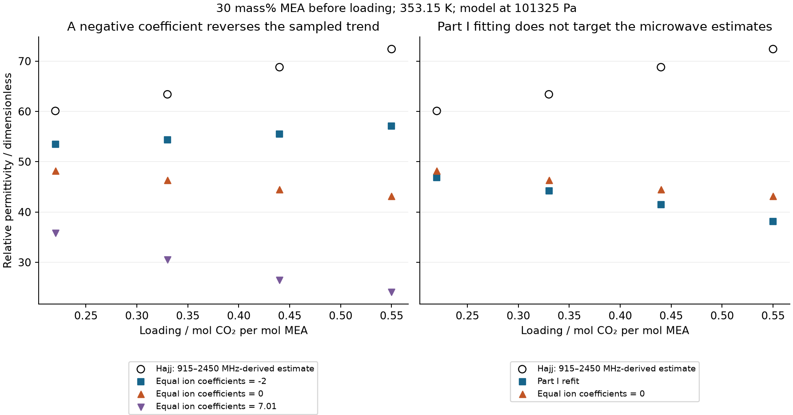

## Result and decision

Negative exploratory coefficients can reverse the sampled loading trend, but
fitting the existing Part I objective does not produce that reversal. The fit
reduces the dimensionless half-sum of squared weighted residuals from
**150.76290288 to 149.60353279** in **62.96 s**,
with a coefficient on its imposed bound and large conditional errors for the
other two ions. These results do not justify adopting ion-specific coefficients
without a separate owner decision. Nothing is adopted here.

This is an exploratory numerical comparison. The Hajj values are estimates
inferred from **915–2450 MHz spectra**, not established static-permittivity
measurements; the extrapolated static-limit uncertainty is unknown.
The observations used for the fit are the same 307 adopted Part I rows.
Hajj's frequency-limited values are comparison-only, with no fit weight.

## Model, basis and source limits

The composed Engine law is

$$\varepsilon(\rho,T,\mathbf x)=
\frac{\varepsilon_{solvent}(\rho,T,\mathbf x)}
{1+\sum_{i\in ions}\alpha_i x_i}.$$

Relative permittivity and the suppression coefficients are dimensionless;
$x_i$ is the true-species mole fraction. The adopted density–temperature
numerator and all chemistry, observation roles, scales and weights are
preserved. MEAH+, carbamate and bicarbonate coefficients are free in the fit;
all other ion coefficients are zero. The prior 11 F2 coordinates retain their
bounds, scales and diameter ties, making 14 independent fitted coordinates.

The chosen range is **−10 to +10** independently per fitted ion. It brackets
Figiel et al. (2025), equation (11), common coefficient +7.01 for alkali halides
at 298.15 K. No transferable published ion-specific coefficients were found
for these MEA ions. The entire negative half is an exploratory sign test.
[Source verification and search limits](sources.md) give exact locators and
explain why no dielectric-decrement estimate was treated as MEA data.

At each comparison state the model solves homogeneous reactive liquid
equilibrium at **353.15 K and 101325 Pa**, from **30 mass% MEA before CO₂
loading**. Analytical CO₂/MEA loading is 0.22–0.55 mol/mol. Molar masses are
0.06108 kg/mol MEA and 0.01801528 kg/mol water, from the adopted declaration.
This is a single-liquid diagnostic, not a global phase-equilibrium claim.

## Loading comparison

| Loading / mol CO₂ mol⁻¹ MEA | Zero | Equal −2 | Equal +7.01 | Part I refit | Hajj, inferred from 915–2450 MHz |
|---|---:|---:|---:|---:|---:|
| 0.22 | 48.1917 | 53.4705 | 35.8071 | 46.8508 | 60.1 |
| 0.33 | 46.3044 | 54.3538 | 30.4989 | 44.2495 | 63.4 |
| 0.44 | 44.5130 | 55.4610 | 26.4269 | 41.4648 | 68.8 |
| 0.55 | 43.1158 | 57.0946 | 24.1171 | 38.1532 | 72.4 |

Values are dimensionless relative permittivities. Equal −2 changes the endpoint
increase to +3.6241, whereas Hajj's 915–2450 MHz-derived estimates increase by
+12.3. Reversal of sign is therefore not quantitative agreement. The fitted
model falls more steeply than the zero-coefficient model over these sampled
loadings. No agreement threshold or uncertainty test is imposed.

The equal-coefficient sweep covers −10, −5, −2, 0, 2, 5, 7.01 and 10;
it is a diagonal through the independently fitted interval, not exhaustive
coverage of three-dimensional coefficient space. At −10 and −5, all four
calculations are refused with `invalid permittivity suppression denominator`.
Those refusals occur during numerical evaluation and do not prove absence
of a physically admissible root. They are retained in `results/trend.json`,
with no invented permittivity. Positivity safeguards were preserved.
The remaining 28 comparison-state solves return values and meet the declared
native equilibrium tolerance. Row residuals, densities and compositions are
retained beside every successful prediction.

## Identity and Part I replay

At the #388 fixed composition (water 0.80, MEA 0.18, MEAH+ 0.01 and carbamate
0.01, other species zero), at **353 K**, zero coefficients give:

| Molar density / mol m⁻³ | Adopted law | Composed law, zero coefficients |
|---:|---:|---:|
| 45000 | 55.15795653250771 | 55.15795653250771 |
| 40000 | 49.14040580667352 | 49.14040580667352 |

All **307/307** Part I predictions are available. The largest relative
prediction difference from the adopted F2 replay is **2.023e-12**;
the largest absolute scaled-residual difference is
**1.534e-11**. The cost is
**150.76290287955263**, against **150.76290287953717**.
These satisfy the inherited **1e-10 relative** identity tolerance from #340;
observation values need not be bitwise identical across Engine builds.
The two fixed-composition permittivities are bitwise identical.
This is numerical verification, not physical validation.

## Part I fit and information

The sole fit starts at the adopted F2 document with all ion coefficients zero.
It converges after **18 iterations** by the existing function-tolerance
rule (1e-6 relative cost change), with native final cost
**149.603532793257**. The independent rebuilt-parameter replay is
**149.603532793259**. Its largest relative prediction difference from
the native fit is **4.433e-13**.
No additional starts or bound expansions were run.

| Objective group | Adopted F2 cost | Probe refit cost | Change |
|---|---:|---:|---:|
| common149 | 23.835763 | 23.255091 | -0.580672 |
| restored species | 2.40556435 | 2.10511866 | -0.300446 |
| Jakobsen | 12.7457498 | 12.7745516 | +0.0288018 |
| Kiepe | 0.000679019499 | 0.000679019499 | +0 |
| CO2-free density | 13.1167659 | 12.775323 | -0.341443 |
| Cai | 91.6312886 | 91.6651336 | +0.033845 |
| loaded density | 0.378742865 | 0.425071021 | +0.0463282 |
| Cp | 6.64834931 | 6.60256478 | -0.0457845 |

The common149 group contains the historical pressure, heat and selected
species observations. Other group names retain the Part I input identities.
Costs are dimensionless and group weighted; they are not raw measurement errors.

| Independent parameter identity | Start | Fitted | Conditional standard error |
|---|---:|---:|---:|
| pair/carbamate-anion/water/k_ij | -0.066121247 | -0.0023227942 | 0.28353 |
| pair/protonated-monoethanolamine/water/k_ij | -0.35772543 | -0.5 | bound; withheld |
| pair/bicarbonate-anion/water/k_ij | 0.76500002 | 0.64440568 | 1.3923 |
| pair/carbamate-anion/protonated-monoethanolamine/k_ij | -1 | -1 | bound; withheld |
| pair/protonated-monoethanolamine/water/k_ij/reciprocal_temperature_slope | 96.174693 | 105.83048 | 64.089 |
| component/protonated-monoethanolamine/segment_diameter | 4.8558298 | 5.020675 | 1.0365 |
| component/carbamate-anion/segment_diameter | 5.3479914 | 5.1821736 | 0.98354 |
| pair/monoethanolamine/water/k_ij | -0.088928359 | -0.089187072 | 0.0016327 |
| pair/monoethanolamine/water/k_ij/reciprocal_temperature_slope | -6.3627379 | -6.7406861 | 2.26 |
| component/protonated-monoethanolamine/dispersion_energy_over_k | 208.73557 | 141.50649 | 97.818 |
| component/carbamate-anion/dispersion_energy_over_k | 179.85787 | 232.0739 | 111.07 |
| probe/protonated-monoethanolamine/suppression | 0 | 10 | bound; withheld |
| probe/carbamate-anion/suppression | 0 | -9.0490137 | 7.5468 |
| probe/bicarbonate-anion/suppression | 0 | -4.4860793 | 6.7081 |

Parameter units follow the quantity: interaction coefficients and suppression
coefficients are dimensionless, reciprocal-temperature slopes and dispersion
energies divided by Boltzmann's constant are in K, segment diameters are in Å.
The MEAH+–water and carbamate–MEAH+ interactions, plus the MEAH+ suppression
coefficient, are active at their bounds. The Engine reports rank 14, but
withholds full covariance at active bounds. The displayed errors hold all
three bound coordinates fixed, use the weighted exact residual derivatives
and residual variance $2C/(307-11)$, and reuse the existing Part I conditional
information calculation. They are local, linearized, conditional estimates;
no symmetric standard error is claimed for a bound coefficient.
The carbamate and bicarbonate errors are large relative to their fitted
magnitudes. Separate ion coefficients are weakly determined in this one fit;
full numerical rank does not establish physical identifiability or prediction
uncertainty. Changes in the other 11 coordinates also contribute to the small
cost improvement, so it cannot be attributed solely to permittivity.

## Runtime evidence

Before fitting, one complete exact-derivative evaluation of all 307 rows and
14 coordinates took **7.8590 s**. All 307 derivative rows were available.
The ordinary prediction evaluations took **4.9966 s**, excluding 0.3449 s
of construction. The existing 180-iteration allowance, one exact derivative
and two residual evaluations per iteration, with no parallel speedup credit,
gave a conservative estimate of **53.56 min**.
The native fit used three workers and finished in **62.96 s**.
Admission wait and compilation are excluded from these calculation timings.

These are one-run workload estimates on a shared busy machine, not a measured
speedup or a reproducible benchmark distribution. Common149 takes 5.24 s of
the 7.86 s exact-derivative workload. A separate Python profile places 0.886 s
of its 0.887 s ten-row sample in Engine `regression.differentiate`; Python
observation construction is about 0.001 s. This identifies the native exact
prediction/derivative calculation as the costly operation at that resolution;
it does not distinguish native subroutines. No long-runtime defect was found
and no Engine source change was made.

## Stability searches

The same Part I producers are called on the refitted mapping for the
1908-state enforced grid, 576-state offset grid and 162-state census.
The initial zero-coefficient checks return the Engine diagnostic
`charged trial outside the condensed domain of permittivity without a unit vacuum limit`.
A charged liquid trial can cross into the low-density domain even though its
label is “liquid.” It must not be counted as a completed stable state.
The full retained results determine the remaining comparison; no stability
change is asserted from a diagnostic label.

## Provenance and use

[Build identity](results/build.json) records Engine merged `main` commit
`245c0c9d0c0caa4b823b940f38eef8d5cc5fa9e2`, containing PR #59, and wheel SHA-256
`df8c0bcdfb48e0c166e3acd44adfd1d6cbb9f0527ee9ad3e24526244358ea8ab`.
The installed package files were checked against that wheel before numerical
work. The latest published development release checked did not contain PR #59,
so a local release-mode Linux wheel was built from the synced read-only clone.
The adopted F2 document SHA-256 is
`ae17803e1bcb2ca0a1970e05c7cc235d615c4d8a3a349b5afef0b0401dedefed`.
[Reproduction commands](README.md) use a probe-local environment and preserve
the repository pin, lock and all manifests.

The notebook is rendered standalone because the owner prohibited changes to
`analyses/_cse-manuscript.json`; it is not registered in the site. This notebook
has not yet received independent delivered review and is not promoted for
manuscript use. The owner decides whether the bounded result merits further
model investigation or a future change to Part I.
