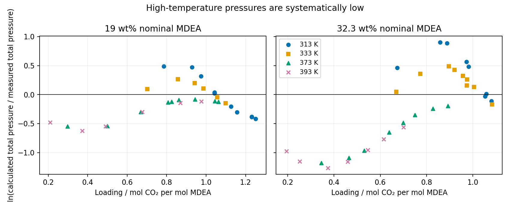

## Result

None of the tested alternatives explains the five complete-isotherm deviations.
The high-temperature discrepancy is a systematic pressure deficit, strongest at
low loading and higher MDEA concentration. It is present before averaging and
is also visible against the published Figure 4 trace. This is **numerical
diagnosis, not physical validation**. The primary comparison, fixed parameters,
and declared interpretation remain unchanged. Independent delivery review is
still required; these results are not promoted for manuscript use.



All entries are ARD in percent using Eq. 28. Each column changes one declared
input or scored observable from the primary calculation. The #126 column changes
only the pair of pure-solvent temperature correlations; it retains mole weighting
and its unnormalized denominator. The partial-pressure column compares calculated
$y_{CO_2}P$ against measured **total** pressure, solely as the declared label
diagnostic. It is not an experimental partial-pressure comparison.

## A. Signed pressure errors and the published curve



The row comparison is [signed-pressure-deviations.csv](signed-pressure-deviations.csv).
At 19 wt% and 373/393 K all 9/6 signed logarithmic errors are negative,
respectively −0.548 to −0.079 and −0.623 to −0.116. At 32.3 wt% the corresponding
8/7 errors are −1.179 to −0.194 and −1.265 to −0.562. At 333 K and 32.3 wt%,
eight rows overpredict pressure and the highest-loading row underpredicts it.
The change of sign with loading at low temperature is distinct from scatter
around a constant offset. These are observations about the retained numbers,
not an identified molecular cause.

Bülow's main paper, printed p. 6332, Figure 4 plots the 19 wt% Kuranov isotherms;
no 32.3 wt% CO₂ figure was found in the main paper or SI. The text immediately
below Figure 4 describes low-loading underprediction at high temperature and
high-loading underprediction at low temperature. The primary calculation shares
that qualitative pattern, but its deficit is larger.

The embedded Figure 4 raster (PDF p. 6, image 281, 500 × 364 pixels) was extracted
without resampling. [Calibration](figure4-calibration.json) uses loading 0/1.5
at pixels 108/482 and pressure 1/10 bar at y = 281/133, with a log-pressure axis.
`digitize.py` retains the largest connected orange trace to remove detached
triangles, then the CSE XY helper maps its pixel columns to values.
The [digitized trace](figure4-373.csv), [QA overlay](figure4-overlay.png),
and [row comparison](figure4-comparison.json) are retained. Visual inspection
classified extraction **review**: markers attached to the line remain; allow
about four pixels, roughly 7% in pressure and 0.016 in loading. There is no
independent second extraction. This bounds a visual comparison; it cannot
reconstruct Table S3 to its printed precision.

At loading 0.499 (source row 20), the digitized orange trace is about 4.50 bar,
our total pressure is 2.726 bar, our CO₂ partial pressure is 1.753 bar, and measured
total pressure is 4.686 bar. Our total pressure is about 39% below the plotted
trace. At loading 0.668 (row 21), the corresponding values are 8.46, 6.394,
5.403 and 8.596 bar. The disagreement therefore predates the ARD aggregation.
The figure caption calls its vertical axis partial pressure whereas the prose
calls these system pressures; this conflict is not resolved by digitization.

## B. Data selection and averaging

Kuranov 1996 Table 2 (printed p. 1960) gives total pressures and actual
molalities, not exactly 19 and 32.3 wt%. Its positive-loading row counts in
313/333/373/393 K order are 11/7/9/6 at the lower MDEA concentration and
10/9/8/7 at the higher concentration. These match the frozen inventory. Two
additional rows at 393 K have zero loading; 413 K remains excluded.
Bülow SI Table S3 (PDF p. 2) supplies eight deviations but **no counts or row
identities**. Figure 4 shows the lower-concentration series only and cannot
recover near-coincident row identities. Exact author selection remains unknown.

Two direct bounds use the primary row errors without changing any calculation:

- At 32.3 wt%, 393 K, individual absolute errors range from 42.997 to 71.784%.
  Any nonempty subset of these rows therefore has ARD at least 42.997%, above
  the upper reproduction limit 20.77%. Dropping rows alone cannot explain this
  isotherm under the frozen predictions.
- Even if an added zero-loading row had zero pressure error, the 393 K ARDs
  could not fall below $6(29.4545)/7=25.2467$% at 19 wt% or
  $7(61.3199)/8=53.6549$% at 32.3 wt%. Both exceed their intervals.

No zero-loading solve or numerical value was invented. These bounds do not
exclude an author dataset with different pressures/compositions or a different
scored observable. They also do not identify which rows the authors used.

## C. Reactions and standard states

Read directly: Bülow printed pp. 6328–6329, Eqs. 1–14; SI Table S1, PDF p. 1;
Austgen 1991 Table V, p. 547; Kamps–Maurer 1996 Eq. 12, p. 1509 and its
experimental temperature range. Bülow uses $a_i=x_i\gamma_i$, pure liquid water
for water, and infinite dilution in pure water for every solute, explicitly
including MDEA and CO₂. Its Eqs. 12–13 use the same T and p in numerator and
denominator. The frozen problem uses those references at system pressure;
there is no additional molality conversion in the equilibrium equations.
The retained repeat checks verify the arithmetic conversion for pK comparisons.

The SI S1 row assignments conflict with the main-paper reaction numbering.
The frozen corrected mapping agrees with Austgen's water/carbon/H₂S triples
and with the Kamps–Maurer MDEA correlation after scale transfer. SI S1 describes
a 273–498 K range for the included rows, but Kamps–Maurer's underlying MDEA
measurements end at 368 K. Thus 373/393 K are extrapolations of that source law,
even though the SI states a wider range. This is a source-domain limitation,
not numerical evidence that a different constant explains the gap.

Austgen uses hydronium-form reactions; Bülow prints H⁺. The water-activity
factor implied by changing that convention remains an acknowledged uncertainty.
No hydronium substitution, reference-pressure change, altered reaction law,
or coefficient adjustment was made. Those would change the declared model
and require an owner decision. No new basis/transcription defect was found.

## D. Permittivity

Bülow p. 6329 Eq. 19 sums solvent pure-component permittivities times solvent
mole fractions. Its surrounding text excludes ions from the sum and does not
provide a denominator or a pure-solvent temperature correlation. CO₂ is a sour
gas rather than a designated solvent; the declared solvent list is water/MDEA.
With the frozen free-species reading, CO₂ and ions contribute zero to the
numerator but remain in the mole-fraction denominator. That distinction is
an interpretation, not a recovered author implementation.

The Hsieh laws were checked against Hsieh 2007 Eq. 3 and Table 3, p. 621:
MDEA coefficients 44.1399, −0.046824, −8.82158 × 10⁻⁵; water 249.21,
−0.79069, 7.2997 × 10⁻⁴, with T in kelvin. The MDEA range is 303.15–328.15 K
and water 273.15–373.15 K. High-temperature use extrapolates these data.
Bülow cites Vahidi–Moshtari for 298 K values; its actual high-temperature inputs
are not recovered here. The Vahidi–Moshtari PDF remains unread.

The two predeclared dielectric alternatives were evaluated on the 63 already
qualified rows, each with the primary start, work limits and qualification
checks. All 126 returned states qualify. Solvent normalization worsens every
complete-isotherm comparison; replacing the two temperature laws changes ARD
by at most 0.147 percentage point. Neither explains the gap. This does not
test an arbitrary dielectric law or an initial-solvent composition convention.

## E. Pressure observable and vapor treatment

Bülow p. 6329 Eq. 16 uses fugacity equality for volatile neutral components;
charged species remain liquid-only. The frozen calculation includes water,
MDEA and CO₂ in the vapor and uses the EOS for both phases. That matches the
printed criterion. Figure 4's partial-pressure caption and the adjacent
system-pressure prose conflict; Eq. 28 and SI S3 do not settle which observable
was scored. Calculated $y_{CO_2}P$ against the same measured total pressure
worsens all four high-temperature ARDs (table above). It also lowers the
32.3 wt%, 333 K ARD from 30.899 to 29.139%, farther from 42.86%.

This probe rejects only that one observable substitution. No experimental
partial pressures are available in the adopted Kuranov table, and no ideal-vapor,
CO₂-only-vapor or author-specific vapor treatment was inferred or substituted.

## F. Published parameter transcription

Tables 1–3 were checked against rendered Zotero PDF pp. 4–5 (printed
6330–6331), alongside the admitted document and preparation generator. The
three neutral segment numbers, diameters/temperature law, dispersion energies,
site counts, association energies/volumes, all five included ion segment
numbers/diameters/energies/charges, the five nonzero MDEA-system interaction
laws, reference temperature 298.15 K, and omitted-pair zero values agree at
printed precision. Table 3 states 293–413 K. No numerical transcription defect
was found. The printed volumes, water-only CO₂ cross association, nonassociating
MDEAH⁺, and inferred packing rule remain the frozen choices, not proven author
code. This inspection does not establish the authors' association-strength
convention or their differentiation of composition-dependent permittivity.

## Reproduction, scope and remaining unknowns

`probe.py` imports the existing primary row solver without changing its file.
`solvent-normalized-document.json` changes only normalization;
`126-temperature-laws-document.json` changes only the pure-solvent laws.
Full probe rows and row-by-row pressure comparisons are retained under their
respective filenames. `compare.py` reads retained values; `present.py` only
plots them. `execution.json` records the interpreter, wheel identity and primary
row-file hash. Six source PDF hashes matched `../sources.json`; the current
Bülow reading-copy hash matched its Zotero Markdown and shelf index
(8f5a86ba…21cfe79). PDFs, not transcribed equations alone, were used for exact
parameter checks. The ignored literature shelf was read from the main checkout
without writing there because it is absent in this worktree.

The same separate `.venv-bulow` from the primary worktree was used, with Engine
main-d513820994a78bfe628d42fffd55b2eeab6f89bd, wheel SHA-256
ca7093ca721fdc80226c74d018a582f31705684c6995e80b0492c193334dd5d5.
The archived wheel was decompressed only to satisfy provenance verification;
the temporary decompressed file is removed after execution. Commands use
`nice -n 10 agent-heavy`, at most 16 processes, and one BLAS/OpenMP thread per
process. Replay from this worktree:

```bash
OPENBLAS_NUM_THREADS=1 OMP_NUM_THREADS=1 MKL_NUM_THREADS=1 nice -n 10 agent-heavy /home/tnnrpolley21/Workspaces/Engineering/Amine-Thermodynamics/.worktrees/issue-223-reproduce-b-low-et-al-2021-epc-saft/.venv-bulow/bin/python analyses/mdea_bulow_reproduction/diagnosis-gap/probe.py
python analyses/mdea_bulow_reproduction/diagnosis-gap/compare.py
```

Restore the wheel archive to its recorded `.whl` path first, as in the primary
README, and remove the temporary wheel afterward. Root pins, Engine source,
primary results, manuscript and main checkout were not changed. Rows 11, 18,
50 and 51 were never resubmitted; Engine #912 retains their numerical diagnosis.

The root cause remains unidentified. The evidence narrows the question to a
difference in model implementation or unrecovered author inputs/conventions,
rather than the tested dielectric laws, normalization, pressure-label change,
or row omission alone. This is an inference from the exclusions, not proof of
an error in either implementation. Source-author code, exact dielectric inputs,
exact Table S3 rows/observable, and the treatment of the acknowledged association,
proton and ion conventions remain unknown. No new interpretation was adopted.
