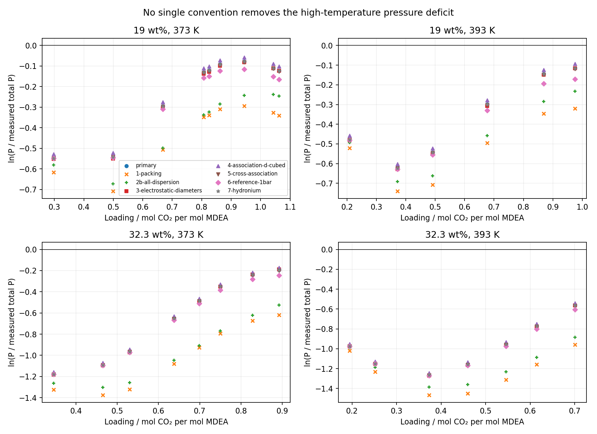
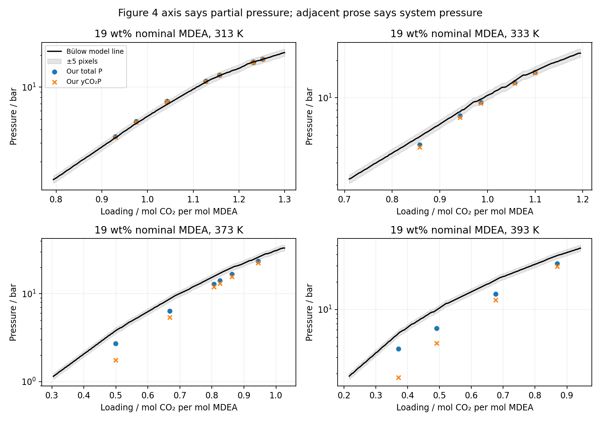
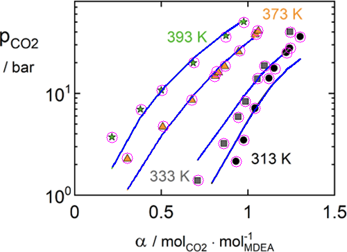

## No single convention explains the discrepancy

Seven expressible one-factor probes retain 63 qualified states out of the 67-row
primary inventory. Rows 11, 18, 50 and 51 were not retried, by owner instruction.
None brings the five complete isotherms into their frozen SI S3 ±3 percentage-point
windows. Evidence type: **numerical diagnosis**. The primary reproduction remains
inconclusive. No parameter, primary method, interpretation or manuscript was changed.
Independent delivered scientific review remains open; manuscript use is not promoted.

At high temperature and loading below 0.5, replacing σ³ by d³ in association
strength raises pressure by only about 2%. Other probes either lower it or have
negligible effect. This is too small to explain the deficit. All temperatures
below refer to nominal isotherm labels; calculations retain each source row's
actual temperature and molalities on 1 kg initial water.

## Isotherm comparisons

The entries below are ARDs of total pressure against measured total pressure,
following Bülow Eq.28. An asterisk means a qualified-subset statistic, **not** the
full-isotherm ARD and not eligible for the reproduction window. Failed or skipped
rows are never removed from the qualification denominator. Complete isotherms are
19 wt% at 373/393 K and 32.3 wt% at 333/373/393 K.

| Convention | 19/313* | 19/333* | 19/373 | 19/393 | 32.3/313* | 32.3/333 | 32.3/373 | 32.3/393 | Qualified |
| --- | --- | --- | --- | --- | --- | --- | --- | --- | --- |
| primary | 30.94 | 15.22 | 19.12 | 29.45 | 62.52 | 30.90 | 44.05 | 61.32 | 63/67 |
| 1-packing | 31.58 | 14.07 | 33.75 | 39.88 | 30.10 | 20.01 | 62.23 | 70.22 | 63/67 |
| 2b-all-dispersion | 21.60 | 13.76 | 30.89 | 36.58 | 19.75 | 18.91 | 60.19 | 68.23 | 63/67 |
| 3-electrostatic-diameters | 30.52 | 14.71 | 19.46 | 29.76 | 62.59 | 31.16 | 44.11 | 61.45 | 63/67 |
| 4-association-d-cubed | 31.49 | 16.15 | 17.40 | 27.92 | 64.59 | 33.04 | 42.87 | 60.49 | 63/67 |
| 5-cross-association | 30.92 | 15.17 | 19.27 | 29.62 | 62.18 | 30.48 | 44.30 | 61.45 | 63/67 |
| 6-reference-1bar | 30.81 | 14.92 | 21.26 | 31.47 | 61.37 | 28.61 | 45.59 | 62.04 | 63/67 |
| 7-hydronium | 30.94 | 15.22 | 19.12 | 29.45 | 62.52 | 30.90 | 44.05 | 61.32 | 63/67 |
| SI S3 | 42.21 | 24.69 | 10.54 | 14.78 | 63.06 | 42.86 | 14.78 | 17.77 | — |


The [isotherm CSV](isotherm-comparison.csv) retains all eight comparisons per
probe: deviation from the primary same-subset ARD, deviation from SI S3 in
percentage points, and direct pressure ARD against primary pressures. No full
ARD is asserted for an incomplete isotherm.

## Signed pressure pattern

Each [row comparison](signed-log-pressure.csv) retains
$\ln(P/P_{measured})$ and its change from the primary result. The latter is
$\ln(P_{probe}/P_{primary})$, so a positive change raises the predicted pressure.
The table gives its range over the qualified 373/393 K rows with loading <0.5,
combining both concentrations. The plot shows all qualified high-temperature
rows; points are predictions at the experimental loading coordinates.

| Convention | Minimum log-pressure change | Maximum log-pressure change |
| --- | --- | --- |
| primary | 0 | 0 |
| 1-packing | -0.292083 | -0.041606 |
| 2b-all-dispersion | -0.21101 | -0.014424 |
| 3-electrostatic-diameters | -0.00840065 | -0.000728382 |
| 4-association-d-cubed | 0.0195244 | 0.021627 |
| 5-cross-association | -0.00200824 | -6.32864e-05 |
| 6-reference-1bar | -0.0117001 | -0.000329284 |
| 7-hydronium | 1.33105e-10 | 4.13517e-09 |



## Corrected Figure 4

The first diagnosis followed an orange experimental marker at loading ≈0.499,
reporting 4.50 bar. That value and its 39% deficit are withdrawn by the round-1
review. The corrected model stroke is near pixel y=195, giving **3.79 bar**.
At source row 20 (373.14 K, loading 0.499154), our total pressure is **2.726 bar**
and our CO₂ partial pressure is **1.753 bar**: respectively **28.1%** and **53.8%**
below the corrected model line.

Figure 4 (p.6332) plots 19 wt% MDEA at 313, 333, 373 and 393 K. These are the only
Kuranov CO₂ curves in the paper and SI: SI S3 supplies eight deviations, while
SI figures concern sulfolane properties and the calculation flowchart. There is
no plotted 32.3 wt% model curve to extract. The caption and axis say CO₂ partial
pressure, while the adjacent paragraph calls the predictions system pressures.
This conflict remains unresolved; both of our observables are compared without
relabeling either one.



The next table gives mean absolute relative differences against the digitized
line, using qualified primary rows **inside the extracted loading support**.
It is a model-to-model comparison, not an experimental ARD or SI reproduction.

| T / K | Rows in support | Total P | yCO₂P |
| --- | --- | --- | --- |
| 313 | 9 | 3.23% | 2.50% |
| 333 | 5 | 6.17% | 8.42% |
| 373 | 6 | 19.16% | 28.97% |
| 393 | 4 | 29.35% | 46.74% |


At 313 K both observables agree with the line within image-reading precision;
they cannot be distinguished. At 333 K total pressure is closer on the sampled
support, but the difference does not resolve the label conflict. At 373 and
393 K neither observable matches: total pressure is closer, yet the systematic
deficits exceed the image-reading bound. This does not establish which pressure
the authors computed. Every expressible probe is also compared at the same
retained source-row loadings in [figure4-comparison.csv](figure4-comparison.csv).
No curve is extrapolated; actual row temperatures differ slightly from the
nominal curve labels.

### Marker masking and uncertainty

[Digitization code](digitize.py) reads the original embedded raster xref 281
(500×364 pixels), never the earlier connected-component trace. Axis calibration:
loading 0/1.5 at x=108/482; pressure 1/10 bar at y=281/133, logarithmic vertically.
Each manually located experimental marker is masked with an 8-pixel-radius disk,
including markers of the other series. Color and a broad center guide isolate
model strokes. Masked gaps use linear interpolation only between retained line
pixels; a local quadratic fit to the nearest 24 unmasked columns checks crossings.
The guide restricts the search and is not an independent measurement.

The conservative vertical bound is ±5 pixels, a multiplicative pressure factor
of 1.0809 (−7.48%, +8.09%). A separate ±1-pixel horizontal bound corresponds to
±0.00401 loading; the slope contribution is not included in the quoted vertical
bound. At row 20 it contributes about another 2% in pressure, so even a conservative
combined bound of about 11% cannot account for either deficit there. These are
image-reading bounds, not confidence intervals or experimental uncertainties.
The crossing checks in [metadata](figure4-metadata.json) are within this bound.
The inspected overlay follows the prediction line through the old erroneous
marker crossing; masked regions are magenta and the retained line is blue.
Classification: review, because the source is a low-resolution raster and gaps
are interpolated; the second interpolation check shares the same pixels.



## Probe definitions and numerical limits

All probes use the immutable Engine main-d513820994a78bfe628d42fffd55b2eeab6f89bd
wheel, SHA-256 ca7093ca721fdc80226c74d018a582f31705684c6995e80b0492c193334dd5d5,
and the separate original `.venv-bulow`. No root dependency file changed.
Each probe changes one physical convention, uses `../run.py` for solving and
qualification, and retains its original starts, solver defaults and budgets.
Residual, balance, replay, positive-permittivity and positive pressure-slope checks
are inherited unchanged. All seven probes qualify all 63 submitted rows.
The four excluded rows remain unresolved, rather than being relabeled successes.

1. Packing: evaluate Held 2014 Eq.22 with the printed ionic energies in Bülow
   Table 2. Held actually uses Eq.21 (0.88σ) for ions; this is the authorized
   diagnostic replacement, not a correction to the source. Only packing changes.
2. Dispersion 2b: admit all ionic dispersion pairs, with zero unlike interaction
   coefficients where the primary same-sign exclusion made them unconsumed.
   Variant 2a is skipped: this wheel declares only all-ion-pairs or exclusion of
   every same-sign pair; no self-only exclusion or diagonal k_ii is admitted.
3. Electrostatic diameters: use the same Eq.22 temperature-dependent diameter for
   both Debye–Hückel and Born, leaving packing at its primary 0.88σ.
4. Association: multiply each resolved original strength's volume by
   $[(d_i+d_j)/(σ_i+σ_j)]^3$. Original Wolbach–Sandler energies and mixing volumes
   are resolved before this multiplication; no packing diameter is changed.
5. Cross association: remove the MDEA–CO₂ prohibition and add both donor–acceptor
   orientations with Wolbach–Sandler energies and volumes (Bülow Eqs.23/25).
6. Reference pressure: declare 100000 Pa on every reaction's reference; mixture
   pressure remains the solved bubble pressure.
7. Hydronium: keep the proton identifier as an internal index, replace its element
   inventory by H₃O⁺ and its mass by 0.01902322 kg/mol, and subtract one water
   reactant per proton produced in each reaction. Thus water dissociation uses
   two waters; the other three reactions gain one water reactant. Printed ion
   parameters, reaction constants, activities and starts remain unchanged.
8. No alternate run: Bülow Eq.26 explicitly defines Tref=298.15 K. Table 3 agrees
   with the primary polynomial: coefficients −0.118, −7.59×10⁻⁴ K⁻¹,
   −1.32×10⁻⁵ K⁻², +1.25×10⁻⁷ K⁻³. Temperature differences in kelvin give
   dimensionless k_ij. No ambiguity was found.

The wheel admits constant packing/Born/Debye–Hückel diameters but no temperature
correlations for these families. For these isothermal solves we evaluate the
specified diameter separately at each row's actual T and declare that constant.
The association strength conversion likewise resolves at each actual T. This
preserves composition and density derivatives needed by the primary equilibrium
solver; it does not qualify temperature derivatives or caloric properties.
[Probe code](probe.py), per-probe example declarations and execution provenance
retain this boundary. The 2b declaration initially lacked the newly consumed
zero same-sign unlike coefficients and was rejected at admission; adding those
zeros resolved the declaration without a solver or scientific-method change.

## Sources, reproduction and remaining unknowns

Read sources: Bülow 2021 methods Eqs.12–26, Tables 1–3, results pp.6331–6333 and
limitations; its complete SI (S1–S4, Figures S1–S3); Held 2014 §2 and Eqs.21–22.
Exact Bülow equation and table forms were checked against the Zotero PDF. The
Bülow and SI PDF hashes match `../sources.json`; the Bülow and Held Markdown
reading copies were compared to their shelf index and current Zotero companions.
The shelf was read from the main checkout because it is absent in this worktree;
no main-checkout file was written. The declared primary equations and data are
reused, not re-estimated. No general claim about amine parameter transfer is made.

Unrecovered author dielectric inputs, exact implementation conventions, exact
Table S3 row selections and scored pressure observable remain unknown. The
four primary numerical failures remain with Engine issue 912. The results do
not prove an error in the paper or Engine, recover the authors' program, validate
a physical model or establish process suitability. No interpretation change is
recommended from these probes.

Replay from this worktree uses the original separate environment. Restore its
archived wheel to the installation-source path for provenance checking, run:

```bash
OPENBLAS_NUM_THREADS=1 OMP_NUM_THREADS=1 MKL_NUM_THREADS=1 nice -n 10 agent-heavy ../issue-223-reproduce-b-low-et-al-2021-epc-saft/.venv-bulow/bin/python analyses/mdea_bulow_reproduction/diagnosis-round2/probe.py
uv run --no-project --with pymupdf --with opencv-python --with matplotlib python analyses/mdea_bulow_reproduction/diagnosis-round2/digitize.py
uv run --no-project --with numpy python analyses/mdea_bulow_reproduction/diagnosis-round2/compare.py
uv run --no-project --with matplotlib python analyses/mdea_bulow_reproduction/diagnosis-round2/present.py
```

The probe command reuses existing retained outputs; remove a selected probe's
rows file only when an authorized rerun is intended. Render this notebook in
isolation with Quarto `--no-execute`; presentation reads retained numbers only.
The existing analysis site and manuscript registry are not changed by this task.
