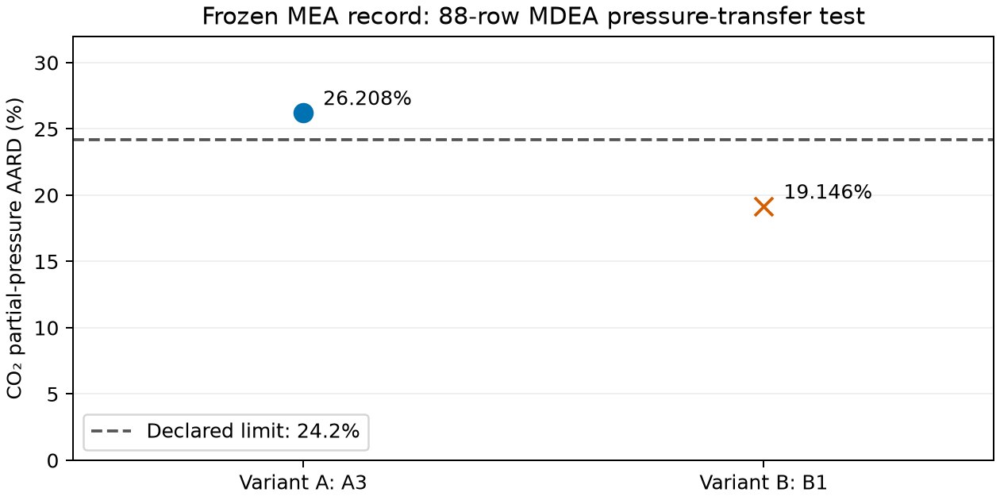

## Outcome and intended use

The declared comparison between gate-passing starts within 1% of the selected cost passes: A1's 88-row Ermatchkov AARD is 26.208496003%, versus 26.208406176% for A3. The absolute difference is 0.0000898275 percentage points, below the non-identification threshold of 2 percentage points or more. B1 has no qualifying alternative: B3 fails the phase gate, and B2 duplicates B1. This check concerns agreement of pressure predictions between starts; it does not establish identification of individual parameters. The [eligibility and comparison record](results/stage2-capped/equal-cost-starts.json) and [88 A1 row predictions](results/stage2-capped/A1/ermatchkov-88.json) retain the numerical evidence.

Variant A fails the declared 24.2% pressure-transfer test; Variant B passes. AARD is average absolute relative deviation. The endpoints were selected by the lowest fitted cost among candidates passing the density-classified phase gate. Selection was committed in `005f79e` before any outside-fit statistic for the new capped endpoints was computed.

| Endpoint | Cost | Ermatchkov AARD (%) | 24.2% test | Dense splits | Gas states | Reconstruction trials | Other unresolved |
|---|---|---|---|---|---|---|---|
| A3 | 403.7 | 26.21 | Fail | 0 | 39 | 0 | 0 |
| B1 | 374.5 | 19.15 | Pass | 0 | 37 | 0 | 0 |

The pressure test uses all 88 Ermatchkov rows at ≤49 wt% MDEA, including the 29 rows below 7 kPa. The 13 higher-concentration rows and the complete 33-row low-pressure subset are separate comparisons. Nitrogen headspace is not modeled. These are conditional physical assessments of the declared model against outside-fit data. Fitted errors are calibration evidence; phase searches, derivative comparisons and balances are numerical verification. There is no absorber-use qualification or universal-ion-parameter claim.

## Model, inputs and selection

The liquid contains water, CO₂, MDEA, MDEAH⁺, bicarbonate, carbonate, hydronium and hydroxide; only neutral species enter the vapor. Variant A uses the MEA single-sphere cation convention; Variant B uses the charged-molecule convention. The shared MEA components, interactions and reaction laws remain frozen in the main fits. The MDEA–water interaction is linear in temperature, initialized from the Kim pre-fit. Neumann ideal-gas Cp is primary, with Wangler evaluated at the same endpoints as a sensitivity. Carson is integral heat from zero loading at 101325 Pa; Jakobsen scales are 10% of each observed ratio; Böttinger is evaluated at 5 and 25 bar.

Merkley uses the native Engine observable with final loading equal to the smaller of the digitized loading point and model saturation loading at 1121 kPa (1466 kPa for the 422.04 K source rows). Only the 20/40 wt% rows at 333.15 and 388.71 K enter the objective. The reaction domain remains 293.15–395 K; the 288.71/422.04 K Merkley and 413 K Kuranov comparisons are retained as unevaluated domain refusals. The source-loading digitization uncertainty is ±0.02 mol CO₂/mol MDEA. Above Hsieh's 328.15 K, the dielectric temperature dependence is a model assumption. The intended comparison domain is ≤49 wt% for the pressure test and ≤50 wt% for other properties; 60 wt% is extrapolation.

A1, A3, B1 and B3 all converged. A2/B2 are duplicates, and A4 remains excluded. B3 has one unresolved phase record (`comparison:113:0`) and is inadmissible for selection. A1 and A3 have costs differing by less than 1e-8; the declared exact lowest-cost rule selects A3. Active bounds are accepted under the owner's MEA precedent and do not establish that these quantities are experimentally identified.

| Endpoint | Coordinate | Target | Quantity | Value | Bounds |
|---|---|---|---|---|---|
| A3 | 2 | MDEAH⁺–CO₂ | k (dimensionless) | 0.5 | [-0.5, 0.5] |
| A3 | 3 | MDEAH⁺–H₂O | k (dimensionless) | -0.5 | [-0.5, 0.5] |
| A3 | 5 | MDEAH⁺–HCO₃⁻ | k (dimensionless) | -1 | [-1.0, 1.0] |
| A3 | 8 | MDEAH⁺ | Born diameter (Å) | 7 | [2.0, 7.0] |
| B1 | 5 | MDEAH⁺–HCO₃⁻ | k (dimensionless) | 1 | [-1.0, 1.0] |
| B1 | 8 | MDEAH⁺ | Born diameter (Å) | 7 | [2.0, 7.0] |

## Property comparisons

Only the 88-row pressure statistic has a pass bar. Every other value below is context under the frozen data roles and residual definitions.

| Source and role | Variant A AARD (%) | Variant B AARD (%) |
|---|---|---|
| Kuranov total pressure, fitted (69) | 20.17 | 21.11 |
| Jakobsen two speciation ratios, fitted (16) | 13.5 | 13.79 |
| Carson integral heat, fitted (40) | 5.531 | 4.834 |
| Merkley capped heat, fitted (4) | 8.542 | 8.508 |
| Weiland Cp, fitted (33) | 3.354 | 2.656 |
| Weiland loaded density, fitted (33) | 0.2012 | 0.1832 |
| Sobrino density, fitted (24) | 0.05682 | 0.05677 |
| Kim bubble pressure, fitted (61) | 3.224 | 3.23 |
| Hsieh permittivity, frozen coefficients | 4.194 | 4.195 |
| Ermatchkov above 49 wt%, extrapolation (13) | 54.99 | 28.35 |
| Ermatchkov below 7 kPa (33) | 37.12 | 16.84 |
| Primary-set rows below 7 kPa (29) | 33.48 | 16.12 |
| Corrected Kamps pressure, context (28) | 18.31 | 25.65 |
| Böttinger amine sum, 5 bar (58) | 7.195 | 7.214 |
| Böttinger amine sum, 25 bar (58) | 7.195 | 7.214 |
| Weiland Cp at 60 wt%, extrapolation (6) | 13.43 | 10.73 |
| Weiland density at 60 wt%, extrapolation (11) | 1.318 | 1.798 |
| Zheng integral heat, context (6) | 18.72 | 22.64 |
| Sedighi total pressure, context (15) | 80.12 | 74.53 |
| Merkley 60 wt%, 333.15/388.71 K (2) | 25.7 | Unavailable |

Böttinger retains all 58 rows, their DMDEA/byproduct fractions and the flags above the source's 3% amine-balance accuracy. A complete relative bicarbonate AARD is undefined because one observed value is zero; all row-level absolute predictions remain retained. No zero row is silently removed. Xiao and Zhang remain unscored because the retained attachments contain only the first page; Derks remains unscored because temperature/basis is unresolved. Zheng uses the source loading for integral heat, with model saturation loading reported separately. Corrected Kamps never enters the follow-up criterion.

| Endpoint | Neumann Cp AARD (%) | Wangler Cp AARD (%) | Change (percentage points) | Kim RMS log ratio |
|---|---|---|---|---|
| A3 | 3.354 | 4.347 | 0.9935 | 0.04392 |
| B1 | 2.656 | 3.4 | 0.7439 | 0.04398 |

The Böttinger comparison uses the declared model sum HCO₃⁻ + CO₃²⁻. The complete Wangler heat/Cp and outside-fit predictions are retained in each endpoint's `wangler-*.json`. Merkley half-loading predictions and the 156 kPa alternatives are retained separately; unavailable out-of-domain rows are not averaged into an apparently complete statistic.

## Saturation truncation and phase search

The phase classifier was declared before refitting: packing fraction above 0.10 is dense; ambiguity near the threshold and other unresolved trials block a clean gate. Gas evolution is reported separately. Zero-loading searches use carbon-free trial supports. Each selected endpoint has 760 state records, including repeated physical states for distinct observables and six formal cap states from the direct saturation diagnostic. Native heat availability is recorded separately. There are zero reconstruction trials, so no residual #904 ion-free recovery is needed. Full state/trial records and hashes are retained, rather than interpreting gas-like liquid seeds as liquid–liquid splitting.

The following loadings are mol CO₂/mol analytical MDEA. A positive truncation means the native heat endpoint is below the source loading point; the 60 wt% entries are extrapolation.

| Endpoint | T (K) | MDEA wt% | Source loading | Model saturation | Heat endpoint | Truncation |
|---|---|---|---|---|---|---|
| A3 | 333.15 | 20 | 1.009 | 1.013 | 1.009 | 0 |
| A3 | 333.15 | 40 | 0.941 | 0.9006 | 0.9006 | 0.04037 |
| A3 | 333.15 | 60 | 0.811 | 0.7819 | 0.7819 | 0.02906 |
| A3 | 388.71 | 20 | 0.587 | 0.4574 | 0.4574 | 0.1296 |
| A3 | 388.71 | 40 | 0.36 | 0.2887 | 0.2887 | 0.07129 |
| A3 | 388.71 | 60 | 0.18 | 0.2065 | 0.18 | 0 |
| B1 | 333.15 | 20 | 1.009 | 1.02 | 1.009 | 0 |
| B1 | 333.15 | 40 | 0.941 | 0.9197 | 0.9197 | 0.02132 |
| B1 | 333.15 | 60 | 0.811 | 0.8069 | Unavailable | Unavailable |
| B1 | 388.71 | 20 | 0.587 | 0.4532 | 0.4532 | 0.1338 |
| B1 | 388.71 | 40 | 0.36 | 0.2581 | 0.2581 | 0.1019 |
| B1 | 388.71 | 60 | 0.18 | 0.1582 | 0.1582 | 0.02184 |

Signed heats below are kJ/mol CO₂; negative is exothermic. Half-loading uses half the source loading point.

| Endpoint | T (K) | MDEA wt% | Observed heat | Capped heat | Half-loading heat |
|---|---|---|---|---|---|
| A3 | 333.15 | 20 | -53.3 | -53.56 | -57.82 |
| A3 | 333.15 | 40 | -55.4 | -64.58 | -66.95 |
| A3 | 333.15 | 60 | -56.8 | -76.27 | -78.01 |
| A3 | 388.71 | 20 | -59.2 | -62.94 | -67.29 |
| A3 | 388.71 | 40 | -62 | -68.7 | -73.83 |
| A3 | 388.71 | 60 | -63.3 | -74.14 | -82.34 |
| B1 | 333.15 | 20 | -53.3 | -54.31 | -57.21 |
| B1 | 333.15 | 40 | -55.4 | -65.93 | -66.03 |
| B1 | 333.15 | 60 | -56.8 | Unavailable | -76.91 |
| B1 | 388.71 | 20 | -59.2 | -62.7 | -66.22 |
| B1 | 388.71 | 40 | -62 | -66.48 | -69.64 |
| B1 | 388.71 | 60 | -63.3 | -64.13 | -70.01 |

At B1, the 333.15 K / 60 wt% native heat is unavailable: a sampled vapor branch is not admitted within the declared grid. The direct diagnostic finds an admitted root near 0.8069, but this does not establish the native observable's uniqueness requirement across the full grid. No complete two-row 60 wt% B AARD is reported. Its 388.71 K prediction is −64.1286 kJ/mol CO₂ against −63.3 observed.

The saturation root is unique only within the declared 30-point search over 0.05–1.50 mol/mol; unsampled paired roots or tangencies can escape it. The gradient is unavailable exactly at the cap switch. Native refused optimizer trials remain in `fit.json`; the selected main fits converged despite their retained refusals. No fallback equation, downstream optimizer, or parameter-independent cap was substituted.

## Local identification and numerical checks

Both selected nine-coordinate Jacobians have rank 9. Their singular values use the declared coordinate scales and weighted residuals:

| Singular-value index | A3 | B1 |
|---|---|---|
| 1 | 106.5 | 106.4 |
| 2 | 13.67 | 13.54 |
| 3 | 9.817 | 7.395 |
| 4 | 3.638 | 6.341 |
| 5 | 2.222 | 4.999 |
| 6 | 0.2303 | 0.599 |
| 7 | 0.2252 | 0.4533 |
| 8 | 0.01931 | 0.02061 |
| 9 | 0.002698 | 0.009007 |

The two weakest-direction bounded objective scans are retained in `local-sensitivity.json`. They are not likelihood profiles; active bounds can block their displacements. Full rank is conditional local information and does not establish universal parameter uniqueness. Each endpoint retains independent fitted-prediction replays, finite-difference comparisons, element/charge balances, solver residuals and full phase evidence. Numerical success is not physical validation.

## Bicarbonate follow-up

| Selected start | Bicarbonate-release pressure AARD (%) | Jacobian correlation with cation–water | Control comparison | Control minus bicarbonate (points) |
|---|---|---|---|---|
| A3 | 20.73 | 0.9939 | UNAVAILABLE | Unavailable |
| B1 | 32.52 | -0.7357 | UNAVAILABLE | Unavailable |

| Control start | Iteration limit | Termination | Cost | Dense split states | Unresolved states | Outside-fit AARD |
|---|---|---|---|---|---|---|
| A3 | 40 | converged | 390.5 | 7 | 1 | Not computed |
| B1 | 40 | limit_reached | 365.8 | 2 | 0 | Not computed |
| B1 | 100 | converged | 365.8 | 2 | 1 | Not computed |

The original B control stopped at the declared 40-iteration limit, with 27 retained saturation refusals and cost 365.820961; its phase results describe that finite, unconverged candidate. The owner authorized one fresh run from the same control start with only the iteration limit raised to 100. Its termination is converged, cost 365.820958506, with 34 refused trials. The released MDEA–CO₂ column's cosine correlation with the cation–water column is 0.134571; at a rejected endpoint this is a diagnostic quantity. The B comparison is UNAVAILABLE under the owner's stopping rule; its control outside-fit AARD and the two-point verdict are unavailable. No further run was made.

The owner's 2026-10-29 decision makes a phase-failed CO₂-control comparison unavailable: retain its endpoint, cost and gate states; do not compute its outside-fit AARD and make no bicarbonate claim for that variant. A bicarbonate-release AARD alone is context, not a verdict. A magnitude above 0.95 in the declared column correlation means the pair is non-separable. When a control passes, the declared margin is two AARD percentage points, with the other property results retained; corrected Kamps is excluded. No MDEA outcome falsifies the MEA bicarbonate value, whose MEA conditional uncertainty already spans the declared range.

## Engine acceptance and provenance

All new calculations use the isolated worktree MDEA environment with Engine `d513820994a78bfe628d42fffd55b2eeab6f89bd`, immutable wheel SHA-256 `ca7093ca721fdc80226c74d018a582f31705684c6995e80b0492c193334dd5d5`. The main MEA dependency pins remain on 3e83e19c. Exact wheel path, installed-byte verification and runtime identity are in [runtime.json](results/stage2-capped/runtime.json).

Acceptance (a) passes: the historical A1/B1 754-state searches have zero reconstruction trials; every other classification is unchanged; maximum absolute change in ΔG/RT is 1.82e-12, within the owner's clarified 1e-10 absolute criterion near zero. Acceptance (b) passes: eight start values and four branch checks agree with direct saturation-plus-heat within 4.79e-13 relative, and all nine derivatives pass 1e-5 on both branches (worst error across all 72 comparisons and both declared steps 2.17e-6). Acceptance (c) passes: both 61-row Kim laws replay within 9.33e-15 relative, all 2354 binary phase searches and all mixing scans pass, and item-(l) Cp and the eight retained Carson checks pass. See the [acceptance guide](results/stage2-density/engine-d5138209/README.md).

The [selection](results/stage2-capped/selection.json), endpoint documents, row-level predictions, native failures and phase summaries own the numerical evidence. Newly retained files above 5 MB are gzipped with raw/compressed SHA-256 hashes in [the evidence registry](results/compressed-evidence.json). The manuscript and Engine source are unchanged. Historical pre-cap results remain in their existing result directories and Git history; they are not the selected endpoints shown here.

This notebook has not been independently reviewed or promoted for manuscript use.
