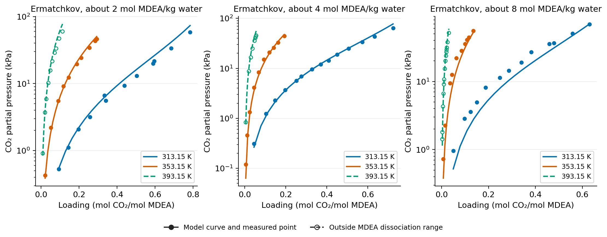
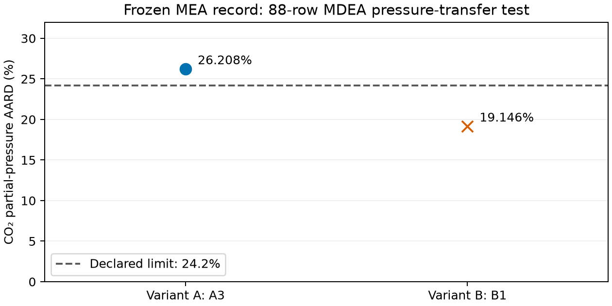
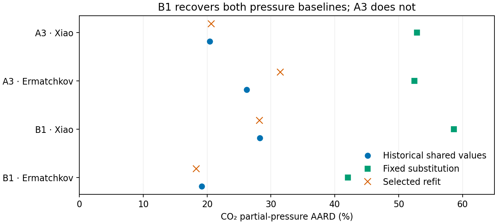

## Kuranov total bubble pressures on published observation sets (#422)

The #411 MDEA model gives **19.5292% average absolute relative deviation (AARD)** on Kuranov et al. (1996), Table 2, close to the **19.7%** Wangler et al. reported on 82 unfitted pressures. The #411 fit used 70 of these pressures (66 loaded and four CO₂-free). The 12 unfitted pressures give 22.0884% AARD. The data roles differ across the models, so these deviations provide no ranking. Uyan et al. reported 22.9% on 82 pressures in Table 6. Wangler et al. redetermined that value as 34.4% in Table 11, note b. The identification of the 82 points with Kuranov's Table 2 rests on the source, count and, for Uyan, the stated concentrations and ranges. [Study definitions and source locators](https://github.com/tannerpolley/Amine-Thermodynamics/issues/422).

The measured quantity is total pressure at the first stable bubble, over about 313–413 K. K19 and K32 are the two Table 2 blocks, at nominal 19 and 32 wt% MDEA. K19-loaded selects the 39 rows at $\alpha>0.01$. Five K82 rows exceed $\alpha=1.2$. C28 selects the loaded K19 rows at nominal 333–413 K, and C21 applies the 3 MPa bound. Cleeton et al. report 20.26% AAD for 26 unidentified observations at 18.9 wt% (Table 3 and discussion of Fig. 7). Seven C28 rows exceed 3 MPa (18, 26, 27, 33, 34, 40 and 41), so C28 and C21 provide comparisons at the corresponding concentration and temperature range. [Retained row membership and full-precision reductions](results/kuranov-published-422/statistics.json).

The 81 retained #411 predictions replayed with zero relative difference on Engine 1.3.1. Row 72, at 393.16 K and 0.373385 mol CO₂/mol MDEA, gives 1.705047 MPa against 1.205300 MPa measured (+41.46%) with the 413 K comparison template (pressure difference, scale 1). It was excluded from the fit and is above the 368 K measured limit of the MDEA dissociation correlation. The pressure difference is 0.500 MPa. Kuranov's Experimental Section gives a maximum pressure uncertainty of 0.1% of the transducer's full-scale reading (at most 0.010 MPa even for its 10 MPa transducer) and an estimated temperature uncertainty of 0.1 K. The replay verifies the calculation. The 12 unfitted rows show departure from measured pressures within this campaign. [Kuranov row predictions and replay differences](results/kuranov-published-422/kuranov-rows.json) · [Input, script and wheel hashes](results/kuranov-published-422/hashes.json).

K19 and K32 each contain 35 fitted and six unfitted pressures. C28 has 22 fitted and six unfitted pressures, and C21 has 17 fitted and four unfitted pressures.

AARD is the mean absolute value of $100(p_\mathrm{calc}/p_\mathrm{exp}-1)$ (Uyan Eq. 25 and Wangler Eq. 32). The bias is the signed mean of the same pressure deviations. The reported maximum is absolute, with the source row in parentheses. The published target columns distinguish Uyan's 19.22% from §4.3.2 (39 rows inferred from the loading cutoff) and 19.82% from the abstract (41 rows inferred from the reported aggregate). Wangler's 32 wt% target is from Fig. 11, and the three 60 wt% observations are from Table 10 and Fig. 14 at 303.00 K.

```{python}
#| echo: false
#| output: asis
import json
from pathlib import Path
from statistics import fmean
from tabulate import tabulate
results = Path("results/kuranov-published-422")
saved = json.loads((results / "statistics.json").read_text())
kuranov, wangler = [json.loads((results / file).read_text()) for file in ("kuranov-rows.json", "wangler-table-10-rows.json")]
current = [dict(subset=s, reading="Present model", printed=None, **v) for s, v in saved["present"].items()]
for reports in (current, saved["reconstruction"]):
    table = []
    for r in reports:
        subset, reading = r["subset"], r["reading"]
        cohort = [q for q in (wangler if subset == "Wangler Table 10" else kuranov) if q["source_row"] in saved["sets"][subset]]
        pressures = {q["source_row"]: q["present" if r["printed"] is None else reading]["pressure_Pa"] for q in cohort}
        dev = {q["source_row"]: 100 * (pressures[q["source_row"]] / q["p_exp"] - 1) for q in cohort if pressures[q["source_row"]] is not None}
        missing = sorted(pressures.keys() - dev.keys())
        aard, bias = (fmean(map(abs, dev.values())), fmean(dev.values())) if dev else (None, None)
        worst, maximum = max(((i, abs(d)) for i, d in dev.items()), key=lambda pair: pair[1], default=(None, None))
        full = None if missing else aard
        assert (len(cohort), len(dev), missing, full, aard, bias, maximum, worst) == tuple(r[k] for k in ("n", "solved", "unsolved_rows", "AARD_percent", "solved_AARD_percent", "bias_percent", "max_abs_percent", "worst_row"))
        table.append((subset, reading, r["printed"], f"{len(dev)}/{len(cohort)}", full, aard if missing else None, bias, f"{maximum:.4f} ({worst})" if dev else None, ", ".join(map(str, missing)) if missing else None))
    print(tabulate(table, headers=["Set", "Reading", "Printed (%)", "Solved", "AARD (%)", "Solved-row AARD (%)", "Bias (%)", "Max (%) and row", "Unsolved rows"], tablefmt="pipe", floatfmt=".4f", missingval="—", disable_numparse=[2]), end="\n\n")
```

The four retained readings use Uyan's Table 3 precision and Table 1 reaction constants, with the repository water and MDEA permittivity laws. The Uyan readings use Eqs. 26–27 with the Table 5 or zero water–MDEAH⁺ coefficient and the Table 5 water–MDEA association-volume correction. Both Wangler readings use Tables 6–7, interpreting the numbered temperature coefficients as powers. The charged-MDEA reading keeps its neutral packing diameter and self-dispersion, whereas the other three use $0.88\sigma$ for the ion packing diameter. None reproduces a printed target at the target's print resolution. The baseline Wangler reading yielded no pressure on the three 60 wt% rows from the specified starts. The charged-MDEA reading solved all three and underpredicted each measured pressure. The #126 Fig. 11 diagnostic showed the charged-MDEA curves up to 0.6 below the digitized curves in $\ln p$ at high loading. [The four fixed readings](https://github.com/tannerpolley/Amine-Thermodynamics/issues/422) · [Wangler Table 10 predictions and solve messages](results/kuranov-published-422/wangler-table-10-rows.json) · [Retained #126 Fig. 11 diagnostic](../mdea_kuranov_refit/results/wangler-figures-11-12.csv).

Raeispour Shirazi and Lotfollahi report **10.9% AARD** for their fitted ePC-SAFT-MB model (Str2, Table 4, p. 7). Their reference [44] and count identify the 82 Kuranov Table 2 total pressures. Section 5.3 states that two binary interactions were fitted to all 162 ternary bubble pressures, including these observations. Eq. 20 uses the same absolute relative pressure deviation. [Raeispour Shirazi and Lotfollahi source check](results/kuranov-published-422/raeispour-table-4.json).

These results await independent scientific review and investigator approval for manuscript use.

## Sensitivity to the shared water–bicarbonate interaction (#417)

The low and high MEA profiles qualified $k=0.1325000116847309$ and $k=1$ for transfer to MDEA. At these values the fitted MEA objective increased by 1.023004 and 0.023674, respectively, relative to the refitted center. The study tests how MDEA predictions and the finite phase-stability searches respond to the shared coefficient after each solvent refits its own parameters. [Study plan and selection rule](https://github.com/tannerpolley/Amine-Thermodynamics/issues/417).

### Fixed-coordinate MEA fits

The historical 11-coordinate F2 fit had $C=150.76290287953717$. The reported F2 parameters replayed at $C=150.76290287955263$ on Engine 1.3.1 `05e94210`, with all 307 fitted rows available. The relative change in objective was $1.03\times10^{-13}$, within the study's $10^{-10}$ replay limit. The maximum relative difference in a prediction was $2.02\times10^{-12}$. Refit at the full-precision center $k_0=0.7650000233694618$ gave $C(k_0)=150.76288471813868$. Its difference from the replay lies within the $10^{-6}C$ start-tie rule. The lower replayed refit cost sets the center for both profiles. [Control readback](results/shared-bicarbonate-417/control-readback.json).

The refits minimized $C(k)=\tfrac12\sum_{i=1}^{307}r_i^2$ using the original weights, ten remaining F2 coordinates, two Born-to-segment-diameter ties, and two F2 start families. A candidate could increase the cost by at most 1.3986782374, the observed increase in the largest reported inward profile of the MEAH⁺–carbamate interaction. The two tested sides used the same allowance. The finite-search requirement was complete searches and no confirmed liquid–liquid split. Fits used only the fitted observations and kept $k$ fixed throughout.

| Fixed $k$ | Previous start, $C$ | Current start, $C$ | Lowest $C-C(k_0)$ | Outcome |
|---:|---:|---:|---:|---|
| 0.7650000233694618 | 150.763064658 | 150.762884718 | 0 | Refitted center |
| −0.5 | 166.651406042 | 166.651406034 | +15.888521316 | Cost exceeds allowance |
| 0.1325000116847309 | 151.786667505 | 151.785889075 | +1.023004357 | First qualifying low value |
| 1.0 | 150.786558248 | 150.787225109 | +0.023673530 | First qualifying high value |

Every start converged and replayed all 307 fitted rows. The largest MEA endpoint replay difference was below the $10^{-8}$ relative cost check. The declared midpoints and quarter-distance values were computed from full-precision $k_0$. The low midpoint and high bound met the selection rule, ending the MEA profile at those points. [Start declarations, evaluated mappings and row replays](results/shared-bicarbonate-417/starts/) · [Objective and search-count readback](results/shared-bicarbonate-417/objective-and-count-readback.json).

| Point | $k_{\mathrm{MEACOO^-},\,\mathrm{H_2O}}$ | $k_{\mathrm{MEAH^+},\,\mathrm{H_2O}}$ | Active fitted bound |
|---|---:|---:|---|
| Low bound, $k=-0.5$ | −0.017993 | −0.500000 | MEAH⁺–water, lower |
| Low midpoint | −0.107259 | −0.333008 | MEAH⁺–carbamate, lower |
| Center refit | −0.064924 | −0.358066 | MEAH⁺–carbamate, lower |
| High bound, $k=1$ | −0.016712 | −0.411770 | MEAH⁺–carbamate, lower |

The F2 conditional correlation for water–bicarbonate is **+0.9601** with carbamate–water and **−0.9739** with MEAH⁺–water. Its conditional standard error is 2.96525 on a fitted interval of width 1.5. The profile shows how these parameters move when the ten other coordinates can refit. [F2 covariance](../mea_parameter_bundle/results/paper-evidence-341/uncertainty/covariance.json) · [Inward-profile cost comparison](../mea_parameter_bundle/results/paper-evidence-341/uncertainty/profiles.json).

| MEA point | Main grid completed | Offset grid completed | Census completed | Supplied evaluations available | Descents |
|---|---:|---:|---:|---:|---:|
| Center | 1,908 / 1,908 | 576 / 576 | 162 / 162 | 991,602 / 991,602 | 0 |
| Low midpoint | 1,908 / 1,908 | 576 / 576 | 162 / 162 | 991,602 / 991,602 | 0 |
| High bound | 1,908 / 1,908 | 576 / 576 | 162 / 162 | 991,602 / 991,602 | 0 |

Each census used the adopted 6,121-composition bank with fingerprint `f7f02b1ef565690efb466dd6d3d73bc9c74c708116725b2b0d931486cdc1b666`. The state records keep parent and trial diagnostics. The grids and census give finite numerical evidence over their declared temperatures, feeds, pressures and trial set. [Search rows](results/shared-bicarbonate-417/searches/) · [Wheel and installed files](results/shared-bicarbonate-417/wheel-modules.json).

The group results retain the observation counts, costs, AARD, RMSE and signed prediction bias. Each cell gives $C$ / AARD (%) / RMSE / bias. The last two values use the displayed property unit. The historical F2 group values describe the reported fit. The study-wheel replay is checked above. [All unrounded MEA group results](results/shared-bicarbonate-417/mea-agreement.csv) · [Source and comparison rows](results/shared-bicarbonate-417/comparison-rows/).

**Fitted MEA observations**

| Observation group (unit), $n$ | Historical F2 | Center refit | Low bound | Low midpoint | High bound |
|---|---:|---:|---:|---:|---:|
| fitted CO2 partial pressure (Pa), 47 | 5.963 / 11.64 / 7495 / 127.9 | 5.971 / 11.64 / 7478 / 122.7 | 8.911 / 15.48 / 8646 / 1087 | 5.981 / 11.7 / 8320 / 284.1 | 5.988 / 11.64 / 7344 / 80.98 |
| Kiepe pressure (Pa), 39 | 0.000679 / 2.667 / 1.8e+05 / 5445 | 0.000679 / 2.667 / 1.8e+05 / 5445 | 0.000679 / 2.667 / 1.8e+05 / 5445 | 0.000679 / 2.667 / 1.8e+05 / 5445 | 0.000679 / 2.667 / 1.8e+05 / 5445 |
| fitted phase mole fraction (1), 94 | 16.49 / 7.079 / 0.002683 / 0.0001001 | 16.48 / 7.077 / 0.002682 / 9.994e-05 | 23.4 / 8.093 / 0.003102 / 5.564e-05 | 17.42 / 7.227 / 0.002754 / 8.998e-05 | 16.45 / 7.069 / 0.00268 / 0.0001001 |
| restored species (1), 7 | 2.406 / 8.928 / 0.003463 / -0.0001634 | 2.405 / 8.927 / 0.003462 / -0.0001634 | 3.354 / 10 / 0.003972 / -0.0001634 | 2.542 / 9.073 / 0.003536 / -0.0001634 | 2.401 / 8.922 / 0.00346 / -0.0001634 |
| Jakobsen ratio (1), 6 | 12.75 / 17.07 / 0.04612 / 0.02274 | 12.75 / 17.08 / 0.04612 / 0.02273 | 16.75 / 25.78 / 0.04867 / 0.02478 | 12.79 / 17.4 / 0.04632 / 0.02314 | 12.73 / 16.97 / 0.04611 / 0.02271 |
| loaded density (kg/m³), 47 | 0.3787 / 0.1523 / 1.842 / 0.1685 | 0.3811 / 0.1526 / 1.847 / 0.1702 | 0.6568 / 0.1894 / 2.364 / -0.389 | 0.4091 / 0.1563 / 1.911 / 0.1102 | 0.384 / 0.1532 / 1.853 / 0.1725 |
| CO2-free density (kg/m³), 5 | 13.12 / 0.03036 / 0.3622 / -0.01158 | 13.1 / 0.03034 / 0.362 / -0.01165 | 11.56 / 0.02836 / 0.34 / -0.01261 | 13.18 / 0.03037 / 0.363 / -0.008147 | 13 / 0.03025 / 0.3606 / -0.01337 |
| fitted heat of absorption (J/mol CO₂), 8 | 1.386 / 1.969 / 1979 / 903.6 | 1.387 / 1.969 / 1980 / 905.6 | 2.296 / 2.538 / 2593 / 1957 | 1.429 / 2.009 / 2002 / 907.5 | 1.393 / 1.969 / 1985 / 923.6 |
| heat capacity (J/(mol-feed K)), 4 | 6.648 / 2.835 / 3.003 / 2.343 | 6.657 / 2.837 / 3.005 / 2.345 | 7.915 / 3.142 / 3.282 / 2.603 | 6.411 / 2.749 / 2.949 / 2.272 | 6.796 / 2.882 / 3.037 / 2.383 |
| Cai temperature (K), 25 | 39.82 / 0.3695 / 1.785 / 0.1422 | 39.83 / 0.3695 / 1.785 / 0.1425 | 40.01 / 0.3708 / 1.789 / 0.147 | 39.79 / 0.3689 / 1.784 / 0.1334 | 39.85 / 0.3698 / 1.785 / 0.1471 |
| Cai mole_fraction (1), 25 | 51.81 / 2.602 / 0.02036 / -0.002932 | 51.81 / 2.601 / 0.02036 / -0.002932 | 51.79 / 2.594 / 0.02036 / -0.00282 | 51.83 / 2.602 / 0.02036 / -0.002883 | 51.79 / 2.601 / 0.02036 / -0.002954 |

**Not fitted MEA observations**

| Observation group (unit), $n$ | Historical F2 | Center refit | Low bound | Low midpoint | High bound |
|---|---:|---:|---:|---:|---:|
| six-source pressures (Pa), 112 | 91.84 / 24.89 / 8.399e+04 / -1.224e+04 | 91.82 / 24.89 / 8.392e+04 / -1.217e+04 | 98.27 / 26.85 / 7.526e+04 / -6450 | 91.58 / 24.81 / 8.03e+04 / -1.117e+04 | 91.8 / 24.9 / 8.437e+04 / -1.229e+04 |
| Wagner pressures (Pa), 23 | 12.38 / 25.03 / 8506 / -6462 | 12.36 / 25 / 8479 / -6447 | 15.84 / 27.23 / 7649 / -6283 | 12.44 / 25.08 / 8538 / -6483 | 12.36 / 25.01 / 8465 / -6444 |
| transfer 15 wt% (Pa), 33 | 36.15 / 45.08 / 1664 / -317.5 | 36.15 / 45.09 / 1664 / -316.9 | 31.88 / 42.29 / 1519 / -239.3 | 36.1 / 45.14 / 1658 / -312.3 | 36.19 / 45.12 / 1665 / -316.7 |
| transfer 45 wt% (Pa), 37 | 93.14 / 45.86 / 1541 / -663.7 | 93.19 / 45.87 / 1541 / -663.8 | 89.64 / 43.68 / 1534 / -676.4 | 92.27 / 45.39 / 1543 / -664.9 | 93.35 / 45.93 / 1542 / -664.3 |
| Matin 19 pools (1), 19 | 33.38 / 67.53 / 0.002887 / -0.002655 | 33.36 / 67.51 / 0.002886 / -0.002654 | 29.73 / 62.58 / 0.002764 / -0.002518 | 34.37 / 68.35 / 0.002935 / -0.0027 | 33.36 / 67.54 / 0.002886 / -0.002654 |
| Arcis heats (kJ/mol CO₂), 14 | 848.2 / 8.862 / 9.026 / 8.197 | 848.6 / 8.864 / 9.028 / 8.199 | 1049 / 9.996 / 9.979 / 9.227 | 847.3 / 8.87 / 9.03 / 8.204 | 851.6 / 8.881 / 9.043 / 8.215 |
| Kim heats (kJ/mol CO₂), 53 | 427.4 / 7.009 / 7.612 / -4.953 | 427.6 / 7.012 / 7.609 / -4.946 | 485.7 / 7.744 / 8.148 / -5.757 | 427.1 / 7.015 / 7.622 / -4.982 | 428.5 / 7.024 / 7.615 / -4.954 |
| Han densities (kg/m³), 67 | 520.2 / 0.3507 / 4.897 / -1.399 | 513.4 / 0.3495 / 4.862 / -1.452 | 1255 / 0.5339 / 7.823 / -5.432 | 513.5 / 0.3539 / 4.861 / -1.732 | 507 / 0.3483 / 4.829 / -1.507 |
| broad heat capacities (kJ/(kg K)), 51 | 64.33 / 2.54 / 0.113 / 0.06274 | 64.41 / 2.541 / 0.1131 / 0.06283 | 74.4 / 2.728 / 0.1216 / 0.07152 | 62.66 / 2.508 / 0.1116 / 0.05992 | 65.51 / 2.561 / 0.1141 / 0.06432 |
| Bottinger 353 K (1), 10 | 4.756 / 10 / 0.005543 / 0.0002022 | 4.761 / 10.01 / 0.005546 / 0.0002022 | 6.731 / 12.15 / 0.006468 / 0.0002022 | 5.297 / 10.7 / 0.005789 / 0.0002022 | 4.744 / 9.983 / 0.005539 / 0.0002022 |

### MDEA refit and pressure and speciation comparisons

The bounded MDEA control replayed all 281 fitted rows at $C=564.48369612531$, within 4.71e-14 relative of the retained fit. At the selected MEA values the refitted MDEA costs were 541.079255 (low) and 565.942499 (high), with signed changes of -23.404441 and +1.458802. The high-minus-low span was +24.863243. [MDEA control rows](results/shared-bicarbonate-417/reported-mdea/replay.json.gz).

Each refit used the same eight MDEA coordinates, all three hash-identified starts, original observation weights, and the original bound on the MDEA–water coefficient at 423 K. Each start loaded the new fixed water–bicarbonate value before binding the model. The objective passed the $10^{-12}$ relative check when the MDEA–water interaction was written about 423 K. The selected start had the lowest converged objective on full replay. [Fitted mappings and start outcomes](results/shared-bicarbonate-417/mdea/).

| Fixed value | Start 0, $C$ | Start 1, $C$ | Start 2, $C$ | Selected start |
|---|---:|---:|---:|---|
| Low | 541.079255213 | 578.025157725 | 541.079255216 | 0 |
| High | 565.942498576 | 584.367880936 | 565.942498595 | 0 |

Ermatchkov pressure rows helped select the historical initial parameters and have the role “not fitted.” The Jakobsen carbonate-family ratio is $(n_{\mathrm{HCO_3^-}}+n_{\mathrm{CO_3^{2-}}})/(n_{\mathrm{MDEA}}+n_{\mathrm{MDEAH^+}})$. Böttinger Table 2 reports $x_{\mathrm{HCO_3^-}}+x_{\mathrm{CO_3^{2-}}}$. Each pressure assignment has 58 available predictions and 57 observations eligible for AARD. The two assignments share the same observations, including the zero that contributes to absolute errors.

AARD cells give % with relative-error denominators in parentheses. Changes are percentage points, with the last column giving high minus low. [Unrounded group statistics and paired rows](results/shared-bicarbonate-417/mdea-comparison.json.gz).

| Observation group | Reported | Low | High | Low − reported, pp | High − reported, pp | High − low, pp |
|---|---:|---:|---:|---:|---:|---:|
| All fitted pressures | 11.2425 (131) | 6.7506 (131) | 11.2865 (131) | -4.4919 | +0.0441 | +4.5360 |
| All pressures outside the objective | 25.8321 (175) | 33.4290 (175) | 25.7892 (175) | +7.5969 | -0.0429 | -7.6398 |
| Kuranov loaded total pressure | 20.0922 (66) | 11.1754 (66) | 20.1797 (66) | -8.9168 | +0.0875 | +9.0043 |
| Kuranov loaded total pressure, within dissociation source range | 11.8230 (37) | 8.1344 (37) | 11.9230 (37) | -3.6887 | +0.1000 | +3.7886 |
| Kuranov loaded total pressure, above dissociation source range | 30.6425 (29) | 15.0554 (29) | 30.7142 (29) | -15.5871 | +0.0717 | +15.6588 |
| Kuranov 413 K total pressure | 20.3271 (11) | 8.1797 (11) | 20.2860 (11) | -12.1474 | -0.0412 | +12.1062 |
| Kuranov binary total pressure | 2.5631 (4) | 2.5612 (4) | 2.5632 (4) | -0.0019 | +0.0000 | +0.0019 |
| Ermatchkov CO₂ partial pressure | 17.8887 (101) | 32.4783 (101) | 17.9003 (101) | +14.5897 | +0.0116 | -14.5781 |
| Ermatchkov CO₂ partial pressure, within dissociation source range | 18.2286 (69) | 36.6465 (69) | 18.3043 (69) | +18.4179 | +0.0757 | -18.3421 |
| Ermatchkov CO₂ partial pressure, outside dissociation source range | 17.1557 (32) | 23.4908 (32) | 17.0291 (32) | +6.3351 | -0.1267 | -6.4617 |
| Jakobsen ratios, pooled | 13.7557 (16) | 16.8433 (16) | 13.5856 (16) | +3.0876 | -0.1701 | -3.2576 |
| Jakobsen carbonate-family ratio | 9.8179 (8) | 9.8569 (8) | 9.8169 (8) | +0.0389 | -0.0010 | -0.0400 |
| Jakobsen cation ratio | 17.6935 (8) | 23.8297 (8) | 17.3544 (8) | +6.1362 | -0.3391 | -6.4753 |
| Böttinger carbonate fraction, 0.5 MPa | 11.1441 (57) | 11.2535 (57) | 11.1420 (57) | +0.1094 | -0.0022 | -0.1115 |
| Böttinger carbonate fraction, 2.5 MPa | 11.1435 (57) | 11.2516 (57) | 11.1418 (57) | +0.1081 | -0.0017 | -0.1098 |

The same 718 observation rows were available in all three cases. The original and paired statistics therefore use identical denominators. [Availability readback](results/shared-bicarbonate-417/mdea-group-readback.json).

The signed relative bias on the 29 loaded Kuranov pressures above the dissociation source range was +30.6425%, +14.9663%, +30.7142% for the reported, low and high fits. For Ermatchkov the corresponding biases were -6.2912%, -32.2306%, -6.3879%.

| Böttinger Table 2 assignment | Reported MAE / signed bias | Low MAE / signed bias | High MAE / signed bias |
|---|---:|---:|---:|
| Böttinger carbonate fraction, 0.5 MPa | 0.002573 / +0.002184 | 0.002610 / +0.002225 | 0.002572 / +0.002183 |
| Böttinger carbonate fraction, 2.5 MPa | 0.002573 / +0.002183 | 0.002609 / +0.002223 | 0.002572 / +0.002183 |

The largest paired prediction changes across the available pressure and carbonate observations are listed below. The Ermatchkov total-pressure rows shown here have 7.994 mol MDEA per kg water. Positive values indicate a larger prediction in the first named scenario.

| Comparison | Quantity | Δ prediction | Source observation | $T$/K | Loading, mol CO₂/mol MDEA |
|---|---|---:|---|---:|---:|
| Low − reported | Total pressure (Pa) | +1.47794e+06 | Ermatchkov2006 Table 6, PDF p.8, printed p.6088, row 13 (comparison:113) | 313.73 | 1.1542 |
| High − reported | Total pressure (Pa) | +40657 | Ermatchkov2006 Table 6, PDF p.8, printed p.6088, row 21 (comparison:121) | 354.38 | 0.94496 |
| High − low | Total pressure (Pa) | -1.4454e+06 | Ermatchkov2006 Table 6, PDF p.8, printed p.6088, row 13 (comparison:113) | 313.73 | 1.1542 |
| Low − reported | Jakobsen (1) | +0.000678493 | Jakobsen2005 Table A5, PDF p.9, printed p.9902, row 8 (fit:84) | 313.15 | 0.79 |
| High − reported | Jakobsen (1) | -2.9096e-05 | Jakobsen2005 Table A5, PDF p.9, printed p.9902, row 8 (fit:84) | 313.15 | 0.79 |
| High − low | Jakobsen (1) | -0.000707589 | Jakobsen2005 Table A5, PDF p.9, printed p.9902, row 8 (fit:84) | 313.15 | 0.79 |

[Pressure row details](results/shared-bicarbonate-417/mdea-largest-pressure.json) · [Carbonate row details](results/shared-bicarbonate-417/mdea-largest-carbonate.json).

### MDEA phase-stability searches

The CO₂-free checks used 1.466 MPa, the original 78 native searches, and the 1,041-composition hull scan. The onset comparison reused the hash-checked 33-temperature table after verifying the pure MDEA and water inputs. Each fitted temperature law was compared to the full table.

| CO₂-free check | Reported | Low | High |
|---|---:|---:|---:|
| Native searches completed | 78 | 78 | 78 |
| Native descents | 0 | 0 | 0 |
| Hull gaps | 0 | 0 | 0 |
| Minimum distance below onset, at temperature | 0.0001000 at 423 K | 0.0001000 at 423 K | 0.0001000 at 423 K |

| Loaded stability search | Reported | Low | High | Low − reported | High − reported | High − low |
|---|---:|---:|---:|---:|---:|---:|
| Requested records | 11824 | 11824 | 11824 | +0 | +0 | +0 |
| Completed | 10725 | 10579 | 10720 | -146 | -5 | +141 |
| Unfinished | 1099 | 1245 | 1104 | +146 | +5 | -141 |
| Grid records without bubble pressure | 870 | 1024 | 874 | +154 | +4 | -150 |
| Descent records | 76 | 74 | 76 | -2 | +0 | +2 |
| Distinct calculations with descent | 27 | 28 | 27 | +1 | +0 | -1 |
| Distinct confirmed liquid–liquid splits | 0 | 2 | 0 | +2 | +0 | -2 |
| Distinct calculations with unmatched liquid-labelled witness | 0 | 4 | 0 | +4 | +0 | -4 |
| Distinct calculations with vapor coincidence | — | 16 | 18 | — | — | +2 |
| Vapor-coincident liquid-labelled witnesses in distinct calculations | — | 33 | 36 | — | — | +3 |
| Unmatched liquid-labelled witnesses in distinct calculations | — | 21 | 0 | — | — | -21 |
| Distinct calculations resolved as vapor | 27 | 24 | 27 | -3 | +0 | +3 |
| Distinct descent calculations with unresolved phase identity | — | 2 | 0 | — | — | -2 |

The search compares each liquid-labelled native witness with the vapor-labelled witnesses using the original composition and packing-fraction distance. A coincidence gives vapor evidence. Unmatched labels and ambiguous supplied descents receive pressure-closure and density-branch checks. A 33-point fixed-composition isotherm checks whether an unspecified root connects to dilute vapor. A confirmed split requires two distinct liquid phases at the parent pressure. The low fit leaves two Merkley bubble-state descents unresolved at 288.71 K. Their fitted liquid roots exceed the $10^{-10}$ relative pressure-closure limit. Search availability changed for 184 low-case records and 25 high-case records compared with the reported fit. [Search counts and state identity](results/shared-bicarbonate-417/mdea-search-readback.json) · [State rows, pressure-closure checks and changes in availability](results/shared-bicarbonate-417/mdea/).

At 363.15 K, 78.62 wt% unloaded MDEA and loading 1.368 mol/mol, the search at 1.05 times its own bubble pressure was unavailable for all three parameter sets. In the low case, the liquid phase vanished during the bubble calculation. In the high case, the bubble calculation reached the 200-iteration limit with a residual of 1.00002 against the $10^{-10}$ limit. [State diagnostics](results/shared-bicarbonate-417/mdea-search-readback.json).

| Confirmed second liquid | $T$/K | Parent $P$/MPa | Liquid densities, mol/m³ | $\Delta G/(RT)$ decrease, mol | Relative pressure closure |
|---|---:|---:|---:|---:|---:|
| Low, Merkley1987 (comparison:363:final) at the assigned pressure for the 40 wt% half-loading comparison | 288.71 | 1.121 | 38544.4344, 37753.4750 | 0.00193713 | 2.16e-12 |
| Low, Grid, 1.3 mol/mol, 1.05 times bubble pressure, 78.62 wt% unloaded MDEA | 373.15 | 203.127 | 21673.2265, 23564.7739 | 0.000249499 | 3.46e-14 |

The binary contains no bicarbonate. Its result responds to refitting the MDEA–water law. The loaded-state and property comparisons describe sensitivity within the declared data, weights, bounds, local starts and sampled states. The measured carbonate sums leave individual inorganic ion concentrations unidentified. The stability counts apply to the tested trial set and available states.

## Bounded k(MDEA–water) fit without the CO₂-free gap (#411)

The owner adopted this set as the reported MDEA parameters on 23 November
2026, replacing the #343 interpolated set. All values use wheel 1.3.1 `05e94210`,
the #343 declaration, data roles and weights, and 4 worker processes.

**Cause of the interpolated result.** Of the eight free coordinates, only
k(MDEA–water) = a0 + a1 (T − T_ref) enters the CO₂-free binary. With every
other value fixed, the largest k without a gap in the lower convex envelope of
G/(RT) at 1.466 MPa (5,490 compositions, bisected to 10⁻⁶) rises almost
linearly from −0.13233 at 290 K to −0.06701 at 423 K, about
4.9×10⁻⁴ K⁻¹. The fitted slopes are 1.15–1.26×10⁻³ K⁻¹, so the hottest
penalty temperature binds. The #343 interpolated set has
k(423 K) = −0.0670122, 1.3×10⁻⁶ above that limit. Its finite penalty weight
let the optimizer accept 14 binary descents for about 100 units of data
cost, and the retreat then stopped on the onset line.
[Gap-onset table](results/bounded-binary-411/critical-k.json).

**Method.** The same linear law was written about T_ref = 423 K; the replay
cost of the interpolated set is unchanged to 10⁻¹². The no-gap requirement is
then the upper bound a0 ≤ −0.0671135 (onset minus 10⁻⁴). The fits use the
281 fitted rows only, with no penalty rows and no retreat. They start from
the two #343 retreated points and from the #343 scale-0.003 optimizer
endpoint, each moved onto the bound. A fourth fit from that endpoint
without the bound measures the cost of the requirement.
[Declaration](inputs/bounded-binary-411.json) ·
[Script](scripts/bounded_binary_411.py).

| Start | Bound | Iterations | Time (s) | Fitted-data cost | Active bounds | k(423 K) | Binary searches: available / descents | Hull gaps |
|---|---|---:|---:|---:|---|---:|---|---|
| #343 retreated point, start 0 | yes | 11 | 501.8 | 564.483696 | k(423 K); k(MDEAH⁺–HCO₃⁻) = 1 | −0.067113 | 78 / 0 | none |
| #343 retreated point, start 1 | yes | 11 | 421.6 | 582.779688 | k(423 K); k(MDEAH⁺–H₂O) | −0.067113 | 78 / 0 | none |
| #343 scale-0.003 endpoint | yes | 6 | 140.3 | 564.483696 | k(423 K); k(MDEAH⁺–HCO₃⁻) = 1 | −0.067113 | 78 / 0 | none |
| #343 scale-0.003 endpoint | no | 40 + 35 | 720.3 | 479.442840 | none | −0.059940 | 77 / 14 | onset 413.05–413.15 K |

All four stopped on optimizer tolerance (the unbounded fit after one
continuation). The first and third bounded fits reach the same point:
costs agree to 8×10⁻¹² relative and every coordinate to 4.2×10⁻⁶ relative
(largest absolute difference 5.60×10⁻⁵ K, in $u_{\mathrm{MDEAH^+}}/k_B$). The
second stops at a separate minimum. At the selected point, k(T) is below
the onset value at all 33 tabulated temperatures from 290 to 423 K. The
binary searches are the 78 #343 states at 1.466 MPa; the hull scan uses
1,041 compositions at 32 temperatures from 288.71 to 422.04 K.
[Fit reports and endpoints](results/bounded-binary-411/fits/) ·
[Selected endpoint](results/bounded-binary-411/endpoint.json).

**Result.** A converged set without the CO₂-free gap at the tested states
exists. It is not the unbounded local minimum: from the same start, the unbounded fit
has a 15.1% lower fitted-data cost (479.44 versus 564.48) and places the
MDEA–water binary in a two-liquid region from about 413 K at 1.466 MPa.
Within this model form, removing the gap costs about 85 units of fitted-data
cost. This is a local comparison from one start, not a global bound.

| Data | Role | Rows | Interpolated AARD (%) | Bounded AARD (%) |
|---|---|---:|---:|---:|
| All pressures | fitted | 131 | 11.48 | 11.24 |
| All pressures | not fitted | 175 | 22.58 | 25.83 |
| Kuranov | fitted | 66 | 20.59 | 20.09 |
| Kim | fitted | 61 | 2.20 | 2.24 |
| Kuranov CO₂-free | fitted | 4 | 2.63 | 2.56 |
| Carson heat | fitted | 40 | 5.54 | 5.59 |
| Merkley heat | fitted | 4 | 6.46 | 8.55 |
| Heat capacity | fitted | 33 | 2.29 | 2.18 |
| Jakobsen speciation | fitted | 16 | 13.62 | 13.76 |
| Loaded density | fitted | 33 | 0.223 | 0.203 |
| Xiao | not fitted | 20 | 20.68 | 31.07 |
| Ermatchkov | not fitted | 101 | 15.36 | 17.89 |
| Kuranov 413 K | not fitted | 11 | 18.97 | 20.33 |
| corrected Kamps | not fitted | 28 | 25.29 | 28.08 |
| Zheng heat | not fitted | 6 | 17.21 | 23.61 |

The fitted-data cost falls from 605.01 to 564.48, and fitted pressures
improve slightly. Every not-fitted pressure set and the Zheng heats are
predicted less well, so the lower fitted cost does not carry to the
comparison data. Conditional standard errors are given below.
[Group comparison](results/bounded-binary-411/comparison.json).

**Full #337 search at the selected point.** The search ran on the same
11,824 requested records and the #343 split record as the trial bank. It took
3,026 s on two worker processes; the free-memory rule set two workers under a
load average of about 35–45.

| Stability outcome | #343 interpolated set | Bounded set |
|---|---:|---:|
| Available | 10,785 | 10,725 |
| Unavailable | 1,039 | 1,099 |
| Records with descent evidence | 77 | 76 |
| Grid native liquid descents | 1 | 0 |
| Data native vapor-labelled descents | 12 | 12 |
| Data descents labelled mixed by trial seed | 52 | 48 |
| Data states with a negative supplied trial | 76 | 76 |

All 76 descent records are among the 77 #343 descent records, which were
identified as 76 vapor-directed data records and one grid split. The missing record is that
split state: 363.15 K, 78.62 wt% unloaded MDEA, 1.368 mol/mol, 1.05 times the
bubble pressure. Its bubble-pressure reference now fails with
`LOCAL_INFEASIBILITY` (residual 0.0406), so the search there is unavailable and
neither confirms nor excludes the split. Seventy-two grid records became unavailable and 12 became
available. Of the 72, 68 failed the bubble-pressure reference and four stalled
in a trial at residuals 1.09–1.72×10⁻¹⁰ against the 10⁻¹⁰ row limit
([Engine issue #87](https://github.com/tannerpolley/epcsaft/issues/87)). The 76 descent records are 27 distinct measured-state calculations. In the
48 records labelled mixed, all 96 liquid-labelled witnesses coincide with a
vapor-labelled witness in composition and packing fraction to 2.35×10⁻¹², the
#343 test for a vapor-connected root (3.07×10⁻¹² there); the #343 isotherm and
pressure-closure checks were not repeated. Four of the 11 Böttinger states at
0.5 MPa now show the instability only through supplied trials, against three.
Neither unavailability nor an absent descent establishes stability.
[Search summary](results/bounded-binary-411/stability.json).

**Conditional standard errors.** With the two bounded values held, the
residual variance is 4.1053 and the conditional standard errors are
1.35×10⁻⁵ K⁻¹ for d$k_{\mathrm{MDEA,w}}$/d$T$, 0.0353 for
$k_{\mathrm{MDEAH^+,CO_2}}$, 0.0106 for $k_{\mathrm{MDEAH^+,w}}$, 3.546 K for
$b_{\mathrm{MDEAH^+,w}}$, 0.0374 Å for $\sigma_{\mathrm{MDEAH^+}}$ and 43.9 K
for $u_{\mathrm{MDEAH^+}}/k_B$. Both active bounds are upper bounds with a negative
cost derivative (−15,970.61 and −8.0474 per unit), so the descent direction
points out of the feasible region and each bound holds the cost up. The search
records 48 measured records with seed-based liquid labels; the interpreted
count is zero distinct liquid–liquid splits among completed searches. At the
27 vapor-directed calculations every bubble pressure converges, at ratios
0.17311–0.98067 of assigned to calculated pressure. The largest conditional correlation is 0.925, between
$k_{\mathrm{MDEAH^+,w}}$ and $u_{\mathrm{MDEAH^+}}$; the smallest
column-normalized singular value is 0.0185. The paper displays read this
folder; the [manuscript handoff](results/bounded-binary-411/manuscript-handoff.md)
lists every changed number and sentence.
[Parameter table](results/bounded-binary-411/parameter-table.json) ·
[Conditional uncertainty](results/bounded-binary-411/conditional-uncertainty.json).

## Fixed-pressure CO₂-free stability penalty (#343)

The [18 November owner decision](https://github.com/tannerpolley/Amine-Thermodynamics/issues/343#issuecomment-6995164177)
adds CO₂-free MDEA–water to the #255 stability penalty. The four Kuranov
binary pressures and their group weights remain as described in the
unpenalized study below. The full #337 search and its loaded-state penalty
remain separate from the initial binary fit.

The added set contains **78 single-liquid parents** at **1.466 MPa**. The
temperatures are 393, 403, 413, 413.15, 422.04 and 423 K. The 10 K steps
cover the requested interval. The additional temperatures align with the
hot Kuranov data and the hottest declared Merkley state. MDEA mole fractions
are 0.01, 0.02, 0.04, 0.06, 0.07, 0.08, 0.10, 0.12, 0.14, 0.16, 0.18,
0.20 and 0.24. The 0.07 point samples the narrow gap found at 413.15 K in
the previous calculation, and 0.24 brackets its predecessor's upper contact
near 0.236 at 422.04 K. Each native Full-search observation has unit weight.
The #255 penalty scales are 0.01 and 0.003. The fixed binary pressures use
no bubble-pressure reference and the binary has no reactions.
[Binary penalty declaration](inputs/retransfer-343-binary-penalty.json).

The untouched fitted B1 endpoint still refuses the two 413.15 K Kuranov
pressures at the revised objective. Under the **19 November orchestrator
decision**, the substituted start is **B1 with k(MDEA-water) taken from start 2**.
It uses intercept −0.1797272203 at 313.15 K and slope
6.168324014e−4 K⁻¹. Every other value in the source parameter document
was verified equal to B1 before applying the unchanged shared-input binding
and Born-diameter tie. B1 remains the frozen comparison model.
[Repair provenance](results/retransfer-343/binary-penalty/repaired-start-provenance.json).

### Runtime check before the first fit

Both starts evaluated all 359 observations, consisting of 281 fitted data
rows and 78 penalty observations, with three single-threaded workers at scale
0.01. The initial binary penalty cost was zero at both starts. The timings
cover one residual sweep and one assembled Jacobian sweep. The residual
sweep used the Engine predictor on every row. The Jacobian sweep evaluated
disjoint row batches at the same zero optimizer vector and preserved the
native row order within each batch.

| Start | Residual wall time (s) | Jacobian wall time (s) | Projected seconds per stage at 40 residual and 15 Jacobian evaluations |
|---|---:|---:|---:|
| B1 with k(MDEA-water) taken from start 2 | 12.334 | 11.963 | 672.8 |
| Retained second start | 11.961 | 11.688 | 653.8 |

The counts 40 and 15 come from the previous MDEA fit on this wheel. Two
stages at both starts project to **44.2 min**, excluding continuations,
retreat and the post-fit search. For the historical #255 median counts of
24 residual and 14 Jacobian sweeps, the corresponding stage projections
are 463.5 and 450.7 s. These are estimates from start-point sweeps. Individual
optimizer trials can change the numerical work. The binary rows used
1.08 and 0.99 accumulated worker seconds in the residual sweeps and
1.40 and 1.34 in the derivative sweeps.
[Repaired start profile](results/retransfer-343/binary-penalty/profile-start-0.json) ·
[Second start profile](results/retransfer-343/binary-penalty/profile-start-1.json).

### Optimizer endpoints and retreat

Both starts terminated on optimizer tolerances at each penalty scale after
the continuations listed below. Costs are dimensionless weighted least-squares
costs. The fitted-data and binary-penalty contributions are shown separately.

| Start | Scale | Attempt | Iterations | Fitted-data cost | Penalty cost | Time (s) | Stop |
|---|---:|---:|---:|---:|---:|---:|---|
| B1 with k(MDEA-water) taken from start 2 | 0.01 | Initial | 40 | 555.182336 | 0.440599 | 472.5 | Iteration limit |
| B1 with k(MDEA-water) taken from start 2 | 0.01 | Continuation 1 | 33 | 555.180950 | 0.440619 | 373.7 | Tolerance |
| B1 with k(MDEA-water) taken from start 2 | 0.003 | Initial | 29 | 504.474694 | 6.103995 | 328.9 | Tolerance |
| Retained second start | 0.01 | Initial | 40 | 575.418156 | 0.444030 | 471.9 | Iteration limit |
| Retained second start | 0.01 | Continuation 1 | 33 | 575.416631 | 0.444051 | 374.4 | Tolerance |
| Retained second start | 0.003 | Initial | 40 | 522.110888 | 6.151683 | 480.2 | Iteration limit |
| Retained second start | 0.003 | Continuation 1 | — | — | — | — | Combined shell deadline |
| Retained second start | 0.003 | Continuation 2 | 31 | 522.107731 | 6.151918 | 310.3 | Tolerance |

The 3,590 s deadline on the combined shell interrupted the first continuation
at scale 0.003 for the retained second start before it wrote a checkpoint.
The interruption counts as one of the two allowed continuations. The final
continuation ran from the last saved endpoint with the same controls. No
completed fit was repeated. The recorded optimizer times sum to 1,175.2 s
and 1,636.8 s per start, excluding the interrupted work, replays and retreats.
[Cost histories and stop records](results/retransfer-343/binary-penalty/fit-and-binary-summary.json) ·
[Interrupted continuation](results/retransfer-343/binary-penalty/start-1/binary-1/stage-1/interrupted.json).

At scale 0.003 the two optimizer endpoints each gave 14 negative binary
stability observations. For **B1 with k(MDEA-water) taken from start 2**,
the search at 413.15 K and $x_{\mathrm{MDEA}}=0.07$ was unavailable because
distinct stationary minima had overlapping value intervals. The retained
second start had all 78 searches available. The most negative dimensionless
tangent-plane distances were −0.005644 and −0.005667, respectively.
These counts are lower bounds on the observed instability. Before retreat,
the repaired start had the lower optimizer fitted-data cost of 504.474694
versus 522.107731.

The #255 retreat then searched the fixed binary states and the supplied
trial compositions on the segment connecting each start to its optimizer
endpoint. It retained the following interpolated points. Each had 78 of 78
binary searches available and zero detected descents. Both upper neighbours
had one unavailable binary search.

| Start | Fraction along segment | Fitted-data cost | Water–MDEA intercept at 313.15 K | Water–MDEA slope (K⁻¹) |
|---|---:|---:|---:|---:|
| B1 with k(MDEA-water) taken from start 2 | 0.8690261841 | 605.013011 | −0.1938787231 | 0.00115490654 |
| Retained second start | 0.8688201904 | 622.497382 | −0.1939812211 | 0.00115583850 |

An independent lower-convex-envelope calculation used 1,041 compositions
at each of 32 sampled temperatures up to 422.04 K at 1.466 MPa. It showed
no sampled gap and no unavailable point for either retreat. The binary
points are interpolated between their respective starts and converged
optimizer endpoints. The finite check covers the sampled CO₂-free
compositions and temperatures at 1.466 MPa.

**Selected for reporting under the #337 fitted-cost rule.** The retreated
point from **B1 with k(MDEA-water) taken from start 2** has the lower
fitted-data cost, 605.013011 versus 622.497382. The difference exceeds the
optimizer's $10^{-10}$ function tolerance used for ties. Both starts
converged before their retreats. The parameter table, conditional standard
errors, deviations and pressure figures use this same interpolated point.
[Selection record](results/retransfer-343/binary-penalty/start-selection.json).
[First retreat and binary scan](results/retransfer-343/binary-penalty/start-0/retreat.json) ·
[Second retreat and binary scan](results/retransfer-343/binary-penalty/start-1/retreat.json).

### Full stability search and loaded-penalty timing

The full diagnostic search at the selected retreated point took **2,097.84 s**
on three workers. It completed all 11,824 requested records after the
reporting shell disconnected. The final summary and 10,870 distinct
per-state files were present. The tables and figures ran in a separate
shell. The search reused identical calculations for 954 requested records.

| Stability outcome | Data states | Grid states | Total states |
|---|---:|---:|---:|
| Requested | 1,564 | 10,260 | 11,824 |
| Available | 1,339 | 9,446 | 10,785 |
| Unavailable | 225 | 814 | 1,039 |
| Native liquid-only descent | 0 | 1 | 1 |
| Native vapor-only descent | 12 | 0 | 12 |
| Native descents labelled mixed before the density-root check | 52 | 0 | 52 |
| Negative supplied trial, density branch unknown | 76 | 0 | 76 |

There are 77 distinct requested records with descent evidence from either
source after accounting for overlap. The counts are lower bounds from a
finite search. The available/unavailable counts describe completion of the
native and supplied work. For 68 unavailable records at least one descent
was still retained. All 76 states with a negative supplied trial have
numerical evidence of instability. The original evaluation-only calls omit
the density branch, which is checked separately below.
The supplied-trial totals are 30,774,833 evaluated, 2,595,046 unavailable and
344,022 not applicable. Trials come from this campaign's MDEA split record.
Neither unavailability nor lack of an observed descent establishes stability.
[Search summary](results/retransfer-343/binary-penalty/post-binary-stability.json) ·
[Descent evidence and witnesses](results/retransfer-343/binary-penalty/descent-states.json).

Among the unavailable grid states, 810 lacked a solved bubble-pressure
reference and four had other native search refusals. The data states had
146 incomplete supplied evaluations, 56 overlapping-minimum refusals,
16 other native search refusals and seven capped-state exceptions. The
288.71 K capped state's Engine cause is
`initial:thermochemistry_unavailable: outside_interval: record excludes temperature`.
The sole grid liquid descent occurred at 363.15 K, 1.368 mol CO₂/mol MDEA
and 1.05 times bubble pressure, with dimensionless tangent-plane distance
−0.00262223. Some trials seeded on the vapor side resolved to liquid.
The density-root checks below establish the split count.

The deduplicated combined penalty has **11,464 compressed-liquid rows**
at 1.05 and 3.0 times bubble pressure and the **78 fixed binary rows**.
Construction took 109.8 s. It recorded 14 unavailable copies of seven
capped sources. Four sources are outside a thermochemical interval.
At the others, saturation evaluation failed at loading 1.35 or 1.15,
or the vapor root was refused at loading 1.40. Each cause is retained
for both pressure ratios.

The native residual and Jacobian were profiled on 130 compressed rows,
stratified by data or grid, pressure ratio and 20 K temperature band.
Three workers completed the probe in 44.0 s, including the fixed-pressure
timing check. Of the 130 rows, 127 provided both residual and Jacobian, and
three refused the bubble-pressure reference with `LOCAL_INFEASIBILITY`.
Weighted expansion of the sample to all compressed rows projects about
1,270 s for a residual sweep and 1,459 s for a Jacobian sweep on three
workers. This is a sample-based projection of calculation time. A complete
objective at the selected point also requires the refused rows.

| Evaluation counts per stage | Projected stage time |
|---|---:|
| Historical #255 medians, 24 residual and 14 Jacobian | 14.14 h |
| Previous MDEA fit, 40 residual and 15 Jacobian | 20.19 h |

The native optimizer already puts rows with identical pressure references
on the same worker and caches the solved reference. To estimate work
remaining after eliminating pressure-reference solves altogether, the probe
repeated the 127 available samples at their resolved pressures. The residual
values and statuses were identical. The frozen-pressure Jacobians omit the
bubble-pressure derivative and serve only as a timing diagnostic.
The corresponding projected stage times were 7.38 h and 10.54 h.
The compression and exact reference reuse available on the pinned wheel
leave the projected stage above the task's one-hour limit.
The loaded penalty was triggered and no loaded-penalty optimization began.
[Measured sample and projections](results/retransfer-343/binary-penalty/loaded-penalty-profile.json) ·
[Native worker assignment](https://github.com/tannerpolley/epcsaft/blob/05e94210fa64cf69725e45babc0411d32139df5a/engine/native/regression/fit.cpp#L235) ·
[Pressure reference reuse](https://github.com/tannerpolley/epcsaft/blob/05e94210fa64cf69725e45babc0411d32139df5a/engine/native/regression/observations.cpp#L578).


### Density roots of the loaded-state descents

At the retreated point from **B1 with k(MDEA-water) taken from start 2**,
the 77 records with descent evidence represent 28 distinct calculations.
The 27 distinct rule (a) cases descend toward vapor. One rule (b) grid case
has a resolved liquid–liquid split. The search summary preserves the 52
preliminary data-state labels based on trial seeds and records the final
counts separately under the density-root classification.

| Source | Trial phase identified at the parent pressure | Requested records | Distinct calculations |
|---|---|---:|---:|
| Rule (a) data, native and supplied | Vapor | 64 | 24 |
| Rule (a) data, supplied only | Vapor | 12 | 3 |
| Rule (b) grid, native | Second liquid | 1 | 1 |

Replaying the native search reproduced the stored witness compositions.
For the 52 records labelled mixed in the original search, the density
solver's `root_density_side` was unspecified. The recorded `density_side`
fell back to the trial seed label. For each liquid-labelled witness, a
vapor-labelled witness matches its composition and log density within
$3.07\times10^{-12}$, below the Engine's `PHASE_COINCIDENCE_DISTANCE` of
$10^{-6}$. Requesting both density branches returned the same root.
On a 33-point isotherm at each trial composition, from $10^{-4}$ times
that root density to the root, pressure increased monotonically and every
sampled pressure derivative was positive. This identifies a
vapor-connected root at the sampled conditions. The rule (a) parent
pressures were 0.1733 to 0.9990 times their model bubble pressures.
[Native branch identification](https://github.com/tannerpolley/epcsaft/blob/05e94210fa64cf69725e45babc0411d32139df5a/engine/native/equilibrium/phase_stability.cpp#L165).

The evaluation-only supplied trials preserve their trial density and can be
off pressure. Across the 76 rule (a) records, 12,142 of 77,491 negative
evaluations already met the $10^{-10}$ parent pressure-row tolerance.
All 12,142 were vapor-side or connected to dilute gas at fixed composition.
The other 65,349 values retain negative evidence at the evaluated points.
Their original densities do not establish a pressure-equilibrated phase.
For each state's most negative trial, closing pressure at unchanged
composition gave a vapor-side root (24 records) or a vapor-connected
single root (52 records). Ten of those original trial densities needed
pressure closure. All density corrections remained within the native
`DENSITY_ANCHOR_LOG_WINDOW` of 0.00995033, with a maximum absolute log
density change of 0.00173223. At the closed roots the dimensionless
tangent-plane distances ranged from −1.61176 to −0.000992521. Each
negative magnitude exceeded its native numerical error estimate by at
least $7.54\times10^{6}$. These trials add vapor-side evidence and leave
the number of observed liquid–liquid splits at one.
The per-state `outside_ranges` field uses the #337 convention. A false
mark means the applicable law is within its source range, a true mark
means it is outside, and an unused reaction is identified explicitly.
The two 388.71 K states, `comparison:374:1:phase` and
`Merkley-capped:8:phase`, lie above the 368 K MDEA dissociation limit.
[All 77 records with temperatures, pressures, tangent-plane distances and range marks](results/retransfer-343/binary-penalty/descent-and-penalty-diagnosis/descent-states.csv) ·
[Pressure-root checks and witness compositions](results/retransfer-343/binary-penalty/descent-and-penalty-diagnosis/phase-witnesses.json).

The grid split is a predicted liquid–liquid equilibrium at 363.15 K,
78.620 wt% MDEA on the unloaded stock basis, 1.368 mol CO₂ per mol MDEA,
and 262.862 MPa (1.05 times the model bubble pressure). The native
liquid-side tangent-plane distance was −0.00262223. The seed yielded a
finite Gibbs decrease of $-2.89\times10^{-5}$ mol in $G/(RT)$, with
estimated numerical error $7.66\times10^{-10}$ mol on that feed basis.
A separate two-liquid equilibrium solve at the same conditions gave
molar densities of 22,332 and 24,983 mol/m³ and CO₂ mole fractions of
0.282 and 0.726. The second liquid accounts for 0.874% of the equilibrium
fluid moles. The maximum classified equilibrium residual was
$2.92\times10^{-14}$ against the Engine's $10^{-10}$ row tolerance.
Bulk $G/(RT)$ fell by $4.51\times10^{-5}$ mol on 3.918 mol feed.
This establishes a local model equilibrium at a highly concentrated,
high-pressure grid point. No measured coexistence was used to verify it.
The 1,039 unavailable searches remain unavailable and the split count
remains a lower bound.
[Two-liquid equilibrium calculation](results/retransfer-343/binary-penalty/descent-and-penalty-diagnosis/two-liquid-equilibrium.json).

### Pressure interpretation at the vapor-directed data states

At the 24 distinct data-state calculations with native vapor-directed
descent, the declared pressure was below the model bubble pressure.
The negative tangent-plane distance rules out the homogeneous liquid
as the stable equilibrium **at that declared pressure**. This is
consistent with vapor formation below the model bubble pressure.
The reported bubble pressures are local incipient-vapor roots solved
at higher pressures. The descents at the data pressures neither verify
nor rule out stability of those roots at their own pressures. Stability
of the reported bubble roots remains unverified. These searches concern
density, speciation and heat declarations. They identified no affected
Kuranov, Xiao or Ermatchkov pressure-observation rows.

| Data declaration | Distinct native-descent calculations | Affected rows or search records |
|---|---:|---|
| Sobrino unloaded density, fitted | 4 | `fit:200`, `fit:206`, `fit:212`, `fit:218` |
| Böttinger speciation at 5 bar, not fitted | 8 | `comparison:221–222`, `225–226`, `249–250`, `305–306`, `321–322`, `325–326`, `353–354`, `357–358` |
| Böttinger speciation at 25 bar, not fitted | 2 | `comparison:163–164`, `227–228` |
| Zheng integral heat, not fitted | 5 | Final states of `comparison:411`, `413–416` |
| Merkley heat and capped states, fitted and not fitted | 5 | `fit:126` (also `Merkley-capped:4:phase`), `comparison:370`, `comparison:374`, `Merkley-capped:5:phase`, `Merkley-capped:8:phase` |

Three further Böttinger calculations at 5 bar have vapor-directed
evidence from supplied trials only. They correspond to
`comparison:157–158`, `161–162` and `201–202`.
[Exact state keys, pressures and tangent-plane distances](results/retransfer-343/binary-penalty/descent-and-penalty-diagnosis/descent-states.csv).

### Penalty evaluation time by state set

| Set | Deduplicated rows | Residual sweep (s) | Jacobian sweep (s) | Projected stage, 24 residual + 14 Jacobian (h) | Projected stage, 40 residual + 15 Jacobian (h) |
|---|---:|---:|---:|---:|---:|
| Rule (a) data, both ratios | 1,206 | 88.54 | 107.69 | 1.009 | 1.432 |
| Rule (b) grid, 1.05 times bubble pressure | 5,129 | 582.32 | 664.34 | 6.466 | 9.238 |
| Rule (b) grid, 3.0 times bubble pressure | 5,129 | 598.98 | 687.45 | 6.667 | 9.520 |
| Fixed-pressure CO₂-free binary | 78 | 0.41 | 0.50 | 0.00468 | 0.00664 |
| Total | 11,542 | 1,270.25 | 1,459.97 | 14.146 | 20.197 |

These three-worker projections use the retained stratified compressed-row
sample and the measured 78 binary rows at the same endpoint. A row shared
by data and grid belongs to the data set in this accounting. Seven capped
sources still have no constructed compressed copies at either ratio. The
table estimates penalty evaluation time at a fixed parameter point.
Parameter-dependent work, optimizer cache reuse, fitted-data evaluations,
retreat and endpoint searching are outside the time calculation.

On the 127 available compressed sample rows, timings averaged 46.2 ms
per worker for the bubble reference solve, 62.2 ms for that solve with its
derivatives, 9.2 ms for the fixed-pressure reacting parent solve and
118.8 ms for its native tangent-plane search. The native fixed-pressure
row took 128.8 ms with 152.0 ms for prediction and derivatives together.
Independent call timings have distinct compilation and warm-up costs.
At the grid split, freezing pressure changes a dimensionless prediction
derivative by 0.1534 per optimizer unit, even though the central value
matches. Sharing an identical bubble-pressure reference between the
two ratios preserves both the predictions and residual Jacobian exactly.
Across 36 timed pair repetitions, separate evaluations took 13.273 worker
seconds and paired evaluations took 11.502 worker seconds, a 13.3%
reduction. The pinned fit already assigns identical references to the same
worker and reuses the solve. The measured gain applies to these pairs.
[Timed calls and stage projections](results/retransfer-343/binary-penalty/descent-and-penalty-diagnosis/timing.json).

All three original pressure-reference failures occur before applying the
compression ratio. Their largest classified residuals are material
balances. Four alternate pressure guesses per case still refused. At
313.15 K, neighboring converged starts also failed for the 78.620 wt%
stock at loading 0.8 and the approximately 43.4 wt% stock at loading 1.3.
The neighboring attempts reached a packing-domain or vapor-root
refusal. At 373.15 K and approximately 65.1 wt% MDEA at loading 1.3,
two neighboring seeds independently recovered a bubble pressure of
106.826642 MPa with residual $2.27\times10^{-13}$. This establishes a
start-sensitive solve for that row. The other two bubble references
remain unavailable under the tested starts.
[Exact refusal messages and independent starts](results/retransfer-343/binary-penalty/descent-and-penalty-diagnosis/bubble-pressure-refusals.json).

The #255 MEA records give 1,367 and 4,314 s for whole fits with 1,903
penalty parents and 32 requested workers. Normalizing those whole-fit
times by the penalty-row count and by the sum of the reported residual and
Jacobian evaluations gives 15.3–20.5 ms wall time per row per evaluation.
The same normalization gives 64.4–97.8 ms for the later #282 MEA stages
on three workers with the same enforced set. MDEA's weighted sample gives
110.8 ms per loaded row for residual evaluation and 127.3 ms for the
Jacobian on three workers. The MEA whole-fit records include the fitted
data and optimizer work. They cannot isolate native per-row time or a
same-wheel speed ratio. Adopted F2 in #338 needed no penalized stage.
[Historical fit references and accounting](results/retransfer-343/binary-penalty/descent-and-penalty-diagnosis/timing.json).

### OWNER DECISION 2026-11-19

The owner answered through the question tool to report the one
liquid–liquid split and retain the binary-penalty result without a
loaded-penalty refit. The split is outside the measured domain at
363.15 K, 78.620 wt% unloaded MDEA, 1.368 mol CO₂ per mol MDEA and
262.862 MPa, with TPD/$RT$ of −0.00262. The sample timings project
**14.1–20.2 h per stage** for the whole penalty set and **1.0–1.4 h**
for the data states alone (1.009–1.432 h before rounding).
Both exceed the one-hour limit. No loaded-penalty refit was run.
This is an owner-approved exception for MDEA only. The #337 series
penalty rule remains in force for the other amines.
[Owner decision on #343](https://github.com/tannerpolley/Amine-Thermodynamics/issues/343#issuecomment-6998481156).

### Same-row comparisons against the retained B1 model

The retreated point evaluated 718 of 731 data observations, including all
281 fitted ones. B1 evaluated 716 of those observations under the same
declarations and pinned wheel. All 718 available values at the retreated
point and all 716 B1 values remain in the row records. The comparison
statistics below use only rows available at both points, and the table
records the resulting denominator. The complete reduction gives fitted
and not-fitted deviations and signed biases for every dataset and each
reaction law, including absolute errors in the observed units.
[Same-row reduction](results/retransfer-343/binary-penalty/same-row-deviations.json) ·
[Retreated point data](results/retransfer-343/binary-penalty/post-binary/data-rows.json) ·
[B1 data](results/retransfer-343/binary-penalty/same-data-B1/data-rows.json).

| Pressure data | Role | MDEA dissociation range | Paired / declared | Retreated point absolute / signed deviation (%) | B1 absolute / signed deviation (%) |
|---|---|---|---:|---:|---:|
| Kim binary and pure water | Fitted | Reaction not used | 61 / 61 | 2.20 / +1.29 | 3.23 / +1.25 |
| Kuranov CO₂-free | Fitted | Reaction not used | 2 / 4 | 2.30 / +2.30 | 3.09 / +3.09 |
| Kuranov loaded | Fitted | Inside | 37 / 37 | 11.49 / −0.95 | 11.80 / −7.80 |
| Kuranov loaded | Fitted | Outside | 29 / 29 | 32.21 / +32.21 | 32.02 / +32.02 |
| Kuranov loaded at 413 K | Not fitted | Outside | 11 / 11 | 18.97 / +18.97 | 20.96 / +20.96 |
| Xiao | Not fitted | Inside | 20 / 20 | 20.68 / −19.77 | 28.19 / −28.19 |
| Ermatchkov | Not fitted | Inside | 69 / 69 | 15.52 / −7.19 | 18.77 / −14.53 |
| Ermatchkov | Not fitted | Outside | 32 / 32 | 15.01 / +11.11 | 21.33 / +19.90 |
| Corrected Kamps | Not fitted | Inside | 21 / 21 | 25.06 / +15.27 | 26.72 / −13.17 |
| Corrected Kamps | Not fitted | Outside | 7 / 7 | 25.99 / +25.99 | 22.66 / +22.66 |

Xiao and Ermatchkov influenced the earlier B1 selection and did not enter
this fit or choose its start. All four CO₂-free Kuranov rows evaluate at
the retreated point, with mean absolute relative deviation 2.63%.
B1 refuses the two hot binary rows on their binary declaration. Kuranov's
pressure uncertainty of 0.1% of transducer full scale is a measurement
specification. No transducer range was assigned here to an individual row.

The 333.15 K, 60 wt% MDEA heat at 1.121 MPa
(`comparison:370`, not fitted) remains unavailable. The
Engine's saturation solve at 1.40 mol CO₂/mol MDEA reports no locally
unique anchored vapor root. The sole stable root, 34,051 mol/m³, lies
above the negative-slope sample at 10,595 mol/m³, and the saturation
interval is unexamined. The row retains the original Engine message.




The pressure figures use 23 loading curves with 21 evaluations each.
Curve temperatures follow the source isotherms. Curve stocks use the
median water amount for each source isotherm and stock. The observed
points and same-row comparisons retain their individual temperatures
and stock amounts. All 483 curve predictions evaluated. The curve records
retain pressures in Pa and carry the reaction applicability and range marks.
[Curves and marked results](results/retransfer-343/binary-penalty/curves/curve-data.json) ·
[Measured-point locations](results/retransfer-343/binary-penalty/curves/data-points.json).

### Published pressure comparisons

Ermatchkov et al. (2006), *Industrial & Engineering Chemistry Research*,
[doi:10.1021/ie0604270](https://doi.org/10.1021/ie0604270), Table 5
(printed p. 6086, PDF p. 6), reports mean absolute relative pressure
deviations. The selected point uses the same statistic, evaluated over
all available observations in each of the paper's two sets.

| Observations and pressure basis | Selected MDEA point, not fitted | Published set I | Published set II |
|---|---:|---:|---:|
| Ermatchkov Tables 1–3, 101 CO₂ partial pressures | 15.36% | 16.8% (predicted) | 3.9% (fitted) |
| Pérez-Salado Kamps, 28 corrected total pressures in Ermatchkov Table 6 | 25.29% | 1.9% (fitted) | 3.5% (fitted) |

The 101-row set uses CO₂ partial pressure from headspace gas
chromatography. The Kamps set uses total pressure and the corrected
temperatures printed in Table 6 (p. 6088, PDF p. 8). Each comparison
uses its own pressure basis. Both published models used the corrected
Kamps rows in their correlations. Only set II used the 101 Ermatchkov
rows in its fit. The four published percentages were checked in the
Zotero PDF (parent `NM9K6UKR`, attachment `UD6X5RGU`).
[Published and same-row statistics](results/retransfer-343/binary-penalty/published-pressure-comparisons.json).

### Parameter values, conditional information and checks

No parameter is on a bound at either final optimizer endpoint or the
selected retreated point. The standard errors below use the weighted
Jacobian of the 281 fitted data observations at the retreated point and
residual variance 4.43233. They describe local conditional linearized
information. The reported point is interpolated, so these numbers do not
give intervals for a converged estimator or account for the stability
decision.

| Fitted quantity | Unit | Retreated value | Lower and upper bounds | Conditional standard error |
|---|---|---:|---:|---:|
| MDEA–water intercept at 313.15 K | 1 | −0.19387872 | −0.5, 0.5 | 0.00169 |
| MDEA–water linear slope | K⁻¹ | 0.00115490654 | −0.01, 0.01 | 0.0000324 |
| MDEAH⁺–CO₂ interaction | 1 | 0.255340 | −0.5, 0.5 | 0.0435 |
| MDEAH⁺–water intercept | 1 | −0.025506 | −0.5, 0.5 | 0.1596 |
| MDEAH⁺–water reciprocal-temperature coefficient | K | −18.2352 | −1,000, 1,000 | 4.48 |
| MDEAH⁺–bicarbonate interaction | 1 | 0.891185 | −1, 1 | 1.42 |
| MDEAH⁺ segment diameter, tied to Born diameter | Å | 3.64302 | 3.0, 4.5 | 0.0781 |
| MDEAH⁺ dispersion energy divided by Boltzmann's constant | K | 596.464 | 50, 950 | 345.3 |

The same 278-row B1 replay on the pinned wheel retains a maximum relative
prediction difference of $2.58\times10^{-12}$, below #343's $10^{-8}$ limit
from #255. The source hashes bind the adopted #340 shared values and the
`05e94210` wheel. The reloaded optimizer endpoints reproduce their
fitted-data costs within $5.30\times10^{-13}$ and $3.51\times10^{-13}$
relative, below the same limit. The retreated point reproduces its cost
exactly after reload.

All 2,924 reaction-range marks on measured data match the declaration.
The additional 1,932 marks on the curve grid match the same ranges, with
189 curve nodes outside 278–368 K for MDEA dissociation. All seven
restored corrected-Kamps observations above 393.15 K evaluated and are
marked outside the MDEA dissociation measurement range. The 273.15–498.15 K
limits for R1–R3 are Austgen et al.'s source-correlation range (1991,
Table V, p. 547, citing Edwards 1978). Measured coverage of those limits
has not been verified. [Conditional information](results/retransfer-343/binary-penalty/post-binary/conditional-uncertainty.json) ·
[First optimizer reload](results/retransfer-343/binary-penalty/start-0/optimizer-reload-check.json) ·
[Second optimizer reload](results/retransfer-343/binary-penalty/start-1/optimizer-reload-check.json) ·
[Retreated reload](results/retransfer-343/binary-penalty/post-binary/retreated-reload-check.json).

The numerical checks and the retained files for the paper tables are kept
with this analysis. The compressed per-state records stay in the ignored
run directory. Their inventory lists each path, size and SHA-256.
[Verification](results/retransfer-343/binary-penalty/verification.json) ·
[Summary row](results/retransfer-343/binary-penalty/summary-row.json) ·
[Parameter table](results/retransfer-343/binary-penalty/parameter-table.json) ·
[Per-state inventory](results/retransfer-343/binary-penalty/stability-detail-manifest.json).

## Previous unpenalized MDEA fit with CO₂-free Kuranov pressures (#343, 18 November 2026)

The fit stopped at the binary miscibility check. At the only fitted endpoint,
a liquid–liquid gap first appeared between **413.052 and 413.150 K** in the
sampled liquid Gibbs-energy calculation at **1.466 MPa**. At **422 K** the
sampled contact compositions were **0.029 and 0.140 mol MDEA/mol mixture**.
The optimizer reached its 40-iteration limit. The stop condition in the
[owner's decision](https://github.com/tannerpolley/Amine-Thermodynamics/issues/343#issuecomment-6961718041)
takes precedence over continuations and the full stability search. No endpoint
was selected.

### Measurements and weights

The four CO₂-free pressures below come from Kuranov et al. (1996), Table 2,
printed p. 1960, checked against the current Zotero attachment. The printed
column is ten times the total pressure in MPa. The source states maximum
pressure uncertainty of 0.1% of the transducer full scale (Experimental
Section, p. 1959) and temperature uncertainty of 0.1 K. The fit evaluates
all four as nonreactive binary bubble pressures. The two 413.15 K rows were
previously not fitted, the 393.17 K row exceeded B1's calculation interval,
and the 393.15 K row moved from the loaded-state declaration. Each Kuranov
stock has two rows at weight 0.5 each. The 58 Kim MDEA–water mixture rows use
weight 1/58 each, replacing their unit row weights. The three separate Kim
pure-water rows retain unit row weights. This gives each of the two Kuranov
stocks and the Kim mixture series total weight 1. Other weights and the
pressure log-ratio residual definition follow the retained declarations.
[Source transcription and weights](results/retransfer-343/kuranov-transcription.json).

| T (K) | MDEA (mol/kg water) | Measured pressure (kPa) | Predicted pressure at the stopped endpoint (kPa) |
|---:|---:|---:|---:|
| 393.17 | 1.9493 | 190.9 | 194.396 |
| 393.15 | 3.9707 | 186.2 | 192.482 |
| 413.15 | 1.9493 | 346.4 | 354.144 |
| 413.15 | 3.9707 | 338.6 | 353.477 |

At 413.15 K the two fitted homogeneous-liquid pressure predictions differ by
0.667 kPa. The measurements differ by 7.8 kPa. The bubble calculations follow
each specified liquid composition. The Gibbs-energy calculation below tests
whether two liquids can lower the energy at fixed temperature and pressure.
Neither calculation supplies experimental liquid–liquid coexistence data.
[Source and phase-rule interpretation](https://github.com/tannerpolley/Amine-Thermodynamics/issues/397#issuecomment-6961702192).

### Starts, fit and binary miscibility

| Start | Cost at start | Final fitted cost | Iterations | Disposition |
|---|---:|---:|---:|---|
| Retained B1 endpoint on the common inputs | Unavailable | — | — | Both 413.15 K binary pressures refused at the start. |
| Retained second start on the common inputs | 2393.02474254 | 578.66533392 | 40 | Iteration limit. Binary gap at the endpoint halted continuations. |

The Engine refused the B1 start with liquid curvature eigenvalues
−1.69456e−4 and −0.108859 at 1.9493 and 3.9707 mol/kg water, respectively.
Their negative rounding bands were approximately −2.11e−14 and −1.95e−14.
All 281 fitted rows replayed at the second start. Its initial binary screen
found no gap through 422.04 K at 1.466 MPa on the stated grid. The fit used
40 residual evaluations and 15 Jacobian evaluations. The retained history
includes 26 rejected trial costs represented by the largest finite double.
Of the recorded evaluation refusals, 24 report local liquid instability and
two report an infeasible saturation solve at a loading of 1.05 mol CO₂/mol MDEA.
[First start](results/retransfer-343/start-0/diagnosis.json),
[second start](results/retransfer-343/start-1/diagnosis.json),
[fit history and refusals](results/retransfer-343/start-1/unpenalized/stage-0/fit.json).

At the fitted endpoint the water–MDEA interaction is
$k=-0.1925744674 + (1.201976\times10^{-3}\;\mathrm{K}^{-1})(T-313.15\;\mathrm{K})$.
At 422 K, $k=-0.0617394$. The earlier estimate of a maximum slope near
$1.27\times10^{-3}\;\mathrm{K}^{-1}$ used the B1 intercept −0.20633735.
The endpoint has a less negative intercept. A slope bound for a revised fit
requires a corresponding intercept condition. [Previous diagnosis](https://github.com/tannerpolley/Amine-Thermodynamics/issues/397#issuecomment-6961702192).

The numerical miscibility check evaluates the homogeneous liquid branch at
1.466 MPa, the declared hot Merkley pressure, on 1,041 composition points
per temperature. It compares $\sum_i x_i[\ln x_i+\ln\phi_i]$ to its lower
convex envelope. Subtraction of pure-component reference terms would add a
linear function of composition and leave the comparison unchanged. The
central composition step is 0.001, with refined points near the pure ends.
An onset bracket narrowed the first detected gap to 0.1 K in temperature.
The contact values below are sampled compositions. Coexistence at other
pressures and intervals between the sampled temperatures remain unexamined.
[Binary miscibility calculation](results/retransfer-343/start-1/unpenalized/stage-0/binary-mixing.json).

| T (K) | Sampled MDEA mole fractions at contact | Maximum homogeneous liquid Gibbs excess above the chord, divided by RT |
|---:|---:|---:|
| 413.150 | 0.066–0.074 | 3.81e−8 |
| 415.000 | 0.047–0.099 | 5.01e−5 |
| 420.000 | 0.032–0.131 | 6.10e−4 |
| 422.000 | 0.029–0.140 | 9.84e−4 |
| 422.040 | 0.029–0.140 | 9.92e−4 |

This sampled Gibbs-energy gap is a numerical prediction of the model even
though the parameters had not converged. None of the eight fitted quantities
was on a bound at this endpoint. Conditional standard errors and a selected
parameter record remain unavailable. [Parameter values and bounds](results/retransfer-343/start-1/unpenalized/stage-0/parameters.json).

### Same-row fitted deviations and range checks

The table compares the fitted predictions available at the stopped endpoint
against the frozen previous B1 model on **277 common observations**, replayed
on the same wheel. Each pair is unweighted mean absolute relative deviation
and signed mean relative deviation in percent, using $(p-o)/o$ for prediction
$p$ and observation $o$. The four CO₂-free Kuranov rows use the new binary
observation declaration and are shown separately above. Absolute deviations
in each quantity's unit and the results by individual reaction law are retained.
[Same-row statistics](results/retransfer-343/fitted-same-row-deviations.json).

| Fitted data | MDEA dissociation range | Rows | Stopped endpoint absolute / signed (%) | Previous B1 absolute / signed (%) |
|---|---|---:|---:|---:|
| Carson heat | Inside | 40 | 6.30 / −0.36 | 5.45 / −2.05 |
| Heat capacity | Inside | 33 | 2.35 / −0.09 | 2.59 / +0.39 |
| Jakobsen protonated fraction | Inside | 16 | 13.41 / +13.41 | 13.58 / +13.58 |
| Kim pressure | Reaction not used | 61 | 2.49 / +1.88 | 3.23 / +1.25 |
| Kuranov loaded pressure | Inside | 37 | 19.44 / −11.11 | 11.80 / −7.80 |
| Kuranov loaded pressure | Outside | 29 | 42.38 / +42.19 | 32.02 / +32.02 |
| Merkley heat | Inside | 2 | 8.91 / +8.91 | 10.36 / +10.36 |
| Merkley heat | Outside | 2 | 2.61 / −0.65 | 6.56 / +6.56 |
| Loaded density | Inside | 33 | 0.26 / +0.09 | 0.18 / +0.05 |
| Unloaded density | Reaction not used | 24 | 0.073 / −0.001 | 0.057 / +0.022 |

All 2,924 marks on 731 declared observations match the reaction applicability
and interval checks. For MDEA dissociation (278–368 K measured), the fitted
declarations have 161 inside, 31 outside and 89 without that reaction. The
450 not-fitted declarations have 390 inside and 60 outside. The seven
corrected-Kamps rows above 393.15 K are declared, marked and still await
calculation. All states with R1–R3 are within 273.15–498.15 K, the
source-correlation range stated by Austgen (1991), Table V, p. 547, citing
Edwards (1978). Measured coverage of that interval has not been verified.
The calculation interval is 288.71–422.04 K.
[Row-level range checks](results/retransfer-343/range-mark-verification.json),
[range sources](results/retransfer-343/reaction-ranges.json).

Xiao and Ermatchkov remain not fitted. Their pressures were accessed during
development and informed the earlier B1 selection. The earlier B1 results
were 28.19% mean absolute relative deviation for Xiao (20 rows) and 18.27%
for Ermatchkov (88 rows). Those B1 results cover an earlier comparison
inventory. The stop leaves the revised not-fitted predictions and
same-row comparison unavailable, including the declared 333.15 K,
60 wt% MDEA, 1.121 MPa heat. [Historical pressure comparison](../solvent_specification_mdea/notebook.qmd).

### Numerical checks and work left at the stop

| Check | Evidence and origin of limit |
|---|---|
| Frozen B1 replay | All 278 rows replayed on Engine `05e94210` in 18.75 s. Maximum relative prediction and cost differences are 2.58e−12 and 7.96e−13. The 1e−8 limit is the #343 numerical replay requirement inherited from #255. |
| Shared inputs | The fit used the #340 parameter record with SHA-256 beginning `ae17803e`, the shared values with SHA-256 beginning `4c27d47e`, and the pinned wheel with SHA-256 beginning `c9fbf898`. Identity follows #340 and the pin retained by #396. The MDEAH⁺ Born diameter was tied to its segment diameter. |
| Endpoint cost | The retained fit re-evaluated all 281 rows at cost 578.6653339161983, relative difference 1.85e−13 from native cost. This passes the 1e−8 numerical difference limit in #343. The cost evaluation preceded writing the endpoint file. No additional cost calculation after reload was run after the binary stop. |
| Range marks | All 2,924 declarations checked against the stated ranges. Output checks for the unfitted evaluation, curves and stability search are pending their calculations. |
| Runtime and miscibility | The second start's serial derivative sweep took 22.61 s. The screening projection was 904 s for 40 sweeps. The native fit took 420.49 s on three workers and the endpoint binary scan 3.21 s. The task's one-hour runtime boundary was respected. The owner's check through 422 K found a gap and stopped the campaign. |

[Replay](results/retransfer-343/baseline-replay-05e94210.json),
[run identity](results/retransfer-343/identity.json),
[fit timing](results/retransfer-343/start-1/fit-profile.json).

No post-fit #337 search, penalty or supplied-trial re-evaluation ran. The
revised search declaration contains 1,564 data states and 10,260 grid states.
The older #392 run found 103 descent states at its previous MDEA endpoint
(a finite-search lower bound). It recorded 1,008 unavailable results, including
776 grid bubble-pressure failures and two stalled grid searches. Those counts
describe that older endpoint. The revised endpoint has no full-search split or
availability tally. The modeled binary gap, the pressure differences and the
fit history support taking a slope-bound proposal back for the owner's decision.
The stopped result supplies calibration and numerical evidence. Parameter
adoption, experimental validation and absorber-use assessment remain open.
[Previous search record](../stability_search/results/repin-05e94210/summary.json).

## Shared Part II route qualification (#343 Stage A, 14 November 2026)

The shared [declaration-driven calculation](../part-ii-route.md) reproduces all
**278 frozen B1 fitted predictions exactly** on Engine `391dfe5d`.
Its dimensionless weighted least-squares cost is **374.51907880524016**,
against the retained **374.5190788051367**: relative difference
**2.7622348852673895e-13**, below the owner-set numerical replay tolerance **1e-8**.
The [replay record](results/part-ii-route-replay/replay.json) now retains each
prediction's unit and declared constructor/arguments basis, source row,
residual and cost contribution. The original Stage A claim that units were
retained was incorrect; correction round 1 adds their propagation and declares
units in the existing MDEA dataset owner. The
[declaration](inputs/part-ii-replay.json) binds the frozen reference by hash.
The wheel and F2 shared-values hashes were verified; no Engine source changed.

The correction addresses the independent review's **Not supported** finding
for the shared capability. The original frozen replay was supported. The
following bounded numerical checks are retained for a new independent review;
they are not an F2 MDEA fit or an amine stability campaign.

| Check | Numerical evidence and limit |
|---|---|
| Supplied composition | At 313.15 K, feed water:MDEA:CO2 = 10:1:0.3 mol and parent pressure 26406.39096483641 Pa (1.05 times the bubble pressure), optimized and supplied evaluations are separately available. Native supplied TPD/(RT) is 2.842170943040401e-14, with a descent error estimate 3.461382351678598e-8; no resolved descent is found in this one supplied trial. |
| Full reduction | All 710 rows are retained, 697 predictions are available and 13 native refusals remain explicit. Both zero observations remain in absolute-error statistics and counts; their relative errors are undefined. Every record carries unit and basis, including unavailable predictions. |
| Curve export | One source-bound pressure point at 313.24 K and loading 0.7853846925468954 mol CO2/mol MDEA gives 112004.30580404977 Pa with unit, basis and range marks. This checks export, not the shape or agreement of a fitted model curve. |
| Correlated errors | A three-pressure-row, one-coordinate MDEA probe with one stability observation gives native initial cost 5.238594760243741, replay cost 5.238594760243742 and direct quadratic-form cost 5.238594760243740. Diagonal weighting would give 6.766184472178929. The bounded fit stops at the iteration limit. |
| Continuation and retreat | The #338 calls make three one-iteration attempts on one real MDEA fitted row, with costs 0.5675959520293671, 0.12580000389323778 and 3.852589529149623e-5. The optimizer remains not converged. The one-state native retreat accepts fraction 1, with replay cost 3.8525895292959595e-5; optimizer convergence and termination at an optimizer tolerance both remain false. A separate prescribed-interval decision test checks fraction 0.875 and prevents an interpolated point from inheriting convergence. |
| Complete starts | Two hashed MDEA dissociation laws retain distinct `a` values (-16.398914976729678 and -16.19891497672968), giving distinct source-bound predictions. The native chart accepts pre-existing Born ties once; a deliberately out-of-bound origin is rejected explicitly. These perturbations test transport and are not new scientific starts. |

The [diagnosis](results/part-ii-route-replay/correction-1/supplied-trial-diagnosis.json)
finds the rejected supplied-trial observation call already on main at
`673bceb`. None of the inspected 12 retained #338 grids or the #341 grid
(2484 rows each) entered that branch. Supplied census compositions used the
separate native `eq.stability_test` path. The rejected call raises; the inspected
records contain no silent numerical value from it.

The real **278-row historical B1** conditional-information calculation gives
seven finite conditional standard errors, holding the protonated-MDEA–bicarbonate
interaction at +1 and Born diameter at 7 Å fixed at their active bounds.
The fitted residual variance is 2.763978441367086. These are local conditional
errors under the declared residual model, not parameter-identification or
physical-validation evidence.

| Free coordinate | Conditional standard error | Unit |
|---|---:|---|
| MDEA–water interaction level | 0.00134116789491 | dimensionless |
| MDEA–water linear temperature slope | 0.0000256313289279 | 1/K |
| Protonated-MDEA–CO2 interaction | 0.0293447002312 | dimensionless |
| Protonated-MDEA–water interaction level | 0.00998986339847 | dimensionless |
| Protonated-MDEA–water reciprocal temperature slope | 3.36279114196 | K |
| Protonated-MDEA segment diameter | 0.0306149636367 | Å |
| Protonated-MDEA dispersion energy / Boltzmann constant | 36.6855163738 | K |

Exact values, coordinates and bound conditions are in the
[conditional-information record](results/part-ii-route-replay/correction-1/historical-conditional-uncertainty.json).
The [data rows](results/part-ii-route-replay/correction-1/data-rows.json),
[range-separated deviations](results/part-ii-route-replay/correction-1/deviations.json),
[curve point](results/part-ii-route-replay/correction-1/curve-data.json),
[correlated cost](results/part-ii-route-replay/correction-1/correlated-cost-probe.json),
[continuation and retreat](results/part-ii-route-replay/correction-1/continuation-retreat-probe.json)
and [complete-start check](results/part-ii-route-replay/correction-1/complete-start-probe.json)
retain the evidence. The bounded F2-bound reporting points are unrefitted;
no comparison against published models or measurement uncertainty is inferred
from them. A finite search gives only a lower bound on splits. No full amine
campaign or physical validation is claimed. Stage B still waits for independent
review and merge; these notebook results are not promoted for manuscript use.

The one calculation interval needed by the existing MDEA data declaration is
**288.71–422.04 K**. For shared R1–R3, **273.15–498.15 K is the
source-correlation range stated by Austgen 1991 Table V p.547 (citing Edwards
1978), not verified measured coverage**. MDEA dissociation uses the Part II
278–368 K range. Used laws with unknown source ranges and laws not used in a
problem receive distinct marks; neither is classified inside or outside.
These marks never exclude a calculation state.

Correction round 2 checks the supplied-negative decision on the frozen PZ
#308 A12s endpoint. Hilliard rows 55 and 56 give TPD/(RT)
**-0.030909497986954193** and **-0.043726732681022895**, with native descent
error estimates **2.4419377891537167e-10** and **2.428577955203585e-10**.
The temperatures are 313.179 and 313.201 K; the parent pressures are
11463.926167364934 and 11982.433005315248 Pa. Their supplied evaluations are
available. The optimized searches remain unavailable, and evaluation-only
`resolved_descent` remains false. The [retained comparison](results/part-ii-route-replay/correction-2/supplied-classification.json)
changes the negative supplied count from **0 to 2**, without admitting new
historical split records or claiming stable parents. The shared predicate is
extracted from #338's evaluated-negative-distance decision; the error estimates
are retained, and no new error threshold is introduced.

The production-whitening test now compares `SolventSpecification.whiten`
against the independent quadratic form. All **8 Part II tests pass**; the
MDEA replay above is unchanged. Correction round 3 moves the historical
#255 pin assignment into its explicit CLI entry point. Importing the shared
calculation preserves Engine `391dfe5d`; all six historical CLI commands still
select `bc779473` before dispatch. The historical selection check runs the
actual dispatch block with calculation callbacks stubbed; it does not rerun a
historical study or install a historical wheel.

The complete corrected suite has **103 passed and 11 failed**, with 17 passing
subtests. Main `fdce917` has **95 passed and the same 11 failures**, with 17
passing subtests; the eight additional passing tests are the Part II module.
The previous 13 failures included two native-feed failures introduced by this
PR's import-time pin assignment. Both now pass, together with all eight Part II
tests. The [pin and suite verification](results/part-ii-route-replay/correction-3/verification.json)
retains the comparison. The remaining 11 failures are an open verification
limit shared with main. This is numerical capability evidence, not a new
PZ fit or physical validation. The [#343 ceiling decision](https://github.com/tannerpolley/Amine-Thermodynamics/issues/343#issuecomment-6875906180)
records 487 gross added executable lines against `673bceb`; this correction
stays within that ceiling.

## Current B1 adoption (#302, 11 November 2026)

The owner adopted the #298 **B1-endpoint** on the #255 shared values and complete R2 declaration in a [post-hoc owner amendment](https://github.com/tannerpolley/Amine-Thermodynamics/issues/298#issuecomment-6806627180). The original design did not pass every gate. A3 remains unrefit in `solvent_specification_mdea/A3.toml`; its old parameters are inconsistent with the adopted shared set. The A3 refit is retained only as evidence of the MEA → MDEA transfer penalty and is not adopted.

- F2 originally failed both A3 pressure comparisons. The owner treats Xiao's +0.27 percentage point as a measurement-level difference, citing ±1.5% pressure uncertainty. Ermatchkov's +5.23 percentage points remains a systematic loss. B1 passed both pressure comparisons.
- F3 originally failed Carson for B1 (1.132420 × historical scaled RMS, above 1.10) and A3 (1.103341 ×). The owner accepted B1 at scaled RMS 1.106 versus historical 0.977, comparable to accepted A3 historical 1.075.
- The two A3 388.71 K, 60 wt% Merkley heat failures are reported as concentration extrapolations beyond the intended ≤50 wt% domain, rather than gate failures.

The adopted specification replays 278 fitted predictions with maximum relative difference **0**, and cost **374.5190788052401** versus **374.5190788051367** (relative difference **2.7600e-13**). Xiao pressure AARD is **28.1910414167%** (20 rows); Ermatchkov is **18.2705616155%** (88 rows). This is numerical verification and conditional outside-fit assessment on wheel `391dfe5d`, SHA-256 `0962e21d2fa7a8ba1ed4622f1110b3e8053bacd878fa41c999d85e8b9afab66b`; it does not establish new physical validation.

Limits: two active bounds (protonated-MDEA–bicarbonate +1 and Born diameter 7 Å); conditional parameter uncertainty reported in the [adopted-specification notebook](../solvent_specification_mdea/notebook.qmd#parameter-uncertainty-and-sensitivity-307); no F4 phase evidence at 394.94–395.00 K; Kuranov rows 28 and 72 and seven corrected-Kamps states outside the adopted R2 domain; B1 333.15 K / 60 wt% heat unavailable. The retained F4 check covers 775 required records, with zero dense-liquid, ambiguous or unresolved states. No absorber-use qualification is claimed.

[Adoption replay](../solvent_specification_mdea/results/adoption-302/verification.json) and [explicit original verdicts and amendment](results/refit-298/disposition.json) retain the evidence. Independent review of #302 is required before delivery; #298 delivered evidence was Supported at `67cbbd7`. The sections below describe historical studies under their own parameter and wheel bindings.


## Outcome and intended use

The declared comparison between gate-passing starts within 1% of the selected cost passes: A1's 88-row Ermatchkov AARD is 26.208496003%, versus 26.208406176% for A3. The absolute difference is 0.0000898275 percentage points, below the non-identification threshold of 2 percentage points or more. B1 has no qualifying alternative: B3 fails the phase gate, and B2 duplicates B1. This check concerns agreement of pressure predictions between starts; it does not establish identification of individual parameters. The [eligibility and comparison record](results/stage2-capped/equal-cost-starts.json) and [88 A1 row predictions](results/stage2-capped/A1/ermatchkov-88.json) retain the numerical evidence.

Variant A fails the declared 24.2% pressure-transfer test; Variant B passes. AARD is average absolute relative deviation. The endpoints were selected by the lowest fitted cost among candidates passing the density-classified phase gate. Selection was committed in `005f79e` before any outside-fit statistic for the new capped endpoints was computed.

| Endpoint | Cost | Ermatchkov AARD (%) | 24.2% test | Dense splits | Gas states | Reconstruction trials | Other unresolved |
|---|---|---|---|---|---|---|---|
| A3 | 403.7 | 26.21 | Fail | 0 | 39 | 0 | 0 |
| B1 | 374.5 | 19.15 | Pass | 0 | 37 | 0 | 0 |



The pressure test uses all 88 Ermatchkov rows at ≤49 wt% MDEA, including the 29 rows below 7 kPa. The 13 higher-concentration rows and the complete 33-row low-pressure subset are separate comparisons. Nitrogen headspace is not modeled. These are conditional physical assessments of the declared model against outside-fit data. Fitted errors are calibration evidence; phase searches, derivative comparisons and balances are numerical verification. There is no absorber-use qualification or universal-ion-parameter claim.

## Model, inputs and selection

The liquid contains water, CO₂, MDEA, MDEAH⁺, bicarbonate, carbonate, hydronium and hydroxide; only neutral species enter the vapor. Variant A uses the MEA single-sphere cation convention; Variant B uses the charged-molecule convention. The shared MEA components, interactions and reaction laws remain frozen in the main fits. The MDEA–water interaction is linear in temperature, initialized from the Kim pre-fit. Neumann ideal-gas Cp is primary, with Wangler evaluated at the same endpoints as a sensitivity. Carson is integral heat from zero loading at 101325 Pa; Jakobsen scales are 10% of each observed ratio; Böttinger is evaluated at 5 and 25 bar.

Merkley uses the native Engine observable with final loading equal to the smaller of the digitized loading point and model saturation loading at 1121 kPa (1466 kPa for the 422.04 K source rows). Only the 20/40 wt% rows at 333.15 and 388.71 K enter the objective. The reaction domain remains 293.15–395 K; the 288.71/422.04 K Merkley and 413 K Kuranov comparisons are retained as unevaluated domain refusals. The source-loading digitization uncertainty is ±0.02 mol CO₂/mol MDEA. Above Hsieh's 328.15 K, the dielectric temperature dependence is a model assumption. The intended comparison domain is ≤49 wt% for the pressure test and ≤50 wt% for other properties; 60 wt% is extrapolation.

A1, A3, B1 and B3 all converged. A2/B2 are duplicates, and A4 remains excluded. B3 has one unresolved phase record (`comparison:113:0`) and is inadmissible for selection. A1 and A3 have costs differing by less than 1e-8; the declared exact lowest-cost rule selects A3. Active bounds are accepted under the owner's MEA precedent and do not establish that these quantities are experimentally identified.

| Endpoint | Coordinate | Target | Quantity | Value | Bounds |
|---|---|---|---|---|---|
| A3 | 2 | MDEAH⁺–CO₂ | k (dimensionless) | 0.5 | [-0.5, 0.5] |
| A3 | 3 | MDEAH⁺–H₂O | k (dimensionless) | -0.5 | [-0.5, 0.5] |
| A3 | 5 | MDEAH⁺–HCO₃⁻ | k (dimensionless) | -1 | [-1.0, 1.0] |
| A3 | 8 | MDEAH⁺ | Born diameter (Å) | 7 | [2.0, 7.0] |
| B1 | 5 | MDEAH⁺–HCO₃⁻ | k (dimensionless) | 1 | [-1.0, 1.0] |
| B1 | 8 | MDEAH⁺ | Born diameter (Å) | 7 | [2.0, 7.0] |

## Property comparisons

Only the 88-row pressure statistic has a pass bar. Every other value below is a comparison under the frozen data roles and residual definitions.

| Source and role | Variant A AARD (%) | Variant B AARD (%) |
|---|---|---|
| Kuranov total pressure, fitted (69) | 20.17 | 21.11 |
| Jakobsen two speciation ratios, fitted (16) | 13.5 | 13.79 |
| Carson integral heat, fitted (40) | 5.531 | 4.834 |
| Merkley capped heat, fitted (4) | 8.542 | 8.508 |
| Weiland Cp, fitted (33) | 3.354 | 2.656 |
| Weiland loaded density, fitted (33) | 0.2012 | 0.1832 |
| Sobrino density, fitted (24) | 0.05682 | 0.05677 |
| Kim bubble pressure, fitted (61) | 3.224 | 3.23 |
| Hsieh permittivity, frozen coefficients | 4.194 | 4.195 |
| Ermatchkov above 49 wt%, extrapolation (13) | 54.99 | 28.35 |
| Ermatchkov below 7 kPa (33) | 37.12 | 16.84 |
| Primary-set rows below 7 kPa (29) | 33.48 | 16.12 |
| Corrected Kamps pressure, comparison (28) | 18.31 | 25.65 |
| Böttinger amine sum, 5 bar (58) | 7.195 | 7.214 |
| Böttinger amine sum, 25 bar (58) | 7.195 | 7.214 |
| Weiland Cp at 60 wt%, extrapolation (6) | 13.43 | 10.73 |
| Weiland density at 60 wt%, extrapolation (11) | 1.318 | 1.798 |
| Zheng integral heat, comparison (6) | 18.72 | 22.64 |
| Sedighi total pressure, comparison (15) | 80.12 | 74.53 |
| Merkley 60 wt%, 333.15/388.71 K (2) | 25.7 | Unavailable |

Böttinger retains all 58 rows, their DMDEA/byproduct fractions and the flags above the source's 3% amine-balance accuracy. A complete relative bicarbonate AARD is undefined because one observed value is zero; all row-level absolute predictions remain retained. No zero row is silently removed. The additional-source section below supersedes the earlier first-page-only Xiao/Zhang source assessment and records the Derks basis assessment. Zheng uses the source loading for integral heat, with model saturation loading reported separately. Corrected Kamps never enters the follow-up criterion.

| Endpoint | Neumann Cp AARD (%) | Wangler Cp AARD (%) | Change (percentage points) | Kim RMS log ratio |
|---|---|---|---|---|
| A3 | 3.354 | 4.347 | 0.9935 | 0.04392 |
| B1 | 2.656 | 3.4 | 0.7439 | 0.04398 |

The Böttinger comparison uses the declared model sum HCO₃⁻ + CO₃²⁻. The complete Wangler heat/Cp and outside-fit predictions are retained in each endpoint's `wangler-*.json`. Merkley half-loading predictions and the 156 kPa alternatives are retained separately; unavailable out-of-domain rows are not averaged into an apparently complete statistic.

## Saturation truncation and phase search

The phase classifier was declared before refitting: packing fraction above 0.10 is dense; ambiguity near the threshold and other unresolved trials block a clean gate. Gas evolution is reported separately. Zero-loading searches use carbon-free trial supports. Each selected endpoint has 760 state records, including repeated physical states for distinct observables and six formal cap states from the direct saturation diagnostic. Native heat availability is recorded separately. There are zero reconstruction trials, so no residual #904 ion-free recovery is needed. Full state/trial records and hashes are retained, rather than interpreting gas-like liquid seeds as liquid–liquid splitting.

The following loadings are mol CO₂/mol analytical MDEA. A positive truncation means the native heat endpoint is below the source loading point; the 60 wt% entries are extrapolation.

| Endpoint | T (K) | MDEA wt% | Source loading | Model saturation | Heat endpoint | Truncation |
|---|---|---|---|---|---|---|
| A3 | 333.15 | 20 | 1.009 | 1.013 | 1.009 | 0 |
| A3 | 333.15 | 40 | 0.941 | 0.9006 | 0.9006 | 0.04037 |
| A3 | 333.15 | 60 | 0.811 | 0.7819 | 0.7819 | 0.02906 |
| A3 | 388.71 | 20 | 0.587 | 0.4574 | 0.4574 | 0.1296 |
| A3 | 388.71 | 40 | 0.36 | 0.2887 | 0.2887 | 0.07129 |
| A3 | 388.71 | 60 | 0.18 | 0.2065 | 0.18 | 0 |
| B1 | 333.15 | 20 | 1.009 | 1.02 | 1.009 | 0 |
| B1 | 333.15 | 40 | 0.941 | 0.9197 | 0.9197 | 0.02132 |
| B1 | 333.15 | 60 | 0.811 | 0.8069 | Unavailable | Unavailable |
| B1 | 388.71 | 20 | 0.587 | 0.4532 | 0.4532 | 0.1338 |
| B1 | 388.71 | 40 | 0.36 | 0.2581 | 0.2581 | 0.1019 |
| B1 | 388.71 | 60 | 0.18 | 0.1582 | 0.1582 | 0.02184 |

Signed heats below are kJ/mol CO₂; negative is exothermic. Half-loading uses half the source loading point.

| Endpoint | T (K) | MDEA wt% | Observed heat | Capped heat | Half-loading heat |
|---|---|---|---|---|---|
| A3 | 333.15 | 20 | -53.3 | -53.56 | -57.82 |
| A3 | 333.15 | 40 | -55.4 | -64.58 | -66.95 |
| A3 | 333.15 | 60 | -56.8 | -76.27 | -78.01 |
| A3 | 388.71 | 20 | -59.2 | -62.94 | -67.29 |
| A3 | 388.71 | 40 | -62 | -68.7 | -73.83 |
| A3 | 388.71 | 60 | -63.3 | -74.14 | -82.34 |
| B1 | 333.15 | 20 | -53.3 | -54.31 | -57.21 |
| B1 | 333.15 | 40 | -55.4 | -65.93 | -66.03 |
| B1 | 333.15 | 60 | -56.8 | Unavailable | -76.91 |
| B1 | 388.71 | 20 | -59.2 | -62.7 | -66.22 |
| B1 | 388.71 | 40 | -62 | -66.48 | -69.64 |
| B1 | 388.71 | 60 | -63.3 | -64.13 | -70.01 |

At B1, the 333.15 K / 60 wt% native heat is unavailable: a sampled vapor branch is not admitted within the declared grid. The direct diagnostic finds an admitted root near 0.8069, but this does not establish the native observable's uniqueness requirement across the full grid. No complete two-row 60 wt% B AARD is reported. Its 388.71 K prediction is −64.1286 kJ/mol CO₂ against −63.3 observed.

The saturation root is unique only within the declared 30-point search over 0.05–1.50 mol/mol; unsampled paired roots or tangencies can escape it. The gradient is unavailable exactly at the cap switch. Native refused optimizer trials remain in `fit.json`; the selected main fits converged despite their retained refusals. No fallback equation, downstream optimizer, or parameter-independent cap was substituted.

## Local identification and numerical checks

Both selected nine-coordinate Jacobians have rank 9. Their singular values use the declared coordinate scales and weighted residuals:

| Singular-value index | A3 | B1 |
|---|---|---|
| 1 | 106.5 | 106.4 |
| 2 | 13.67 | 13.54 |
| 3 | 9.817 | 7.395 |
| 4 | 3.638 | 6.341 |
| 5 | 2.222 | 4.999 |
| 6 | 0.2303 | 0.599 |
| 7 | 0.2252 | 0.4533 |
| 8 | 0.01931 | 0.02061 |
| 9 | 0.002698 | 0.009007 |

The two weakest-direction bounded objective scans are retained in `local-sensitivity.json`. They are not likelihood profiles; active bounds can block their displacements. Full rank is conditional local information and does not establish universal parameter uniqueness. Each endpoint retains independent fitted-prediction replays, finite-difference comparisons, element/charge balances, solver residuals and full phase evidence. Numerical success is not physical validation.

## Bicarbonate follow-up

| Selected start | Bicarbonate-release pressure AARD (%) | Jacobian correlation with cation–water | Control comparison | Control minus bicarbonate (points) |
|---|---|---|---|---|
| A3 | 20.73 | 0.9939 | UNAVAILABLE | Unavailable |
| B1 | 32.52 | -0.7357 | UNAVAILABLE | Unavailable |

| Control start | Iteration limit | Termination | Cost | Dense split states | Unresolved states | Outside-fit AARD |
|---|---|---|---|---|---|---|
| A3 | 40 | converged | 390.5 | 7 | 1 | Not computed |
| B1 | 40 | limit_reached | 365.8 | 2 | 0 | Not computed |
| B1 | 100 | converged | 365.8 | 2 | 1 | Not computed |

The original B control stopped at the declared 40-iteration limit, with 27 retained saturation refusals and cost 365.820961; its phase results describe that finite, unconverged candidate. The owner authorized one fresh run from the same control start with only the iteration limit raised to 100. Its termination is converged, cost 365.820958506, with 34 refused trials. The released MDEA–CO₂ column's cosine correlation with the cation–water column is 0.134571; at a rejected endpoint this is a diagnostic quantity. The B comparison is UNAVAILABLE under the owner's stopping rule; its control outside-fit AARD and the two-point verdict are unavailable. No further run was made.

The owner's 2026-10-29 decision makes a phase-failed CO₂-control comparison unavailable: retain its endpoint, cost and gate states; do not compute its outside-fit AARD and make no bicarbonate claim for that variant. A bicarbonate-release AARD alone is comparison evidence, not a verdict. A magnitude above 0.95 in the declared column correlation means the pair is non-separable. When a control passes, the declared margin is two AARD percentage points, with the other property results retained; corrected Kamps is excluded. No MDEA outcome falsifies the MEA bicarbonate value, whose MEA conditional uncertainty already spans the declared range.

## Engine acceptance and provenance

All new calculations use the isolated worktree MDEA environment with Engine `d513820994a78bfe628d42fffd55b2eeab6f89bd`, immutable wheel SHA-256 `ca7093ca721fdc80226c74d018a582f31705684c6995e80b0492c193334dd5d5`. The main MEA dependency pins remain on 3e83e19c. Exact wheel path, installed-byte verification and runtime identity are in [runtime.json](results/stage2-capped/runtime.json).

Acceptance (a) passes: the historical A1/B1 754-state searches have zero reconstruction trials; every other classification is unchanged; maximum absolute change in ΔG/RT is 1.82e-12, within the owner's clarified 1e-10 absolute criterion near zero. Acceptance (b) passes: eight start values and four branch checks agree with direct saturation-plus-heat within 4.79e-13 relative, and all nine derivatives pass 1e-5 on both branches (worst error across all 72 comparisons and both declared steps 2.17e-6). Acceptance (c) passes: both 61-row Kim laws replay within 9.33e-15 relative, all 2354 binary phase searches and all mixing scans pass, and item-(l) Cp and the eight retained Carson checks pass. See the [acceptance guide](results/stage2-density/engine-d5138209/README.md).

The [selection](results/stage2-capped/selection.json), endpoint documents, row-level predictions, native failures and phase summaries own the numerical evidence. Newly retained files above 5 MB are gzipped with raw/compressed SHA-256 hashes in [the evidence registry](results/compressed-evidence.json). The manuscript and Engine source are unchanged. Historical pre-cap results remain in their existing result directories and Git history; they are not the selected endpoints shown here.


## Additional sources at the frozen endpoints {#sources-225}

Xiao's 20 equilibrium measurements give CO₂ partial-pressure AARDs of **20.40% at A3** and **28.28% at B1** at 23.5 wt% unloaded MDEA and 298.15–313.15 K.
The source is outside the fitted datasets.
These additional-source comparisons change neither the 24.2% Ermatchkov criterion nor its verdict: A fails and B passes.
No parameters were fitted and no manuscript result is revised.

| Source and quantity | Rows | A3 AARD (%) | B1 AARD (%) | Conditions and disposition |
|---|---:|---:|---:|---|
| Xiao Table 4, CO₂ partial pressure | 20 | 20.397551 | 28.276415 | 23.5 wt%, 298.15–313.15 K, 8.1–60.8 kPa |
| Ermatchkov primary CO₂ partial pressure, retained #222 statistic | 88 | 26.208406 | 19.146012 | ≤49 wt%; unchanged |
| Zhang equilibrium pressure/loading | 16 conditions | Unscored | Unscored | 5 mol/L single MDEA; extrapolation; numerical loadings and conversion density unavailable |
| Derks Table 1, species concentrations | 4 | Unscored | Unscored | 2 kmol/m³ initial MDEA; numerical temperature unavailable |

For Xiao, the calculation follows the #222 bubble-state pressure path at each measured loading and uses $p_{\mathrm{CO_2}}=P y_{\mathrm{CO_2}}$.
The logarithmic residual is $r_i=\ln(p_{i,\mathrm{model}}/p_{i,\mathrm{observed}})$; the reported AARD is $100 N^{-1}\sum_i |\exp(r_i)-1|$, rather than a percentage of logarithms.
The mean absolute log ratios are 0.239241 at A3 and 0.354606 at B1.
All 20 predictions are available at each endpoint, with requested equilibrium tolerances met.
The unloaded MDEA mass fraction is the printed 0.235; the printed rounded molality 2.58 mol/kg water is retained separately.
The experiments used CO₂/N₂ at 0.101 MPa; the model omits nitrogen, as in the Ermatchkov comparison.
These are conditional model predictions compared with measured pressures, not absorber-use qualification.
Source uncertainty is retained without treating it as parameter uncertainty or propagating it into an AARD confidence interval.


The same #222 phase search was applied to each scored bubble state: reacting liquid on all eight species, vapor trials on neutral species, packing-fraction threshold 0.10, and the retained ambiguity interval 0.05–0.35.
At A3 and B1 separately, **20/20 states pass**, with **zero dense-split states, zero gas-evolution states, zero ambiguous states and zero unresolved states**.
No support-reconstruction failures occurred.
Gas evolution is counted separately and is not a dense-liquid failure.
These searches provide numerical evidence for the model's phase assumption at the scored states; they do not establish experimental phase stability or exhaustive global stability.
No phase search is claimed for unscored Zhang or Derks states.

### Source identities, transcription and unavailable quantities

Xiao et al. (2018), DOI 10.1016/j.jct.2018.03.020, **Table 4 and footnote, printed p.175 (PDF p.6)**, supplies all 20 rows in [the transcription](../../data/reference/MDEA/Xiao2018_context.csv).
The full 13-page PDF is attachment **C3NAG687**, SHA-256 `7c33012580b85fc940b0efe54380ee65c1745077382c41cd8605c309171f9975`, under new parent **6H2LM5C5**.
Old parent **WE7ZG7KW** retains first-page attachment **F3EC6J42**.
The footnote states standard uncertainties: pressure 1.5%, temperature 0.1 K, loading 0.004 mol CO₂/mol amine, unloaded MDEA 0.1 wt%, CO₂ 0.04 wt% and molality 0.01 mol/kg water.
The printed source-model loading and deviation columns are retained without using them as observations.

Zhang et al. (2023), DOI 10.1016/j.cej.2023.143279, **§2.2 (PDF p.2), §3.3 and Figures 6–9 (PDF pp.6–8)**, specifies 5 mol/L single MDEA and equilibrium experiments at 298, 303, 313 and 323 K, each at 5, 14, 30 and 60 kPa CO₂ partial pressure.
All 16 conditions per endpoint remain [explicitly unscored](results/context-sources/unscored-states.json).
The equilibrium loadings are graphical, not tabulated; main Tables 1–3 contain correlation coefficients.
The [author supplement at CNR](https://iris.cnr.it/handle/20.500.14243/439094), SHA-256 `8488f03dfdb693095b038d53c41a2ea1e8df70abc17d701d63002687498d38b1`, has four pages and supplies **Table S2, p.2**: [eight transient pure-MDEA rows](../../data/reference/MDEA/Zhang2023_context_transient.csv), including the unloaded row, with time, loading and species amounts in mol for 80 mL at 298 K.
These are time-dependent absorption measurements, not equilibrium pressure observations.
The paper's endpoint criterion is loading unchanged for two hours within ±0.002 C/N, with duplicate maximum deviation from the mean below 1%; Table S2 has no per-row uncertainty.
No numerical unloaded-solvent density was found in the main paper or supplement to convert 5 mol/L to mass fraction.
The issue's “about 57 wt%” remains a domain designation, not a substituted conversion datum.
Every prospective Zhang comparison is **extrapolation** beyond the 49/50 wt% domain.
No correlation-generated loadings or assumed density were substituted for observations.
The full 10-page PDF is **DJURMPCM**, SHA-256 `b29bc0ee96ad0695b1673dd4056d1c8cc7fb9cf7a0efed98ce6393935bb2d24e`, under new parent **PYMWILJ7**; old parent **TMHPSMM9** retains first-page attachment **PU7B5G27**.
The downloaded supplement has no Zotero attachment identity; no library item was changed.

Derks et al. (2011), DOI 10.1016/j.egypro.2011.01.094, **Table 1, printed p.603 (PDF p.5)**, supplies [four rows](../../data/reference/MDEA/Derks2011_context.csv) at loadings 0, 0.11, 0.42 and 0.80 mol CO₂/mol MDEA.
Parent **48VSQYEE**, attachment **5467GXJK**, SHA-256 `b646d4caafe53705d0b064698061f487fdc7f87d6e23908b6b31fb8029738582`, identifies the seven-page PDF.
The initial solvent is aqueous 2 kmol/m³ MDEA, and all three species columns are concentrations per liquid volume in kmol/m³.
Printed ± entries are retained, including zeros; the source does not state their confidence level.
The experimental description (§2, pp.600–602), abstract and Table 1 give ambient or room temperature without a numerical value.
Thus the volume-concentration basis is identified, but a numerical temperature and a density-based conversion to the model feed remain unavailable.
All four rows remain unscored at both endpoints; neither 298.15 K nor a mass fraction was assumed.

[Source provenance and table hashes](../../data/reference/MDEA/context-sources.json), [row predictions](results/context-sources/A3-Xiao.json), [B1 predictions](results/context-sources/B1-Xiao.json), [phase searches](results/context-sources/A3-phase.json), [B1 searches](results/context-sources/B1-phase.json), [numerical checks](results/context-sources/numerical-checks.json) and [summary](results/context-sources/summary.json) retain the evidence.
The calculation uses the separate worktree MDEA environment and the immutable merged Engine main-d513820 wheel, SHA-256 `ca7093ca721fdc80226c74d018a582f31705684c6995e80b0492c193334dd5d5`; installed Engine files were checked byte-for-byte against that wheel.
Run `agent-heavy nice -n 10 .venv/bin/python -I analyses/mdea_mea_workflow/scripts/score_context.py` from this worktree, then `nice -n 10 .venv/bin/python -I analyses/mdea_mea_workflow/scripts/plot_context.py` for the retained-value figure.
Pool size comes from the full CPU count, with one BLAS thread per process.

## Shared bicarbonate sensitivity and the Xiao pressure miss

At the frozen MDEA endpoints, reducing the bicarbonate–water interaction from
$k=0.7270558477497251$ to $0.6270558477497251$ improves Xiao agreement for both
cation representations. It improves the Ermatchkov comparison for the single
sphere A3 but worsens it for charged-molecule B1. The same change raises the
MEA 307-observation weighted cost from 148.879 to 157.930. These are conditional
parameter sensitivities, not an adopted shared value or evidence that the
cation representation alone controls the pressure error.

Xiao Table 4 supplies 20 measurements at 23.5 wt% unloaded analytical MDEA,
298.15–313.15 K and 8.1–60.8 kPa CO₂ partial pressure. The molality calculated
from that mass fraction is 2.57791 mol/kg water, consistent with the printed
2.58. Loading is moles of added CO₂ per mole of analytical MDEA. Section 3.2
and the table footnote identify CO₂/N₂ at 0.101 MPa total pressure. The
calculation retains the existing nitrogen-free bubble state and computes
$P y_{\mathrm{CO_2}}$. It therefore matches the reported quantity's label but
not the experiment's total-pressure state. Nitrogen and this pressure-state
difference remain unresolved; the results do not isolate an intrinsic
physical-model cause for the Xiao miss.

The live full Xiao PDF (Zotero `6H2LM5C5` / `C3NAG687`) matches the retained
SHA-256. Ermatchkov's current reading copy also matches the indexed Zotero
sidecar. Its Experimental Technique and Tables 1–3 establish the molality
basis for the 88 primary comparison rows. [Source checks and input hashes](results/transfer-267/source-basis.json)
record these findings. The four-reaction chemistry retains R1–R3 and the
MDEAH⁺ dissociation direction and reference convention. Uyan 2015 §3 and Table 1
supply the mole-fraction law; its molality conversion adds 4.0165 to $\ln K$.
It gives $pK_m=8.54994$ at 298.15 K, versus 8.55071 from the Kamps–Maurer law.
The [existing source comparison](results/reaction-basis-kamps-maurer.json)
attributes the small difference to printed coefficient rounding. Application
above the source's 368 K limit remains extrapolation. No chemistry law was
adjusted in these probes. Xiao's own modified Kent–Eisenberg model
(§2, Eqs. 1–15) correlates its effective dissociation constant with temperature
and physical CO₂ solubility. That fitted relation is not a replacement for
the retained thermodynamic dissociation law. These comparisons use the
experimental loading column, not Xiao's calculated loading column.

AARD is $100\langle|p_{\rm calc}/p_{\rm obs}-1|\rangle$; bias is the signed
mean of the same relative error. All 108 pressure states per probe returned
values. Their declared finite phase searches detected zero dense-liquid or
gas witnesses and zero unresolved states. This does not establish global
stability. The original pressure predictions replay within $10^{-8}$ relative
(or $10^{-8}$ Pa near zero).

| Representation and probe | Shared $k$ | Xiao AARD (%) | Xiao bias (%) | Ermatchkov AARD (%) | Ermatchkov bias (%) |
|---|---:|---:|---:|---:|---:|
| A3 baseline | 0.727056 | 20.3976 | −20.3976 | 26.2084 | −18.8835 |
| A3, $k-0.1$ | 0.627056 | 10.5526 | −3.3441 | 23.1772 | −1.3759 |
| A3, $k+0.1$ | 0.827056 | 34.4541 | −34.4541 | 34.7715 | −32.9226 |
| A3, retained joint refit | 0.294490 | 19.1954 | −18.6376 | 20.7305 | −5.7513 |
| B1 baseline | 0.727056 | 28.2764 | −28.2066 | 19.1460 | +0.8939 |
| B1, $k-0.1$ | 0.627056 | 16.4205 | −11.9838 | 27.2756 | +23.2050 |
| B1, $k+0.1$ | 0.827056 | 41.4631 | −41.4631 | 23.3225 | −16.9997 |
| B1, retained joint refit | −0.086756 | 30.0501 | −30.0501 | 32.5173 | −31.2243 |


The retained joint refits also changed MDEA-specific coordinates. They do not
isolate bicarbonate sensitivity. The separate frozen-endpoint $k\pm0.1$
calculations do. The 24.2% Ermatchkov criterion is a repository assessment
limit, not experimental uncertainty. A3 at $k-0.1$ enters that limit; B1 at the
same shared value leaves it. None of these cases eliminates the negative Xiao
mean bias in both representations while meeting the Ermatchkov criterion for
both.

### Consequences for the frozen MEA parameter record

Every tested shared value was evaluated on all 307 MEA fitted observations,
with every other parameter and law fixed. All 307 predictions were available
at each value. The original endpoint cost replays to $10^{-10}$ relative.
These costs use the existing observation scales and weights; they are not
uncertainty intervals or independent validation statistics.

| Shared bicarbonate–water $k$ | MEA 307-row cost | Common149 cost | Restored-species cost | Jakobsen cost |
|---:|---:|---:|---:|---:|
| 0.7270558477, baseline | 148.87894 | 23.86100 | 2.44867 | 13.12218 |
| 0.6270558477 | 157.93049 | 33.86784 | 2.85583 | 11.78620 |
| 0.8270558477 | 158.79830 | 31.65398 | 2.04713 | 15.61860 |
| 0.2944901719, A3 joint-refit value | 289.82399 | 165.96290 | 4.04353 | 10.45523 |
| −0.0867558092, B1 joint-refit value | 532.29579 | 406.90172 | 4.90988 | 11.14717 |

The common149 group contains the retained pressure/species/heat observations;
its row predictions and the separate restored-species and Jakobsen groups
are retained with every other group in [the MEA results](results/transfer-267/mea/).
The two joint-refit shared values roughly double or more than triple the MEA
cost without refitting MEA. Their MDEA scores alone therefore cannot recommend
a usable shared value. This study does not apply a new MEA accept/reject
threshold. Issue #266 owns the separate minor-species refits; no matching
retained results from that issue were available in this checkout when these
consequences were calculated.

### Testing the active parameter bounds

One matched refit per representation uses the original fitted observations,
weights and scales, starting from the selected endpoint. Shared values remain
at the MEA baseline. Only four finite search limits change: cation–CO₂ and
cation–water constant $k$ use [−0.6, 0.6], cation–bicarbonate uses [−1.2, 1],
and Born diameter uses [1.5, 8] Å. The other limits and nine-coordinate
parameterization are unchanged. Native fitting retains the 40-iteration and
2100-second limits and the original tolerances.

These intervals test whether artificial search limits control the comparison;
they are not measured physical parameter ranges. Uyan 2015 Eq. 7 gives
$u_{ij}=\sqrt{u_i u_j}(1-k_{ij})$. Requiring nonnegative unlike attraction
excludes $k>1$ under that interpretation. Positive component energies and
diameters are also necessary conditions. They do not establish parameter
identifiability or physical validation. The cation–water temperature law is
checked at 293.15 and 395 K, the endpoints of this assessment interval.

The A3 fit converges in 13 iterations, with weighted cost 396.38810 versus
403.71499 at the original endpoint. Its Ermatchkov AARD is 20.43947%, with
+5.24458% bias; Xiao AARD is 20.96662%, with −19.66526% bias and 17/20
underpredictions. The cation–water $k=-0.6$, cation–bicarbonate $k=-1.2$ and
Born diameter 8 Å reach the expanded bounds. Its cation–water law remains
below 1 at both temperature endpoints. Thus expanding the box changes the
pressure comparison but does not remove bound dependence or the Xiao miss.
Its finite full-state phase search covers 754 states, detects 35 gas-evolution
witnesses, and detects no dense-liquid split or unresolved state. These gas
witnesses are distinct from the rejected dense-liquid phase condition. [Fit, replay and phase evidence](results/transfer-267/A3-bounds/)
retain every original fitted group, native trial failure and phase classification.

The B1 expanded-bound fit converges in 5 iterations at cost
373.17470, versus 374.45201 originally. Its Xiao AARD/bias remain
28.02791% / −27.95981%; Ermatchkov gives 18.99988% / +0.10828%.
Its 754-state finite phase search detects 36 gas-evolution witnesses, no
dense-liquid split, and no unresolved state. Cation–bicarbonate $k=1$ and
Born diameter 8 Å remain bound-active.
Extending the former beyond 1 would leave the adopted nonnegative unlike-attraction
interpretation. Neither fit isolates the cation, and the pressure ranking remains
reversed between the sources. These two finite box extensions do not support
an unrestricted statement about every admissible parameterization.

Every original fitted property group remains in the objective. Their weighted
costs are retained below; heterogeneous groups must not be compared as equally
weighted physical errors. Fresh native-prediction replays reproduce weighted
residuals within $10^{-8}$ absolute and cost within $10^{-8}$ relative.

| Fitted group | A3 baseline cost | A3 expanded cost | B1 baseline cost | B1 expanded cost |
|---|---:|---:|---:|---:|
| Kuranov | 17.97147 | 23.49031 | 20.35356 | 19.79171 |
| Jakobsen | 21.34983 | 21.33020 | 22.01985 | 22.01831 |
| Carson | 23.11187 | 21.07040 | 19.07573 | 19.04978 |
| Merkley | 7.79258 | 6.52739 | 7.93742 | 7.73542 |
| Cp | 82.58162 | 73.04635 | 54.30857 | 53.85153 |
| loaded-density | 1.15602 | 1.26196 | 1.24237 | 1.22307 |
| unloaded-density | 249.69275 | 249.60260 | 249.45551 | 249.44586 |
| Kim | 0.05884 | 0.05888 | 0.05901 | 0.05902 |


### The missing 333 K heat

The charged-molecule B1 native saturation-capped heat at 333.15 K, 60 wt% MDEA,
1121 kPa and source loading cap 0.811 mol/mol remains unavailable after
refining the loading search from the original 30 samples to 60 and 120 samples
over the same 0.05–1.50 mol/mol bounds. The native diagnostic cannot admit a
vapor-density branch: at the original grid it finds a stable root at
33402.24 mol/m³ above a negative-slope sample at 10464.56 mol/m³, with an
unexamined gap and unresolved slope reversals. Finer loading sampling changes
the failing density values but does not resolve branch admission. This is a
numerical search limitation; it does not show that absorption heat is
physically undefined.

| Control, at 60 wt% and 1121 kPa | 30-sample heat (kJ/mol CO₂) | 60-sample heat | 120-sample heat |
|---|---:|---:|---:|
| A3, 333.15 K | −76.268595 | −76.268595 | −76.268595 |
| B1, 388.71 K | −64.128582 | −64.128582 | −64.128582 |

The controls' largest change is below $4\times10^{-9}$ J/mol CO₂. The separate
saturation diagnostic near 0.80691 mol/mol was not substituted for the native
observable. No complete two-observation B1 60 wt% heat AARD is calculated.
Sixty wt% remains a composition extrapolation. [The exact reproducer](results/transfer-267/heat-reproducer.json)
retains parameter documents, caloric and reaction declarations, all grids,
failure messages and the requested upstream check. The requested correction
must preserve the full-grid uniqueness check and both controls. The
[original wheel results](results/transfer-267/heat.json) separate the failure
from these useful control heat values.

The latest merged Engine main tested here is `4ffbb2b0825a28cdfa87dc333a586e641ff4c4b0`,
with wheel SHA-256 `40a58fc8f341f2ef4d9f26ae604cda93a5380e2a87073147bc2ba8efb17864b2`.
An unmodified archive of that fetched commit was built and installed in a separate
worktree environment. The [latest-wheel reproduction](results/transfer-267/heat-latest.json)
returns the same B1 333.15 K refusal on every grid. Both controls agree with the
original wheel within $1.4\times10^{-13}$ relative. The failure therefore persists
on that merged main commit. The combined [heat reproducer](results/transfer-267/heat-reproducer.json)
contains both wheel identities, all input documents, grids, outputs and the stated
correction criteria. The orchestrator owns the Engine request; this study has not
changed Engine source or adopted the diagnostic wheel.


For #255 stage 3, retain both cation representations and test the final MEA
shared values with these source-specific consequences visible. The small
bicarbonate decrease is a sensitivity direction for joint assessment, not a
parameter recommendation. The existing joint-refit shared values cause much
larger MEA cost increases, while bound release does not remove the Xiao miss.
Resolve the Engine heat search separately before reporting a complete B1
60 wt% heat statistic. No new parameter record is adopted.

### Calculation identity and reproduction

The pressure, heat-grid and MDEA parameter probes use merged Engine
`d513820994a78bfe628d42fffd55b2eeab6f89bd`, wheel SHA-256
`ca7093ca721fdc80226c74d018a582f31705684c6995e80b0492c193334dd5d5`.
The MEA consequences use merged Engine `3e83e19c`, wheel SHA-256
`0d08dff9be39fb8fc9018119c47612f53d823cd0e456914d7dd44c6941596804`.
Each process verifies installed Engine files byte-for-byte against its wheel.
The original MEA and MDEA dependency pins are unchanged. Runtime and row-level
values are retained under [transfer-267](results/transfer-267/).

The [probe driver](scripts/transfer_probes.py) uses the existing MDEA
application declarations and native Engine observations, fitting and phase
searches. Run `agent-heavy .venv/bin/python analyses/mdea_mea_workflow/scripts/transfer_probes.py`
with argument `heat`, `pressure` or `fit` in the prepared MDEA environment.
For `mea`, use the main checkout's MEA interpreter on that same worktree script.
`present` reads retained numbers and creates the pressure figure without
calculating model predictions. The optional latest-main heat command takes
`latest-heat`, the built wheel path and its merged commit as arguments; it
uses a separate environment and does not qualify that wheel for the other
calculations.

The independent design review returned **Ready** before numerical execution.
Independent delivered review returned **Supported** for numerical and scientific
content at commit `407604db3d25326d4b09e2640a7587e4fd66c635`, against base
`30db72afad45232c36f8bfce82ea80278f3267e2`. The supported use is conditional
numerical sensitivity and comparison with measured pressures, informing #255
stage 3. The heat remains a documented Engine numerical-search limitation.
This review record changes no numerical evidence. The notebook has not been
promoted for manuscript use. They support conditional numerical
sensitivity and comparison with physical observations within the stated
pressure-state, source, finite-search and composition limits. They do not
qualify absorber use.

## Issue 298: MDEA refits with the adopted shared MEA values

**The declared refits do not recover all required properties.** B1 recovers both pressure baselines; A3 recovers neither. Both selected records fail the Carson group-preservation rule. A3 also fails two outside-fit heat checks at 388.71 K and 60 wt% MDEA. This is the transfer penalty of the adopted shared set under this model, objective, bounds and declared starts, rather than a global impossibility result.

The historical costs reproduce after restoring the pre-0e216fe water ideal-gas calorics in scratch. The refits use current calorics and the pinned 391dfe5d wheel. Kuranov source rows 28 and 72 are excluded from both baselines and refits, leaving 278 fitted observations. The adopted R2 law is unchanged.

These are calibration and numerical verification results for the manuscript workflow comparison. They do not establish absorber suitability or parameter transferability. No parameters are adopted. Independent delivered-evidence review and investigator promotion remain pending.

### Historical confirmation and rebased costs

| Record | Retained historical cost, 280 rows | Earlier-water replay, 280 rows | Relative difference | Current-input baseline, 278 rows | Fixed shared substitution, 278 rows |
|---|---:|---:|---:|---:|---:|
| A3 | 403.714985147052 | 403.714985147345 | 7.25e-13 | 403.307869920741 | 450.976082646481 |
| B1 | 374.452013423974 | 374.452013423993 | 4.95e-14 | 373.659545206477 | 431.191955444524 |

The water caloric change is the explained historical difference. Earlier failed old-wheel and current-wheel results remain historical evidence in F1.json; they are superseded as stopping decisions by the successful coefficient confirmation and the owner rebase.

### Declared bounded fits

| Start | Status | Cost | Iterations | Wall time, s | Rank | Active coordinate indices, zero based |
|---|---|---:|---:|---:|---:|---|
| A3-endpoint | converged | 403.571525172116 | 10 | 103.78 | 9 | [2, 3, 5, 8] |
| A3-alternative | converged | 403.571525151964 | 11 | 117.62 | 9 | [2, 3, 5, 8] |
| B1-endpoint | converged | 374.519078805137 | 11 | 137.49 | 9 | [5, 8] |
| B1-alternative | converged | 392.924179859028 | 17 | 242.44 | 9 | [3, 8] |

The controls remain 40 iterations, 2100 seconds, function and parameter tolerances 1e-10, and gradient tolerance 1e-8. Native refusals, iteration costs, Jacobians and weak directions are retained per start. Bounds are computational limits, not confidence intervals.

### Endpoint eligibility and gates

- A3-endpoint: eligibility True; 775 phase records, 0 dense-liquid states, 0 ambiguous states, 0 unresolved checks, 39 gas-witness states; derivative pass True; maximum relative element error 4.94e-13, maximum absolute charge error 3.97e-13 mol.
- A3-alternative: eligibility True; 775 phase records, 0 dense-liquid states, 0 ambiguous states, 0 unresolved checks, 39 gas-witness states; derivative pass True; maximum relative element error 4.94e-13, maximum absolute charge error 2.23e-13 mol.
- B1-endpoint: eligibility True; 775 phase records, 0 dense-liquid states, 0 ambiguous states, 0 unresolved checks, 37 gas-witness states; derivative pass True; maximum relative element error 9.18e-13, maximum absolute charge error 4.76e-13 mol.
- B1-alternative: eligibility True; 775 phase records, 0 dense-liquid states, 0 ambiguous states, 0 unresolved checks, 35 gas-witness states; derivative pass True; maximum relative element error 5.31e-13, maximum absolute charge error 3.34e-13 mol.

Frozen selection: {'A3': {'name': 'A3-alternative', 'cost': 403.5715251519642, 'endpoint_sha256': 'bf448013a5a195e266ed4f1ad9262b3d2a6068f818e6a17e629f3c3e06c18674'}, 'B1': {'name': 'B1-endpoint', 'cost': 374.5190788051367, 'endpoint_sha256': '2a5341be176829d087133a1467828f762a655f92a586eb1062a5719a58142d9d'}}.

F1 passes the owner-amended 278-row replay; the maximum independent residual discrepancy is 1.55e-15. F2–F4 details and their numerical evidence are in gates.json. F5 preserves the declared experiment: no widened bounds, changed weights, released shared interaction, shortened heat grid, Engine edits or adoption.

F2 fails for A3 and passes for B1. The separate older Ermatchkov ≤24.2% criterion fails for A3 (31.441683%) and passes for B1 (18.270562%). F3 fails for both: Carson scaled-RMS ratios are 1.103341 and 1.132420 against the allowed 1.10. The Carson pressure-sensitivity changes are 0.146065% and 0.150275%, both below 0.5%.

F4 passes on the owner-amended domain: each selected endpoint has 775 required phase records, no dense-liquid witnesses, no ambiguous states and no unresolved checks. Gas witnesses are reported separately (39 for A3, 37 for B1), with none at mandatory Carson states. All four Jacobians have rank 9. The qualifying A3 starts differ by 0.000331 percentage point in Ermatchkov AARD, below the 2-point warning threshold; the B1 alternative is outside the 1% cost window. F5 retains the bounded-experiment outcome, with no change to the adopted shared values or fitting policy.

### Pressure comparisons

All three cases use current caloric inputs and the pinned 391dfe5d wheel. “Historical” means the historical shared law and MDEA parameters replayed on that wheel; “fixed substitution” changes only the shared bicarbonate–water interaction and complete R2 law to #255; “refit” uses the frozen selected endpoint. Xiao and Ermatchkov remain outside the fit.

| Record | Source | Rows per case | Historical AARD, % | Fixed-substitution AARD, % | Refit AARD, % |
|---|---|---:|---:|---:|---:|
| A3 | Xiao | 20 | 20.397550919 | 52.860207512 | 20.663633355 |
| A3 | Ermatchkov | 88 | 26.208406176 | 52.471988578 | 31.441682923 |
| B1 | Xiao | 20 | 28.276415410 | 58.638814923 | 28.191041417 |
| B1 | Ermatchkov | 88 | 19.146012403 | 42.034976805 | 18.270561616 |



Points compare historical, fixed-substitution and selected-refit scalar per-source AARDs on the same wheel: 20 Xiao rows and 88 primary Ermatchkov rows. No parameter or measurement uncertainty was estimated. The comparison is conditional model assessment, not new physical validation. Exact plotted values are retained in pressure-comparison.csv.

The earlier current-shared-value pressure AARDs were A3 Xiao 20.397551%, A3 Ermatchkov 26.208406%, B1 Xiao 28.276415%, and B1 Ermatchkov 19.146012%. Rebased same-wheel values above are the actual comparison baselines. Pressure recovery is source specific, with 1e-6 percentage-point comparison tolerance; the older Ermatchkov 24.2% criterion remains separate.

#### A3 property preservation

| Group | Baseline scaled RMS | Refit scaled RMS | Ratio | Pass ≤1.10 |
|---|---:|---:|---:|---|
| Kuranov | 0.217138179 | 0.209084852 | 0.96291151 | True |
| Jakobsen | 1.63362444 | 1.62610884 | 0.995399428 | True |
| Carson | 1.07498539 | 1.18607593 | 1.10334144 | False |
| Merkley | 1.97390273 | 2.0531751 | 1.04016022 | True |
| Cp | 2.23736961 | 2.18531131 | 0.976732363 | True |
| loaded-density | 1.52054027 | 1.46684488 | 0.964686639 | True |
| unloaded-density | 1.44248843 | 1.44235628 | 0.999908383 | True |
| Kim | 0.0439221728 | 0.0439411876 | 1.00043292 | True |

Outside-fit heat checks: 12 pass, 2 fail, 12 without a historical numerical comparator. Full row identities, availability and values are retained in gates.json.

#### B1 property preservation

| Group | Baseline scaled RMS | Refit scaled RMS | Ratio | Pass ≤1.10 |
|---|---:|---:|---:|---|
| Kuranov | 0.229273545 | 0.223438188 | 0.974548494 | True |
| Jakobsen | 1.65906049 | 1.63947745 | 0.988196309 | True |
| Carson | 0.976619829 | 1.10594401 | 1.13242019 | False |
| Merkley | 1.99216201 | 2.01558215 | 1.01175614 | True |
| Cp | 1.81414132 | 1.760133 | 0.970229265 | True |
| loaded-density | 1.57630501 | 1.58828838 | 1.00760219 | True |
| unloaded-density | 1.44180301 | 1.44166289 | 0.999902819 | True |
| Kim | 0.0439848664 | 0.0440063978 | 1.00048952 | True |

Outside-fit heat checks: 13 pass, 0 fail, 13 without a historical numerical comparator. Full row identities, availability and values are retained in gates.json.

### Three-case heat comparisons

Scaled RMS values below use the frozen heat residual scales; they are dimensionless. The Carson and fitted Merkley rows remain calibration evidence. Heat values in the outside-fit tables are signed integral enthalpies in kJ/mol CO₂ (negative is exothermic), using the existing Neumann calorics, pressure assignments, capped loading definition and full 30-node search. The half-loading diagnostic retains its original meaning. No uncertainty was estimated.

| Record | Fitted heat group | Rows | Historical scaled RMS | Fixed-substitution scaled RMS | Refit scaled RMS | Refit / historical |
|---|---|---:|---:|---:|---:|---:|
| A3 | Carson | 40 | 1.074985386 | 1.241034460 | 1.186075926 | 1.103341442 |
| A3 | Merkley | 4 | 1.973902729 | 3.089343204 | 2.053175105 | 1.040160224 |
| B1 | Carson | 40 | 0.976619829 | 1.111056735 | 1.105944013 | 1.132420191 |
| B1 | Merkley | 4 | 1.992162010 | 3.162675978 | 2.015582148 | 1.011756141 |

Both refits still fail the Carson limit of 1.10 times the historical RMS. The added substitution assessments do not change F1–F5, selection or endpoint hashes.

#### A3 outside-fit heats

| Group | Source row | Temperature, K | MDEA, wt% | Observed | Historical | Fixed substitution | Refit |
|---|---|---:|---:|---:|---:|---:|---:|
| Merkley-half-loading | — | 288.71 | 20 | -47.300000 | outside domain | outside domain | outside domain |
| Merkley-outside | — | 288.71 | 20 | -47.300000 | outside domain | outside domain | outside domain |
| Merkley-half-loading | — | 288.71 | 40 | -49.300000 | outside domain | outside domain | outside domain |
| Merkley-outside | — | 288.71 | 40 | -49.300000 | outside domain | outside domain | outside domain |
| Merkley-half-loading | — | 288.71 | 60 | -50.800000 | outside domain | outside domain | outside domain |
| Merkley-outside | — | 288.71 | 60 | -50.800000 | outside domain | outside domain | outside domain |
| Merkley-half-loading | — | 333.15 | 20 | -53.300000 | -57.817198 | -58.446554 | -57.551526 |
| Merkley-half-loading | — | 333.15 | 40 | -55.400000 | -66.953455 | -69.087135 | -67.230919 |
| Merkley-half-loading | — | 333.15 | 60 | -56.800000 | -78.010068 | -81.736935 | -78.932567 |
| Merkley-outside | — | 333.15 | 60 | -56.800000 | -76.268595 | -82.807447 | -76.567791 |
| Merkley-half-loading | — | 388.71 | 20 | -59.200000 | -67.289475 | -69.900697 | -67.592150 |
| Merkley-half-loading | — | 388.71 | 40 | -62.000000 | -73.833565 | -80.762448 | -75.415201 |
| Merkley-half-loading | — | 388.71 | 60 | -63.300000 | -82.344969 | -94.396098 | -85.682725 |
| Merkley-outside | — | 388.71 | 60 | -63.300000 | -74.141516 | -89.705250 | -77.732589 |
| Merkley-half-loading | — | 422.04 | 20 | -63.100000 | outside domain | outside domain | outside domain |
| Merkley-outside | — | 422.04 | 20 | -63.100000 | outside domain | outside domain | outside domain |
| Merkley-half-loading | — | 422.04 | 40 | -65.300000 | outside domain | outside domain | outside domain |
| Merkley-outside | — | 422.04 | 40 | -65.300000 | outside domain | outside domain | outside domain |
| Merkley-half-loading | — | 422.04 | 60 | -67.700000 | outside domain | outside domain | outside domain |
| Merkley-outside | — | 422.04 | 60 | -67.700000 | outside domain | outside domain | outside domain |
| Zheng | 1 | 323.15 | 30.0 | -53.800000 | -57.085917 | -59.165704 | -56.727511 |
| Zheng | 2 | 323.15 | 30.0 | -53.450000 | -56.251890 | -58.326763 | -55.887409 |
| Zheng | 3 | 323.15 | 50.0 | -55.960000 | -69.054093 | -72.884221 | -69.117316 |
| Zheng | 4 | 323.15 | 50.0 | -52.210000 | -66.908309 | -71.614517 | -66.710191 |
| Zheng | 5 | 323.15 | 50.0 | -48.680000 | -61.803386 | -66.016506 | -61.594171 |
| Zheng | 6 | 323.15 | 50.0 | -47.570000 | -58.241473 | -62.010976 | -58.091294 |

Available outside-fit heats: historical 14/26, fixed substitution 14/26, refit 14/26. Each column retains the same 26 row identities; 288.71 K rows remain outside the declared domain. Native refusals and full messages are retained in each case’s comparisons.json.

#### B1 outside-fit heats

| Group | Source row | Temperature, K | MDEA, wt% | Observed | Historical | Fixed substitution | Refit |
|---|---|---:|---:|---:|---:|---:|---:|
| Merkley-half-loading | — | 288.71 | 20 | -47.300000 | outside domain | outside domain | outside domain |
| Merkley-outside | — | 288.71 | 20 | -47.300000 | outside domain | outside domain | outside domain |
| Merkley-half-loading | — | 288.71 | 40 | -49.300000 | outside domain | outside domain | outside domain |
| Merkley-outside | — | 288.71 | 40 | -49.300000 | outside domain | outside domain | outside domain |
| Merkley-half-loading | — | 288.71 | 60 | -50.800000 | outside domain | outside domain | outside domain |
| Merkley-outside | — | 288.71 | 60 | -50.800000 | outside domain | outside domain | outside domain |
| Merkley-half-loading | — | 333.15 | 20 | -53.300000 | -57.208494 | -57.856333 | -56.882295 |
| Merkley-half-loading | — | 333.15 | 40 | -55.400000 | -66.030627 | -68.225366 | -66.211889 |
| Merkley-half-loading | — | 333.15 | 60 | -56.800000 | -76.913111 | -80.690116 | -77.536120 |
| Merkley-outside | — | 333.15 | 60 | -56.800000 | refused | refused | refused |
| Merkley-half-loading | — | 388.71 | 20 | -59.200000 | -66.220141 | -68.941131 | -66.111096 |
| Merkley-half-loading | — | 388.71 | 40 | -62.000000 | -69.641790 | -77.642746 | -69.877407 |
| Merkley-half-loading | — | 388.71 | 60 | -63.300000 | -70.005790 | -86.759093 | -70.480750 |
| Merkley-outside | — | 388.71 | 60 | -63.300000 | -64.128582 | -82.468989 | -64.490952 |
| Merkley-half-loading | — | 422.04 | 20 | -63.100000 | outside domain | outside domain | outside domain |
| Merkley-outside | — | 422.04 | 20 | -63.100000 | outside domain | outside domain | outside domain |
| Merkley-half-loading | — | 422.04 | 40 | -65.300000 | outside domain | outside domain | outside domain |
| Merkley-outside | — | 422.04 | 40 | -65.300000 | outside domain | outside domain | outside domain |
| Merkley-half-loading | — | 422.04 | 60 | -67.700000 | outside domain | outside domain | outside domain |
| Merkley-outside | — | 422.04 | 60 | -67.700000 | outside domain | outside domain | outside domain |
| Zheng | 1 | 323.15 | 30.0 | -53.800000 | -58.271220 | -60.413136 | -58.254683 |
| Zheng | 2 | 323.15 | 30.0 | -53.450000 | -57.475220 | -59.616927 | -57.462589 |
| Zheng | 3 | 323.15 | 50.0 | -55.960000 | -70.757644 | -74.251606 | -71.214352 |
| Zheng | 4 | 323.15 | 50.0 | -52.210000 | -69.639532 | -73.999857 | -70.060827 |
| Zheng | 5 | 323.15 | 50.0 | -48.680000 | -64.521461 | -68.218430 | -64.918633 |
| Zheng | 6 | 323.15 | 50.0 | -47.570000 | -60.720653 | -63.980620 | -61.106770 |

Available outside-fit heats: historical 13/26, fixed substitution 13/26, refit 13/26. Each column retains the same 26 row identities; 288.71 K rows remain outside the declared domain. Native refusals and full messages are retained in each case’s comparisons.json.

The Wangler caloric sensitivity and alternative-pressure/saturation comparisons are also retained for each substitution under wangler-fitted-heat-cp.json, wangler-comparisons.json and saturation-and-alternative-pressure.json. B1 at 333.15 K, 60 wt% and 1.121 MPa remains refused on the original capped-heat search; no grid restriction or finite substitute is introduced.

### Adopted-R2 domain exclusions

The owner authorized an **F4 phase-gate exclusion** for the seven corrected-Kamps states below on 2026-11-11, applied consistently to the baseline and refit phase inventories. This exclusion does not remove historical-law pressure scores. Historical-law baseline comparisons score all 28 corrected-Kamps rows: A3 AARD 18.308014532% and B1 AARD 25.646534684%. Fixed substitutions and selected refits using the adopted R2 law have 21/28 available rows and seven domain errors, with no full-set aggregate. These unequal-coverage results are not a matched corrected-Kamps comparison; no subset AARD is presented here. The 278 fitted observations are unchanged. **F4 phase evidence does not cover 394.94–395.00 K.**

| Source row | Temperature, K | Source locator |
|---|---:|---|
| 22 | 394.94 | Ermatchkov2006, Table 6, PDF p.8, printed p.6088; PDF attachment UD6X5RGU |
| 23 | 395.00 | Ermatchkov2006, Table 6, PDF p.8, printed p.6088; PDF attachment UD6X5RGU |
| 24 | 394.94 | Ermatchkov2006, Table 6, PDF p.8, printed p.6088; PDF attachment UD6X5RGU |
| 25 | 394.99 | Ermatchkov2006, Table 6, PDF p.8, printed p.6088; PDF attachment UD6X5RGU |
| 26 | 394.95 | Ermatchkov2006, Table 6, PDF p.8, printed p.6088; PDF attachment UD6X5RGU |
| 27 | 394.94 | Ermatchkov2006, Table 6, PDF p.8, printed p.6088; PDF attachment UD6X5RGU |
| 28 | 394.95 | Ermatchkov2006, Table 6, PDF p.8, printed p.6088; PDF attachment UD6X5RGU |

### Fitted MDEA parameters

Values at the frozen selected endpoints are listed below. The bicarbonate–water interaction and complete R2 law are fixed to the adopted #255 values; they are not refitted coordinates. The segment and Debye–Hückel diameter ties and the A3 packing-diameter factor 0.88 are preserved.

| Quantity | Unit | A3 value | A3 bound | B1 value | B1 bound |
|---|---|---:|---|---:|---|
| MDEA–water interaction at 313.15 K | dimensionless | -0.206171540892 | interior | -0.206337348212 | interior |
| MDEA–water linear temperature slope | 1/K | 0.00147234890357 | interior | 0.00147504010086 | interior |
| Protonated-MDEA–CO2 interaction | dimensionless | 0.5 | upper | 0.248188928222 | interior |
| Protonated-MDEA–water interaction at 313.15 K | dimensionless | -0.5 | lower | -0.0332362078286 | interior |
| Protonated-MDEA–water reciprocal temperature slope | K | -84.8137978565 | interior | -27.1049250702 | interior |
| Protonated-MDEA–bicarbonate interaction | dimensionless | -1 | lower | 1 | upper |
| Protonated-MDEA segment diameter | angstrom | 6.35770868038 | interior | 3.64940741844 | interior |
| Protonated-MDEA dispersion energy / Boltzmann constant | K | 189.925957376 | interior | 623.043027255 | interior |
| Protonated-MDEA Born diameter | angstrom | 7 | upper | 7 | upper |

All attempted endpoint parameters and bounds are retained in fitted-parameters.json and the native fit/declaration files. Interior values and full local rank do not establish unique identification.

### Limits and retained evidence


The two A3 outside-fit heat failures are concentration extrapolations at 388.71 K and 60 wt% MDEA. For the half-loading diagnostic, the calculated heat changes from −82.344969 to −85.682725 kJ/mol CO₂ against an observation of −63.3 kJ/mol, increasing absolute error by 3.337756 kJ/mol. For the capped integral heat, it changes from −74.141516 to −77.732589 kJ/mol, increasing absolute error by 3.591073 kJ/mol. Both increases exceed the permitted residual scale of 3.165 kJ/mol.

For B1 at 333.15 K, 60 wt% MDEA and 1.121 MPa, the capped heat remains unavailable at both baseline and refit: the original native search refuses the vapor branch at loading 1.45 mol/mol. No shortened grid or finite substitute heat is used, and no numerical heat-recovery claim is made for that row.

The two excluded Kuranov temperatures (393.17 and 393.16 K) exceed the adopted R2 upper limit of 393.15 K. No law was extended. Historical costs use 280 rows and are not directly comparable to the 278-row costs. Phase failure rejects an endpoint; unresolved numerical checks prevent a clean verdict. Neither establishes global impossibility of recovery. Active bounds and local Jacobian rank do not establish parameter identification. The 60 wt% comparisons remain concentration extrapolations. The original 30-node heat search over loading 0.05–1.50 mol/mol is preserved, including refusals. A historically unavailable B1 heat has no finite historical comparator.

F1.json owns qualification and provenance; attempts.json and each start directory own fit results; eligibility.json owns endpoint eligibility; selection.json freezes selection before pressure scoring; pressure-scores.json and gates.json own the comparisons. No source coefficients or Engine source were changed. The historical-water calculation is retained as logs/water-coefficient-confirmation.py and its row outputs, with coefficients recoverable from Git.

Execution: agent-heavy .venv/bin/python analyses/mdea_mea_workflow/scripts/continue_298.py runs the declared fits after historical confirmation; agent-heavy .venv/bin/python analyses/mdea_mea_workflow/scripts/assess_298.py runs the endpoint checks and assessments. The latter reuses retained phase calculations and applies the owner domain exclusion before freezing the selection.
