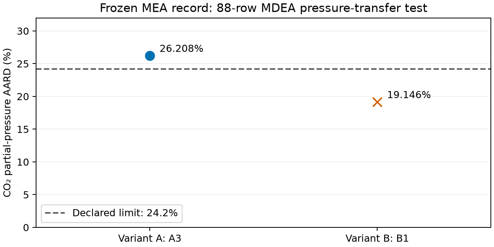
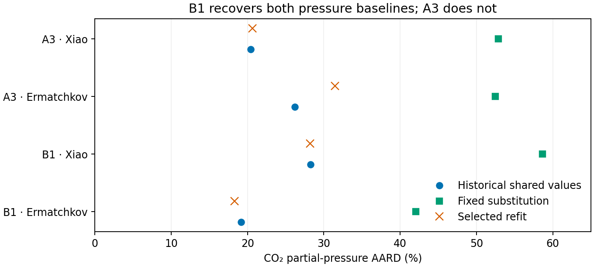

## Shared Part II route qualification (#343 Stage A, 14 November 2026)

The shared [declaration-driven calculation](../part-ii-route.md) reproduces all
**278 frozen B1 fitted predictions exactly** on Engine `391dfe5d`.
Its dimensionless weighted least-squares cost is **374.51907880524016**,
against the retained **374.5190788051367**: relative difference
**2.7622348852673895e-13**, below the owner-set numerical replay tolerance **1e-8**.
The [replay record](results/part-ii-route-replay/replay.json) now retains each
prediction's unit and declared constructor/arguments basis, source row,
residual and cost contribution. The original Stage A claim that units were
retained was incorrect; correction round 1 adds their propagation and declares
units in the existing MDEA dataset owner. The
[declaration](inputs/part-ii-replay.json) binds the frozen reference by hash.
The wheel and F2 shared-values hashes were verified; no Engine source changed.

The correction addresses the independent review's **Not supported** finding
for the shared capability. The original frozen replay was supported. The
following bounded numerical checks are retained for a new independent review;
they are not an F2 MDEA fit or an amine stability campaign.

| Check | Numerical evidence and limit |
|---|---|
| Supplied composition | At 313.15 K, feed water:MDEA:CO2 = 10:1:0.3 mol and parent pressure 26406.39096483641 Pa (1.05 times the bubble pressure), optimized and supplied evaluations are separately available. Native supplied TPD/(RT) is 2.842170943040401e-14, with a descent error estimate 3.461382351678598e-8; no resolved descent is found in this one supplied trial. |
| Full reduction | All 710 rows are retained, 697 predictions are available and 13 native refusals remain explicit. Both zero observations remain in absolute-error statistics and counts; their relative errors are undefined. Every record carries unit and basis, including unavailable predictions. |
| Curve export | One source-bound pressure point at 313.24 K and loading 0.7853846925468954 mol CO2/mol MDEA gives 112004.30580404977 Pa with unit, basis and range marks. This checks export, not the shape or agreement of a fitted model curve. |
| Correlated errors | A three-pressure-row, one-coordinate MDEA probe with one stability observation gives native initial cost 5.238594760243741, replay cost 5.238594760243742 and direct quadratic-form cost 5.238594760243740. Diagonal weighting would give 6.766184472178929. The bounded fit stops at the iteration limit. |
| Continuation and retreat | The #338 calls make three one-iteration attempts on one real MDEA fitted row, with costs 0.5675959520293671, 0.12580000389323778 and 3.852589529149623e-5. The optimizer remains not converged. The one-state native retreat accepts fraction 1, with replay cost 3.8525895292959595e-5; optimizer convergence and termination at an optimizer tolerance both remain false. A separate prescribed-interval decision test checks fraction 0.875 and prevents an interpolated point from inheriting convergence. |
| Complete starts | Two hashed MDEA dissociation laws retain distinct `a` values (-16.398914976729678 and -16.19891497672968), giving distinct source-bound predictions. The native chart accepts pre-existing Born ties once; a deliberately out-of-bound origin is rejected explicitly. These perturbations test transport and are not new scientific starts. |

The [diagnosis](results/part-ii-route-replay/correction-1/supplied-trial-diagnosis.json)
finds the rejected supplied-trial observation call already on main at
`673bceb`. None of the inspected 12 retained #338 grids or the #341 grid
(2484 rows each) entered that branch. Supplied census compositions used the
separate native `eq.stability_test` path. The rejected call raises; the inspected
records contain no silent numerical value from it.

The real **278-row historical B1** conditional-information calculation gives
seven finite conditional standard errors, holding the protonated-MDEA–bicarbonate
interaction at +1 and Born diameter at 7 Å fixed at their active bounds.
The fitted residual variance is 2.763978441367086. These are local conditional
errors under the declared residual model, not parameter-identification or
physical-validation evidence.

| Free coordinate | Conditional standard error | Unit |
|---|---:|---|
| MDEA–water interaction level | 0.00134116789491 | dimensionless |
| MDEA–water linear temperature slope | 0.0000256313289279 | 1/K |
| Protonated-MDEA–CO2 interaction | 0.0293447002312 | dimensionless |
| Protonated-MDEA–water interaction level | 0.00998986339847 | dimensionless |
| Protonated-MDEA–water reciprocal temperature slope | 3.36279114196 | K |
| Protonated-MDEA segment diameter | 0.0306149636367 | Å |
| Protonated-MDEA dispersion energy / Boltzmann constant | 36.6855163738 | K |

Exact values, coordinates and bound conditions are in the
[conditional-information record](results/part-ii-route-replay/correction-1/historical-conditional-uncertainty.json).
The [data rows](results/part-ii-route-replay/correction-1/data-rows.json),
[range-separated deviations](results/part-ii-route-replay/correction-1/deviations.json),
[curve point](results/part-ii-route-replay/correction-1/curve-data.json),
[correlated cost](results/part-ii-route-replay/correction-1/correlated-cost-probe.json),
[continuation and retreat](results/part-ii-route-replay/correction-1/continuation-retreat-probe.json)
and [complete-start check](results/part-ii-route-replay/correction-1/complete-start-probe.json)
retain the evidence. The bounded F2-bound reporting points are unrefitted;
no comparison against published models or measurement uncertainty is inferred
from them. A finite search gives only a lower bound on splits. No full amine
campaign or physical validation is claimed. Stage B still waits for independent
review and merge; these notebook results are not promoted for manuscript use.

The one calculation interval needed by the existing MDEA data declaration is
**288.71–422.04 K**. For shared R1–R3, **273.15–498.15 K is the
source-correlation range stated by Austgen 1991 Table V p.547 (citing Edwards
1978), not verified measured coverage**. MDEA dissociation uses the Part II
278–368 K range. Used laws with unknown source ranges and laws not used in a
problem receive distinct marks; neither is classified inside or outside.
These marks never exclude a calculation state.

Correction round 2 checks the supplied-negative decision on the frozen PZ
#308 A12s endpoint. Hilliard rows 55 and 56 give TPD/(RT)
**-0.030909497986954193** and **-0.043726732681022895**, with native descent
error estimates **2.4419377891537167e-10** and **2.428577955203585e-10**.
The temperatures are 313.179 and 313.201 K; the parent pressures are
11463.926167364934 and 11982.433005315248 Pa. Their supplied evaluations are
available. The optimized searches remain unavailable, and evaluation-only
`resolved_descent` remains false. The [retained comparison](results/part-ii-route-replay/correction-2/supplied-classification.json)
changes the negative supplied count from **0 to 2**, without admitting new
historical split records or claiming stable parents. The shared predicate is
extracted from #338's evaluated-negative-distance decision; the error estimates
are retained, and no new error threshold is introduced.

The production-whitening test now compares `SolventSpecification.whiten`
against the independent quadratic form. All **8 Part II tests pass**; the
MDEA replay above is unchanged. The complete suite has **101 passed and
13 failed**, with 17 passing subtests. A read-only source comparison at
`7bfd0769` gives the same 13 failing test identities (99 passed, with 17
passing subtests). These older wheel/source/reaction-fixture failures remain
an open verification limit; the [verification record](results/part-ii-route-replay/correction-2/verification.json)
retains their identities. This is numerical capability evidence, not a new
PZ fit or physical validation. The owner has not ratified a code ceiling above
400; this correction keeps the existing 487-line executable surface.

## Current B1 adoption (#302, 11 November 2026)

The owner adopted the #298 **B1-endpoint** on the #255 shared values and complete R2 declaration in a [post-hoc owner amendment](https://github.com/tannerpolley/Amine-Thermodynamics/issues/298#issuecomment-6806627180). The original design did not pass every gate. A3 remains unrefit in `solvent_specification_mdea/A3.toml`; its old parameters are inconsistent with the adopted shared set. The A3 refit is retained only as evidence of the MEA → MDEA transfer penalty and is not adopted.

- F2 originally failed both A3 pressure comparisons. The owner treats Xiao's +0.27 percentage point as a measurement-level difference, citing ±1.5% pressure uncertainty. Ermatchkov's +5.23 percentage points remains a systematic loss. B1 passed both pressure comparisons.
- F3 originally failed Carson for B1 (1.132420 × historical scaled RMS, above 1.10) and A3 (1.103341 ×). The owner accepted B1 at scaled RMS 1.106 versus historical 0.977, comparable to accepted A3 historical 1.075.
- The two A3 388.71 K, 60 wt% Merkley heat failures are reported as concentration extrapolations beyond the intended ≤50 wt% domain, rather than gate failures.

The adopted specification replays 278 fitted predictions with maximum relative difference **0**, and cost **374.5190788052401** versus **374.5190788051367** (relative difference **2.7600e-13**). Xiao pressure AARD is **28.1910414167%** (20 rows); Ermatchkov is **18.2705616155%** (88 rows). This is numerical verification and conditional outside-fit assessment on wheel `391dfe5d`, SHA-256 `0962e21d2fa7a8ba1ed4622f1110b3e8053bacd878fa41c999d85e8b9afab66b`; it does not establish new physical validation.

Limits: two active bounds (protonated-MDEA–bicarbonate +1 and Born diameter 7 Å); conditional parameter uncertainty reported in the [adopted-specification notebook](../solvent_specification_mdea/notebook.qmd#parameter-uncertainty-and-sensitivity-307); no F4 phase evidence at 394.94–395.00 K; Kuranov rows 28 and 72 and seven corrected-Kamps states outside the adopted R2 domain; B1 333.15 K / 60 wt% heat unavailable. The retained F4 check covers 775 required records, with zero dense-liquid, ambiguous or unresolved states. No absorber-use qualification is claimed.

[Adoption replay](../solvent_specification_mdea/results/adoption-302/verification.json) and [explicit original verdicts and amendment](results/refit-298/disposition.json) retain the evidence. Independent review of #302 is required before delivery; #298 delivered evidence was Supported at `67cbbd7`. The sections below describe historical studies under their own parameter and wheel bindings.

## Outcome and intended use

The declared comparison between gate-passing starts within 1% of the selected cost passes: A1's 88-row Ermatchkov AARD is 26.208496003%, versus 26.208406176% for A3. The absolute difference is 0.0000898275 percentage points, below the non-identification threshold of 2 percentage points or more. B1 has no qualifying alternative: B3 fails the phase gate, and B2 duplicates B1. This check concerns agreement of pressure predictions between starts; it does not establish identification of individual parameters. The [eligibility and comparison record](results/stage2-capped/equal-cost-starts.json) and [88 A1 row predictions](results/stage2-capped/A1/ermatchkov-88.json) retain the numerical evidence.

Variant A fails the declared 24.2% pressure-transfer test; Variant B passes. AARD is average absolute relative deviation. The endpoints were selected by the lowest fitted cost among candidates passing the density-classified phase gate. Selection was committed in `005f79e` before any outside-fit statistic for the new capped endpoints was computed.

| Endpoint | Cost | Ermatchkov AARD (%) | 24.2% test | Dense splits | Gas states | Reconstruction trials | Other unresolved |
|---|---|---|---|---|---|---|---|
| A3 | 403.7 | 26.21 | Fail | 0 | 39 | 0 | 0 |
| B1 | 374.5 | 19.15 | Pass | 0 | 37 | 0 | 0 |

The pressure test uses all 88 Ermatchkov rows at ≤49 wt% MDEA, including the 29 rows below 7 kPa. The 13 higher-concentration rows and the complete 33-row low-pressure subset are separate comparisons. Nitrogen headspace is not modeled. These are conditional physical assessments of the declared model against outside-fit data. Fitted errors are calibration evidence; phase searches, derivative comparisons and balances are numerical verification. There is no absorber-use qualification or universal-ion-parameter claim.

## Model, inputs and selection

The liquid contains water, CO₂, MDEA, MDEAH⁺, bicarbonate, carbonate, hydronium and hydroxide; only neutral species enter the vapor. Variant A uses the MEA single-sphere cation convention; Variant B uses the charged-molecule convention. The shared MEA components, interactions and reaction laws remain frozen in the main fits. The MDEA–water interaction is linear in temperature, initialized from the Kim pre-fit. Neumann ideal-gas Cp is primary, with Wangler evaluated at the same endpoints as a sensitivity. Carson is integral heat from zero loading at 101325 Pa; Jakobsen scales are 10% of each observed ratio; Böttinger is evaluated at 5 and 25 bar.

Merkley uses the native Engine observable with final loading equal to the smaller of the digitized loading point and model saturation loading at 1121 kPa (1466 kPa for the 422.04 K source rows). Only the 20/40 wt% rows at 333.15 and 388.71 K enter the objective. The reaction domain remains 293.15–395 K; the 288.71/422.04 K Merkley and 413 K Kuranov comparisons are retained as unevaluated domain refusals. The source-loading digitization uncertainty is ±0.02 mol CO₂/mol MDEA. Above Hsieh's 328.15 K, the dielectric temperature dependence is a model assumption. The intended comparison domain is ≤49 wt% for the pressure test and ≤50 wt% for other properties; 60 wt% is extrapolation.

A1, A3, B1 and B3 all converged. A2/B2 are duplicates, and A4 remains excluded. B3 has one unresolved phase record (`comparison:113:0`) and is inadmissible for selection. A1 and A3 have costs differing by less than 1e-8; the declared exact lowest-cost rule selects A3. Active bounds are accepted under the owner's MEA precedent and do not establish that these quantities are experimentally identified.

| Endpoint | Coordinate | Target | Quantity | Value | Bounds |
|---|---|---|---|---|---|
| A3 | 2 | MDEAH⁺–CO₂ | k (dimensionless) | 0.5 | [-0.5, 0.5] |
| A3 | 3 | MDEAH⁺–H₂O | k (dimensionless) | -0.5 | [-0.5, 0.5] |
| A3 | 5 | MDEAH⁺–HCO₃⁻ | k (dimensionless) | -1 | [-1.0, 1.0] |
| A3 | 8 | MDEAH⁺ | Born diameter (Å) | 7 | [2.0, 7.0] |
| B1 | 5 | MDEAH⁺–HCO₃⁻ | k (dimensionless) | 1 | [-1.0, 1.0] |
| B1 | 8 | MDEAH⁺ | Born diameter (Å) | 7 | [2.0, 7.0] |

## Property comparisons

Only the 88-row pressure statistic has a pass bar. Every other value below is a comparison under the frozen data roles and residual definitions.

| Source and role | Variant A AARD (%) | Variant B AARD (%) |
|---|---|---|
| Kuranov total pressure, fitted (69) | 20.17 | 21.11 |
| Jakobsen two speciation ratios, fitted (16) | 13.5 | 13.79 |
| Carson integral heat, fitted (40) | 5.531 | 4.834 |
| Merkley capped heat, fitted (4) | 8.542 | 8.508 |
| Weiland Cp, fitted (33) | 3.354 | 2.656 |
| Weiland loaded density, fitted (33) | 0.2012 | 0.1832 |
| Sobrino density, fitted (24) | 0.05682 | 0.05677 |
| Kim bubble pressure, fitted (61) | 3.224 | 3.23 |
| Hsieh permittivity, frozen coefficients | 4.194 | 4.195 |
| Ermatchkov above 49 wt%, extrapolation (13) | 54.99 | 28.35 |
| Ermatchkov below 7 kPa (33) | 37.12 | 16.84 |
| Primary-set rows below 7 kPa (29) | 33.48 | 16.12 |
| Corrected Kamps pressure, comparison (28) | 18.31 | 25.65 |
| Böttinger amine sum, 5 bar (58) | 7.195 | 7.214 |
| Böttinger amine sum, 25 bar (58) | 7.195 | 7.214 |
| Weiland Cp at 60 wt%, extrapolation (6) | 13.43 | 10.73 |
| Weiland density at 60 wt%, extrapolation (11) | 1.318 | 1.798 |
| Zheng integral heat, comparison (6) | 18.72 | 22.64 |
| Sedighi total pressure, comparison (15) | 80.12 | 74.53 |
| Merkley 60 wt%, 333.15/388.71 K (2) | 25.7 | Unavailable |

Böttinger retains all 58 rows, their DMDEA/byproduct fractions and the flags above the source's 3% amine-balance accuracy. A complete relative bicarbonate AARD is undefined because one observed value is zero; all row-level absolute predictions remain retained. No zero row is silently removed. The additional-source section below supersedes the earlier first-page-only Xiao/Zhang source assessment and records the Derks basis assessment. Zheng uses the source loading for integral heat, with model saturation loading reported separately. Corrected Kamps never enters the follow-up criterion.

| Endpoint | Neumann Cp AARD (%) | Wangler Cp AARD (%) | Change (percentage points) | Kim RMS log ratio |
|---|---|---|---|---|
| A3 | 3.354 | 4.347 | 0.9935 | 0.04392 |
| B1 | 2.656 | 3.4 | 0.7439 | 0.04398 |

The Böttinger comparison uses the declared model sum HCO₃⁻ + CO₃²⁻. The complete Wangler heat/Cp and outside-fit predictions are retained in each endpoint's `wangler-*.json`. Merkley half-loading predictions and the 156 kPa alternatives are retained separately; unavailable out-of-domain rows are not averaged into an apparently complete statistic.

## Saturation truncation and phase search

The phase classifier was declared before refitting: packing fraction above 0.10 is dense; ambiguity near the threshold and other unresolved trials block a clean gate. Gas evolution is reported separately. Zero-loading searches use carbon-free trial supports. Each selected endpoint has 760 state records, including repeated physical states for distinct observables and six formal cap states from the direct saturation diagnostic. Native heat availability is recorded separately. There are zero reconstruction trials, so no residual #904 ion-free recovery is needed. Full state/trial records and hashes are retained, rather than interpreting gas-like liquid seeds as liquid–liquid splitting.

The following loadings are mol CO₂/mol analytical MDEA. A positive truncation means the native heat endpoint is below the source loading point; the 60 wt% entries are extrapolation.

| Endpoint | T (K) | MDEA wt% | Source loading | Model saturation | Heat endpoint | Truncation |
|---|---|---|---|---|---|---|
| A3 | 333.15 | 20 | 1.009 | 1.013 | 1.009 | 0 |
| A3 | 333.15 | 40 | 0.941 | 0.9006 | 0.9006 | 0.04037 |
| A3 | 333.15 | 60 | 0.811 | 0.7819 | 0.7819 | 0.02906 |
| A3 | 388.71 | 20 | 0.587 | 0.4574 | 0.4574 | 0.1296 |
| A3 | 388.71 | 40 | 0.36 | 0.2887 | 0.2887 | 0.07129 |
| A3 | 388.71 | 60 | 0.18 | 0.2065 | 0.18 | 0 |
| B1 | 333.15 | 20 | 1.009 | 1.02 | 1.009 | 0 |
| B1 | 333.15 | 40 | 0.941 | 0.9197 | 0.9197 | 0.02132 |
| B1 | 333.15 | 60 | 0.811 | 0.8069 | Unavailable | Unavailable |
| B1 | 388.71 | 20 | 0.587 | 0.4532 | 0.4532 | 0.1338 |
| B1 | 388.71 | 40 | 0.36 | 0.2581 | 0.2581 | 0.1019 |
| B1 | 388.71 | 60 | 0.18 | 0.1582 | 0.1582 | 0.02184 |

Signed heats below are kJ/mol CO₂; negative is exothermic. Half-loading uses half the source loading point.

| Endpoint | T (K) | MDEA wt% | Observed heat | Capped heat | Half-loading heat |
|---|---|---|---|---|---|
| A3 | 333.15 | 20 | -53.3 | -53.56 | -57.82 |
| A3 | 333.15 | 40 | -55.4 | -64.58 | -66.95 |
| A3 | 333.15 | 60 | -56.8 | -76.27 | -78.01 |
| A3 | 388.71 | 20 | -59.2 | -62.94 | -67.29 |
| A3 | 388.71 | 40 | -62 | -68.7 | -73.83 |
| A3 | 388.71 | 60 | -63.3 | -74.14 | -82.34 |
| B1 | 333.15 | 20 | -53.3 | -54.31 | -57.21 |
| B1 | 333.15 | 40 | -55.4 | -65.93 | -66.03 |
| B1 | 333.15 | 60 | -56.8 | Unavailable | -76.91 |
| B1 | 388.71 | 20 | -59.2 | -62.7 | -66.22 |
| B1 | 388.71 | 40 | -62 | -66.48 | -69.64 |
| B1 | 388.71 | 60 | -63.3 | -64.13 | -70.01 |

At B1, the 333.15 K / 60 wt% native heat is unavailable: a sampled vapor branch is not admitted within the declared grid. The direct diagnostic finds an admitted root near 0.8069, but this does not establish the native observable's uniqueness requirement across the full grid. No complete two-row 60 wt% B AARD is reported. Its 388.71 K prediction is −64.1286 kJ/mol CO₂ against −63.3 observed.

The saturation root is unique only within the declared 30-point search over 0.05–1.50 mol/mol; unsampled paired roots or tangencies can escape it. The gradient is unavailable exactly at the cap switch. Native refused optimizer trials remain in `fit.json`; the selected main fits converged despite their retained refusals. No fallback equation, downstream optimizer, or parameter-independent cap was substituted.

## Local identification and numerical checks

Both selected nine-coordinate Jacobians have rank 9. Their singular values use the declared coordinate scales and weighted residuals:

| Singular-value index | A3 | B1 |
|---|---|---|
| 1 | 106.5 | 106.4 |
| 2 | 13.67 | 13.54 |
| 3 | 9.817 | 7.395 |
| 4 | 3.638 | 6.341 |
| 5 | 2.222 | 4.999 |
| 6 | 0.2303 | 0.599 |
| 7 | 0.2252 | 0.4533 |
| 8 | 0.01931 | 0.02061 |
| 9 | 0.002698 | 0.009007 |

The two weakest-direction bounded objective scans are retained in `local-sensitivity.json`. They are not likelihood profiles; active bounds can block their displacements. Full rank is conditional local information and does not establish universal parameter uniqueness. Each endpoint retains independent fitted-prediction replays, finite-difference comparisons, element/charge balances, solver residuals and full phase evidence. Numerical success is not physical validation.

## Bicarbonate follow-up

| Selected start | Bicarbonate-release pressure AARD (%) | Jacobian correlation with cation–water | Control comparison | Control minus bicarbonate (points) |
|---|---|---|---|---|
| A3 | 20.73 | 0.9939 | UNAVAILABLE | Unavailable |
| B1 | 32.52 | -0.7357 | UNAVAILABLE | Unavailable |

| Control start | Iteration limit | Termination | Cost | Dense split states | Unresolved states | Outside-fit AARD |
|---|---|---|---|---|---|---|
| A3 | 40 | converged | 390.5 | 7 | 1 | Not computed |
| B1 | 40 | limit_reached | 365.8 | 2 | 0 | Not computed |
| B1 | 100 | converged | 365.8 | 2 | 1 | Not computed |

The original B control stopped at the declared 40-iteration limit, with 27 retained saturation refusals and cost 365.820961; its phase results describe that finite, unconverged candidate. The owner authorized one fresh run from the same control start with only the iteration limit raised to 100. Its termination is converged, cost 365.820958506, with 34 refused trials. The released MDEA–CO₂ column's cosine correlation with the cation–water column is 0.134571; at a rejected endpoint this is a diagnostic quantity. The B comparison is UNAVAILABLE under the owner's stopping rule; its control outside-fit AARD and the two-point verdict are unavailable. No further run was made.

The owner's 2026-10-29 decision makes a phase-failed CO₂-control comparison unavailable: retain its endpoint, cost and gate states; do not compute its outside-fit AARD and make no bicarbonate claim for that variant. A bicarbonate-release AARD alone is comparison evidence, not a verdict. A magnitude above 0.95 in the declared column correlation means the pair is non-separable. When a control passes, the declared margin is two AARD percentage points, with the other property results retained; corrected Kamps is excluded. No MDEA outcome falsifies the MEA bicarbonate value, whose MEA conditional uncertainty already spans the declared range.

## Engine acceptance and provenance

All new calculations use the isolated worktree MDEA environment with Engine `d513820994a78bfe628d42fffd55b2eeab6f89bd`, immutable wheel SHA-256 `ca7093ca721fdc80226c74d018a582f31705684c6995e80b0492c193334dd5d5`. The main MEA dependency pins remain on 3e83e19c. Exact wheel path, installed-byte verification and runtime identity are in [runtime.json](results/stage2-capped/runtime.json).

Acceptance (a) passes: the historical A1/B1 754-state searches have zero reconstruction trials; every other classification is unchanged; maximum absolute change in ΔG/RT is 1.82e-12, within the owner's clarified 1e-10 absolute criterion near zero. Acceptance (b) passes: eight start values and four branch checks agree with direct saturation-plus-heat within 4.79e-13 relative, and all nine derivatives pass 1e-5 on both branches (worst error across all 72 comparisons and both declared steps 2.17e-6). Acceptance (c) passes: both 61-row Kim laws replay within 9.33e-15 relative, all 2354 binary phase searches and all mixing scans pass, and item-(l) Cp and the eight retained Carson checks pass. See the [acceptance guide](results/stage2-density/engine-d5138209/README.md).

The [selection](results/stage2-capped/selection.json), endpoint documents, row-level predictions, native failures and phase summaries own the numerical evidence. Newly retained files above 5 MB are gzipped with raw/compressed SHA-256 hashes in [the evidence registry](results/compressed-evidence.json). The manuscript and Engine source are unchanged. Historical pre-cap results remain in their existing result directories and Git history; they are not the selected endpoints shown here.

## Additional sources at the frozen endpoints {#sources-225}

Xiao's 20 equilibrium measurements give CO₂ partial-pressure AARDs of **20.40% at A3** and **28.28% at B1** at 23.5 wt% unloaded MDEA and 298.15–313.15 K.
The source is outside the fitted datasets.
These additional-source comparisons change neither the 24.2% Ermatchkov criterion nor its verdict: A fails and B passes.
No parameters were fitted and no manuscript result is revised.

| Source and quantity | Rows | A3 AARD (%) | B1 AARD (%) | Conditions and disposition |
|---|---:|---:|---:|---|
| Xiao Table 4, CO₂ partial pressure | 20 | 20.397551 | 28.276415 | 23.5 wt%, 298.15–313.15 K, 8.1–60.8 kPa |
| Ermatchkov primary CO₂ partial pressure, retained #222 statistic | 88 | 26.208406 | 19.146012 | ≤49 wt%; unchanged |
| Zhang equilibrium pressure/loading | 16 conditions | Unscored | Unscored | 5 mol/L single MDEA; extrapolation; numerical loadings and conversion density unavailable |
| Derks Table 1, species concentrations | 4 | Unscored | Unscored | 2 kmol/m³ initial MDEA; numerical temperature unavailable |

For Xiao, the calculation follows the #222 bubble-state pressure path at each measured loading and uses $p_{\mathrm{CO_2}}=P y_{\mathrm{CO_2}}$.
The logarithmic residual is $r_i=\ln(p_{i,\mathrm{model}}/p_{i,\mathrm{observed}})$; the reported AARD is $100 N^{-1}\sum_i |\exp(r_i)-1|$, rather than a percentage of logarithms.
The mean absolute log ratios are 0.239241 at A3 and 0.354606 at B1.
All 20 predictions are available at each endpoint, with requested equilibrium tolerances met.
The unloaded MDEA mass fraction is the printed 0.235; the printed rounded molality 2.58 mol/kg water is retained separately.
The experiments used CO₂/N₂ at 0.101 MPa; the model omits nitrogen, as in the Ermatchkov comparison.
These are conditional model predictions compared with measured pressures, not absorber-use qualification.
Source uncertainty is retained without treating it as parameter uncertainty or propagating it into an AARD confidence interval.

The same #222 phase search was applied to each scored bubble state: reacting liquid on all eight species, vapor trials on neutral species, packing-fraction threshold 0.10, and the retained ambiguity interval 0.05–0.35.
At A3 and B1 separately, **20/20 states pass**, with **zero dense-split states, zero gas-evolution states, zero ambiguous states and zero unresolved states**.
No support-reconstruction failures occurred.
Gas evolution is counted separately and is not a dense-liquid failure.
These searches provide numerical evidence for the model's phase assumption at the scored states; they do not establish experimental phase stability or exhaustive global stability.
No phase search is claimed for unscored Zhang or Derks states.

### Source identities, transcription and unavailable quantities

Xiao et al. (2018), DOI 10.1016/j.jct.2018.03.020, **Table 4 and footnote, printed p.175 (PDF p.6)**, supplies all 20 rows in [the transcription](../../data/reference/MDEA/Xiao2018_context.csv).
The full 13-page PDF is attachment **C3NAG687**, SHA-256 `7c33012580b85fc940b0efe54380ee65c1745077382c41cd8605c309171f9975`, under new parent **6H2LM5C5**.
Old parent **WE7ZG7KW** retains first-page attachment **F3EC6J42**.
The footnote states standard uncertainties: pressure 1.5%, temperature 0.1 K, loading 0.004 mol CO₂/mol amine, unloaded MDEA 0.1 wt%, CO₂ 0.04 wt% and molality 0.01 mol/kg water.
The printed source-model loading and deviation columns are retained without using them as observations.

Zhang et al. (2023), DOI 10.1016/j.cej.2023.143279, **§2.2 (PDF p.2), §3.3 and Figures 6–9 (PDF pp.6–8)**, specifies 5 mol/L single MDEA and equilibrium experiments at 298, 303, 313 and 323 K, each at 5, 14, 30 and 60 kPa CO₂ partial pressure.
All 16 conditions per endpoint remain [explicitly unscored](results/context-sources/unscored-states.json).
The equilibrium loadings are graphical, not tabulated; main Tables 1–3 contain correlation coefficients.
The [author supplement at CNR](https://iris.cnr.it/handle/20.500.14243/439094), SHA-256 `8488f03dfdb693095b038d53c41a2ea1e8df70abc17d701d63002687498d38b1`, has four pages and supplies **Table S2, p.2**: [eight transient pure-MDEA rows](../../data/reference/MDEA/Zhang2023_context_transient.csv), including the unloaded row, with time, loading and species amounts in mol for 80 mL at 298 K.
These are time-dependent absorption measurements, not equilibrium pressure observations.
The paper's endpoint criterion is loading unchanged for two hours within ±0.002 C/N, with duplicate maximum deviation from the mean below 1%; Table S2 has no per-row uncertainty.
No numerical unloaded-solvent density was found in the main paper or supplement to convert 5 mol/L to mass fraction.
The issue's “about 57 wt%” remains a domain designation, not a substituted conversion datum.
Every prospective Zhang comparison is **extrapolation** beyond the 49/50 wt% domain.
No correlation-generated loadings or assumed density were substituted for observations.
The full 10-page PDF is **DJURMPCM**, SHA-256 `b29bc0ee96ad0695b1673dd4056d1c8cc7fb9cf7a0efed98ce6393935bb2d24e`, under new parent **PYMWILJ7**; old parent **TMHPSMM9** retains first-page attachment **PU7B5G27**.
The downloaded supplement has no Zotero attachment identity; no library item was changed.

Derks et al. (2011), DOI 10.1016/j.egypro.2011.01.094, **Table 1, printed p.603 (PDF p.5)**, supplies [four rows](../../data/reference/MDEA/Derks2011_context.csv) at loadings 0, 0.11, 0.42 and 0.80 mol CO₂/mol MDEA.
Parent **48VSQYEE**, attachment **5467GXJK**, SHA-256 `b646d4caafe53705d0b064698061f487fdc7f87d6e23908b6b31fb8029738582`, identifies the seven-page PDF.
The initial solvent is aqueous 2 kmol/m³ MDEA, and all three species columns are concentrations per liquid volume in kmol/m³.
Printed ± entries are retained, including zeros; the source does not state their confidence level.
The experimental description (§2, pp.600–602), abstract and Table 1 give ambient or room temperature without a numerical value.
Thus the volume-concentration basis is identified, but a numerical temperature and a density-based conversion to the model feed remain unavailable.
All four rows remain unscored at both endpoints; neither 298.15 K nor a mass fraction was assumed.

[Source provenance and table hashes](../../data/reference/MDEA/context-sources.json), [row predictions](results/context-sources/A3-Xiao.json), [B1 predictions](results/context-sources/B1-Xiao.json), [phase searches](results/context-sources/A3-phase.json), [B1 searches](results/context-sources/B1-phase.json), [numerical checks](results/context-sources/numerical-checks.json) and [summary](results/context-sources/summary.json) retain the evidence.
The calculation uses the separate worktree MDEA environment and the immutable merged Engine main-d513820 wheel, SHA-256 `ca7093ca721fdc80226c74d018a582f31705684c6995e80b0492c193334dd5d5`; installed Engine files were checked byte-for-byte against that wheel.
Run `agent-heavy nice -n 10 .venv/bin/python -I analyses/mdea_mea_workflow/scripts/score_context.py` from this worktree, then `nice -n 10 .venv/bin/python -I analyses/mdea_mea_workflow/scripts/plot_context.py` for the retained-value figure.
Pool size comes from the full CPU count, with one BLAS thread per process.

## Shared bicarbonate sensitivity and the Xiao pressure miss

At the frozen MDEA endpoints, reducing the bicarbonate–water interaction from
$k=0.7270558477497251$ to $0.6270558477497251$ improves Xiao agreement for both
cation representations. It improves the Ermatchkov comparison for the single
sphere A3 but worsens it for charged-molecule B1. The same change raises the
MEA 307-observation weighted cost from 148.879 to 157.930. These are conditional
parameter sensitivities, not an adopted shared value or evidence that the
cation representation alone controls the pressure error.

Xiao Table 4 supplies 20 measurements at 23.5 wt% unloaded analytical MDEA,
298.15–313.15 K and 8.1–60.8 kPa CO₂ partial pressure. The molality calculated
from that mass fraction is 2.57791 mol/kg water, consistent with the printed
2.58. Loading is moles of added CO₂ per mole of analytical MDEA. Section 3.2
and the table footnote identify CO₂/N₂ at 0.101 MPa total pressure. The
calculation retains the existing nitrogen-free bubble state and computes
$P y_{\mathrm{CO_2}}$. It therefore matches the reported quantity's label but
not the experiment's total-pressure state. Nitrogen and this pressure-state
difference remain unresolved; the results do not isolate an intrinsic
physical-model cause for the Xiao miss.

The live full Xiao PDF (Zotero `6H2LM5C5` / `C3NAG687`) matches the retained
SHA-256. Ermatchkov's current reading copy also matches the indexed Zotero
sidecar. Its Experimental Technique and Tables 1–3 establish the molality
basis for the 88 primary comparison rows. [Source checks and input hashes](results/transfer-267/source-basis.json)
record these findings. The four-reaction chemistry retains R1–R3 and the
MDEAH⁺ dissociation direction and reference convention. Uyan 2015 §3 and Table 1
supply the mole-fraction law; its molality conversion adds 4.0165 to $\ln K$.
It gives $pK_m=8.54994$ at 298.15 K, versus 8.55071 from the Kamps–Maurer law.
The [existing source comparison](results/reaction-basis-kamps-maurer.json)
attributes the small difference to printed coefficient rounding. Application
above the source's 368 K limit remains extrapolation. No chemistry law was
adjusted in these probes. Xiao's own modified Kent–Eisenberg model
(§2, Eqs. 1–15) correlates its effective dissociation constant with temperature
and physical CO₂ solubility. That fitted relation is not a replacement for
the retained thermodynamic dissociation law. These comparisons use the
experimental loading column, not Xiao's calculated loading column.

AARD is $100\langle|p_{\rm calc}/p_{\rm obs}-1|\rangle$; bias is the signed
mean of the same relative error. All 108 pressure states per probe returned
values. Their declared finite phase searches detected zero dense-liquid or
gas witnesses and zero unresolved states. This does not establish global
stability. The original pressure predictions replay within $10^{-8}$ relative
(or $10^{-8}$ Pa near zero).

| Representation and probe | Shared $k$ | Xiao AARD (%) | Xiao bias (%) | Ermatchkov AARD (%) | Ermatchkov bias (%) |
|---|---:|---:|---:|---:|---:|
| A3 baseline | 0.727056 | 20.3976 | −20.3976 | 26.2084 | −18.8835 |
| A3, $k-0.1$ | 0.627056 | 10.5526 | −3.3441 | 23.1772 | −1.3759 |
| A3, $k+0.1$ | 0.827056 | 34.4541 | −34.4541 | 34.7715 | −32.9226 |
| A3, retained joint refit | 0.294490 | 19.1954 | −18.6376 | 20.7305 | −5.7513 |
| B1 baseline | 0.727056 | 28.2764 | −28.2066 | 19.1460 | +0.8939 |
| B1, $k-0.1$ | 0.627056 | 16.4205 | −11.9838 | 27.2756 | +23.2050 |
| B1, $k+0.1$ | 0.827056 | 41.4631 | −41.4631 | 23.3225 | −16.9997 |
| B1, retained joint refit | −0.086756 | 30.0501 | −30.0501 | 32.5173 | −31.2243 |

The retained joint refits also changed MDEA-specific coordinates. They do not
isolate bicarbonate sensitivity. The separate frozen-endpoint $k\pm0.1$
calculations do. The 24.2% Ermatchkov criterion is a repository assessment
limit, not experimental uncertainty. A3 at $k-0.1$ enters that limit; B1 at the
same shared value leaves it. None of these cases eliminates the negative Xiao
mean bias in both representations while meeting the Ermatchkov criterion for
both.

### Consequences for the frozen MEA parameter record

Every tested shared value was evaluated on all 307 MEA fitted observations,
with every other parameter and law fixed. All 307 predictions were available
at each value. The original endpoint cost replays to $10^{-10}$ relative.
These costs use the existing observation scales and weights; they are not
uncertainty intervals or independent validation statistics.

| Shared bicarbonate–water $k$ | MEA 307-row cost | Common149 cost | Restored-species cost | Jakobsen cost |
|---:|---:|---:|---:|---:|
| 0.7270558477, baseline | 148.87894 | 23.86100 | 2.44867 | 13.12218 |
| 0.6270558477 | 157.93049 | 33.86784 | 2.85583 | 11.78620 |
| 0.8270558477 | 158.79830 | 31.65398 | 2.04713 | 15.61860 |
| 0.2944901719, A3 joint-refit value | 289.82399 | 165.96290 | 4.04353 | 10.45523 |
| −0.0867558092, B1 joint-refit value | 532.29579 | 406.90172 | 4.90988 | 11.14717 |

The common149 group contains the retained pressure/species/heat observations;
its row predictions and the separate restored-species and Jakobsen groups
are retained with every other group in [the MEA results](results/transfer-267/mea/).
The two joint-refit shared values roughly double or more than triple the MEA
cost without refitting MEA. Their MDEA scores alone therefore cannot recommend
a usable shared value. This study does not apply a new MEA accept/reject
threshold. Issue #266 owns the separate minor-species refits; no matching
retained results from that issue were available in this checkout when these
consequences were calculated.

### Testing the active parameter bounds

One matched refit per representation uses the original fitted observations,
weights and scales, starting from the selected endpoint. Shared values remain
at the MEA baseline. Only four finite search limits change: cation–CO₂ and
cation–water constant $k$ use [−0.6, 0.6], cation–bicarbonate uses [−1.2, 1],
and Born diameter uses [1.5, 8] Å. The other limits and nine-coordinate
parameterization are unchanged. Native fitting retains the 40-iteration and
2100-second limits and the original tolerances.

These intervals test whether artificial search limits control the comparison;
they are not measured physical parameter ranges. Uyan 2015 Eq. 7 gives
$u_{ij}=\sqrt{u_i u_j}(1-k_{ij})$. Requiring nonnegative unlike attraction
excludes $k>1$ under that interpretation. Positive component energies and
diameters are also necessary conditions. They do not establish parameter
identifiability or physical validation. The cation–water temperature law is
checked at 293.15 and 395 K, the endpoints of this assessment interval.

The A3 fit converges in 13 iterations, with weighted cost 396.38810 versus
403.71499 at the original endpoint. Its Ermatchkov AARD is 20.43947%, with
+5.24458% bias; Xiao AARD is 20.96662%, with −19.66526% bias and 17/20
underpredictions. The cation–water $k=-0.6$, cation–bicarbonate $k=-1.2$ and
Born diameter 8 Å reach the expanded bounds. Its cation–water law remains
below 1 at both temperature endpoints. Thus expanding the box changes the
pressure comparison but does not remove bound dependence or the Xiao miss.
Its finite full-state phase search covers 754 states, detects 35 gas-evolution
witnesses, and detects no dense-liquid split or unresolved state. These gas
witnesses are distinct from the rejected dense-liquid phase condition. [Fit, replay and phase evidence](results/transfer-267/A3-bounds/)
retain every original fitted group, native trial failure and phase classification.

The B1 expanded-bound fit converges in 5 iterations at cost
373.17470, versus 374.45201 originally. Its Xiao AARD/bias remain
28.02791% / −27.95981%; Ermatchkov gives 18.99988% / +0.10828%.
Its 754-state finite phase search detects 36 gas-evolution witnesses, no
dense-liquid split, and no unresolved state. Cation–bicarbonate $k=1$ and
Born diameter 8 Å remain bound-active.
Extending the former beyond 1 would leave the adopted nonnegative unlike-attraction
interpretation. Neither fit isolates the cation, and the pressure ranking remains
reversed between the sources. These two finite box extensions do not support
an unrestricted statement about every admissible parameterization.

Every original fitted property group remains in the objective. Their weighted
costs are retained below; heterogeneous groups must not be compared as equally
weighted physical errors. Fresh native-prediction replays reproduce weighted
residuals within $10^{-8}$ absolute and cost within $10^{-8}$ relative.

| Fitted group | A3 baseline cost | A3 expanded cost | B1 baseline cost | B1 expanded cost |
|---|---:|---:|---:|---:|
| Kuranov | 17.97147 | 23.49031 | 20.35356 | 19.79171 |
| Jakobsen | 21.34983 | 21.33020 | 22.01985 | 22.01831 |
| Carson | 23.11187 | 21.07040 | 19.07573 | 19.04978 |
| Merkley | 7.79258 | 6.52739 | 7.93742 | 7.73542 |
| Cp | 82.58162 | 73.04635 | 54.30857 | 53.85153 |
| loaded-density | 1.15602 | 1.26196 | 1.24237 | 1.22307 |
| unloaded-density | 249.69275 | 249.60260 | 249.45551 | 249.44586 |
| Kim | 0.05884 | 0.05888 | 0.05901 | 0.05902 |

### The missing 333 K heat

The charged-molecule B1 native saturation-capped heat at 333.15 K, 60 wt% MDEA,
1121 kPa and source loading cap 0.811 mol/mol remains unavailable after
refining the loading search from the original 30 samples to 60 and 120 samples
over the same 0.05–1.50 mol/mol bounds. The native diagnostic cannot admit a
vapor-density branch: at the original grid it finds a stable root at
33402.24 mol/m³ above a negative-slope sample at 10464.56 mol/m³, with an
unexamined gap and unresolved slope reversals. Finer loading sampling changes
the failing density values but does not resolve branch admission. This is a
numerical search limitation; it does not show that absorption heat is
physically undefined.

| Control, at 60 wt% and 1121 kPa | 30-sample heat (kJ/mol CO₂) | 60-sample heat | 120-sample heat |
|---|---:|---:|---:|
| A3, 333.15 K | −76.268595 | −76.268595 | −76.268595 |
| B1, 388.71 K | −64.128582 | −64.128582 | −64.128582 |

The controls' largest change is below $4\times10^{-9}$ J/mol CO₂. The separate
saturation diagnostic near 0.80691 mol/mol was not substituted for the native
observable. No complete two-observation B1 60 wt% heat AARD is calculated.
Sixty wt% remains a composition extrapolation. [The exact reproducer](results/transfer-267/heat-reproducer.json)
retains parameter documents, caloric and reaction declarations, all grids,
failure messages and the requested upstream check. The requested correction
must preserve the full-grid uniqueness check and both controls. The
[original wheel results](results/transfer-267/heat.json) separate the failure
from these useful control heat values.

The latest merged Engine main tested here is `4ffbb2b0825a28cdfa87dc333a586e641ff4c4b0`,
with wheel SHA-256 `40a58fc8f341f2ef4d9f26ae604cda93a5380e2a87073147bc2ba8efb17864b2`.
An unmodified archive of that fetched commit was built and installed in a separate
worktree environment. The [latest-wheel reproduction](results/transfer-267/heat-latest.json)
returns the same B1 333.15 K refusal on every grid. Both controls agree with the
original wheel within $1.4\times10^{-13}$ relative. The failure therefore persists
on that merged main commit. The combined [heat reproducer](results/transfer-267/heat-reproducer.json)
contains both wheel identities, all input documents, grids, outputs and the stated
correction criteria. The orchestrator owns the Engine request; this study has not
changed Engine source or adopted the diagnostic wheel.

For #255 stage 3, retain both cation representations and test the final MEA
shared values with these source-specific consequences visible. The small
bicarbonate decrease is a sensitivity direction for joint assessment, not a
parameter recommendation. The existing joint-refit shared values cause much
larger MEA cost increases, while bound release does not remove the Xiao miss.
Resolve the Engine heat search separately before reporting a complete B1
60 wt% heat statistic. No new parameter record is adopted.

### Calculation identity and reproduction

The pressure, heat-grid and MDEA parameter probes use merged Engine
`d513820994a78bfe628d42fffd55b2eeab6f89bd`, wheel SHA-256
`ca7093ca721fdc80226c74d018a582f31705684c6995e80b0492c193334dd5d5`.
The MEA consequences use merged Engine `3e83e19c`, wheel SHA-256
`0d08dff9be39fb8fc9018119c47612f53d823cd0e456914d7dd44c6941596804`.
Each process verifies installed Engine files byte-for-byte against its wheel.
The original MEA and MDEA dependency pins are unchanged. Runtime and row-level
values are retained under [transfer-267](results/transfer-267/).

The [probe driver](scripts/transfer_probes.py) uses the existing MDEA
application declarations and native Engine observations, fitting and phase
searches. Run `agent-heavy .venv/bin/python analyses/mdea_mea_workflow/scripts/transfer_probes.py`
with argument `heat`, `pressure` or `fit` in the prepared MDEA environment.
For `mea`, use the main checkout's MEA interpreter on that same worktree script.
`present` reads retained numbers and creates the pressure figure without
calculating model predictions. The optional latest-main heat command takes
`latest-heat`, the built wheel path and its merged commit as arguments; it
uses a separate environment and does not qualify that wheel for the other
calculations.

The independent design review returned **Ready** before numerical execution.
Independent delivered review returned **Supported** for numerical and scientific
content at commit `407604db3d25326d4b09e2640a7587e4fd66c635`, against base
`30db72afad45232c36f8bfce82ea80278f3267e2`. The supported use is conditional
numerical sensitivity and comparison with measured pressures, informing #255
stage 3. The heat remains a documented Engine numerical-search limitation.
This review record changes no numerical evidence. The notebook has not been
promoted for manuscript use. They support conditional numerical
sensitivity and comparison with physical observations within the stated
pressure-state, source, finite-search and composition limits. They do not
qualify absorber use.

## Issue 298: MDEA refits with the adopted shared MEA values

**The declared refits do not recover all required properties.** B1 recovers both pressure baselines; A3 recovers neither. Both selected records fail the Carson group-preservation rule. A3 also fails two outside-fit heat checks at 388.71 K and 60 wt% MDEA. This is the transfer penalty of the adopted shared set under this model, objective, bounds and declared starts, rather than a global impossibility result.

The historical costs reproduce after restoring the pre-0e216fe water ideal-gas calorics in scratch. The refits use current calorics and the pinned 391dfe5d wheel. Kuranov source rows 28 and 72 are excluded from both baselines and refits, leaving 278 fitted observations. The adopted R2 law is unchanged.

These are calibration and numerical verification results for the manuscript workflow comparison. They do not establish absorber suitability or parameter transferability. No parameters are adopted. Independent delivered-evidence review and investigator promotion remain pending.

### Historical confirmation and rebased costs

| Record | Retained historical cost, 280 rows | Earlier-water replay, 280 rows | Relative difference | Current-input baseline, 278 rows | Fixed shared substitution, 278 rows |
|---|---:|---:|---:|---:|---:|
| A3 | 403.714985147052 | 403.714985147345 | 7.25e-13 | 403.307869920741 | 450.976082646481 |
| B1 | 374.452013423974 | 374.452013423993 | 4.95e-14 | 373.659545206477 | 431.191955444524 |

The water caloric change is the explained historical difference. Earlier failed old-wheel and current-wheel results remain historical evidence in F1.json; they are superseded as stopping decisions by the successful coefficient confirmation and the owner rebase.

### Declared bounded fits

| Start | Status | Cost | Iterations | Wall time, s | Rank | Active coordinate indices, zero based |
|---|---|---:|---:|---:|---:|---|
| A3-endpoint | converged | 403.571525172116 | 10 | 103.78 | 9 | [2, 3, 5, 8] |
| A3-alternative | converged | 403.571525151964 | 11 | 117.62 | 9 | [2, 3, 5, 8] |
| B1-endpoint | converged | 374.519078805137 | 11 | 137.49 | 9 | [5, 8] |
| B1-alternative | converged | 392.924179859028 | 17 | 242.44 | 9 | [3, 8] |

The controls remain 40 iterations, 2100 seconds, function and parameter tolerances 1e-10, and gradient tolerance 1e-8. Native refusals, iteration costs, Jacobians and weak directions are retained per start. Bounds are computational limits, not confidence intervals.

### Endpoint eligibility and gates

- A3-endpoint: eligibility True; 775 phase records, 0 dense-liquid states, 0 ambiguous states, 0 unresolved checks, 39 gas-witness states; derivative pass True; maximum relative element error 4.94e-13, maximum absolute charge error 3.97e-13 mol.
- A3-alternative: eligibility True; 775 phase records, 0 dense-liquid states, 0 ambiguous states, 0 unresolved checks, 39 gas-witness states; derivative pass True; maximum relative element error 4.94e-13, maximum absolute charge error 2.23e-13 mol.
- B1-endpoint: eligibility True; 775 phase records, 0 dense-liquid states, 0 ambiguous states, 0 unresolved checks, 37 gas-witness states; derivative pass True; maximum relative element error 9.18e-13, maximum absolute charge error 4.76e-13 mol.
- B1-alternative: eligibility True; 775 phase records, 0 dense-liquid states, 0 ambiguous states, 0 unresolved checks, 35 gas-witness states; derivative pass True; maximum relative element error 5.31e-13, maximum absolute charge error 3.34e-13 mol.

Frozen selection: {'A3': {'name': 'A3-alternative', 'cost': 403.5715251519642, 'endpoint_sha256': 'bf448013a5a195e266ed4f1ad9262b3d2a6068f818e6a17e629f3c3e06c18674'}, 'B1': {'name': 'B1-endpoint', 'cost': 374.5190788051367, 'endpoint_sha256': '2a5341be176829d087133a1467828f762a655f92a586eb1062a5719a58142d9d'}}.

F1 passes the owner-amended 278-row replay; the maximum independent residual discrepancy is 1.55e-15. F2–F4 details and their numerical evidence are in gates.json. F5 preserves the declared experiment: no widened bounds, changed weights, released shared interaction, shortened heat grid, Engine edits or adoption.

F2 fails for A3 and passes for B1. The separate older Ermatchkov ≤24.2% criterion fails for A3 (31.441683%) and passes for B1 (18.270562%). F3 fails for both: Carson scaled-RMS ratios are 1.103341 and 1.132420 against the allowed 1.10. The Carson pressure-sensitivity changes are 0.146065% and 0.150275%, both below 0.5%.

F4 passes on the owner-amended domain: each selected endpoint has 775 required phase records, no dense-liquid witnesses, no ambiguous states and no unresolved checks. Gas witnesses are reported separately (39 for A3, 37 for B1), with none at mandatory Carson states. All four Jacobians have rank 9. The qualifying A3 starts differ by 0.000331 percentage point in Ermatchkov AARD, below the 2-point warning threshold; the B1 alternative is outside the 1% cost window. F5 retains the bounded-experiment outcome, with no change to the adopted shared values or fitting policy.

### Pressure comparisons

All three cases use current caloric inputs and the pinned 391dfe5d wheel. “Historical” means the historical shared law and MDEA parameters replayed on that wheel; “fixed substitution” changes only the shared bicarbonate–water interaction and complete R2 law to #255; “refit” uses the frozen selected endpoint. Xiao and Ermatchkov remain outside the fit.

| Record | Source | Rows per case | Historical AARD, % | Fixed-substitution AARD, % | Refit AARD, % |
|---|---|---:|---:|---:|---:|
| A3 | Xiao | 20 | 20.397550919 | 52.860207512 | 20.663633355 |
| A3 | Ermatchkov | 88 | 26.208406176 | 52.471988578 | 31.441682923 |
| B1 | Xiao | 20 | 28.276415410 | 58.638814923 | 28.191041417 |
| B1 | Ermatchkov | 88 | 19.146012403 | 42.034976805 | 18.270561616 |

Points compare historical, fixed-substitution and selected-refit scalar per-source AARDs on the same wheel: 20 Xiao rows and 88 primary Ermatchkov rows. No parameter or measurement uncertainty was estimated. The comparison is conditional model assessment, not new physical validation. Exact plotted values are retained in pressure-comparison.csv.

The earlier current-shared-value pressure AARDs were A3 Xiao 20.397551%, A3 Ermatchkov 26.208406%, B1 Xiao 28.276415%, and B1 Ermatchkov 19.146012%. Rebased same-wheel values above are the actual comparison baselines. Pressure recovery is source specific, with 1e-6 percentage-point comparison tolerance; the older Ermatchkov 24.2% criterion remains separate.

#### A3 property preservation

| Group | Baseline scaled RMS | Refit scaled RMS | Ratio | Pass ≤1.10 |
|---|---:|---:|---:|---|
| Kuranov | 0.217138179 | 0.209084852 | 0.96291151 | True |
| Jakobsen | 1.63362444 | 1.62610884 | 0.995399428 | True |
| Carson | 1.07498539 | 1.18607593 | 1.10334144 | False |
| Merkley | 1.97390273 | 2.0531751 | 1.04016022 | True |
| Cp | 2.23736961 | 2.18531131 | 0.976732363 | True |
| loaded-density | 1.52054027 | 1.46684488 | 0.964686639 | True |
| unloaded-density | 1.44248843 | 1.44235628 | 0.999908383 | True |
| Kim | 0.0439221728 | 0.0439411876 | 1.00043292 | True |

Outside-fit heat checks: 12 pass, 2 fail, 12 without a historical numerical comparator. Full row identities, availability and values are retained in gates.json.

#### B1 property preservation

| Group | Baseline scaled RMS | Refit scaled RMS | Ratio | Pass ≤1.10 |
|---|---:|---:|---:|---|
| Kuranov | 0.229273545 | 0.223438188 | 0.974548494 | True |
| Jakobsen | 1.65906049 | 1.63947745 | 0.988196309 | True |
| Carson | 0.976619829 | 1.10594401 | 1.13242019 | False |
| Merkley | 1.99216201 | 2.01558215 | 1.01175614 | True |
| Cp | 1.81414132 | 1.760133 | 0.970229265 | True |
| loaded-density | 1.57630501 | 1.58828838 | 1.00760219 | True |
| unloaded-density | 1.44180301 | 1.44166289 | 0.999902819 | True |
| Kim | 0.0439848664 | 0.0440063978 | 1.00048952 | True |

Outside-fit heat checks: 13 pass, 0 fail, 13 without a historical numerical comparator. Full row identities, availability and values are retained in gates.json.

### Three-case heat comparisons

Scaled RMS values below use the frozen heat residual scales; they are dimensionless. The Carson and fitted Merkley rows remain calibration evidence. Heat values in the outside-fit tables are signed integral enthalpies in kJ/mol CO₂ (negative is exothermic), using the existing Neumann calorics, pressure assignments, capped loading definition and full 30-node search. The half-loading diagnostic retains its original meaning. No uncertainty was estimated.

| Record | Fitted heat group | Rows | Historical scaled RMS | Fixed-substitution scaled RMS | Refit scaled RMS | Refit / historical |
|---|---|---:|---:|---:|---:|---:|
| A3 | Carson | 40 | 1.074985386 | 1.241034460 | 1.186075926 | 1.103341442 |
| A3 | Merkley | 4 | 1.973902729 | 3.089343204 | 2.053175105 | 1.040160224 |
| B1 | Carson | 40 | 0.976619829 | 1.111056735 | 1.105944013 | 1.132420191 |
| B1 | Merkley | 4 | 1.992162010 | 3.162675978 | 2.015582148 | 1.011756141 |

Both refits still fail the Carson limit of 1.10 times the historical RMS. The added substitution assessments do not change F1–F5, selection or endpoint hashes.

#### A3 outside-fit heats

| Group | Source row | Temperature, K | MDEA, wt% | Observed | Historical | Fixed substitution | Refit |
|---|---|---:|---:|---:|---:|---:|---:|
| Merkley-half-loading | — | 288.71 | 20 | -47.300000 | outside domain | outside domain | outside domain |
| Merkley-outside | — | 288.71 | 20 | -47.300000 | outside domain | outside domain | outside domain |
| Merkley-half-loading | — | 288.71 | 40 | -49.300000 | outside domain | outside domain | outside domain |
| Merkley-outside | — | 288.71 | 40 | -49.300000 | outside domain | outside domain | outside domain |
| Merkley-half-loading | — | 288.71 | 60 | -50.800000 | outside domain | outside domain | outside domain |
| Merkley-outside | — | 288.71 | 60 | -50.800000 | outside domain | outside domain | outside domain |
| Merkley-half-loading | — | 333.15 | 20 | -53.300000 | -57.817198 | -58.446554 | -57.551526 |
| Merkley-half-loading | — | 333.15 | 40 | -55.400000 | -66.953455 | -69.087135 | -67.230919 |
| Merkley-half-loading | — | 333.15 | 60 | -56.800000 | -78.010068 | -81.736935 | -78.932567 |
| Merkley-outside | — | 333.15 | 60 | -56.800000 | -76.268595 | -82.807447 | -76.567791 |
| Merkley-half-loading | — | 388.71 | 20 | -59.200000 | -67.289475 | -69.900697 | -67.592150 |
| Merkley-half-loading | — | 388.71 | 40 | -62.000000 | -73.833565 | -80.762448 | -75.415201 |
| Merkley-half-loading | — | 388.71 | 60 | -63.300000 | -82.344969 | -94.396098 | -85.682725 |
| Merkley-outside | — | 388.71 | 60 | -63.300000 | -74.141516 | -89.705250 | -77.732589 |
| Merkley-half-loading | — | 422.04 | 20 | -63.100000 | outside domain | outside domain | outside domain |
| Merkley-outside | — | 422.04 | 20 | -63.100000 | outside domain | outside domain | outside domain |
| Merkley-half-loading | — | 422.04 | 40 | -65.300000 | outside domain | outside domain | outside domain |
| Merkley-outside | — | 422.04 | 40 | -65.300000 | outside domain | outside domain | outside domain |
| Merkley-half-loading | — | 422.04 | 60 | -67.700000 | outside domain | outside domain | outside domain |
| Merkley-outside | — | 422.04 | 60 | -67.700000 | outside domain | outside domain | outside domain |
| Zheng | 1 | 323.15 | 30.0 | -53.800000 | -57.085917 | -59.165704 | -56.727511 |
| Zheng | 2 | 323.15 | 30.0 | -53.450000 | -56.251890 | -58.326763 | -55.887409 |
| Zheng | 3 | 323.15 | 50.0 | -55.960000 | -69.054093 | -72.884221 | -69.117316 |
| Zheng | 4 | 323.15 | 50.0 | -52.210000 | -66.908309 | -71.614517 | -66.710191 |
| Zheng | 5 | 323.15 | 50.0 | -48.680000 | -61.803386 | -66.016506 | -61.594171 |
| Zheng | 6 | 323.15 | 50.0 | -47.570000 | -58.241473 | -62.010976 | -58.091294 |

Available outside-fit heats: historical 14/26, fixed substitution 14/26, refit 14/26. Each column retains the same 26 row identities; 288.71 K rows remain outside the declared domain. Native refusals and full messages are retained in each case’s comparisons.json.

#### B1 outside-fit heats

| Group | Source row | Temperature, K | MDEA, wt% | Observed | Historical | Fixed substitution | Refit |
|---|---|---:|---:|---:|---:|---:|---:|
| Merkley-half-loading | — | 288.71 | 20 | -47.300000 | outside domain | outside domain | outside domain |
| Merkley-outside | — | 288.71 | 20 | -47.300000 | outside domain | outside domain | outside domain |
| Merkley-half-loading | — | 288.71 | 40 | -49.300000 | outside domain | outside domain | outside domain |
| Merkley-outside | — | 288.71 | 40 | -49.300000 | outside domain | outside domain | outside domain |
| Merkley-half-loading | — | 288.71 | 60 | -50.800000 | outside domain | outside domain | outside domain |
| Merkley-outside | — | 288.71 | 60 | -50.800000 | outside domain | outside domain | outside domain |
| Merkley-half-loading | — | 333.15 | 20 | -53.300000 | -57.208494 | -57.856333 | -56.882295 |
| Merkley-half-loading | — | 333.15 | 40 | -55.400000 | -66.030627 | -68.225366 | -66.211889 |
| Merkley-half-loading | — | 333.15 | 60 | -56.800000 | -76.913111 | -80.690116 | -77.536120 |
| Merkley-outside | — | 333.15 | 60 | -56.800000 | refused | refused | refused |
| Merkley-half-loading | — | 388.71 | 20 | -59.200000 | -66.220141 | -68.941131 | -66.111096 |
| Merkley-half-loading | — | 388.71 | 40 | -62.000000 | -69.641790 | -77.642746 | -69.877407 |
| Merkley-half-loading | — | 388.71 | 60 | -63.300000 | -70.005790 | -86.759093 | -70.480750 |
| Merkley-outside | — | 388.71 | 60 | -63.300000 | -64.128582 | -82.468989 | -64.490952 |
| Merkley-half-loading | — | 422.04 | 20 | -63.100000 | outside domain | outside domain | outside domain |
| Merkley-outside | — | 422.04 | 20 | -63.100000 | outside domain | outside domain | outside domain |
| Merkley-half-loading | — | 422.04 | 40 | -65.300000 | outside domain | outside domain | outside domain |
| Merkley-outside | — | 422.04 | 40 | -65.300000 | outside domain | outside domain | outside domain |
| Merkley-half-loading | — | 422.04 | 60 | -67.700000 | outside domain | outside domain | outside domain |
| Merkley-outside | — | 422.04 | 60 | -67.700000 | outside domain | outside domain | outside domain |
| Zheng | 1 | 323.15 | 30.0 | -53.800000 | -58.271220 | -60.413136 | -58.254683 |
| Zheng | 2 | 323.15 | 30.0 | -53.450000 | -57.475220 | -59.616927 | -57.462589 |
| Zheng | 3 | 323.15 | 50.0 | -55.960000 | -70.757644 | -74.251606 | -71.214352 |
| Zheng | 4 | 323.15 | 50.0 | -52.210000 | -69.639532 | -73.999857 | -70.060827 |
| Zheng | 5 | 323.15 | 50.0 | -48.680000 | -64.521461 | -68.218430 | -64.918633 |
| Zheng | 6 | 323.15 | 50.0 | -47.570000 | -60.720653 | -63.980620 | -61.106770 |

Available outside-fit heats: historical 13/26, fixed substitution 13/26, refit 13/26. Each column retains the same 26 row identities; 288.71 K rows remain outside the declared domain. Native refusals and full messages are retained in each case’s comparisons.json.

The Wangler caloric sensitivity and alternative-pressure/saturation comparisons are also retained for each substitution under wangler-fitted-heat-cp.json, wangler-comparisons.json and saturation-and-alternative-pressure.json. B1 at 333.15 K, 60 wt% and 1.121 MPa remains refused on the original capped-heat search; no grid restriction or finite substitute is introduced.

### Adopted-R2 domain exclusions

The owner authorized an **F4 phase-gate exclusion** for the seven corrected-Kamps states below on 2026-11-11, applied consistently to the baseline and refit phase inventories. This exclusion does not remove historical-law pressure scores. Historical-law baseline comparisons score all 28 corrected-Kamps rows: A3 AARD 18.308014532% and B1 AARD 25.646534684%. Fixed substitutions and selected refits using the adopted R2 law have 21/28 available rows and seven domain errors, with no full-set aggregate. These unequal-coverage results are not a matched corrected-Kamps comparison; no subset AARD is presented here. The 278 fitted observations are unchanged. **F4 phase evidence does not cover 394.94–395.00 K.**

| Source row | Temperature, K | Source locator |
|---|---:|---|
| 22 | 394.94 | Ermatchkov2006, Table 6, PDF p.8, printed p.6088; PDF attachment UD6X5RGU |
| 23 | 395.00 | Ermatchkov2006, Table 6, PDF p.8, printed p.6088; PDF attachment UD6X5RGU |
| 24 | 394.94 | Ermatchkov2006, Table 6, PDF p.8, printed p.6088; PDF attachment UD6X5RGU |
| 25 | 394.99 | Ermatchkov2006, Table 6, PDF p.8, printed p.6088; PDF attachment UD6X5RGU |
| 26 | 394.95 | Ermatchkov2006, Table 6, PDF p.8, printed p.6088; PDF attachment UD6X5RGU |
| 27 | 394.94 | Ermatchkov2006, Table 6, PDF p.8, printed p.6088; PDF attachment UD6X5RGU |
| 28 | 394.95 | Ermatchkov2006, Table 6, PDF p.8, printed p.6088; PDF attachment UD6X5RGU |

### Fitted MDEA parameters

Values at the frozen selected endpoints are listed below. The bicarbonate–water interaction and complete R2 law are fixed to the adopted #255 values; they are not refitted coordinates. The segment and Debye–Hückel diameter ties and the A3 packing-diameter factor 0.88 are preserved.

| Quantity | Unit | A3 value | A3 bound | B1 value | B1 bound |
|---|---|---:|---|---:|---|
| MDEA–water interaction at 313.15 K | dimensionless | -0.206171540892 | interior | -0.206337348212 | interior |
| MDEA–water linear temperature slope | 1/K | 0.00147234890357 | interior | 0.00147504010086 | interior |
| Protonated-MDEA–CO2 interaction | dimensionless | 0.5 | upper | 0.248188928222 | interior |
| Protonated-MDEA–water interaction at 313.15 K | dimensionless | -0.5 | lower | -0.0332362078286 | interior |
| Protonated-MDEA–water reciprocal temperature slope | K | -84.8137978565 | interior | -27.1049250702 | interior |
| Protonated-MDEA–bicarbonate interaction | dimensionless | -1 | lower | 1 | upper |
| Protonated-MDEA segment diameter | angstrom | 6.35770868038 | interior | 3.64940741844 | interior |
| Protonated-MDEA dispersion energy / Boltzmann constant | K | 189.925957376 | interior | 623.043027255 | interior |
| Protonated-MDEA Born diameter | angstrom | 7 | upper | 7 | upper |

All attempted endpoint parameters and bounds are retained in fitted-parameters.json and the native fit/declaration files. Interior values and full local rank do not establish unique identification.

### Limits and retained evidence

The two A3 outside-fit heat failures are concentration extrapolations at 388.71 K and 60 wt% MDEA. For the half-loading diagnostic, the calculated heat changes from −82.344969 to −85.682725 kJ/mol CO₂ against an observation of −63.3 kJ/mol, increasing absolute error by 3.337756 kJ/mol. For the capped integral heat, it changes from −74.141516 to −77.732589 kJ/mol, increasing absolute error by 3.591073 kJ/mol. Both increases exceed the permitted residual scale of 3.165 kJ/mol.

For B1 at 333.15 K, 60 wt% MDEA and 1.121 MPa, the capped heat remains unavailable at both baseline and refit: the original native search refuses the vapor branch at loading 1.45 mol/mol. No shortened grid or finite substitute heat is used, and no numerical heat-recovery claim is made for that row.

The two excluded Kuranov temperatures (393.17 and 393.16 K) exceed the adopted R2 upper limit of 393.15 K. No law was extended. Historical costs use 280 rows and are not directly comparable to the 278-row costs. Phase failure rejects an endpoint; unresolved numerical checks prevent a clean verdict. Neither establishes global impossibility of recovery. Active bounds and local Jacobian rank do not establish parameter identification. The 60 wt% comparisons remain concentration extrapolations. The original 30-node heat search over loading 0.05–1.50 mol/mol is preserved, including refusals. A historically unavailable B1 heat has no finite historical comparator.

F1.json owns qualification and provenance; attempts.json and each start directory own fit results; eligibility.json owns endpoint eligibility; selection.json freezes selection before pressure scoring; pressure-scores.json and gates.json own the comparisons. No source coefficients or Engine source were changed. The historical-water calculation is retained as logs/water-coefficient-confirmation.py and its row outputs, with coefficients recoverable from Git.

Execution: agent-heavy .venv/bin/python analyses/mdea_mea_workflow/scripts/continue_298.py runs the declared fits after historical confirmation; agent-heavy .venv/bin/python analyses/mdea_mea_workflow/scripts/assess_298.py runs the endpoint checks and assessments. The latter reuses retained phase calculations and applies the owner domain exclusion before freezing the selection.
