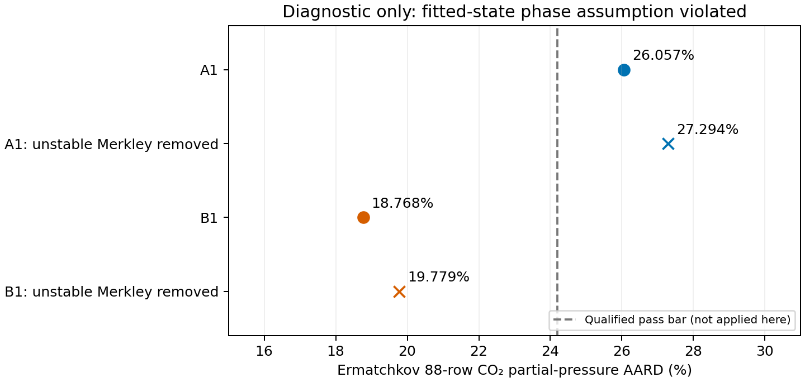

## Question, model and authority

Can the frozen MEA shared-species record describe aqueous MDEA properties under the declared formulation? The owner authorized diagnostic assessment of the phase-failed A1/B1 candidates, followed by ion-bound narrowing selected from phase evidence alone (issue #222, owner decision on the phase stop, 2026-10-28). A1 and B1 were chosen by fitted objective before outside-fit access. Part 1 cannot supply a qualified verdict. Each variant’s verdict comes only from Part 2.

AARD means average absolute relative deviation. Variant A treats MDEAH⁺ as a single sphere (m = 1); Variant B treats it as a charged molecule (m = 3.675). Both use the frozen eight-species liquid chemistry.

The fixed formulation, input roles, scales and weights are retained in [the issue snapshot](inputs/stage2-diagnostic-narrowing-issue-222.json) and [stage-1 evidence](README.md). The primary MDEA ideal-gas heat capacity is Neumann; Wangler is a sensitivity without refitting. The neutral MDEA–water law is linear in temperature; the cation–water slope retains its declared reciprocal form. Carson uses integral heat from zero loading. Merkley uses integral heat to its digitized loading point, with half-loading and 156 kPa checks. The main fits retain the four Merkley 20/40 wt% states at 333.15 and 388.71 K.

All calculations use Engine 3e83e19c, wheel SHA-256 `0d08dff9be39fb8fc9018119c47612f53d823cd0e456914d7dd44c6941596804`, through the isolated main-venv interpreter. The application reaction domain is 293.15–395 K with unchanged coefficients; refused extrapolations are not assigned predictions. No Engine source is imported.

## Part 1 — diagnostic transfer test

**Every value in this part is diagnostic: phase assumption violated at fitted Merkley saturation states.** These are conditional calculations at endpoints that violate the single-liquid phase assumption, not physical validation or pass/fail verdicts.

| Candidate | Objective | Ermatchkov 88-row AARD (%) | Removed Merkley indices | Liquid-witness states after removal | Unresolved states after removal |
|---|---:|---:|---|---:|---:|
| A1 | 400.448016085 | 26.057105 | — | — | — |
| A1, unstable Merkley removed | 395.374637991 | 27.293902 | [126, 127, 128] | 32 | 102 |
| B1 | 372.165913375 | 18.767755 | — | — | — |
| B1, unstable Merkley removed | 371.795416342 | 19.779119 | [127, 128] | 32 | 108 |

Both removal refits converge but retain resolved liquid witnesses and unresolved trials. Removing these rows does not qualify transfer. Their objectives differ in row count and are not compared as if they used the same objective. The phase searches include the remaining fitted states and declared in-domain comparison states; duplicate states are retained for distinct observations. The omission applies only to the objective: phase searches cover the complete original fitted-state grid, including the omitted Merkley states. Each sensitivity vector has 754 fitted/comparison state records. Earlier objective-row-only phase queries remain archived and do not supply these complete-grid counts.

| Outside-fit comparison | A1 (%) | B1 (%) | A1 removal (%) | B1 removal (%) |
|---|---:|---:|---:|---:|
| Ermatchkov88 | 26.057105 | 18.767755 | 27.293902 | 19.779119 |
| Ermatchkov_above49 | 54.527308 | 29.738297 | 56.461170 | 32.464005 |
| Ermatchkov_below7 | 36.886256 | 19.666241 | 38.715872 | 24.258374 |
| Ermatchkov88_below7 | 33.268675 | 18.212276 | 35.161421 | 22.346415 |
| corrected-Kamps | 18.307782 | 23.853466 | 19.147835 | 22.410454 |
| Bottinger-amine-sum-5bar | 7.194294 | 7.214306 | 7.198144 | 7.215862 |
| Bottinger-amine-sum-25bar | 7.194306 | 7.214239 | 7.198146 | 7.215796 |
| Cp-60wt | 13.360851 | 10.906006 | 13.317104 | 11.107686 |
| density-60wt | 1.309816 | 1.777978 | 1.271323 | 1.769203 |
| Zheng | 18.933869 | 22.577244 | 20.386123 | 22.610042 |
| Sedighi | 80.129949 | 75.444763 | 79.517480 | 76.488720 |

Ermatchkov has 101 rows: 88 at ≤49 wt%, 13 above 49 wt%, 33 below 7 kPa (29 in the primary 88). All 88 remain in the primary denominator. The #126 contextual AARD references are 42.72% and 60.97%; the qualified pass bar remains ≤24.2%, but is not applied to this part. Corrected Kamps has 28 rows; Böttinger has 58; Weiland 60 wt% has six Cp and 11 density rows; Zheng has six heat rows; Sedighi has 15 scored rows. These percentages use the individual source observable and do not create additional pass criteria.

### Comparison coverage and caloric sensitivity

Böttinger keeps all 58 rows and evaluates each at 500000 and 2500000 Pa, following the owner ruling. Its per-row pressures are missing: the source reports only a 5–25 bar range. Both speciation comparisons and their per-row pressure spread are retained. The earlier atmospheric-pressure comparisons are withdrawn. Vapor witnesses are reported separately from liquid–liquid witnesses. One reported bicarbonate mole fraction is zero, so a 58-row relative AARD is undefined; row-level absolute predictions remain in each `comparisons.json`. The reported carbonate signal is compared with the model sum of bicarbonate and carbonate (Böttinger 2008, Results and Discussion, p.7921). DMDEA and byproduct columns and their ratios to the reported amine sum remain in every row. Rows whose combined contribution exceeds 3% of that amine sum are flagged; none is removed. These species are not separately modeled. These comparisons do not repair the source amine balance. Merkley at 288.71/422.04 K and Kuranov 413 K remain unevaluated under the frozen reaction domain. Only two of eight Merkley outside-fit rows and six of twelve half-loading rows are in-domain and evaluated; no complete-set AARD is reported. The six ambiguous 156 kPa alternatives include three domain refusals and three resolved 333.15 K endpoints. Zheng integral heats are evaluated at reported loading. All six model-saturation loadings are resolved for every diagnostic vector. The approved 0.05–1.50 loading scan retains every native failure, inverts the first adjacent admitted sign change, and finds no multiple admitted sign changes on this prescribed scan. Initial failed fixed-bracket attempts remain retained as numerical diagnostics; the scan replaces their missing endpoint results. Derks remains unresolved; Xiao and Zhang remain unscored because their attachments contain only the first page.

Wangler sensitivity predictions for the fitted Carson/Merkley/Cp observations and in-domain outside-fit heat/Cp comparisons are retained separately in every diagnostic endpoint directory as `wangler-fitted-heat-cp.json` and `wangler-comparisons.json`. They use the same parameters and observations, without refitting. Neumann remains primary.

### Endpoint coordinates and Cp sensitivity

| Coordinate | A1 | B1 | A1 removal | B1 removal |
|---|---:|---:|---:|---:|
| MDEA–water k₀ | -0.2061917919 | -0.2063243742 | -0.2062581803 | -0.2063190677 |
| MDEA–water c₁ (K⁻¹) | 0.001472604436 | 0.001474738954 | 0.001473798568 | 0.00147456385 |
| MDEAH⁺–CO₂ k | 0.5 | 0.2525104755 | 0.5 | 0.2602035012 |
| MDEAH⁺–water k₀ | -0.5 | -0.01769004926 | -0.5 | -0.01888193205 |
| MDEAH⁺–water slope (K) | -89.921158 | -29.72278854 | -88.50429291 | -30.33917115 |
| MDEAH⁺–HCO₃⁻ k | -1 | 1 | -1 | 1 |
| MDEAH⁺ σ (Å) | 6.357766042 | 3.650559071 | 6.36100591 | 3.648214426 |
| MDEAH⁺ u/k (K) | 180.1319886 | 615.8344212 | 179.2005905 | 607.371655 |
| MDEAH⁺ Born diameter (Å) | 7 | 7 | 7 | 7 |

| Candidate | Neumann fitted Cp AARD (%) | Wangler fitted Cp AARD (%) |
|---|---:|---:|
| A1 | 3.336267 | 4.324865 |
| B1 | 2.689324 | 3.458774 |
| A1-removed-Merkley | 3.321275 | 4.304057 |
| B1-removed-Merkley | 2.733658 | 3.525508 |

The isothermal fitted Carson/Merkley heat predictions are unchanged at reported precision under this ideal-gas Cp substitution. Comparisons use the identical retained rows for each vector. The omitted Merkley markers remain separately predicted in the row-level diagnostic files.

### Resolved model saturation endpoints

| Zheng source row | A1 α_sat | B1 α_sat | A1 removal α_sat | B1 removal α_sat |
|---|---:|---:|---:|---:|
| 1 | 0.93527325 | 0.95287621 | 0.94175174 | 0.95298597 |
| 2 | 1.01562046 | 1.01995919 | 1.02042964 | 1.01911426 |
| 3 | 0.84544606 | 0.87725820 | 0.85865749 | 0.87908946 |
| 4 | 0.94798659 | 0.96170845 | 0.95752961 | 0.96148033 |
| 5 | 1.05109905 | 1.03666555 | 1.05796341 | 1.03457810 |
| 6 | 1.13224107 | 1.09067231 | 1.13831371 | 1.08703053 |

Loading is mol CO₂/mol analytical MDEA. Each source row retains its 323.15 K temperature, solvent composition and total pressure in the row-level file. These are diagnostic single-liquid saturation calculations; they do not qualify a globally stable saturation assemblage.

| Candidate | Maximum amine-sum pressure spread (mole fraction) | Maximum carbonate-sum pressure spread (mole fraction) |
|---|---:|---:|
| A1 | 4.6978677e-08 | 8.9501611e-07 |
| B1 | 2.9277335e-07 | 3.4584615e-06 |
| A1-removed-Merkley | 5.2548777e-08 | 6.2074614e-07 |
| B1-removed-Merkley | 2.8009633e-07 | 3.308711e-06 |

These spreads compare 5 and 25 bar at fixed temperature, loading and initial solvent composition. Missing per-row experimental pressure remains a limitation, even when the calculated spread is small.

### Carbonate-sum comparison at both pressure limits

The full 58-row relative AARD is undefined because one reported carbonate signal is zero. Mean absolute mole-fraction errors retain all 58 rows.

| Candidate | MAE at 5 bar | MAE at 25 bar |
|---|---:|---:|
| A1 | 0.002451332 | 0.002451395 |
| B1 | 0.002582039 | 0.002581641 |
| A1-removed-Merkley | 0.002477574 | 0.002477570 |
| B1-removed-Merkley | 0.002593787 | 0.002593404 |

## Part 2 — phase-evidence bound narrowing

Each step probes every currently active ion bound one coordinate at a time, inward by 10% of its original interval. The probe is ranked by the least-negative resolved liquid split, with unresolved-state count as the tie-breaker. This selects the bound change using phase evidence only. Every refit starts from the variant’s objective-preferred declared start, projected into the narrowed interval if required. Each step retains bounds, endpoint, objective, group costs and complete phase records. Counts below refer to state records, including duplicate physical states for distinct observables. An unresolved record contains at least one unresolved trial or an unavailable solve; vapor witnesses are listed separately and do not count as liquid instability. All prescribed narrowed saturation scans resolve a bracket and none has multiple admitted sign changes. No Part 2 outside-fit statistic is computed before the bounds pass the phase gate and are frozen.

| Variant | Step | Changed coordinate (zero-based) | New bound | Objective | Liquid witnesses | Unresolved states |
|---|---:|---:|---:|---:|---:|---:|
| A | 1 | 3 | -0.4 | 410.725545749 | 39 | 108 |
| A | 2 | 3 | -0.3 | 429.539551144 | 36 | 106 |
| A | 3 | 8 | 6.5 | 430.838299602 | 39 | 91 |
| A | 4 | 3 | -0.2 | 459.901622532 | 40 | 99 |
| A | 5 | 8 | 6 | 461.445529919 | 40 | 97 |
| A | 6 | 8 | 5.5 | 463.272605270 | 33 | 112 |

Variant A: stable narrowed endpoint found: **False**. [Every narrowing step](results/stage2-narrowed/A1/path.json) retains its phase evidence and exact bounds.

| Variant | Step | Changed coordinate (zero-based) | New bound | Objective | Liquid witnesses | Unresolved states |
|---|---:|---:|---:|---:|---:|---:|
| B | 1 | 5 | 0.8 | 374.125216591 | 33 | 96 |
| B | 2 | 5 | 0.6 | 376.406032139 | 31 | 111 |
| B | 3 | 5 | 0.4 | 379.170109819 | 35 | 104 |
| B | 4 | 5 | 0.2 | 382.590950055 | 30 | 103 |
| B | 5 | 5 | 0 | 386.846658201 | 26 | 118 |
| B | 6 | 5 | -0.2 | 392.099097184 | 30 | 101 |

Variant B: stable narrowed endpoint found: **False**. [Every narrowing step](results/stage2-narrowed/B1/path.json) retains its phase evidence and exact bounds.

The final active A limits are cation–water k = −0.2 (lower), cation–bicarbonate k = −1 (lower), and Born diameter = 5.5 Å (upper). The final active B limits are cation–bicarbonate k = −0.2 (upper) and Born diameter = 7 Å (upper). [Every coordinate, value and bound at all 12 endpoints](results/stage2-narrowed/coordinates-and-bounds.csv) provides the full disclosure. B1’s original unlike-ion value is +1 in the retained physical vector; the earlier prose value −1 was incorrect.

Coordinate order (zero-based): 0 neutral–water k₀; 1 linear coefficient c₁ (K⁻¹); 2 cation–CO₂ k; 3 cation–water k; 4 cation–water reciprocal slope (K); 5 cation–bicarbonate k; 6 segment diameter (Å); 7 dispersion energy/k (K); 8 Born diameter (Å). Diameter targets retain the linked Debye–Hückel and packing factors. Original A1 active limits are cation–CO₂ 0.5, cation–water −0.5, unlike-ion −1 and Born diameter 7 Å; B1 has unlike-ion +1 and Born diameter 7 Å. All remaining original and narrowed intervals are retained in the declarations and bounds files.

Neither variant achieves the required absence of liquid witnesses and unresolved trials within the retained narrowing path. There is **no stable endpoint and no per-variant Ermatchkov transfer verdict**. Thus the conditional full assessment, weak-direction scans, new numerical audit, Wangler assessment and bicarbonate/control follow-up are not run on a narrowed endpoint. Diagnostic Part 1 percentages are not substituted for these results.

The follow-up rule remains k(HCO₃⁻–water) ∈ [−0.5,1], compared against a free k(MDEA–CO₂) control, requiring at least a two-percentage-point Ermatchkov improvement while keeping the other property results. Corrected Kamps is excluded. A correlation magnitude above 0.95 between bicarbonate–water and cation–water Jacobian columns means non-separable. Neither the margin nor the correlation is available without a qualified endpoint. **No MDEA outcome falsifies the MEA bicarbonate value.**

## Meaning, uncertainty and claim limits

The retained phase evidence is numerical verification of the declared model at specified states. A resolved descending liquid split violates the stipulated single-liquid assumption; it does not demonstrate experimental demixing or the globally stable assemblage. Unresolved trials and refused roots are numerical non-results. A finite search with no witness would not prove global stability. Native trial evidence, split ΔG/RT and its numerical error remain in each phase record.

The strongest intended claim combines calibration on the frozen fit sets with assessment against outside-fit observations within 293–395 K, ≤49 wt% for pressure and ≤50 wt% for the other properties. Bound-active endpoints and all narrowed bounds must be disclosed. Permittivity above Hsieh’s 328.15 K range is extrapolated. The linear neutral interaction law, Neumann ideal-gas Cp, source/digitization uncertainties and frozen residual scales remain limitations. MDEA dissociation above 368 K and the shared reaction laws up to 395 K are extrapolated; nitrogen in the Ermatchkov headspace is not modeled. Numerical precision does not quantify source uncertainty or model discrepancy. No absorber-use, manuscript or universal-ion claim follows.

## Evidence and reproduction

Use the isolated interpreter and `nice -n 10 agent-heavy` with `scripts/stage2.py diagnostic`, then `scripts/stage2.py narrow`. The supplemental diagnostic command retains the saturation/alternative-pressure endpoint calculations and every prescribed loading-scan failure. `scripts/stage2.py present` renders the retained diagnostic AARD figure. Pools use every available core subject to free memory, with one BLAS thread per process. The wheel is checked byte-for-byte; no worktree environment is created. All writes remain in this worktree.

[Diagnostic evidence](results/stage2-diagnostic/README.md), [narrowing evidence](results/stage2-narrowed/README.md), and the immutable [previous four-endpoint evidence](results/stage2/README.md) retain the calculation identities. The actual Merkley methods were read from the Zotero PDF, pp.439–441; the existing Baygi/Uyan/Wangler Markdown copies were checked against live indexed sources. No new literature convention or acceptance limit is inferred. Historical preparation and earlier model diagnostics remain in Git and their retained result directories.

This notebook has not been independently reviewed or promoted for manuscript use. No subagents, MEA-record or manuscript changes, Zotero writes, merge or push occurred.
