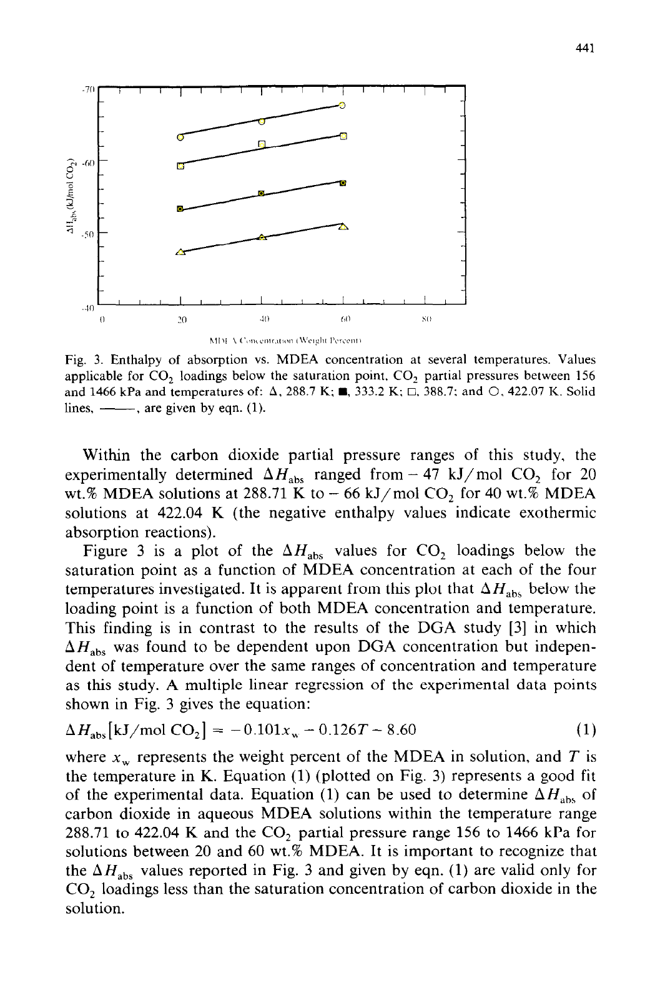

Stage 1 provides numerical preparation evidence for issue 222. It does not yet
meet every completion criterion, so no MDEA joint fit or transfer assessment
has started. The fixed shared-species record is the MEA JSON with SHA-256
`00e77608a8489fc9e03a7d2a86c08cb5ff782bb441368a62fa6390b8bfe9cc91`.
The installed ePC-SAFT wheel has SHA-256
`0d08dff9be39fb8fc9018119c47612f53d823cd0e456914d7dd44c6941596804`;
its package files were checked byte-for-byte against the wheel.

## Pure-MDEA conversion and dielectric calibration

The 4C MDEA parameters of Pahlavanzadeh 2013 Table 2 were held fixed except
for the conversion from the $d^3$ association convention in its Eq. 4 to
$σ^3$. At 21 temperatures from 293.15 to 393.15 K the MEA saturation and
native least-squares declarations give:

| Quantity | Retained result |
|---|---:|
| Source association volume | 0.123858 |
| Converted constant, eight significant figures | 0.11800686 |
| Saturation-pressure AARD against source model | 1.34914246% |
| Saturated-liquid-density AARD against source model | 0.00525150% |
| Largest saturation-equilibrium residual | 4.17 × 10⁻¹⁴ |

The owner accepted κ = 0.11800686, fixed to eight significant figures, in
issue 222, “Stage-1 owner decisions” (2026-10-28); item (b) is complete.
The unconverted κ = 0.123858 gives pressure AARD **8.38332%** and density
AARD **0.0339482%** against the same source model (MEA unconverted comparison:
2.80%). These are numerical model-to-model differences, not experimental validation.
See [conversion evidence](results/kappa/summary.json) and
[unconverted replay](results/kappa/unconverted-replay.json).

Hsieh 2007 Table 2 contributes six pure-MDEA measurements; Table 5 contributes
24 aqueous measurements at MDEA mole fractions 0.2–0.8 and 303.15–328.15 K.
The two fitted dielectric coefficients are **0.8630669729 L/mol** and
**1121.773473 K**. At model liquid densities and the assumed measurement
pressure of 101325 Pa, the 30-point AARD is **3.86106149%**.
Native replay differs by at most **1.42 × 10⁻¹⁴** in relative permittivity.
Water coefficients remain fixed. The two coefficients use the MEA
one-percent relative residual scales; no joint coordinate enters this fit.
The second local minimum is **0.28087913 L/mol, 2793.648 K**, with cost
**328.265** and AARD **3.91286%**, versus **318.265** and **3.86106%** for
the selected solution. Selection follows the MEA larger-volume convention
(`supplement.tex`, paragraph supplement-20), and also selects the lower cost here.
At 393 K the two solutions differ by 1.87% at x = 0.2 and 6.69% for pure MDEA. Mean signed deviations
are **−8.1% at x = 0.2**, **+4.7% at x = 0.6**, and **−3.4% for pure MDEA**.
Densities are start-1 densities with MDEA–water k = 0. The absorber range
about 23–49 wt% (x ≈ 0.04–0.13) is below Hsieh's lowest x = 0.2.
Above 328.15 K the dielectric law is a model assumption.
See [all dielectric rows](results/dielectric/rows.json) and
[both minima and composition bias](results/dielectric/summary.json).

## Source transcriptions and physical bases

Ten files retain 338 source observations, including twelve digitized points.
The [source provenance file](../../data/reference/MDEA/stage1-sources.json)
identifies each PDF, locator, units, basis, uncertainty, row count and hash.

| Source | Rows | Completion or limit |
|---|---:|---|
| Hsieh Table 5 | 24 | All entries checked against PDF p.4 |
| Ermatchkov Table 6 | 28 | Corrected Kamps total pressures; not partial pressures |
| Jakobsen A5 | 8 | PDF p.9, printed p.9902; loadNMR used; no rows excluded |
| Böttinger MDEA Table 2 | 58 | All rows retained; amine sums and carbonate/bicarbonate signal preserved |
| Carson Table 3 | 40 | Integral ΔH/n₁ from zero loading; both repeated runs retained |
| Weiland 1997 Table 1 | 39 | 33 entries at 30–50 wt%, six at 60 wt% |
| Weiland 1998 Table 1 | 44 | No reported loaded uncertainty; explicit scale proposal in README awaits owner freeze |
| Sobrino Table 5 | 24 | Only the 0.1 MPa rows, six temperatures, four compositions |
| Kim Table 8 | 61 | All printed series; only total bubble pressure may be scored later |
| Merkley Figure 3 | 12 | Plateau slopes; both low-temperature pressure candidates retained, proposed assignment awaits freeze |

The Böttinger printed HCO₃⁻ column represents the bicarbonate/carbonate
signal; the amine column represents MDEA/MDEAH⁺. Individual species are not
inferred. [Fractions and three-percent flags](results/bottinger-flags.json)
retain the byproduct and DMDEA⁺ contributions, without excluding any row.
Jakobsen's column printed as xAmCOO⁻ is interpreted as MDEAH⁺, as required
by the issue; [charge imbalances](results/jakobsen-charge.json) are retained
for all eight rows. These source imbalances are not numerical solver errors.

Carson's printed “partial molar” column is cumulative ΔH/n₁ over sequential
CO₂ additions, an integral from zero loading, not ∂ΔH/∂n₁ (procedure printed
p.1289, PDF p.5). Of 40 rows, 27 agree with ΔH/n₁ within 0.03 kJ/mol.
Rows 11–20 differ by up to 0.29 kJ/mol because n₁ has two significant figures;
rows 32 and 34 differ by 0.03–0.04 kJ/mol. Row 38 prints 0.0180 mol, a source
typo: −622.0 J ÷ (−48.59 × 1000 J/mol) = **0.012801 mol**. Printed values
are preserved; [row arithmetic](results/carson-arithmetic.json) is separate.

Merkley Table 1 lists both 156 and 1121 kPa at 288.71 and 333.15 K; runs
differ by up to 9%, while Figure 3 assigns no pressure to each marker.
Every marker retains candidate pressures and ambiguity. At 388.71 K Table 1
lists only 1121 kPa, and at 422.04 K only 1466 kPa. The text on printed p.441
gives **−66 kJ/mol** at 40 wt%, 422.04 K, versus digitized **−65.3 kJ/mol**
(a 0.7 kJ/mol difference); neither value replaces the other. The 5% scale
and the pressure proposal are in the [README](README.md#owner-freeze-proposals).

Derks 2011 Table 1 specifies only “room temperature”; no numerical
thermostat temperature is established, so those four states remain unscored.

## Ideal-gas units and reaction basis

The owner adopted the restored factor T in Wangler Eq.26 (PDF G7ZTAJZS,
printed p.18):

$$H^{ig}/n=T[A_2+A_3(A_4/T)\coth(A_4/T)-A_5(A_6/T)\tanh(A_6/T)+A_1/T].$$

The literal derivative gives only 2.498–4.981 J/mol/K, below the ideal-gas
lower bound 5R/2 = **20.79 J/mol/K**. With T restored, the Table 3 coefficients
give water **33.575 J/mol/K** (reference 33.58) and CO₂ **37.243 J/mol/K**
(reference 37.1) at 298.15 K. The cubic fitted over 293–423 K is

$$C_p^{ig}=91.8741258383-0.108076279455T+0.00164227867349T^2-1.67647752484\times10^{-6}T^3$$

in J/mol/K, with T in K. Its maximum relative deviation is **0.022213%** on
a 0.1 K grid, below 0.5%; h = s = 0 at 313.15 K. The
[ideal-gas record](inputs/physical-ideal-gas-calorics.json) uses the MEA format.
[Fit and check values](results/ideal-gas-polynomial.json) retain the full grid.
At 298.15 K Wangler gives **161.218 J/mol/K**, versus **189.200 J/mol/K**
from the independent EOS estimate of [Neumann et al. (2021)](https://doi.org/10.1007/s10765-021-02933-7),
Eq.5 and Table 8 (author manuscript pp.10–11), a **−14.79%** difference.
Their ideal part was initialized with Joback and adjusted to liquid Cp and
sound-speed data; they report Joback deviations up to 27%, no measured
ideal-gas Cp, and no reliable uncertainty for this property. This is an
independent estimate comparison, not physical validation of Wangler.
See [units check](results/ideal-gas-units-check.json) and
[PDF equation](inputs/wangler-equation-26.png).

Jakobsen 2005 Table 1 prints coefficients −83.4914, −819.7 and 10.9756;
Uyan 2015 Table 1 prints −83.491, −819.7 and 10.976. At 298.15 K the
correlations differ by −0.00267904 in ln K. Uyan's law gives pKₓ = 10.29428
and pKₘ = 8.54994 after the prescribed +4.0165 conversion. Similar
coefficients do not establish the unavailable original paper's basis.
Item (g) remains blocked on Kamps–Maurer 1996, DOI 10.1021/je960141+.
No Zotero write or coefficient substitution was made.

## Two ion conventions at start 1

Both complete eight-species parameter mappings were admitted. Each was
evaluated at 313.15 K and 100 kPa for an unloaded liquid (water/MDEA
mole fractions 0.95/0.05) and a charged liquid (water/MDEA/MDEAH⁺/HCO₃⁻
0.94/0.04/0.01/0.01). These prescribed liquid compositions test capability;
they are not reactive equilibrium predictions. Their dimensionless
Helmholtz contributions are in [A](results/admission-A.json) and
[B](results/admission-B.json). The MDEA ideal-gas record is admitted in each full mapping; native neutral
selection evaluates Cp and verifies h = s = 0 at 313.15 K at the standard
ideal-gas density. Direct full-mixture caloric totals require ionic ideal
records even at zero ionic fractions; reaction-completed ionic totals remain
conditional on (g). This completes the MDEA caloric admission half of (e).

The pressure-coordinate probe uses all twenty Kuranov rows above unit
loading: 13 at nominal 313 K, five at 333 K and two at 373 K; none at 393 K.
Exact printed temperatures are retained. Both columns are exact native derivatives of log total bubble
pressure, with all MDEA-specific interactions at zero and all other start-1
values declared in the issue. The MDEA dissociation reference remains
provisional pending item (g).

| Variant | ‖MDEA–CO₂ column‖ | ‖MDEAH⁺–CO₂ column‖ | Singular values after unit-column normalization |
|---|---:|---:|---|
| A | 0.74498383 | 4.99071572 | 1.36452134, 0.37159322 |
| B | 0.01073442 | 9.42711583 | 1.05617562, 0.94047491 |

Both pre-normalization norms rank MDEAH⁺–CO₂ larger. Each normalized column
has norm one, so the magnitude ranking cannot be based on the normalized
norms themselves. Both original and normalized columns are retained in
[A](results/probe-A-columns.csv) and [B](results/probe-B-columns.csv).
The owner selected k(MDEAH⁺–CO₂) and fixed k(MDEA–CO₂) = 0.
Raw norms compare directly because both coordinates are dimensionless k.
Unit-column singular values describe column angles, not sensitivity magnitude.

The [shared-only reference checks](results/shared-reference-checks.json) give identical
water and CO₂ pressures, residual Helmholtz energies and residual enthalpies
for both variants and the original record at the retained reference states.

The [numerical checks](results/numerical-checks.json) compare both derivatives
in both variants against centered re-solves at source row 4. All relative
errors meet 10⁻⁵ at step 10⁻³. The smaller-step check is retained separately:
its weakest derivative missed that tolerance slightly, consistent with
cancellation near zero. This is a numerical derivative check on one source
state, not a phase-stability or identifiability qualification of a fit.

## Stage-2 gate

Items (b)–(f) are complete for stage-1 preparation. Item (a) retains all
source rows with explicit proposals awaiting owner freeze; (g) remains blocked. Independent delivered review
and the owner's exact freeze comment are still required. Stage 2 must also
retain every declared start, property prediction, failure, phase check,
identifiability result and sensitivity/control comparison. Nothing here
selects a variant by its pressure score or establishes absorber suitability.
The [README](README.md) lists reproduction commands and all remaining gates.

## Start-4 declaration and newer source observations

The stage-1 addendum establishes an admissible fourth Variant A initial guess;
it makes no parameter-transfer claim. [Declaration evidence](results/start-4-declaration.json)
retains the Bülow Table 3 re-centering, projection, strict bounds, complete
document diff and native liquid evaluations. Re-centering at 313.15 K gives
$k=-0.131933125$, $dk/dT=-0.001070625\ \mathrm{K}^{-1}$ and reciprocal-law
slope $b=104.9886164016\ \mathrm{K}$. The declared rounded slope is
104.9886164 K; projection minus source cubic is +0.0105989562 at 373.15 K.
The Engine's reciprocal law agrees with equivalent constant-k evaluations
at three temperatures within 1e-8. All nine coordinates are strictly inside
the Variant A bounds; only four ion diameters and the MDEA–water pair differ
from start 1. The original shared component and pair blocks remain
byte-identical and the shared owner hash is unchanged.

The prescribed unloaded and loaded liquids at 313.15 K, 100 kPa have molar
densities 43792.4928 and 45580.2694 mol/m³ and dimensionless residual
Helmholtz energies −8.93473850 and −11.79080043. Maximum pressure residual
is 4.30e-6 Pa. These checks verify numerical admission and the parameter
law; they do not solve chemical equilibrium or validate a physical model.
The [README addendum](README.md#stage-1-addendum-starts-and-newer-comparisons)
records compositions and detailed source limits.

[New source records](../../data/reference/MDEA/addendum-sources.json) retain
six Zheng Table 4 pure-MDEA observations at 323.15 K and 24 Sedighi Table 3
observations at 303.15–323.15 K. Zheng's integral heat magnitude spans
47.57–55.96 kJ/mol CO₂; both heat and saturation loading have relative
expanded uncertainty 0.05. The comparison uses reported saturation loading
and source total pressure, with model saturation loading reported separately.
Piperazine blend rows are excluded and SI loading curves are unavailable.

Fifteen Sedighi rows at 10–50 wt% are designated for later scoring, with nine
higher-concentration rows unscored. The reported 101.325 kPa is total pressure
for a CO₂-fed apparatus with solvent vapor; compare total bubble pressure,
not CO₂ partial pressure. Sections 2.2 and 4.1 describe saturation checks,
constant pressure, a 20-minute measurement and three-run averaging, but give
no quantitative equilibrium tolerance. Sedighi reports no uncertainty.
Its printed loading and mole columns are retained even where inconsistent:
row 18 gives 0.739 versus mole-ratio loading 0.72922636. This source limitation
has not been converted into an exclusion or an invented uncertainty.

Xiao and Zhang remain declared but unscored because their Zotero attachments
contain only the first page. Thus (h) and the authorized two-source portion
of (i) are complete; the full four-source criterion awaits full texts.
No outside-fit prediction was evaluated, no objective or pass criterion
changed, and no joint optimization was run. The addendum has not received
independent delivered review or promotion to manuscript use. The owner's
stage-2 freeze remains required.
