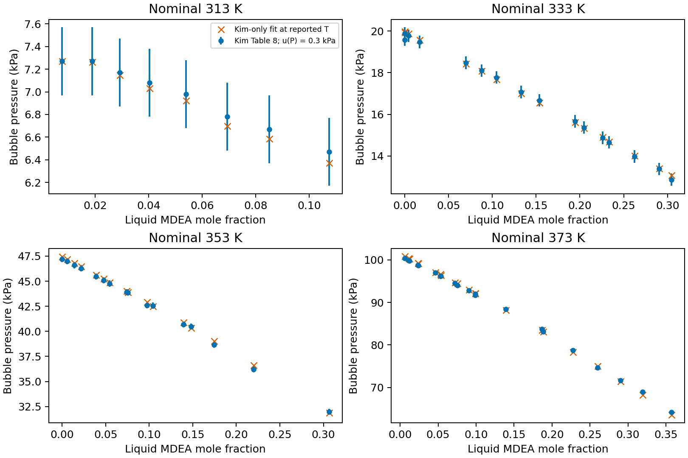
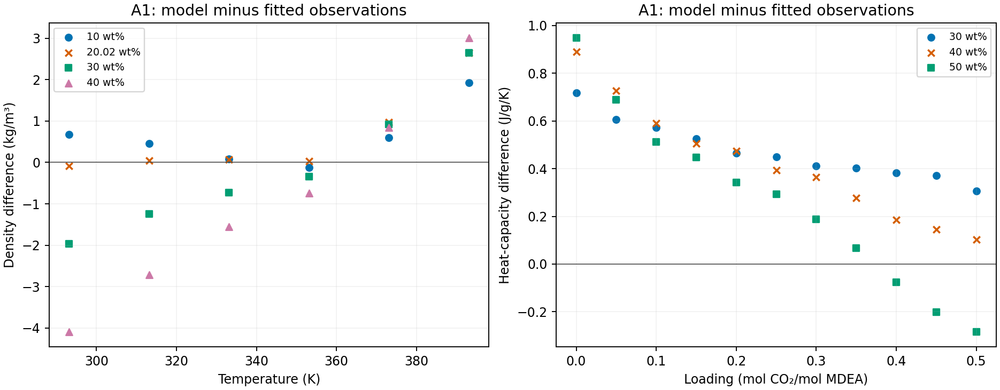

## Linear-law joint fit: return to Design

**A1 converges at cost 400.448016085 in 13 iterations, but reaches four arbitrary bounds.** The required stop applies before selecting a representative or evaluating outside-fit data. A3, B1 and B3 did not run. The current results use the item-(l) linear MDEA–water law, Neumann ideal-gas Cp, the 395 K reaction domain, Merkley 333.15/388.71 K fit rows, Carson integral heat at 101325 Pa, and Jakobsen 10% scales. Data roles, weights and remaining bounds are unchanged.

The attached task worktree began clean at `2b6cd44`. The requested larger-budget A4 retry cannot be expressed by the pinned wheel: native iteration and recovery-work limits are fixed at 200 and 512, and both requested overrides (400 and 1024) are rejected. The retry was never run. Under the owner's away-mode amendment, A4 is excluded without retry; it remains unqualified because its prior row-1 trial is unresolved, not because instability was established. Item (l) is complete for A1, A3, B1 and B3. A2 and B2 remain duplicates.

| Start | Fitted objective | Disposition |
|---|---:|---|
| A1 | 400.44801608493293 | Converged; return to Design: four arbitrary bounds |
| A2 | — | Duplicate of A1 |
| A3 | — | Not run after mandatory A1 bound stop |
| A4 | — | Excluded unqualified without retry by owner amendment |
| B1 | — | Not run after mandatory A1 bound stop |
| B2 | — | Duplicate of B1 |
| B3 | — | Not run after mandatory A1 bound stop |

| A1 coordinate | Endpoint | Bound assessment |
|---|---:|---|
| k(MDEA-water) at 313.15 K | -0.206191791938 | interior |
| c1(MDEA-water), 1/K | 0.00147260443632 | interior |
| k(MDEAH+-CO2) | 0.5 | active |
| k(MDEAH+-water) at 313.15 K | -0.5 | active |
| reciprocal slope(MDEAH+-water), K | -89.9211579971 | interior |
| k(MDEAH+-HCO3-) | -1 | active |
| sigma(MDEAH+), angstrom | 6.35776604151 | interior |
| u/k(MDEAH+), K | 180.131988552 | interior |
| Born diameter(MDEAH+), angstrom | 7 | active |

The A1 scaled Jacobian has rank nine at start and endpoint. Its singular values range from 106.145425 to 0.0026403123 initially and 106.515942 to 0.00261441066 at the endpoint. Covariance is classified `active_bound`. Full singular values and weak combinations are retained in the fit files; rank alone does not establish parameter identifiability. Weak-direction profiles were not run after the mandatory bound stop.

All 280 fitted predictions replay to 2.32438e-12 relative difference, below 1e−8. The two linear-coefficient derivatives were checked by centered differences at one Kim pressure row and one Weiland Cp row; the retained [derivative checks](results/joint-fit-linear/linear-derivatives.json) give the 1e−5 comparison. Carson liquid defining-row residuals satisfy 1e−10:

| Carson row | Maximum residual | Finite phase search |
|---|---:|---|
| 1 | 1.7053e-13 | no witness in the recorded trial set; unresolved trials 0 |
| 10 | 1.13687e-13 | no witness in the recorded trial set; unresolved trials 0 |

These two finite searches find no descending split and no unresolved trial. They do not establish global stability. Full phase searches across every fitted and comparison state and a broader balance audit were not run after the arbitrary-bound stop. The two-state evidence does not remove that stop.

| Variant | Representative | Ermatchkov 88-row CO2 partial-pressure AARD | Verdict |
|---|---|---|---|
| A | None | Not evaluated | Return to Design at A1 |
| B | None | Not evaluated | Unassessed after A1 stop |

Neither variant has a pass/fail result against 24.2%. All declared Ermatchkov subsets, other outside-fit comparisons and the Wangler sensitivity without refitting remain unevaluated. The bicarbonate-free versus k(MDEA–CO2) control follow-up did not run: neither the two-percentage-point margin nor the bicarbonate/cation-water correlation is available. Corrected Kamps stays excluded from the criterion. **No MDEA outcome falsifies the MEA bicarbonate value.** Xiao and Zhang remain unscored.

This is calibration and numerical verification, not physical validation, parameter adoption, transfer qualification or absorber qualification. Above 328.15 K the frozen MDEA dielectric coefficients remain a model assumption. Independent delivered review remains open; nothing is promoted for the manuscript. A table suffices for this single bound-stopped endpoint; there is no outside-fit comparison to plot.

Evidence: [summary](results/joint-fit-linear/summary.json), [fit and covariance](results/joint-fit-linear/A1/fit.json), [endpoint](results/joint-fit-linear/A1/endpoint.json), [initial identifiability](results/joint-fit-linear/A1/initial-identifiability.json), [replay](results/joint-fit-linear/A1/replay.json), [Carson searches](results/joint-fit-linear/A1/carson-phase.json), [frozen inputs](results/joint-fit-linear/frozen-inputs.json), [runtime](results/joint-fit-linear/runtime.json), and [A4 capability inspection](results/item-l/A4-retry-capability.json).

Execution used the isolated main-venv interpreter and the byte-verified Engine `3e83e19c` wheel, SHA-256 `0d08dff9be39fb8fc9018119c47612f53d823cd0e456914d7dd44c6941596804`. Fit controls stayed at 40 iterations and 2100 seconds; 32 row workers used one BLAS thread each, with 22.08 GB available when sized. Every numerical command ran at nice 10. No worktree venv, Engine source import, main-checkout write, frozen-data change, MEA-record change, manuscript change or Zotero write was made.

The presentation-only notebook refresh failed because `snakemake` is absent from PATH. [The refresh error is retained](results/joint-fit-linear/notebook-refresh.txt). The notebook source and section index are current; HTML remains stale. No preview service was changed.

## Historical A4 amendment before the exclusion decision

### A4 row 1 before the owner amendment

**Stage 2 is blocked by an unresolved A4 phase search.** A4 now takes
k(MDEAH+–water) = −0.2298 with slope zero, keeping every other value,
including Bülow's cation sizes and dispersion energy. Its SHA-256 is
`37dc90fde1e8807dafb1e3b7e7d378ba711ec38da7f6d5291d34a46e549301c0`.
The amendment is the latest 2026-10-28 ruling on issue #222.

Both Carson states use 298.15 K, the declared 101325 Pa convention and one
mole of analytical MDEA plus source water and CO2. Neumann ideal-gas Cp and
the retained item-(l) linear MDEA–water law are unchanged. The Engine wheel
is 3e83e19c, SHA-256 `0d08dff9be39fb8fc9018119c47612f53d823cd0e456914d7dd44c6941596804`;
installed package files were verified byte for byte against the wheel.

| Carson row | Loading, mol CO2/mol MDEA | Maximum equilibrium residual | Descending splits | Unresolved trials | Gate |
|---|---:|---:|---:|---:|---|
| 1 | 0.08243367843 | 2.273736754e−13 | 0 | 1 | Unresolved |
| 10 | 0.2479764498 | 5.115907697e−13 | 0 | 0 | Pass |

The row-10 split previously found at k(MDEAH+–water) = 0 is absent from this
recorded search. Row 1 prevents qualification: completion of the search and
absence of a witness do not resolve its remaining trial. Minimum tangent-plane
values are −2.84217e−14 and −8.52651e−14 in RT units for rows 1 and 10.
They do not establish a descending split. This is a numerical qualification
limit, not observed demixing or evidence that the physical model is unstable.
The reused helper retains trial compositions and minimum values, but omits
the individual trial optimizer messages; the precise cause of the unresolved
trial has not been diagnosed. No search budget, tolerance or retry was changed.
Per the requested stop, no further scientific calculations ran.

| Variant | Distinct starts | Joint-fit endpoints | Representative | Transfer verdict |
|---|---|---|---|---|
| A | A1, A3, A4 | Not run | None | Not assessed: A4 start gate unresolved |
| B | B1, B3 | Not run | None | Not assessed: item (l) incomplete |

A2 and B2 remain recorded duplicates of A1 and B1. No new objective,
start/endpoint identifiability analysis, weak-direction profile or arbitrary-bound
assessment exists. Earlier reciprocal-law endpoints below are historical and
cannot represent this amended model. Neither variant has an Ermatchkov AARD
or a pass/fail result against 24.2% on the 88 primary rows. All outside-fit
comparisons and the Wangler heat/Cp sensitivity remain unrun.

The bicarbonate-free and k(MDEA–CO2) control refits, their two-percentage-point
comparison and the bicarbonate/cation–water correlation were not run.
Corrected Kamps data remain excluded from that criterion. **No MDEA outcome
falsifies the MEA bicarbonate value.** Xiao and Zhang remain unscored.

This is numerical evidence at two starting-vector states, not physical
validation, parameter transfer, adoption or absorber qualification. Independent
delivered review remains open; nothing is promoted for manuscript use.
A table suffices for these two scalar checks; a curve would add no information.

Evidence: [A4 summary](results/item-l/A4-amendment-summary.json),
[search results](results/item-l/A4-amended-carson-search.json),
[amended start](results/item-l/amended-starts/A4.json),
[runtime and hashes](results/item-l/A4-amendment-runtime.json), and
[endpoint inventory](results/item-l/A4-amendment-endpoints.csv).
The original A4 is retained in Git at base commit `3a2eaab`, path
`analyses/mdea_mea_workflow/results/item-l/amended-starts/A4.json`;
the original ten-search file and phase summary remain historical evidence.
Only the A4 hash changes in the amended-start hash inventory.

Execution used `nice -n 10` and the isolated main-venv interpreter, with two
processes for the two independent rows on the 32-core machine, one BLAS thread
per process and 22.86 GB available memory at launch. No worktree environment,
Engine source import, main-checkout write or Zotero write was used.
An initial process submission failed before either row ran because its dynamic
module was not registered for pickling; registering the module corrected that
execution error without changing a numerical setting.

The presentation-only HTML refresh failed because `snakemake` is unavailable;
[the error is retained](results/item-l/A4-notebook-refresh.txt). The notebook
source is current; its HTML view remains stale. No preview service was changed.

## Historical item-(l) result before the A4 amendment

**Return to Design.** The linear-law binary gate passes, but A4 fails the
Carson row-10 two-liquid search. Item (l) is incomplete; stage 2 did not run.
The prior reciprocal-law joint-fit results below remain historical evidence.

The retained Kim-only fit gives k0 = −0.179727220278 and
c1 = 0.000616832401403 K⁻¹, with reference temperature 313.15 K and pressure
AARD 0.467971% on 61 Kim states. Both initializations agree, with rank-two
scaled Jacobians and no active bounds. Neumann ideal-gas Cp is primary.
At 298.15 K, Weiland Cp errors are +0.9541 / +2.8434 / +3.5230% at
30 / 40 / 50 wt%. Criterion (3) passes under the owner's ≤50 wt% reading;
+5.2106% at 60 wt% is extrapolation. Concepción's retained 15-row Cp AARD
is 2.8079%; Sobrino's 24-row density AARD is 0.14894%.

Criterion (2): all 1,177 searches (61 Kim and 1,116 composition-grid states)
complete with zero liquid–liquid witnesses or unresolved trials. All four
hulls are miscible at 293.15, 313.15, 353.15 and 393.15 K. The 171 vapor
witnesses are classified separately; all 38 Kim vapor witnesses have positive
bubble-pressure residuals, with no sign mismatch.

Criterion (4): all ten Carson searches complete with zero unresolved trials;
nine pass. A4 row 10 at 298.15 K, 101325 Pa admits a two-liquid split with
ΔG/RT = −0.130277337990 and estimated numerical error 2.64057e−8.
Both liquid phases and their compositions are retained. The five starts and
the common Neumann caloric file are hashed; A2 and B2 remain duplicates.
They are not qualified as a set for stage 2.

These are calibration and numerical phase-search results, not physical
validation or an amine-parameter transfer verdict. The finite search grid
limits the binary claim; ideal-gas Cp uncertainty remains unquantified.
Independent delivered review and investigator promotion remain open.
The [item-(l) README](results/item-l/README.md) links the full search results,
start hashes, coordinate identities, property comparisons and reproduction
command. No MEA parameter or manuscript change accompanies this result.

## Earlier reciprocal-law joint-fit evidence

All three distinct Variant A starts converge to the same bound-constrained result; both Variant B starts converge to another bound-constrained result. The A1 omission diagnostics support a conflict between density and Cp within the frozen model. Widening the three active bounds does not resolve the bounds or Carson phase stops. Nothing is adopted, and outside-fit assessment remains blocked. These results have not been independently reviewed or promoted for manuscript use.

## Kim-only pre-fit and amended starts

The ion-free MDEA–water calculation fits all 61 Kim 2008 Table 8 bubble
pressures, including the pure-water rows, using log-ratio residuals with
weight one. Vapor mole fractions do not enter the objective. The law is
$k(T)=k(313.15\,\mathrm{K})+b(1/T-1/313.15\,\mathrm{K})$.

| Initialization | k(313.15 K) endpoint | b endpoint (K) | Termination |
|---|---:|---:|---|
| −0.184, 0 K, primary | −0.181786994679 | −75.539233386 | Function tolerance |
| −0.15, 0 K | −0.181787002961 | −75.539241989 | Gradient tolerance |

Both endpoints converge within the owner's agreement limits of 1e−4 in k
and 1 K in slope. The primary scaled-Jacobian singular values are
0.2124813 and 0.02886988, with coordinate scales 0.01 and 10 K and no active
bounds. Cost is 0.0012265413 and pressure AARD is 0.4998313%. The initial
zero-pair attempt was refused for local liquid instability before iteration.
The two subsequent initializations were orchestrator choices from diagnosis
probes, not source values.

All four Gibbs-mixing convex hulls are miscible at 293.15, 313.15, 353.15 and
393.15 K. The 1,177 tangent-plane searches cover every Kim state and 279
compositions per grid temperature, including pure endpoints, at the diagnosis
pressure of 101325 Pa. All searches complete with zero unresolved trials and
zero liquid–liquid descent witnesses. This finite grid/search does not prove
global stability at every continuous composition.

The 170 vapor witnesses are retained separately. The owner confirmed that
the gate tests liquid miscibility. All 38 Kim states with vapor witnesses
have the matching positive bubble-pressure residual, with zero sign
mismatches. Near pure water at 393.15 K and atmospheric pressure, vapor
formation is expected; it is not liquid demixing.

All ten amended Carson searches pass: A1, A3, A4, B1 and B3 at rows 1 and
10, 298.15 K and the declared 101325 Pa convention. They complete with
zero unresolved trials and no descending split. Every start takes the primary
Kim pair. A1/B1 take ion–water k = −0.2298 with zero slope; A2/B2 are
recorded as duplicates, not separately run. A4 retains Bülow's ion sizes
and energy. These are starting-vector checks, not endpoint qualification.

[Fit, phase searches, sign checks and claim limits](results/kim-prefit/README.md)
and [amended documents and hashes](inputs/amended-starts/hashes.json) retain
the evidence. Kim source locators are Table 8, p.2524 and experimental
uncertainties, pp.2526–2527. Source provenance stays in the retained `data/reference/MDEA/stage1-sources.json`.

## Remaining starts

The owner authorized the remaining starts and A1 attribution on 2026-10-28 in issue #222. The objective is unchanged: 280 residuals, the 395.0 K application reaction-domain amendment with unchanged coefficients, and only the four 20/40 wt% Merkley markers at 333.15 and 388.71 K. A2 and B2 are duplicates. Engine 3e83e19c is used through the pinned wheel and isolated main-venv interpreter. No Engine source is imported.

| Case | Cost | Active coordinate indices (1-based) | Carson row 1 ΔG/RT | Carson row 10 ΔG/RT |
|---|---:|---|---:|---:|
| A1 | 2478.055957 | 3, 6, 9 | no witness | -0.0413548 |
| A3 | 2478.055957 | 3, 6, 9 | no witness | -0.0413555 |
| A4 | 2478.055957 | 3, 6, 9 | no witness | -0.0413507 |
| B1 | 2685.766932 | 3, 6, 9 | no witness | unresolved |
| B3 | 2685.766932 | 3, 6, 9 | no witness | no witness |

B1 row 10 has an unresolved trial and no admitted split; B3 has no witness and zero unresolved trials. A finite no-witness search does not prove global stability. Negative split values are model numerical evidence, not observed demixing.

## Joint-fit endpoint evidence

| Case | unloaded-density | Cp | Kuranov | Merkley | Carson | Jakobsen | loaded-density | Kim |
|---|---:|---:|---:|---:|---:|---:|---:|---:|
| A1 | 1273.529611 | 751.832429 | 231.610672 | 78.584033 | 70.492352 | 68.989293 | 2.999991 | 0.017576 |
| A3 | 1273.530902 | 751.832339 | 231.610806 | 78.583580 | 70.491760 | 68.989045 | 2.999950 | 0.017576 |
| A4 | 1273.533900 | 751.831717 | 231.609540 | 78.583467 | 70.491396 | 68.988319 | 3.000042 | 0.017576 |
| B1 | 1764.888567 | 777.119985 | 29.830305 | 7.850623 | 67.516462 | 22.293454 | 16.252447 | 0.015089 |
| B3 | 1764.888672 | 777.119991 | 29.830203 | 7.850590 | 67.516494 | 22.293448 | 16.252446 | 0.015089 |

| Coordinate | A1 | A3 | A4 | B1 | B3 |
|---|---:|---:|---:|---:|---:|
| k(MDEA-water) | -0.179560674 | -0.179560658 | -0.179560613 | -0.173759808 | -0.173759807 |
| slope(MDEA-water) K | -94.3749061 | -94.3748533 | -94.3747302 | -76.2778062 | -76.2778027 |
| k(MDEAH+-CO2) | 0.5 | 0.5 | 0.5 | 0.5 | 0.5 |
| k(MDEAH+-water) | 0.360212621 | 0.360211435 | 0.360210423 | -0.205098164 | -0.205100415 |
| slope(MDEAH+-water) K | -143.775924 | -143.776052 | -143.775509 | -68.662158 | -68.6623898 |
| k(MDEAH+-HCO3-) | 1 | 1 | 1 | 1 | 1 |
| sigma angstrom | 6.49720424 | 6.49720274 | 6.49720422 | 3.6619924 | 3.66199242 |
| u/k K | 836.778941 | 836.773584 | 836.772744 | 251.18119 | 251.179623 |
| Born angstrom | 2 | 2 | 2 | 2 | 2 |

Coordinate indices in the endpoint tables refer to the coordinate order above. Exact active bounds, all singular values, right vectors, termination messages, and full phase-search records are retained in the linked READMEs.

| Case | Scaled-Jacobian singular values |
|---|---|
| A1 | 20.97209, 12.86666, 6.846579, 4.020813, 2.600659, 0.4460133, 0.2299382, 0.1745183, 0.01554123 |
| A3 | 20.97209, 12.86665, 6.84656, 4.020814, 2.600654, 0.4460117, 0.2299391, 0.1745185, 0.01554114 |
| A4 | 20.97209, 12.86664, 6.846553, 4.020806, 2.600657, 0.4460112, 0.2299386, 0.1745183, 0.01554096 |
| B1 | 21.08682, 10.65784, 8.52581, 4.959233, 3.418959, 0.3656064, 0.253843, 0.0707478, 0.02342157 |
| B3 | 21.08683, 10.65784, 8.525829, 4.959237, 3.418948, 0.3656049, 0.2538429, 0.07074847, 0.02342103 |

## A1 diagnostic endpoint evidence

| Case | Cost | Active coordinate indices (1-based) | Carson row 1 ΔG/RT | Carson row 10 ΔG/RT |
|---|---:|---|---:|---:|
| without-unloaded-density | 61.484953 | 3, 4, 6, 9 | no witness | no witness |
| without-Cp | 337.636025 | 3, 4, 6, 9 | no witness | no witness |
| without-both | 95.828886 | 4 | no witness | no witness |
| widened-bounds | 2367.978298 | 6, 9 | -3.45906e-05 | -0.10857 |

The both-removed endpoint is usable for diagnostics but not converged. Omitted group costs below are evaluated on fitted-source rows but excluded from the diagnostic objective.

| Case | unloaded-density | Cp | Kuranov | Merkley | Carson | Jakobsen | loaded-density | Kim |
|---|---:|---:|---:|---:|---:|---:|---:|---:|
| without-unloaded-density | 10363.849974 | 8.249669 | 7.495639 | 1.742176 | 21.109666 | 21.371395 | 0.964173 | 0.552236 |
| without-Cp | 287.568816 | 8207.339608 | 7.571300 | 0.954226 | 19.642378 | 21.326143 | 0.509238 | 0.063923 |
| without-both | 1158.308217 | 15994.868085 | 23.360466 | 1.301789 | 26.905715 | 21.640104 | 22.415024 | 0.205788 |
| widened-bounds | 1150.545426 | 764.880822 | 235.894802 | 65.756069 | 53.137047 | 95.699084 | 2.046197 | 0.018851 |

| Coordinate | without-unloaded-density | without-Cp | without-both | widened-bounds |
|---|---:|---:|---:|---:|
| k(MDEA-water) | -0.213475962 | -0.20627676 | -0.217343222 | -0.181232968 |
| slope(MDEA-water) K | -17.0813068 | -175.649762 | -240.855266 | -99.5853192 |
| k(MDEAH+-CO2) | 0.5 | 0.5 | 0.488869576 | 0.850830077 |
| k(MDEAH+-water) | -0.5 | -0.5 | -0.5 | 0.301906667 |
| slope(MDEAH+-water) K | 33.4657747 | -151.897403 | -285.284377 | -199.043111 |
| k(MDEAH+-HCO3-) | -1 | -1 | -0.971174434 | 2 |
| sigma angstrom | 6.35933345 | 6.38518598 | 6.2263748 | 6.43632122 |
| u/k K | 181.902121 | 180.234447 | 178.071349 | 501.27973 |
| Born angstrom | 7 | 7 | 3.43596711 | 1 |

Coordinate indices in the endpoint tables refer to the coordinate order above. Exact active bounds, all singular values, right vectors, termination messages, and full phase-search records are retained in the linked READMEs.

| Case | Scaled-Jacobian singular values |
|---|---|
| without-unloaded-density | 11.45997, 9.51726, 3.500391, 2.055253, 0.521334, 0.2135959, 0.1349047, 0.01552054, 0.002403977 |
| without-Cp | 20.84254, 10.92381, 6.02509, 3.776281, 1.819246, 0.2283141, 0.2026911, 0.01137314, 0.001515965 |
| without-both | 10.53037, 5.653457, 2.113352, 0.5270684, 0.2025864, 0.122074, 0.08873328, 0.03838754, 0.00155278 |
| widened-bounds | 21.07709, 12.36154, 6.254274, 4.514013, 2.567095, 0.9153348, 0.4830785, 0.2923925, 0.01691204 |

## A1 residual patterns

[Every density and Cp residual](results/diagnosis-a1-bounds/a1-density-cp-residuals.csv) retains temperature, unloaded-solvent mass fraction, loading, observed and predicted values, physical units, scaled and weighted residuals, and cost. Density spans 293.15–393.15 K at 10–40 wt%; Cp is at 298.15 K at 30–50 wt%. Density differences range from −4.09935 to +3.01330 kg/m³. Cp differences range from −0.28498 to +0.94890 J/g/K. The residual scales are the frozen objective conventions, not newly assigned measurement uncertainties.

## Attribution and its limits

The evidence supports a conflict among fitted properties within the frozen model and scales. It does not identify a wrong shared parameter or a single erroneous source. Removing either unloaded density or Cp changes the ion endpoint substantially, reverses the cation–bicarbonate and Born bound directions, and removes the Carson witnesses in these two searches. The omitted group then becomes badly misfitted. This is evidence of competing parameter demands; attributing them to a specific physical term or dataset error remains an inference requiring Design.

At A1, the unloaded-density group has cost 1273.529611. All 24 predictions reproduce with only MDEA and water present to 5.69e−13 kg/m³; the seven ion-coordinate Jacobian columns are exactly zero. The density misfit is therefore irreducible by ion coordinates directly. The MDEA–water coordinates remain free: fitting just their existing reciprocal law to density converges locally at cost 287.565760, k(313.15 K) = −0.206213778 and slope −175.541668 K, without active bounds. This leaves a nonzero neutral-model misfit, and is not proof of a global minimum or evidence that pure MDEA parameters alone are wrong. No association correction, pure parameter, data scale or model equation was changed.

The density and Cp groups exert opposing scaled cost gradients on the neutral reciprocal slope: +247.187 and −253.858. Thus density affects the ionic compromise indirectly through shared neutral coordinates. On the three A1 bound-active coordinates, the group gradients give a more specific local attribution: Kuranov contributes −1.33241 of the total −1.11407 cation–CO₂ gradient (pushing upward), −0.27030 of the total −0.13651 cation–bicarbonate gradient (pushing upward), and +1.72877 of the total +3.60992 Born gradient (pushing downward); Cp contributes +1.03331 to the Born gradient. Every group with nonzero Born sensitivity contributes in the downward direction. These derivatives use the frozen scaled coordinates and weights; they describe the local A1 endpoint, not unique physical causation.

Widening the three requested bounds lowers cost by 110.077659 (4.44%) but retains two active bounds and produces Carson witnesses at both rows. Row 1 ΔG/RT = −3.45906e−5 exceeds its estimated numerical error 2.61e−8 in magnitude; row 10 is −0.108570 versus 2.60e−8. It does not solve the bound or phase problem. The two omissions that converge also remain bound-constrained. The both-removed endpoint reaches the iteration limit and cannot support an optimum claim: the density-removed endpoint has a feasible lower cost, 53.235284, on the both-removed objective.

## Design options, without selection

1. Examine the neutral model's ability to describe density and Cp together before another transfer assessment: fixed pure MDEA inputs, reciprocal interaction law, cross-association and caloric assumptions are possible review boundaries. Changing any of them requires a new design and falsifier.
2. Audit the property bases and source consistency, and reconsider their roles or scales only with an explicit owner decision. The omission diagnostics do not authorize dropping either group.
3. If wider ionic bounds are scientifically justified, design the new ranges together with the phase requirement. The present widened run demonstrates that expanding these three intervals alone is insufficient.
4. Keep the current stops and the outside-fit block until a revised model or objective passes new bound and phase criteria. Further convergence work for the both-removed diagnostic would need an amended execution allowance; its current endpoint is incomplete.

These are engineering options, not a literature-mandated sequence. Baygi and Pahlavanzadeh (2015), §§3.1–3.3, separate pure/binary calibration from ternary assessment. Uyan et al. (2015), §4.2.3, use a binary cross-association correction and a different temperature law; those features are possible design alternatives, not evidence that they resolve this model's density/Cp conflict. The actual paper passages were read from the ignored shelf in the main checkout; all three Baygi/Uyan/Wangler reading-copy hashes match their indexed live Zotero Markdown files. No exact source equation or table was retranscribed for this diagnosis.

No endpoint is selected or adopted. No outside-fit data, including Ermatchkov, were evaluated. Weak-direction profiles, the Neumann sensitivity and the original transfer follow-ups remain blocked. These are calibration and numerical phase-search results, not physical validation, a transfer verdict, or absorber qualification. Independent delivered review and investigator promotion remain open.

## Retained evidence and reproduction

[Joint-fit README](results/joint-fit/README.md) and [diagnosis README](results/diagnosis-a1-bounds/README.md) provide full endpoint tables and commands. Each endpoint includes the declaration, predictions, weighted residuals, scaled Jacobian, singular vectors, active bounds, endpoint document, fitted-row replay and Carson rows 1/10 searches. The reduced objectives also retain omitted-group predictions. The runtime record verifies the installed wheel files byte for byte. The initial derivative-object indexing error is corrected without changing declarations or equations; its failed attempt remains recorded under A3.

All eight new endpoints replay below the frozen 1e−8 relative tolerance. The no-ion density replay and zero ion sensitivities establish the stated invariance. No new numerical tolerance or acceptance rule is introduced. Numerical precision does not quantify experimental uncertainty or model discrepancy. The source notebook is retained; the ordinary site refresh is attempted separately and any missing renderer dependency is recorded in the diagnosis README.
