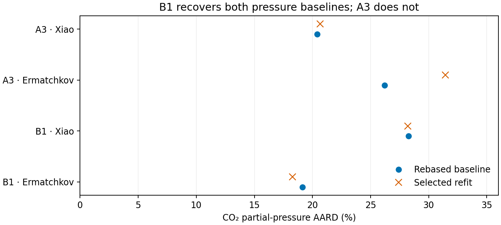

# MDEA refits with the adopted shared MEA values

**The declared refits do not recover all required properties.** B1 recovers both pressure baselines; A3 recovers neither. Both selected records fail the Carson group-preservation rule. A3 also fails two outside-fit heat checks at 388.71 K and 60 wt% MDEA. This is the transfer penalty of the adopted shared set under this model, objective, bounds and declared starts, rather than a global impossibility result.

The historical costs reproduce after restoring the pre-0e216fe water ideal-gas calorics in scratch. The refits use current calorics and the pinned 391dfe5d wheel. Kuranov source rows 28 and 72 are excluded from both baselines and refits, leaving 278 fitted observations. The adopted R2 law is unchanged.

These are calibration and numerical verification results for the manuscript workflow comparison. They do not establish absorber suitability or parameter transferability. No parameters are adopted. Independent delivered-evidence review and investigator promotion remain pending.

## Historical confirmation and rebased costs

| Record | Retained historical cost, 280 rows | Earlier-water replay, 280 rows | Relative difference | Current-input baseline, 278 rows | Fixed shared substitution, 278 rows |
|---|---:|---:|---:|---:|---:|
| A3 | 403.714985147052 | 403.714985147345 | 7.25e-13 | 403.307869920741 | 450.976082646481 |
| B1 | 374.452013423974 | 374.452013423993 | 4.95e-14 | 373.659545206477 | 431.191955444524 |

The water caloric change is the explained historical difference. Earlier failed old-wheel and current-wheel results remain historical evidence in F1.json; they are superseded as stopping decisions by the successful coefficient confirmation and the owner rebase.

## Declared bounded fits

| Start | Status | Cost | Iterations | Wall time, s | Rank | Active coordinate indices, zero based |
|---|---|---:|---:|---:|---:|---|
| A3-endpoint | converged | 403.571525172116 | 10 | 103.78 | 9 | [2, 3, 5, 8] |
| A3-alternative | converged | 403.571525151964 | 11 | 117.62 | 9 | [2, 3, 5, 8] |
| B1-endpoint | converged | 374.519078805137 | 11 | 137.49 | 9 | [5, 8] |
| B1-alternative | converged | 392.924179859028 | 17 | 242.44 | 9 | [3, 8] |

The controls remain 40 iterations, 2100 seconds, function and parameter tolerances 1e-10, and gradient tolerance 1e-8. Native refusals, iteration costs, Jacobians and weak directions are retained per start. Bounds are computational limits, not confidence intervals.

## Endpoint eligibility and gates

- A3-endpoint: eligibility True; 775 phase records, 0 dense-liquid states, 0 ambiguous states, 0 unresolved checks, 39 gas-witness states; derivative pass True; maximum relative element error 4.94e-13, maximum absolute charge error 3.97e-13 mol.
- A3-alternative: eligibility True; 775 phase records, 0 dense-liquid states, 0 ambiguous states, 0 unresolved checks, 39 gas-witness states; derivative pass True; maximum relative element error 4.94e-13, maximum absolute charge error 2.23e-13 mol.
- B1-endpoint: eligibility True; 775 phase records, 0 dense-liquid states, 0 ambiguous states, 0 unresolved checks, 37 gas-witness states; derivative pass True; maximum relative element error 9.18e-13, maximum absolute charge error 4.76e-13 mol.
- B1-alternative: eligibility True; 775 phase records, 0 dense-liquid states, 0 ambiguous states, 0 unresolved checks, 35 gas-witness states; derivative pass True; maximum relative element error 5.31e-13, maximum absolute charge error 3.34e-13 mol.

Frozen selection: {'A3': {'name': 'A3-alternative', 'cost': 403.5715251519642, 'endpoint_sha256': 'bf448013a5a195e266ed4f1ad9262b3d2a6068f818e6a17e629f3c3e06c18674'}, 'B1': {'name': 'B1-endpoint', 'cost': 374.5190788051367, 'endpoint_sha256': '2a5341be176829d087133a1467828f762a655f92a586eb1062a5719a58142d9d'}}.

F1 passes the owner-amended 278-row replay; the maximum independent residual discrepancy is 1.55e-15. F2–F4 details and their numerical evidence are in gates.json. F5 preserves the declared experiment: no widened bounds, changed weights, released shared interaction, shortened heat grid, Engine edits or adoption.

F2 fails for A3 and passes for B1. The separate older Ermatchkov ≤24.2% criterion fails for A3 (31.441683%) and passes for B1 (18.270562%). F3 fails for both: Carson scaled-RMS ratios are 1.103341 and 1.132420 against the allowed 1.10. The Carson pressure-sensitivity changes are 0.146065% and 0.150275%, both below 0.5%.

F4 passes on the owner-amended domain: each selected endpoint has 775 required phase records, no dense-liquid witnesses, no ambiguous states and no unresolved checks. Gas witnesses are reported separately (39 for A3, 37 for B1), with none at mandatory Carson states. All four Jacobians have rank 9. The qualifying A3 starts differ by 0.000331 percentage point in Ermatchkov AARD, below the 2-point warning threshold; the B1 alternative is outside the 1% cost window. F5 retains the bounded-experiment outcome, with no change to the adopted shared values or fitting policy.

## Pressure comparisons

| Record or endpoint | Source | Rows available | AARD, % | Signed mean relative error, % | Mean log pressure ratio | Underpredictions |
|---|---|---:|---:|---:|---:|---:|
| A3-baseline-278 | Xiao | 20/20 | 20.39755091904604 | -20.39755091904604 | -0.23924106295983258 | 20 |
| A3-baseline-278 | Ermatchkov | 88/88 | 26.20840617567598 | -18.8835160742905 | -0.2731194883934826 | 63 |
| A3-alternative | Xiao | 20/20 | 20.663633354779623 | -20.663633354779623 | -0.24015679236652296 | 20 |
| A3-alternative | Ermatchkov | 88/88 | 31.44168292303566 | -26.388872830526825 | -0.3878709895388074 | 74 |
| A3-endpoint | Xiao | 20/20 | 20.662965112326965 | -20.662965112326965 | -0.2401483261724549 | 20 |
| A3-endpoint | Ermatchkov | 88/88 | 31.441352418741413 | -26.388294079014557 | -0.38786247676140273 | 74 |
| B1-baseline-278 | Xiao | 20/20 | 28.27641541015077 | -28.206634239681186 | -0.3539104778378324 | 19 |
| B1-baseline-278 | Ermatchkov | 88/88 | 19.146012402859704 | 0.8938901651675738 | -0.02163202170516023 | 40 |
| B1-endpoint | Xiao | 20/20 | 28.191041416685415 | -28.191041416685415 | -0.35300056705847915 | 20 |
| B1-endpoint | Ermatchkov | 88/88 | 18.27056161553312 | -1.6832773991508851 | -0.046993392339662085 | 43 |

Points compare scalar per-source AARDs on the same wheel: 20 Xiao rows and 88 primary Ermatchkov rows. No parameter or measurement uncertainty was estimated. The comparison is conditional model assessment, not new physical validation. Exact plotted values are retained in pressure-comparison.csv.

The earlier current-shared-value pressure AARDs were A3 Xiao 20.397551%, A3 Ermatchkov 26.208406%, B1 Xiao 28.276415%, and B1 Ermatchkov 19.146012%. Rebased same-wheel values above are the actual comparison baselines. Pressure recovery is source specific, with 1e-6 percentage-point comparison tolerance; the older Ermatchkov 24.2% criterion remains separate.

### A3 property preservation

| Group | Baseline scaled RMS | Refit scaled RMS | Ratio | Pass ≤1.10 |
|---|---:|---:|---:|---|
| Kuranov | 0.217138179 | 0.209084852 | 0.96291151 | True |
| Jakobsen | 1.63362444 | 1.62610884 | 0.995399428 | True |
| Carson | 1.07498539 | 1.18607593 | 1.10334144 | False |
| Merkley | 1.97390273 | 2.0531751 | 1.04016022 | True |
| Cp | 2.23736961 | 2.18531131 | 0.976732363 | True |
| loaded-density | 1.52054027 | 1.46684488 | 0.964686639 | True |
| unloaded-density | 1.44248843 | 1.44235628 | 0.999908383 | True |
| Kim | 0.0439221728 | 0.0439411876 | 1.00043292 | True |

Outside-fit heat checks: 12 pass, 2 fail, 12 without a historical numerical comparator. Full row identities, availability and values are retained in gates.json.

### B1 property preservation

| Group | Baseline scaled RMS | Refit scaled RMS | Ratio | Pass ≤1.10 |
|---|---:|---:|---:|---|
| Kuranov | 0.229273545 | 0.223438188 | 0.974548494 | True |
| Jakobsen | 1.65906049 | 1.63947745 | 0.988196309 | True |
| Carson | 0.976619829 | 1.10594401 | 1.13242019 | False |
| Merkley | 1.99216201 | 2.01558215 | 1.01175614 | True |
| Cp | 1.81414132 | 1.760133 | 0.970229265 | True |
| loaded-density | 1.57630501 | 1.58828838 | 1.00760219 | True |
| unloaded-density | 1.44180301 | 1.44166289 | 0.999902819 | True |
| Kim | 0.0439848664 | 0.0440063978 | 1.00048952 | True |

Outside-fit heat checks: 13 pass, 0 fail, 13 without a historical numerical comparator. Full row identities, availability and values are retained in gates.json.

## Adopted-R2 domain exclusions

The owner extended the domain-exclusion rule to the seven corrected-Kamps comparison states below on 2026-11-11. The same exclusions apply to both baselines and every refit start. All remain retained as out-of-domain, unscored comparisons; the 278 fitted observations are unchanged. **F4 phase evidence does not cover 394.94–395.00 K.**

| Source row | Temperature, K | Source locator |
|---|---:|---|
| 22 | 394.94 | Ermatchkov2006, Table 6, PDF p.8, printed p.6088; PDF attachment UD6X5RGU |
| 23 | 395.00 | Ermatchkov2006, Table 6, PDF p.8, printed p.6088; PDF attachment UD6X5RGU |
| 24 | 394.94 | Ermatchkov2006, Table 6, PDF p.8, printed p.6088; PDF attachment UD6X5RGU |
| 25 | 394.99 | Ermatchkov2006, Table 6, PDF p.8, printed p.6088; PDF attachment UD6X5RGU |
| 26 | 394.95 | Ermatchkov2006, Table 6, PDF p.8, printed p.6088; PDF attachment UD6X5RGU |
| 27 | 394.94 | Ermatchkov2006, Table 6, PDF p.8, printed p.6088; PDF attachment UD6X5RGU |
| 28 | 394.95 | Ermatchkov2006, Table 6, PDF p.8, printed p.6088; PDF attachment UD6X5RGU |

## Fitted MDEA parameters

Values at the frozen selected endpoints are listed below. The bicarbonate–water interaction and complete R2 law are fixed to the adopted #255 values; they are not refitted coordinates. The segment and Debye–Hückel diameter ties and the A3 packing-diameter factor 0.88 are preserved.

| Quantity | Unit | A3 value | A3 bound | B1 value | B1 bound |
|---|---|---:|---|---:|---|
| MDEA–water interaction at 313.15 K | dimensionless | -0.206171540892 | interior | -0.206337348212 | interior |
| MDEA–water linear temperature slope | 1/K | 0.00147234890357 | interior | 0.00147504010086 | interior |
| Protonated-MDEA–CO2 interaction | dimensionless | 0.5 | upper | 0.248188928222 | interior |
| Protonated-MDEA–water interaction at 313.15 K | dimensionless | -0.5 | lower | -0.0332362078286 | interior |
| Protonated-MDEA–water reciprocal temperature slope | K | -84.8137978565 | interior | -27.1049250702 | interior |
| Protonated-MDEA–bicarbonate interaction | dimensionless | -1 | lower | 1 | upper |
| Protonated-MDEA segment diameter | angstrom | 6.35770868038 | interior | 3.64940741844 | interior |
| Protonated-MDEA dispersion energy / Boltzmann constant | K | 189.925957376 | interior | 623.043027255 | interior |
| Protonated-MDEA Born diameter | angstrom | 7 | upper | 7 | upper |

All attempted endpoint parameters and bounds are retained in fitted-parameters.json and the native fit/declaration files. Interior values and full local rank do not establish unique identification.

## Limits and retained evidence

The two A3 outside-fit heat failures are concentration extrapolations at 388.71 K and 60 wt% MDEA. For the half-loading diagnostic, the calculated heat changes from −82.344969 to −85.682725 kJ/mol CO₂ against an observation of −63.3 kJ/mol, increasing absolute error by 3.337756 kJ/mol. For the capped integral heat, it changes from −74.141516 to −77.732589 kJ/mol, increasing absolute error by 3.591073 kJ/mol. Both increases exceed the permitted residual scale of 3.165 kJ/mol.

For B1 at 333.15 K, 60 wt% MDEA and 1.121 MPa, the capped heat remains unavailable at both baseline and refit: the original native search refuses the vapor branch at loading 1.45 mol/mol. No shortened grid or finite substitute heat is used, and no numerical heat-recovery claim is made for that row.

The two excluded Kuranov temperatures (393.17 and 393.16 K) exceed the adopted R2 upper limit of 393.15 K. No law was extended. Historical costs use 280 rows and are not directly comparable to the 278-row costs. Phase failure rejects an endpoint; unresolved numerical checks prevent a clean verdict. Neither establishes global impossibility of recovery. Active bounds and local Jacobian rank do not establish parameter identification. The 60 wt% comparisons remain concentration extrapolations. The original 30-node heat search over loading 0.05–1.50 mol/mol is preserved, including refusals. A historically unavailable B1 heat has no finite historical comparator.

F1.json owns qualification and provenance; attempts.json and each start directory own fit results; eligibility.json owns endpoint eligibility; selection.json freezes selection before pressure scoring; pressure-scores.json and gates.json own the comparisons. No source coefficients or Engine source were changed. The historical-water calculation is retained as logs/water-coefficient-confirmation.py and its row outputs, with coefficients recoverable from Git.

Execution: agent-heavy .venv/bin/python analyses/mdea_mea_workflow/scripts/continue_298.py runs the declared fits after historical confirmation; agent-heavy .venv/bin/python analyses/mdea_mea_workflow/scripts/assess_298.py runs the endpoint checks and assessments. The latter reuses retained phase calculations and applies the owner domain exclusion before freezing the selection.
