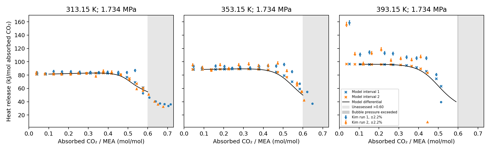
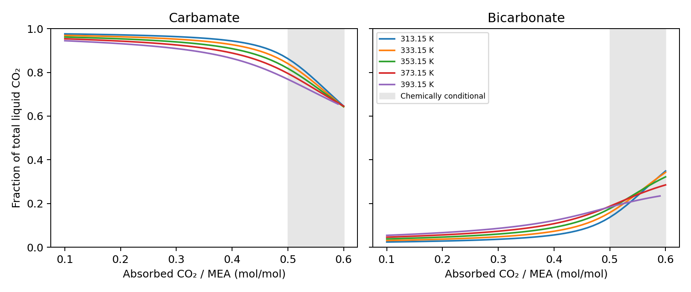
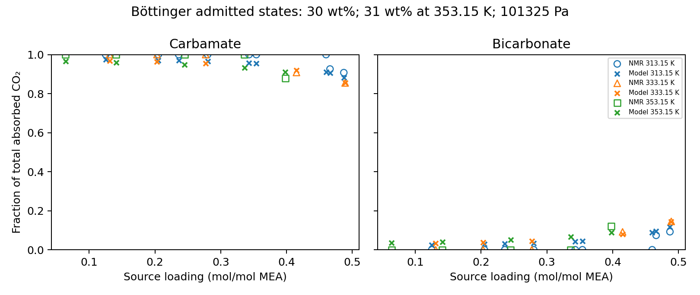
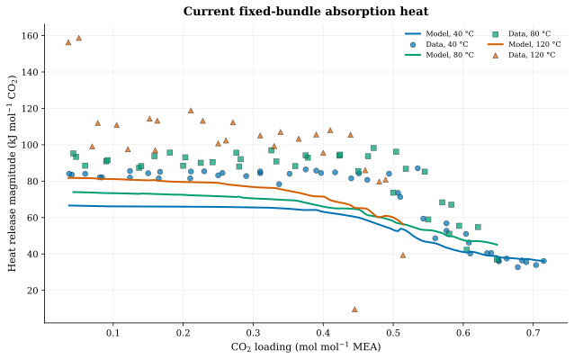

# Final-parameter Kim comparison {#kim2007-current}

At 1.734 MPa and nominal 30 wt% MEA, the final manuscript parameter set gives semi-differential heat RMSEs of **4.82, 7.23 and 24.997 kJ/mol absorbed CO₂** against the printed Kim observations at 313.15, 353.15 and 393.15 K, respectively, after the loading ceiling is applied and flagged source rows are omitted (n = 27, 26 and 18). At 393.15 K, the all-printed value is 29.12 kJ/mol absorbed CO₂ (n = 20). These are fixed-parameter predictions compared with calorimetry, supported by numerical reference and balance checks. They do not establish a common experimental crossover or process suitability.

The 313 K run 1 / 353 K run 2 pair reverses downward and then upward below loading 0.60; the model misses that pattern. Its downward reversal is nominal on the source uncertainty scale, whereas the subsequent upward reversal is resolved under conservative bounds. The other three admitted pairs do not reverse experimentally. The limiting differential model quantity reverses near loading 0.558; its zero is a different diagnostic from the crossing of unequal measured addition intervals.

## Basis, inputs and source definitions

The parameter file is `results/selected-current-best-parameters.json`, SHA-256 `00e77608a8489fc9e03a7d2a86c08cb5ff782bb441368a62fa6390b8bfe9cc91`; the immutable Engine wheel is SHA-256 `0d08dff9be39fb8fc9018119c47612f53d823cd0e456914d7dd44c6941596804`, built from merged commit `3e83e19ccc771b51d8ebc038931ab25192f4c5b5`. No parameter was fitted here. [The amended design](https://tnnrpolley21-ms-7c95.taila72856.ts.net:3000/tannerpolley/Amine-Thermodynamics/issues/245#issuecomment-10718) records the source decisions.

For 1 mol analytical MEA, fixed water amount and liquid absorbed-CO₂ loading $\alpha$, positive heat release is

$$
Q(a,b)=-\frac{H_L(T,P,b)-H_L(T,P,a)-(b-a)h_g(T,P)}{b-a}.
$$

The calculation reuses the manuscript's `fit_observations.heat_items` declaration and Engine addition enthalpy. $h_g$ is pure CO₂ vapor-feed enthalpy at the same temperature and pressure as the two equilibrium liquids. The manuscript uses the opposite sign for signed absorption enthalpy. The source-feed bubble helper is given the same analytical water amount as the manuscript heat declaration; its source molar-mass convention differs slightly from the EOS record's convention.

Kim and Svendsen (2007), Experimental and Results, pp.5803–5807, define their reported differential heat as a finite-interval average reported at the final liquid loading. The same-run preceding printed endpoint supplies $a$; the first interval starts at zero. The printed endpoints are rounded, and exact doses are unavailable. The limiting model differential quantity is

$$
q_{\mathrm{diff}}(\alpha)=\frac{d[\alpha Q(0,\alpha)]}{d\alpha}.
$$

The ordinary per-CO₂ integral is $Q(0,\alpha)$ and the cumulative per-MEA heat is $\alpha Q(0,\alpha)$. At 393.15 K, the source's per-CO₂ integral omits the first interval: use $Q(0.051,\alpha)$ for run 1 and $Q(0.036,\alpha)$ for run 2. The per-MEA column remains cumulative from zero. Integral columns are correlated transformations, not additional independent experiments.

Kim reduces gross feed by the change in reactor vapor CO₂ inventory to obtain absorbed CO₂. These published liquid-loading increments already use that absorbed basis. No second vapor subtraction is made here. Row-specific pressure histories are unavailable, so the chosen isobar is an approximation to the liquid comparison rather than a complete variable-pressure calorimeter energy balance.

## Heat deviations

The primary table omits the flagged source observables described below. RMSE and bias for the per-MEA integral are in kJ/mol MEA; all other heat errors are in kJ/mol absorbed CO₂. AARD is mean absolute relative deviation. The last column counts observations beyond the source's ±2.2% relative scale, not a model confidence interval.

| T (K) | Quantity | n | RMSE | Bias | AARD (%) | Beyond ±2.2% |
|---|---|---:|---:|---:|---:|---:|
| 313.15 | Finite-interval per CO₂ | 27 | 4.8199 | -1.1367 | 4.1988 | 15 |
| 313.15 | Differential endpoint per CO₂ | 27 | 5.3790 | -2.0414 | 4.1591 | 17 |
| 313.15 | Integral per CO₂ | 26 | 1.9039 | -1.4856 | 1.8741 | 12 |
| 313.15 | Integral per MEA | 27 | 0.6972 | -0.4308 | 1.9549 | 14 |
| 353.15 | Finite-interval per CO₂ | 26 | 7.2320 | -5.8240 | 6.5727 | 21 |
| 353.15 | Differential endpoint per CO₂ | 26 | 9.2667 | -7.2815 | 8.4480 | 22 |
| 353.15 | Integral per CO₂ | 26 | 4.6629 | -4.5487 | 4.9128 | 26 |
| 353.15 | Integral per MEA | 26 | 1.8860 | -1.5554 | 4.8720 | 26 |
| 393.15 | Finite-interval per CO₂ | 18 | 24.9975 | -16.7755 | 18.0758 | 17 |
| 393.15 | Differential endpoint per CO₂ | 18 | 25.5700 | -18.2065 | 18.7738 | 17 |
| 393.15 | Integral per CO₂ | 16 | 14.2743 | -14.1785 | 12.9473 | 16 |
| 393.15 | Integral per MEA | 18 | 6.3562 | -5.9694 | 21.5062 | 18 |

Across the 53 admitted 313.15/353.15 K observations, finite-interval RMSE is 6.1231 kJ/mol and AARD is 5.3633%; the endpoint differential comparison gives 7.5409 kJ/mol and 6.2631%. Hong et al. (2027), §3.2, Fig.6 and Eq.17, report 9.48% and 14.29% for their two models. Hong's heat comes from the temperature derivative of equilibrium CO₂ partial pressure; this calculation uses liquid and feed enthalpies. Their scoring subset and fitting history differ, so these percentages do not rank otherwise equivalent calculations.

Kim was absent from the final 307-row objective, whose eight heat targets were Vinjarapu observations. Six Kim 40/80 °C intervals entered a historical model-D fit, and the 120 °C block was previously inspected. Arcis also informed final parameter selection. None of these comparisons is a blind test.

### Printed inconsistencies and sensitivity

Table 1, 40 °C run 1 at loading 0.041, prints 8.575 kJ/mol CO₂ despite 3.425 kJ/mol MEA. The anomalous per-CO₂ integral is retained but omitted from the primary integral statistic. Including it changes that RMSE/AARD from 1.9039 kJ/mol and 1.8741% (26 values) to 14.1125 kJ/mol and 33.1989% (27 values). The other observables on this row remain scored.

Table 3 run 2 at loading 0.078 prints differential/truncated-integral heat 112.000 kJ/mol CO₂, while the cumulative per-MEA increment implies 121.6429 kJ/mol. At loading 0.445, the printed differential value is 9.562 kJ/mol while the cumulative increment implies 95.5714 kJ/mol. These are source consistency diagnostics; they neither identify the erroneous column nor provide replacement observations. All four heat observables on each affected row are omitted from the primary source-screened statistics and retained in the all-printed statistics. The first two per-CO₂ integral cells at 393.15 K contain a footnote rather than numbers and cannot be scored.

| 393.15 K quantity | Printed numeric values: n / RMSE / AARD (%) | Without rows 0.078 and 0.445: n / RMSE / AARD (%) | Also without each run's anomalous first interval: n / RMSE / AARD (%) |
|---|---|---|---|
| Finite-interval per CO₂ | 20 / 29.1202 / 55.6270 | 18 / 24.9975 / 18.0758 | 16 / 15.4630 / 15.5028 |
| Differential endpoint per CO₂ | 20 / 29.1065 / 54.3023 | 18 / 25.5700 / 18.7738 | 16 / 16.3644 / 16.2679 |
| Integral per CO₂ | 18 / 14.2791 / 12.9533 | 16 / 14.2743 / 12.9473 | 16 / 14.2743 / 12.9473 |
| Integral per MEA | 20 / 6.3014 / 21.5977 | 18 / 6.3562 / 21.5062 | 16 / 6.6738 / 19.3870 |

Even after removing those two inconsistent rows and the two anomalous first intervals, the 393.15 K finite-interval RMSE remains 15.4630 kJ/mol (AARD 15.5028%, 16 observations). Source anomalies therefore explain only part of the discrepancy.

## Run-pair temperature ordering

For each pair, reported finite-interval heats and their model counterparts are interpolated against the same source endpoints over the common admitted range. Excluded endpoints are removed before interpolation. The uncertainty bound on the temperature difference is the sum of the two ±2.2% absolute bounds; no independence assumption or confidence level is assigned.

| 313 K run / 353 K run | Admitted loading range | Observed difference range (kJ/mol) | Model difference range (kJ/mol) | Reversal evidence and falsifier outcome |
|---|---|---|---|---|
| 1/1 | 0.047–0.576 | +0.7517 to +17.6589 | -0.1284 to +7.2654 | No observed reversal; model downward zero 0.574627. No experimental reversal to test. |
| 1/2 | 0.043–0.576 | -6.3568 to +14.0794 | +0.8137 to +7.2778 | Observed down [0.518, 0.535], then up [0.535, 0.570]; model has neither. Contradicts the admitted pair, including the uncertainty-resolved upward reversal. |
| 2/1 | 0.047–0.576 | +6.3765 to +26.3173 | +0.5614 to +7.2607 | Neither reverses; no experimental reversal to test. |
| 2/2 | 0.043–0.576 | +5.4632 to +19.0026 | +1.5035 to +7.2705 | Neither reverses; no experimental reversal to test. |

For pair 1/2, nominal observed zeros are 0.520161 and 0.548155. The downward reversal is not resolved at both bracket endpoints on the stated source scale; the upward reversal is resolved. There is no common sustained experimental downward crossover below 0.60. Full-table brackets requiring excluded endpoints remain unassessed: pair 1/1 [0.640, 0.648], pair 1/2 [0.594, 0.605], and pair 2/2 [0.594, 0.604]. In the last case the interpolated zero is nominally below 0.60, but it still requires an excluded endpoint and is not an admitted test.

The limiting model diagnostic $q_{\mathrm{diff}}(353.15)-q_{\mathrm{diff}}(313.15)$ changes downward near 0.558. Its zero need not coincide with finite-interval crossings. The refined bracket is [0.557666338, 0.558566338], with endpoint differences +0.053007 and -0.053190 kJ/mol. Both signs exceed the combined 0.002 kJ/mol numerical heat tolerance. The bracket and differences are retained in `summary.json`.



## Loading admission and exclusions

| T (K) | Source rows | Above 0.60, uncalculated | Bubble-pressure exclusions | Numerical failures | Available intervals | First pressure-excluded Kim loading |
|---|---:|---:|---:|---:|---:|---|
| 313.15 | 37 | 10 | 0 | 0 | 27 | None |
| 353.15 | 29 | 3 | 0 | 0 | 26 | None |
| 393.15 | 20 | 0 | 0 | 0 | 20 | None |

The unassessed 313 K source loadings are run 1: 0.608, 0.640, 0.662, 0.684, 0.704, 0.715; run 2: 0.604, 0.634, 0.651, 0.678. At 353 K they are run 1: 0.621, 0.648; run 2: 0.605. There are no known positive-oxazolidone Kim source states to exclude separately; absence of that measurement does not establish absence of the species.

All 51 requested pathway states per temperature are admitted at 313.15, 333.15, 353.15 and 373.15 K. At 393.15 K, 50 of 51 are admitted; loading 0.60 exceeds 1.734 MPa bubble pressure. Its pressure crossing lies in [0.596875, 0.597500]. No upper pressure crossing is found through 0.60 at the other four temperatures. This is a study admission limit, not a continuous process-use domain or proof of global single-liquid stability.

Böttinger et al. (2008), §7, p.141, report quantifiable 2-oxazolidone above about 0.5 loading. It is absent from this model. The region 0.5–0.6 remains chemically conditional; known positive-oxazolidone NMR states were excluded from the adopted comparison set. Temperature extrapolation of reaction laws beyond their original source range remains a separate limitation.

## Carbamate and bicarbonate fractions

The denominator is total liquid CO₂: $N_C=n_{CO_2}+n_{MEACOO^-}+n_{HCO_3^-}+n_{CO_3^{2-}}$. Fractions are $f_{carb}=n_{MEACOO^-}/N_C$, $f_{bicarb}=(n_{HCO_3^-}+n_{CO_3^{2-}})/N_C$, and $f_{free}=n_{CO_2}/N_C$. Each carbonate contains one carbon. The fractions sum to one, rather than normalizing only by reacted CO₂.

| T (K) | Loading | Carbamate | Bicarbonate + carbonate | Free CO₂ |
|---|---:|---:|---:|---:|
| 313.15 | 0.10 | 0.976161 | 0.023837 | 0.000001 |
| 313.15 | 0.30 | 0.963644 | 0.036346 | 0.000010 |
| 313.15 | 0.50 | 0.862954 | 0.136725 | 0.000321 |
| 313.15 | 0.60 | 0.645690 | 0.348768 | 0.005542 |
| 333.15 | 0.10 | 0.969407 | 0.030585 | 0.000008 |
| 333.15 | 0.30 | 0.952139 | 0.047809 | 0.000052 |
| 333.15 | 0.50 | 0.840396 | 0.158260 | 0.001344 |
| 333.15 | 0.60 | 0.642543 | 0.342629 | 0.014828 |
| 353.15 | 0.10 | 0.961897 | 0.038066 | 0.000037 |
| 353.15 | 0.30 | 0.939494 | 0.060252 | 0.000254 |
| 353.15 | 0.50 | 0.818107 | 0.176728 | 0.005165 |
| 353.15 | 0.60 | 0.643362 | 0.321891 | 0.034747 |
| 373.15 | 0.10 | 0.953779 | 0.046056 | 0.000166 |
| 373.15 | 0.30 | 0.925598 | 0.073262 | 0.001139 |
| 373.15 | 0.50 | 0.795256 | 0.187402 | 0.017341 |
| 373.15 | 0.60 | 0.645932 | 0.285131 | 0.068938 |
| 393.15 | 0.10 | 0.944950 | 0.054354 | 0.000695 |
| 393.15 | 0.30 | 0.909083 | 0.086194 | 0.004723 |
| 393.15 | 0.50 | 0.768545 | 0.183988 | 0.047468 |
| 393.15 | 0.60 | Outside pressure admission | — | — |

Carbamate remains the largest carbon fraction throughout the admitted grid, but decreases with loading. At loading 0.50 it decreases from 0.862954 at 313.15 K to 0.768545 at 393.15 K. At high loading, increasing temperature also increases dissolved free CO₂, so a smaller carbamate fraction does not translate entirely into bicarbonate. For example at loading 0.59, the free fraction increases from 0.004363 to 0.110436 across those temperatures.

Hong et al. (2027), Eqs.15–16 and Fig.5, use $f_{carb}=w[1-(X^R_{CO_2,sym})^2]$ and $f_{bicarb}=(1-w)[1-X^R_{CO_2,single}]$. Their weight $w$ is not itself a pathway fraction, and the two associated fractions need not sum to one. The present explicit-species definitions share the intended total-CO₂ basis but do not reproduce that site-based algebra. Their Fig.5 reference is Aspen HYSYS eNRTL rather than NMR. The loading trend is qualitatively similar; no Hong figure values were digitized, and SI Table S1 weights were not treated as fractions.



The NMR comparison uses the adopted Böttinger states 042–050 at 313.15 K, 055–059 at 333.15 K, and 063–067 at 353.15 K: nine, five and five states. Their source compositions are 30 wt%, 30 wt% and 31 wt%, respectively. The source-state model predictions use the retained 101325 Pa single-liquid declarations, rather than treating those points as exact matches to the 30 wt%, 1.734 MPa sweep. Source carbon fractions use the same-state carbon-pool mole-fraction sum. Bicarbonate-labeled measurements map to the model bicarbonate-plus-carbonate pool under the adopted observation approximation (Böttinger p.134: carbonate practically absent). Zero observations are preserved without relative-error metrics. The 313/333 K comparisons include fitted data; the 353 K comparisons were previously accessed.



## Numerical evidence, reproduction and limits

The three existing manuscript heat reference cases pass within 0.001 kJ/mol. The study's own zero-to-0.11 heat exactly reproduces the corresponding Vinjarapu prediction to the retained numerical precision. All 43 NMR species reference comparisons pass, with largest relative difference $2.1\times10^{-15}$. Every requested differential step-halving check passes the 0.001 kJ/mol criterion. Available states meet the Engine request and the $10^{-10}$ scaled equilibrium, carbon, nitrogen and charge balance limits. These checks verify the numerical calculations; they do not make the calorimetry independent or validate omitted chemistry.

Integral outputs record their own availability and returned reason, independently of the finite-interval heat. The summary lists unavailable prediction identities, reasons and counts for each integral basis and for the integral curves; domain exclusions and intentionally undefined first truncated integrals are separate from numerical failures. The pinned in-memory check makes `heat(313.15, 0, 0.084)` unavailable: both comparison integrals and the curve integral retain the injected reason and count one numerical failure each, while the valid finite-interval prediction remains available.

```bash
agent-heavy uv run --no-sync python analyses/mea_parameter_bundle/scripts/kim2007_heat_pathways.py calculate
agent-heavy uv run --no-sync python analyses/mea_parameter_bundle/scripts/kim2007_heat_pathways.py present
```

Calculation and presentation are separate actions. Presentation verifies retained hashes and does not import the thermodynamic runtime. The retained [heat rows](../results/kim2007-heat-pathways-245/kim-heat.csv), [statistics and brackets](../results/kim2007-heat-pathways-245/summary.json), [run-pair differences](../results/kim2007-heat-pathways-245/run-pair-differences.csv), [state diagnostics](../results/kim2007-heat-pathways-245/states.csv), [fractions](../results/kim2007-heat-pathways-245/pathway-fractions.csv), [NMR fractions](../results/kim2007-heat-pathways-245/bottinger-fractions.csv), [verification](../results/kim2007-heat-pathways-245/verification.json), and [hashed inputs](../results/kim2007-heat-pathways-245/inputs.json) own the numerical evidence.

The comparison supports a narrower manuscript statement about the fixed-parameter heat predictions and the disagreement among source run pairs. Missing experimental pressures, rounded loading intervals, inconsistent printed heats, prior data use, reaction-law extrapolation and omitted oxazolidone limit its interpretation. Independent delivered review returned Supported at commit `3223295`. The investigator promoted notebook commit `fd8097f` on 2026-11-05 for a short descriptive manuscript comparison of per-temperature heat deviations and run-pair outcomes, optionally pathway fractions, subject to fixed-parameter comparison against previously accessed data, nominal 30 wt% MEA at 1.734 MPa and loading ≤ 0.60, distinct finite-interval and limiting differential heats and per-CO₂ and per-MEA bases, the limitations above, no controlled ranking against Hong et al., no universal experimental crossover, and no process qualification (issue #251).

### Loadings beyond the source uncertainty scale

The following are the primary-table observables whose absolute deviation exceeds 2.2% of the printed magnitude. Full row identities and the statistics including flagged source values remain in the linked files.

| T (K) | Quantity | Run | Loadings |
|---|---|---|---|
| 313.15 | Finite-interval per CO₂ | 1 | 0.041, 0.124, 0.167, 0.211, 0.256, 0.451, 0.494, 0.535, 0.576 |
| 313.15 | Finite-interval per CO₂ | 2 | 0.037, 0.337, 0.375, 0.417, 0.543, 0.576 |
| 313.15 | Differential endpoint per CO₂ | 1 | 0.041, 0.124, 0.167, 0.211, 0.397, 0.451, 0.494, 0.535, 0.576 |
| 313.15 | Differential endpoint per CO₂ | 2 | 0.037, 0.337, 0.375, 0.417, 0.463, 0.507, 0.543, 0.576 |
| 313.15 | Integral per CO₂ | 1 | 0.124, 0.167, 0.211, 0.256, 0.310, 0.352, 0.397, 0.451, 0.494, 0.535, 0.576 |
| 313.15 | Integral per CO₂ | 2 | 0.037 |
| 313.15 | Integral per MEA | 1 | 0.041, 0.124, 0.167, 0.211, 0.256, 0.310, 0.352, 0.397, 0.451, 0.494, 0.535, 0.576 |
| 313.15 | Integral per MEA | 2 | 0.037, 0.081 |
| 353.15 | Finite-interval per CO₂ | 1 | 0.047, 0.090, 0.159, 0.203, 0.282, 0.378, 0.423, 0.464, 0.504, 0.545, 0.583 |
| 353.15 | Finite-interval per CO₂ | 2 | 0.043, 0.092, 0.181, 0.276, 0.326, 0.375, 0.424, 0.472, 0.518, 0.570 |
| 353.15 | Differential endpoint per CO₂ | 1 | 0.047, 0.090, 0.159, 0.203, 0.282, 0.378, 0.423, 0.464, 0.504, 0.545, 0.583 |
| 353.15 | Differential endpoint per CO₂ | 2 | 0.043, 0.092, 0.181, 0.276, 0.326, 0.375, 0.424, 0.472, 0.518, 0.570, 0.594 |
| 353.15 | Integral per CO₂ | 1 | 0.047, 0.090, 0.159, 0.203, 0.242, 0.282, 0.333, 0.378, 0.423, 0.464, 0.504, 0.545, 0.583 |
| 353.15 | Integral per CO₂ | 2 | 0.043, 0.092, 0.137, 0.181, 0.225, 0.276, 0.326, 0.375, 0.424, 0.472, 0.518, 0.570, 0.594 |
| 353.15 | Integral per MEA | 1 | 0.047, 0.090, 0.159, 0.203, 0.242, 0.282, 0.333, 0.378, 0.423, 0.464, 0.504, 0.545, 0.583 |
| 353.15 | Integral per MEA | 2 | 0.043, 0.092, 0.137, 0.181, 0.225, 0.276, 0.326, 0.375, 0.424, 0.472, 0.518, 0.570, 0.594 |
| 393.15 | Finite-interval per CO₂ | 1 | 0.051, 0.105, 0.152, 0.228, 0.271, 0.339, 0.390, 0.439, 0.489, 0.514 |
| 393.15 | Finite-interval per CO₂ | 2 | 0.036, 0.163, 0.211, 0.261, 0.310, 0.365, 0.410 |
| 393.15 | Differential endpoint per CO₂ | 1 | 0.051, 0.105, 0.152, 0.228, 0.271, 0.339, 0.390, 0.439, 0.489, 0.514 |
| 393.15 | Differential endpoint per CO₂ | 2 | 0.036, 0.163, 0.211, 0.261, 0.310, 0.365, 0.410 |
| 393.15 | Integral per CO₂ | 1 | 0.105, 0.152, 0.228, 0.271, 0.339, 0.390, 0.439, 0.489, 0.514 |
| 393.15 | Integral per CO₂ | 2 | 0.121, 0.163, 0.211, 0.261, 0.310, 0.365, 0.410 |
| 393.15 | Integral per MEA | 1 | 0.051, 0.105, 0.152, 0.228, 0.271, 0.339, 0.390, 0.439, 0.489, 0.514 |
| 393.15 | Integral per MEA | 2 | 0.036, 0.121, 0.163, 0.211, 0.261, 0.310, 0.365, 0.410 |

# Historical model-D assessment

Historical model-D calorimetry assessment; model D labels the corrected-Born parameter formulation.

## Question

Does the historical model-D nine-species working record reproduce absorption heat across
loading and temperature, and which heat observations were actually allowed to
influence the reaction-temperature fit?

## Result

The historical model-D record gives a root-mean-square error (RMSE) of **8.027440 kJ mol⁻¹ CO₂** and bias **-3.617420 kJ mol⁻¹ CO₂** for the Kim–Svendsen 40/80 °C calibration cohort (66 / 66 intervals scored). Only six 40/80 °C intervals entered the reaction-temperature objective. The
120 °C block remained outside that fit, and Kim 2014 was comparison evidence.

## Basis and method

[]{#starting-point-and-strategy}

The historical serialized model-D record is `9055458d8b7cd767a0d08e9f37e4fd28631e29c363364d7b842ebade645cb241`, with solvation-shell and dielectric-saturation (SSM+DS) model D, labeled `p5conv-a-11`, source R4 (carbamate hydrolysis) and the inherited assessed R1–R3/R5 corrections (water ionization, CO₂ hydration, bicarbonate dissociation and protonated-amine dissociation). This assessment used wheel `28181e72e429c6e87fc6361082af1a7b21c8747e76bda65a1c30abb4a97402f2`. All 113 retained intervals and all endpoint states evaluate; no interval is omitted.

The calorimetry preparation reads the canonical monoethanolamine (MEA) observation table and
records the preceding endpoint for each finite-loading interval with the same
source, temperature, concentration and run. The retained partition contains
66 Kim–Svendsen 40/80 °C calibration intervals, 20 Kim–Svendsen 120 °C
holdout intervals and 27 Kim et al. 2014 model-selection comparison rows.

Each interval is scored as the heat released per mole of CO₂ absorbed,
−[H_L(α₂) − H_L(α₁) − (α₂ − α₁) h_CO₂^ig(T)]/(α₂ − α₁), for 1 mol MEA, with
zero calorimeter vapor inventory and an ideal-gas CO₂ feed. The neutral
records cancel between the endpoints, so the result depends only on the equation of state (EOS),
the reactions and their reference chain.

## Values

[]{#numerical-result}

| Cohort | Intervals scored | RMSE (kJ mol⁻¹ CO₂) | Bias (kJ mol⁻¹ CO₂) |
|:--|--:|--:|--:|
| Kim 2014 model-selection comparison | 27 / 27 | 6.670190 | -0.252200 |
| Kim–Svendsen 120 °C comparison outside working range | 20 / 20 | 30.124813 | -13.250753 |



| Thermal-reference quantity | Value | Unit or basis |
|:--|--:|:--|
| Consistent states / checked states | 9/9 | count |
| Temperatures | 40, 80, 120 | °C |
| Loadings | 0.1, 0.3, 0.5 | mol CO₂/mol MEA |
| Existing relative limit | 1e−6 | dimensionless |
| Maximum Gibbs–Helmholtz disagreement | 3.662e-13 | relative |
| Maximum centered-feed re-solve disagreement | 5.604e-09 | relative |
| Maximum pure-water heat-capacity difference | 15.00 | % |
| Maximum vaporization-enthalpy difference | 1.34 | % |

## Limits and evidence type

[]{#conclusion-and-limits}

The Result and Values report the historical calibration errors and high-temperature bias. The adopted seventh-amendment record’s [A7 heat statistics](../notebook.qmd#heat-of-absorption) are separate. This is numerical verification and reported calibration/assessment evidence. It supplies no caloric or process-column qualification and does not extend the working domain beyond 30 wt% MEA at 40–80 °C. The thermal consistency checks are tabulated above; pure-water heat-capacity disagreement and the absence of a verified pure-MEA liquid reference remain separate limits.

## Records

::: {.callout-note}
These historical model-D heat values are finite-dose total-enthalpy differences on the pinned Engine
(wheel `28181e72`): the Engine's record-anchored total enthalpy
([ePC-SAFT #84](https://github.com/tannerpolley/ePC-SAFT/issues/84),
[#138](https://github.com/tannerpolley/ePC-SAFT/issues/138)) with MEA's neutral
ideal-gas records and ions completed from the R1–R5 reaction enthalpies. They do
not by themselves validate an absorber model.
:::

### September-incumbent comparison

The historical September-incumbent comparison on wheel `b66c7b96` evaluated 109/113 intervals:

| Cohort | RMSE (kJ mol⁻¹) | Bias (kJ mol⁻¹) |
|:--|--:|--:|
| Calibration | 11.77 | +0.4 |
| High temperature, 120 °C | 29.28 | −15.8 |
| Kim 2014 | 10.80 | +1.4 |

Those values describe `868a5018`; the model-D comparison changes both parameter record and producing wheel and is not a wheel-only experiment.

[Observation partition record](../results/calorimetry/calorimetry-observation-partition-record.json) · [Heat summary](../results/calorimetry/current-selected-direct-enthalpy-summary.json) · [Interval comparison](../results/calorimetry/current-selected-direct-enthalpy-comparison.csv) · [Physical ideal-gas records](https://github.com/tannerpolley/Amine-Thermodynamics/blob/65ad618a994eb5a49434b58ff6bf15c431fbe905/data/reference/MEA/thermal/physical-ideal-gas-calorics.json) · [Thermal checks](../results/calorimetry/thermal-reference-validation.json)
