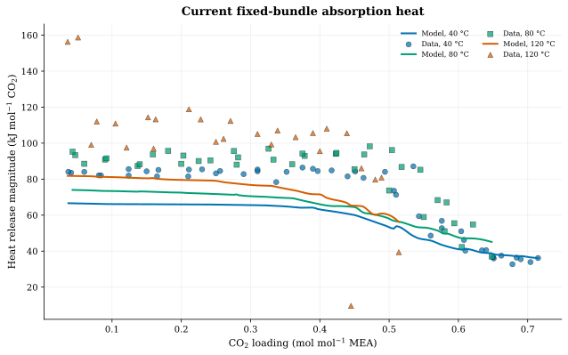

Historical model-D calorimetry assessment; model D labels the corrected-Born parameter formulation.

# Question

Does the historical model-D nine-species working record reproduce absorption heat across
loading and temperature, and which heat observations were actually allowed to
influence the reaction-temperature fit?

# Result

The historical model-D record gives a root-mean-square error (RMSE) of **8.027440 kJ mol⁻¹ CO₂** and bias **-3.617420 kJ mol⁻¹ CO₂** for the Kim–Svendsen 40/80 °C calibration cohort (66 / 66 intervals scored). Only six 40/80 °C intervals entered the reaction-temperature objective. The
120 °C block remained outside that fit, and Kim 2014 was comparison evidence.

# Basis and method

[]{#starting-point-and-strategy}

The historical serialized model-D record is `9055458d8b7cd767a0d08e9f37e4fd28631e29c363364d7b842ebade645cb241`, with solvation-shell and dielectric-saturation (SSM+DS) model D, labeled `p5conv-a-11`, source R4 (carbamate hydrolysis) and the inherited assessed R1–R3/R5 corrections (water ionization, CO₂ hydration, bicarbonate dissociation and protonated-amine dissociation). This assessment used wheel `28181e72e429c6e87fc6361082af1a7b21c8747e76bda65a1c30abb4a97402f2`. All 113 retained intervals and all endpoint states evaluate; no interval is omitted.

The calorimetry preparation reads the canonical monoethanolamine (MEA) observation table and
records the preceding endpoint for each finite-loading interval with the same
source, temperature, concentration and run. The retained partition contains
66 Kim–Svendsen 40/80 °C calibration intervals, 20 Kim–Svendsen 120 °C
holdout intervals and 27 Kim et al. 2014 model-selection comparison rows.

Each interval is scored as the heat released per mole of CO₂ absorbed,
−[H_L(α₂) − H_L(α₁) − (α₂ − α₁) h_CO₂^ig(T)]/(α₂ − α₁), for 1 mol MEA, with
zero calorimeter vapor inventory and an ideal-gas CO₂ feed. The neutral
records cancel between the endpoints, so the result depends only on the equation of state (EOS),
the reactions and their reference chain.

# Values

[]{#numerical-result}

| Cohort | Intervals scored | RMSE (kJ mol⁻¹ CO₂) | Bias (kJ mol⁻¹ CO₂) |
|:--|--:|--:|--:|
| Kim 2014 model-selection comparison | 27 / 27 | 6.670190 | -0.252200 |
| Kim–Svendsen 120 °C comparison outside working range | 20 / 20 | 30.124813 | -13.250753 |

| Thermal-reference quantity | Value | Unit or basis |
|:--|--:|:--|
| Consistent states / checked states | 9/9 | count |
| Temperatures | 40, 80, 120 | °C |
| Loadings | 0.1, 0.3, 0.5 | mol CO₂/mol MEA |
| Existing relative limit | 1e−6 | dimensionless |
| Maximum Gibbs–Helmholtz disagreement | 3.662e-13 | relative |
| Maximum centered-feed re-solve disagreement | 5.604e-09 | relative |
| Maximum pure-water heat-capacity difference | 15.00 | % |
| Maximum vaporization-enthalpy difference | 1.34 | % |

# Limits and evidence type

[]{#conclusion-and-limits}

The Result and Values report the historical calibration errors and high-temperature bias. The adopted seventh-amendment record’s [A7 heat statistics](../notebook.qmd#heat-of-absorption) are separate. This is numerical verification and reported calibration/assessment evidence. It supplies no caloric or process-column qualification and does not extend the working domain beyond 30 wt% MEA at 40–80 °C. The thermal consistency checks are tabulated above; pure-water heat-capacity disagreement and the absence of a verified pure-MEA liquid reference remain separate limits.

# Records

::: {.callout-note}
These historical model-D heat values are finite-dose total-enthalpy differences on the pinned Engine
(wheel `28181e72`): the Engine's record-anchored total enthalpy
([ePC-SAFT #84](https://github.com/tannerpolley/ePC-SAFT/issues/84),
[#138](https://github.com/tannerpolley/ePC-SAFT/issues/138)) with MEA's neutral
ideal-gas records and ions completed from the R1–R5 reaction enthalpies. They do
not by themselves validate an absorber model.
:::

## September-incumbent comparison

The historical September-incumbent comparison on wheel `b66c7b96` evaluated 109/113 intervals:

| Cohort | RMSE (kJ mol⁻¹) | Bias (kJ mol⁻¹) |
|:--|--:|--:|
| Calibration | 11.77 | +0.4 |
| High temperature, 120 °C | 29.28 | −15.8 |
| Kim 2014 | 10.80 | +1.4 |

Those values describe `868a5018`; the model-D comparison changes both parameter record and producing wheel and is not a wheel-only experiment.

[Observation partition record](../results/calorimetry/calorimetry-observation-partition-record.json) · [Heat summary](../results/calorimetry/current-selected-direct-enthalpy-summary.json) · [Interval comparison](../results/calorimetry/current-selected-direct-enthalpy-comparison.csv) · [Physical ideal-gas records](https://github.com/tannerpolley/Amine-Thermodynamics/blob/65ad618a994eb5a49434b58ff6bf15c431fbe905/data/reference/MEA/thermal/physical-ideal-gas-calorics.json) · [Thermal checks](../results/calorimetry/thermal-reference-validation.json)
