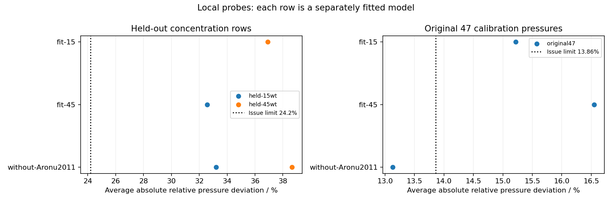

# Outcome

The concentration limitation was not removed by these tested local probes. Adding the 15 wt% pressure rows leaves **36.92% AARD at held-out 45 wt%**, and adding the 45 wt% rows leaves **32.56% at held-out 15 wt%**. Both exceed the issue's **24.2%** limit; their original 47-pressure AARDs, **15.22% and 16.55%**, also exceed **13.86%**. Holding out all Aronu strengths gives **33.21% at 15 wt% and 38.66% at 45 wt%**, while preserving the other observables and giving **13.13%** on the original 47 pressures.

These are separate local fitted models over the existing 16 coordinates. They do not establish that no admissible parameter vector could pass, identify a unique physical cause, or supply a newly adopted parameter set. The engineering decision is to retain the concentration limitation and give #255 an explicit outside-fit assessment design.

# Fixed-parameter diagnosis

This study addresses [issue #261](https://github.com/tannerpolley/Amine-Thermodynamics/issues/261). It starts from the selected parameter document `00e77608a8489fc9e03a7d2a86c08cb5ff782bb441368a62fa6390b8bfe9cc91`. Local fits are probes, not adopted parameter sets. Pressure comparisons are previously accessed outside-fit observations or calibration comparisons, not blind physical validation.

The selected endpoint's 33 Aronu observations at nominal 15 wt% MEA have pressure AARD 29.49% and mean natural-log prediction/observation error −0.20495. The 37 observations at 45 wt% have AARD 56.04% and mean log error +0.14920. The isotherm split shows that these aggregate signs are not constant with temperature:

| Nominal MEA strength | Temperature / K | Observations | Pressure AARD / % | Mean log error |
|---|---:|---:|---:|---:|
| 15 wt% | 313.15 | 14 | 38.26 | −0.46894 |
| 15 wt% | 333.15 | 13 | 23.22 | −0.10674 |
| 15 wt% | 353.15 | 6 | 22.61 | +0.19825 |
| 45 wt% | 313.15 | 15 | 27.31 | −0.11133 |
| 45 wt% | 333.15 | 11 | 52.49 | +0.06900 |
| 45 wt% | 353.15 | 11 | 98.75 | +0.58465 |

The [baseline predictions](../results/pressure-transfer-261/baseline-comparisons.json) retain individual loadings and values. The old-wheel [row reduction](../results/pressure-transfer-261/old-wheel/baseline-rows.csv) and [isotherm reduction](../results/pressure-transfer-261/old-wheel/baseline-summary.json) supply the original comparison; the qualified new-wheel endpoint reproduces those predictions numerically. Grouping by loading is descriptive, not a fitted trend or an estimate of measurement uncertainty.

The [temperature/loading reduction](../results/pressure-transfer-261/baseline-by-temperature-loading.json) accounts for all 70 rows in bins below 0.2, 0.2 to below 0.4, and at least 0.4 mol CO₂/mol analytical MEA. At 313.15 K, the 15 wt% mean log error changes from **+0.1640** (3 rows below 0.2) to **−1.0043** (5 rows at least 0.4); the 45 wt% values change from **+0.2125** (3) to **−0.6276** (5). At 353.15 K, the large 45 wt% AARD is concentrated in the eight rows below 0.2 (**127.49%**); the single row at least 0.4 gives **0.0681%**. Sparse high-loading bins should not be read as continuous trends. A constant concentration correction cannot represent these temperature and loading differences.

## Chemical-potential contributions

At 27 fresh reacting bubble states, temperatures are 313.15, 333.15 and 353.15 K; analytical loadings are 0.1, 0.3 and 0.5 mol total carbon/mol analytical MEA; unloaded solvent strengths are 15, 30 and 45 wt% MEA. The basis is one mol analytical MEA. Water/MEA amounts follow the unloaded mass fraction with molar masses 18.01528 and 61.084 g/mol; neutral feeds subtract the declared seed species' analytical amounts. These diagnostic states differ from the observation-specific seeded feeds, which remain unchanged in the fitting declarations.

The existing second-order forward difference of extensive residual Helmholtz contributions at fixed temperature and volume estimates each neutral species' residual chemical potential. Only attribution uses these finite differences. Engine supplies all equilibrium predictions and fitting derivatives. For each species,

$$
\ln\phi_i = \sum_c \frac{\mu^{\mathrm{res}}_{i,c}}{RT}-\ln Z,
$$

up to the measured finite-difference closure error. The five contributions are hard chain, dispersion, association, Debye–Hückel and Born. Steps are $10^{-4}$, $5\times10^{-5}$ and $2.5\times10^{-5}$ mol on the one-mol phase basis. The finest-step maximum closure error over CO₂, MEA and water is **1.00717×10⁻⁶**; the largest individual contribution change from the preceding step is **2.08665×10⁻⁶**, both below the accepted **10⁻⁵** limit. See [raw matched states](../results/pressure-transfer-261/matched-attribution.json) and [retained checks](../results/pressure-transfer-261/attribution-checks.json).

At 333.15 K and loading 0.3, CO₂ contributions relative to 30 wt% are:

| Dimensionless difference from 30 wt% | 15 wt% | 45 wt% |
|---|---:|---:|
| Hard-chain chemical potential / RT | +1.98306 | −2.05054 |
| Dispersion chemical potential / RT | −1.23936 | +1.25808 |
| Association chemical potential / RT | −0.47449 | +0.48043 |
| Debye–Hückel chemical potential / RT | −0.000759 | +0.002924 |
| Born chemical potential / RT | +0.08278 | −0.09768 |
| Log fugacity coefficient | +0.39509 | −0.44419 |
| Log liquid CO₂ mole fraction | −0.46472 | +0.49551 |
| Log bubble pressure | +0.08210 | −0.10997 |
| Log CO₂ fugacity activity | +0.01247 | −0.05864 |

The compressibility correction is retained separately in the complete difference table. Fugacity activity means $f_i/P^0$, with $P^0=100000$ Pa. Its concentration ratio at common temperature is independent of any shared species reference. It is not a liquid Raoult or Henry activity coefficient. The large opposing chemical-potential contributions largely cancel, and equilibrium composition further offsets the fugacity-coefficient differences. The largest contribution does not identify an erroneous equation or uniquely explain the observation bias.

## Local parameter sensitivity

The complete [70 × 16 native derivative array](../results/pressure-transfer-261/sensitivities.json) differentiates log pressure at the selected endpoint. Mean responses for selected coordinate scales are:

| Positive coordinate direction | Mean response at 15 wt% | Mean response at 45 wt% |
|---|---:|---:|
| R5 native logarithmic-law coefficient $b$, +184.2068 K | +0.56118 | +0.55713 |
| MEA–water interaction constant, +0.01 | +0.11678 | +0.38213 |
| MEAH⁺ dispersion energy/$k_B$, +10 K | +0.17976 | +0.51565 |
| Carbamate dispersion energy/$k_B$, +10 K | +0.04561 | +0.17398 |
| MEAH⁺ Born diameter, +0.1 Å | −0.000596 | −0.006176 |
| Carbamate Born diameter, +0.1 Å | −0.000426 | −0.005330 |

These are tangent derivatives multiplied by the declared coordinate scale, not finite-change predictions or parameter uncertainties. Bounds remain active; a displayed positive direction can point outside the allowed box. Two interior directions were checked at both 0.01 and 0.005 optimizer-unit steps; the largest derivative discrepancy was **4.21×10⁻¹⁰**. R5's coefficient changes both strength averages similarly, whereas neutral mixing and ion dispersion have different strength responses at their stated scales. This supports testing existing coupled coordinates; it does not establish a successful adjustment or justify a new coordinate.

## Unloaded binary comparison

Neutral MEA–water liquids were evaluated at the same three temperatures and strengths, at imposed pressures 66660, 100000 and 101330 Pa. The pure-liquid-reference coefficient uses each pure species at the same temperature and pressure. Calculated binary bubble pressures span **5696.96–44963.08 Pa**; every imposed pressure exceeds the corresponding bubble pressure, so no below-bubble metastability flags occur. This is not a global phase-stability proof.

Across 66660–101330 Pa, the largest absolute change in the natural logarithm of the activity coefficient is **2.403×10⁻⁵ for MEA** and **1.276×10⁻⁶ for water**. All [54 species/state/pressure records](../results/pressure-transfer-261/unloaded-activities.json) are retained.

The original 25 Cai paired boiling-temperature/vapor-composition states remain calibration observations. Their fixed-endpoint temperature RMSE is **1.788 K**, and vapor MEA mole-fraction AARD is **2.591%**. Cai's retained measurements are at higher boiling temperatures, not direct activity measurements at these nine 313.15–353.15 K diagnostic states. The repository's Lee–Lee activity data concern MEA hydrochloride, not unloaded MEA–water, and are not used as this comparison. No independent direct activity measurements at the nine states are used.

[Fakouri Baygi and Pahlavanzadeh (2015), §3.2.1, Eq. (12), Table 3 and §3.3](https://doi.org/10.1016/j.cherd.2014.07.017) distinguish binary VLE parameter fitting from ternary comparisons. That paper supports the distinction between calibration and transfer; it does not validate the present electrolyte formulation. Its local reading copy and current Zotero source matched the indexed SHA-256 `f28ed7ca…f9a83cbe`.

# Local refit method and results

The accepted [revised design](https://github.com/tannerpolley/Amine-Thermodynamics/issues/261#issuecomment-6698192743) uses 252 unique reactive CO₂ partial-pressure observations: 159 admitted canonical rows, 70 additional Aronu concentration rows and 23 Wagner rows. All original 47 pressure identities occur in the canonical set and are replaced, never duplicated. Xu rows `vle_obs_0286`, `vle_obs_0287` and `vle_obs_0288` at 393.55, 394.15 and 394.95 K are [excluded with their temperatures](../results/pressure-transfer-261/excluded.json), beyond the adopted reaction domain's 393.15 K ceiling. Source exclusion removes that source across all representations, including all 106 Aronu observations together. Recorded compositions and temperatures are unchanged. The canonical and Wagner rows are near 30 wt%, with their recorded compositions retained rather than forcing exactly 30 wt%.

Every fitted reactive pressure uses residual $r=\ln(p_{\mathrm{pred}}/p_{\mathrm{obs}})$ and fixed numerical weight $w=11.11111111111111$, including the original 47. The objective is $\frac12\sum_i w_i r_i^2$. The 260 other original objective rows keep their existing transformations, scales and weights; these include 39 Kiepe binary total-pressure observations, which are distinct from reactive CO₂ partial pressures. Each fit starts from the same selected endpoint and original 16 physical coordinates, including the two neutral MEA–water coordinates. Reaction bounds are translated to that start without changing their physical interval; the R2 increment is bounded by [−8636.068425883279, 11363.931574116721] J/mol.

The native bounded local method allows 60 iterations and 1200 s; function and gradient tolerances are $10^{-8}$ and parameter tolerance $10^{-10}$. Each retained usable endpoint is exported, evaluated afresh against training observations, and compared to the native fit cost and weighted residuals at $10^{-8}$. Every main probe terminated by the Engine's function tolerance, with zero failed trial evaluations; this is not a global-minimum or parameter-identifiability result. Active bounds occur in every main fit, so no unconstrained covariance or confidence interval is inferred. Full termination, active-coordinate and derivative information remains in each `fit.json`. Across all ten endpoints, the maximum relative replay-cost difference is **1.95×10⁻¹³** and the maximum absolute weighted-residual difference is **1.01×10⁻¹¹**, below the accepted $10^{-8}$ checks; see [retained checks](../results/pressure-transfer-261/retained-checks.json).

| Probe | Fitted reactive pressure rows | Held-out source/concentration rows | Held-out AARD / % | Original 47 AARD / % | Other-observable preservation |
|---|---:|---:|---:|---:|---|
| fit-15 | 80 | 172 | 28.86 | 15.22 | Fail |
| fit-45 | 84 | 168 | 25.71 | 16.55 | Fail |
| without-Aronu2011 | 146 | 106 | 32.92 | 13.13 | Pass |
| without-Hilliard2008 | 221 | 31 | 25.71 | 29.25 | Fail |
| without-Idris2014 | 242 | 10 | 18.78 | 23.31 | Fail |
| without-Jou1995 | 204 | 48 | 34.22 | 30.80 | Fail |
| without-Mamun2005 | 233 | 19 | 20.38 | 23.64 | Fail |
| without-Wagner2013 | 229 | 23 | 12.66 | 23.36 | Fail |
| without-Xu2011 | 237 | 15 | 32.80 | 23.63 | Fail |

For `fit-15` and `fit-45`, the aggregate held-out column includes every pressure row absent from that fit, not only the opposite concentration. The concentration-specific results used for the falsifier are **36.92% for the 37 held-out 45 wt% rows** and **32.56% for the 33 held-out 15 wt% rows**. In `without-Aronu2011`, the 106 held-out rows include 36 near-30 wt% rows in addition to those two sets. No source-held-out fold other than Aronu supplies a concentration holdout: the other six source folds fit the 15 and 45 wt% observations.

{#fig-pressure-transfer}

## Source transfer stratified by temperature

The bands are $T\le333.15$ K and $333.15<T\le393.15$ K, using recorded temperatures. A dash means no observations, not a successful zero error.

| Held-out source | Lower-band count | Lower-band AARD / % | Higher-band count | Higher-band AARD / % |
|---|---:|---:|---:|---:|
| Aronu2011 | 79 | 28.41 | 27 | 46.13 |
| Hilliard2008 | 30 | 24.35 | 1 | 66.45 |
| Idris2014 | 10 | 18.78 | 0 | — |
| Jou1995 | 17 | 40.64 | 31 | 30.70 |
| Mamun2005 | 0 | — | 19 | 20.38 |
| Wagner2013 | 0 | — | 23 | 12.66 |
| Xu2011 | 0 | — | 15 | 32.80 |

The higher-band Hilliard result is one row at 333.256 K. Training on other sources at high temperature means these columns test source transfer stratified by temperature, not extrapolation beyond the training temperatures. Jou and Hilliard fold starts were previously fitted to those sources, and all comparison sources were previously accessed. These results are not independent blind validation. In particular, Wagner's 12.66% source-held-out AARD occurs alongside 23.36% on the original 47 pressures and failed preservation; it does not establish an acceptable combined model.

## Observable preservation and objective balance

For each original non-reactive-pressure observable separately, the owner requires that the count within twice the existing residual scale must not decrease and that AARD or dimensional RMSE must not rise more than 25%. Positive species fractions, densities, heat capacity, binary pressure and binary vapor composition use AARD; boiling temperature uses RMSE in K and signed integral absorption heat uses RMSE in J/mol CO₂. These are owner-selected preservation limits, not new experimental uncertainties or confidence statements. The [complete reduction](../results/pressure-transfer-261/probe-summary.json) retains every before/after count, metric and objective cost share, including observables that pass.

Only the Aronu source-held-out main probe preserves every observable. Adding either concentration lowers the four heat-capacity observations' count from 3 to 2 within twice their scales. Adding 45 wt% also increases the signed-heat RMSE by 27.9%. The source folds excluding Hilliard, Idris, Jou or Wagner lose species and loaded-density counts; excluding Mamun or Xu also fails preservation. In the selected Hilliard fold, species counts fall **94→93**, loaded-density counts **44→42**, and signed-heat RMSE rises **38.0%**. Original binary and unloaded-density comparisons are retained rather than removed to improve pressure fitting.

Reactive-pressure objective share changes from **4.02%** in the original 307-row objective to **58.10%** at the selected start of the Hilliard fold and **43.45%** after that fit. Per-observable baseline, expanded-start and fitted shares are retained for every fold. The one conditional normalization comparison is described below; reduced pressure weighting is a test of this balance, not proof that weighting caused the bias.

## One pressure-weight normalization comparison

The [declared ranking](../results/pressure-transfer-261/normalization-selection.json) selects `without-Hilliard2008`: it loses three within-scale counts in total and has the largest relative metric deterioration among folds tied at that count loss. Exactly one additional fit starts from the original selected endpoint, with all 221 fitted reactive CO₂ pressure weights multiplied by **47/221 = 0.2126697**. The 39 Kiepe binary pressures and all other weights remain unchanged.

| Quantity | Fixed per-pressure weights | Normalized reactive-pressure weights |
|---|---:|---:|
| Hilliard held-out pressure AARD / % (31 rows) | 25.71 | 24.15 |
| Original 47-pressure AARD / % | 29.25 | 28.36 |
| Original species count within twice scale (94 rows) | 93 | 94 |
| Loaded-density count within twice scale (47 rows) | 42 | 44 |
| Signed-heat RMSE / J mol⁻¹ CO₂ | 2532.42 | 1926.48 |
| Fitted reactive-pressure objective share / % | 43.45 | 15.12 |
| All observable preservation checks | Fail | Pass |

The normalized fit terminated by function tolerance after 24 iterations, with zero trial failures; its fresh replay cost is **168.09696670488222** under its own weights. Costs under different weights are different objectives and should not be used as a direct goodness ranking. Pressure share at its selected start is **22.77%**. Its 162-state 30 wt% phase search is complete with zero detected descent. The normalized fit restores preservation while the original-pressure AARD remains far above 13.86%. Both concentration sets are fitted in this source fold, so its 24.15% Hilliard result is not a concentration-holdout falsifier success. This comparison supports explicit objective balancing for the next design; it neither proves a unique weighting cause nor licenses adoption.

# Recommendation for #255 stage 2

No probe here warrants parameter adoption or a claim that the concentration limitation has been removed. Retain that limitation for the current selected record. For the next stage, use an explicit pressure-data split with **57 near-30 wt% Jou/Hilliard/Idris observations at recorded temperatures at most 333.15 K as candidate pressure calibration**, **all 106 Aronu observations outside fitting** for source/concentration transfer, and **all remaining 89 non-Aronu pressures above 333.15 K outside fitting** for pressure-temperature transfer. The latter includes all 23 Wagner rows. This accounts for all 252 admitted rows: 57 fit candidates and 195 assessment rows, with identities retained in [the recommended data roles](../results/pressure-transfer-261/recommendation-data-roles.json). Keep all existing non-pressure property constraints. This is an engineering recommendation for the #255 design, not a fitted or accepted endpoint; that combined split has not been run here. Temperature transfer would be outside the pressure-calibration temperature range, while other properties may still constrain temperature dependence. Previous source access still prevents a blind-validation claim.

Retain the existing 16-coordinate family for that bounded stage-2 comparison, including neutral MEA–water mixing and ion dispersion constrained by Cai and bulk properties. No added coordinate is justified by these probes. The tangent responses show that changing the R5 coefficient alone offers little independent control of the two strength averages at the selected endpoint; they do not select a single erroneous Helmholtz term. Require the original pressure and observable-preservation limits together with the stage-2 phase requirements before any adoption. Adding the 15/45 wt% rows to calibration would consume the available concentration assessment and requires a separately declared future transfer set; these local fits do not justify that change.

# Phase assessment and evidence limits

Each usable main fitted endpoint has the reused **162-state search at 30 wt% MEA**, with **162 complete searches, zero detected descent and zero incomplete searches**. The normalized endpoint has the same counts, giving 1620 completed state searches across ten separate endpoints. The [per-fold files](../results/pressure-transfer-261/probe-summary.json) link by fold name to `phase-summary.json`; compressed `phase/point-*.json.gz` files retain the underlying trials and are losslessly round-trip checked. The result concerns this finite search only. It does not establish global phase stability or phase stability at 15/45 wt%; no new phase coverage is claimed. No fit enforces phase stability.

All nine main fits converged and passed fresh replay, so their unsuccessful threshold comparisons are usable local-probe evidence. They share a single previously fitted start and finite bounds. They neither rule out another local solution nor show that the coordinate family cannot meet the limits. A combined table of predictions from separate fitted models is not one parameter vector passing both strengths. No statistical measurement uncertainty, confidence band or parameter interval is inferred from these comparisons.

# Numerical basis and limits

All new calculations use the immutable wheel from merged Engine `e6dae5c7353ae10e0aa2d8e46055847b9d64bbe4`, SHA-256 `83ede7d2722d3581603f6e4139c614b8bbfc903ce90609c90b802d46eea77dd6`, installed only in this worktree's environment. The project pin remains unchanged. All 12 packaged Engine files matched installed bytes. The 307-row replay cost is **148.87893934556408**, relative difference **6.58×10⁻¹⁴** from **148.87893934557388**. Maximum prediction-relative difference is **6.96×10⁻¹³** and maximum residual difference with the approved floor is **7.06×10⁻¹²**. The 16-coordinate chart is admitted with the original per-problem temperature bounds.

The earlier wheel admitted fixed predictions but refused tied R2/R5 coordinates with differing temperature bounds. Its [common-window diagnostic](../results/pressure-transfer-261/old-wheel/domain-diagnosis.json) reproduced predictions within 1.44×10⁻¹³; those narrowed windows were not adopted. The owner instead approved the later wheel, as recorded in [the qualification amendment](https://github.com/tannerpolley/Amine-Thermodynamics/issues/261#issuecomment-6698773201).

Evidence here comprises numerical verification, fixed-model predictions and local calibration/transfer comparisons. Original observation scales and owner-selected preservation limits are not newly inferred measurement uncertainties or confidence intervals. No parameter-confidence or prediction interval is estimated. No parameter set or manuscript claim is promoted by this notebook. Independent readiness review returned **Ready** for the revised design and wheel qualification. Delivered-result review returned **Supported**, with no remaining required defects, for commit `92be786925d8457c5b1f1959387c470341d04a64` against `30db72a`. The reviewer independently checked the row reductions, objective weights, all 1620 phase records, attribution, binary states, figure and complete changed functions. The sole initial finding—four ignored execution logs—was corrected before acceptance. This review supports the bounded numerical conclusion and does not promote parameters or manuscript claims. The root notebook links this page; site membership is left to its owner because this issue must not edit `analyses/_cse-manuscript.json`. A standalone HTML view is rendered without executing the model. Final executable additions are **458 lines against the approved 500-line ceiling**, relative to `30db72a`; the three scripts add no numerical solver. Ruff checks for undefined names, unused imports and fatal syntax errors pass.

The phase-input failure caused by inserting wheel metadata into an Engine parameter document was corrected by keeping wheel identity in `parameters-provenance.json`, separate from `parameters.json`. The completed `fit-15` was not repeated. The earlier phase helper's wheel constant is set to the approved wheel within this study process and still verifies installed bytes. The retained failed-run logs record those execution failures; they are not physical negative evidence. The completed [main run](../results/pressure-transfer-261/refit-completion.log) and [normalization run](../results/pressure-transfer-261/normalization-run.log) retain subsequent output.

To reproduce, install the specified immutable wheel into the worktree environment, then use `agent-heavy uv run --no-sync python analyses/mea_parameter_bundle/scripts/pressure_transfer_261.py` with `prepare`, `baseline`, `sensitivity`, `binary`, each `fit <fold>` and `phase <fold>`, and `reduce`; the separate attribution script supplies the matched-state diagnostic. The fit command refuses to overwrite an existing completed fit. Preserve that safeguard: reproduce in a clean issue checkout. `reduce` and the plot script read retained values only. The repository-wide Engine pin and adopted parameter document are unchanged.
