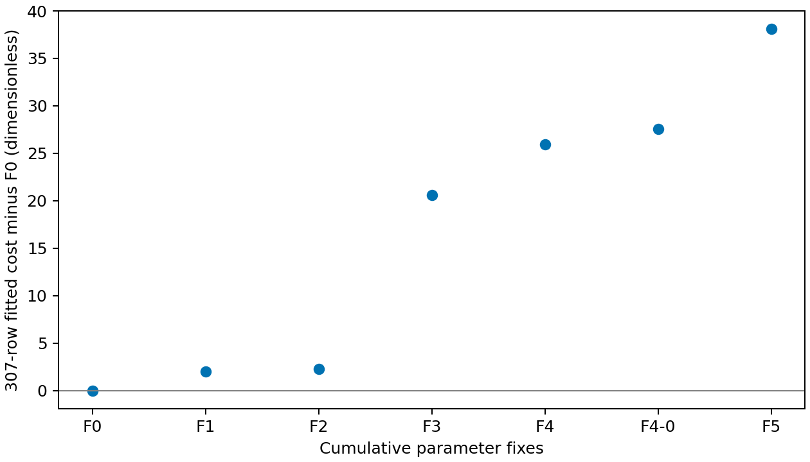
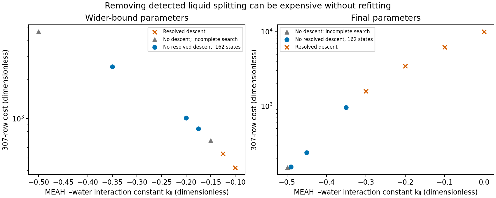

## Current adoption, 11 November 2026

[#297](https://github.com/tannerpolley/Amine-Thermodynamics/issues/297) adopts the #255 wide-start primary (`f8f64820…`) on Engine `391dfe5d…`, wheel `0962e21d…`. The [adoption account](../results/adoption-297/README.md) owns the fresh replays, finite stability searches, group rules, conditional information and current numerical package. Observation cost is 148.510545654; the same-wheel outgoing reference costs 148.883260440. Normal default replays cover 153 quantities and all 307 declared observations. This is numerical verification and calibration-quality comparison, not new independent physical validation. MDEA #298, manuscript #259 and delivered review remain separate.

The chronology below retains earlier records and their original evidence. Earlier references to an adopted or reported record describe that study's record; they do not relabel it as the #297 candidate. Generated current tables are identified by their adopted-package inputs.

## Literature constants and fewer fitted parameters, 13 November 2026 {#reduced-refit-338}

**Holding R2 and R5 at their literature laws gives F1 cost 150.5320236, 2.0214779 above the 16-parameter current record, with 13 fitted parameters.** Further cumulative fixes give the candidates below; none is adopted. The [complete issue #338 account](../results/reduced-refit/README.md) owns full per-dataset costs, deviations and biases, parameter errors and correlations, native stopping histories, phase-search evidence and record fingerprints. This section supplies the evidence for the owner's #340 choice.

| Fit | Fitted parameters | Cost | Change from F0 | On bound | Conditional SE > \|value\| |
|---|---|---|---|---|---|
| F0 | 16 | 148.5105 | 0 | 6 | 3 |
| F1 | 13 | 150.532 | 2.021478 | 2 | 3 |
| F2 | 11 | 150.7629 | 2.252357 | 1 | 3 |
| F3 | 9 | 169.1381 | 20.6276 | 1 | 1 |
| F4 | 9 | 174.4514 | 25.94085 | 2 | 0 |
| F4-0 | 8 | 176.0491 | 27.53852 | 1 | 0 |
| F5 | 8 | 186.6151 | 38.10455 | 3 | 0 |

F1 replaces both laws completely: Austgen Table V R2 plus the Part I molality conversion, and Bates–Pinching Eq.(10) R5. F2 ties each amine ion's Born diameter to its segment diameter, which the pinned wheel accepts. F3 fixes carbamate–water interaction and MEAH⁺–water reciprocal-temperature slope at zero. F4 imports the #282 salt water-ion laws and fits MEAH⁺–HCO₃⁻; its bound endpoint triggers F4-0 with that interaction fixed at zero. F5 instead continues F4 and fixes MEAH⁺–carbamate at zero. The same 307 observations, residual definitions, scales, weights and remaining bounds apply throughout.

All twelve unpenalized starts converge on optimizer tolerances without continuations. Selection uses fitted cost only; relative-tolerance ties are disclosed. Each endpoint completes the 1908 grid, 576 offset and 162 liquid–vapor state searches, with zero split states found and no unavailable state. Earlier census split compositions are checked as supplied trials separately from the optimized Full search. No penalty stage is triggered; penalty cost is zero and penalized-search counts are not run. Counts are lower bounds and do not prove global stability. F0's searches are retained same-wheel #297 evidence; F0 itself is replayed, not refitted. The supplied-trial correction below augments this evidence without repeating fitted or optimized-search results.

### Supplied-trial recovery

The recovery from the Not supported review at `269f085` replaces folder enumeration with discovery over **all 66422 git-tracked files under `analyses/mea_parameter_bundle`**. The [registry](../results/reduced-refit/split-registry.json) contains **4057 occurrences before deduplication and 3471 distinct trials**, from 1069 files. Compared with 2111 trials, it adds the 1320 omissions identified by review and 40 distinct trials from the newly merged #350 MEA evidence.

| Source family | Occurrences | Distinct within family |
|---|---|---|
| parameter-identifiability/results | 1296 | 1296 |
| results/engine-3e83e19c-adoption | 49 | 40 |
| results/engine-3e83e19c-phase | 165 | 158 |
| results/engine-3e83e19c-phase-search | 564 | 282 |
| results/joint-recalibration-170 | 432 | 432 |
| results/phase-diagnosis-255 | 1044 | 1041 |
| results/phase-extension-201 | 176 | 129 |
| results/reduced-refit | 148 | 148 |
| results/same-data-comparison | 40 | 40 |
| results/stable-refit-255 | 143 | 143 |

Distinct counts overlap between families; only the global total removes those overlaps.

Deduplication uses exact phase kind, ordered support, full nine-component composition and packing fraction, without rounding. Support-length arrays are expanded with zeros outside support. The trial-content SHA-256 is `e9c9a4d9e1f30fbf8689202edc5bb226b4b5453ec2cfcd9b7c96a929602df4f2`. It guards the search cache. When it changes, all supplied distances are reevaluated; the objective and optimized searches are preserved.

`split-registry.json` is the single owner of MEA split compositions found earlier. Later MEA searches (#341, #342) read it and append new split compositions; they do not rediscover them by scanning folders. Part II amines (#343–#346) keep their own records because their component systems differ.

The [completeness report](../results/reduced-refit/split-completeness.json) (14,802,183 bytes) lists **47598 files with composition or tangent-plane terms but no split yielded**, with fields and a reason per file. **271 non-JSON formats remain explicitly listed as unread formats**; they are source code, retained code/timing text, documents, settings, logs, figures, CSV observation/state/score summaries, and one TAR collection of assessment rows. The 48 JSONL files were read and contain observation or parameter-iteration records, without split trials. The **19 malformed JSON files** are historical empty timing files or interrupted derivative diagnostics, not retained split compositions. The disposable inspection of non-JSON structured records found only homogeneous-state mole fractions or data/score metadata, without a split trial. These lists are not silently treated as parsed formats.

**Falsifying check:** an independent enumeration of git-tracked MEA files for negative-distance or split records finds nothing outside the registry. The [disposable enumeration result](../results/reduced-refit/split-enumeration-check.json) found 4057 occurrences and zero outside it; a separate inspection covered the non-JSON references listed above. Probe code is not retained.

All 3471 trials are evaluated at each of the 162 census states of all 13 endpoints. The native evaluator does the numerics, without optimization. Reconstructed parent coordinates must match the retained coordinates exactly. Liquid trials here are historical split liquids, with no exact composition/packing identity to any retained parent liquid (checked at all endpoints); no new composition-distance cutoff is imposed.

| Endpoint | Evaluated | Minimum / RT | Nontrivial liquid minimum / RT | Negative | Unavailable |
|---|---|---|---|---|---|
| F0 | 562302 | 2.159602900064783e-06 | 0.0001790543912818521 | 0 | 0 |
| F1/previous/unpenalized | 562302 | 5.402977336643744e-06 | 2.535660055968947e-05 | 0 | 0 |
| F1/current/unpenalized | 562302 | 5.40293612516507e-06 | 2.53541980157479e-05 | 0 | 0 |
| F2/previous/unpenalized | 562302 | 4.815477097963594e-06 | 3.065092460019514e-05 | 0 | 0 |
| F2/current/unpenalized | 562302 | 4.751837451522078e-06 | 3.210939303244231e-05 | 0 | 0 |
| F3/previous/unpenalized | 562302 | 1.136039097104913e-05 | 0.000196470078094535 | 0 | 0 |
| F3/current/unpenalized | 562302 | 1.134502116428848e-05 | 0.0001960879055786791 | 0 | 0 |
| F4/previous/unpenalized | 562302 | 1.158027180281351e-05 | 8.235760802222103e-05 | 0 | 0 |
| F4/current/unpenalized | 562302 | 1.158823226887762e-05 | 8.242620791065747e-05 | 0 | 0 |
| F4-0/previous/unpenalized | 562302 | 1.021214094976131e-05 | 0.0001171217211037856 | 0 | 0 |
| F4-0/current/unpenalized | 562302 | 1.021592373717795e-05 | 0.0001170882502492532 | 0 | 0 |
| F5/previous/unpenalized | 562302 | 1.028898375921017e-05 | 0.0002063773691816095 | 0 | 0 |
| F5/current/unpenalized | 562302 | 1.028897418109409e-05 | 0.000206374489010841 | 0 | 0 |

The [retained-distance comparison](../results/reduced-refit/retained-distance-check.json) reproduces all 4,445,766 previously included distances exactly (maximum difference zero RT); optimized-search summaries and parent records are identical.

All 7309926 distances are available and nonnegative, so no penalized refit is triggered. These are finite numerical-verification results, not proof of global stability or physical validation. No fits, objective replays, or optimized searches were run for the recovery. Independent delivered review remains pending.

The merge with `origin/main` at `b926e16` preserves both callers of `final_evidence.stability`: native `Phase` objects return a full supplied report, and witness dictionaries append `supplied_trials` while preserving the retained optimized report. The unchanged #350 `same_data_part1.supplied_census` call at state 37 reproduces both retained supplied distances exactly (minimum 0.010452367161576603 RT, maximum difference zero) and identical parent coordinates; [caller check](../results/reduced-refit/same-data-caller-check.json) retains the comparison. No force push is used.

Reproduce supplied evaluation only with `agent-heavy uv run --no-sync python analyses/mea_parameter_bundle/scripts/reduced_refit_338.py coverage`.

[agreement.csv](../results/reduced-refit/agreement.csv) reports every fitted group and the identical 112 six-source, 23 Wagner, 33/37 Aronu, 14 Arcis, 53 Kim, 67 Han, 19 Matin, five Böttinger states (ten quantities) and 51 broad heat capacities. It gives cost, average absolute relative deviation, root-mean-square error, signed prediction-minus-observation bias, and numeric #255 comparisons without agreement thresholds. Cai temperature and mole-fraction units are separated. These not-fitted data were previously inspected and informed the selected fixes; their errors are comparisons, not independent physical validation. Qualified same-row published-model scores were unavailable when this #338 agreement table was frozen; #339 now retains its separate [same-data comparison](../results/same-data-comparison/README.md).

F0 replays all 307 predictions and cost exactly. The salt replay reproduces 0.16297888463729926% NaHCO₃ and 5.111329872572398% Na₂CO₃ deviations exactly. Every reduced endpoint reload reproduces fitted cost within the issue's 10⁻⁸ relative limit, with exact fixed values. Bates–Pinching Eq.(10) returns ln K5(298.15 K) = −21.865746172917778. The owner corrected the original source-table check because Eq.(10) is a correlation: its mean absolute residual against measured Table 2 is 0.0009073164433412793 pK, beside the paper's stated 0.0010. Exact conversion of the equation agrees within floating-point rounding.

| Temperature / K | Bates–Pinching ln K5 | Hamborg-derived ln K5 | Bates minus Hamborg |
|---|---|---|---|
| 313.15 | -20.88988 | -20.79712 | -0.09276316 |
| 323.15 | -20.29039 | -20.20875 | -0.08163974 |
| 333.15 | -19.72749 | -19.65099 | -0.07650184 |
| 343.15 | -19.19796 | -19.12128 | -0.0766884 |
| 353.15 | -18.69899 | -18.61737 | -0.08162103 |

The second law is the #263 correlation derived from Hamborg measurements; it is not another fit here. [parameter-details.csv](../results/reduced-refit/parameter-details.csv) reports values, bounds, conditional errors and their ratios. [part-ii-inherited-values.json](../results/reduced-refit/part-ii-inherited-values.json) records each alternative's completed R1–R3 laws and water-carbonate-ion interactions. Local conditional errors condition on fixed laws, active bounds, assigned weights and linearization; they are not physical prediction intervals.

The evidence is calibration and numerical verification on Engine `391dfe5d64ede5036bf160bc6ae037ad5e14af32`, wheel SHA-256 `0962e21d2fa7a8ba1ed4622f1110b3e8053bacd878fa41c999d85e8b9afab66b`. Only two starts and finite phase searches are examined. Cost changes depend on cumulative order. F4/F4-0/F5 inherit two bound salt-fit values and extrapolate the 278–318 K salt laws to MEA states up to 393 K. Nothing is adopted or promoted for manuscript use by this notebook update. The delivered review and render are recorded in the [delivery checks](../results/reduced-refit/delivery-checks.json).

**Historical record: adopted 24 October 2026 under [#215](https://github.com/tannerpolley/Amine-Thermodynamics/issues/215), SHA-256 `00e77608…`, MEA association volume 0.036305439.** The [one-wheel package](../results/engine-3e83e19c-paper-evidence/README.md) owns its assessments and replay evidence. The 20 October adoption and manuscript-use approval under #196 concern the frozen record `e234e860…` at association volume 0.036287; the dated sections below preserve that history.

# Question

Could restricting the joint fit remove the resolved phase descents while retaining acceptable property agreement?

# Result

The historical record adopted under #215 has common pressure/species average absolute relative deviations (AARD) of 11.86/7.10% and fitted Vinjarapu heat root-mean-square error (RMSE) of 1.84 kJ/mol CO₂. It passes the [six computed limits and density rule](#density-free-213): 44/47 fitted loaded densities meet their $2s$ limits, and the three misses are exactly the permitted set. The [rebuilt phase search](#phase-extension-201) resolves no Gibbs-energy descent in 162 states for this record, against 54 descent states for the refitted A6 comparison. Each fit completes all 1458 trials. The finite search does not establish global stability. The [overview](../notebook.qmd) owns the current parameter and property tables; the 20 October trade-off and its source-uncertainty limits are retained below as history.

# Basis and method

“Second restricted fit” is the retained record alias `restricted-2`; A6 identifies the [preceding density/phase comparison](../loaded-density/index.qmd). The common-149 subset contains the common pressure, species and Vinjarapu heat targets, and is nested within the joint objective. MA57 and MUMPS are Engine linear solvers; [Engine adoptions](../engine-adoptions/index.qmd) records their provenance.

# Values

## Pure-MEA association-volume conversion {#association-volume-210}

**The owner chose the native least-squares conversion under [#210](https://github.com/tannerpolley/Amine-Thermodynamics/issues/210), fixing $\kappa=0.036305439$ in dependent calculations.** On the pinned Engine `3e83e19c` wheel, the original SciPy bounded absolute-error search gives $\kappa=0.03628703079971812$, which rounds to `0.036287` at five significant figures and differs from the historical optimum by $1.4089\times10^{-13}$ relative (required: at most $10^{-6}$). The native least-squares fit gives $0.03630543900419865$. Its different five-significant-figure rounding triggered the historical estimator stop, resolved by the owner's choice of the eight-significant-figure value. The #210 conversion study did not itself replace the selected file. Its fixed value now enters the #212 record adopted under #215; manuscript updates remain with #211.

Both fits compare pure-MEA saturation pressure and liquid molar density with Baygi's own model at 21 temperatures, 293.15–393.15 K in 5 K steps, holding the other pure parameters fixed. The reference volume is $0.037470[1-0.12\exp(-3(277.174)/T)]^3$, from Baygi and Pahlavanzadeh (2015), Eqs. (4)–(5), p. 791 and Table 2, p. 792. The original search minimizes the sum of absolute relative errors; the native fit minimizes half the sum of their squares with unit weights and observations in Pa and mol/m³. The two final objectives are:

| Estimator | Sum of absolute relative errors | Half sum of squared relative errors |
|---|---:|---:|
| Absolute-error optimum | 0.11081423588344319 | 0.0003857111510874517 |
| Least-squares optimum | 0.11088518051704765 | 0.0003835770506949749 |

SciPy reports success after 25 evaluations. The native fit is usable and converged by function tolerance after three iterations, with all 42 final observations available and finite. All 722 retained saturation solves pass the $10^{-10}$ equation-residual limit; the largest absolute residual is $5.8176\times10^{-14}$. The [retained comparison](../results/engine-3e83e19c-association-volume/README.md) provides both objectives at each optimum, the full [31-temperature table](../results/engine-3e83e19c-association-volume/reporting-grid.csv), percentage average absolute deviations over both requested intervals, the exact fitting declaration and provenance. For the printed volume `0.036287`, pressure/density average absolute deviations from Baygi's model are 0.525156%/0.00253596% over 293.15–393.15 K and 0.793280%/0.00897262% over 303.15–443.15 K. A scalar table suffices for the rounding decision; the retained grid supports inspection of its temperature dependence.

This is numerical reproduction against deterministic model targets, not physical validation. It applies only to pure MEA and isothermal properties; the 293.15–303.15 K portion extends below Baygi's pure-parameter fitting interval (303.15–443.15 K, §3.1, p. 792). Neither the difference between optima nor the native covariance is physical parameter uncertainty. The #210 delivered review returned Supported; the owner authorized its fixed conversion value. The historical #215 notebook evidence still requires independent delivered review and investigator promotion for manuscript use.

**Dependent refits at the fixed volume ([#212](https://github.com/tannerpolley/Amine-Thermodynamics/issues/212)): every declared calculation passes its checks; the second restricted endpoint is now the record adopted under #215.** The [refit account](../results/engine-3e83e19c-refit-chain/README.md), [numerical summary](../results/engine-3e83e19c-refit-chain/summary.json) and [validation](../results/engine-3e83e19c-refit-chain/validation.json) bind the same Engine wheel, SHA-256 `0d08dff9be39fb8fc9018119c47612f53d823cd0e456914d7dd44c6941596804`. The stage-2 neutral MEA–water refit passes both starts, selecting $k_{\mathrm{MEA,H_2O}}=-0.08439986221195522$ with serialized cost 91.80963081696862. The rebuilt stage-5 reduction passes all 14 rows, rank two, distinct positive admissible branches and native replay within $10^{-10}$. The larger-volume branch supplied to every joint start is 0.7309865858310542 L/mol and 1019.0802597119892 K.

| Fit at $\kappa=0.036305439$ | Numerical completion | Iterations | Native objective cost |
|---|---|---:|---:|
| Neutral MEA–water, A | Converged and usable; checks pass | 1 | 91.80963081696791 |
| Neutral MEA–water, B | Converged and usable; checks pass | 1 | 91.80963081698934 |
| A6 comparison | Converged and usable; information checks pass | 5 | 148.2115075904099 |
| Hartono x₃ sensitivity | Converged and usable; information checks pass | 5 | 148.31366430715744 |
| First restricted | Converged and usable; information checks pass | 4 | 149.21952645124134 |
| Second restricted, adopted under #215 | Converged and usable; information checks pass | 8 | 148.87893934555717 |

All four joint fits have 307 finite, available rows. Their starts preserve observations, scales, controls, physical bounds and diameter ties; reaction boxes are rebuilt from the original unshifted bounds using each endpoint's inherited totals. The second restricted fit starts from the new first restricted endpoint, with inherited R2 = −1811.930108185226 J/mol and R5 = 10000 J/mol and the MEAH⁺ size lower bound at 5.35 Å. Its inward-move check requires no diameter change. The original interrupted information calculation and [its stopping record](../results/engine-3e83e19c-refit-chain/restricted-2/stop.json) remain unchanged. The orchestrator authorized identical re-execution after the host interruption; [the successful attempt](../results/engine-3e83e19c-refit-chain/restricted-2/attempt-3/continuation.json) retains the same declaration, start, chemistry, bounds, controls, budgets and tolerances. No numerical retry, added start or enlarged budget was used.

The [adopted reported endpoint](../results/engine-3e83e19c-refit-chain/restricted-2/attempt-3/run/fit/usable-budget-endpoint.json), SHA-256 `00e77608a8489fc9e03a7d2a86c08cb5ff782bb441368a62fa6390b8bfe9cc91`, changes the MEA–water constant from −0.08990482269248873 to −0.08990160794755829 and its reciprocal-temperature slope from −8.06991337259403 to −8.057331218929972 K. The carbamate segment diameter changes from 4.866040008417222 to 4.866108647520244 Å. [parameter-changes.csv](../results/engine-3e83e19c-refit-chain/parameter-changes.csv) retains every coefficient change, absolute and relative, against the preceding endpoints.

Both requested fixed replays retain all 307 rows, finite, available and meeting their requested tolerances. Their dimensionless costs, half the sum of squared weighted residuals, are:

| Fixed replay | All 307 rows | 149-quantity group | Cai |
|---|---:|---:|---:|
| Adopted reported record | 148.87893934557388 | 23.860996312136727 | 91.87458520309771 |
| Refitted A6 comparison | 148.21150759040813 | 24.920645016884034 | 91.77764784327805 |

The adopted reported record has **44/47 loaded densities within twice the assigned scale**. The only misses are `Amundsen2009_state_081`, `Hartono2014_density_80C_alpha0.29` and `Hartono2014_density_80C_alpha0.39`, exactly the permitted set. The largest CO₂-free absolute density error is **0.557484452458425 kg/m³**, at `AMU-DENS-002`; the 1 kg/m³ limit passes. The new comparison fit has 47/47 loaded densities within twice their assigned scales. The [reported score](../results/engine-3e83e19c-refit-chain/displays/reported/score.json) and [comparison score](../results/engine-3e83e19c-refit-chain/displays/comparison/score.json) link to sibling row-level replays.

The [reported-fit permittivity calculation](../results/engine-3e83e19c-refit-chain/displays/permittivity/summary.json), explicitly bound to the new endpoint and stage-5 rows, passes its native solvent-law and water checks for all 14 rows at 298.15 K and 101325 Pa. Its cost is 1.9123762682171106, relative-permittivity RMSE is 0.30144843492606227, and average absolute relative deviation is 0.45273994351848046%. The Cai calculation with the stage-2 constant interaction −0.08439986221195522, zero MEA–water slope and all other adopted-record inputs unchanged has cost **91.29322049026165** over 50 available quantities; it performs no second fit.

The fixed Arcis addition-enthalpy errors (predicted minus observed) are positive at both pressures. [The retained comparison](../results/engine-3e83e19c-refit-chain/displays/summary.json) gives every error and pressure-group bias. RMSE values are in kJ/mol CO₂:

| Fit | All 14 quantities | 0.51 MPa, 8 quantities | 1.03 MPa, 6 quantities |
|---|---:|---:|---:|
| Adopted reported record | 8.115640714619083 | 10.332399122695893 | 3.3670700883078895 |
| Refitted A6 comparison | 8.05184864877517 | 10.260693886454757 | 3.3014396109050015 |

The existing [conditional-uncertainty calculation](../results/engine-3e83e19c-refit-chain/displays/conditional/conditional-uncertainty.json) passes the asserted active set `[1,3,5,7,8,11]` and free rank ten, retaining 307 residuals and 297 degrees of freedom. Its standard errors and correlations are conditional on weights, fixed inputs, active bounds and local linearization; they establish neither measurement-error uncertainty, parameter uniqueness nor prediction intervals.

These are numerical-verification results, calibration statistics and fixed-model comparisons for the declared observations and weights. The [historical #215 paper-evidence package](../results/engine-3e83e19c-paper-evidence/README.md) retains the model curves and assessments. The [density-free comparison below](#density-free-213) owns the six cost and property limits, and the [162-state search](#phase-extension-201) records finite phase evidence for both refitted endpoints. The selected file was replaced under #215; the historical A7 results below retain their own identities. Independent delivered review and investigator promotion for manuscript use remain open.

## Density-free conditional reference on Engine 3e83e19c {#density-free-213}

**The adopted reported record passes all six unrounded limits in [#213](https://github.com/tannerpolley/Amine-Thermodynamics/issues/213).** The [retained reference](../results/engine-3e83e19c-density-free/README.md) fits five interaction coordinates to exactly the 149 base quantities, starting once from #212's second restricted endpoint (SHA-256 `00e77608a8489fc9e03a7d2a86c08cb5ff782bb441368a62fa6390b8bfe9cc91`). All other coefficients, Born and permittivity choices and reaction constants remain fixed. The Engine commit is `3e83e19ccc771b51d8ebc038931ab25192f4c5b5`, wheel SHA-256 `0d08dff9be39fb8fc9018119c47612f53d823cd0e456914d7dd44c6941596804`.

The native fit is converged and usable after nine iterations, reducing dimensionless cost from 23.860996312136727 to 23.775639474323388. The 149-row fixed replay costs 23.77563947432554; every row is available, finite and meets its requested numerical tolerance. The reference pressure/species average absolute relative deviations are 11.898355269557591% / 7.090199842730563%, and the eight Vinjarapu heats have RMSE 1.8225957856620474 kJ/mol CO₂. The 14 Arcis heats at 322.5 K and 0.51/1.03 MPa are evaluated separately, excluded from fitting and common cost; their RMSE is 8.070718549141134 kJ/mol CO₂. The Cai reference cost is #212's refitted constant-interaction value, 91.29322049026165 over 50 quantities.

The four dimensionless fitted interactions are carbamate–water −0.004991206740588576, MEAH⁺–water −0.5, bicarbonate–water 0.7347337707498196, and carbamate–MEAH⁺ −1.0. The MEAH⁺–water reciprocal-temperature slope is −40.45338120322384 K, about 313.15 K. The MEAH⁺–water and carbamate–MEAH⁺ constant interactions reach their lower bounds. [The parameter CSV](../results/engine-3e83e19c-density-free/parameters.csv) preserves the five values and units.

| Current acceptance quantity | Unrounded limit | Adopted record | Margin (limit − adopted record) |
|---|---:|---:|---:|
| Common 149-quantity cost | 26.153203421758096 | 23.860996312136727 | 2.292207109621369 |
| Pressure deviation, % | 13.898355269557591 | 11.862562814041896 | 2.035792455515695 |
| Species deviation, % | 9.090199842730563 | 7.102842181553149 | 1.9873576611774135 |
| Vinjarapu heat RMSE, kJ/mol CO₂ | 2.822595785662047 | 1.8350098647473438 | 0.9875859209147033 |
| Arcis heat RMSE, kJ/mol CO₂ | 9.070718549141134 | 8.115640714619083 | 0.9550778345220508 |
| Cai cost | 95.85788151477473 | 91.87458520309771 | 3.983296311677023 |

[The unrounded limits](../results/engine-3e83e19c-density-free/limits.json) retain definitions, hashed inputs and margins. The limits are respectively 1.10 times reference cost, reference pressure/species deviations plus two percentage points, reference heat RMSEs plus 1 kJ/mol CO₂, and 1.05 times the constant-interaction Cai cost. The adopted-record reduction selects the exact 149 base IDs from #212's 307-row replay before scoring; its Arcis and Cai quantities come from #212's displays, imported into the [historical #215 package](../results/engine-3e83e19c-paper-evidence/refit-display-summary.json). A scalar table answers this acceptance question; plotting does not clarify the comparisons.

This is a comparison reference calibrated to the same 149 quantities without density data, conditional on the candidate's other parameters, rather than an independent model. These calibration statistics and numerical checks establish no physical validation, prediction uncertainty or process-use qualification. The [#215 adoption](../results/engine-3e83e19c-paper-evidence/adoption.json) binds this exact endpoint and these limits. Its remaining acceptance quantities are:

| Current acceptance quantity | Requirement | Adopted record |
|---|---|---|
| Fitted loaded density | Within $2s$, except the permitted three rows | 44/47 within $2s$; misses exactly `Amundsen2009_state_081`, `Hartono2014_density_80C_alpha0.29`, `Hartono2014_density_80C_alpha0.39` |
| CO₂-free maximum absolute density error | ≤ 1.0 kg/m³ | 0.5575 kg/m³ |
| Resolved phase descents | None in the declared 162-state search | 0/162 states; all 1458 trials complete |

The [reported score](../results/engine-3e83e19c-paper-evidence/reported-score.json) retains the density count and unrounded CO₂-free maximum, 0.557484452458425 kg/m³; the [#212 account](../results/engine-3e83e19c-refit-chain/README.md) names the permitted misses. The [#214 state reduction](../results/engine-3e83e19c-phase-search/run-2/phase-family.csv) retains every phase outcome. These tables describe the record adopted on 24 October 2026, `00e77608…` at association volume 0.036305439. Independent delivered review and investigator promotion for manuscript use remain open.

## Joint fit objective groups

The table preserves all 307 objective rows and their separate costs from the [#297 fit summary](../results/adoption-297/paper-evidence/fit-summary.json). The common-149 pressure, species and heat subgroups are shown separately beneath their combined group and must not be added a second time. The added seven restored species and six Jakobsen amount ratios preserve their declared observation operators. Costs depend on the declared scales and weights; density scales are not uniformly measured uncertainties. The [historical F1–F6 comparison](../results/heat-final-170/fit-comparison.csv) remains predecessor evidence.

The objective table below reads the record adopted under [#297](https://github.com/tannerpolley/Amine-Thermodynamics/issues/297), SHA-256 `f8f64820…`, on Engine `391dfe5d`. Earlier adoption approvals and numerical records on this page retain their historical parameter and Engine identities. See the [current overview](../notebook.qmd#working-record).

<!-- RESULTS:fits:BEGIN -->

| Objective group | Rows | Cost (dimensionless) |
| --- | --- | --- |
| common149 | 149 | 23.7019 |
| restored species | 7 | 2.4269 |
| Jakobsen | 6 | 12.9375 |
| Kiepe | 39 | 0.0007 |
| CO2-free density | 5 | 11.9760 |
| Cai | 50 | 91.8554 |
| loaded density | 47 | 0.4490 |
| Cp | 4 | 5.1631 |
| common149 pressure | 47 | 5.8265 |
| common149 species | 94 | 16.6520 |
| common149 heat | 8 | 1.2234 |

<!-- RESULTS:fits:END -->

## Restricted fits

**Historical decision: 20 October 2026, #196.** This subsection and the following sensitivity/assessment subsection describe the frozen [second restricted endpoint](../results/joint-recalibration-170/amendment-7/restricted-2/fit/usable-budget-endpoint.json), SHA-256 `e234e860…`, with MEA association volume 0.036287, and its original A6 comparison. Their [restricted-fit account](../results/joint-recalibration-170/amendment-7/restricted/README.md) and [assessment](../results/joint-recalibration-170/amendment-7/selected-assessment/README.md) preserve the original values and limits. These are historical scores, not the #297 objective groups above.

The owner [chose a restricted feasibility fit](https://github.com/tannerpolley/Amine-Thermodynamics/issues/170#issuecomment-6283335389) with MEAH⁺ segment diameter in [5.49, 5.8] Å and MEAH⁺–water $k$ in [−0.5, −0.161]. All other bounds, rows, scales and weights were kept from A6’s Held form (Debye–Hückel diameter equal to segment diameter; see [loaded density](../loaded-density/index.qmd#basis-and-method)). That endpoint ([record](../results/joint-recalibration-170/amendment-7/restricted/README.md)) was split-free but failed density (44/47, worst 2.70$s$) on its MEAH⁺ size bound.

Fixed-vector probes at 5.45/5.40/5.35 Å showed no resolved descent but did not pass density with size alone. The owner then approved one more fit with the size bound lowered to 5.35 Å.

| Historical gate (20 October limits) | First endpoint | A7 accepted on 20 October | Historical A6 selected |
|---|---:|---:|---:|
| Points with resolved descent (73) | 0 | **0** | 12 |
| Loaded density within 2s (47) | 44, max 2.70 | **44, max 2.43** | 47, max 1.98 |
| CO₂-free density max \|e\| (≤ 1.0 kg/m³) | 0.55 | 0.56 | 0.57 |
| Cai cost (≤ 95.90) | 91.92 | 91.91 | 91.81 |
| Common-149 cost (≤ 35.26) | 24.10 | 23.87 | 24.92 |
| Pressure / species AARD (≤ 15.81 / 9.89 %) | 11.89 / 7.10 | 11.86 / 7.10 | 12.47 / 7.15 |
| Vinjarapu RMSE (≤ 3.13 kJ/mol) | 1.83 | 1.83 | 1.82 |
| 307-row objective | 149.246 | 148.905 | 148.238 |

The endpoint accepted on 20 October ([`e234e860…`](../results/joint-recalibration-170/amendment-7/restricted-2/fit/usable-budget-endpoint.json)) converged in 12 iterations, and its cold replay matches within 3.3 × 10⁻¹³. MEAH⁺ size ends on 5.35 Å, and MEAH⁺–water $k$ on −0.5. The unlike-ion $k$ (−1), the Born diameters (5 Å) and the total R5 shift (+10,000 J/mol) are on bounds as in A6. Across the warm loaded states, the split-free vectors underpredict density more than A6 does. At lower temperature both fit within the gate.

**Three fitted loaded densities fail the 2s gate at 353.15 K:** `Amundsen2009_state_081` (−2.2832s), `Hartono2014_density_80C_alpha0.29` (−2.0550s), and `Hartono2014_density_80C_alpha0.39` (−2.4317s). They remain failures accepted with disclosure. Amundsen's exact source-uncertainty boundary at high temperature and loading remains unresolved (source pp. 3099–3100, locators retained per row); the density scales are not uniformly measured uncertainties. The five source-conflict Amundsen loading-0.4 rows remain excluded from the objective and gate.

## Sensitivity, assessment and gas root

**Historical assessment: 20 October 2026, record `e234e860…`, MEA association volume 0.036287.** The following table and gas-root probe use the frozen files linked here, not the #212 refits.

The single sensitivity using Hartono’s printed liquid CO₂ mole fraction as the loading basis starts 0.002 Å inside the size bound; its moved start was screened first. It moves the parameters little: carbamate size +0.033 Å and the R2 total shift +94 J/mol. It also has no resolved descent at the 73 points. On its own basis it misses three loaded densities, worst 2.91$s$ ([record](../results/joint-recalibration-170/amendment-7/restricted/README.md)).

The [full assessment](../results/joint-recalibration-170/amendment-7/selected-assessment/README.md) of the accepted endpoint, against A6:

| Historical assessment (non-fitted rows are predictions) | A7 accepted on 20 October | Historical A6 selected |
|---|---:|---:|
| Concentration transfer, 70 states at 15/45 wt %, pressure AARD | 43.5 % | 168.7 % |
| Wagner 23 pressures AARD | 15.4 % | 20.1 % |
| Canonical 159 / 100–120 °C 54 pressure AARD | 20.6 / 24.3 % | 20.9 / 24.5 % |
| Han 2012 67 densities RMSE (assessment only) | 5.91 kg/m³ | 7.55 kg/m³ |
| Amundsen 103 densities RMSE | 6.42 kg/m³ | 4.96 kg/m³ |
| Arcis 14 heats RMSE (gate ≤ 9.36) | 8.11 kJ/mol | 8.05 kJ/mol |
| Hilliard Cp errors, 318.15 K α 0 / 0.358; 353.15 K α 0 / 0.358 | +5.53 / +2.57 / +1.15 / −2.13 % | +5.04 / +2.57 / +0.75 / −1.55 % |
| Matin 19 species pools AARD | 67.5 % | 66.8 % |

All 210 densities, 22 heats, four Cp states and 375 admitted states are available. Replays of the fitted rows agree within 1.2 × 10⁻¹¹ kg/m³. State stationarity, material and charge residuals are at most 2.2 × 10⁻¹² ([verification](../results/joint-recalibration-170/amendment-7/selected-assessment/verification.json)).

The [gas-root falsifier](../results/joint-recalibration-170/amendment-7/gas-root/run-2/gas-root.json) at 318.15 K, 3699.08 Pa, α 0.2556 **passes**.

## Auxiliary diagnostics

These figures read the current #297 package (`f8f64820…`); they are separate from the historical 20 October assessment table above.

[Pressure parity](../figures/a7_regression_overview/output/pressure-parity.svg) · [Pressure residuals](../figures/a7_regression_overview/output/pressure-residuals.svg) · [Species parity](../figures/a7_regression_overview/output/species-parity.svg) · [Species residuals](../figures/a7_regression_overview/output/species-residuals.svg) · [Report-only Matin pools](../figures/a7_regression_overview/output/matin-pool.svg).

# Limits and evidence type

- **Phase evidence.** The [historical #214 finite search](#phase-extension-201) uses one 162-state grid at 313.15–393.15 K and α $10^{-5}$–0.6 for #212’s two endpoints. It resolves zero descending states for the reported record and 54 for the comparison. It does not certify global stability.
- **Fit evidence.** The historical #212 first and second restricted fits are each single local fits from one start. They do not show that no vector passes every gate.
- **Bounds.** The historical 20 October lowered size bound rested on three checked vectors, not a certified box; the #212 refit inherited it.
- **Uncertainty.** The density scales are frozen source-local loading secants. Parameter, source-correlation and model-form uncertainty are not propagated.

Calibration with named non-fitted comparisons and numerical verification; not physical validation, and not qualified for concentration transfer or absorber/stripper use.

# Records

**The owner adopted the A7 second restricted endpoint as the repository working record on 20 October 2026 ([#196](https://github.com/tannerpolley/Amine-Thermodynamics/issues/196)).** The record selected on 20 October was the [accepted endpoint](../results/joint-recalibration-170/amendment-7/restricted-2/fit/usable-budget-endpoint.json), document version 2, SHA-256 `e234e8601ebc47b3dec25383ee0a0a8029cabb9f7f92c87866f595c505c7e58e`, with association volume 0.036287. On 24 October the working record was replaced by its Engine `3e83e19c` refit with association volume 0.036305439 (#212, #215), SHA-256 `00e77608a8489fc9e03a7d2a86c08cb5ff782bb441368a62fa6390b8bfe9cc91`. The record declares 16 fitted coordinates across binary interactions, ion dimensions and energies, and R2/R5 chemistry, with the retained shared stage-5 water and solvent-density-temperature permittivity. Native density replaces the predecessor's empirical density translation.

For that historical record, the three loaded-density failures at 353.15 K were accepted with disclosure. The owner approved that record for manuscript use on 20 October 2026 ([#170](https://github.com/tannerpolley/Amine-Thermodynamics/issues/170#issuecomment-6301568416)); the manuscript on `main` uses it since [#197](https://github.com/tannerpolley/Amine-Thermodynamics/issues/197) (`dfc2780`).

The current #297 figures read retained [pressure](../results/adoption-297/paper-evidence/pressure-figure-data.csv), [species](../results/adoption-297/paper-evidence/species-figure-data.csv), and [19 report-only Matin pool](../results/adoption-297/paper-evidence/pool-figure-data.csv) rows derived from the single [462-row state table](../results/adoption-297/paper-evidence/state-targets.csv). The [cohort summaries and availability](../results/adoption-297/paper-evidence/state-summary.json) preserve canonical, Wagner and transfer comparisons, exclusions and historical data access.

## Engine wheel and phase qualification

**Historical Engine qualification, 20 October 2026:** this section precedes the #212 refits and retains the original A6 vector and A7 selection (`e234e860…`, association volume 0.036287). The phase-family requirement needed a merged Engine wheel with the finite-trial classification correction in Engine #660. That wheel also returns equilibrium temperature and pressure as plain numbers, so the repository [adopted Engine 8298c602](../results/engine-8298c602-adoption/README.md) first (linked transfer record). The [requalification](../results/joint-recalibration-170/amendment-7/fixed-study/wheel-8298c602/README.md) reran the amendment-4 control and A6 selected families and the A6 307-row replay:

| Check | Engine 21e761c3 | Engine 8298c602 |
|---|---|---|
| Amendment-4 control family (passed / unresolved / failed) | 0 / 73 / 0 | 73 / 0 / 0 |
| A6 selected family | 0 / 61 / 12 | 61 / 0 / 12 |
| A6 307-row replay, max relative prediction change | | 2.1 × 10⁻¹³ |

| Phase-family numerical comparison | Retained value |
| --- | --- |
| Resolved descents retained on both wheels | 29 |
| Maximum absolute change in dimensionless tangent-plane distance, tpd/RT | 1.1 × 10⁻¹³ |

No new descent appeared and no equation changed. The classification changes are the Engine #660 relabelling. A `no_resolved_descent` trial records that this finite trial set resolved no descent. It does not certify global stability.

## Numerical reproduction {#numerical-reproduction}

The [fresh-process #297 replay](../results/adoption-297/paper-evidence/default-replay/summary.json) loads the adopted selected file through the default path and reproduces **153/153 identities**: 47 pressures (Pa), 94 species mole fractions, eight Vinjarapu integral heats (J/mol CO₂), and four Hilliard heat capacities (kJ/(kg K)). Worst relative difference is **8.38 × 10⁻¹⁶**, below $10^{-10}$. [Per-row values](../results/adoption-297/paper-evidence/default-replay/comparison.json) and [input hashes](../results/adoption-297/paper-evidence/default-replay/input-hashes.json) retain the check. This verifies numerical reproduction of the adopted record only.

## Execution record

**Historical amendment-7 execution, 20 October 2026.** The first gas-root attempt stopped at an input-path check before witness evaluation, root requests, dilution scanning and the physical solve; Engine initialization and problem compilation had already occurred. The attempt is retained and charged.

- **Compute.** Amendment 7 calls total 1,614.64 wall-s / 3,544.75 CPU-s ([step ledger](../results/joint-recalibration-170/amendment-7/step-ledger.json)). They are charged to the program ledger at integration.

# Finite phase search on reported-fit bubble pressures {#phase-extension-201}

## Question

Does the new reported record from #212 resolve any Gibbs-energy descent on the same 162-state grid as its refitted A6 comparison, using the reported record's own bubble pressure at each temperature and loading?

## Result

**The reported record resolves no descent at all 162 states. The comparison resolves descents at 54 of 162 states, comprising 143 descending trials.** Both fits complete every state and all 1458 scheduled trials. There is no unavailable pressure, unresolved trial or incomplete state, and no reported-fit falsifier. The uniform distinct-composition reduction produces 91 representative confirmation attempts for the comparison: 51 confirmed paths across 32 states and 40 unsuccessful attempts with retained numerical diagnostics. The reported fit has no descending trial to confirm.

These are finite-search numerical-verification results and model predictions. They do not establish global stability or physically validate liquid–liquid splitting. Independent delivered review and investigator promotion for manuscript use remain open; #215 has adopted the reported endpoint byte for byte.

## Records, basis and method

The [study README](../results/engine-3e83e19c-phase-search/run-2/README.md), [provenance](../results/engine-3e83e19c-phase-search/run-2/provenance.json) and [checked values](../results/engine-3e83e19c-phase-search/run-2/validation.json) retain the complete calculation. Every model and split uses Engine commit `3e83e19ccc771b51d8ebc038931ab25192f4c5b5`, wheel SHA-256 `0d08dff9be39fb8fc9018119c47612f53d823cd0e456914d7dd44c6941596804`. The installed Engine files were checked byte for byte against the wheel before calculation; no Engine source checkout was imported.

The reported record is [#212's second restricted endpoint](../results/engine-3e83e19c-refit-chain/restricted-2/attempt-3/run/fit/usable-budget-endpoint.json), byte SHA-256 `00e77608a8489fc9e03a7d2a86c08cb5ff782bb441368a62fa6390b8bfe9cc91`. The comparison is [#212's refitted A6 endpoint](../results/engine-3e83e19c-refit-chain/a6/run/fit/usable-budget-endpoint.json), byte SHA-256 `efb2a9abe3787410734394f5ee32e6eade42d7cb6f5ad23445a357423690b2f3`. Both use MEA association volume 0.036305439. Parameter bytes, runtime mappings, state lists and producers have separate hashes. The corrected request construction takes reaction metadata and domains from the explicitly bound mapping and opens the selected working-record file zero times under a read guard. The first census did read it seven times per request; its original claim of no dependency was incorrect. Its consumed domains and metadata equal those in both #212 records, while the changed R2/R5 coefficients already came from the explicit endpoints. The [diagnosis and read-only trace of #212/#213](../results/engine-3e83e19c-phase-search/run-2/README.md#correction-of-the-selected-record-dependency) and [read-guard proof](../results/engine-3e83e19c-phase-search/run-2/dependency-proof.json) retain the evidence. Calls without a mapping keep their earlier behavior.

The feed is 9.7292821 mol MEA, 76.9751925 mol water and $9.7292821\alpha$ mol CO₂. Charged species remain liquid-only. For each of the 54 temperature–loading pairs, `diagnose()` independently starts a fixed-pressure liquid solve at 101325 Pa, then uses its composition and packing guesses for a free-pressure bubble solve with zero vapor amount. Both solves are retained. All 54 references pass the requested tolerance, finite-pressure and 1 Pa–10 MPa window checks, liquid-positive/vapor-zero amounts, raw residuals at most $10^{-10}$, nonnegative reduced-Hessian minimum and positive pressure–density derivatives. Reference pressures range from **6412.308582651815 Pa to 1768948.0817829045 Pa**, with largest absolute raw residual **3.9745984281580604 × 10⁻¹³**. The [54-row reference table](../results/engine-3e83e19c-phase-search/run-2/reference-pressures.csv) links each pair to its numerical diagnostics.

The grid uses temperatures 313.15, 318.15, 333.15, 353.15, 373.15 and 393.15 K; loadings $10^{-5}$, 0.05, 0.1, 0.2, 0.256, 0.3, 0.4, 0.5 and 0.6 mol CO₂/mol MEA; and pressure fractions 0.50, 0.80 and 0.95. Loading is outermost, followed by temperature and pressure fraction; indices run 0–161 without duplicated states. Both fits consume identical state and point-file hashes. All 162 states fall inside the 1 Pa–10 MPa candidate interval; 152 fall inside the 10–300000 Pa diagnostic interval. The observed-total-pressure indicator is defined for 81 states at 353.15–393.15 K (17 inside, 64 outside) and is null for the 81 lower-temperature states. It is not an admission check. The [state table](../results/engine-3e83e19c-phase-search/run-2/states.csv) retains every domain column.

Twelve concurrent same-temperature chains each search 27 ordered states, using `phase_family(..., continue_bubble=True)`, four liquid starts and five vapor starts. Existing recovery calls retain two attempts, at most 400 iterations per attempt and 800 per call. Reference construction and screening share 600 s wall / 3600 s CPU; confirmation starts a fresh budget with the same ceilings. Each reference, state and representative confirmation is limited to the smaller of 300 s and remaining stage wall time. No ceiling was reached, no numerical attempt was added and no process was terminated. Each process uses one numerical-library thread and runs at niceness 10.

## State and trial counts

A completed state has all nine returned successful trial optimizers and complete numerical evidence. A resolved descent still counts as completed evidence: the native `failed` classification denotes the descent, not a failed numerical calculation. Both fits return all 1458 trials and complete 162 states, with zero unresolved or unavailable states. The [324-row state reduction](../results/engine-3e83e19c-phase-search/run-2/phase-family.csv), [2916 trial slots](../results/engine-3e83e19c-phase-search/run-2/trials.csv), [counts](../results/engine-3e83e19c-phase-search/run-2/counts-by-temperature.csv) and [outcomes](../results/engine-3e83e19c-phase-search/run-2/outcomes-by-temperature.csv) preserve those distinctions. Tables directly answer these categorical questions; no continuous relationship is inferred between grid states.

| Fit | Temperature / K | States | Descent states | Descending trials | Completed | Unresolved |
|---|---:|---:|---:|---:|---:|---:|
| reported | 313.15 | 27 | 0 | 0 | 27 | 0 |
| reported | 318.15 | 27 | 0 | 0 | 27 | 0 |
| reported | 333.15 | 27 | 0 | 0 | 27 | 0 |
| reported | 353.15 | 27 | 0 | 0 | 27 | 0 |
| reported | 373.15 | 27 | 0 | 0 | 27 | 0 |
| reported | 393.15 | 27 | 0 | 0 | 27 | 0 |
| comparison | 313.15 | 27 | 10 | 27 | 27 | 0 |
| comparison | 318.15 | 27 | 10 | 24 | 27 | 0 |
| comparison | 333.15 | 27 | 9 | 23 | 27 | 0 |
| comparison | 353.15 | 27 | 9 | 26 | 27 | 0 |
| comparison | 373.15 | 27 | 9 | 25 | 27 | 0 |
| comparison | 393.15 | 27 | 7 | 18 | 27 | 0 |

## Uniform split confirmations

Descending trials are ordered by most negative split Gibbs change, then grouped within each state by phase kind, support and maximum composition difference at most $10^{-6}$. One representative per group receives one attempt with 400 iterations. Confirmation requires success, requested tolerance met, negative $\Delta G/(RT)$, raw residuals at most $10^{-10}$, positive reduced-Hessian minimum, positive amounts and positive pressure–density derivatives. Distinct confirmation paths are counted once.

| Temperature / K | Attempts | Confirmed paths | States with a confirmation |
|---:|---:|---:|---:|
| 313.15 | 15 | 7 | 6 |
| 318.15 | 15 | 4 | 3 |
| 333.15 | 15 | 7 | 5 |
| 353.15 | 17 | 9 | 5 |
| 373.15 | 17 | 15 | 8 |
| 393.15 | 12 | 9 | 5 |

All confirmations belong to the comparison fit. The 51 confirmed paths have $\Delta G$ from −7569.920533932512 to −0.7926816549017589 J on the stated feed basis. The [91-row split table](../results/engine-3e83e19c-phase-search/run-2/split-confirmations.csv) retains fit, state, temperature, loading, pressure, seed, success, admission, both Gibbs changes, and every confirmed phase's identity, support, amount (mol), molar density (mol/m³) and supported-species mole fractions. The 40 unsuccessful attempts retain their causes and raw results, with phase-quantity cells empty. Their diagnostics include vanished phases, coincident phases and a nonpositive reduced Hessian; no extra confirmation attempt is made. Failure to confirm does not erase a resolved descending trial.

## Numerical checks, timing and limits

The largest raw residual is $3.353761712787673\times10^{-12}$ for parent states and $3.467448550509289\times10^{-12}$ for confirmed splits, below $10^{-10}$. Retained checks cover state order, domain columns, complete trial identities, parameter/state hashes, composition grouping, split phase values and unchanged execution-time producer hashes. Every reference, screening state and confirmation returns within its bound; the longest item is 3.271364313 s.

Reference construction uses 6.551251094 s wall / 38.979783620 s CPU. The shared reference-plus-screening stage ends at 28.412972003 s wall / 244.768486133 s CPU; these cumulative values already include reference construction. Confirmation uses a fresh 19.893877184 s wall / 95.250929557 s CPU. Total measured calculation and reduction time is 49.210244071 s wall / 340.921808888 s CPU. The [stage calls](../results/engine-3e83e19c-phase-search/run-2/calls.json) and [total timing](../results/engine-3e83e19c-phase-search/run-2/timing.json) retain the measured values. The supervisor ran in transient user unit `issue214-phase-r2.service`; it completed normally using `systemd-run --wait --pipe`. All 469 raw reference, parent and representative-confirmation records have exactly equal numerical values and diagnostics to the first census after excluding duration and output location. Trial, count, outcome, state and confirmation tables are byte-identical. The state reduction differs only in source paths and the reference table only in timing. [The first census](../results/engine-3e83e19c-phase-search/run-2/first-run-README.md) is retained; [the comparison](../results/engine-3e83e19c-phase-search/run-2/comparison-with-first-run.json) records those checks.

The search is finite at specified states. The 81 states above 333.15 K extrapolate beyond the pressure-fit temperature range. Native numerical error estimates determine resolved descent; parameter, measurement and model-form uncertainty are not propagated. Neither absent descents nor confirmed model splits establish physical liquid separation, concentration transfer or absorber/stripper performance. Historical results retain their own records and are not acceptance targets for this new design. The #214 search did not itself change the selected record; #215 subsequently adopted its reported endpoint. Manuscript and generator updates remain with #211. The notebook is validated and rendered only under `/tmp`; no preview service is controlled. The independent delivered review is still required.

## Fixed-parameter liquid-split diagnosis (#255) {#liquid-split-diagnosis-255}

**Strengthening MEAH⁺–water attraction removes the detected liquid split, at a large cost without refitting.** The [diagnosis](../results/phase-diagnosis-255/README.md) retains all five Helmholtz contributions for all 51 confirmed paths, 48 fixed vectors, their 307-row replays and full phase-search diagnostics. The wider-bound control reproduces cost 148.2115075904 and 47/47 loaded densities within twice their scales; the final control reproduces cost 148.8789393456 and 44/47. All calculations use the merged Engine `3e83e19c` wheel, SHA-256 `0d08dff9…`; no fit was performed.

Among tested complete removing vectors, `wide-water--0.175` has the least cost, 835.050162, with 40/47 loaded densities within twice their scales. The full parameter changes and all candidate costs are in [probes.csv](../results/phase-diagnosis-255/probes.csv). The original 32 confirmed states are searched first; a vector without descent there is extended to all 162 states. This extension finds seven descents missed by the subset at water interaction −0.125. The −0.15 point has no descent and one incomplete search; −0.175 completes all 162 searches without descent. A fixed-vector threshold is not a fitted optimum.

At the confirmed split with the most negative ΔG/(RT) (state 133, trial 3; 333.15 K, loading 0.5, 21175.719 Pa), extensive changes divided by RT are: hard chain +29.9372, dispersion −57.8689, association −18.2318, Debye–Hückel −10.3490, Born −106.2339, PV −5.6961 and the ideal/standard remainder +165.7129, summing to −2.7295539154147264 mol (−7560.7640 J on the stated feed basis). State 155, trial 0 (353.15 K, loading 0.6, 346562.787 Pa; ΔG/(RT) = −2.578089112565067 mol) has the largest decrease in joules, −7569.9205 J. The remainder is obtained by subtraction. [contributions.csv](../results/phase-diagnosis-255/contributions.csv) separately records poor-minus-rich molar differences. These coupled, opposing terms do not assign every split to one term.

For the final set, the diameter can be moved from 5.35 to 4.15535743 Å with a complete search and no descent. Water interaction −0.35 also completes without descent, whereas −0.2 restores descent at all 32 original confirmed states. At −0.3, five original states descend (minimum tangent-plane distance −0.00705527), placing the sampled onset between −0.35 and −0.3: a +0.15 to +0.20 move from the bound with every other coefficient fixed. Completeness is counted independently of descent from parent admission, report completion, all nine trial slots, optimizer success and unresolved/indeterminate trial evidence. The numerical-limitation counts are 1 for `wide-pair--0.5` (state 155), 2 for `final-water--0.1` (including failed parent admission at state 92), and 5 for `final-water-0.0` (failed parent admission at states 55, 56, 74, 92 and 95). Valid descents at admitted states remain counterexamples. Several very small moves produce incomplete searches; those are not classified stable. These are directional limits, not a nearest boundary or a parameter-confidence region.

The pinned `epcsaft.regression` interface rejects a stability observation and refuses discovery in a fitting observation; [executable evidence](../results/phase-diagnosis-255/engine-capability.json) retains both errors. A native parameter-fitting stability constraint or penalty must evaluate the candidate EOS and reaction laws, return signed descent and feasibility/error evidence, supply parameter derivatives with branch-change handling, and preserve unavailable calculations. It must report stability penalties separately from the original 307-row cost.

**Proposal for owner and design review:** keep the model initially, preserve all 307 data roles and scales, establish source-supported bounds, and fit with stability enforced on a denser temperature/loading/pressure/MEA-strength grid, followed by an independent denser assessment. The orchestrator must request and qualify the missing Engine capability. No Engine issue or stage-2 fit is started here. The issue's falsifier is not met because allowed parameter moves remove the detected split, but the existence of a useful low-cost stable fit remains unestablished.

These are fixed-model predictions and numerical verification, not physical validation. This diagnosis has not been independently reviewed or promoted for manuscript use. The linked README states source sections actually read, numerical unknowns and the proposed design's remaining decisions.
