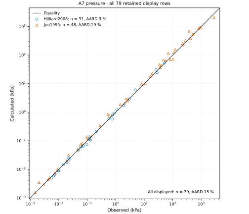
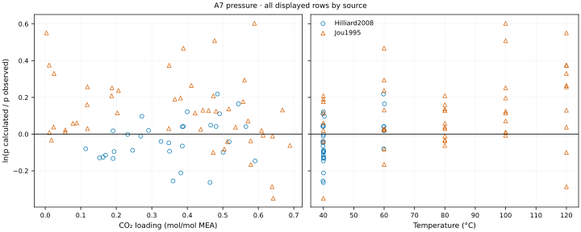

## Amendment 3: information release stops both comparisons

**Larger dielectric branch: inconclusive. Smaller dielectric branch: inconclusive under the 10% non-Kiepe improvement / at-most-1% common-149 increase rule.** The [retained larger source/seed A information calculation](results/joint-recalibration-170/amendment-2/amendment-3/information-results.json) fails the complete-system conditioning requirement before any fit. All four treatment/control fits remain unrun. The [full report](results/joint-recalibration-170/amendment-2/amendment-3/README.md) preserves the fixed stage-2 CO₂–water law, 16-coordinate treatment, 14-coordinate control and all 205 positive-weight observations.

| Weighted, scaled information block at the larger start | Rank / columns | Condition | Release requirement |
|---|---:|---:|---|
| Existing nuisance directions, all free | 14 / 14 | 6390.086918958839 | Pass, ≤10000 |
| New CO₂–MEA pair projected against all nuisance directions | 2 / 2 | 6.298512700977455 | Pass, rank 2 and ≤10000 |
| Complete free set | 16 / 16 | 562848.8359854996 | **Fail, >10000** |

All 217 information observations are Available, including twelve loaded-density requests with zero objective weight. The projected pair is distinguishable locally by rank, while the complete 16-column system fails its separate information threshold. These statements use the declared optimizer scales and 10⁻¹⁴ relative singular cutoff. No rescaling, dropped slope, fixed nuisance coordinate or changed tolerance was used. The native exception's generic wording blames the mandatory block; its own report shows that block passes and the complete-system condition fails. No other start or fit follows this hard stop.

At this larger start, all 39 Kiepe rows pass [fixed-binary invariance](results/joint-recalibration-170/amendment-2/amendment-3/larger-dV-start-Kiepe.csv) against the same-wheel qualified reference: maximum $|r_{K,new}-r_{K,reference}|=1.3785847463587686\times10^{-14}$, with $r_K=\ln(P_{calc}/P_{obs})/\sqrt{39}$. Both new weighted optimizer derivatives are zero on every Kiepe row. The two limits remain 10⁻⁸ in weighted-row and weighted-derivative units, respectively; neither is in Pa. This is a start check, not endpoint replay.

The source/seed A values give **C₂₀₅=195.70428763022872, C₁₆₆=195.70360861073 and C₁₄₉=159.6463713717262**, with the CO₂–MEA pair still (0, 0 K) and no active start bound. The [costs by family](results/joint-recalibration-170/amendment-2/amendment-3/larger-dV-start-family-costs.csv) retain every contribution. At 7 mol MEA/kg water and 101325 Pa, the four [seed Cp predictions](results/joint-recalibration-170/amendment-2/amendment-3/larger-dV-start-Cp.csv) are 3.8429337814983437, 3.4007092926258196, 3.8315431506913087 and 3.3338543689118705 kJ kg⁻¹ K⁻¹, with signed errors +3.3185584486716824%, +0.9861705308335411%, −0.6497134602678645% and −3.942882735129205%. Ordering is 318.15 K/loadings 0 and 0.358, then 353.15 K/loadings 0 and 0.358; nominal zero uses the declared 10⁻⁶ carbon proxy and complete-feed mass conversion. These values are seed diagnostics, not fitted endpoints.

For each of the four fits, convergence/iterations, C₁₆₆ and C₁₄₉, endpoint Kiepe invariance, fitted active bounds, fitted CO₂–MEA values and fitted Cp errors are unavailable. Controls declare CO₂–MEA fixed at (0, 0 K); treatments start there. Centered derivative re-solves, serialized start/endpoint cold replay, raw closure and subsequent assessments remain unrun. A complete bound-active control would complete its comparison and remain unadopted; that exception does not remove this earlier information stop. A compact table communicates these scalar release quantities; no fitted-comparison figure has endpoints to display.

The [resumed ledger](results/joint-recalibration-170/amendment-2/amendment-3/resume-accounting.json) applies all three supplied orchestrator decisions: bounded 60 s post-termination grace and own-PID kill/reap, the recorded ledger as the admission basis despite unknowable earlier overhead, and historical idle time excluded from active wall. Prior active charge is **15124.735403 − 5215.0172 = 9909.718203 s**, including the earlier preparation/reporting charges. Each prospective fit requires active charge + 1380 s + remaining check reserve ≤21600 s and CPU charge + 44160 CPU-s + remaining check reserve ≤144000 CPU-s. The larger information launch was admitted on both limits; its conditioning failure, rather than allowance exhaustion, stopped the sequence.

The information child used **49.310241 CPU-s / 49.31769729300868 wall-s** and reaped normally. Whole-command CPU is conservatively charged as 49.56 CPU-s; a separate 100 CPU-s covers static checks/reporting/commits. Program CPU is **51278.048914 + 100 + 49.56 = 51427.608914 / 144000 CPU-s**. The ledger retains all active-wall arithmetic, preparation/finish reservations and the separate 5215.0172 s historical idle interval. Numerical fit count and fit charges are zero. Executable change is **4 added / 1 removed**, giving **861/900** gross campaign lines; the bounded teardown passed cooperative and SIGTERM-resistant owned-child checks. The Engine wheel and all installed files match SHA-256 `98a140a00796782b536c892695b3546547ab5986a4905ae723190aceee38d83a`.

This evidence supports a local information diagnostic and start binary numerical verification, conditional on the fixed model, inputs and declared scales. It does not support a fitted model-form decision, independent prediction, physical validation, parameter adoption or manuscript promotion. The corrected design and its source/readiness evidence are reused without a new primary-literature claim. Delivered independent review remains with the parent; this notebook update has not been independently reviewed or promoted for manuscript use.

## Route 2b: λ=0, start A, two dielectric branches

**smaller-dV:** limit_reached at 53 iterations, training cost 36.7833961664, common-149 cost 23.0753630456. **larger-dV:** converged at 82 iterations, training cost 36.7856554763, common-149 cost 23.0699563702.

**The larger native fit converges by function tolerance, but endpoint replay fails at Böttinger state 032 (MEA + MEAH⁺): residual 1.8575624390395507e-6 against 1e-10 after 16 iterations. There are 51 Available replay rows before the 52nd attempted row is unavailable. This is the required hard stop; derivative checks remain unrun.**

The two authorized calls use λ=0, start A, 100 iterations, 1200 s native wall and a 1320 s crash backstop, with 12000 CPU-s checked after normal reaping. Bound activity is reported. The frozen declaration has 16 coordinates and 205 positive-weight rows. CO₂–water pivot and reciprocal-temperature slope are free; all 39 Kiepe natural-log pressure residuals have weight 1/39; bicarbonate–water has upper bound 1.0. All other declarations remain unchanged. The binary law is $k(T)=k(313.15)+b(1/T-1/313.15)$, with T in kelvin, b in kelvin and dimensionless k. No loaded-density assessment is run.

| Returned quantity | Smaller d_V | Larger d_V |
|---|---|---|
| Convergence status | limit_reached | converged |
| Native stopping message | Maximum solver time reached. Total solver time: 2.167208e+02 >= 1.997555e+02. | Function tolerance reached. |cost_change|/cost: 6.178608e-11 <= 1.000000e-10 |
| Iterations | 53 | 82 |
| Residual evaluations | 54 | 84 |
| Jacobian evaluations | 47 | 59 |
| Projected gradient, tolerance 1e-8 | 0.000110807132411 | 3.62797944318e-05 |
| Initial training cost | 196.86581561 | 195.70428763 |
| Returned training cost | 36.7833961664 | 36.7856554763 |
| Common-149 cost | 23.0753630456 | 23.0699563702 |
| Common-149 minus Route 2 partial | -1.20583106812 | -1.21123774354 |
| Trial failures | 0 | 2 |

The earlier 81-iteration Route 2 partial has common-149 cost **24.2811941137**. Adopted **32.05668491** belongs to a historical calibration using different inputs and wheel. The smaller values belong to a time-limited iterate. The larger fit meets its function tolerance (relative cost change 6.178608e-11 ≤ 1e-10), while its projected gradient remains above 1e-8 and its serialized endpoint fails replay. Neither branch supplies a qualified calibration endpoint or a parameter-adoption decision.

### Training cost by family

| Family | Rows | Smaller d_V | Larger d_V |
|---|---|---|---|
| Common-149 pressure | 47 | 6.78866387178 | 6.77164572884 |
| Common-149 species | 94 | 15.0852796903 | 15.0835580679 |
| Common-149 Vinjarapu heat | 8 | 1.20141948351 | 1.21475257344 |
| Restored species | 7 | 1.69801644599 | 1.70125545 |
| Pooled Jakobsen ratios | 6 | 6.24600648378 | 6.25662635277 |
| Kiepe pressure | 39 | 2.29832717517 | 2.28241396275 |
| Equilibrium Cp | 4 | 3.46568301584 | 3.47540334066 |

Costs are one half the sum of squared weighted residuals. All 149 common targets keep their original definitions, weights and scales. Cost reconstruction from the returned arrays is retained in each reported-results.json; it is arithmetic verification, not serialization replay.

### Kiepe pressure errors by isotherm

| T, K | Rows | Smaller mean absolute error, % | Smaller maximum absolute error, % | Larger mean absolute error, % | Larger maximum absolute error, % |
|---|---|---|---|---|---|
| 313.2 | 12 | 96.3778735169 | 98.2142367181 | 96.3639674409 | 98.2038935526 |
| 353.11 | 9 | 77.8852816516 | 85.051357781 | 77.6243400611 | 84.8129184727 |
| 373.26 | 12 | 58.9405035288 | 69.1574437004 | 58.3404157861 | 68.5321695552 |
| 393.17 | 6 | 31.3686952579 | 46.3200109654 | 30.4729342186 | 45.0997687503 |

Errors are calculated from all 39 returned pressure predictions against their retained observations. Signed means, log-residual root-mean-square values and isotherm costs are in each Kiepe-isotherms.csv. Both returned vectors strongly underpredict most binary pressures. Their lower common-149 costs do not establish simultaneous agreement with the added binary data.

### Active bounds and objective gradients

| Branch | Coordinate | Value | Unit | Side | Gradient per optimizer unit | Gradient per quantity unit |
|---|---|---|---|---|---|---|
| smaller-dV | Bicarbonate–water k | 1 | dimensionless | upper | -0.000888184514473 | -0.0888184514473 |
| smaller-dV | Carbamate–MEAH⁺ k | -1 | dimensionless | lower | 0.0246367162102 | 2.46367162102 |
| smaller-dV | MEAH⁺ Born diameter | 5 | angstrom | upper | -0.00224389215565 | -0.0224389215565 |
| smaller-dV | Carbamate Born diameter | 5 | angstrom | upper | -0.00431899105143 | -0.0431899105143 |
| smaller-dV | R5 unshifted a_k | 2400 | K | lower | -0.338734138729 | 0.00423417673411 |
| smaller-dV | R5 enthalpy shift | 10000 | J/mol | upper | -0.000445945513378 | -1.78378205351e-07 |
| smaller-dV | MEAH⁺ dispersion/k | 950 | K | upper | -0.0108689636201 | -0.00108689636201 |
| larger-dV | Bicarbonate–water k | 1 | dimensionless | upper | -0.00087620910926 | -0.087620910926 |
| larger-dV | Carbamate–MEAH⁺ k | -1 | dimensionless | lower | 0.0243522023616 | 2.43522023616 |
| larger-dV | MEAH⁺ Born diameter | 5 | angstrom | upper | -0.00213502741288 | -0.0213502741288 |
| larger-dV | Carbamate Born diameter | 5 | angstrom | upper | -0.004237252637 | -0.04237252637 |
| larger-dV | R5 unshifted a_k | 2400 | K | lower | -0.339594617536 | 0.00424493271921 |
| larger-dV | R5 enthalpy shift | 10000 | J/mol | upper | -0.000452543232856 | -1.81017293143e-07 |
| larger-dV | MEAH⁺ dispersion/k | 950 | K | upper | -0.0107401774211 | -0.00107401774211 |

Gradients are Jᵀr for the weighted residual objective, using the returned weighted optimizer Jacobian. Quantity gradients include the reciprocal-correlation sign for R5 unshifted a_k. Bounds are search limits, not confidence intervals.

### All coordinate values against the 81-iteration Route 2 partial

| Coordinate | Unit | A start | Route 2 partial | Smaller d_V | Larger d_V |
|---|---|---|---|---|---|
| Carbamate–water k | dimensionless | 0.134080741317 | -0.202719733667 | 0.214819481849 | 0.21402107787 |
| MEAH⁺–water k | dimensionless | -0.379554080066 | -0.152249129162 | -0.208848402803 | -0.208419628851 |
| Bicarbonate–water k | dimensionless | 0.5 | 0.5 | 1 | 1 |
| Carbamate–MEAH⁺ k | dimensionless | -0.707285890215 | -1 | -1 | -1 |
| MEAH⁺–water slope b | K | -112.567750584 | 36.9034558902 | -337.127093362 | -339.690447725 |
| MEAH⁺ segment diameter | angstrom | 3.563 | 5.51743301647 | 4.16295757137 | 4.15813207604 |
| Carbamate segment diameter | angstrom | 3.5605 | 5.8 | 5.38701343402 | 5.38617156391 |
| MEAH⁺ Born diameter | angstrom | 3.563 | 5 | 5 | 5 |
| Carbamate Born diameter | angstrom | 3.5605 | 3.62897938162 | 5 | 5 |
| R5 unshifted a_k | K | 2677.91 | 2568.56004544 | 2400 | 2400 |
| R2 enthalpy shift | J/mol | 0 | -10000 | 1667.91582297 | 1812.89554857 |
| R5 enthalpy shift | J/mol | 0 | -8392.06021931 | 10000 | 10000 |
| CO₂–water k(313.15 K) | dimensionless | -0.0464169011206 | -0.0464169011206 | -0.212524867101 | -0.2122386739 |
| CO₂–water slope b | K | -35.6650522065 | -35.6650522065 | -249.206280174 | -250.745198532 |
| MEAH⁺ dispersion/k | K | 228.71 | 251.302802793 | 950 | 950 |
| Carbamate dispersion/k | K | 533.11 | 168.034884166 | 677.551986745 | 672.474282815 |

The fixed dielectric pairs remain smaller d_V/d_T = **0.2464540312088979 L/mol / 2436.4423007273617 K** and larger **0.7309888238084122 L/mol / 1019.0786110170793 K**. Segment-size coordinates retain the 0.88 packing/Debye–Hückel ties. R2/R5 enthalpy shifts preserve the 313.15 K pivot. R5 unshifted a_k is separate from the composed serialized reaction law, retained in each partial parameter file.

### Four molality-based solution Cp errors

| T, K | Loading | Observed Cp, kJ/(kg K) | Smaller Cp | Smaller signed error, % | Larger Cp | Larger signed error, % |
|---|---|---|---|---|---|---|
| 318.15 | 0 | 3.7195 | 3.84329140224 | 3.32817320169 | 3.84329005259 | 3.32813691611 |
| 318.15 | 0.358 | 3.3675 | 3.45783007606 | 2.6824076039 | 3.45792255614 | 2.68515385702 |
| 353.15 | 0 | 3.8566 | 3.83233767735 | -0.629111721565 | 3.83232826082 | -0.629355888085 |
| 353.15 | 0.358 | 3.4707 | 3.3662461415 | -3.0095905294 | 3.36588376063 | -3.02003167585 |

These four equilibrium Cp targets use 7 mol MEA/kg water and 101325 Pa; nominal unloaded states retain the declared 1e-6 CO₂ proxy. Molar-to-mass conversion uses the retained complete-feed amount and mass, and reproduces each source observation. These are fitted observations, not withheld validation.

### Numerical checks and limits

| Branch | Available rows | Full rank / columns | Free rank / columns | Full condition | Free condition | Native CPU-s | Complete call wall-s |
|---|---|---|---|---|---|---|---|
| smaller-dV | {'Available': 205} | 16/16 | 9/9 | 166973.649595 | 271.337775542 | 6795.859259 | 1279.28800544 |
| larger-dV | {'Available': 205} | 16/16 | 9/9 | 170622.64937 | 269.663585122 | 7615.602123 | 1265.4682337 |

Both native fit calls exit 0 and are reaped without interruption. The driver retains a nonconvergence traceback for limit-reached returns; this does not supersede the owner instruction to run the other authorized branch. The native time-limit message describes an internal solver span; complete call timing can exceed 1200 s while remaining below the 1320 s crash backstop.

| Branch | Endpoint replay | Derivative checks | Hard stops before another call |
|---|---|---|---|
| smaller-dV | Unrun: fit did not converge | Unrun: fit did not converge | None reached |
| larger-dV | Failed: CentralSolveUnavailable at Bottinger2008_state_032::MEA + MEAH+; residual 1.8575624390395507e-6 > 1e-10, 16 iterations | Unrun: hard stop after failed endpoint replay | unavailable endpoint replay row, failed endpoint replay |

The replay failure is a numerical stopping point; it does not establish failure of the thermodynamic model. No retry, changed tolerance or method is attempted under the explicit hard-stop instruction. These two bounded end-state comparisons are reported as scalar tables rather than an inferred continuous calibration curve. No parameter uncertainty, independent physical validation, adoption, manuscript promotion or delivered independent review is claimed. No λ=0.1, start B or assessment is run. Frozen, hash-checked source inputs are reused; no new literature judgment is made, and this worktree has no local literature reading shelf.

The [full report and charges](results/joint-recalibration-170/amendment-2/route2b/README.md) links retained targets, coordinates, native returns and wheel checks. Four start-A release tests remain passed and are not repeated. The launcher change has 5 gross executable additions / 28 removals, net −23; campaign charge is 857/900. The earlier interrupted fit remains reserved at 12000 CPU-s within the extended 36000 CPU-s fit allowance.

Final program charge is **51178.048914/144000 CPU-s**; fit charge is **26412.05/36000 CPU-s**, including the earlier 12000 CPU-s interrupted-call reservation. The [final accounting](results/joint-recalibration-170/amendment-2/route2b/completion-accounting.json) includes 8.50 CPU-s for the failed replay and 100 CPU-s for preparation/reporting. The replay failure stops derivative checks and all further scientific calls.

## Route 2: time limit at 81 iterations; comparison incomplete

**The primary $\lambda=0.1$ common-149 cost and the completed $\lambda=0$ control remain unavailable.** The [owner-authorized continuation](https://github.com/tannerpolley/Amine-Thermodynamics/issues/170#issuecomment-6207429019) restarts $\lambda=0$ A from its declared source/seed document at **100 iterations, 1200 s native wall and 12000 aggregate CPU-s**. On the shared smaller-$d_V$ branch and the same 14 released coordinates, it returns after **81 iterations** at the native time limit, with whole-training cost **196.865136591 → 40.5902023581**. The returned **24.2811941137 common-149 cost is a partial-iterate diagnostic**. The adopted record's retained **32.05668491** uses a different wheel and declaration and is a historical reference only, not a ranking. There is no completed A/B comparison record at either weight.

| Density weight | Start | Retained result | Completed comparison cost |
|---:|:---:|---|---|
| 0 | A | Time-limited partial, 81 iterations, training cost 40.5902023581 | Unavailable |
| 0 | B | Unrun after required non-convergence stop | Unavailable |
| 0.1 | A | Unrun after required non-convergence stop | Unavailable |
| 0.1 | B | Unrun after required non-convergence stop | Unavailable |

All **166/166 native predictions are Available**, with **82 residual / 64 Jacobian evaluations** and zero trial failures. The native owner exits normally and is reaped after **1248.100513649 wall-s / 7446.787965 CPU-s**; the command charge is **1248.330902440 wall-s / 7447.008186 CPU-s**. The existing **1320 s backstop** does not fire. Aggregate fit CPU is measured after normal reaping, below 12000 CPU-s. The native call exceeds 1200 s by 48.100513649 s. Its time-limit message reports an internal solver span; it is not the complete call timing. The driver exits 1 after retaining the required stop. An initial missing-`PYTHONPATH` import failure performs no thermodynamic calculation and is included once in preparation overhead.

The native projected-gradient norm is **2.10700056805**, against $10^{-8}$. Five coordinates are active at bounds, as reported below. **Bound activity alone is permitted for these four fits; non-convergence is the present stop.** Full/free weighted, scaled ranks are **14/14 and 9/9**, with conditions **13247.5501 and 831.2497**. Covariance remains `not_converged`; no parameter uncertainty or bound-constrained optimum is asserted. All four starting release checks remain passed. Bounds, starts, source chemistry assumptions, fixed neutral inputs, residual weights and the released dispersions stay unchanged.

| Active coordinate | Partial value | Side | Training-cost gradient per scaled optimizer coordinate |
|---|---:|---|---:|
| Bicarbonate–water interaction | 0.5 | Upper | +0.0319591960294 |
| Carbamate–MEAH⁺ interaction | -1 | Lower | -0.0239158824269 |
| Carbamate segment diameter | 5.8 Å | Upper | +0.448229029215 |
| MEAH⁺ Born diameter | 5 Å | Upper | -0.0108382835599 |
| R2 enthalpy shift | -10000 J/mol | Lower | -0.274943154841 |

R2/R5 shifts at the **313.15 K pivot** are **-10000 / -8392.06021931 J/mol**. R5's unshifted $a_k$ is **2568.56004544 K**, movement **-109.349954556 K** from source; the Engine-serialized resulting $a_k$ is **2130.21235992 K**, with $b=1.78670100758$. The unshifted search box applies to the unshifted coefficient. MEAH⁺/carbamate segment sizes are **5.51743301647 / 5.8 Å**, Born diameters **5 / 3.62897938162 Å**, and dispersions/k **251.302802793 / 168.034884166 K**. The [parameter table](results/joint-recalibration-170/amendment-2/route2/lambda-0/F1/A/converge-1/parameters-and-gradients.csv) retains all 14 values, source movements, tied-size meanings, bounds and gradients.

The common-149 pressure/species/Vinjarapu contributions are **6.63091194532 / 16.9797004741 / 0.670581694244**. Pressure/species mean absolute relative errors are **12.3906185005% / 7.17742618759%**; eight Vinjarapu heats have RMSE **1.48858761067 kJ/mol CO₂**. Seven restored species, six pooled Jakobsen ratios and four Cp observations contribute **2.47797629947 / 11.5193754720 / 2.31165647297**. These are incomplete calibration statistics. The [target table](results/joint-recalibration-170/amendment-2/route2/lambda-0/F1/A/converge-1/target-costs.csv) retains every returned value and error. Cost reconstruction differs from native by one ulp, $7.11\times10^{-15}$; it is retained-array arithmetic, not serialization replay.

| Temperature, K | Loading | Observed Cp, kJ/(kg K) | Partial Cp, kJ/(kg K) | Signed error, % |
|---:|---:|---:|---:|---:|
| 318.15 | 0 | 3.7195 | 3.84277891451 | +3.3143948 |
| 318.15 | 0.358 | 3.3675 | 3.42372348313 | +1.6695912 |
| 353.15 | 0 | 3.8566 | 3.83152349216 | -0.6502232 |
| 353.15 | 0.358 | 3.4707 | 3.39874916634 | -2.0730929 |

The four Cp feeds use exactly **7 mol MEA/kg water**, 101325 Pa, and the declared $10^{-6}$ unloaded CO₂ proxy. The partial vector misses the **3%** target at unloaded 318.15 K. Its proxy, total-enthalpy and frozen-composition checks remain unrun. All **103 endpoint density rows** remain unrun: loaded fit/temperature groups **12/8**, unloaded fit/temperature groups **3/2**, 30 wt% loading-0.5 group **3**, loaded 20/40 wt% **45**, and unloaded non-30 wt% **30**. There is no result for the 20 loaded or five unloaded physical requirements.

No replay, derivative, closure or thermodynamic assessment follows the required non-convergence stop. Fixed-record pressure/temperature/concentration groups, Wagner, corrected Jakobsen, 14 Arcis, 28 Hajj, C5, the union score and six Kim heats/frozen $s_H$ remain unrun. Gas-root falsifier attempts and 73-point flash-family attempts are both **zero**; missing evidence does not count as zero failures. The unchanged-water and neutral-binary qualifications remain separate numerical verification. The [eligibility table](results/joint-recalibration-170/amendment-2/route2/eligibility.csv) and [full section-5 report table](results/joint-recalibration-170/amendment-2/route2/report-availability.csv) identify every available quantity and gap. This partial vector is not physically eligible, independently reviewed, adopted or promoted for manuscript/absorber use. It establishes no equation-of-state limitation.

The [Route 2 report](results/joint-recalibration-170/amendment-2/route2/README.md), [incomplete-fit record](results/joint-recalibration-170/amendment-2/route2/lambda-0/F1/A/converge-1/incomplete-fit.json), [native output](results/joint-recalibration-170/amendment-2/route2/lambda-0/F1/A/converge-1/native.json), [cost/time history](results/joint-recalibration-170/amendment-2/route2/lambda-0/F1/A/converge-1/iteration-history.csv) and [full/free spectra](results/joint-recalibration-170/amendment-2/route2/lambda-0/F1/A/converge-1/identification.json) retain the evidence. Native history includes rejected costs; its per-entry durations are not call wall time. Matplotlib is absent. This section uses scalar/property/availability tables and retains the exact history; plotting it would not resolve the missing convergence or comparison record.

The [cumulative accounting](results/joint-recalibration-170/amendment-2/route2/timing-and-program-accounting.json), including the conservative reporting/presentation charges, is **21999.743957976 CPU-s / at least 3145.449697966 active wall-s** for the program, leaving at most **122000.256042024 CPU-s / 18454.550302034 wall-s** of 144000/21600. Route 2 totals **19732.208820256 conservative CPU-s / 2442.685345839 wall-s**. The four-fit reserve has **40552.991814000 CPU-s** remaining; assessment/reporting has **2714.799365744 CPU-s**. These allowances do not override the present stop.

The [first-attempt accounting diagnosis](results/joint-recalibration-170/amendment-2/route2/diagnosis-wall/README.md) remains valid; its conservative missing-worker CPU reservation is retained. The new command is charged once, with **120 CPU-s / 120 active wall-s** conservative preparation/reporting/checks/commits and **60 CPU-s / 60 active wall-s** conservative presentation reservation, verified against measured render charges. Earlier unmetered overhead remains disclosed. The only new launcher change removes the superseded active-bound stop: **2 added / 2 removed executable lines**, yielding **187/200 part 2 and 812/900 campaign** conservative gross additions. No subagent, preview-service action or remote write occurs. The owner must decide the non-convergence stop before any further fit or thermodynamic call. Evidence is incomplete calibration and retained-array numerical verification, not physical validation.

## Joint recalibration amendment 2: precursor stops at five bounds

The new [amendment-2 calculation](results/joint-recalibration-170/amendment-2/route1/precursor/README.md), performed on merged Engine `84ca269d`, has **no selected joint precursor**. Start A reaches 40 iterations without convergence; both segment diameters reach 5.8 Å, both Born diameters 1 Å, and R5's unshifted $a_k$ 2400 K, all bounds. Start B and the 3b fit remain unrun after this required stop. The [other amendment-2 calculation](results/joint-recalibration-170/amendment-2/route2/README.md) remains subject to its separately reported native-time/non-convergence stop. All 203 quantities are available at both starts and in the native A vector, with zero failed trials. This is an incomplete calibration attempt with retained diagnostics, not parameter adoption or an EOS impossibility result.

The four [unchanged-record replays](results/joint-recalibration-170/amendment-2/qualification-84ca269d/README.md) pass both $10^{-8}$ limits: maximum relative cost difference $8.42\times10^{-13}$ and weighted-row difference $3.68\times10^{-10}$. One fresh Python 3.13.14 environment pins wheel SHA-256 `98a140a00796782b536c892695b3546547ab5986a4905ae723190aceee38d83a`, NumPy 2.5.4 and SciPy 1.18.1. This is numerical verification of unchanged records.

The [shared inputs](results/joint-recalibration-170/amendment-2/shared/README.md) apply 27.14274817 wt% CO₂-free MEA to Jakobsen 011 and 022, loadings 0.29/0.59, and zero bicarbonate–water interaction. At each state the inorganic numerator is bicarbonate plus carbonate; the denominator is MEA plus MEAH⁺ plus carbamate. Observed pooled ratios are 0.007279344859 and 0.141342756184. Eighteen unchanged Böttinger/Matin quantities and six Jakobsen ratios supply 24 standardized differences. The 16 overlaps with the older 195-target precursor retain this difference definition exactly once, yielding 203 residuals and 115 remaining logarithmic species quantities. Source-mass/seed conservation and the retained D₂O/dioxane approximations are explicit in the frozen requests and checks; historical wrong-feed results below remain history.

The [shared Schreckenberg reduction](results/joint-recalibration-170/amendment-2/stage5-smaller-dV/README.md) passes on all 14 unloaded Agieienko–Buchner compositions at 298.15 K/101325 Pa. The smaller-$d_V$ pair is **0.246454031209 L/mol, 2436.442300727 K**; the larger pair is **0.730988823808 L/mol, 1019.078611017 K**. Rank is 2, condition 6.17608348 and discriminant 3.22393997846. Both native curves reproduce the reduction within $2.85\times10^{-14}$ absolute. Permittivity RMSE is 0.30616047. Both exact full records, scale-based sensitivity and coherent ±1% perturbations are retained. This is dielectric calibration and numerical verification, conditional on fixed water/EOS and the declared neutral-unloaded approximation. The larger pair remains for later work; neither branch is adopted.

Precursor A cost decreases **62.94479652 → 0.5871029140**; B's unfit starting cost is **18.3038169348**. The weighted coordinate-scaled Jacobian has full rank **10/10**, free rank **5/5**, and condition **1078.5353 full / 42.5287 free**. Full/free spectra, native gradients and unavailable covariance are retained. R5 changes **−277.91 K** from source, beyond the declared 80 K reporting magnitude; CO₂ dispersion remains fixed at 169.21 K. Returned CO₂–water $k_p=-0.0481735994649$, $b=-40.4043211794$ K; mutual ion interaction is −0.802917025988. MEAH⁺/carbamate dispersions are 422.7856934/359.5316977 K. The optional same-matrix R5 projection onto all seven ion columns has cosine **0.9996859613** (1.435954°), showing strong local overlap under this objective while full numerical rank remains ten.

| Family (targets) | A start mean absolute relative error, % | B start, % | A iteration 40, % |
|---|---:|---:|---:|
| reacting pressures (25) | 51.276371 | 54.796634 | 89.546995 |
| unshared species (115) | 58.074576 | 30.024264 | 15.926736 |
| Kiepe pressures (39) | 2.666524 | 2.666524 | 3.841493 |
| ion difference quantities (24) | 108.516535 | 58.847926 | 11.222979 |

These errors and the [Kiepe isotherm errors](results/joint-recalibration-170/amendment-2/route1/precursor/kiepe-isotherm-errors.csv) describe the executed calibration objective and finite native vector. They exclude complete input/model uncertainty. Endpoint closure, serialization replay and centered derivatives remain unrun; the saved vector is explicitly `usable-budget-endpoint.json`, with no complete precursor or 3b selection. Accordingly there are no fitted 3b shifts, pivot-check values or six-heat qualification values to report. Those computations require a complete precursor and a decision on the present stop.

At the numerical stop, cumulative program charge is **2095.814246720 CPU-s / at least 536.132346552 active wall-s**; remaining allowance is at most **141904.185753280 CPU-s / 21063.867653448 wall-s**, less unknown earlier overhead. [The accounting file](results/joint-recalibration-170/amendment-2/route1/precursor/timing-and-program-accounting.json) adds subsequent reporting/rendering charges. Stage 5 charges 1.223031 CPU-s / 1.183949904 wall-s once; the precursor block, including new-wheel requalification and shared preparation, charges 695.799685 CPU-s / 67.607706820 wall-s at that boundary. Budgets and rank did not trigger this stop; convergence and five active bounds did. Parent review and an owner decision remain pending. No new record is promoted for manuscript or absorber/stripper use.

### Bounded diagnosis after the precursor stop

The parent-authorized [two-point diagnosis](results/joint-recalibration-170/amendment-2/route1/precursor/diagnosis/README.md) leaves Route 1 stopped. It adds an exact start Jacobian and uses the retained iteration-40 matrix; all 203 start predictions agree exactly and weighted residuals agree within $1.53\times10^{-16}$. This is conditional assessment and numerical verification of an incomplete calibration. No new fit, B start, 3b or bound change runs.

The additive cost by family (25 reacting pressures / 115 unshared species / 39 Kiepe / 24 stage-4 differences) is **0.10330737 / 0.02960787 / 0.00067902 / 62.81120227** at A and **0.06447827 / 0.03486145 / 0.00122766 / 0.48653552** at iteration 40. The diagnostic original 131-species log score is 0.03034724 → 0.03188384; it is not added because its 16 overlapping targets already belong to the stage-4 difference family. The ten largest targets/states and signed contributions of every target to the five bound-coordinate gradients are retained in the diagnosis.

The full weighted, coordinate-scaled condition is **12290.8524 → 1078.5353**, rank ten at both points. All ten columns start free; the five final free columns have condition 42.5287. R5's projection onto seven ion columns has cosine **0.999846708 → 0.999685961** (angles 1.00324° → 1.43595°). This is strong local overlap under the declared weights, without loss of full numerical rank or proof of feasible compensation at the bounds. At iteration 40, MEAH⁺ segment and Born gradients favor movement inward; carbamate segment/Born and R5 favor outward movement. The bound directions therefore have competing local incentives.

Jakobsen 011/022 inorganic-pool standardized residuals are **+48.8892/+13.1110 → +0.9837/+0.3963**; Matin 009/019/016 are **+6.3315/+11.4830/+9.7684 → −1.6192/−0.1907/−1.6941**. The historical stopped ions-first pool residuals are +0.3721/+4.9554 and −1.7390/−1.1321/−3.3588. Historical Jakobsen 022 used the wrong feed; these are conditional discrepancies at different vectors and are not evidence that pooling alone caused an improvement. The report retains predicted values, scales and common-weight comparisons.

Projected gradient is **$6.93615723\times10^{-4}$** against $10^{-8}$, including the feasible inward MEAH⁺ segment direction. The last cost decrease is **$2.95256563\times10^{-6}$**, from 0.587105866588 to 0.587102914023: **cost was still falling**. No complete precursor is selected. **Shared step 2, stage 5 smaller-$d_V$, completed**; its full record remains [parameters.json](results/joint-recalibration-170/amendment-2/stage5-smaller-dV/parameters.json).

The diagnosis charges **47.785628000 CPU-s / 47.792345550 active wall-s**, within 60/60, including the conservatively charged first capture error and short reporting/check commands. Cumulative charges become **2204.045075720 CPU-s / at least 639.282933387 active wall-s**, leaving at most **141795.954924280 CPU-s / 20960.717066613 s**, less unknown earlier overhead. Code remains 80/180 added lines for part 1 and conservative 625/900 for the campaign. Added text has numerical/prose checks; the previous HTML render predates this diagnosis. The parent keeps Route 1 stopped for its design decision with the owner.

## Historical joint recalibration: initial ion calibration stopped at four bounds

The historical campaign below is superseded for further calibration by [#170 amendment 2](https://github.com/tannerpolley/Amine-Thermodynamics/issues/170#issuecomment-6204801680) on 15 October 2026. The new-wheel qualification and amended calculation are reported above; these earlier statements describe the historical sequence. Neither the superseded 160 K stage-3 vector nor the iteration-40 ion vector is a permitted start or calibration input. Earlier next-step and pending-decision statements below describe the historical calculation; reuse is limited to the inputs and checks explicitly retained by amendment 2.

The historical ions-first amendment fixed CO₂ dispersion at 169.21 K, reset bicarbonate–water interaction from +0.5 to zero, and estimated seven ion quantities on source R2/R5 chemistry and the stage-2 neutral binaries. Engine `cf26a17b` passed all four unchanged-record requalifications at the declared $10^{-8}$ limits. The five unloaded 30 wt% density predictions change by at most $1.37\times10^{-12}$ kg/m³ after the bicarbonate correction; all five numerical closure checks pass.

These historical 26-target calculations used an incorrect CO₂-free MEA mass fraction of 0.11583721405835971 (11.58372141 wt%) for Jakobsen state 022. The subsequent [carbonate diagnosis](results/joint-recalibration-170/stage4/initial-source-chemistry/diagnosis-carbonate/README.md) traced both 011 and 022 to the nominal 30 wt% batch; under the retained D₂O-as-water and omitted-dioxane assumptions, both require 0.2714274817259226 (27.14274817 wt%). The fit and sensitivity numbers below describe the executed wrong-feed declaration. They do not qualify amendment 2's corrected-feed, 24-target pooled declaration.

Both initial ion starts return all nine admitted states and 26 targets. The first A fit uses its 40 iterations without native convergence. Cost falls from **59.17684172 to 1.36097504**, but carbamate segment diameter reaches **2 Å**, carbamate dispersion/k **50 K**, and both Born diameters **1 Å**, all lower bounds. Its other returned values are MEAH⁺ segment diameter 4.49330937 Å, MEAH⁺ dispersion/k 489.25373230 K, and mutual interaction −0.76308270. The mutual change exceeds the 0.03 reporting scale. Full/free ranks are **7/7 and 3/3**, with condition numbers **16199.96 and 147.29**. Native covariance is unavailable for this unconverged, bound-active vector.

| Family | A start mean absolute relative error, % | A unconverged native vector, % |
|---|---:|---:|
| 18 mole-fraction targets | 63.006749 | 16.799706 |
| 8 Jakobsen species/total-amine ratios | 326.773624 | 21.288693 |

These are calibration errors under fixed inputs and declared engineering scales, not physical parameter uncertainty. All 26 native predictions are available, with no failed trials. Endpoint closure, replay and centered derivative checks have not run. The initial application run also encountered a serialization defect: seven tied coordinates return eleven physical parameter-target values. The corrected reader now consumes all eleven, checked on exact native charts at A and iteration 40. No subsequent fit ran; the retained vector is for diagnosis only.

**No I₀ is selected. S₁, I₁, S₂ and the movement test are unrun under the explicit stop rule.** R5 remains at source 2677.91 K, and CO₂–water interaction/slope remain at their stage-2 values. No further start fit, bound change or later stage was launched. The [stage-4 report](results/joint-recalibration-170/stage4/initial-source-chemistry/README.md) retains starts, source declarations, raw fit, error tables, singular spectra, bounds and timings; [wheel requalification](results/joint-recalibration-170/stage4/qualification-cf26a17b/README.md) retains the unchanged comparisons. Its Kiepe isotherm/root tables describe that unchanged-record requalification, not a new stage-3 endpoint.

A parent-authorized [bounded diagnosis](results/joint-recalibration-170/stage4/initial-source-chemistry/diagnosis-chemistry/README.md) evaluates exact ion-plus-chemistry Jacobians without a fit. The two Jakobsen carbonate-ratio targets supply 47.36794 of A’s initial 59.17684 cost; their iteration-40 cost is 0.00192. The remaining error is mainly bicarbonate/pool and protonated-MEA targets. The R5 reference-level sensitivity overlaps strongly with the four bound-active ion columns:

| Diagnostic point | R5 / ion-span cosine | Angle, degrees | Nine-column condition number |
|---|---:|---:|---:|
| A start | 0.989240 | 8.413 | 175500.87 |
| A iteration 40 | 0.987652 | 9.013 | 131178.52 |

Both nine-column matrices have rank 9 at the declared cutoff. The local R5 cost gradient is positive at both points, so decreasing its fixed source reference level lowers this ion objective to first order. The R2 pivot-preserving enthalpy column is much weaker on these 20/40 °C rows; it does not test the R2 reference level. The zero reactive interactions were not varied. This supports local reaction-reference/activity-coefficient confounding without selecting a unique cause of the four bounds. Cost still falls in the last step, and projected gradient is $1.0774\times10^{-5}$ against $10^{-8}$. Intermediate active-bound membership is unavailable in the retained scalar history.

At the end of the chemistry diagnosis, before the subsequent carbonate diagnosis, cumulative program charges recorded on 15 October 2026, including the authorized diagnosis, are **1289.168845 CPU-s / at least 441.633360 active wall-s**, leaving at that point at most **142710.831155 CPU-s / 21158.366640 wall-s**. Diagnosis includes a conservative 64 CPU-s / 2 wall-s charge for short unmetered commands; earlier unmetered startup/verification overhead remains unknown. The reader correction and code accounting are disclosed in the stage-4 report. This conditional calibration and numerical verification has not been independently reviewed or promoted for manuscript use. It establishes no physical model limit or unique ion properties. Including the subsequent carbonate diagnosis, the latest retained cumulative charge is 1398.791530720 CPU-s / at least 467.340689828 active wall-s, leaving at most 142601.208469280 CPU-s / 21132.659310172 active wall-s. Earlier unmetered overhead remains unknown; these are charges, not thermodynamic results.

The superseded 160 K stage-3 endpoint and its pressure/species trade-off remain in the [historical stage-3 report](results/joint-recalibration-170/stage3/README.md). It was not used as a start or precursor in this attempt. At the time of this historical attempt, heat F1 remained the adopted record; the current section below now reports the A7 record adopted under #196.

# Current working record {#working-record}

**The owner adopted the A7 second restricted endpoint as the repository working record on 20 October 2026 ([#196](https://github.com/tannerpolley/Amine-Thermodynamics/issues/196)).** The [selected JSON](results/selected-current-best-parameters.json) is byte-identical to the [accepted endpoint](results/joint-recalibration-170/amendment-7/restricted-2/fit/usable-budget-endpoint.json), document version 2, SHA-256 `e234e8601ebc47b3dec25383ee0a0a8029cabb9f7f92c87866f595c505c7e58e`. The record declares 16 fitted coordinates across binary interactions, ion dimensions and energies, and R2/R5 chemistry, with the retained shared stage-5 water and solvent-density-temperature permittivity. Native density replaces the predecessor's empirical density translation.

This is the owner's working-record choice, not physical validation. The three loaded-density failures at 353.15 K remain failures accepted with disclosure. Phase evidence covers the finite 73-point family at 313.15–333.15 K and loading $10^{-5}$–0.5; it is not a stability certificate. Both restricted fits are single local fits from one start, with sampled bounds. Non-fitted comparisons preserve their source-state basis and data-access history. Concentration transfer and absorber/stripper use are not qualified. **A7 has not been promoted for manuscript use.**

<!-- RESULTS:working-record:BEGIN -->

The adopted A7 [307 objective rows](results/a7-paper-evidence/fitted-rows.csv) have cost **148.905254**. The common 149 cost is **23.865964**: 47 pressures, 94 species targets and eight Vinjarapu heats. Their pressure and species average absolute relative deviations (AARDs) are **11.860789%** and **7.103579%**. The added targets and their separate costs appear below.

<!-- RESULTS:working-record:END -->

## Default-path reproduction and Engine identity

The [fresh-process replay](results/a7-paper-evidence/default-replay/summary.json) loads the selected file through the default path and reproduces **153/153 identities**: 47 pressures (Pa), 94 species mole fractions, eight Vinjarapu integral heats (J/mol CO₂), and four Hilliard heat capacities (kJ/(kg K)). Worst relative difference is **8.39 × 10⁻¹⁶**, below $10^{-10}$. [Per-row values](results/a7-paper-evidence/default-replay/comparison.json), [input hashes](results/a7-paper-evidence/default-replay/input-hashes.json), and [timing](results/a7-paper-evidence/default-replay/command-time.json) retain the check. It took 10.99 wall-s / 10.84 CPU-s. This verifies numerical reproduction of A7 only.

The pinned Engine is merged commit `8298c6029ebb8b467929badc4a223c580ec591ab`, wheel SHA-256 `8897a0caab9f2508ed642f42c8b5226957fbe7035ed7bfdad71e4166798785b3`, with numpy 2.5.4 and scipy 1.18.1 for this replay. No Engine source checkout is imported.

Where the A7 calculations on this wheel call Ipopt, it used the MA57 linear solver. The wheel selects MA57 when the owner's licensed HSL library loads through `EPCSAFT_HSL_LIBRARY`, and MUMPS otherwise (Engine #605). The login environment has set that library since 18 October 2026, and the [A7 launcher](results/joint-recalibration-170/amendment-7/run.py.txt) passes the inherited environment to every call. The A7 result files do not store the solver; the [8298c602 transfer comparison](results/engine-8298c602-adoption/comparison.json), run on the same wheel and machine, records `ma57`. The previous pin, 21e761c3, predates that selection and used [MUMPS 5.6](results/engine-8298c602-adoption/README.md). The Engine reports MA57 and MUMPS states agreeing within about 10⁻¹¹; this repository has not compared the two solvers on A7. Acknowledgement: HSL, a collection of Fortran codes for large-scale scientific computation. <https://www.hsl.rl.ac.uk/>

## Heat F1 predecessor

Heat F1 remains [predecessor evidence](results/a7-paper-evidence/predecessor-f1.json) with its original parameter, Engine and source-state identities. Its frozen [heat-160 record](results/heat-160/A-parameters.json) has SHA-256 `66ff7715958e9d22e77bd129faf7f67822204e3285b50993bf3f67d72c3b9778`; the replaced selected version 3 had SHA-256 `7b0b4bb5669c1b2061fd7ec26e5fb4c8491005bdb5ba8f9e22e4c0b0b4b84308`. The [six-fit study](results/heat-final-170/fit-comparison.csv) and its [figures](results/heat-final-170/figures/heat-of-absorption.png) remain retained. The [8298c602 wheel transfer](results/engine-8298c602-adoption/README.md) reproduces only its named 152 F1 quantities within 2.9 × 10⁻¹² relative difference; it does not qualify every retained F1 result on the current wheel. Historical guards, including [Cp](results/cp-unloaded-161/evaluate.py) and [density](results/density-current-record-123/replay.py), remain unchanged. The LaTeX manuscript still uses F1 pending Stage 3; manuscript freshness checks concern those retained LaTeX inputs and do not establish A7 adoption.

# Current parameters {#selected-parameters}

These tables read the [selected JSON](results/selected-current-best-parameters.json), [fit summary](results/a7-paper-evidence/fit-summary.json), and [conditional uncertainty](results/a7-paper-evidence/conditional-uncertainty.json). Values with a conditional standard error are rounded using two significant digits of that error; hovering shows the exact value. The [input hashes](figures/a7_regression_overview/output/parameter-table-inputs.json) identify the inputs.

[Green: a fixed charge or formulation definition]{.evidence-1} · [Blue: a numerical input with recorded qualifications]{.evidence-2}. [★](#fitted-coordinates){.fit-star} identifies fitted component or pair inputs and all 16 declared coordinates. Tied diameters and transformed chemistry are described explicitly. Green does not certify fitted properties.

<!-- CURRENT-PARAMETERS:BEGIN -->

## Species parameters

Lengths are Å; energy parameters are K. Association volumes, segment counts, permittivities and solvation factors are dimensionless. A dash means the input is absent, not a fitted zero.

::: {.parameter-table .species-table}
| Species | $m$ | $\sigma$ | $\epsilon/k$ | $\epsilon^{AB}/k$ | $\kappa^{AB}$ | Scheme | $z$ | $\epsilon_r$ | $d_B$ | $f_{\mathrm{solv}}$ |
| :-- | :-- | :-- | :-- | :-- | :-- | :-- | :-- | :-- | :-- | :-- |
| CO₂ | 2.0729 | 2.7852 | 169.21 | — | — | 2B | 0 | solvent law | — | 1 |
| MEA | 3.0353 | 3.0435 | 277.174 | 2586.3 | 0.036287 | 2B | 0 | solvent law | — | 1 |
| H₂O | 1.25275383793 | water law | 432.378813093 | 1756.64979645 | 0.0376197279503 | 2B | 0 | solvent law | — | 1.5 |
| MEAH⁺ | 1 | 5.35[★](#fitted-coordinates){.fit-star} | 178[★](#fitted-coordinates){.fit-star} | — | — | — | 1 | 8 | 5[★](#fitted-coordinates){.fit-star} | 1 |
| MEACOO⁻ | 1 | 4.866[★](#fitted-coordinates){.fit-star} | 207[★](#fitted-coordinates){.fit-star} | — | — | — | -1 | 8 | 5[★](#fitted-coordinates){.fit-star} | 1 |
| HCO₃⁻ | 1 | 2.9296 | 70 | — | — | — | -1 | 8 | 3 | 1 |
| CO₃²⁻ | 1 | 2.4422 | 249.26 | — | — | — | -2 | 8 | 3 | 1 |
| H₃O⁺ | 1 | 3.4654 | 500 | — | — | — | 1 | 8 | 1.218 | 1 |
| OH⁻ | 1 | 2.0177 | 650 | — | — | — | -1 | 8 | 3.081076894 | 1 |
:::

CO₂ has induced 2B association with water and no self-association; its cross-association inputs are in `topology.edges` of the selected file. Ion association is absent.

Water diameter, with $T$ in K and $\sigma$ in Å:

$$\sigma_{\mathrm{H_2O}}(T)=2.78043261494+10.11 e^{-0.01775T}-1.417 e^{-0.01146T}$$

The selected file uses solvent-density-temperature permittivity with the retained shared stage-5 water parameters. It excludes dispersion between ions with the same charge sign. For MEAH⁺ and MEACOO⁻, packing diameter is 0.88 times segment diameter and Debye–Hückel diameter equals segment diameter; Born diameters vary separately. No empirical density translation is applied. Fixed and transferred inputs carry their recorded qualifications; these tables confer no new physical validation.

Solvent-density-temperature permittivity inputs (retained shared stage 5):

::: {.parameter-table .summary-table}
| Component | Dielectric volume (L/mol) | Dielectric temperature (K) |
| :-- | :-- | :-- |
| CO₂ | 1e-08 | 1403 |
| MEA | 0.730988823808 | 1019.07861102 |
| H₂O | 0.3777 | 1403 |
:::

## Binary interactions

Symmetric $k_{ij}$, upper triangle. A blue zero is a serialized fixed input, not a measured absence of interaction. Green exclusions state the selected formulation rule.

::: {.parameter-table .binary-interactions-table}
|  | CO₂ | MEA | H₂O | MEAH⁺ | MEACOO⁻ | HCO₃⁻ | CO₃²⁻ | H₃O⁺ | OH⁻ |
| :-- | :-- | :-- | :-- | :-- | :-- | :-- | :-- | :-- | :-- |
| CO₂ | — | 0 | -0.0464169011206 | 0 | 0 | 0 | 0 | 0 | 0 |
| MEA |  | — | -0.0899[★](#fitted-coordinates){.fit-star} | 0 | 0 | 0 | 0 | 0 | 0 |
| H₂O |  |  | — | -0.5[★](#fitted-coordinates){.fit-star} | -0.00[★](#fitted-coordinates){.fit-star} | 0.7[★](#fitted-coordinates){.fit-star} | -0.25 | 0.25 | -0.25 |
| MEAH⁺ |  |  |  | — | -1[★](#fitted-coordinates){.fit-star} | 0 | 0 | excluded | 0 |
| MEACOO⁻ |  |  |  |  | — | excluded | excluded | 0 | excluded |
| HCO₃⁻ |  |  |  |  |  | — | excluded | 0 | excluded |
| CO₃²⁻ |  |  |  |  |  |  | — | 0 | excluded |
| H₃O⁺ |  |  |  |  |  |  |  | — | 0 |
| OH⁻ |  |  |  |  |  |  |  |  | — |
:::

The stored temperature dependence is $k_{ij}(T)=k_{ij}(T_{\mathrm{ref}})+b(1/T-1/T_{\mathrm{ref}})$. The slope $b$ has units K.

::: {.parameter-table .summary-table}
| Pair | $b$ (K) | $T_{\mathrm{ref}}$ (K) |
| :-- | :-- | :-- |
| CO₂–MEA | 0 | 313.15 |
| CO₂–H₂O | -35.6650522065 | 313.15 |
| MEA–H₂O | -8.1[★](#fitted-coordinates){.fit-star} | 313.15 |
| MEAH⁺–H₂O | -42[★](#fitted-coordinates){.fit-star} | 313.15 |
:::

## Sixteen fitted coordinates {#fitted-coordinates}

::: {.parameter-table .summary-table}
| Coordinate | Current value | Unit | Conditional standard error | Bound |
| :-- | :-- | :-- | :-- | :-- |
| pair/MEACOO⁻/H₂O/k_ij | -0.00[★](#fitted-coordinates){.fit-star} | dimensionless | 0.18 | Free |
| pair/MEAH⁺/H₂O/k_ij | -0.5[★](#fitted-coordinates){.fit-star} | dimensionless | — | On bound; no symmetric error |
| pair/HCO₃⁻/H₂O/k_ij | 0.7[★](#fitted-coordinates){.fit-star} | dimensionless | 1.3 | Free |
| pair/MEACOO⁻/MEAH⁺/k_ij | -1[★](#fitted-coordinates){.fit-star} | dimensionless | — | On bound; no symmetric error |
| pair/MEAH⁺/H₂O/k_ij/reciprocal_temperature_slope | -42[★](#fitted-coordinates){.fit-star} | K | 60 | Free |
| component/MEAH⁺/segment_diameter | 5.35[★](#fitted-coordinates){.fit-star} | angstrom | — | On bound; no symmetric error |
| component/MEACOO⁻/segment_diameter | 4.866[★](#fitted-coordinates){.fit-star} | angstrom | 0.079 | Free |
| component/MEAH⁺/born_diameter | 5[★](#fitted-coordinates){.fit-star} | angstrom | — | On bound; no symmetric error |
| component/MEACOO⁻/born_diameter | 5[★](#fitted-coordinates){.fit-star} | angstrom | — | On bound; no symmetric error |
| reaction:R5:correlation:a_k | 2830[★](#fitted-coordinates){.fit-star} | K | 1.7e+02 | Free |
| reaction:R2:enthalpy_shift | -1400[★](#fitted-coordinates){.fit-star} | J/mol | 5.3e+03 | Free |
| reaction:R5:enthalpy_shift | 10000[★](#fitted-coordinates){.fit-star} | J/mol | — | On bound; no symmetric error |
| pair/MEA/H₂O/k_ij | -0.0899[★](#fitted-coordinates){.fit-star} | dimensionless | 0.001 | Free |
| pair/MEA/H₂O/k_ij/reciprocal_temperature_slope | -8.1[★](#fitted-coordinates){.fit-star} | K | 1.8 | Free |
| component/MEAH⁺/dispersion_energy_over_k | 178[★](#fitted-coordinates){.fit-star} | K | 48 | Free |
| component/MEACOO⁻/dispersion_energy_over_k | 207[★](#fitted-coordinates){.fit-star} | K | 84 | Free |
:::

The ten free coordinates have rank 10 at the campaign cutoff 1e-14. The residual variance factor is 1.0027289830 with 307 − 10 = 297 degrees of freedom. R5 A is the unshifted source coordinate; enthalpy shifts are totals including inherited shifts. The errors condition on residual weights, fixed inputs, active bounds and local linearization. They do not establish independent-error measurement uncertainty, parameter uniqueness or prediction intervals.

## Reactions

R2/R4/R5 below are generated from the current selected JSON. It does not serialize fixed R1/R3; those rows and the reaction equations come from the retained [chemistry declaration](https://github.com/tannerpolley/Amine-Thermodynamics/blob/30ce082/data/reference/MEA/manifests/chemical_reaction_source_contract.json), including its stored aqueous-molality offsets.

::: {.parameter-table .summary-table}
| Reaction | $A$ | $B$ | $C$ | $D$ | $\Delta$ | Input owner |
| :-- | :-- | :-- | :-- | :-- | :-- | :-- |
| R1 · 2 H₂O ⇌ H₃O⁺ + OH⁻ | 132.899 | -13445.9 | -22.4773 | 0 | 8.0330699846 | Fixed chemistry |
| R2 · CO₂ + 2 H₂O ⇌ HCO₃⁻ + H₃O⁺ | 234.948670781 | -11925.2335722 | -36.7816 | 0 | — | Selected JSON |
| R3 · HCO₃⁻ + H₂O ⇌ CO₃²⁻ + H₃O⁺ | 216.049 | -12431.7 | -35.4819 | 0 | 4.0165349923 | Fixed chemistry |
| R4 · MEACOO⁻ + H₂O ⇌ HCO₃⁻ + MEA | 2.151 | -1545.3 | — | — | — | Selected JSON |
| R5 · MEAH⁺ + H₂O ⇌ MEA + H₃O⁺ | 3354.01716526 | -1.28110639057 | 0.0004277 | — | — | Selected JSON |
:::

For R1–R3, $\ln K=A+B/T+C\ln T+DT+\Delta$; R2 already includes the conversion in $A$ and has no separate offset. For R4, $\ln K=A+B/T$. For R5, $-\log_{10}K=A/T+B+CT$. The displayed layouts therefore give $B$ in K for R1–R4 and $A$ in K for R5; $D$ for R1–R3 and $C$ for R5 are in K⁻¹. Other coefficients are dimensionless. R2/R5 include the fitted pivot-preserving enthalpy shifts at 313.15 K; R5 also varies its unshifted source A. The displayed reaction coefficients include these transformations and are not independent fitted coordinates or new source measurements.

<!-- CURRENT-PARAMETERS:END -->

# Pressure and speciation

The figures read A7's retained packet [pressure](results/a7-paper-evidence/pressure-figure-data.csv), [species](results/a7-paper-evidence/species-figure-data.csv), and [19 report-only Matin pool](results/a7-paper-evidence/pool-figure-data.csv) rows, derived from the single [462-row state table](results/a7-paper-evidence/state-targets.csv). The [cohort summaries and availability](results/a7-paper-evidence/state-summary.json) preserve canonical, Wagner and transfer comparisons, exclusions and historical data access. **Model values are markers at measured states**; no continuous curve is inferred. Pressure CSV values are Pa and the axes use kPa. [Figure provenance](figures/a7_regression_overview/output/provenance.json) records the input hashes. Rendering executes no model.

{#fig-pressure}

{#fig-pressure-parity}

{#fig-pressure-residuals}

{#fig-speciation}

# Heat of absorption

The [22 retained heat rows](results/a7-paper-evidence/heat.csv) join by record ID to `heat-rows.json`, preserving the declared scales, roles and units. Eight Vinjarapu rows at 313.15 K and 1.734 MPa enter the objective; 14 Arcis rows at 322.5 K are non-fitted predictions at their source pressures. Heat is the integral finite-addition enthalpy from zero carbon. Negative heat denotes exothermic absorption. The retained A7 assessment has no matched no-heat control.

{#fig-heat}

Root-mean-square error (RMSE) and calculated-minus-observed bias are in kJ/mol CO₂.

<!-- RESULTS:heat:BEGIN -->

| Source / role | n | RMSE (kJ/mol CO₂) | Bias (kJ/mol CO₂) |
| --- | --- | --- | --- |
| Vinjarapu2024 · fitted | 8 | 1.8349 | 0.4729 |
| Arcis2011 · non-fitted prediction | 14 | 8.1144 | 7.1819 |

<!-- RESULTS:heat:END -->

# Joint fit objective groups

The table preserves all 307 objective rows and their separate costs from the [fit summary](results/a7-paper-evidence/fit-summary.json). The common-149 pressure, species and heat subgroups are shown separately beneath their combined group and must not be added a second time. The added seven restored species and six Jakobsen amount ratios preserve their declared observation operators. Costs depend on the declared scales and weights; density scales are not uniformly measured uncertainties. The [historical F1–F6 comparison](results/heat-final-170/fit-comparison.csv) remains predecessor evidence.

<!-- RESULTS:fits:BEGIN -->

| Objective group | Rows | Cost |
| --- | --- | --- |
| common149 | 149 | 23.865964 |
| restored species | 7 | 2.450296 |
| Jakobsen | 6 | 13.117059 |
| Kiepe | 39 | 0.000679 |
| CO2-free density | 5 | 11.611171 |
| Cai | 50 | 91.907755 |
| loaded density | 47 | 0.565751 |
| Cp | 4 | 5.386578 |
| common149 pressure | 47 | 5.983408 |
| common149 heat | 8 | 1.213472 |
| common149 species | 94 | 16.669084 |

<!-- RESULTS:fits:END -->

# High-temperature pressure comparison

A7's 100–120 °C comparisons preserve source and cohort membership from [state-targets.csv](results/a7-paper-evidence/state-targets.csv). Canonical and packet rows overlap and are separate views, not additional independent observations. Their source-state bases and access history remain those of the retained assessment. These non-fitted predictions do not qualify high-temperature process use. No matched A7 no-heat calculation was made.

<!-- RESULTS:high-temperature:BEGIN -->

| Cohort | n | A7 pressure AARD (%) |
| --- | --- | --- |
| canonical 100-120 C | 54 | 24.3499 |
| packet 100-120 C | 20 | 27.5380 |
| canonical 100-120 C Jou1995 100 C | 10 | 23.5022 |
| canonical 100-120 C Jou1995 120 C | 10 | 31.5737 |
| canonical 100-120 C Mamun2005 120 C | 19 | 18.5405 |
| canonical 100-120 C Xu2011 100 C | 8 | 26.8979 |
| canonical 100-120 C Xu2011 120 C | 7 | 28.0976 |
| packet 100-120 C Jou1995 100 C | 10 | 23.5022 |
| packet 100-120 C Jou1995 120 C | 10 | 31.5737 |

<!-- RESULTS:high-temperature:END -->

# Density and heat capacity

## Density

The [210 retained densities](results/a7-paper-evidence/density.csv) are native equation-of-state predictions, with no empirical volume translation. The objective contains 47 loaded and five CO₂-free densities. Source pressures remain the retained assumptions, including 0.100 MPa where unreported. The other retained rows preserve their non-fitted roles and exclusions.

<!-- RESULTS:density:BEGIN -->

| Source (all retained states) | n | RMSE (kg/m³) | AARD (%) |
| --- | --- | --- | --- |
| Amundsen2009 | 103 | 6.4197 | 0.3822 |
| Hartono2014 | 40 | 2.4230 | 0.1864 |
| Han2012 | 67 | 5.9052 | 0.3924 |

<!-- RESULTS:density:END -->

**Three fitted loaded densities fail the 2s gate at 353.15 K:** `Amundsen2009_state_081` (−2.2832s), `Hartono2014_density_80C_alpha0.29` (−2.0550s), and `Hartono2014_density_80C_alpha0.39` (−2.4317s). They remain failures accepted with disclosure. Amundsen's exact source-uncertainty boundary at high temperature and loading remains unresolved (source pp. 3099–3100, locators retained per row); the density scales are not uniformly measured uncertainties. The five source-conflict Amundsen loading-0.4 rows remain excluded from the objective and gate.

## Heat capacity

The four [Hilliard Cp rows](results/a7-paper-evidence/cp.csv) enter the objective at 7 mol MEA/kg water, 101325 Pa, with the declared $10^{-6}$ unloaded CO₂ proxy. Cp uses the parameter-document molar masses for the complete analytical-feed mass, following the retained assessment conversion. The [verification record](results/a7-paper-evidence/verification.json) preserves the unloaded proxy and enthalpy checks; no new heat-capacity sweep was run.

<!-- RESULTS:heat-capacity:BEGIN -->

| Temperature (K) | Nominal loading (mol/mol MEA) | Cp (kJ/(kg·K)) | Observed Cp (kJ/(kg·K)) | Deviation (%) |
| --- | --- | --- | --- | --- |
| 318.15 | 0.0 | 3.9253 | 3.7195 | 5.5340 |
| 318.15 | 0.358 | 3.4539 | 3.3675 | 2.5667 |
| 353.15 | 0.0 | 3.9009 | 3.8566 | 1.1500 |
| 353.15 | 0.358 | 3.3966 | 3.4707 | -2.1347 |

1 of 4 states exceed the 3% comparison limit.

<!-- RESULTS:heat-capacity:END -->

The historical [#161 Cp check](results/cp-unloaded-161/README.md) remains tied to its original F1 record and source basis. It is not an A7 result. Conditional parameter errors, the finite phase family and these spot comparisons do not establish prediction intervals, parameter uniqueness, global physical validation or process-use qualification.

# Dilute neutral CO₂ observation for amendment 4

**The fixed stage-2 model supplies a numerically verified dilute CO₂ partial
pressure, so a mole-fraction Henry observation can be declared natively.**
This 16 October 2026 design preflight uses Engine `84ca269d`, CO₂–MEA
intercept and slope both zero, T=293.15–360.25 K, source gas-free MEA mass
fractions 0.12208545–0.48838927, no reactions and neutral phase support.
It does not change the adopted parameter set discussed above.

The [retained calculation](results/joint-recalibration-170/amendment-4/dilute-bubble/summary.json)
compares 22 distinct states at liquid CO₂ mole fractions 1e-5, 1e-6 and 1e-7.
All 66 native partial-pressure predictions are Available with tolerance met;
the table reports the quantities supporting that conclusion.

| Quantity | Retained result |
|---|---:|
| Selected liquid CO₂ mole fraction | 1e-5 |
| pCO₂ at selected dilution / Pa | 565.458365–2244.447500 |
| Total bubble pressure / Pa | 2329.641493–57404.683320 |
| Maximum relative change of pCO₂/x to next decade | 8.75251e-5 |
| Maximum raw equilibrium residual | 1.57208e-13 |
| Cold-replay pressure change / Pa | 0 |

These scalar verification bounds are reported as a table; a plot would not
clarify the declaration check.

The [data owner](../../data/reference/MEA/physical_solubility/README.md),
Eqs.N2O-5–N2O-7, converts the 23 analogy-derived Hc values using measured
unloaded densities: Hx=Hc times gas-free total molar density. Xu Table 4
matches all 16 Xu states exactly. Hartono Table 3 requires temperature
interpolation; its 360.25 K row uses Karunarathne Table 3 measurements at
353.15 and 363.15 K. The resulting Hx range is 1.20998549e8–3.69615034e8 Pa.
Density interpolation, cross-campaign differences and analogy uncertainty
are unquantified; propagated N₂O uncertainty does not include them.

A conditional pressure estimate to 101325 Pa, using a stated 100 cm³/mol
absolute partial-molar-volume envelope, is 0.416577% for the liquid Poynting
term and at most 0.695049% including native gas-fugacity changes at fixed
bubble-vapor composition. This is below the 1% engineering threshold for that diagnostic. It does
not establish transfer from Hartono's N₂O gas reference: SI Table S2 provides
partial N₂O pressures, not the total pressure or a complete gas-fugacity
translation. Xu's actual Henry pressures and gas reference also remain
unverified because Table S3 is unread. Xu's 7.2% water-calibration discrepancy
is a separate source limitation, not a Hartono uncertainty allowance. The [evidence and limits](results/joint-recalibration-170/amendment-4/dilute-bubble/README.md)
retain this distinction. Start-B, derivative, dielectric-branch and exact
gas-free density checks also remain unrun. No neutral or reacting fit ran.

The density-uncertainty correction uses Karunarathne Table 3's expanded
±7.10 kg/m³ (k=2, 95% confidence); §3's ±7.80 kg/m³ applies separately to
CO₂-loaded solutions. The two retained density central values and all
historical Hc-times-density Hx values remain unchanged.

Orchestrator decision, 2026-10-16 (owner away): use Hartono SI Table S2 direct
pN₂O/xN₂O, converted by the unchanged N₂O-to-CO₂ water ratio, as the primary
Hartono Hx basis. It already uses mole fraction and needs no density
conversion. Table 11 Hc times measured gas-free total molar density exceeds
the SI ratio by 0.85368–3.09128%; retain this as a source-representation
difference, without claiming to have resolved the source volume convention.
The [derived CSV](../../data/reference/MEA/physical_solubility/CO2_physical_from_N2O.csv)
retains both source representations and selects the SI primary targets
(151298904.50–358676232.10 Pa). Their uncertainty is unquantified here;
Table 11's Hc uncertainty is not transferred to them.

Only seven Hartono observations at gas-free wMEA=0.30 and 298.35–360.25 K
are primary neutral calibration candidates, in six temperature groups.
The two 312.65 K repeats split one group weight. For repeat group g the
native log_ratio weight is 1/[6 m_g (0.05)²]; 0.05 is an engineering residual
scale. All 16 Xu rows are conditional comparisons with zero fitting weight
until Table S3 and its pressure/gas reference are verified. Preserve the
historical preflight's numerical results and identify its earlier `primary`
labels as the superseded 15-row, two-source proposal. The retained target
replays used Table 11 Hc-times-density Hartono targets; they do not qualify
the selected SI targets. The Hartono mean absolute relative error ≤10%,
maximum ≤20%, two-start identification checks and original numerical stops
remain. No neutral observation enters the 205-row reacting objective.

Source pressure/gas-reference qualification for Hartono and the remaining
original numerical checks still stop calibration. The representation choice
is supplied; no owner answer is pending. No pair is selected or adopted, no
fit ran, and executable additions remain 861/900 with zero added by these
text/data corrections.

These results support the calculation declaration and basis conversion,
with numerical solution verification. They do not supply physical validation,
independent review, source-pressure equivalence or parameter promotion.
This new section has not been independently reviewed or promoted for
manuscript use.

# Open work

The paper ([#170](https://github.com/tannerpolley/Amine-Thermodynamics/issues/170)) is updated only after one joint MEA refit, which takes:

- [#172](https://github.com/tannerpolley/Amine-Thermodynamics/issues/172): Schreckenberg permittivity with the low-density limit;
- [#124](https://github.com/tannerpolley/Amine-Thermodynamics/issues/124): a water refit at 3% Cp without worse density, then solution Cp;
- [#182](https://github.com/tannerpolley/Amine-Thermodynamics/issues/182): fit the two Böttinger 40 °C states and Matin state 016;
- [#183](https://github.com/tannerpolley/Amine-Thermodynamics/issues/183): loaded-solution density in the physical fit;
- [#184](https://github.com/tannerpolley/Amine-Thermodynamics/issues/184): the Jakobsen D₂O dilution and loading basis.

This notebook supplies retained evidence, not manuscript promotion or submission authority. Past records are owned by [parameter-record-history.csv](results/parameter-record-history.csv) and Git. Rendering this live notebook never runs the thermodynamic model.

**Provenance of the retained heat-fit evaluation.** [Frozen heat F1 record](results/heat-160/A-parameters.json) SHA-256 `66ff7715958e9d22e77bd129faf7f67822204e3285b50993bf3f67d72c3b9778`; Engine wheel SHA-256 `94b55dfcf72f21b43010c7125d71f103f41fd56f7a6b6fe0774903eef71cc72a` from merged Engine commit `026b30311b959f1a5db4feef4c15e243f7044a5f`; [evaluation execution](results/heat-final-170/evaluation/execution.json) records its use.

## Amendment 4: neutral CO₂–MEA pair determined; it does not change the reacting fit

**The CO₂–MEA dispersion correction is now determined independently from
neutral physical solubility, and fixing it leaves the reacting fit
unchanged.** Run 18 October 2026 on Engine `main-21e761c3`. Records:
[B1 transfer](results/joint-recalibration-170/amendment-4/b1-vapor-bound/README.md),
[neutral fit](results/joint-recalibration-170/amendment-4/neutral-fit/README.md),
[larger-d_V pair](results/joint-recalibration-170/amendment-4/matched-larger-dV/README.md),
[smaller-d_V pair](results/joint-recalibration-170/amendment-4/matched-smaller-dV/README.md).
Not yet independently reviewed as a delivered result.

**Source transfer (B1).** Hartono, Juliussen & Svendsen 2008 defines the N₂O
pressure as total minus measured solvent pressure (Eq. 5). On that basis the
N₂O vapor fugacity differs from the reported pressure by 0.37–0.60 %, and
each target carries that correction. The transfer left after it is at most
0.36–0.51 % (rows 1–6) and 0.83 % (360.25 K), inside the 1 % rule. The
source's Peng–Robinson gas balance biases its H low by 0.16–3.85 %, depending
on an unprinted fill pressure; that is a disclosed source limitation, pending
owner ratification.

**Neutral fit.** Seven Hartono 2014 rows at 30 wt % MEA, 298.35–360.25 K,
observed as the model's dilute-bubble CO₂ partial pressure at CO₂ mole
fraction 10⁻⁶. Both starts reach k(313.15 K) = 0.098720 and b = −50.989 K in
k(T) = k + b(1/T − 1/313.15 K), interior, condition 5.499, cold replay exact.
The fitted rows lie within −1.41 to +1.32 % (@fig-neutral-henry). The Xu &
Wang 2018 rows, not fitted, lie between −7.7 and +22.5 %, rising with
temperature and MEA content; near 30 wt % at 313 K they sit about 12 % above
the model while Hartono's sit within 0.5 %. The fit therefore calibrates to
one solubility campaign; transfer to other MEA contents is not shown.
b is weakly determined (local conditioning 64 K at the declared weights).

{#fig-neutral-henry}

**Matched reacting comparison.** Both arms free the same 14 coordinates on
the same 205 rows; the control fixes the CO₂–MEA pair at (0, 0) and the
variant at the neutral value.

| Branch | C166 control | C166 variant | Ratio | C149 ratio | Active bounds (both arms) |
|---|---:|---:|---:|---:|---|
| larger d_V | 39.6902 | 39.7134 | 1.00059 | 0.99999 | carbamate–MEAH⁺ k = −1; segment diameters 5.8 Å; Born diameters 5.0 Å |
| smaller d_V | 39.7366 | 39.7601 | 1.00059 | 1.00001 | the same |

The rule required C166 at least 10 % lower with the neutral pair; it is
0.06 % higher on both branches, as stated before the fits. A ratio table is
used because the result is four scalars. Cold replay (≤ 7e-12) and Kiepe
invariance (3e-15) pass in every arm. Three endpoint misses keep the decision
formally undecidable: the nine free columns have condition 3.7e4 (6.2e4 for
all 14; limit 1e4), with the weakest direction mostly on the
bicarbonate–water k_ij; the fixed-step derivative check misses at the two ion
dispersion energies by truncation (error ratio 4.0 per step halving); and
the projected gradient (0.008–0.010) is above 1e-8, although a Gauss–Newton
step would lower the cost by at most 3.6e-4. None can turn a 0.06 % increase
into a 10 % reduction. The loaded-density and per-row heat assessments were
not run at these endpoints.

**Meaning.** The five active bounds persist with or without the neutral
pair, so the CO₂–MEA interaction is not what drives the ion parameters to
their limits. This is numerical evidence on this objective, not physical
validation.

**Endpoint documents.** A campaign defect wrote R2's fitted ln K constant in
the Engine's c ln(T/T_ref) form into documents that use c ln T, 211.4 too low
(Route 2 and both Route 2b endpoint documents carry it).
The fits were unaffected; corrected documents replay cold. The same defect
caused the Route 2b endpoint-replay stop: with the constant corrected, the
Route 2b larger-d_V document replays all 205 rows to 6.7e-13.

## Amendment 6: loaded density, first density-weighted screen

**Neither evaluated amendment-4 control nor the paper record meets the loaded-density gate.** Weighting density moved the MEAH⁺ size off its bound and brought the free-column conditioning under its limit. At the unfinished endpoint the common-row cost rose 0.1 % while the Vinjarapu heat error rose from 1.52 to 1.79 kJ/mol.

Run 18 October 2026 on Engine `main-21e761c3`. Records:
[smaller-d_V densities](results/joint-recalibration-170/amendment-6/smaller-dV-density/README.md),
[density-weighted screen](results/joint-recalibration-170/amendment-6/density-sweep/README.md).
Delivered review (independent, three rounds of record corrections, no new calculation): Supported at b5d794b.

**Density at λ = 0.** The #183 gate requires each of the 20 loaded 30 wt % rows (loading up to 0.4) within 2 kg/m³. On its 12 fitted rows:
- Both A4 controls miss by −24.3 to −108.2 kg/m³. The two dielectric branches differ by at most 0.009 kg/m³.
- The paper record F1 without translation misses by +136 to +190 kg/m³ at its four retained states.
- With the empirical translation, the paper record still has 15 of the 20 gate rows outside ±2 kg/m³ (−3.68 to +3.85).
- Before amendment 6, no joint-refit fit had weighted density: every earlier retained `fit_case` has `density_weight = 0`.

**First screen: larger d_V, start A, λ = 0.01.** Here λ/12 is the weight of each density row, at scale 2 kg/m³. The fit stopped at the 100-iteration limit, so the runner refused the λ = 0.1 and λ = 1 fits until the owner decides. At that unconverged endpoint:

| | λ = 0 (A4 control) | λ = 0.01 (iteration 100) |
|---|---:|---:|
| C149 | 24.561 | 24.585 |
| Pressure / species AARD, % | 12.76 / 7.17 | 12.36 / 7.12 |
| Vinjarapu RMSE, kJ/mol | 1.52 | 1.79 |
| 12 loaded-density errors, kg/m³ | −24 to −108 | −2.9 to −24.4 |
| MEAH⁺ / carbamate segment diameter, Å | 5.8 / 5.8 | 4.47 / 5.8 |
| Free-column condition (limit 1e4) | 37,393 | 3,768 |
| Projected gradient (limit 1e-8) | 0.00812 | 0.00513 |

The table compares two endpoints across nine quantities, so a table rather than a figure.

- **Where the cost moved:** the non-density reacting cost rose 2.65 %, mostly from the corrected Jakobsen ratios (+0.86) and the Vinjarapu heats (+0.47). Pressures (−0.27) and the Matin species (−0.17) improved.
- **What stayed on bounds:** the carbamate size and both Born diameters, plus three other coordinates.
- **Shape of the remaining errors:** they grow with loading, from about −3 kg/m³ at 0.1 to about −24 kg/m³ at 0.4.
- **Checks:** the start release tests pass at λ = 0.01, 0.1 and 1 (augmented condition up to 4,887). The endpoint cold replay agrees on all 217 rows to 1.8e-12.

**Meaning.** The loaded densities add information the λ = 0 fits lacked. A small weight moves the MEAH⁺ size off its bound, cuts the loaded-density errors 4.4–8.6× row by row (mean absolute error 5.3× smaller), and brings the free-column condition under 1e4. The common-row cost rises only 0.1 % because improved pressure and species offset a worse Vinjarapu heat. The carbamate size held at 5.8 Å is one untested possible contributor to the remaining loading trend. This is numerical evidence from one unconverged fit, not a candidate or physical validation. Whether a converged fit, or a larger λ, can meet 2 kg/m³ is untested.

## Amendment 6, step 1b: weighting density, and a second density source

**Weighting the loaded densities cuts the loaded-density error by one to two orders of magnitude, but no endpoint passes the existing density gate.** The aggregate calibration cost changes little, while the Vinjarapu heat error rises 22–24 %. Run 19 October 2026, under the owner's authorization of that date. Record: [step 1b](results/joint-recalibration-170/amendment-6/density-sweep-1b/README.md). Delivered review (independent, two rounds of record corrections, no new fit): Supported at ceb40c1.

| Endpoint (converged) | C149 | Pressure / species AARD, % | Vinjarapu RMSE, kJ/mol | Amundsen loaded density errors, kg/m³ | Hartono 32 density errors, kg/m³ |
|---|---:|---|---:|---|---|
| λ = 0 (A4) | 24.561 | 12.76 / 7.17 | 1.52 | −108 to −24 (12 fitted rows) | — |
| λ = 0.1, Amundsen targets | 23.472 | 11.82 / 7.05 | 1.88 | −7.3 to +2.5 (9 of 20 within 2) | −0.6 to +5.1 |
| λ = 1, Amundsen targets | 24.726 | 12.44 / 7.10 | 1.88 | −4.5 to +2.9 (7 of 20) | +0.6 to +6.3 |
| λ = 1, Hartono targets | 24.678 | 12.40 / 7.10 | 1.86 | −10.1 to +1.0 (10 of 20) | −3.4 to +2.1 |

The table compares four endpoints across six quantities, so a table rather than a figure.

- **The two sources disagree at high loading.** Amundsen lies 0.4–1.6 kg/m³ above Hartono at loadings 0.1–0.3 and 8.5–9.1 kg/m³ above at 0.4. Hartono reports ±0.02 kg/m³ in density and ±0.01 in loading.
- **These fits follow the source they are given.** Fitted to Hartono, the model is within about ±1 kg/m³ (−1.00 to +1.03) of Amundsen at loadings 0.1–0.2 and below Amundsen at 0.3–0.4. Fitted to Amundsen, it lies above Hartono.
- **Source disagreement does not explain every remaining error.** At 50 °C and loading 0.2, the Amundsen-targeted fit misses by +2.9 kg/m³ where the sources differ by 0.7.
- **The CO₂-free 25 °C row stays at about −1.0 kg/m³** against a 0.5 kg/m³ limit. Unloaded heat capacity is nearly unchanged; loaded heat capacity shifts (+1.55 to +2.20 % at 318 K, loading 0.358, at λ = 0.1).
- **Linear screens of model-form changes,** retained in the record, give at best about 2.03 kg/m³ maximum Amundsen error at no more than a 5 % C149 increase. That is a linear prediction only.

The Hartono rows are a diagnostic transcription, not adopted data. None of these endpoints is a candidate.

## Amendment 6, revision 3: fitted density gates pass; phase-family gate blocks adoption

**Delivered, review pending; adoption withheld (phase-family gate).** The selected Held larger-dielectric-volume start-A endpoint has cost **148.2377** and reproduces **47/47 fitted loaded densities within $2s$**, with maximum absolute error **1.98$s$**. Its five CO₂-free densities pass the owner's revised **$2u=1.0$ kg/m³** gate. The same vector has **0 passed / 61 unresolved / 12 failed** phase-family points; retained split-seeded calculations confirm lower-Gibbs two-liquid states at 333.15 K and loadings 0.4 and 0.5. Density agreement therefore does not qualify this vector for adoption. These are calibration results and numerical verification of model predictions, without physical validation of phase separation. Sources: [joint-fit scores](results/joint-recalibration-170/amendment-6/joint-mea-water/summary.json), [selected assessment](results/joint-recalibration-170/amendment-6/selected-assessment/summary.json), [phase-family counts](results/joint-recalibration-170/amendment-6/selected-checks/phase-family/summary.json) and [phase diagnosis](results/joint-recalibration-170/amendment-6/selected-checks/phase-diagnosis/report.md).

### Basis, source roles and the MEA–water fit

The 19 October 2026 revision asks whether uncertainty-scaled loaded densities and the MEA–water temperature dependence can be fitted jointly while retaining the pressure, species, heat and neutral-mixture ceilings. The fitted density composition is **30 mass % MEA on a CO₂-free solvent basis**, with loading $\alpha=n_{\mathrm{CO_2}}/n_{\mathrm{MEA}}$. The principal loaded-density comparison uses Amundsen at 25–80 °C and Hartono at 20–80 °C, with assumed pressure 100000 Pa and **no empirical volume translation**. The final objective includes 15 Amundsen loaded rows, 32 Hartono loaded rows, five Amundsen CO₂-free rows, and the 50 Cai neutral-mixture rows alongside the retained reacting-property targets. The adopted propagated density scale $s$ is row-specific; $|\rho_{calc}-\rho_{obs}|\leq2s$ is not a universal ±2 kg/m³ requirement. Exact rows, source locators and scales are in the [selected density table](results/joint-recalibration-170/amendment-6/selected-assessment/density.csv); the [assessment methods](results/joint-recalibration-170/amendment-6/selected-assessment/README.md) distinguish exact zero-carbon, trace-carbon proxy and source-feed calculations.

The owner [removed the five Amundsen loading-0.4 rows from the objective and gate and retained Han 2012 for assessment only](https://github.com/tannerpolley/Amine-Thermodynamics/issues/170#issuecomment-6278610430), [required joint fitting of the MEA–water pair with all 50 Cai rows](https://github.com/tannerpolley/Amine-Thermodynamics/issues/170#issuecomment-6278891898), and [selected Held with a CO₂-free gate of $2u=1.0$ kg/m³](https://github.com/tannerpolley/Amine-Thermodynamics/issues/170#issuecomment-6279085063). The [selected-vector assessment decision](https://github.com/tannerpolley/Amine-Thermodynamics/issues/170#issuecomment-6279829306) withholds adoption. These decisions supersede the earlier sections' data roles and 0.5 kg/m³ CO₂-free gate for this revision only.

The retained [third-source comparison](results/joint-recalibration-170/amendment-6/source-conflict/README.md), with exact values in [third-source-values.csv](results/joint-recalibration-170/amendment-6/source-conflict/third-source-values.csv), does not resolve the source disagreement unanimously: at loading 0.4, Han's interpolated values are closer to Hartono over the shared temperatures, whereas Weiland's printed 25 °C value is closer to Amundsen. The source comparison records interpolation, preparation and uncertainty limits, including Weiland's incomplete loaded-density uncertainty. Removing five rows is an owner-selected scope change, not proof that those measurements are wrong. The excluded rows remain visible in the assessment below.

The preliminary [stage-2b fit](results/joint-recalibration-170/amendment-6/stage2b/README.md) uses

$$
k_{\mathrm{MEA,H_2O}}(T)=k_{\mathrm{MEA,H_2O}}(313.15\,\mathrm{K})+b\left(\frac{1}{T}-\frac{1}{313.15\,\mathrm{K}}\right).
$$

Here $k$ is dimensionless and $b$ is in kelvin. Both starts converge to $k=-0.0898918$, $b=-8.948$ K, with no active bound. Cai cost is 92.615 against 95.895, and CO₂-free errors at 25/40/50/70/80 °C are −0.479, −0.016, +0.023, +0.431, +0.353 kg/m³. This preliminary result is superseded by the joint fit: the selected Held document has $k=-0.08848725$ and $b=-6.268895$ K ([explicit endpoint](results/joint-recalibration-170/amendment-6/joint-mea-water/held/fit/usable-budget-endpoint.json)). Stage-2b covariance is a conditional local linearization, not measurement-propagated uncertainty for the selected endpoint.

### Candidate comparison and selected endpoint

The [initial tied/Held pair](results/joint-recalibration-170/amendment-6/candidates/README.md), scored in [candidates/summary.json](results/joint-recalibration-170/amendment-6/candidates/summary.json), gives costs 56.6003/56.6632 and only 47/52 loaded rows within $2s$; both miss all five Amundsen loading-0.4 rows. With those rows removed but MEA–water still fixed, the [47-row refits](results/joint-recalibration-170/amendment-6/without-amundsen-0p4/summary.json) give costs 56.2077/56.2441 and 46/47 within $2s$: both still miss Amundsen at 80 °C, loading 0.3. Costs from these objectives cannot be compared directly with the following joint costs, which also include the 50 Cai rows.

| Joint fit | Cost | Loaded densities within $2s$ | Largest $\lvert e\rvert/s$ | CO₂-free rows within 1.0 kg/m³ | Cai cost |
|---|---:|---:|---:|---:|---:|
| Tied, larger branch, A | 148.2505 | 47/47 | 1.977 | 5/5 | 91.8277 |
| **Held, larger branch, A: selected** | **148.2377** | **47/47** | **1.976** | **5/5** | **91.8115** |
| Held, larger branch, B | 148.5323 | 46/47 | 2.112 | 5/5 | 91.8876 |
| Held, smaller branch, A | 148.5639 | 46/47 | 2.119 | 5/5 | 91.8890 |

Sources: [joint-mea-water/summary.json](results/joint-recalibration-170/amendment-6/joint-mea-water/summary.json) and [held-followups/summary.json](results/joint-recalibration-170/amendment-6/held-followups/summary.json). The tied form uses Debye–Hückel diameter $0.88\sigma$; Held uses $\sigma$. Held larger-A is the lower-cost joint endpoint, consistent with the recorded preference for Held within 1%. Its common-149 cost is **24.9231** (ceiling 35.26), pressure/species average absolute relative deviations (AARD) are **12.47/7.15 %** (ceilings 15.81/9.89 %), and Vinjarapu root mean square error (RMSE) is **1.82 kJ/mol CO₂** (ceiling 3.13). Cai cost is **91.81 ≤ 95.90**. These are fitted-data comparisons.

Selected CO₂-free errors at **25/40/50/70/80 °C** are **−0.571, −0.082, −0.026, +0.413, +0.351 kg/m³**. The 25 °C row still misses the former 0.5 kg/m³ gate. A [local linear trade-off calculation](results/joint-recalibration-170/amendment-6/joint-mea-water/tradeoff.json) predicts that forcing it to −0.5 kg/m³ raises Held cost by 0.3311 and the largest loaded error to 2.0057$s$. This is a linearized prediction, not a re-solved constrained fit; the owner's revised gate supplies the reported pass.

{#fig-amendment6-revision3-density}

The figure is generated solely from [density.csv](results/joint-recalibration-170/amendment-6/selected-assessment/density.csv), using cohort row identities from [summary.json](results/joint-recalibration-170/amendment-6/selected-assessment/summary.json). The disclosed [rendering script](results/joint-recalibration-170/amendment-6/notebook-figures/loaded-density-errors.py) verifies both input SHA-256 hashes and the selected parameter identity, selects exactly 15 + 32 rows and makes no Engine calls. The scales describe the adopted observation uncertainty treatment, not parameter confidence bands. Excluded source-conflict and assessment-only rows are not plotted.

**Bounds and stopping condition.** Six selected coordinates remain at bounds: carbamate–MEAH⁺ $k_{ij}=-1.0$; carbamate segment diameter **5.8 Å**; MEAH⁺ and carbamate Born diameters **5.0 Å each**; R5 **unshifted** $a_k=2400$ K; and R5 enthalpy shift **+10 kJ/mol**. Bicarbonate–water $k_{ij}=0.6531773314$ is **interior**, unlike the earlier candidates' +1.0 bound. The [native fit](results/joint-recalibration-170/amendment-6/joint-mea-water/held/fit/native.json), [explicit endpoint](results/joint-recalibration-170/amendment-6/joint-mea-water/held/fit/usable-budget-endpoint.json) and [chemistry coordinates](results/joint-recalibration-170/amendment-6/joint-mea-water/held/fit/chemistry-coordinates.json) distinguish the unshifted R5 coefficient from its serialized, enthalpy-adjusted value. The fit stops by relative function tolerance $10^{-6}$ at iteration 17; projected gradient 0.01334 exceeds the declared $10^{-8}$ gradient tolerance. Convergence by function tolerance and bound-active point estimates do not establish a unique optimum or uniquely identified ion properties.

**Starts and loading-basis sensitivity.** The frozen B start originally gives an Engine pre-solve refusal, `NOT_RUN: rank-deficient declared equations`, on 25 pressure rows. The [retained diagnosis](results/joint-recalibration-170/amendment-6/held-followups/diagnosis/README.md) traces this to the parameter-dependent declared-equation rank check at the Engine's generic point; it does not establish the Engine-internal cause of the rank loss. The owner authorized carbamate–MEAH⁺ $k_{ij}=-0.99$ at B's start, with the optimizer free to return to −1.0. The resulting B and smaller-branch A fits both miss Amundsen at **80 °C, $\alpha=0.3$**, by **2.11–2.12$s$**. The Hartono $x_3$ loading-basis sensitivity, starting from the selected endpoint with the frozen printed-loading density scales, gives cost **148.3398** but only **13/15 Amundsen rows within $2s$** ([declaration](results/joint-recalibration-170/amendment-6/held-followups/held-x3/fit-spec.json), [retained values](results/joint-recalibration-170/amendment-6/held-followups/held-x3/fit/native.json)). It is sensitivity evidence, not a replacement selection. The other reading of the same Hartono record, printed loading with a solvent near 30.5–30.9 mass % MEA rather than nominal 30 %, is estimated at **+0.9 to +2.3 kg/m³** and is kept separate from $s$ ([source README](../../data/reference/MEA/observations/density_viscosity/README.md), "Adopted fitting basis"); neither reading is resolved by the source.

### Selected-vector assessment beyond the fitted rows

All cohorts below use the same explicit Held document. The [assessment README](results/joint-recalibration-170/amendment-6/selected-assessment/README.md) records methods and limitations; [summary.json](results/joint-recalibration-170/amendment-6/selected-assessment/summary.json) retains full-precision cohort reductions. Counts describe available/requested rows; subset rows overlap their source totals.

| Density cohort | Rows | Bias, kg/m³ | RMSE, kg/m³ | Role or limit |
|---|---:|---:|---:|---|
| Amundsen, all / loaded / unloaded | 103/103; 68/68; 35/35 | −2.799; −3.522; −1.394 | 4.958; 5.855; 2.399 | Broad source assessment |
| Amundsen, fitted loaded | 15/15 | −0.739 | 2.100 | 15/15 within $2s$ |
| Amundsen, excluded loading-0.4 | 5/5 | −8.582 | 8.646 | Outside objective and gate |
| Amundsen, CO₂-free gate | 5/5 | +0.017 | 0.354 | 5/5 within 1.0 kg/m³ |
| Hartono, all loaded | 40/40 | +1.791 | 3.533 | No unloaded Hartono rows in this assessment |
| Hartono, fitted loaded | 32/32 | +0.469 | 1.688 | 32/32 within $2s$ |
| Hartono, loading 0.50 | 8/8 | +7.080 | 7.143 | Assessment only |
| Han, all / loaded / unloaded | 67/67; 50/50; 17/17 | +0.133; +0.105; +0.212 | 7.549; 8.725; 0.824 | Assessment only |

All **210 density rows** are available ([row values and source uncertainties](results/joint-recalibration-170/amendment-6/selected-assessment/density.csv)). The five excluded Amundsen errors range from **−10.324 to −7.712 kg/m³**; Hartono at loading 0.50 ranges from **+4.998 to +7.991 kg/m³**. For Han, 6/50 loaded and 9/17 unloaded errors fall within the stated combined density uncertainties; 12/50 and 13/17 fall within the stated expanded uncertainties. These source-uncertainty counts are not adoption gates. Adopted propagated scales are not available for every assessment row, so a universal $2s$ pass fraction is not reported.

At **7 mol MEA/kg water and 101325 Pa**, the Hilliard heat-capacity comparisons are below. Cp is reported in **kJ kg⁻¹ K⁻¹, with mass based on the complete loaded analytical feed**; loadings are 0 and 0.358. The final conversion uses molar masses in the explicit parameter document ([Cp values](results/joint-recalibration-170/amendment-6/selected-assessment/cp.csv), [mass-basis and numerical checks](results/joint-recalibration-170/amendment-6/selected-assessment/cp-summary.json)).

| Temperature, K | Loading | Observed Cp | Equilibrium Cp | Frozen-composition Cp | Error, % |
|---|---:|---:|---:|---:|---:|
| 318.15 | 0 | 3.7195 | 3.90691 | 3.90689 | +5.04 |
| 318.15 | 0.358 | 3.3675 | 3.45421 | 3.43303 | +2.57 |
| 353.15 | 0 | 3.8566 | 3.88563 | 3.88553 | +0.75 |
| 353.15 | 0.358 | 3.4707 | 3.41674 | 3.38674 | −1.55 |

All six evaluations, including the two smaller-carbon-proxy evaluations, pass re-solved enthalpy-difference checks at 0.1/0.05 K. Zero-loading proxy comparisons differ by $2.25\times10^{-7}$ and $2.61\times10^{-7}$ relative. Three of four states lie within 3% of measured Cp; the 318.15 K unloaded state does not. Cp adequacy remains report-only.

| Integral addition heat cohort | Rows | Bias, kJ/mol CO₂ | RMSE, kJ/mol CO₂ | AARD, % | Assessment |
|---|---:|---:|---:|---:|---|
| Vinjarapu | 8/8 | +0.337 | 1.822 | 1.92 | Fitted; RMSE ≤3.13 |
| Arcis, combined | 14/14 | +7.113 | 8.050 | 7.67 | Previously accessed, outside objective; RMSE ≤9.36 |
| Arcis, 510000 Pa | 8/8 | +10.141 | 10.259 | 10.77 | Pressure subset, report only |
| Arcis, 1030000 Pa | 6/6 | +3.076 | 3.300 | 3.52 | Pressure subset, report only |

The heat reference is zero loading; negative addition enthalpy denotes heat release. The Arcis ceiling applies to the **combined** 14-row RMSE, not to each pressure subset. Values and conditions are retained in [heats.csv](results/joint-recalibration-170/amendment-6/selected-assessment/heats.csv) and [heat-summary.json](results/joint-recalibration-170/amendment-6/selected-assessment/heat-summary.json).

| Pressure or pooled-species cohort | Available rows | AARD, % | Mean signed relative error, % |
|---|---:|---:|---:|
| Canonical pressure | 159 | 20.86 | −8.30 |
| Packet pressure | 79 | 15.79 | +3.80 |
| Canonical pressure, 100–120 °C | 54 | 24.51 | −5.90 |
| Packet pressure, 100–120 °C | 20 | 25.37 | +11.77 |
| Concentration transfer, combined | 70 | 168.71 | +97.06 |
| Transfer, 15 mass % | 33 | 281.87 | +281.87 |
| Transfer, 45 mass % | 37 | 67.79 | −67.77 |
| Wagner pressure, combined | 23 | 20.10 | −20.10 |
| Wagner, near 353.15 K | 11 | 25.48 | −25.48 |
| Wagner, near 392.15 K | 12 | 15.18 | −15.18 |
| Matin bicarbonate + carbonate pools | 19 | 66.79 | −66.79 |

All **375 admitted states** are available: 123 packet states (including 79 pressure targets), 159 canonical, 70 transfer and 23 Wagner. Canonical/packet overlap is not independent replication. The 54 canonical high-temperature rows comprise 18 nominal-100 °C and 36 nominal-120 °C rows. Their source AARDs are Jou 100/120 °C **18.18/32.56 %** (10/10 rows), Mamun 120 °C **23.14 %** (19), and Xu 100/120 °C **26.50/23.51 %** (8/7). The separate 20-row packet cohort is ten plus ten Jou-labelled rows with the same Jou reductions. Three canonical rows above 393.15 K (`vle_obs_0286`–`0288`) are explicitly inadmissible and excluded, rather than unavailable. [state-targets.csv](results/joint-recalibration-170/amendment-6/selected-assessment/state-targets.csv) and [state-summary.json](results/joint-recalibration-170/amendment-6/selected-assessment/state-summary.json) retain exact identities, measured temperatures, signed errors and overlapping memberships. Matin pool cost is **33.5122**; the pool is outside F1 fitting.

All **ten Jakobsen carbonate-share states** are available from liquid-only calculations at 101325 Pa, solvent MEA mass fraction 0.2714274817 and each printed `loadNMR`. The carbon share is $n(\mathrm{CO_3^{2-}})/[n(\mathrm{CO_2})+n(\mathrm{MEACOO^-})+n(\mathrm{HCO_3^-})+n(\mathrm{CO_3^{2-}})]$. Calculated/observed share ranges **0.00634–0.35031** over all ten and **0.01455–0.35031** over the historical nine. The additional 40 °C/maxload-0.21 state gives **0.00634**. Approximate dilution, mole-for-mole D₂O-as-water, omitted dioxane, inferred `loadNMR` and the unresolved source denominator limit interpretation; one fitted ratio state overlaps this comparison. The earlier bubble-template attempts are superseded by the fixed-pressure rows ([carbonate-share.csv](results/joint-recalibration-170/amendment-6/selected-assessment/carbonate-share.csv), [carbonate-summary.json](results/joint-recalibration-170/amendment-6/selected-assessment/carbonate-summary.json)). Concentration transfer, high-temperature pressure, Matin pools and carbonate shares therefore remain material limitations despite fitted-density agreement.

### Gas-root and phase-family evidence

The [gas-root scratch probe](results/joint-recalibration-170/amendment-6/selected-checks/gas-root/run/gas-root.json) **passes** at **318.15 K, 3699.0804 Pa, $\alpha=0.25557798$**. Both native root requests return the same sole ionic root, denser than the newly solved liquid; no separate stable ionic gas root is found, and physical-solve and dilution checks complete. This is the bounded numerical probe authorized in [owner comment 6278338236](https://github.com/tannerpolley/Amine-Thermodynamics/issues/170#issuecomment-6278338236), not evidence of global phase stability.

The phase family uses **73 unchanged design states**, a feed of **9.7292821 mol MEA + 76.9751925 mol water + $\alpha\times9.7292821$ mol CO₂**, nine-species liquid and neutral CO₂/MEA/water vapor supports, and row tolerance $10^{-10}$. The [same-driver comparison](results/joint-recalibration-170/amendment-6/selected-checks/phase-diagnosis/family-comparison.csv) and [diagnosis](results/joint-recalibration-170/amendment-6/selected-checks/phase-diagnosis/report.md) separate accepted equilibrium solutions from stability qualification:

| Parameter record | Passed | Unresolved | Failed | Points with resolved descent | Accepted final solves |
|---|---:|---:|---:|---:|---:|
| Selected Held | 0 | 61 | 12 | 12 | 73 |
| Tied joint | 0 | 59 | 14 | 14 | 73 |
| A4 larger-branch control | 0 | 73 | 0 | 0 | 73 |
| Paper declaration successor `7b0b4bb5` | 0 | 9 | 64 | 48 | 57 |

The exact older paper document `66ff7715` has 73 input-construction failures because the CO₂–MEA cross-association declaration is missing; those failures establish no phase behavior. Its existing declaration-only successor `7b0b4bb5` has **48 resolved-descent points plus 16 without an accepted final solve**, accounting for its 64 failures. Historical #172 successful-solve counts use a different wheel and solve-based rule and are not interchangeable with these stability-qualified counts.

For selected Held, all **29 resolved descending trials** admit conserved finite dense-liquid splits whose Gibbs decreases exceed their estimated numerical errors; the weakest decrease exceeds its estimate by more than $1.3\times10^5$ ([descending trials](results/joint-recalibration-170/amendment-6/selected-checks/phase-diagnosis/descending-trials.csv)). Split-seeded equilibrium calculations give:

| Temperature, K | Loading | Pressure, Pa | New phase state | $\Delta G/(RT)$ versus original, for the stated feed | Largest classified row residual |
|---|---:|---:|---|---:|---:|
| 333.15 | 0.4 | 21787.8 | Two liquids | **−2.1105** | $1.64\times10^{-14}$ |
| 333.15 | 0.5 | 38286.8 | Two liquids | **−3.2496** | $3.90\times10^{-14}$ |
| 313.15 | 0.1 | 4737.14 | Two liquids + vapor | −0.01888 | $5.03\times10^{-15}$ |

Sources: [split-seeded-63.json](results/joint-recalibration-170/amendment-6/selected-checks/phase-diagnosis/split-seeded-63.json), [split-seeded-70.json](results/joint-recalibration-170/amendment-6/selected-checks/phase-diagnosis/split-seeded-70.json) and [split-seeded-21.json](results/joint-recalibration-170/amendment-6/selected-checks/phase-diagnosis/split-seeded-21.json). Points 63/70 compare with single liquid; point 21 compares with its original liquid–vapor state. The two-liquid changes correspond to **−5846 and −9001 J for the stated finite feed**, respectively; $\Delta G/(RT)$ is not a molar Gibbs-energy difference. These are admissible lower-Gibbs model states, not certified global minima: the new states still retain failed or indeterminate trial searches.

Zero passes also reflects a separate numerical limitation. Every selected-family point has a failed nominal-liquid, near-pure-CO₂ trial optimizer that approaches a vapor-like trace-ion state. Other tiny negative tangent-plane distances are smaller than their estimated numerical errors. The A4 control has **no resolved descent** but remains unresolved at all 73 points; its zero-pass count does not imply the selected model's dense-liquid instability. The [diagnosis report](results/joint-recalibration-170/amendment-6/selected-checks/phase-diagnosis/report.md) also records that no tested single parameter change removes all selected-model descents and no tested declared numerical setting earns a pass. Neither the gas-root pass nor the unresolved-trial diagnosis removes the demonstrated lower-Gibbs splits. No measured liquid–liquid separation was assessed.

### Evidence identity, uncertainty and decision limit

The selected [parameter document](results/joint-recalibration-170/amendment-6/joint-mea-water/held/fit/usable-budget-endpoint.json) has SHA-256 **`ceefc95cd051fb291e0c08675c4cb6f159bf10dca0116ef1251ba78c243f79c7`**. Its runtime mapping has SHA-256 `3018fe9aaeddab6271299d22166fa5ddce2449625a3833ec6f417d188678894d`; the phase-family summary names that mapping identity. All results above use the merged Engine commit **`21e761c318c2ac5b555a245365c844d38a93e4cb`**, wheel SHA-256 **`d2f61e3a5961b859151fbe0487f4ab633405b11620d9dd64682656a68a110357`** ([assessment provenance](results/joint-recalibration-170/amendment-6/selected-assessment/provenance.json), [input hashes](results/joint-recalibration-170/amendment-6/selected-assessment/input-hashes.json), [phase identities](results/joint-recalibration-170/amendment-6/selected-checks/phase-diagnosis/provenance.json)).

The [selected numerical checks](results/joint-recalibration-170/amendment-6/selected-assessment/verification.json) reproduce the 47 fitted loaded plus five CO₂-free densities within **$1.82\times10^{-12}$ kg/m³**, heat values within **$2.97\times10^{-8}$ J/mol**, and the four mass-converted Cp values within **$10^{-10}$ kJ kg⁻¹ K⁻¹** of the native fit. Across 375 states, maximum stationarity, material and charge residuals are **$7.11\times10^{-13}$**, **$7.13\times10^{-13}$ mol** and **$2.27\times10^{-13}$ mol**. These finite-state replay and balance checks support numerical verification; they do not establish global stability.

The source-uncertainty scales and deterministic point estimates do not propagate parameter, source-correlation or model-form uncertainty. Bound activity, start dependence, loading-basis sensitivity and remaining source disagreements limit parameter interpretation. Non-fitted rows are conditional predictions; previously accessed rows and overlapping cohorts do not establish untouched predictive validation. The selected assessment did not perform a paired with/without-heat comparison or independently bind the complete historical #189 pure-water qualification inputs. No new pure-water sweep is inferred from this result.

The retained [program ledger](results/joint-recalibration-170/amendment-4/compute-ledger.json) charges **16,190 / 21,600 s** compute wall time and **127,560.61 / 200,000 CPU-s**, leaving 5,410 s and 72,439.39 CPU-s. The historical [follow-up accounting](results/joint-recalibration-170/amendment-6/held-followups/uncharged-compute.json) is now included once in that ledger (1,559 s / 7,317 CPU-s rounded charge); its “not yet charged” note describes the earlier handoff, not an additional pending charge. Campaign executable gross additions are **1,321 / 1,325**, under [the owner's code-ceiling decision](https://github.com/tannerpolley/Amine-Thermodynamics/issues/170#issuecomment-6278338236). Notebook and figure preparation uses retained values only.

**Decision.** The selected Held endpoint passes the revised fitted-property gates, while the phase-family evidence prevents adoption. The unresolved trial searches and the model's resolved dense-liquid splits are distinct remaining questions. This revision is **delivered, review pending; adoption withheld (phase-family gate)**. The notebook update has not been independently reviewed or promoted for manuscript use; it does not authorize an absorber/stripper model or replacement of the currently adopted parameter record.

## Amendment 7: split-free restricted refit; three warm loaded densities disclosed

**Delivered, review pending; the owner accepted the endpoint with a disclosed loaded-density limitation.** On the qualified Engine 8298c602 wheel, a restricted refit of the same 307-row objective converges to a vector with **no resolved descent at any of the 73 family points**, where the A6 selected vector has 12 descent points. It meets every fitted-property gate except loaded density. **44/47** fitted loaded densities are within $2s$. The three misses are all at **353.15 K, α 0.29–0.39**, 4.2–5.5 kg/m³ low (0.40–0.53 %, worst **2.43$s$**). All three exceed the adopted $2s$ limits. The Hartono residuals exceed both the printed density uncertainty and the loading contributions estimated by the retained source-local secants. The Amundsen residual exceeds its adopted scale, but the source excludes the highest temperatures/loadings from its general uncertainty estimate and leaves the exact row boundary unresolved. The owner chose this disclosed density miss over A6's resolved dense-liquid splits ([#170 comment 6298116916](https://github.com/tannerpolley/Amine-Thermodynamics/issues/170#issuecomment-6298116916)).

### Engine wheel and phase qualification

The strict gate needed a merged Engine wheel with #660. That wheel also returns equilibrium temperature and pressure as plain numbers, so the repository [adopted Engine 8298c602](results/engine-8298c602-adoption/README.md) first (previous section). The [requalification](results/joint-recalibration-170/amendment-7/fixed-study/wheel-8298c602/README.md) reran the A4 control and A6 selected families and the A6 307-row replay:

| Check | Engine 21e761c3 | Engine 8298c602 |
|---|---|---|
| A4 control family (passed / unresolved / failed) | 0 / 73 / 0 | 73 / 0 / 0 |
| A6 selected family | 0 / 61 / 12 | 61 / 0 / 12; same 29 resolved descents, \|Δ tpd/RT\| ≤ 1.1 × 10⁻¹³ |
| A6 307-row replay, max relative prediction change | | 2.1 × 10⁻¹³ |

No new descent appeared and no equation changed. The classification changes are the Engine #660 relabelling. A `no_resolved_descent` trial records that this finite trial set resolved no descent. It does not certify global stability.

### Restricted fits

The owner [chose a restricted feasibility fit](https://github.com/tannerpolley/Amine-Thermodynamics/issues/170#issuecomment-6283335389) with MEAH⁺ segment diameter in [5.49, 5.8] Å and MEAH⁺–water $k$ in [−0.5, −0.161]. Every other box, row, scale and weight of the A6 Held declaration was kept, and the start was the screened fixed-path vector. That endpoint ([record](results/joint-recalibration-170/amendment-7/restricted/README.md)) was split-free but failed density (44/47, worst 2.70$s$) on its MEAH⁺ size bound.

Fixed-vector probes at 5.45/5.40/5.35 Å showed no resolved descent but did not pass density with size alone. The owner then approved one more fit with the size bound lowered to 5.35 Å (readiness review r1 Ready). No further fit is authorized.

| Gate (unchanged limits) | First endpoint | Accepted endpoint | A6 selected |
|---|---:|---:|---:|
| Points with resolved descent (73) | 0 | **0** | 12 |
| Loaded density within 2s (47) | 44, max 2.70 | **44, max 2.43** | 47, max 1.98 |
| CO₂-free density max \|e\| (≤ 1.0 kg/m³) | 0.55 | 0.56 | 0.57 |
| Cai cost (≤ 95.90) | 91.92 | 91.91 | 91.81 |
| C149 (≤ 35.26) | 24.10 | 23.87 | 24.92 |
| Pressure / species AARD (≤ 15.81 / 9.89 %) | 11.89 / 7.10 | 11.86 / 7.10 | 12.47 / 7.15 |
| Vinjarapu RMSE (≤ 3.13 kJ/mol) | 1.83 | 1.83 | 1.82 |
| 307-row objective | 149.246 | 148.905 | 148.238 |

The accepted endpoint ([`e234e860…`](results/joint-recalibration-170/amendment-7/restricted-2/fit/usable-budget-endpoint.json)) converged in 12 iterations, and its cold replay matches within 3.3 × 10⁻¹³. MEAH⁺ size ends on 5.35 Å, and MEAH⁺–water $k$ on −0.5. The unlike-ion $k$ (−1), the Born diameters (5 Å) and the total R5 shift (+10,000 J/mol) are on bounds as in A6. Across the warm loaded states, the split-free vectors underpredict density more than A6 does. At lower temperature both fit within the gate.

### Sensitivity, assessment and gas root

The single Hartono $x_3$ loading-basis sensitivity starts 0.002 Å inside the size bound; its moved start was screened first. It moves the parameters little: carbamate size +0.033 Å and the R2 total shift +94 J/mol. It also has no resolved descent at the 73 points. On its own basis it misses three loaded densities, worst 2.91$s$ ([record](results/joint-recalibration-170/amendment-7/restricted/README.md)).

The [full assessment](results/joint-recalibration-170/amendment-7/selected-assessment/README.md) of the accepted endpoint, against A6:

| Assessment (non-fitted rows are predictions) | A7 accepted | A6 selected |
|---|---:|---:|
| Concentration transfer, 70 states at 15/45 wt %, pressure AARD | 43.5 % | 168.7 % |
| Wagner 23 pressures AARD | 15.4 % | 20.1 % |
| Canonical 159 / 100–120 °C 54 pressure AARD | 20.6 / 24.3 % | 20.9 / 24.5 % |
| Han 2012 67 densities RMSE (assessment only) | 5.91 kg/m³ | 7.55 kg/m³ |
| Amundsen 103 densities RMSE | 6.42 kg/m³ | 4.96 kg/m³ |
| Arcis 14 heats RMSE (gate ≤ 9.36) | 8.11 kJ/mol | 8.05 kJ/mol |
| Hilliard Cp errors, 318.15 K α 0 / 0.358; 353.15 K α 0 / 0.358 | +5.53 / +2.57 / +1.15 / −2.13 % | +5.04 / +2.57 / +0.75 / −1.55 % |
| Matin 19 species pools AARD | 67.5 % | 66.8 % |

All 210 densities, 22 heats, four Cp states and 375 admitted states are available. Replays of the fitted rows agree within 1.2 × 10⁻¹¹ kg/m³. State stationarity, material and charge residuals are at most 2.2 × 10⁻¹² ([verification](results/joint-recalibration-170/amendment-7/selected-assessment/verification.json)).

The [gas-root falsifier](results/joint-recalibration-170/amendment-7/gas-root/run-2/gas-root.json) at 318.15 K, 3699.08 Pa, α 0.2556 **passes**. Its first attempt stopped at an input-path check before witness evaluation, root requests, dilution scanning and the physical solve; Engine initialization and problem compilation had already occurred. The attempt is retained and charged.

### Limits and decision

- **Phase evidence.** The phase evidence is the finite 73-point family at 313.15–333.15 K, α $10^{-5}$–0.5. It is not a stability certificate for the reacting domain.
- **Fit evidence.** Both restricted fits are single local fits from one start. They do not show that no vector passes every gate.
- **Bounds.** The lowered size bound rests on three checked vectors, not a certified box.
- **Uncertainty.** The density scales are frozen source-local loading secants. Parameter, source-correlation and model-form uncertainty are not propagated.
- **Compute.** Amendment 7 calls total 1,614.64 wall-s / 3,544.75 CPU-s ([step ledger](results/joint-recalibration-170/amendment-7/step-ledger.json)). They are charged to the program ledger at integration.

**Decision.** The owner accepted the A7 second restricted endpoint for evidence completion, with the 80 °C loaded-density miss disclosed. That evidence is now complete. The owner has now adopted it byte-identically as the [selected parameter record](results/selected-current-best-parameters.json) under [#196](https://github.com/tannerpolley/Amine-Thermodynamics/issues/196). The default-path replay and retained evidence package are reported in the current-record section. Delivered review of this adoption remains pending; it has not been promoted for manuscript use. It does not authorize an absorber/stripper model.
