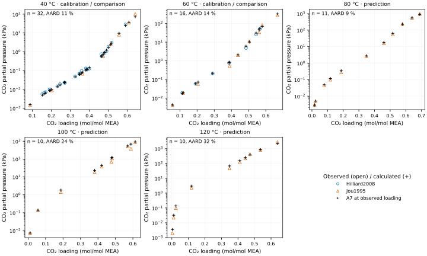
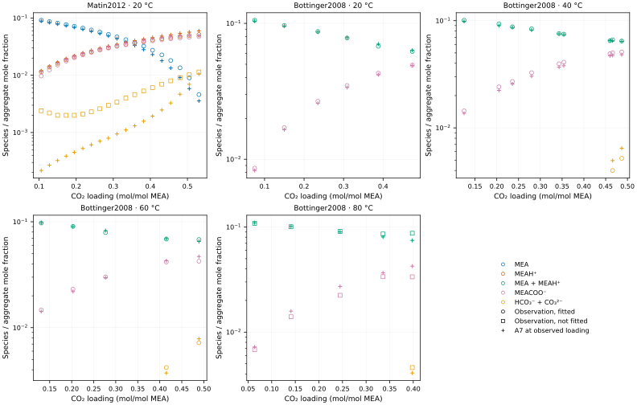
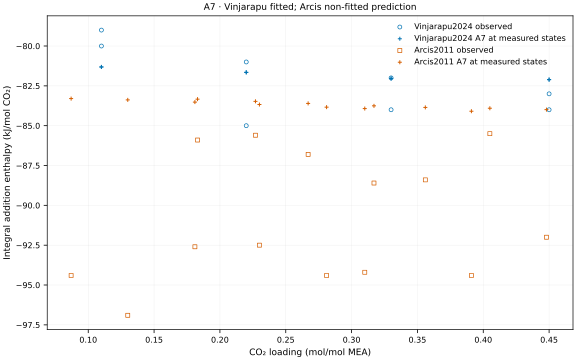
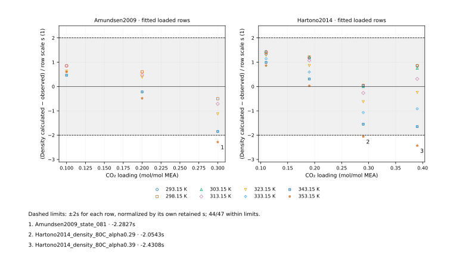
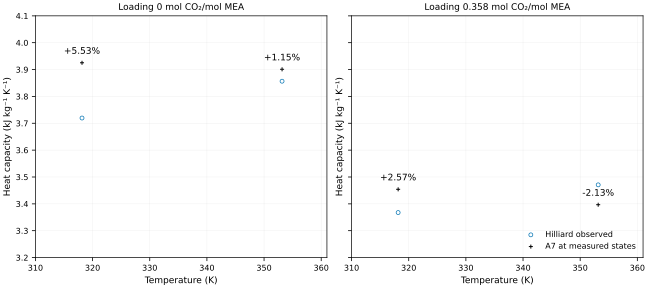

**A7 adopted parameter record · adopted 20 October 2026 · record `e234e860…` · Engine `8298c602` · [Download exact parameters](results/selected-current-best-parameters.json)**

These are electrolyte PC-SAFT (ePC-SAFT) parameters for aqueous MEA–CO₂, with nine liquid species (CO₂, MEA, H₂O, MEAH⁺, MEACOO⁻, HCO₃⁻, CO₃²⁻, H₃O⁺, OH⁻) and five reactions R1–R5. A7 is the seventh amendment of the joint-recalibration plan in [#170](https://github.com/tannerpolley/Amine-Thermodynamics/issues/170); it is the record adopted on 20 October 2026.

# Adopted record and result {#working-record}

The adopted A7 record fits 16 adjustable parameters to 307 objective rows, using native equation-of-state densities without empirical volume translation. For the common calibration subset, average absolute relative deviations are 11.86% for 47 pressures and 7.10% for 94 species targets; the eight fitted Vinjarapu heats have a root-mean-square error of 1.83 kJ/mol CO₂. Of 47 fitted loaded densities, 44 meet their row-specific limits, with three disclosed failures at 353.15 K; one of four heat-capacity points exceeds the 3% comparison limit. At 73 tested states (313.15–333.15 K, CO₂ loading $10^{-5}$–0.5), the phase-stability search found no phase split with lower Gibbs energy; this finite test does not establish global phase stability. The record is approved for manuscript use, but its single-start local fits, active bounds and conditional uncertainty do not establish parameter uniqueness, independent physical validation, concentration transfer or absorber/stripper qualification.

<!-- RESULTS:working-record:BEGIN -->

| Objective | Rows | Cost (dimensionless) |
| --- | --- | --- |
| A7 joint objective | 307 | 148.9053 |
| Common calibration subset | 149 | 23.8660 |

<!-- RESULTS:working-record:END -->

The [joint-calibration record](joint-recalibration/index.qmd#records) retains the full parameter and Engine identities, replay evidence, and the owner’s adoption and manuscript-use decisions. The figures show calibration and named comparison evidence.

# Parameters {#selected-parameters}

These tables read the [selected JSON](results/selected-current-best-parameters.json), [fit summary](results/a7-paper-evidence/fit-summary.json), and [conditional uncertainty](results/a7-paper-evidence/conditional-uncertainty.json). Parameter point estimates use about four significant figures; conditional standard errors use two. Hover over starred fitted estimates to see their full-precision values. Full precision remains in the linked JSON and CSV records. The [input hashes](figures/a7_regression_overview/output/parameter-table-inputs.json) identify the inputs.

[Green: a fixed charge or formulation definition]{.evidence-1} · [Blue: a numerical input with recorded qualifications]{.evidence-2}. [★](#fitted-coordinates){.fit-star} identifies fitted component or pair inputs and all 16 declared coordinates. Tied diameters and transformed chemistry are described explicitly. Green does not certify fitted properties.

<!-- CURRENT-PARAMETERS:BEGIN -->

## Species parameters {#species-parameters}

Lengths are Å; energy parameters are K. Association volumes, segment counts, permittivities and solvation factors are dimensionless. A dash means the input is absent, not a fitted zero.

::: {.parameter-table .species-table}
| Species | $m$ (1) | $\sigma$ (Å) | $\epsilon/k$ (K) | $\epsilon^{AB}/k$ (K) | $\kappa^{AB}$ (1) | Scheme |
| :-- | :-- | :-- | :-- | :-- | :-- | :-- |
| CO₂ | 2.073 | 2.785 | 169.2 | — | — | 2B |
| MEA | 3.035 | 3.043 | 277.2 | 2586 | 0.03629 | 2B |
| H₂O | 1.253 | water law | 432.4 | 1757 | 0.03762 | 2B |
| MEAH⁺ | 1.000 | 5.350[★](#fitted-coordinates){.fit-star} | 177.8[★](#fitted-coordinates){.fit-star} | — | — | — |
| MEACOO⁻ | 1.000 | 4.866[★](#fitted-coordinates){.fit-star} | 207.3[★](#fitted-coordinates){.fit-star} | — | — | — |
| HCO₃⁻ | 1.000 | 2.930 | 70.00 | — | — | — |
| CO₃²⁻ | 1.000 | 2.442 | 249.3 | — | — | — |
| H₃O⁺ | 1.000 | 3.465 | 500.0 | — | — | — |
| OH⁻ | 1.000 | 2.018 | 650.0 | — | — | — |
:::

### Electrostatic inputs

::: {.parameter-table .species-table}
| Species | $z$ (1) | $\epsilon_r$ (1) | $d_B$ (Å) | $f_{\mathrm{solv}}$ (1) |
| :-- | :-- | :-- | :-- | :-- |
| CO₂ | 0 | solvent law | — | 1.000 |
| MEA | 0 | solvent law | — | 1.000 |
| H₂O | 0 | solvent law | — | 1.500 |
| MEAH⁺ | 1.000 | 8.000 | 5.000[★](#fitted-coordinates){.fit-star} | 1.000 |
| MEACOO⁻ | −1.000 | 8.000 | 5.000[★](#fitted-coordinates){.fit-star} | 1.000 |
| HCO₃⁻ | −1.000 | 8.000 | 3.000 | 1.000 |
| CO₃²⁻ | −2.000 | 8.000 | 3.000 | 1.000 |
| H₃O⁺ | 1.000 | 8.000 | 1.218 | 1.000 |
| OH⁻ | −1.000 | 8.000 | 3.081 | 1.000 |
:::

CO₂ has induced 2B association with water and no self-association; its cross-association inputs are in `topology.edges` of the selected file. Ion association is absent.

::: {title="Exact water-diameter constant 2.78043261494 Å; full coefficients in the selected JSON"}

Water diameter (rounded display; use the selected JSON for numerical work), with $T$ in K and $\sigma$ in Å. The constant and amplitudes are in Å; exponent coefficients are in K⁻¹:

$$\sigma_{\mathrm{H_2O}}(T)=2.78+10.11 e^{-0.01775T}-1.417 e^{-0.01146T}$$

:::

The selected file uses solvent-density-temperature permittivity with the retained shared stage-5 water parameters. It excludes dispersion between ions with the same charge sign. For MEAH⁺ and MEACOO⁻, packing diameter is 0.88 times segment diameter and Debye–Hückel diameter equals segment diameter; Born diameters vary separately. No empirical density translation is applied. Fixed and transferred inputs carry their recorded qualifications; these tables confer no new physical validation.

## Permittivity inputs

Solvent-density-temperature inputs (retained shared stage 5):

::: {.parameter-table .summary-table}
| Component | Dielectric volume (L/mol) | Dielectric temperature (K) |
| :-- | :-- | :-- |
| CO₂ | 1.000e−08 | 1403 |
| MEA | 0.7310 | 1019 |
| H₂O | 0.3777 | 1403 |
:::

## Binary interactions

Symmetric dimensionless $k_{ij}$ at the reference temperature, upper triangle. A blue zero is a serialized fixed input, not a measured absence of interaction. Green exclusions state the selected formulation rule.

::: {.parameter-table .binary-interactions-table}
|  | CO₂ | MEA | H₂O | MEAH⁺ | MEACOO⁻ | HCO₃⁻ | CO₃²⁻ | H₃O⁺ | OH⁻ |
| :-- | :-- | :-- | :-- | :-- | :-- | :-- | :-- | :-- | :-- |
| CO₂ | — | 0 | −0.04642 | 0 | 0 | 0 | 0 | 0 | 0 |
| MEA |  | — | −0.08990[★](#fitted-coordinates){.fit-star} | 0 | 0 | 0 | 0 | 0 | 0 |
| H₂O |  |  | — | −0.5000[★](#fitted-coordinates){.fit-star} | −0.003863[★](#fitted-coordinates){.fit-star} | 0.7253[★](#fitted-coordinates){.fit-star} | −0.2500 | 0.2500 | −0.2500 |
| MEAH⁺ |  |  |  | — | −1.000[★](#fitted-coordinates){.fit-star} | 0 | 0 | excluded | 0 |
| MEACOO⁻ |  |  |  |  | — | excluded | excluded | 0 | excluded |
| HCO₃⁻ |  |  |  |  |  | — | excluded | 0 | excluded |
| CO₃²⁻ |  |  |  |  |  |  | — | 0 | excluded |
| H₃O⁺ |  |  |  |  |  |  |  | — | 0 |
| OH⁻ |  |  |  |  |  |  |  |  | — |
:::

The stored temperature dependence is $k_{ij}(T)=k_{ij}(T_{\mathrm{ref}})+b(1/T-1/T_{\mathrm{ref}})$. The slope $b$ has units K.

::: {.parameter-table .summary-table}
| Pair | $b$ (K) | $T_{\mathrm{ref}}$ (K) |
| :-- | :-- | :-- |
| CO₂–MEA | 0 | 313.15 |
| CO₂–H₂O | −35.67 | 313.15 |
| MEA–H₂O | −8.070[★](#fitted-coordinates){.fit-star} | 313.15 |
| MEAH⁺–H₂O | −41.93[★](#fitted-coordinates){.fit-star} | 313.15 |
:::

## Fitted coordinates and conditional uncertainty {#fitted-coordinates}

::: {.parameter-table .summary-table}
| Coordinate | Current value | Unit | Conditional standard error (same unit) | Bounds (same unit) |
| :-- | :-- | :-- | :-- | :-- |
| MEACOO⁻–H₂O interaction | −0.003863[★](#fitted-coordinates){.fit-star} | 1 | 0.18 | Free; -0.5 to 0.5 |
| MEAH⁺–H₂O interaction | −0.5000[★](#fitted-coordinates){.fit-star} | 1 | — | On bound; -0.5 to -0.161 |
| HCO₃⁻–H₂O interaction | 0.7253[★](#fitted-coordinates){.fit-star} | 1 | 1.3 | Free; -0.5 to 1 |
| MEACOO⁻–MEAH⁺ interaction | −1.000[★](#fitted-coordinates){.fit-star} | 1 | — | On bound; -1 to 1 |
| MEAH⁺–H₂O reciprocal-temperature slope | −41.93[★](#fitted-coordinates){.fit-star} | K | 60 | Free; -1000 to 1000 |
| MEAH⁺–segment diameter | 5.350[★](#fitted-coordinates){.fit-star} | Å | — | On bound; 5.35 to 5.8 |
| MEACOO⁻–segment diameter | 4.866[★](#fitted-coordinates){.fit-star} | Å | 0.079 | Free; 2 to 5.8 |
| MEAH⁺–Born diameter | 5.000[★](#fitted-coordinates){.fit-star} | Å | — | On bound; 2 to 5 |
| MEACOO⁻–Born diameter | 5.000[★](#fitted-coordinates){.fit-star} | Å | — | On bound; 2 to 5 |
| R5 unshifted source A | 2832[★](#fitted-coordinates){.fit-star} | K | 1.7e+02 | Free; 2400 to 3000 |
| R2 total enthalpy shift | −1387[★](#fitted-coordinates){.fit-star} | J/mol | 5.3e+03 | Free; -10000 to 10000 |
| R5 total enthalpy shift | 1.000e+04[★](#fitted-coordinates){.fit-star} | J/mol | — | On bound; -10000 to 10000 |
| MEA–H₂O interaction | −0.08990[★](#fitted-coordinates){.fit-star} | 1 | 0.001 | Free; -0.5 to 0.5 |
| MEA–H₂O reciprocal-temperature slope | −8.070[★](#fitted-coordinates){.fit-star} | K | 1.8 | Free; -1000 to 1000 |
| MEAH⁺–dispersion energy/k | 177.8[★](#fitted-coordinates){.fit-star} | K | 48 | Free; 50 to 950 |
| MEACOO⁻–dispersion energy/k | 207.3[★](#fitted-coordinates){.fit-star} | K | 84 | Free; 50 to 1000 |
:::

The ten free coordinates have rank 10 at the campaign cutoff 1e-14. The residual variance factor is 1.003 with 307 − 10 = 297 degrees of freedom. R5 A is the unshifted source coordinate; enthalpy shifts are totals including inherited shifts. The errors condition on residual weights, fixed inputs, active bounds and local linearization. They do not establish independent-error measurement uncertainty, parameter uniqueness or prediction intervals.

## Reaction correlations

R2/R4/R5 below are generated from the current selected JSON. It does not serialize fixed R1/R3; those rows and the reaction equations come from the retained [chemistry declaration](https://github.com/tannerpolley/Amine-Thermodynamics/blob/30ce082/data/reference/MEA/manifests/chemical_reaction_source_contract.json), including its stored aqueous-molality offsets.

::: {.parameter-table .summary-table}
| Reaction | $A$ (1) | $B$ (K) | $C$ (1) | $D$ (K⁻¹) | $\Delta$ (1) | Input owner |
| :-- | :-- | :-- | :-- | :-- | :-- | :-- |
| R1 · 2 H₂O ⇌ H₃O⁺ + OH⁻ | 132.9 | −1.345e+04 | −22.48 | 0 | 8.033 | Fixed chemistry |
| R2 · CO₂ + 2 H₂O ⇌ HCO₃⁻ + H₃O⁺ | 234.9 | −1.193e+04 | −36.78 | 0 | — | Selected JSON |
| R3 · HCO₃⁻ + H₂O ⇌ CO₃²⁻ + H₃O⁺ | 216.0 | −1.243e+04 | −35.48 | 0 | 4.017 | Fixed chemistry |
| R4 · MEACOO⁻ + H₂O ⇌ HCO₃⁻ + MEA | 2.151 | −1545 | — | — | — | Selected JSON |
:::

R5 uses a base-10 logarithm and different coefficient units:

::: {.parameter-table .summary-table}
| Reaction | $A$ (K) | $B$ (1) | $C$ (K⁻¹) | Input owner |
| :-- | :-- | :-- | :-- | :-- |
| R5 · MEAH⁺ + H₂O ⇌ MEA + H₃O⁺ | 3354 | −1.281 | 0.0004277 | Selected JSON |
:::

For R1–R3, $\ln K=A+B/T+C\ln T+DT+\Delta$; R2 already includes the conversion in $A$ and has no separate offset. For R4, $\ln K=A+B/T$. For R5, $-\log_{10}K=A/T+B+CT$. The displayed layouts therefore give $B$ in K for R1–R4 and $A$ in K for R5; $D$ for R1–R3 and $C$ for R5 are in K⁻¹. Other coefficients are dimensionless. R2/R5 include the fitted pivot-preserving enthalpy shifts at 313.15 K; R5 also varies its unshifted source A. The displayed reaction coefficients include these transformations and are not independent fitted coordinates or new source measurements.

<!-- CURRENT-PARAMETERS:END -->

# Fitting plots

## CO₂ pressure {#pressure-and-speciation}

Model values are calculated at each measured state and shown as + markers; no continuous curve is drawn. Pressures are plotted in kPa. [Figure data and provenance](figures/a7_regression_overview/output/provenance.json).

{#fig-pressure}

<!-- RESULTS:pressure:BEGIN -->

| Cohort / role | Evaluated / requested | AARD (%) | RMS ln(calc/obs) (1) |
| --- | --- | --- | --- |
| All shown (Hilliard 2008 + Jou 1995) | 79 / 79 | 15.47 | 0.1923 |
| Fitted (common calibration subset) | 47 / 47 | 11.86 | 0.1514 |
| Hilliard 2008 | 31 / 31 | 9.42 | 0.1187 |
| Jou 1995 | 48 / 48 | 19.37 | 0.2276 |

<!-- RESULTS:pressure:END -->

## Speciation

{#fig-speciation}

<!-- RESULTS:species:BEGIN -->

| Cohort / role | Evaluated / requested | AARD (%) | RMS ln(calc/obs) (1) |
| --- | --- | --- | --- |
| All shown (Böttinger 2008 + Matin 2012) | 131 / 131 | 16.21 | 0.5312 |
| Fitted, common calibration subset (94 targets) | 94 / 94 | 7.10 | 0.1014 |
| Fitted, including 7 restored targets (101 targets) | 101 / 101 | 7.24 | 0.1038 |
| Restored targets only (7) | 7 / 7 | 9.00 | 0.1319 |
| Böttinger 2008 | 55 / 55 | 5.62 | 0.0790 |
| Matin 2012 | 76 / 76 | 23.88 | 0.6941 |
| Matin HCO₃⁻ + CO₃²⁻ pool (report only) | 19 / 19 | 67.48 | 1.3710 |

<!-- RESULTS:species:END -->

The common calibration subset contains 94 species targets; seven restored fitted targets are reported separately. The 19 Matin bicarbonate/carbonate pools are report-only comparisons and overlap the displayed population. See the [exact row membership and diagnostics](joint-recalibration/index.qmd).

## Integral heat of absorption {#heat-of-absorption}

The [22 retained heat rows](results/a7-paper-evidence/heat.csv) comprise the fitted and non-fitted comparisons below. Eight Vinjarapu rows at 313.15 K and 1.734 MPa enter the objective; 14 Arcis rows at 322.5 K are non-fitted predictions at their source pressures. Heat is the integral finite-addition enthalpy from zero carbon. Negative heat denotes exothermic absorption.

{#fig-heat}

Root-mean-square error (RMSE) and calculated-minus-observed bias are in kJ/mol CO₂.

<!-- RESULTS:heat:BEGIN -->

| Source / role | n | RMSE (kJ/mol CO₂) | Bias (kJ/mol CO₂) |
| --- | --- | --- | --- |
| Vinjarapu2024 · fitted | 8 | 1.83 | +0.473 |
| Arcis2011 · non-fitted prediction | 14 | 8.11 | +7.18 |

<!-- RESULTS:heat:END -->

## Density {#density-and-heat-capacity}

The [210 retained densities](results/a7-paper-evidence/density.csv) are native equation-of-state predictions, with no empirical volume translation. The objective contains 47 loaded and five CO₂-free densities. Source pressures remain the retained assumptions, including 0.100 MPa where unreported. The other retained rows preserve their non-fitted roles and exclusions.

{#fig-density}

<!-- RESULTS:density:BEGIN -->

| Fitted cohort | Evaluated / requested | Within limit | Max \|error\|/s (1) | RMSE (kg/m³) | AARD (%) |
| --- | --- | --- | --- | --- | --- |
| Amundsen fitted 15 | 15 / 15 | 14 / 15 | 2.28 | 2.264 | 0.17 |
| Hartono fitted 32 | 32 / 32 | 30 / 32 | 2.43 | 2.175 | 0.18 |
| Amundsen, CO₂-free (5 rows) | 5 / 5 | 5 / 5 | 1.11 | 0.341 | 0.03 |

Loaded rows use their row-specific $2s$ limits; the CO₂-free five use 1.0 kg/m³.

| Source (all retained states; overlaps fitted rows) | n | RMSE (kg/m³) | AARD (%) |
| --- | --- | --- | --- |
| Amundsen2009 | 103 | 6.420 | 0.38 |
| Hartono2014 | 40 | 2.423 | 0.19 |
| Han2012 | 67 | 5.905 | 0.39 |

<!-- RESULTS:density:END -->

Three fitted loaded densities at 353.15 K fall outside their $2s$ limits (−2.28$s$, −2.06$s$, −2.43$s$). These three rows are underpredicted by 4.2–5.5 kg/m³ (0.40–0.53%). The source-uncertainty discussion and the five excluded Amundsen rows are on the [A7 page](joint-recalibration/index.qmd).

## Heat capacity

The four [Hilliard Cp rows](results/a7-paper-evidence/cp.csv) enter the objective at 7 mol MEA/kg water, 101325 Pa, with the declared $10^{-6}$ unloaded CO₂ proxy.

{#fig-cp}

<!-- RESULTS:heat-capacity:BEGIN -->

| Temperature (K) | Nominal loading (mol/mol MEA) | Cp (kJ/(kg·K)) | Observed Cp (kJ/(kg·K)) | Deviation (%) | Within 3% |
| --- | --- | --- | --- | --- | --- |
| 318.15 | 0.0 | 3.9253 | 3.7195 | +5.53 | No |
| 318.15 | 0.358 | 3.4539 | 3.3675 | +2.57 | Yes |
| 353.15 | 0.0 | 3.9009 | 3.8566 | +1.15 | Yes |
| 353.15 | 0.358 | 3.3966 | 3.4707 | -2.13 | Yes |

1 of 4 states exceed the 3% comparison limit.

<!-- RESULTS:heat-capacity:END -->

# Where to find more

| Reader question | Page / exact records |
| --- | --- |
| Joint calibration, assessment and adoption | [A7 joint recalibration and adoption](joint-recalibration/index.qmd) · [A7 evidence package](results/a7-paper-evidence/README.md) |
| How the record was reached | [Joint recalibration history](joint-recalibration-history/index.qmd) · [Parameter adoption history](results/parameter-record-history.csv) |
| Neutral CO₂ solubility and the CO₂–MEA pair | [Neutral CO₂ study](neutral-co2/index.qmd) |
| Loaded density and phase assessment before A7 | [Loaded density and phase comparison before A7](loaded-density/index.qmd) |
| Heat F1 predecessor | [F1 identity and six-fit comparison](heat-f1/index.qmd) |
| Numerical reproduction and Engine transfers | [Engine adoptions](engine-adoptions/index.qmd) · [Default-path reproduction](joint-recalibration/index.qmd#numerical-reproduction) |
| High-temperature pressure and transfer | [High-temperature comparison](high-temperature/index.qmd) |
| Remaining scientific questions | [Open work](open-work/index.qmd) |
| Formulation and earlier fitting | [Neutral MEA–water](neutral-mea-water/index.qmd) · [Association topology](association-topology/index.qmd) · [CO₂ and R4](co2-r4-calibration/index.qmd) · [Born and permittivity](born-permittivity/index.qmd) |
| Earlier coupled assessment | [Reaction-temperature fit](reaction-temperature-fit/index.qmd) · [Calorimetry](calorimetry/index.qmd) · [Coupling and identification](coupling-and-identification/index.qmd) |
| Earlier designs and ion fitting | [Ionic/speciation fit](ionic-speciation-fit/index.qmd) · [Historical designs](historical-designs/index.qmd) |
| Sources and provenance | [Evidence map](../evidence-map.qmd) · [Parameter-table input hashes](figures/a7_regression_overview/output/parameter-table-inputs.json) |
