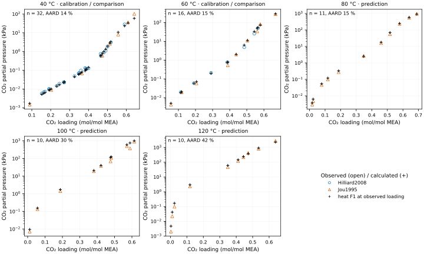
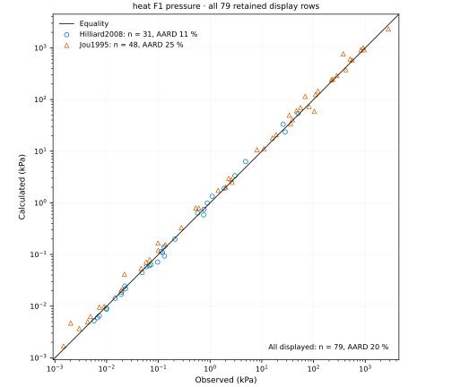
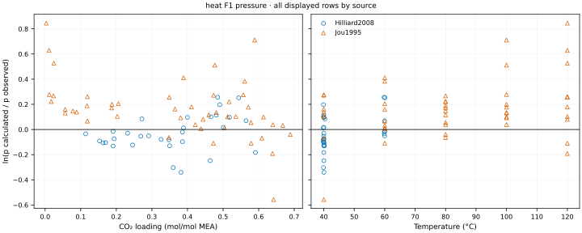
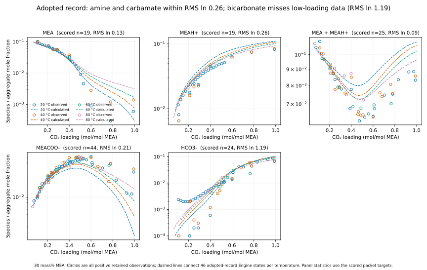
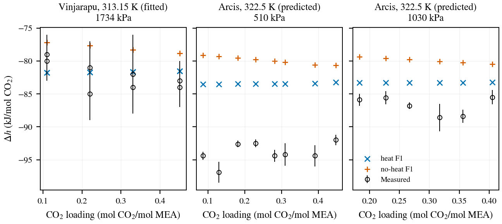

## Route 2b: λ=0, start A, two dielectric branches

**smaller-dV:** limit_reached at 53 iterations, training cost 36.7833961664, common-149 cost 23.0753630456. **larger-dV:** Fit running; no returned result.

The two authorized calls use λ=0, start A, 100 iterations, 1200 s native wall and a 1320 s crash backstop, with 12000 CPU-s checked after normal reaping. Bound activity is reported. The frozen declaration has 16 coordinates and 205 positive-weight rows. CO₂–water pivot and reciprocal-temperature slope are free; all 39 Kiepe natural-log pressure residuals have weight 1/39; bicarbonate–water has upper bound 1.0. All other declarations remain unchanged. No loaded-density assessment is run.

| Returned quantity | Smaller d_V | Larger d_V |
|---|---|---|
| Convergence status | limit_reached | Pending |
| Iterations | 53 | Pending |
| Residual evaluations | 54 | Pending |
| Jacobian evaluations | 47 | Pending |
| Projected gradient, tolerance 1e-8 | 0.000110807132411 | Pending |
| Initial training cost | 196.86581561 | Pending |
| Returned training cost | 36.7833961664 | Pending |
| Common-149 cost | 23.0753630456 | Pending |
| Common-149 minus Route 2 partial | -1.20583106812 | Pending |
| Trial failures | 0 | Pending |

The earlier 81-iteration Route 2 partial has common-149 cost **24.2811941137**. Adopted **32.05668491** is historical context from different inputs and wheel. These are partial-iterate calibration statistics; an objective value is not a converged optimum or a parameter-adoption decision.

### Training cost by family

| Family | Rows | Smaller d_V | Larger d_V |
|---|---|---|---|
| Common-149 pressure | 47 | 6.78866387178 | Pending |
| Common-149 species | 94 | 15.0852796903 | Pending |
| Common-149 Vinjarapu heat | 8 | 1.20141948351 | Pending |
| Restored species | 7 | 1.69801644599 | Pending |
| Pooled Jakobsen ratios | 6 | 6.24600648378 | Pending |
| Kiepe pressure | 39 | 2.29832717517 | Pending |
| Equilibrium Cp | 4 | 3.46568301584 | Pending |

Costs are one half the sum of squared weighted residuals. All 149 common targets keep their original definitions, weights and scales. Cost reconstruction from the returned arrays is retained in each reported-results.json; it is arithmetic verification, not serialization replay.

### Kiepe pressure errors by isotherm

| T, K | Rows | Smaller mean absolute error, % | Smaller maximum absolute error, % | Larger mean absolute error, % | Larger maximum absolute error, % |
|---|---|---|---|---|---|
| 313.2 | 12 | 96.3778735169 | 98.2142367181 | Pending | Pending |
| 353.11 | 9 | 77.8852816516 | 85.051357781 | Pending | Pending |
| 373.26 | 12 | 58.9405035288 | 69.1574437004 | Pending | Pending |
| 393.17 | 6 | 31.3686952579 | 46.3200109654 | Pending | Pending |

Errors are calculated from all 39 returned pressure predictions against their retained observations. Signed means, log-residual root-mean-square values and isotherm costs are in each Kiepe-isotherms.csv. The smaller branch underpredicts most binary pressures strongly at its returned partial iterate; its lower common-149 cost therefore does not establish simultaneous agreement with the added binary data.

### Active bounds and objective gradients

| Branch | Coordinate | Value | Unit | Side | Gradient per optimizer unit | Gradient per quantity unit |
|---|---|---|---|---|---|---|
| smaller-dV | Bicarbonate–water k | 1 | dimensionless | upper | -0.000888184514473 | -0.0888184514473 |
| smaller-dV | Carbamate–MEAH⁺ k | -1 | dimensionless | lower | 0.0246367162102 | 2.46367162102 |
| smaller-dV | MEAH⁺ Born diameter | 5 | angstrom | upper | -0.00224389215565 | -0.0224389215565 |
| smaller-dV | Carbamate Born diameter | 5 | angstrom | upper | -0.00431899105143 | -0.0431899105143 |
| smaller-dV | R5 unshifted a_k | 2400 | K | lower | -0.338734138729 | 0.00423417673411 |
| smaller-dV | R5 enthalpy shift | 10000 | J/mol | upper | -0.000445945513378 | -1.78378205351e-07 |
| smaller-dV | MEAH⁺ dispersion/k | 950 | K | upper | -0.0108689636201 | -0.00108689636201 |

Gradients are Jᵀr for the weighted residual objective, using the returned weighted optimizer Jacobian. Quantity gradients include the reciprocal-correlation sign for R5 unshifted a_k. Bounds are search limits, not confidence intervals.

### All coordinate values against the 81-iteration Route 2 partial

| Coordinate | Unit | A start | Route 2 partial | Smaller d_V | Larger d_V |
|---|---|---|---|---|---|
| Carbamate–water k | dimensionless | 0.134080741317 | -0.202719733667 | 0.214819481849 | Pending |
| MEAH⁺–water k | dimensionless | -0.379554080066 | -0.152249129162 | -0.208848402803 | Pending |
| Bicarbonate–water k | dimensionless | 0.5 | 0.5 | 1 | Pending |
| Carbamate–MEAH⁺ k | dimensionless | -0.707285890215 | -1 | -1 | Pending |
| MEAH⁺–water slope b | K | -112.567750584 | 36.9034558902 | -337.127093362 | Pending |
| MEAH⁺ segment diameter | angstrom | 3.563 | 5.51743301647 | 4.16295757137 | Pending |
| Carbamate segment diameter | angstrom | 3.5605 | 5.8 | 5.38701343402 | Pending |
| MEAH⁺ Born diameter | angstrom | 3.563 | 5 | 5 | Pending |
| Carbamate Born diameter | angstrom | 3.5605 | 3.62897938162 | 5 | Pending |
| R5 unshifted a_k | K | 2677.91 | 2568.56004544 | 2400 | Pending |
| R2 enthalpy shift | J/mol | 0 | -10000 | 1667.91582297 | Pending |
| R5 enthalpy shift | J/mol | 0 | -8392.06021931 | 10000 | Pending |
| CO₂–water k(313.15 K) | dimensionless | -0.0464169011206 | -0.0464169011206 | -0.212524867101 | Pending |
| CO₂–water slope b | K | -35.6650522065 | -35.6650522065 | -249.206280174 | Pending |
| MEAH⁺ dispersion/k | K | 228.71 | 251.302802793 | 950 | Pending |
| Carbamate dispersion/k | K | 533.11 | 168.034884166 | 677.551986745 | Pending |

The fixed dielectric pairs remain smaller d_V/d_T = **0.2464540312088979 L/mol / 2436.4423007273617 K** and larger **0.7309888238084122 L/mol / 1019.0786110170793 K**. Segment-size coordinates retain the 0.88 packing/Debye–Hückel ties. R2/R5 enthalpy shifts preserve the 313.15 K pivot. R5 unshifted a_k is separate from the composed serialized reaction law, retained in each partial parameter file.

### Four molality-based solution Cp errors

| T, K | Loading | Observed Cp, kJ/(kg K) | Smaller Cp | Smaller signed error, % | Larger Cp | Larger signed error, % |
|---|---|---|---|---|---|---|
| 318.15 | 0 | 3.7195 | 3.84329140224 | 3.32817320169 | Pending | Pending |
| 318.15 | 0.358 | 3.3675 | 3.45783007606 | 2.6824076039 | Pending | Pending |
| 353.15 | 0 | 3.8566 | 3.83233767735 | -0.629111721565 | Pending | Pending |
| 353.15 | 0.358 | 3.4707 | 3.3662461415 | -3.0095905294 | Pending | Pending |

These four equilibrium Cp targets use 7 mol MEA/kg water and 101325 Pa; nominal unloaded states retain the declared 1e-6 CO₂ proxy. Molar-to-mass conversion uses the retained complete-feed amount and mass, and reproduces each source observation. These are fitted observations, not withheld validation.

### Numerical checks and limits

| Branch | Available rows | Full rank / columns | Free rank / columns | Full condition | Free condition | Native CPU-s | Complete call wall-s |
|---|---|---|---|---|---|---|---|
| smaller-dV | {'Available': 205} | 16/16 | 9/9 | 166973.649595 | 271.337775542 | 6795.859259 | 1279.28800544 |

Every returned native call exits 0 and is reaped without interruption. The driver retains a nonconvergence traceback for limit-reached returns; this does not supersede the owner instruction to run the other authorized branch. The native time-limit message describes an internal solver span; complete call timing can exceed 1200 s while remaining below the 1320 s crash backstop.

| Branch | Endpoint replay | Derivative checks | Hard stops before another call |
|---|---|---|---|
| smaller-dV | Unrun: fit did not converge | Unrun: fit did not converge | None reached |

These two bounded end-state comparisons are reported as scalar tables rather than an inferred continuous calibration curve. No parameter uncertainty, independent physical validation, adoption, manuscript promotion or delivered independent review is claimed. No λ=0.1, start B or assessment is run. Frozen, hash-checked source inputs are reused; no new literature judgment is made, and this worktree has no local literature reading shelf.

The [full report and charges](results/joint-recalibration-170/amendment-2/route2b/README.md) links retained targets, coordinates, native returns and wheel checks. Four start-A release tests remain passed and are not repeated. The launcher change has 5 gross executable additions / 28 removals, net −23; campaign charge is 857/900. The earlier interrupted fit remains reserved at 12000 CPU-s within the extended 36000 CPU-s fit allowance.

## Route 2: time limit at 81 iterations; comparison incomplete

**The primary $\lambda=0.1$ common-149 cost and the completed $\lambda=0$ control remain unavailable.** The [owner-authorized continuation](https://github.com/tannerpolley/Amine-Thermodynamics/issues/170#issuecomment-6207429019) restarts $\lambda=0$ A from its declared source/seed document at **100 iterations, 1200 s native wall and 12000 aggregate CPU-s**. On the shared smaller-$d_V$ branch and the same 14 released coordinates, it returns after **81 iterations** at the native time limit, with whole-training cost **196.865136591 → 40.5902023581**. The returned **24.2811941137 common-149 cost is a partial-iterate diagnostic**. The adopted record's retained **32.05668491** uses a different wheel and declaration and is a historical reference only, not a ranking. There is no completed A/B comparison record at either weight.

| Density weight | Start | Retained result | Completed comparison cost |
|---:|:---:|---|---|
| 0 | A | Time-limited partial, 81 iterations, training cost 40.5902023581 | Unavailable |
| 0 | B | Unrun after required non-convergence stop | Unavailable |
| 0.1 | A | Unrun after required non-convergence stop | Unavailable |
| 0.1 | B | Unrun after required non-convergence stop | Unavailable |

All **166/166 native predictions are Available**, with **82 residual / 64 Jacobian evaluations** and zero trial failures. The native owner exits normally and is reaped after **1248.100513649 wall-s / 7446.787965 CPU-s**; the command charge is **1248.330902440 wall-s / 7447.008186 CPU-s**. The existing **1320 s backstop** does not fire. Aggregate fit CPU is measured after normal reaping, below 12000 CPU-s. The native call exceeds 1200 s by 48.100513649 s. Its time-limit message reports an internal solver span; it is not the complete call timing. The driver exits 1 after retaining the required stop. An initial missing-`PYTHONPATH` import failure performs no thermodynamic calculation and is included once in preparation overhead.

The native projected-gradient norm is **2.10700056805**, against $10^{-8}$. Five coordinates are active at bounds, as reported below. **Bound activity alone is permitted for these four fits; non-convergence is the present stop.** Full/free weighted, scaled ranks are **14/14 and 9/9**, with conditions **13247.5501 and 831.2497**. Covariance remains `not_converged`; no parameter uncertainty or bound-constrained optimum is asserted. All four starting release checks remain passed. Bounds, starts, source chemistry assumptions, fixed neutral inputs, residual weights and the released dispersions stay unchanged.

| Active coordinate | Partial value | Side | Training-cost gradient per scaled optimizer coordinate |
|---|---:|---|---:|
| Bicarbonate–water interaction | 0.5 | Upper | +0.0319591960294 |
| Carbamate–MEAH⁺ interaction | -1 | Lower | -0.0239158824269 |
| Carbamate segment diameter | 5.8 Å | Upper | +0.448229029215 |
| MEAH⁺ Born diameter | 5 Å | Upper | -0.0108382835599 |
| R2 enthalpy shift | -10000 J/mol | Lower | -0.274943154841 |

R2/R5 shifts at the **313.15 K pivot** are **-10000 / -8392.06021931 J/mol**. R5's unshifted $a_k$ is **2568.56004544 K**, movement **-109.349954556 K** from source; the Engine-serialized resulting $a_k$ is **2130.21235992 K**, with $b=1.78670100758$. The unshifted search box applies to the unshifted coefficient. MEAH⁺/carbamate segment sizes are **5.51743301647 / 5.8 Å**, Born diameters **5 / 3.62897938162 Å**, and dispersions/k **251.302802793 / 168.034884166 K**. The [parameter table](results/joint-recalibration-170/amendment-2/route2/lambda-0/F1/A/converge-1/parameters-and-gradients.csv) retains all 14 values, source movements, tied-size meanings, bounds and gradients.

The common-149 pressure/species/Vinjarapu contributions are **6.63091194532 / 16.9797004741 / 0.670581694244**. Pressure/species mean absolute relative errors are **12.3906185005% / 7.17742618759%**; eight Vinjarapu heats have RMSE **1.48858761067 kJ/mol CO₂**. Seven restored species, six pooled Jakobsen ratios and four Cp observations contribute **2.47797629947 / 11.5193754720 / 2.31165647297**. These are incomplete calibration statistics. The [target table](results/joint-recalibration-170/amendment-2/route2/lambda-0/F1/A/converge-1/target-costs.csv) retains every returned value and error. Cost reconstruction differs from native by one ulp, $7.11\times10^{-15}$; it is retained-array arithmetic, not serialization replay.

| Temperature, K | Loading | Observed Cp, kJ/(kg K) | Partial Cp, kJ/(kg K) | Signed error, % |
|---:|---:|---:|---:|---:|
| 318.15 | 0 | 3.7195 | 3.84277891451 | +3.3143948 |
| 318.15 | 0.358 | 3.3675 | 3.42372348313 | +1.6695912 |
| 353.15 | 0 | 3.8566 | 3.83152349216 | -0.6502232 |
| 353.15 | 0.358 | 3.4707 | 3.39874916634 | -2.0730929 |

The four Cp feeds use exactly **7 mol MEA/kg water**, 101325 Pa, and the declared $10^{-6}$ unloaded CO₂ proxy. The partial vector misses the **3%** target at unloaded 318.15 K. Its proxy, total-enthalpy and frozen-composition checks remain unrun. All **103 endpoint density rows** remain unrun: loaded fit/temperature groups **12/8**, unloaded fit/temperature groups **3/2**, 30 wt% loading-0.5 group **3**, loaded 20/40 wt% **45**, and unloaded non-30 wt% **30**. There is no result for the 20 loaded or five unloaded physical requirements.

No replay, derivative, closure or thermodynamic assessment follows the required non-convergence stop. Fixed-record pressure/temperature/concentration groups, Wagner, corrected Jakobsen, 14 Arcis, 28 Hajj, C5, the union score and six Kim heats/frozen $s_H$ remain unrun. Gas-root falsifier attempts and 73-point flash-family attempts are both **zero**; missing evidence does not count as zero failures. The unchanged-water and neutral-binary qualifications remain separate numerical verification. The [eligibility table](results/joint-recalibration-170/amendment-2/route2/eligibility.csv) and [full section-5 report table](results/joint-recalibration-170/amendment-2/route2/report-availability.csv) identify every available quantity and gap. This partial vector is not physically eligible, independently reviewed, adopted or promoted for manuscript/absorber use. It establishes no equation-of-state limitation.

The [Route 2 report](results/joint-recalibration-170/amendment-2/route2/README.md), [incomplete-fit record](results/joint-recalibration-170/amendment-2/route2/lambda-0/F1/A/converge-1/incomplete-fit.json), [native output](results/joint-recalibration-170/amendment-2/route2/lambda-0/F1/A/converge-1/native.json), [cost/time history](results/joint-recalibration-170/amendment-2/route2/lambda-0/F1/A/converge-1/iteration-history.csv) and [full/free spectra](results/joint-recalibration-170/amendment-2/route2/lambda-0/F1/A/converge-1/identification.json) retain the evidence. Native history includes rejected costs; its per-entry durations are not call wall time. Matplotlib is absent. This section uses scalar/property/availability tables and retains the exact history; plotting it would not resolve the missing convergence or comparison record.

The [cumulative accounting](results/joint-recalibration-170/amendment-2/route2/timing-and-program-accounting.json), including the conservative reporting/presentation charges, is **21999.743957976 CPU-s / at least 3145.449697966 active wall-s** for the program, leaving at most **122000.256042024 CPU-s / 18454.550302034 wall-s** of 144000/21600. Route 2 totals **19732.208820256 conservative CPU-s / 2442.685345839 wall-s**. The four-fit reserve has **40552.991814000 CPU-s** remaining; assessment/reporting has **2714.799365744 CPU-s**. These allowances do not override the present stop.

The [first-attempt accounting diagnosis](results/joint-recalibration-170/amendment-2/route2/diagnosis-wall/README.md) remains valid; its conservative missing-worker CPU reservation is retained. The new command is charged once, with **120 CPU-s / 120 active wall-s** conservative preparation/reporting/checks/commits and **60 CPU-s / 60 active wall-s** conservative presentation reservation, verified against measured render charges. Earlier unmetered overhead remains disclosed. The only new launcher change removes the superseded active-bound stop: **2 added / 2 removed executable lines**, yielding **187/200 part 2 and 812/900 campaign** conservative gross additions. No subagent, preview-service action or remote write occurs. The owner must decide the non-convergence stop before any further fit or thermodynamic call. Evidence is incomplete calibration and retained-array numerical verification, not physical validation.

## Joint recalibration amendment 2: precursor stops at five bounds

The new [amendment-2 calculation](results/joint-recalibration-170/amendment-2/route1/precursor/README.md), performed on merged Engine `84ca269d`, has **no selected joint precursor**. Start A reaches 40 iterations without convergence; both segment diameters reach 5.8 Å, both Born diameters 1 Å, and R5's unshifted $a_k$ 2400 K, all bounds. No Route 1 B or 3b fit runs after this required stop. Route 2 remains subject to its separately reported native-time/non-convergence stop. All 203 quantities are available at both starts and in the native A vector, with zero failed trials. This is an incomplete calibration attempt with retained diagnostics, not parameter adoption or an EOS impossibility result.

The four [unchanged-record replays](results/joint-recalibration-170/amendment-2/qualification-84ca269d/README.md) pass both $10^{-8}$ limits: maximum relative cost difference $8.42\times10^{-13}$ and weighted-row difference $3.68\times10^{-10}$. One fresh Python 3.13.14 environment pins wheel SHA-256 `98a140a00796782b536c892695b3546547ab5986a4905ae723190aceee38d83a`, NumPy 2.5.4 and SciPy 1.18.1. This is numerical verification of unchanged records.

The [shared inputs](results/joint-recalibration-170/amendment-2/shared/README.md) apply 27.14274817 wt% CO₂-free MEA to Jakobsen 011 and 022, loadings 0.29/0.59, and zero bicarbonate–water interaction. At each state the inorganic numerator is bicarbonate plus carbonate; the denominator is MEA plus MEAH⁺ plus carbamate. Observed pooled ratios are 0.007279344859 and 0.141342756184. Eighteen unchanged Böttinger/Matin quantities and six Jakobsen ratios supply 24 standardized differences. The 16 overlaps with the older 195-target precursor retain this difference definition exactly once, yielding 203 residuals and 115 remaining logarithmic species quantities. Source-mass/seed conservation and the retained D₂O/dioxane approximations are explicit in the frozen requests and checks; historical wrong-feed results below remain history.

The [shared Schreckenberg reduction](results/joint-recalibration-170/amendment-2/stage5-smaller-dV/README.md) passes on all 14 unloaded Agieienko–Buchner compositions at 298.15 K/101325 Pa. The smaller-$d_V$ pair is **0.246454031209 L/mol, 2436.442300727 K**; the larger pair is **0.730988823808 L/mol, 1019.078611017 K**. Rank is 2, condition 6.17608348 and discriminant 3.22393997846. Both native curves reproduce the reduction within $2.85\times10^{-14}$ absolute. Permittivity RMSE is 0.30616047. Both exact full records, scale-based sensitivity and coherent ±1% perturbations are retained. This is dielectric calibration and numerical verification, conditional on fixed water/EOS and the declared neutral-unloaded approximation. The larger pair remains for later work; neither branch is adopted.

Precursor A cost decreases **62.94479652 → 0.5871029140**; B's unfit starting cost is **18.3038169348**. The weighted coordinate-scaled Jacobian has full rank **10/10**, free rank **5/5**, and condition **1078.5353 full / 42.5287 free**. Full/free spectra, native gradients and unavailable covariance are retained. R5 changes **−277.91 K** from source, beyond the declared 80 K reporting magnitude; CO₂ dispersion remains fixed at 169.21 K. Returned CO₂–water $k_p=-0.0481735994649$, $b=-40.4043211794$ K; mutual ion interaction is −0.802917025988. MEAH⁺/carbamate dispersions are 422.7856934/359.5316977 K. The optional same-matrix R5 projection onto all seven ion columns has cosine **0.9996859613** (1.435954°), showing strong local overlap under this objective while full numerical rank remains ten.

| Family (targets) | A start mean absolute relative error, % | B start, % | A iteration 40, % |
|---|---:|---:|---:|
| reacting pressures (25) | 51.276371 | 54.796634 | 89.546995 |
| unshared species (115) | 58.074576 | 30.024264 | 15.926736 |
| Kiepe pressures (39) | 2.666524 | 2.666524 | 3.841493 |
| ion difference quantities (24) | 108.516535 | 58.847926 | 11.222979 |

These errors and the [Kiepe isotherm errors](results/joint-recalibration-170/amendment-2/route1/precursor/kiepe-isotherm-errors.csv) describe the executed calibration objective and finite native vector. They exclude complete input/model uncertainty. Endpoint closure, serialization replay and centered derivatives remain unrun; the saved vector is explicitly `usable-budget-endpoint.json`, with no complete precursor or 3b selection. Accordingly there are no fitted 3b shifts, pivot-check values or six-heat qualification values to report. Those computations require a complete precursor and a decision on the present stop.

At the numerical stop, cumulative program charge is **2095.814246720 CPU-s / at least 536.132346552 active wall-s**; remaining allowance is at most **141904.185753280 CPU-s / 21063.867653448 wall-s**, less unknown earlier overhead. [The accounting file](results/joint-recalibration-170/amendment-2/route1/precursor/timing-and-program-accounting.json) adds subsequent reporting/rendering charges. Stage 5 charges 1.223031 CPU-s / 1.183949904 wall-s once; the precursor block, including new-wheel requalification and shared preparation, charges 695.799685 CPU-s / 67.607706820 wall-s at that boundary. Budgets and rank did not trigger this stop; convergence and five active bounds did. Parent review and an owner decision remain pending. No new record is promoted for manuscript or absorber/stripper use.

### Bounded diagnosis after the precursor stop

The parent-authorized [two-point diagnosis](results/joint-recalibration-170/amendment-2/route1/precursor/diagnosis/README.md) leaves Route 1 stopped. It adds an exact start Jacobian and uses the retained iteration-40 matrix; all 203 start predictions agree exactly and weighted residuals agree within $1.53\times10^{-16}$. This is conditional assessment and numerical verification of an incomplete calibration. No new fit, B start, 3b or bound change runs.

The additive cost by family (25 reacting pressures / 115 unshared species / 39 Kiepe / 24 stage-4 differences) is **0.10330737 / 0.02960787 / 0.00067902 / 62.81120227** at A and **0.06447827 / 0.03486145 / 0.00122766 / 0.48653552** at iteration 40. The diagnostic original 131-species log score is 0.03034724 → 0.03188384; it is not added because its 16 overlapping targets already belong to the stage-4 difference family. The ten largest targets/states and signed contributions of every target to the five bound-coordinate gradients are retained in the diagnosis.

The full weighted, coordinate-scaled condition is **12290.8524 → 1078.5353**, rank ten at both points. All ten columns start free; the five final free columns have condition 42.5287. R5's projection onto seven ion columns has cosine **0.999846708 → 0.999685961** (angles 1.00324° → 1.43595°). This is strong local overlap under the declared weights, without loss of full numerical rank or proof of feasible compensation at the bounds. At iteration 40, MEAH⁺ segment and Born gradients favor movement inward; carbamate segment/Born and R5 favor outward movement. The bound directions therefore have competing local incentives.

Jakobsen 011/022 inorganic-pool standardized residuals are **+48.8892/+13.1110 → +0.9837/+0.3963**; Matin 009/019/016 are **+6.3315/+11.4830/+9.7684 → −1.6192/−0.1907/−1.6941**. The historical stopped ions-first pool residuals are +0.3721/+4.9554 and −1.7390/−1.1321/−3.3588. Historical Jakobsen 022 used the wrong feed; these are conditional discrepancies at different vectors and are not evidence that pooling alone caused an improvement. The report retains predicted values, scales and common-weight comparisons.

Projected gradient is **$6.93615723\times10^{-4}$** against $10^{-8}$, including the feasible inward MEAH⁺ segment direction. The last cost decrease is **$2.95256563\times10^{-6}$**, from 0.587105866588 to 0.587102914023: **cost was still falling**. No complete precursor is selected. **Shared step 2, stage 5 smaller-$d_V$, completed**; its full record remains [parameters.json](results/joint-recalibration-170/amendment-2/stage5-smaller-dV/parameters.json).

The diagnosis charges **47.785628000 CPU-s / 47.792345550 active wall-s**, within 60/60, including the conservatively charged first capture error and short reporting/check commands. Cumulative charges become **2204.045075720 CPU-s / at least 639.282933387 active wall-s**, leaving at most **141795.954924280 CPU-s / 20960.717066613 s**, less unknown earlier overhead. Code remains 80/180 added lines for part 1 and conservative 625/900 for the campaign. Added text has numerical/prose checks; the previous HTML render predates this diagnosis. The parent keeps Route 1 stopped for its design decision with the owner.

## Historical joint recalibration: initial ion calibration stopped at four bounds

The historical campaign below is superseded for further calibration by [#170 amendment 2](https://github.com/tannerpolley/Amine-Thermodynamics/issues/170#issuecomment-6204801680) on 15 October 2026. The new-wheel qualification and amended calculation are reported above; these earlier statements describe the historical sequence. Neither the superseded 160 K stage-3 vector nor the iteration-40 ion vector is a permitted start or calibration input. Earlier next-step and pending-decision statements below describe the historical calculation; reuse is limited to the inputs and checks explicitly retained by amendment 2.

The historical ions-first amendment fixed CO₂ dispersion at 169.21 K, reset bicarbonate–water interaction from +0.5 to zero, and estimated seven ion quantities on source R2/R5 chemistry and the stage-2 neutral binaries. Engine `cf26a17b` passed all four unchanged-record requalifications at the declared $10^{-8}$ limits. The five unloaded 30 wt% density predictions change by at most $1.37\times10^{-12}$ kg/m³ after the bicarbonate correction; all five numerical closure checks pass.

These historical 26-target calculations used an incorrect CO₂-free MEA mass fraction of 0.11583721405835971 (11.58372141 wt%) for Jakobsen state 022. The subsequent [carbonate diagnosis](results/joint-recalibration-170/stage4/initial-source-chemistry/diagnosis-carbonate/README.md) traced both 011 and 022 to the nominal 30 wt% batch; under the retained D₂O-as-water and omitted-dioxane assumptions, both require 0.2714274817259226 (27.14274817 wt%). The fit and sensitivity numbers below describe the executed wrong-feed declaration. They do not qualify amendment 2's corrected-feed, 24-target pooled declaration.

Both initial ion starts return all nine admitted states and 26 targets. The first A fit uses its 40 iterations without native convergence. Cost falls from **59.17684172 to 1.36097504**, but carbamate segment diameter reaches **2 Å**, carbamate dispersion/k **50 K**, and both Born diameters **1 Å**, all lower bounds. Its other returned values are MEAH⁺ segment diameter 4.49330937 Å, MEAH⁺ dispersion/k 489.25373230 K, and mutual interaction −0.76308270. The mutual change exceeds the 0.03 reporting scale. Full/free ranks are **7/7 and 3/3**, with condition numbers **16199.96 and 147.29**. Native covariance is unavailable for this unconverged, bound-active vector.

| Family | A start mean absolute relative error, % | A unconverged native vector, % |
|---|---:|---:|
| 18 mole-fraction targets | 63.006749 | 16.799706 |
| 8 Jakobsen species/total-amine ratios | 326.773624 | 21.288693 |

These are calibration errors under fixed inputs and declared engineering scales, not physical parameter uncertainty. All 26 native predictions are available, with no failed trials. Endpoint closure, replay and centered derivative checks have not run. The initial application run also encountered a serialization defect: seven tied coordinates return eleven physical parameter-target values. The corrected reader now consumes all eleven, checked on exact native charts at A and iteration 40. No subsequent fit ran; the retained vector is for diagnosis only.

**No I₀ is selected. S₁, I₁, S₂ and the movement test are unrun under the explicit stop rule.** R5 remains at source 2677.91 K, and CO₂–water interaction/slope remain at their stage-2 values. No further start fit, bound change or later stage was launched. The [stage-4 report](results/joint-recalibration-170/stage4/initial-source-chemistry/README.md) retains starts, source declarations, raw fit, error tables, singular spectra, bounds and timings; [wheel requalification](results/joint-recalibration-170/stage4/qualification-cf26a17b/README.md) retains the unchanged comparisons. Its Kiepe isotherm/root tables describe that unchanged-record requalification, not a new stage-3 endpoint.

A parent-authorized [bounded diagnosis](results/joint-recalibration-170/stage4/initial-source-chemistry/diagnosis-chemistry/README.md) evaluates exact ion-plus-chemistry Jacobians without a fit. The two Jakobsen carbonate-ratio targets supply 47.36794 of A’s initial 59.17684 cost; their iteration-40 cost is 0.00192. The remaining error is mainly bicarbonate/pool and protonated-MEA targets. The R5 reference-level sensitivity overlaps strongly with the four bound-active ion columns:

| Diagnostic point | R5 / ion-span cosine | Angle, degrees | Nine-column condition number |
|---|---:|---:|---:|
| A start | 0.989240 | 8.413 | 175500.87 |
| A iteration 40 | 0.987652 | 9.013 | 131178.52 |

Both nine-column matrices have rank 9 at the declared cutoff. The local R5 cost gradient is positive at both points, so decreasing its fixed source reference level lowers this ion objective to first order. The R2 pivot-preserving enthalpy column is much weaker on these 20/40 °C rows; it does not test the R2 reference level. The zero reactive interactions were not varied. This supports local reaction-reference/activity-coefficient confounding without selecting a unique cause of the four bounds. Cost still falls in the last step, and projected gradient is $1.0774\times10^{-5}$ against $10^{-8}$. Intermediate active-bound membership is unavailable in the retained scalar history.

At the end of the chemistry diagnosis, before the subsequent carbonate diagnosis, cumulative program charges recorded on 15 October 2026, including the authorized diagnosis, are **1289.168845 CPU-s / at least 441.633360 active wall-s**, leaving at that point at most **142710.831155 CPU-s / 21158.366640 wall-s**. Diagnosis includes a conservative 64 CPU-s / 2 wall-s charge for short unmetered commands; earlier unmetered startup/verification overhead remains unknown. The reader correction and code accounting are disclosed in the stage-4 report. This conditional calibration and numerical verification has not been independently reviewed or promoted for manuscript use. It establishes no physical model limit or unique ion properties. Including the subsequent carbonate diagnosis, the latest retained cumulative charge is 1398.791530720 CPU-s / at least 467.340689828 active wall-s, leaving at most 142601.208469280 CPU-s / 21132.659310172 active wall-s. Earlier unmetered overhead remains unknown; these are charges, not thermodynamic results.

The superseded 160 K stage-3 endpoint and its pressure/species trade-off remain in the [historical stage-3 report](results/joint-recalibration-170/stage3/README.md). It was not used as a start or precursor in this attempt. The adopted record below remains the prior record.

# Current working record {#working-record}

**The current record is the investigator-adopted heat-augmented SSM+DS F1 start A, for 30 wt% MEA on a CO₂-free basis at 40–80 °C.** The [#170 owner decision](https://github.com/tannerpolley/Amine-Thermodynamics/issues/170#issuecomment-6071318908) adds eight Vinjarapu integral heats to each F1–F6 fit; the [#147 design amendment](https://github.com/tannerpolley/Amine-Thermodynamics/issues/147#issuecomment-6070624850) fixes the same five interaction coordinates and inherited calibrated chemistry. Water, ion sizes and the density-only empirical volume translation remain fixed.

Pressure calibration covers 40/60 °C, species calibration covers 20–60 °C, and heat calibration uses 40 °C. Evidence is **calibration for the fitted data; prediction for Arcis, 80–120 °C and concentration transfer; no physical validation**. The high-temperature data have historical access and selection ancestry; they are not untouched tests. Concentration transfer and absorber/stripper use are not qualified. **The investigator promoted this record for manuscript writing on 2026-10-08.**

<!-- RESULTS:working-record:BEGIN -->

The current [fit-comparison rows](results/heat-final-170/fit-comparison.csv) give a 149-target objective cost of **32.056684**: 47 pressures, 94 species targets and 8 integral heats. The matched pressure/species subtotal is **30.330866**, against **30.089761** without heat. Fitted pressure AARD is **13.814751%** and species AARD is **7.891434%**. AARD is the average absolute relative deviation; the declared residual scales and conditional errors do not constitute measured uncertainty for all targets.

<!-- RESULTS:working-record:END -->
# Current parameters {#selected-parameters}

These tables read the [selected JSON](results/selected-current-best-parameters.json) and [conditional-uncertainty.json](results/heat-final-170/conditional-uncertainty.json), F1 entry. Fitted values are rounded to two significant digits of their conditional standard error; hovering a value shows its exact serialized number. [Input hashes](figures/regression_overview/output/parameter-table-inputs.json) identify the presentation inputs.

[Green: a fixed charge or formulation definition]{.evidence-1} · [Blue: a current numerical input with recorded qualifications]{.evidence-2}. [★](#fitted-coordinates){.fit-star} marks the five fitted coordinates. Green does not certify fitted properties.

<!-- CURRENT-PARAMETERS:BEGIN -->

## Species parameters

Lengths are Å; energy parameters are K. Association volumes, segment counts, permittivities and solvation factors are dimensionless. A dash means the input is absent, not a fitted zero.

::: {.parameter-table .species-table}
| Species | $m$ | $\sigma$ | $\epsilon/k$ | $\epsilon^{AB}/k$ | $\kappa^{AB}$ | Scheme | $z$ | $\epsilon_r$ | $d_B$ | $f_{\mathrm{solv}}$ |
| :-- | :-- | :-- | :-- | :-- | :-- | :-- | :-- | :-- | :-- | :-- |
| CO₂ | 2.0729 | 2.7852 | 173.44025 | — | — | 2B | 0 | — | — | 1 |
| MEA | 3.0353 | 3.0435 | 277.174 | 2586.3 | 0.036287 | 2B | 0 | 32 | — | 1 |
| H₂O | 1.3340338 | water law | 415.47578 | 1725.6848 | 0.0461035 | 2B | 0 | water law | — | 1.5 |
| MEAH⁺ | 1 | 3.48508556586 | 232.687201645 | — | — | — | 1 | 8 | 3.53322927146 | 1 |
| MEACOO⁻ | 1 | 3.53543525721 | 453.265244384 | — | — | — | -1 | 8 | 3.54107030822 | 1 |
| HCO₃⁻ | 1 | 2.9296 | 70 | — | — | — | -1 | 8 | 3 | 1 |
| CO₃²⁻ | 1 | 2.4422 | 249.26 | — | — | — | -2 | 8 | 3 | 1 |
| H₃O⁺ | 1 | 3.4654 | 500 | — | — | — | 1 | 8 | 1.218 | 1 |
| OH⁻ | 1 | 2.0177 | 650 | — | — | — | -1 | 8 | 3.081076894 | 1 |
:::

CO₂ has induced 2B association with water and no self-association; its cross-association inputs are in `topology.edges` of the selected file. Ion association is absent.

Water diameter, with $T$ in K and $\sigma$ in Å:

$$\sigma_{\mathrm{H_2O}}(T)=2.7176052+10.11 e^{-0.01775T}-1.417 e^{-0.01146T}$$

Water relative permittivity:

$$\epsilon_{r,\mathrm{H_2O}}(T)=78.4104347858-0.361337662337(T-298.15)^{1}+0.00076555618295(T-298.15)^{2}$$

The selected file retains solvent-only dielectric mixing and excludes dispersion between ions with the same charge sign. Packing and Debye–Hückel diameters remain separate fields in that file; Born diameters are shown above. Fixed and transferred inputs carry their recorded qualifications; these tables confer no new physical validation.

## Binary interactions

Symmetric $k_{ij}$, upper triangle. A blue zero is a serialized fixed input, not a measured absence of interaction. Green exclusions state the selected formulation rule.

::: {.parameter-table .binary-interactions-table}
|  | CO₂ | MEA | H₂O | MEAH⁺ | MEACOO⁻ | HCO₃⁻ | CO₃²⁻ | H₃O⁺ | OH⁻ |
| :-- | :-- | :-- | :-- | :-- | :-- | :-- | :-- | :-- | :-- |
| CO₂ | — | 0 | -0.0242424022679 | 0 | 0 | 0 | 0 | 0 | 0 |
| MEA |  | — | -0.0803172261897 | 0 | 0 | 0 | 0 | 0 | 0 |
| H₂O |  |  | — | -0.312[★](#fitted-coordinates){.fit-star} | 0.224[★](#fitted-coordinates){.fit-star} | 0.5[★](#fitted-coordinates){.fit-star} | -0.25 | 0.25 | -0.25 |
| MEAH⁺ |  |  |  | — | -0.968[★](#fitted-coordinates){.fit-star} | 0 | 0 | excluded | 0 |
| MEACOO⁻ |  |  |  |  | — | excluded | excluded | 0 | excluded |
| HCO₃⁻ |  |  |  |  |  | — | excluded | 0 | excluded |
| CO₃²⁻ |  |  |  |  |  |  | — | 0 | excluded |
| H₃O⁺ |  |  |  |  |  |  |  | — | 0 |
| OH⁻ |  |  |  |  |  |  |  |  | — |
:::

The stored temperature dependence is $k_{ij}(T)=k_{ij}(T_{\mathrm{ref}})+b(1/T-1/T_{\mathrm{ref}})$. The slope $b$ has units K.

::: {.parameter-table .summary-table}
| Pair | $b$ (K) | $T_{\mathrm{ref}}$ (K) |
| :-- | :-- | :-- |
| CO₂–MEA | 0 | 313.15 |
| MEAH⁺–H₂O | 108[★](#fitted-coordinates){.fit-star} | 313.15 |
:::

## Five fitted coordinates {#fitted-coordinates}

::: {.parameter-table .summary-table}
| Coordinate | Current value | Conditional standard error | Bound |
| :-- | :-- | :-- | :-- |
| MEACOO⁻–water $k_{ij}$ | 0.224[★](#fitted-coordinates){.fit-star} | 0.012 | Free |
| MEAH⁺–water $k_{ij}$ | -0.312[★](#fitted-coordinates){.fit-star} | 0.013 | Free |
| HCO₃⁻–water $k_{ij}$ | 0.5[★](#fitted-coordinates){.fit-star} | — | On bound; no standard error |
| MEACOO⁻–MEAH⁺ $k_{ij}$ | -0.968[★](#fitted-coordinates){.fit-star} | 0.027 | Free |
| MEAH⁺–water $b$ (K) | 108[★](#fitted-coordinates){.fit-star} | 23 | Free |
:::

The errors condition on fixed chemistry, water, neutral binaries, Born inputs and residual weights. They do not establish unique ion properties; no uncertainty band or concentration-transfer claim follows.

## Reactions

R2/R4/R5 below are generated from the current selected JSON. It does not serialize fixed R1/R3; those rows and the reaction equations come from the retained [chemistry declaration](https://github.com/tannerpolley/Amine-Thermodynamics/blob/30ce082/data/reference/MEA/manifests/chemical_reaction_source_contract.json), including its stored aqueous-molality offsets.

::: {.parameter-table .summary-table}
| Reaction | $A$ | $B$ | $C$ | $D$ | $\Delta$ | Input owner |
| :-- | :-- | :-- | :-- | :-- | :-- | :-- |
| R1 · 2 H₂O ⇌ H₃O⁺ + OH⁻ | 132.899 | -13445.9 | -22.4773 | 0 | 8.0330699846 | Fixed chemistry |
| R2 · CO₂ + 2 H₂O ⇌ HCO₃⁻ + H₃O⁺ | 232.331415339 | -11105.6400305 | -36.7816 | 0 | — | Selected JSON |
| R3 · HCO₃⁻ + H₂O ⇌ CO₃²⁻ + H₃O⁺ | 216.049 | -12431.7 | -35.4819 | 0 | 4.0165349923 | Fixed chemistry |
| R4 · MEACOO⁻ + H₂O ⇌ HCO₃⁻ + MEA | 2.151 | -1545.3 | — | — | — | Selected JSON |
| R5 · MEAH⁺ + H₂O ⇌ MEA + H₃O⁺ | 3037.63995347 | -1.01731508373 | 0.0004277 | — | — | Selected JSON |
:::

For R1–R3, $\ln K=A+B/T+C\ln T+DT+\Delta$; R2 already includes the conversion in $A$ and has no separate offset. For R4, $\ln K=A+B/T$. For R5, $-\log_{10}K=A/T+B+CT$. The displayed layouts therefore give $B$ in K for R1–R4 and $A$ in K for R5; $D$ for R1–R3 and $C$ for R5 are in K⁻¹. Other coefficients are dimensionless. R2/R5 are inherited calibrated chemistry, held fixed in the five-coordinate fit; they are not new source measurements.

<!-- CURRENT-PARAMETERS:END -->

# Pressure and speciation

The figures read only the F1 rows in the retained [pressure](results/heat-final-170/pressure-figure-data.csv), [species](results/heat-final-170/species-figure-data.csv) and [pool](results/heat-final-170/pool-figure-data.csv) tables. Each row identifies the selected record by hash. **Model values are markers at measured states**; no continuous curve is inferred. Pressure CSV values are Pa, converted to kPa on the pressure axes. [Figure provenance](figures/regression_overview/output/provenance.json) records the input hashes and confirms that rendering executes no model.

{#fig-pressure}

{#fig-pressure-parity}

{#fig-pressure-residuals}

{#fig-speciation}

# Heat of absorption

The [retained heat rows](results/heat-final-170/figure-data/heat.csv) and [input hashes](results/heat-final-170/figure-data/input-hashes.json) support the integral finite-addition heat comparison. Vinjarapu uses eight fitted points at 313.15 K and 1.734 MPa, from zero carbon; Arcis uses 14 predicted points at 322.5 K, separated by pressure. Negative heat denotes exothermic absorption. The no-heat F1 control is evaluated on the same Engine wheel.

{#fig-heat}

RMSE is root-mean-square error; bias is calculated minus observed. Values below are from [heat-comparison.csv](results/heat-final-170/heat-comparison.csv), in kJ/mol CO₂.

<!-- RESULTS:heat:BEGIN -->

| Record | Source / role | Pressure (MPa) | n | RMSE (kJ/mol) | Bias (kJ/mol) |
| --- | --- | --- | --- | --- | --- |
| heat F1 | Vinjarapu2024 · fitted | All | 8 | 2.1266 | 0.5998 |
| heat F1 | Arcis2011 · predicted | All | 14 | 8.3644 | 7.5001 |
| heat F1 | Arcis2011 · predicted | 0.5100 | 8 | 10.5795 | 10.4841 |
| heat F1 | Arcis2011 · predicted | 1.0300 | 6 | 3.7435 | 3.5214 |
| no-heat F1 | Vinjarapu2024 · predicted control | All | 8 | 4.5741 | 4.2684 |
| no-heat F1 | Arcis2011 · predicted | All | 14 | 11.6318 | 10.9755 |
| no-heat F1 | Arcis2011 · predicted | 0.5100 | 8 | 14.1430 | 14.0353 |
| no-heat F1 | Arcis2011 · predicted | 1.0300 | 6 | 7.0000 | 6.8957 |

The current fit gives −81.7538 to −81.5072 kJ/mol CO₂ for Vinjarapu. Vinjarapu RMSE is 2.1266 kJ/mol against 4.5741 without heat; Arcis RMSE is 8.3644 against 11.6318 kJ/mol.

<!-- RESULTS:heat:END -->

The positive Arcis bias means the model remains less exothermic than those observations. Heat calibration does not identify unique ion properties or establish physical validation.

# F1–F6 fit comparison

All heat-augmented problems use the same eight Vinjarapu heats. The table reports both matched no-heat controls and current heat fits from [fit-comparison.csv](results/heat-final-170/fit-comparison.csv). F1 is SSM+DS; F2/F3 change the Born treatment, F4/F5 add the Matin pool to F1/F2, and F6 changes source chemistry. Costs for different target sets are not directly comparable. HCO₃⁻–water is on its upper bound in F1; bound membership for every problem remains in the CSV.

<!-- RESULTS:fits:BEGIN -->

| Problem | Objective | Targets | Cost | Pressure AARD (%) | Species n | Species AARD (%) | Heat cost |
| --- | --- | --- | --- | --- | --- | --- | --- |
| F1 | no heat | 141 | 30.0898 | 13.2565 | 94 | 7.9373 | 0.0000 |
| F2 | no heat | 141 | 57.2430 | 36.0792 | 94 | 8.4560 | 0.0000 |
| F3 | no heat | 141 | 154.6342 | 79.5732 | 94 | 11.6456 | 0.0000 |
| F4 | no heat | 159 | 46.0544 | 13.8667 | 112 | 14.0734 | 0.0000 |
| F5 | no heat | 159 | 63.8898 | 34.4715 | 112 | 11.9681 | 0.0000 |
| F6 | no heat | 141 | 30.1794 | 14.3321 | 94 | 7.9699 | 0.0000 |
| F1 | with heat | 149 | 32.0567 | 13.8148 | 94 | 7.8914 | 1.7258 |
| F2 | with heat | 149 | 60.0081 | 36.0678 | 94 | 8.4435 | 2.6588 |
| F3 | with heat | 149 | 160.5551 | 80.2452 | 94 | 11.9813 | 4.2801 |
| F4 | with heat | 167 | 47.6143 | 13.3442 | 112 | 14.0830 | 1.4504 |
| F5 | with heat | 167 | 66.6018 | 34.3375 | 112 | 12.1191 | 2.6371 |
| F6 | with heat | 149 | 40.9018 | 14.7318 | 94 | 7.9899 | 10.3466 |

<!-- RESULTS:fits:END -->
# Matched high-temperature trade-off

The two F1 records below are evaluated on identical rows and Engine wheel, grouped by cohort and nominal temperature in [high-temperature-comparison.csv](results/heat-final-170/high-temperature-comparison.csv). “All” is the retained cohort aggregate, not an extra temperature. These are pressure predictions outside fitted temperatures; the aggregate also contains low-temperature comparisons.

<!-- RESULTS:high-temperature:BEGIN -->

| Cohort | Nominal temperature (°C) | n | No-heat F1 AARD (%) | Heat F1 AARD (%) |
| --- | --- | --- | --- | --- |
| Hilliard/Jou packet pressures | 40 | 32 | 13.4784 | 13.7841 |
| Hilliard/Jou packet pressures | 60 | 16 | 13.4512 | 14.7990 |
| Hilliard/Jou packet pressures | 80 | 11 | 9.0194 | 15.2212 |
| Hilliard/Jou packet pressures | 100 | 10 | 18.1241 | 29.6587 |
| Hilliard/Jou packet pressures | 120 | 10 | 24.1146 | 41.5535 |
| Hilliard/Jou packet pressures | All | 79 | 14.7864 | 19.7143 |
| canonical pressures | 40 | 59 | 21.6294 | 21.8668 |
| canonical pressures | 60 | 25 | 16.0157 | 16.3166 |
| canonical pressures | 80 | 21 | 19.4112 | 19.6061 |
| canonical pressures | 100 | 18 | 24.0083 | 30.8034 |
| canonical pressures | 120 | 36 | 29.3719 | 30.8510 |
| canonical pressures | All | 159 | 22.4761 | 23.7414 |

<!-- RESULTS:high-temperature:END -->
**A single linear-in-$1/T$ interaction slope cannot satisfy both the 40 °C heats and the 100–120 °C pressures in this retained comparison.** Heat fitting improves calorimetry while the high-temperature pressure deviations increase in both cohorts. This conclusion applies to the fixed chemistry, five fitted coordinates, residual scales and retained observations; it does not establish a general impossibility for another model. The working 40–80 °C interval is not qualification of high-temperature extrapolation or concentration transfer.

# Density and heat capacity

## Density

The adopted record retains a density-only translation, $\rho_{\mathrm{corr}}=M_{\mathrm{mix}}/[v_{\mathrm{EOS}}+10^{-6}c(x_{\mathrm{MEAH^+}}+x_{\mathrm{MEACOO^-}})]$, with $c=39.5142952780$ cm³/mol, calibrated on four Amundsen (2009) Table 3 states. It is not applied to chemical potentials, enthalpy or heat capacity and is not applied automatically by Engine. [corrected-densities.csv](results/heat-final-170/corrected-densities.csv) evaluates the current record at all retained Amundsen loaded-solution states, at an assumed 0.100 MPa, on a CO₂-free basis. Errors are absolute relative deviations from the observed density.

<!-- RESULTS:density:BEGIN -->

| States | n | MEA (wt%) | T (K) | Loading (mol/mol MEA) | Without translation, mean / max (%) | With translation, mean / max (%) |
| --- | --- | --- | --- | --- | --- | --- |
| Translation calibration | 4 | 30 | 323.15–343.15 | 0.3–0.4 | 15.23 / 17.57 | 0.19 / 0.25 |
| Other retained states | 64 | 20–40 | 298.15–353.15 | 0.1–0.5 | 11.63 / 32.44 | 0.28 / 0.70 |

<!-- RESULTS:density:END -->

Without the translation the physical model overpredicts density at every retained state, by far more than the translated error, so the translation, not the equation of state, carries the reported densities. The first row is the translation's calibration. The other states entered neither the translation nor the record's parameter fits, so they test the translation outside its calibration. [#183](https://github.com/tannerpolley/Amine-Thermodynamics/issues/183) replaces the translation with density rows in the physical fit. The source locator (Amundsen 2009, Tables 2–4) is stored per row in the CSV. Source pressure is unreported; 0.100 MPa is the modeling assumption. The source's ±0.002 g/cm³ uncertainty for loaded solutions excludes the highest temperatures and loadings and leaves its exact per-row boundary unresolved (pp. 3099–3100).

## Heat capacity

Current equilibrium solution Cp spot checks are retained in [heat-capacity-comparison.csv](results/heat-final-170/heat-capacity-comparison.csv), using the heat F1 rows only. The Hilliard (2008) Appendix G.2 observations use 7 mol MEA/kg water; the model uses 30 wt% MEA on a CO₂-free basis, assumes 101325 Pa and represents nominal unloaded MEA by loading $10^{-5}$.

<!-- RESULTS:heat-capacity:BEGIN -->

| Temperature (K) | Nominal loading (mol/mol MEA) | Cp (kJ/(kg·K)) | Observed Cp (kJ/(kg·K)) | Deviation (%) |
| --- | --- | --- | --- | --- |
| 318.15 | 0.0 | 3.8680 | 3.7195 | 3.9938 |
| 318.15 | 0.358 | 3.4173 | 3.3675 | 1.4787 |
| 353.15 | 0.358 | 3.3414 | 3.4707 | -3.7256 |

2 of 3 states exceed the 3% comparison limit.

<!-- RESULTS:heat-capacity:END -->

[#124](https://github.com/tannerpolley/Amine-Thermodynamics/issues/124) fixes these misses before the joint refit, starting with the water parameters. The unloaded 80 °C value is [#161](https://github.com/tannerpolley/Amine-Thermodynamics/issues/161); no current value for it or for a pure-water grid is retained in this set.

# Open work

The paper ([#170](https://github.com/tannerpolley/Amine-Thermodynamics/issues/170)) is updated only after one joint MEA refit, which takes:

- [#172](https://github.com/tannerpolley/Amine-Thermodynamics/issues/172): Schreckenberg permittivity with the low-density limit;
- [#124](https://github.com/tannerpolley/Amine-Thermodynamics/issues/124): a water refit at 3% Cp without worse density, then solution Cp;
- [#182](https://github.com/tannerpolley/Amine-Thermodynamics/issues/182): fit the two Böttinger 40 °C states and Matin state 016;
- [#183](https://github.com/tannerpolley/Amine-Thermodynamics/issues/183): loaded-solution density in the physical fit;
- [#184](https://github.com/tannerpolley/Amine-Thermodynamics/issues/184): the Jakobsen D₂O dilution and loading basis.

This notebook supplies retained evidence, not manuscript promotion or submission authority. Past records are owned by [parameter-record-history.csv](results/parameter-record-history.csv) and Git. Rendering this live notebook never runs the thermodynamic model.

**Provenance.** [Selected record](results/selected-current-best-parameters.json) SHA-256 `66ff7715958e9d22e77bd129faf7f67822204e3285b50993bf3f67d72c3b9778`; Engine wheel SHA-256 `94b55dfcf72f21b43010c7125d71f103f41fd56f7a6b6fe0774903eef71cc72a` from merged Engine commit `026b30311b959f1a5db4feef4c15e243f7044a5f`; [evaluation execution](results/heat-final-170/evaluation/execution.json) records its use.
