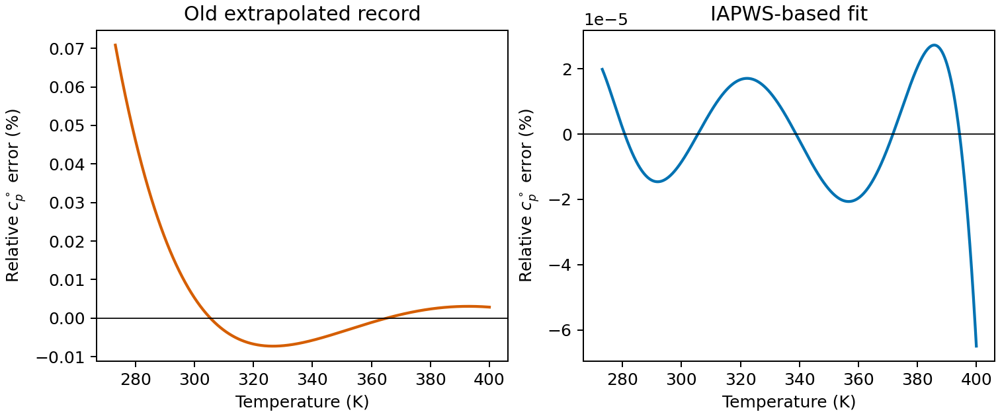
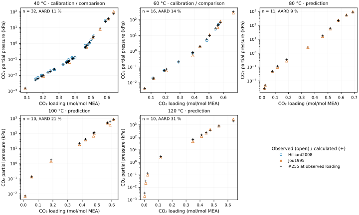
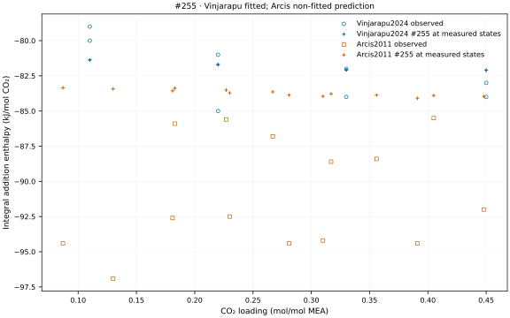
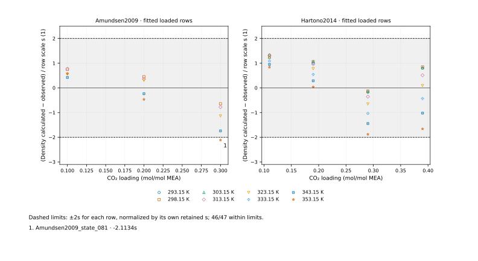
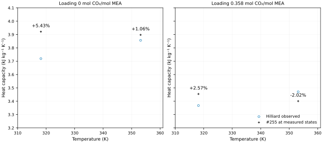
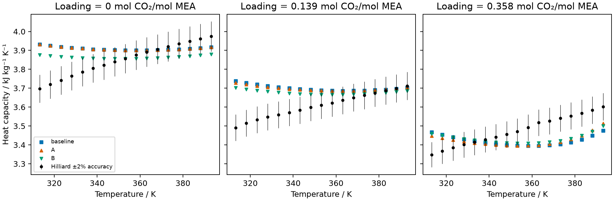

**MEA record adopted by the owner on 11 November 2026 under [#297](https://github.com/tannerpolley/Amine-Thermodynamics/issues/297): #255 wide-start primary, `f8f64820…`, Engine `391dfe5d…`. [Exact parameters](results/selected-current-best-parameters.json) · [adoption evidence and inventory](results/adoption-297/README.md).**

The record describes nine liquid species and reactions R1–R5 for aqueous MEA–water–CO₂ with the existing electrolyte PC-SAFT formulation. The owner selected the completed #255 candidate; adoption performs fixed-parameter evaluations only. Earlier A7, #212 and #215 results remain historical. MDEA fitting belongs to #298 and manuscript updates to #259. Delivered-result review and investigator promotion remain pending.

# Adopted record and result {#working-record}

The 307-row observation cost is **148.510545654**, compared with **148.883260440** for the outgoing record on identical current inputs and wheel. The largest replay difference against #255 is $2.102\times10^{-13}$ relative. All five pressure/species preservation rules and all four density/caloric rules pass. Loaded densities within twice row scale increase from 44/47 to 46/47. These row scales are not uniformly measurement uncertainties.

Fresh native Full searches resolve no descent at **1903 enforced, 576 offset and 162 census states**. All are available. The five originally excluded states also become available without descent. The census preserves the outgoing record's bubble-pressure references; the enforced/offset pressures use candidate-dependent bubble pressures. These finite searches do not certify global phase stability.

Six coordinates are on bounds: MEAH⁺–water interaction −0.5; bicarbonate–water +1; carbamate–MEAH⁺ −1; both Born diameters 5 Å; and R5 total enthalpy shift +10,000 J/mol. The MEAH⁺ segment diameter leaves the narrowed #170/#212 restriction, from 5.35 to about 4.905 Å. These are effective fitted values, not independently identified molecular properties. The candidate-local information calculation has ten free coordinates of numerical rank ten, with the standard errors and correlations retained in the adoption package. They condition on fixed inputs, weights, bounds and linearization and do not quantify uncertainty of the stability boundary.

Concentration transfer remains uneven: pressure average absolute relative deviation is 33.89% at 15 wt% and 44.53% at 45 wt%, against 29.49% and 56.04% for the outgoing record. The unloaded 318.15 K heat-capacity deviation remains +5.43%; the temperature slope is unresolved. The 353 K carbamate excess and carbonate share remain limitations. #284's decomposition concerns the outgoing record; its quadratic-law fits did not pass their required checks. #282's salt-anchored alternative and #283's temperature-dependent carbamate study remain bounded historical findings, not evidence of unique transferable ion parameters.

Fixed substitution of the new shared bicarbonate–water interaction and R2 law into the old MDEA-specific parameters worsens Xiao pressure deviations to 52.9%/58.6% and Ermatchkov to 52.5%/42.0%. These are #255 fixed-parameter comparisons, not new MDEA fits. #298 owns reconciliation. This adoption supplies numerical verification, calibration-quality comparison and fixed-parameter prediction; it supplies no new independent physical validation, parameter uniqueness, global constrained optimality or absorber/process qualification.

<!-- RESULTS:working-record:BEGIN -->

| Objective | Rows | Cost (dimensionless) |
| --- | --- | --- |
| #255 joint objective | 307 | 148.5105 |
| Common calibration subset | 149 | 23.7019 |

<!-- RESULTS:working-record:END -->

The [parameter-profile and source-block bootstrap study](parameter-identifiability/notebook.qmd) retains #262's sensitivity and conditional-uncertainty calculations for the outgoing #215 record. Its delivered result was reviewed Supported; it adopts no parameter vector.

The [current one-wheel evidence package](results/adoption-297/README.md) retains exact parameter and Engine identities, input hashes, adoption evidence and the displayed-input inventory. The figures show calibration and named comparison evidence.



## Water ideal-gas calorics {#water-ideal-gas}

The new water record replaces the extrapolated 500–1700 K Shomate function with a fit over 273.15–400 K to the ideal-gas part of [IAPWS R6-95(2018), equation 5 and table 1](https://iapws.org/documents/release/IAPWS-95.download) (Zotero `Y3FU9CXJ`). Its maximum relative heat-capacity error on 10,001 grid points is $6.50\times10^{-7}$, below the 0.001 limit. Maximum absolute errors relative to the transformed reference are $1.09\times10^{-4}$ J/mol in enthalpy and $3.35\times10^{-7}$ J/(mol K) in entropy. These are numerical fit errors, not physical uncertainty. The 501-point fit, verification grid, coefficients and replay are retained in [water-ideal-gas](water-ideal-gas/fit.json).

The reference transformation sets $h^\circ(298.15\,\mathrm K)=-241826$ J/mol, the existing record's formation-enthalpy convention, and $s^\circ(298.15\,\mathrm K)=188.834$ J/(mol K) at 0.1 MPa, from [NIST-JANAF H-064, 298.15 K row](https://janaf.nist.gov/tables/H-064.html) (Zotero `CWCVM9IE`). At other temperatures the reference adds the IAPWS ideal-gas heat-capacity integral, or its integral divided by temperature, to the respective anchor. The old Engine record evaluated to $-241825.473101$ J/mol and $188.835269$ J/(mol K) at the anchor, so the replacement changes those offsets as well as heat capacity.

Using the fixed parameter record `00e77608…` and pinned Engine `3e83e19c`, the maximum change in the four Hilliard predictions was 0.00190 J/(mol K), compared with their 1.59–1.76 J/(mol K) declared 2% scales. Across eight Vinjarapu and fourteen Arcis integral-heat predictions the largest difference was $8.45\times10^{-9}$ J/mol CO₂. The Kim finite-addition comparison produced 73 paired values with a maximum difference of $4.15\times10^{-11}$ kJ/mol CO₂; 13 points exceed the retained loading ceiling. The 313.15 K reference-caloric heat was 83.7170 kJ/mol CO₂ for both records at the reported precision. Individual results and statuses are in [comparison.json](water-ideal-gas/comparison.json).

Relative to the retained source heat uncertainties, the largest absolute change is $8.93\times10^{-12}$ of the reported uncertainty among the 22 Vinjarapu and Arcis observations. The largest change among the 73 admitted Kim intervals is $2.15\times10^{-11}$ of the source's ±2.2% molar-heat uncertainty. These effects are negligible compared with those uncertainties for these observations and conditions, and are at numerical precision. Arcis reports a statistical estimate with unspecified coverage and possible mixing bias; the 2% Hilliard and heat uncertainties are separate from any assigned fitting scales. The [row-level ratios](water-ideal-gas/uncertainty-comparison.json) retain the uncertainty basis and units.

At 313.15 K the isolated water ideal-enthalpy contribution to R1 and R2 changes by +1.0571 J/mol reaction, and that to R3, R4 and R5 by +0.52855 J/mol reaction, using the declared reaction directions. These are component contributions, not complete reaction enthalpies: the Engine's reaction-reference completion and other species also enter the full thermochemistry.

These are fixed-parameter comparisons, not an independent physical validation or a refit. Near-zero heat differences are at numerical precision and should not be interpreted as measured effects. The fitted water record is limited to 273.15–400 K; other temperatures require a separately supported correlation. Existing historical results retain their original inputs. The new input is intended for the subsequent stable refit; this calculation does not adopt new parameters.

# Parameters {#selected-parameters}

These tables read the [selected JSON](results/selected-current-best-parameters.json), [fit summary](results/adoption-297/paper-evidence/fit-summary.json), and [conditional uncertainty](results/adoption-297/paper-evidence/conditional-uncertainty.json). Parameter point estimates use about four significant figures; conditional standard errors use two. Hover over starred fitted estimates to see their full-precision values. Full precision remains in the linked JSON and CSV records. The [input hashes](figures/a7_regression_overview/output/parameter-table-inputs.json) identify the inputs.

[Green: a fixed charge or formulation definition]{.evidence-1} · [Blue: a numerical input with recorded qualifications]{.evidence-2}. [★](#fitted-coordinates){.fit-star} identifies fitted component or pair inputs and all 16 declared coordinates. Tied diameters and transformed chemistry are described explicitly. Green does not certify fitted properties.

<!-- CURRENT-PARAMETERS:BEGIN -->

## Species parameters {#species-parameters}

Lengths are Å; energy parameters are K. Association volumes, segment counts, permittivities and solvation factors are dimensionless. A dash means the input is absent, not a fitted zero.

::: {.parameter-table .species-table}
| Species | $m$ (1) | $\sigma$ (Å) | $\epsilon/k$ (K) | $\epsilon^{AB}/k$ (K) | $\kappa^{AB}$ (1) | Scheme |
| :-- | :-- | :-- | :-- | :-- | :-- | :-- |
| CO₂ | 2.073 | 2.785 | 169.2 | — | — | 2B |
| MEA | 3.035 | 3.043 | 277.2 | 2586 | 0.03631 | 2B |
| H₂O | 1.253 | water law | 432.4 | 1757 | 0.03762 | 2B |
| MEAH⁺ | 1.000 | 4.905[★](#fitted-coordinates){.fit-star} | 199.7[★](#fitted-coordinates){.fit-star} | — | — | — |
| MEACOO⁻ | 1.000 | 5.320[★](#fitted-coordinates){.fit-star} | 183.0[★](#fitted-coordinates){.fit-star} | — | — | — |
| HCO₃⁻ | 1.000 | 2.930 | 70.00 | — | — | — |
| CO₃²⁻ | 1.000 | 2.442 | 249.3 | — | — | — |
| H₃O⁺ | 1.000 | 3.465 | 500.0 | — | — | — |
| OH⁻ | 1.000 | 2.018 | 650.0 | — | — | — |
:::

### Electrostatic inputs

::: {.parameter-table .species-table}
| Species | $z$ (1) | $\epsilon_r$ (1) | $d_B$ (Å) | $f_{\mathrm{solv}}$ (1) |
| :-- | :-- | :-- | :-- | :-- |
| CO₂ | 0 | solvent law | — | 1.000 |
| MEA | 0 | solvent law | — | 1.000 |
| H₂O | 0 | solvent law | — | 1.500 |
| MEAH⁺ | 1.000 | 8.000 | 5.000[★](#fitted-coordinates){.fit-star} | 1.000 |
| MEACOO⁻ | −1.000 | 8.000 | 5.000[★](#fitted-coordinates){.fit-star} | 1.000 |
| HCO₃⁻ | −1.000 | 8.000 | 3.000 | 1.000 |
| CO₃²⁻ | −2.000 | 8.000 | 3.000 | 1.000 |
| H₃O⁺ | 1.000 | 8.000 | 1.218 | 1.000 |
| OH⁻ | −1.000 | 8.000 | 3.081 | 1.000 |
:::

CO₂ has induced 2B association with water and no self-association; its cross-association inputs are in `topology.edges` of the selected file. Ion association is absent.

::: {title="Exact water-diameter constant 2.78043261494 Å; full coefficients in the selected JSON"}

Water diameter (rounded display; use the selected JSON for numerical work), with $T$ in K and $\sigma$ in Å. The constant and amplitudes are in Å; exponent coefficients are in K⁻¹:

$$\sigma_{\mathrm{H_2O}}(T)=2.78+10.11 e^{-0.01775T}-1.417 e^{-0.01146T}$$

:::

The selected file uses solvent-density-temperature permittivity with the retained shared stage-5 water parameters. It excludes dispersion between ions with the same charge sign. For MEAH⁺ and MEACOO⁻, packing diameter is 0.88 times segment diameter and Debye–Hückel diameter equals segment diameter; Born diameters vary separately. No empirical density translation is applied. Fixed and transferred inputs carry their recorded qualifications; these tables confer no new physical validation.

## Permittivity inputs

Solvent-density-temperature inputs (retained shared stage 5):

::: {.parameter-table .summary-table}
| Component | Dielectric volume (L/mol) | Dielectric temperature (K) |
| :-- | :-- | :-- |
| CO₂ | 1.000e−08 | 1403 |
| MEA | 0.7310 | 1019 |
| H₂O | 0.3777 | 1403 |
:::

## Binary interactions

Symmetric dimensionless $k_{ij}$ at the reference temperature, upper triangle. A blue zero is a serialized fixed input, not a measured absence of interaction. Green exclusions state the selected formulation rule.

::: {.parameter-table .binary-interactions-table}
|  | CO₂ | MEA | H₂O | MEAH⁺ | MEACOO⁻ | HCO₃⁻ | CO₃²⁻ | H₃O⁺ | OH⁻ |
| :-- | :-- | :-- | :-- | :-- | :-- | :-- | :-- | :-- | :-- |
| CO₂ | — | 0 | −0.04642 | 0 | 0 | 0 | 0 | 0 | 0 |
| MEA |  | — | −0.08959[★](#fitted-coordinates){.fit-star} | 0 | 0 | 0 | 0 | 0 | 0 |
| H₂O |  |  | — | −0.5000[★](#fitted-coordinates){.fit-star} | −0.01300[★](#fitted-coordinates){.fit-star} | 1.000[★](#fitted-coordinates){.fit-star} | −0.2500 | 0.2500 | −0.2500 |
| MEAH⁺ |  |  |  | — | −1.000[★](#fitted-coordinates){.fit-star} | 0 | 0 | excluded | 0 |
| MEACOO⁻ |  |  |  |  | — | excluded | excluded | 0 | excluded |
| HCO₃⁻ |  |  |  |  |  | — | excluded | 0 | excluded |
| CO₃²⁻ |  |  |  |  |  |  | — | 0 | excluded |
| H₃O⁺ |  |  |  |  |  |  |  | — | 0 |
| OH⁻ |  |  |  |  |  |  |  |  | — |
:::

The stored temperature dependence is $k_{ij}(T)=k_{ij}(T_{\mathrm{ref}})+b(1/T-1/T_{\mathrm{ref}})$. The slope $b$ has units K.

::: {.parameter-table .summary-table}
| Pair | $b$ (K) | $T_{\mathrm{ref}}$ (K) |
| :-- | :-- | :-- |
| CO₂–MEA | 0 | 313.15 |
| CO₂–H₂O | −35.67 | 313.15 |
| MEA–H₂O | −7.668[★](#fitted-coordinates){.fit-star} | 313.15 |
| MEAH⁺–H₂O | −35.31[★](#fitted-coordinates){.fit-star} | 313.15 |
:::

## Fitted coordinates and conditional uncertainty {#fitted-coordinates}

::: {.parameter-table .summary-table}
| Coordinate | Current value | Unit | Conditional standard error (same unit) | Bounds (same unit) |
| :-- | :-- | :-- | :-- | :-- |
| MEACOO⁻–H₂O interaction | −0.01300[★](#fitted-coordinates){.fit-star} | 1 | 0.14 | Free; -0.5 to 0.5 |
| MEAH⁺–H₂O interaction | −0.5000[★](#fitted-coordinates){.fit-star} | 1 | — | On bound; -0.5 to 0.5 |
| HCO₃⁻–H₂O interaction | 1.000[★](#fitted-coordinates){.fit-star} | 1 | — | On bound; -0.5 to 1 |
| MEACOO⁻–MEAH⁺ interaction | −1.000[★](#fitted-coordinates){.fit-star} | 1 | — | On bound; -1 to 1 |
| MEAH⁺–H₂O reciprocal-temperature slope | −35.31[★](#fitted-coordinates){.fit-star} | kelvin | 65 | Free; -1000 to 1000 |
| MEAH⁺–segment diameter | 4.905[★](#fitted-coordinates){.fit-star} | Å | 1.1 | Free; 2 to 5.8 |
| MEACOO⁻–segment diameter | 5.320[★](#fitted-coordinates){.fit-star} | Å | 0.98 | Free; 2 to 5.8 |
| MEAH⁺–Born diameter | 5.000[★](#fitted-coordinates){.fit-star} | Å | — | On bound; 2 to 5 |
| MEACOO⁻–Born diameter | 5.000[★](#fitted-coordinates){.fit-star} | Å | — | On bound; 2 to 5 |
| R5 completed native b | −7584[★](#fitted-coordinates){.fit-star} | K | 2.7e+02 | Free; -8110.48 to -6728.93 |
| R2 total enthalpy shift | −620.8[★](#fitted-coordinates){.fit-star} | J/mol | 5.2e+03 | Free; -10000 to 10000 |
| R5 total enthalpy shift | 1.000e+04[★](#fitted-coordinates){.fit-star} | J/mol | — | On bound; -10000 to 10000 |
| MEA–H₂O interaction | −0.08959[★](#fitted-coordinates){.fit-star} | 1 | 0.0013 | Free; -0.5 to 0.5 |
| MEA–H₂O reciprocal-temperature slope | −7.668[★](#fitted-coordinates){.fit-star} | kelvin | 2 | Free; -1000 to 1000 |
| MEAH⁺–dispersion energy/k | 199.7[★](#fitted-coordinates){.fit-star} | kelvin | 51 | Free; 50 to 950 |
| MEACOO⁻–dispersion energy/k | 183.0[★](#fitted-coordinates){.fit-star} | kelvin | 36 | Free; 50 to 1000 |
:::

The ten free coordinates have numerical rank 10. The residual variance factor is 1 with 297 degrees of freedom. The R5 coordinate above is the completed native b coefficient (K), using the exact #255 chart; enthalpy shifts are totals. Errors condition on fixed inputs, residual weights, active bounds and linearization. They are not prediction intervals or uncertainty of the stability boundary.

## Reaction correlations

R2/R4/R5 below are generated from the current selected JSON. It does not serialize fixed R1/R3; those rows and the reaction equations come from the retained [chemistry declaration](https://github.com/tannerpolley/Amine-Thermodynamics/blob/30ce082/data/reference/MEA/manifests/chemical_reaction_source_contract.json), including its stored aqueous-molality offsets.

::: {.parameter-table .summary-table}
| Reaction | $A$ (1) | $B$ (K) | $C$ (1) | $D$ (K⁻¹) | $\Delta$ (1) | Input owner |
| :-- | :-- | :-- | :-- | :-- | :-- | :-- |
| R1 · 2 H₂O ⇌ H₃O⁺ + OH⁻ | 132.9 | −1.345e+04 | −22.48 | 0 | 8.033 | Fixed chemistry |
| R2 · CO₂ + 2 H₂O ⇌ HCO₃⁻ + H₃O⁺ | 235.2 | −1.202e+04 | −36.78 | 0 | — | Selected JSON |
| R3 · HCO₃⁻ + H₂O ⇌ CO₃²⁻ + H₃O⁺ | 216.0 | −1.243e+04 | −35.48 | 0 | 4.017 | Fixed chemistry |
| R4 · MEACOO⁻ + H₂O ⇌ HCO₃⁻ + MEA | 2.151 | −1545 | — | — | — | Selected JSON |
:::

R5 uses a base-10 logarithm and different coefficient units:

::: {.parameter-table .summary-table}
| Reaction | $A$ (K) | $B$ (1) | $C$ (K⁻¹) | Input owner |
| :-- | :-- | :-- | :-- | :-- |
| R5 · MEAH⁺ + H₂O ⇌ MEA + H₃O⁺ | 3294 | −1.281 | 0.0004277 | Selected JSON |
:::

For R1–R3, $\ln K=A+B/T+C\ln T+DT+\Delta$; R2 already includes the conversion in $A$ and has no separate offset. For R4, $\ln K=A+B/T$. For R5, $-\log_{10}K=A/T+B+CT$. The displayed layouts therefore give $B$ in K for R1–R4 and $A$ in K for R5; $D$ for R1–R3 and $C$ for R5 are in K⁻¹. Other coefficients are dimensionless. R2/R5 include the fitted pivot-preserving enthalpy shifts at 313.15 K; R5 also varies its unshifted source A. The displayed reaction coefficients include these transformations and are not independent fitted coordinates or new source measurements.

<!-- CURRENT-PARAMETERS:END -->

# Fitting plots

The notebook figures show observed values and model predictions at measured states, read from the current retained package. The five [model-curve families](results/adoption-297/paper-evidence/model-curves/summary.json) are separately retained: 874 states and 2211 quantity rows, with 31 reference comparisons and 150 midpoint checks passed. Same-record repeated calculations agree exactly. All states return values and required bubble pressures; this is numerical verification, not physical validation or a new fit. Thirteen species-grid or midpoint states and eight density-grid or midpoint states lie below their bubble pressure, so their imposed single-liquid calculations do not establish stable liquid behavior. #211 owns manuscript curve figures.

## CO₂ pressure {#pressure-and-speciation}

Pressures are plotted in kPa. [Figure data and provenance](figures/a7_regression_overview/output/provenance.json) bind the current reported record and package.

{#fig-pressure}

<!-- RESULTS:pressure:BEGIN -->

| Cohort / role | Evaluated / requested | AARD (%) | RMS ln(calc/obs) (1) |
| --- | --- | --- | --- |
| Hilliard 2008 + Jou 1995 comparison subset | 79 / 79 | 15.00 | 0.1870 |
| Fitted (common calibration subset) | 47 / 47 | 11.79 | 0.1494 |
| Hilliard 2008 | 31 / 31 | 9.06 | 0.1162 |
| Jou 1995 | 48 / 48 | 18.84 | 0.2209 |

These statistics cover 79 comparison points; 182 canonical and Wagner pressure measurements are retained in the package.

<!-- RESULTS:pressure:END -->

## Speciation

{#fig-speciation}

<!-- RESULTS:species:BEGIN -->

| Cohort / role | Evaluated / requested | AARD (%) | RMS ln(calc/obs) (1) |
| --- | --- | --- | --- |
| All shown (Böttinger 2008 + Matin 2012) | 131 / 131 | 16.23 | 0.5407 |
| Fitted, common calibration subset (94 targets) | 94 / 94 | 7.11 | 0.1013 |
| Fitted, including 7 restored targets (101 targets) | 101 / 101 | 7.24 | 0.1036 |
| Restored targets only (7) | 7 / 7 | 8.96 | 0.1311 |
| Böttinger 2008 | 55 / 55 | 5.58 | 0.0787 |
| Matin 2012 | 76 / 76 | 23.93 | 0.7067 |
| Matin HCO₃⁻ + CO₃²⁻ pool (report only) | 19 / 19 | 67.77 | 1.3966 |

<!-- RESULTS:species:END -->

The figure and table retain the historical mapping. For the 19 Matin report-only comparisons, consistently summing bicarbonate and carbonate changes AARD from 67.4563% to 67.4145%; see the [corrected pooling reconciliation](#bicarbonate-carbonate-266). The common calibration subset contains 94 species targets; seven restored fitted targets are reported separately. The 19 minor-species comparisons overlap the displayed population. See the [exact row membership and diagnostics](joint-recalibration/index.qmd).

## Integral heat of absorption {#heat-of-absorption}

The [22 retained heat rows](results/adoption-297/paper-evidence/heat.csv) comprise the fitted and non-fitted comparisons below. Eight Vinjarapu rows at 313.15 K and 1.734 MPa enter the objective; 14 Arcis rows at 322.5 K are non-fitted predictions at their source pressures. Heat is the integral finite-addition enthalpy from zero carbon. Negative heat denotes exothermic absorption.

{#fig-heat}

Root-mean-square error (RMSE) and calculated-minus-observed bias are in kJ/mol CO₂.

<!-- RESULTS:heat:BEGIN -->

| Source / role | n | RMSE (kJ/mol CO₂) | Bias (kJ/mol CO₂) |
| --- | --- | --- | --- |
| Vinjarapu2024 · fitted | 8 | 1.84 | +0.439 |
| Arcis2011 · non-fitted prediction | 14 | 8.09 | +7.16 |

<!-- RESULTS:heat:END -->

The [adopted-record Kim temperature comparison](results/adoption-297/paper-evidence/kim2007-heat-pathways/summary.json) adds finite-interval, integral and pathway-fraction results at 313.15–393.15 K. Its run-pair comparisons do not establish a common experimental crossover; the current parameter predictions and source exceptions are reported separately from the historical model-D assessment.

## Density {#density-and-heat-capacity}

The [210 retained densities](results/adoption-297/paper-evidence/density.csv) are native equation-of-state predictions, with no empirical volume translation. The objective contains 47 loaded and five CO₂-free densities. Source pressures remain the retained assumptions, including 0.100 MPa where unreported. The other retained rows preserve their non-fitted roles and exclusions.

The [150 density curve states](results/adoption-297/paper-evidence/model-curves/density.csv) retain imposed pressure, bubble pressure and every numerical check. The current density error figure below reads the point predictions.

{#fig-density}

<!-- RESULTS:density:BEGIN -->

| Fitted cohort | Evaluated / requested | Within limit | Max \|error\|/s (1) | RMSE (kg/m³) | AARD (%) |
| --- | --- | --- | --- | --- | --- |
| Amundsen fitted 15 | 15 / 15 | 14 / 15 | 2.11 | 2.138 | 0.16 |
| Hartono fitted 32 | 32 / 32 | 32 / 32 | 1.88 | 1.913 | 0.16 |
| Amundsen, CO₂-free (5 rows) | 5 / 5 | 5 / 5 | 1.13 | 0.346 | 0.03 |

Loaded rows use their row-specific $2s$ limits; the CO₂-free five use 1.0 kg/m³.

| Source (all retained states; overlaps fitted rows) | n | RMSE (kg/m³) | AARD (%) |
| --- | --- | --- | --- |
| Amundsen2009 | 103 | 5.629 | 0.34 |
| Hartono2014 | 40 | 2.218 | 0.18 |
| Han2012 | 67 | 5.232 | 0.37 |

<!-- RESULTS:density:END -->

Three fitted loaded densities at 353.15 K fall outside their $2s$ limits (−2.28$s$, −2.06$s$, −2.43$s$). These three rows are underpredicted by 4.2–5.5 kg/m³ (0.40–0.53%). The source-uncertainty discussion and the five excluded Amundsen rows are on the [A7 page](joint-recalibration/index.qmd).

### Higher-temperature density probes (issue 268)

Measured loaded densities above 353.15 K exist, and 20 such Han cells were
already retained in this repository. Han et al. (2012), DOI
[10.1021/je2010038](https://doi.org/10.1021/je2010038), Tables 3–4
(pp.1097–1098), report loaded densities through 413.15 K and unloaded densities
through 423.15 K. The present model comparison stops at its declared 393.15 K
limit. Its retained Han subset contains 50 loaded and 17 unloaded cells at
30 mass % MEA on the CO₂-free solvent basis. Above 353.15 K there are 20 loaded
cells at analytical loadings 0.10, 0.21, 0.32, 0.44 and 0.56 mol CO₂/mol MEA,
and five unloaded cells. The recorded pressures are 0.1 MPa through 363.15 K
and 0.7 MPa from 373.15 K. Han's uncertainty discussion (pp.1101–1102) gives
combined loaded-density uncertainty 1.3 kg/m³ and expanded uncertainty
2.6 kg/m³ at 95% confidence. Unloaded expanded uncertainties are 0.68 and
0.70 kg/m³ below and at/above 373.15 K, respectively.

The comparison adds 24 source-checked unloaded cells from Sobrino et al.
(2016), DOI [10.1016/j.jct.2016.03.021](https://doi.org/10.1016/j.jct.2016.03.021),
Table 6 (pp.235–236): 293.15–393.15 K at 0.1 MPa and printed MEA mass fractions
0.1001, 0.2000, 0.3005 and 0.4000. Its standard density uncertainty is
0.35 kg/m³; Section 2.1 gives expanded uncertainty below 0.7 kg/m³ with
coverage factor 2. The comparison uses 0.70 kg/m³ as that reported upper
limit. The [source record](https://github.com/tannerpolley/Amine-Thermodynamics/blob/889ba3e03284442a25d8f1cd40ae6fc475758bf8/data/reference/MEA/observations/density_viscosity/README.md)
retains the table checks, composition/pressure conventions, Zotero identities
and PDF hashes. These cells have no fitting role. The 234 density comparisons
combine these cells with the previous 210, counting each source cell once.

These are homogeneous-liquid equation-of-state predictions and local
calibration probes, with no volume translation. Source expanded uncertainties
and the original 47 fitted-density residual scales remain distinct. The
existing Han assessment-only adoption is preserved. The two exploratory fits
add only the 25 higher-temperature Han cells to the unchanged 307-row
objective, using combined uncertainty as the residual scale and weights 1/20
for the 20 loaded cells and 1/5 for the five unloaded cells. These group weights
are study choices, not weights prescribed by Han. Neither fit adopts a new
parameter record or supplies an untouched prediction assessment.

The original 16-coordinate declarations retain their historical physical
bounds and size ties. Incremental reaction-enthalpy bounds are translated to
each start's inherited laws, without applying the inherited shifts twice.
The 600 s native fit limit, 180-iteration limit and original stopping tolerances
are retained. The final-start and wider-bound-start fits both converge, but
convergence is conditional on these bounds and stopping criteria; it is not
a global minimum or parameter-identifiability claim.

| Parameter vector | Original 307-row cost | Augmented 332-row cost | Original loaded rows within 2s / 47 | Higher-temperature Han loaded rows within 2.6 kg/m³ / 20 | Han unloaded rows within source expanded uncertainty / 5 |
| --- | ---: | ---: | ---: | ---: | ---: |
| Final starting set | 148.878939 | 186.414243 | 44 | 2 | 2 |
| Wider-bound starting set | 148.211508 | 168.959948 | 47 | 3 | 2 |
| Probe from final | 153.428254 | 164.095429 | 17 | 13 | 2 |
| Probe from wider-bound | 151.067550 | 162.701482 | 34 | 10 | 2 |

The final-start probe changes the higher-temperature loaded errors from
−20.01 to −2.37 kg/m³ to −8.05 to +4.01 kg/m³. The wider-bound-start probe
has errors −6.75 to +7.94 kg/m³ there. Both improve the added loaded-density
objective while losing fitted-density agreement; neither meets the issue's
simultaneous density requirements. These observations do not establish
nonexistence of a feasible vector elsewhere in the permitted coordinates.

The prescribed Engine wheel first reproduced the endpoint and then refused
the mixed-temperature-domain R5 chart, as recorded in
[the original-wheel refusal](results/density-268/original-wheel-final/chart-refusal.json).
The owner authorized merged Engine e6dae5c7 only in this worktree, SHA-256
`83ede7d2722d3581603f6e4139c614b8bbfc903ce90609c90b802d46eea77dd6`.
The complete final 307-row replay has maximum relative prediction difference
6.96 × 10⁻¹³ from the retained endpoint. Both endpoint replays agree with their
native fit predictions within 1.1 × 10⁻¹² using the recorded scaled comparison.
Every new numerical result records the executing wheel SHA; reused #255
results retain their original wheel identity.

[Retained study results](results/density-268/README.md) include all row predictions,
start declarations, native fit reports, endpoint replays and source identities.
The independent readiness review returned **Ready** after the reaction-bound
and water-diameter declarations were corrected. Both new endpoints complete
all 162 retained physical states, with nine stability trials per state, zero
detected descent states and zero incomplete states. This is a finite search
for additional descent from the admitted liquid–vapor parent, not proof of
global phase stability. The grid retains 313.15, 318.15, 333.15, 353.15,
373.15 and 393.15 K, analytical loadings 10⁻⁵–0.6 mol CO₂/mol MEA at 30 mass %
MEA, and pressures equal to 0.50, 0.80 and 0.95 of the retained final-set
bubble pressures. Actual temperatures, feeds and pressures are preserved in
each compressed phase result. The new wider-bound-start endpoint has MEAH⁺
segment diameter 5.10278 Å, below 5.35 Å, and still has no detected descent on
this grid. That observation does not establish a continuous stability interval.

The [sensitivity reduction](results/density-268/sensitivity-summary.json)
compares full and half centered steps separately for each coordinate. For the
final set, increasing the constant coefficient in water's temperature-dependent
segment diameter by 0.1% (0.00278043 Å), with its exponential terms fixed,
lowers the mean higher-temperature Han density by 2.05863 kg/m³ for unloaded
rows and 2.13981 kg/m³ for loaded rows. Its maximum full-versus-half-step
derivative difference on those unloaded rows is 0.00039001 kg/(m³ Å),
compared with a mean derivative of −740.3976 kg/(m³ Å). This is local numerical
step verification. It does not assign uncertainty to water parameters.
The direction improves the positive unloaded errors while worsening negative
loaded errors. Increasing MEAH⁺ dispersion energy by 0.1% instead changes
the mean loaded density by +0.01706 kg/m³ and has an unloaded response below
0.00002 kg/m³ in magnitude. These different responses support treating neutral
packing and the reactive ionic volume response separately; they do not
identify unique single-ion volumes or statistically rank uncertain parameters.
The full file also retains MEA/water segment-count, MEA diameter,
MEA/water dispersion and MEA–water constant/slope sensitivities at both starts.
The MEAH⁺ one-segment convention remains fixed.

The [five extensions of retained #255 vectors](results/density-268/README.md#retained-255-vectors)
calculate only the missing higher-temperature Han densities. Their original
307-row scores and phase searches are reused, not repeated. Setting the final
MEAH⁺ diameter alone to the wider-bound value overshoots all 20 loaded Han
higher-temperature densities by 12.33–106.32 kg/m³; its retained fitted-density
count is 0/47. Increasing the wider-bound diameter alone to 5.35 Å
underpredicts those 20 by 19.46–93.09 kg/m³ and retains 0/47 fitted density
checks plus 24/32 detected descent states. The retained wider-bound
MEAH⁺–water constant −0.175 vector has 40/47 fitted density checks and a
complete 162-state search without descent; only 8/20 of its newly evaluated
higher-temperature loaded Han densities meet 2.6 kg/m³. The tested Born and
ion-pair moves preserve 47/47 fitted density checks but retain descent and
meet only 4/20 of the new Han checks each. The original phase results use
wheel `0d08dff9…`; these additional density predictions use the qualified
`83ede7d2…` wheel and are labelled separately.

For **#255 stage 2**, retain the current parameter adoption and use this work
as evidence for a joint density/phase fit. Keep the original 47-row requirements
and higher-temperature Han residuals visible as separate conditions; a lower
averaged objective alone hides their tradeoff. Preserve the source campaigns
and reported pressures, and keep Sobrino as an unloaded assessment series.
Use the MEAH⁺ size, dispersion and water-interaction law together rather than
changing size alone or treating 5.35 Å as an experimentally established bound.
Check neutral packing against unloaded/pure-component evidence before freeing
it to repair loaded densities: the tested water-diameter direction moves both
cohorts together despite their opposing errors. Any change to persistent Han
roles, fit weights, physical bounds or model form belongs to the stage-2 design.
Neither probe supplies a replacement parameter set. The supported conclusion
is a density conflict among the tested bounded fits with no detected descent,
not nonexistence across all admissible coordinates. Source correlations,
active parameter bounds, finite phase searches and the 393.15 K cutoff limit
transfer to absorber or other process conditions. These are calibration and
numerical-verification results, not physical validation. Independent delivered
review returned **Supported** for this bounded study and the recommendation to
#255 stage 2. No manuscript promotion is implied.

## MEA–water

The neutral MEA–water binary (no reactions) gives bubble temperature and incipient vapor composition at the two Cai isobars over each isobar’s measured liquid range.

The [70 MEA–water curve states](results/adoption-297/paper-evidence/model-curves/mea-water.csv) retain bubble temperature and vapor water mole fraction; the [fitted rows](results/adoption-297/paper-evidence/fitted-rows.csv) retain all 50 Cai measurement comparisons.

## Heat capacity

The four [Hilliard Cp rows](results/adoption-297/paper-evidence/cp.csv) enter the objective at 7 mol MEA/kg water, 101325 Pa, with the declared $10^{-6}$ unloaded CO₂ proxy.

{#fig-cp}

<!-- RESULTS:heat-capacity:BEGIN -->

| Temperature (K) | Nominal loading (mol/mol MEA) | Cp (kJ/(kg·K)) | Observed Cp (kJ/(kg·K)) | Deviation (%) | Within 3% |
| --- | --- | --- | --- | --- | --- |
| 318.15 | 0.0 | 3.9214 | 3.7195 | +5.43 | No |
| 318.15 | 0.358 | 3.4542 | 3.3675 | +2.57 | Yes |
| 353.15 | 0.0 | 3.8976 | 3.8566 | +1.06 | Yes |
| 353.15 | 0.358 | 3.4007 | 3.4707 | -2.02 | Yes |

1 of 4 states exceed the 3% comparison limit.

<!-- RESULTS:heat-capacity:END -->

# Broader MEA heat-capacity comparison {#broader-mea-heat-capacity-comparison}

The following #264 campaign is historical and retains its outgoing-record baseline. #297 reevaluates the fixed adopted candidate on these 60 rows without repeating the probes; see [current predictions and group scores](results/adoption-297/paper-evidence/heat-capacity-264.json).

Broader heat-capacity calibration did not remove the unloaded 318.15 K discrepancy in these two bounded probes. With the corrected water ideal-gas record, the baseline error is +5.532%; probe A gives +5.531% and probe B +4.087%, compared with Hilliard's stated ±2% accuracy. Both probes converge, but fail the agreed density-preservation limits and develop dense-liquid descent. They are diagnostic endpoints and are not recommended for adoption. This result means **not removed by these tested probes**; it does not establish structural impossibility.

## Measurements and intended comparison

[Source rows](heat-capacity-264/sources.csv) and [live PDF identities/hashes](heat-capacity-264/source-provenance.json) retain 68 Hilliard measurements, six selected Weiland values and three selected Concepción values. Hilliard (2008), Appendix G.2 p.937/PDF994, provides 17 temperatures from 313.15 to 393.15 K at each of loadings 0, 0.139, 0.358 and 0.541 mol CO₂/mol MEA, with 7 mol MEA/kg water. The first three series supply 51 probe-fit observations; the 17 at 0.541 are outside this issue's loading domain. The four historical fitted observations are part of these 51, and are replaced rather than duplicated. Weiland et al. (1997), Table 3 p.1004, supplies six independent comparison rows at 298.15 K, 30 wt% unloaded analytical MEA, and loadings 0–0.5. Concepción et al. (2023), Table 3 p.3, supplies three independent unloaded comparisons at 313.15, 333.15 and 353.15 K, MEA mass fraction 0.2997 and 0.100 MPa. These sources cover selected states, not the entire temperature–loading rectangle.

Hilliard §§4.5–4.6, pp.71–78, describes sealed pans and a temperature ramp; experimental sample pressure is not reported. The assigned 101325 Pa calculation pressure is an assumption. The falsifier and phase searches are conditional on that prescribed model state, and gas descent does not establish instability in the sealed experiment. Total loaded-solution mass is used for all heat capacities. Nominally unloaded calculations retain the historical 10⁻⁶ mol CO₂/mol MEA trace feed.

Hilliard §4.6 pp.78–80 states ±2% accuracy and ±1% reproducibility; neither is identified as a standard uncertainty. The 2% residual scale continues the existing policy. Weiland's experimental section states ±1% repeatability and agreement with standards; this is a comparison band, not a statistical confidence interval. Concepción Table 3 gives 1% expanded uncertainty with coverage factor 2, corresponding to a 0.5% standard residual scale. [Nearby-composition unloaded source comparisons](heat-capacity-264/unloaded-source-comparison.csv) show Concepción above Hilliard by 4.712%, 4.511% and 4.755% at the three common temperatures. Their slightly different MEA concentrations and the unknown Hilliard pressure prevent treating this as a same-state replication, but the difference exceeds the sum of their stated 2% and 1% bands. Source agreement cannot be assumed.

Zhang, Que and Chen (2011), Table 3 p.68, gives the Aspen MEA ideal-gas polynomial over 283–1000 K, without uncertainty. The retained coefficients are translated to the existing 313.15 K-centered `IdealPolynomial` representation; the polynomial was checked against the source, not refitted here. Their §§3.1–3.3 and Tables 7 and 10 describe fitting binary and ternary caloric data with aqueous electrolyte NRTL and PC-SAFT vapor/pure-fluid properties. Baygi and Pahlavanzadeh (2015), §§3.1–3.3 and Tables 2–5, instead fits saturation/binary VLE and compares ternary pressures. Neither paper's use of a model establishes independent heat-capacity validation for these probes.

## What carries the calculated heat capacity

[Baseline decomposition](heat-capacity-264/decomposition.json) and [probe A](heat-capacity-264/probe-A-decomposition.json) / [probe B](heat-capacity-264/probe-B-decomposition.json) retain all 60 states. Frozen-composition heat capacity comes from the Engine's reference-completed `solved_state_actions` phase property. It includes the ionic caloric reference completion; a homogeneous-state total without that completion would mislabel the reaction remainder. Frozen molar quantities are multiplied by solved phase amount/feed mass, while the equilibrium observable is multiplied by feed amount/feed mass. Both are then expressed in kJ/(kg loaded solution K).

Residual constant-volume contributions use the existing MDEA diagnostic relation, $C_{v,r,t}=-R(2T a_{t,T}+T^2a_{t,TT})$, where $a_t$ is the Engine's dimensionless residual Helmholtz contribution at fixed density and composition. This is a diagnostic derivative of Engine values, not a second equation-of-state implementation. The residual pressure–volume coupling is $C_{p,r}-C_{v,r}$. Neutral ideal terms, completed source-reference calorics, residual contributions and reaction equilibration are reported separately.

At unloaded 318.15 K, the decomposition is:

| Contribution / kJ kg⁻¹ K⁻¹ | Baseline | A | B |
|---|---:|---:|---:|
| Neutral MEA ideal | 0.433651 | 0.433652 | 0.433661 |
| Water ideal | 1.309716 | 1.309717 | 1.309720 |
| Completed source reference | 0.000123 | 0.000123 | 0.000518 |
| Hard-chain residual Cv | -1.305965 | -1.305939 | -1.305268 |
| Dispersion residual Cv | 2.186993 | 2.186919 | 2.137581 |
| Association residual Cv | 1.261778 | 1.261782 | 1.261876 |
| Debye–Hückel + Born residual Cv | -0.000047 | -0.000047 | -0.000045 |
| Pressure–volume coupling minus R | 0.039012 | 0.039026 | 0.033414 |
| Reaction equilibration | 0.000008 | 0.000000 | 0.000056 |
| Equilibrium total | 3.925270 | 3.925233 | 3.871513 |

The water change raises the original unloaded 318.15 K prediction by only about 0.000083 kJ kg⁻¹ K⁻¹. The reaction remainder is also too small to account for the 0.205770 kJ kg⁻¹ K⁻¹ baseline difference. Probe B reduces the total by 0.053757 kJ kg⁻¹ K⁻¹, carried mainly by dispersion (−0.049412) and coupling (−0.005598); other terms partially offset that change. This locates the response to the tested residual interaction change, not a unique experimental error in one EOS term. Explaining the entire baseline difference by a uniform MEA caloric-reference shift would require approximately −41.964 J/(mol analytical MEA K); no source uncertainty or independent ideal-gas measurement here authorizes that correction. Loaded states have substantial completed-reference and reaction contributions and cannot be interpreted using the unloaded balance alone.

At 0.05 and 0.025 K derivative steps, the maximum residual-Cv closure discrepancy across all three endpoints and 60 states is 4.61×10⁻⁵ J mol⁻¹ K⁻¹; the maximum term change on halving the step is 2.99×10⁻⁵ J mol⁻¹ K⁻¹. Closure passes the declared 10⁻⁴ relative plus 10⁻⁴ J mol⁻¹ K⁻¹ absolute criterion. This is numerical verification of the decomposition, not physical validation.

## Broader fits and other-property consequences

Probe A uses the existing 14 coordinates and bounds. Probe B adds MEA–water interaction intercept and reciprocal-temperature slope, bounded ±0.05 and ±100 K about the endpoint. Both start from the selected parameter set and accepted reaction laws, keep ideal-gas calorics fixed, and replace the four Cp rows with the 51-row set. The objective therefore contains 354 observations. The 22 existing integral heats are comparison controls; they are not inserted into this objective. Both runs use the declared 60-iteration/1200-second limits and native tolerances. A converges in 31 iterations and B in 35, each with zero native trial failures. Independent endpoint replay agrees with native weighted residuals within 10⁻⁶.

{#fig-heat-capacity-264}

| Heat-capacity set | Rows | Baseline AARD / % | A / % | B / % |
|---|---:|---:|---:|---:|
| broad Cp | 51 | 2.443 | 2.314 | 2.058 |
| Weiland1997 comparison | 6 | 3.321 | 2.876 | 2.374 |
| Concepcion2023 comparison | 3 | 2.073 | 2.072 | 2.386 |

[Temperature, loading and source bins](heat-capacity-264/cp-by-temperature-loading-source.csv) include separate Hilliard-fit and all-source subsets, with AARD and RMSE in kJ kg⁻¹ K⁻¹. [Exact figure values](heat-capacity-264/plotted-values.csv) retain all 180 endpoint-state comparisons.

Every group’s weighted cost and share of the 354-row fit objective is:

| Group | A cost | A share / % | B cost | B share / % |
|---|---:|---:|---:|---:|
| common149 | 27.7412 | 13.87 | 26.8430 | 13.96 |
| restored species | 2.6468 | 1.32 | 2.5171 | 1.31 |
| Jakobsen | 12.0297 | 6.01 | 12.1167 | 6.30 |
| Kiepe | 0.0007 | 0.00 | 0.0007 | 0.00 |
| CO2-free density | 11.5632 | 5.78 | 17.8726 | 9.29 |
| Cai | 91.8746 | 45.92 | 92.2836 | 47.98 |
| loaded density | 0.8212 | 0.41 | 0.6805 | 0.35 |
| broad Cp | 53.3950 | 26.69 | 40.0047 | 20.80 |
| Total | 200.0723 | 100 | 192.3189 | 100 |

[Full group metrics and control cost shares](heat-capacity-264/group-costs.csv) also report the original 307 rows plus 22 integral-heat controls. Cost shares depend on residual scales and are not independent information fractions. Cai combines temperature and vapor composition, so its RMSE is separated by quantity in the replay records.

All pressure/species groups remain within the allowed +2 percentage-point AARD increase. A raises loaded-density AARD by 12.20% and RMSE by 19.72%, but loses three previously within-2-scale observations. B loses two loaded-density observations and raises unloaded-density AARD by 30.38%, exceeding the 25% limit even though its absolute AARD remains small (0.03648%). Integral-heat AARD improves from 5.611% to 4.887% (A) and 5.255% (B); neither loses a previously within-2-scale heat observation. Original four-point Cp AARD also improves and loses no within-scale observation. Thus neither endpoint satisfies all deterioration limits.

| Phase-search outcome (60 states per endpoint) | Baseline | A | B |
|---|---:|---:|---:|
| States with dense-liquid descent | 0 | 15 | 11 |
| States with gas descent | 13 | 13 | 13 |
| Unresolved searches | 0 | 0 | 0 |

[Baseline](heat-capacity-264/baseline-stability.json), [A](heat-capacity-264/probe-A-stability.json) and [B](heat-capacity-264/probe-B-stability.json) retain the complete native search evidence. Dense descent prevents a stable-liquid interpretation of the affected probe states; gas descent is distinct and conditional on the prescribed pressure. Prediction availability alone is not a stability certificate.

## Recommendation for issue 255 stage 2

Retain all 51 in-domain Hilliard values as one source campaign for broader caloric calibration, with their pressure assumption and method accuracy explicit; do not present the 17 temperatures as independent campaigns. Keep the six Weiland and three Concepción rows as independent comparison campaigns at this selection stage, retaining the unloaded-source disagreement. Exclude the 0.541-loading Hilliard series from this issue's 0–0.5 domain. Any stage-2 expansion of those roles must preserve source bases and phase requirements.

Do not adopt A or B: both violate density preservation and develop dense-liquid descent. Neither removes the unloaded 318.15 K error below the source accuracy. The residual dispersion/coupling response explains the change achieved by B, while source disagreement and unquantified MEA ideal-reference uncertainty prevent a unique causal attribution. These are local calibration probes and conditional numerical comparisons with measured data; they do not demonstrate independent predictive validity, global non-identifiability, structural impossibility, or physical validation. Parameter adoption remains with issue 255, and this notebook has not been promoted for manuscript use.

The merged e6dae5c7 wheel has SHA-256 `83ede7d2722d3581603f6e4139c614b8bbfc903ce90609c90b802d46eea77dd6`; every numerical JSON records it. [Qualification](heat-capacity-264/qualification.json) replays all 307 original observations using their pre-260 water inputs, within relative 10⁻⁸ plus absolute 10⁻⁸ in predicted/residual units; all pass, with objective cost 148.878939345564. Subsequent calculations use the corrected water record. The main checkout's pin is unchanged. [Reproduction and record map](heat-capacity-264/README.md) and [provenance](heat-capacity-264/provenance.json) identify inputs and execution. Delivered-result acceptance requires an independent Supported verdict; the review verdict is recorded with issue 264 and its pull request.

# Stability-constrained refit (issue 255) {#stable-refit-255}

This is the retained #255 study on its original wheel. Its selected primary became the repository record under #297 above; the study and its alternatives were not rerun.

A refit that enforces liquid-phase stability during fitting, inside the original wide bounds, finds one stable optimum from both the final set and the wider-bound fit. It has a lower calibration cost than the final set: **148.5105** against **148.8833** for the 307 objective rows, with both on the same inputs and Engine wheel. It is a candidate only. The adopted record, Engine pin and manuscript are unchanged. MDEA shares its bicarbonate–water interaction and its R2 law; transferring both roughly doubles the MDEA pressure error, so adoption needs an owner decision.

## What was enforced

Each stability row is the Engine #1059 requirement: a Full tangent-plane search of an all-liquid parent at a pressure $c$ times the candidate's own reactive bubble pressure ($c = 1.05$ and $3.0$). It penalizes the most negative resolved reduced tangent-plane distance $\tau$. The fit enforces 1903 such states: 15, 25, 35 and 45 wt% MEA, 313.15–393.15 K, loadings $10^{-5}$ and 0.025–0.6 mol CO₂/mol MEA, plus the stage-1 census nodes. A further 576 offset states and the stage-1 162-state liquid + vapor census never enter the fit and are checked at each endpoint. The design and its qualification are in the [results README](results/stable-refit-255/README.md) and the [accepted design](results/stable-refit-255/design-probe/design.md). On the new wheel, the final set has 0 descent states and the wider-bound fit has 1207 of 1908, plus 54 of the 162 census states.

| Run | 307-row cost | Descent (enforced / offset / census) | Acceptance |
|---|---:|---|---|
| final set (reference) | 148.8833 | 0 / 0 / 0 | — |
| start from final set | 148.5106 | 0 / 0 / 0 | pass |
| **start from wider-bound fit (selected)** | **148.5105** | 0 / 0 / 0 | pass |
| (a) R2 enthalpy shift held (#262) | 148.5210 | 0 / 0 / 0 | pass |
| (b) adds R4 shift and 10 Böttinger 353 K rows (#263) | 148.2631 | 0 / 0 / 0 | pass |
| (c) #261 pressure data roles (sensitivity) | 148.6884 | 0 / 0 / 0 | pass |

The two starts agree within 0.023 optimizer scales on every coordinate, so stability alone does not return the fit to the final set. The selected endpoint moves the MEAH⁺ segment diameter from the narrowed 5.35 Å bound to 4.905 Å and the carbamate diameter from 4.866 to 5.32 Å. The bicarbonate–water interaction moves from 0.727 to its upper bound of 1.0. Six coordinates end on bounds. Against the final set, the largest pressure or species rise is +0.012 AARD points (fitted phase mole fractions). Loaded densities within twice their scale rise from 44 to 46 of 47. Heat of absorption and heat capacity keep their within-2s counts, with AARD and RMSE ratios between 0.97 and 1.02 ([assessment](results/stable-refit-255/wide/assessment.json)).

## What the candidate changes downstream

{#fig-stable-refit-255}

The producers listed in the [results README](results/stable-refit-255/README.md#downstream-rerun-on-the-primary-candidate-candidate-evidence) were rerun for both records on the same wheel: the paper's pressure, species and caloric tables and curves, and the notebook's density, heat-capacity, Kim 2007 and MDEA studies. At completion of #255, conditional uncertainty, the phase-family export and `generate_figure_data.py` were deferred to adoption. #297 now supplies the candidate-local conditional calculation, fresh census export and normal figure-command output in its retained package. The final-set rerun reproduces its retained values (state targets within $10^{-12}$; the 4 Cp rows within $2.2\times10^{-5}$, the #260 water record). The [345 same-input differences](results/stable-refit-255/evidence/comparison.csv) include:

| Quantity | Final set | Candidate |
|---|---:|---:|
| canonical pressures (159), AARD | 20.55 % | 20.27 % |
| 15 / 45 wt% transfer, mean ln(calc/obs) | −0.205 / +0.149 | −0.002 / −0.051 |
| 15 / 45 wt% transfer, AARD | 29.5 / 56.0 % | 33.9 / 44.5 % |
| Han loaded density above 353 K, mean error | −8.84 kg/m³ | −6.02 kg/m³ |
| Han loaded density to 353 K, mean error; RMSE | −2.70; 3.23 kg/m³ | −0.26; 5.15 kg/m³ |
| Han loaded density at α = 0.56 | −4 to +2 kg/m³ | +7 to +12 kg/m³ |
| CO₂-free Hilliard Cp at 318.15 K | +5.53 % | +5.43 % |
| carbonate share, mean calc/obs | 0.073 | 0.021 |
| Kim 2007 semi-differential heat, RMSE | 6.12 kJ/mol | 6.30 kJ/mol |
| largest Böttinger 353 K carbamate excess | 26.3 % | 25.9 % (variant b: 24.9 %) |
| MDEA Xiao / Ermatchkov pressure AARD, A3 (candidate k and R2) | 20.4 / 26.2 % | 52.9 / 52.5 % |
| MDEA Xiao / Ermatchkov pressure AARD, B1 (candidate k and R2) | 28.3 / 19.1 % | 58.6 / 42.0 % |

MDEA shares the bicarbonate–water interaction through its parameter documents and the R2 law through its frozen reaction reference, which equals the final set's law. The MDEA rows substitute both; substituting the interaction alone gives almost the same errors (A3: 53.2 / 51.1 %), so the interaction carries the change. The MDEA heat at 333.15 K, 60 wt% and 1.121 MPa for B1 stays unavailable under Engine #1073.

## Meaning and limits

From the final set the requirement was not binding: that fit ends with stability cost 0 and records no resolved descent along its path, so the narrowed #170/#212 bounds, not stability, held its cost (the MEAH⁺ diameter sat at its 5.35 Å bound). From the wider-bound fit (148.2156, 1207 descent states) the penalty moved the fit to the same stable optimum; relative to that unstable optimum, stability costs +0.295. A stable, lower-cost fit therefore exists inside the wide bounds. The cost gain is small (0.25 %). The concentration-transfer bias is reduced, but the transfer AARD, the 353 K carbamate excess, the 318 K heat-capacity offset and the carbonate share remain. The selected endpoint pushes the shared bicarbonate–water interaction to its bound, which harms MDEA and pushes the carbonate share further low.

This is calibration and numerical verification:
- The stability search is finite at declared states; it is not a global certificate.
- The endpoints are local optima with six coordinates on bounds.
- The acceptance rules are repository policy.

This section has not been independently reviewed or promoted for the manuscript route.

# Salt-anchored bicarbonate and carbonate interactions (issue 282) {#carbonate-ions-282}

Issue #282 tests one hypothesis: the fitted bicarbonate–water interaction (0.727 in the final set, 1.0 in the #255 candidate) compensates for an amine-solution effect. Its first step fits the water–HCO₃⁻ and water–CO₃²⁻ temperature laws to aqueous sodium-salt osmotic coefficients on this record's own water model. Its second step refits MEA with those laws held. Falsifier F1 decides whether the salt laws are an established anchor; the MEA refit runs only if it passes.

## Salt reference on the record's water

The data and model:
- **NaCl.** Hamer & Wu 1972 Table 16, 298.15 K, 0.1–1.0 mol/kg. This sets the water–Na⁺ constant, with Held's 2014 temperature slope held.
- **NaHCO₃ and Na₂CO₃.** The single-salt rows of Peiper & Pitzer 1982 Table 6, 278.15–318.15 K, 0.01–1.0 mol/kg, transcribed from the PDF page images. Each row is evaluated at its printed equilibrium ionic composition, charge-closed, with dissolved CO₂ removed as ideal.
- **Ions.** Na⁺ and Cl⁻ follow Held 2014 and the record's ion conventions. Na⁺–Cl⁻, Na⁺–HCO₃⁻, Na⁺–CO₃²⁻ and Na⁺–OH⁻ are Held's values.
- **Scoring.** The three fits run in sequence; F1 is scored on one document holding all three final laws.

{#fig-carbonate-ions-282}

| Rows | n | AARD % (combined laws) | F1 as first written | F1 as amended by the owner (2026-11-09) |
|---|---:|---:|---|---|
| NaCl | 10 | 1.51 | water–Na⁺ $a_0$ at −1: fails "interior" | bound is a stated limit |
| NaHCO₃ | 45 | 0.163 | ≤ 1.5 %: met | ≤ 1.5 %: met |
| Na₂CO₃ | 45 | 5.11 | ≤ 1.5 %: **not met**; water–CO₃²⁻ $a_0$ at −1 | ≤ 6.5 %: met; bound is a stated limit |
| mixed NaHCO₃ + Na₂CO₃ (comparison) | 39 | 2.56 | not fitted | not fitted |

The fitted laws ([results README](results/carbonate-ions-282/README.md), [laws](results/carbonate-ions-282/salt/laws.csv)):

| Law | Fit | Value at 313.15 K | Comparison at 313.15 K |
|---|---|---:|---|
| water–HCO₃⁻ | $0.1117+3.93\times10^{-3}\,(T-298.15)$ | 0.171 | Held 0.00; Wangler −0.100; final set 0.727; #255 candidate 1.0 |
| water–CO₃²⁻ | $-1.000+1.96\times10^{-3}\,(T-298.15)$ | −0.971 | Held −0.25 |
| water–Na⁺ | $-1.000-0.007981\,(T-298.15)$ | −1.120 | Held 0.00046 at 298.15 K |

**F1 as first written failed; under the owner's amendment it passes, with no fitted number changed.** As written, two fitted constants end on their lower bounds and the Na₂CO₃ AARD of 5.1 % exceeds 1.5 %. The owner amended F1 on 2026-11-09 (issue #282, "Owner amendment to F1"):
- **Na₂CO₃ limit 6.5 %.** This is the worst comparable univalent-cation/bivalent-anion case in Held 2014 Table 5, Na₂HPO₄ at 6.43 % (strategy 2, 298.15 K).
- **Bounds.** Coefficients on a bound are stated limits, not gate failures.
- **Falsification level.** The water–HCO₃⁻ ≥ 0.5 at 313.15 K test is unchanged; the fitted law gives 0.171, so it is not falsified.

Both sets of gates are retained in [salt/summary.json](results/carbonate-ions-282/salt/summary.json). **Every MEA and MDEA result below is conditional on the water–Na⁺ and water–CO₃²⁻ intercepts sitting at −1.**

## MEA refit with the salt laws held

**Leverage (no fit).** Substituting the salt laws into the final set raises its 307-row cost from 148.883 to 351.479. Moving the new MEAH⁺–HCO₃⁻ coordinate by ±0.1 changes that cost by +15.445 and −15.299, against the 0.1 threshold, almost all through the 47 fitted CO₂ partial pressures. The coordinate is therefore fitted.

**Starts and anchor.** Both substituted starts, with MEAH⁺–HCO₃⁻ = 0, were checked as retreat anchors on the 1903 enforced states and the 307 rows:
- **The substituted final set** has every state available, no resolved descent and every row available. It is the anchor.
- **The substituted #255 candidate** has two unavailable CO₂-free 25 wt%, 333.15 K states. The Engine refused its initial fit evaluation at one of them, so that start gives no candidate. No other start or fallback was added.

**Budget.** Under the owner's 3-core cap per job, the per-stage wall-time limit was scaled from 7200 s to 76 800 s for these two refits only. Both stages converged well inside it: 30 iterations in 6736 s, then 6 iterations in 1861 s.

**The fit and retreat.** Both stages end with 6 enforced states still descending. The retreat toward the anchor gives an admissible record at t = 0.975693.

| Coordinate | Final set | Refit candidate |
|---|---:|---:|
| MEAH⁺–HCO₃⁻ k | 0 (not present) | **0.976** (stage endpoint: **+1, the upper bound**) |
| MEAH⁺–water k | −0.5 (bound) | −0.111 |
| carbamate–water k | −0.004 | −0.232 |
| MEAH⁺ / carbamate segment diameter / Å | 5.35 / 4.87 | 4.67 / 5.48 |
| MEAH⁺ Born diameter / Å | 5.0 (bound) | 4.29 |
| R5 aₖ / K | 3354 | 3116 |
| R2 enthalpy-shift total / J mol⁻¹ | −1364 | +1039 |

Carbamate–MEAH⁺ (−1) and the R5 shift total (+10 000 J/mol) stay on their bounds.

| Group | n | Final set AARD % | Refit candidate | #255 rule |
|---|---:|---:|---:|---|
| fitted CO₂ partial pressure | 47 | 11.86 | 12.15 | rise ≤ 2 points: met |
| Kiepe pressure | 39 | 2.67 | 2.67 | met |
| fitted phase mole fraction | 94 | 7.10 | 7.56 | met |
| restored species | 7 | 9.00 | 9.52 | met |
| Jakobsen ratio | 6 | 17.51 | 15.79 | met |
| loaded density (within 2s) | 47 | 0.177 (44) | 0.151 (47) | met |
| CO₂-free density | 5 | 0.028 | 0.029 | met |
| fitted heat of absorption | 8 | 1.88 | 1.98 | met |
| heat capacity | 4 | 2.85 | 2.37 | met |

**F2 passes.** There is no resolved liquid-phase descent at any of the 1903 enforced, 576 offset or 162 census states. The 307-row cost is **150.075**, against 148.511 for the #255 candidate and 148.883 for the final set.

**Carbonate and pool comparisons** (#266's records; compared, not fitted):

| Quantity | Final set | Refit candidate |
|---|---:|---:|
| Matin points inside the Matin–Böttinger envelope (each of three pressures) | 18/19 | 17/19 (loadings 0.505 and 0.531 fall below) |
| Matin pool AARD, 101325 Pa | 67.4 % | 69.6 % |
| Jakobsen pool AARD (24 states) | 22.0 % | 25.8 % |
| carbonate share F_C, mean calc/obs (10 states) | 0.073 | 0.103 |
| S_pool, mean calc/obs (24 states) | 0.104 | 0.079 |

## MDEA consequence

The A3 and B1 MDEA records were re-evaluated with the two salt laws in place of the shared bicarbonate–water and carbonate–water values. Their MDEA-specific parameters were not changed.

| Pressure AARD % | Final set | Salt laws, frozen R2 | Salt laws, refit R2 |
|---|---:|---:|---:|
| A3 Xiao (20) | 20.4 | 147.1 | 152.8 |
| A3 Ermatchkov (88) | 26.2 | 119.7 | 111.0 |
| B1 Xiao (20) | 28.3 | 137.7 | 143.0 |
| B1 Ermatchkov (88) | 19.1 | 172.2 | 158.6 |

The pressures are overpredicted at nearly every row. The MDEA heat at A3, 333.15 K changes from −76.3 to about −49 kJ/mol, and at B1, 388.71 K from −64.1 to about −40 kJ/mol. The B1, 333.15 K heat stays unavailable (Engine #1073).

The MDEA-specific parameters were fitted with the old shared values, so this rise says they would need refitting for any new shared value. That refit is out of scope here, and the rise does not refute the salt values. The run does not separate the bicarbonate law from the carbonate law. [Full tables, coordinates and logs](results/carbonate-ions-282/README.md).

## What limits the salt fit

At 298.15 K, lowering the water–Na⁺ or water–CO₃²⁻ intercept through the five tested values (−1, −0.5, 0, 0.5 and 1), with the other coefficients fixed, raises φ toward the reference values at every sampled molality. This supports the direction toward the lower bound for those rows; it does not establish global optimality of the full temperature-dependent fit. ([scan](results/carbonate-ions-282/salt/sensitivity.json).) At the bounds:
- **NaCl** stays 1.1–1.7 % low.
- **Na₂CO₃** is already 1.1 % low at 0.01 mol/kg, where the water–CO₃²⁻ constant has almost no lever. Its deficit peaks at 8 % near 0.2 mol/kg.

This points to the 2:1 electrostatic and Born treatment on this water and to the fixed Held cross values (Na⁺–CO₃²⁻ = −1.000 is itself a bound value in Held 2014) rather than to the water–anion constants. That is an inference; no term-by-term decomposition was run. Held's ion parameters were fitted with a different water (Fuchs 2006), and the Na⁺/Cl⁻ Born diameter is a design choice without a source.

The salt-reference design is unchanged; under the amendment these bounds are carried as limits.

## Meaning and limits

A stable MEA record exists with salt-anchored water–HCO₃⁻ and water–CO₃²⁻, and it passes the #255 acceptance rules without the fitted bicarbonate–water value of 0.727. The fit drives MEAH⁺–HCO₃⁻ to its +1 bound, and several other MEA-ion coordinates move by several optimizer scales. That is consistent with the compensation being taken up by this pair together with the other changed coordinates; the run does not isolate each coordinate's share. The record costs 1.2 more than the final set and moves the shared MDEA pressures far from their data.

Limits:
- **Evidence type.** This is calibration against model-derived salt reference values (Peiper & Pitzer's Pitzer tables) and the 307 MEA rows. It is numerical verification, not validation, and it establishes no physical MEAH⁺–HCO₃⁻ value.
- **The refit** is an admissible retreated record obtained from one converged penalty-fit run at the one admissible start. It was reached by interpolation and bisection, not optimized at that point, so local optimality is not established. The stability search is finite at declared states, and the acceptance rules are repository policy.
- **Temperature range.** The salt laws are fitted at 278–318 K and extrapolated to 393 K.
- **Bounds.** Every result is conditional on the two salt-fit intercepts at −1.
- **Unchanged files.** The parameter record, the Engine pin and the manuscript are unchanged.

Whether MDEA follows any new shared value remains the owner's decision.

This section has not been independently reviewed or promoted for the manuscript route.

# Unloaded heat-capacity slope: water, MEA and excess (issue 284) {#cp-slope-284}

The model's unloaded 30 wt% MEA heat capacity is almost flat over 313–353 K, while both multi-temperature sources rise by about 0.16 kJ kg⁻¹ K⁻¹. Splitting the mixture into pure water, pure MEA and the excess, $c_p^E=c_p-\sum_i w_ic_{p,i}$, puts the slope error in the **MEA–water excess**: share 1.08–1.11 of the mixture slope error for every pairing of mixture source (Hilliard 2008, Concepción 2023) and pure-MEA source (Maham et al. 1997, Chiu et al. 1999). Pure water contributes −0.10 to −0.11 (its model slope is too steep, the opposite sign). Pure MEA contributes −0.002 to +0.029: its slope matches both sources, although its level is about 8 % low. The two authorized joint fits on the corrected Engine wheel fail the required slope, level and stability checks (below). Nothing is adopted.

## Sources and basis

Model MEA and mixture evaluations use 101325 Pa; pure water is also evaluated at 300000 Pa. Calculations use the final parameter set, the #260 water caloric record and Engine wheel 8b9609d4… (bc779473). Experimental sample pressures retain their source-specific descriptions. The [results README](results/cp-slope-284/README.md) records inputs and commands. Pure water is compared with IAPWS-95 (chemicals 1.5.2). Two pure liquid MEA sources were acquired for this issue and read for method and uncertainty ([sources](results/cp-slope-284/pure-mea-sources.csv), [provenance and PDF hashes](results/cp-slope-284/source-provenance.json)):
- Maham et al. (1997), Table 1 p.1748; Table 2 and Eq. (1), p.1748, heat-flow calorimetry, 299–398 K, stated 0.9 % (primary);
- Chiu, Liu & Li (1999), Table 2 p.633, DSC, 303–353 K, ±2 % (±3 % with impurities).

The mixture is #264's unloaded state (10⁻⁶ mol CO₂/mol MEA) at Hilliard's 7 mol/kg water and at Concepción's mass fraction 0.2997. The reference excess is the measured mixture minus IAPWS-95 water minus a pure-MEA source.

## Where the slope error sits

| 313.15 → 353.15 K change / kJ kg⁻¹ K⁻¹ | Model | Reference |
|---|---:|---:|
| pure water | +0.047 | +0.017 (IAPWS-95) |
| pure MEA | +0.181 | +0.180 (Maham), +0.200 (Chiu) |
| mixture | −0.031 | +0.160 (Hilliard), +0.169 (Concepción) |
| excess | −0.119 | +0.088 to +0.103 |

Water and MEA slope errors are weighted by mass fraction; excess is weighted by one. The weighted errors recover the mixture slope error within 3×10⁻¹⁷ kJ kg⁻¹ K⁻¹. The maximum absolute residual-Cv closure discrepancy is approximately 4.53×10⁻⁵ J mol⁻¹ K⁻¹, and every evaluated state satisfies 10⁻⁴|Cv,res| + 10⁻⁴ J mol⁻¹ K⁻¹. Over 313–353 K, the mixture contributions are hard chain +1.034, dispersion −1.188, association −0.231, pressure–volume coupling +0.307, MEA ideal gas +0.037 and water ideal gas +0.009 kJ kg⁻¹ K⁻¹. Together they recover the approximately −0.031 total.

![Heat capacity against temperature. (a) Pure water: model lines and IAPWS-95 points at 0.1 and 0.3 MPa. (b) Pure liquid MEA: model line, Maham 1997 (±0.9 %) and Chiu 1999 (±2 %) points. (c) Unloaded 30 wt% MEA–water: final-set and inadmissible stage 2 retreated-record lines at Hilliard’s composition with Hilliard, Concepción and Weiland points. (d) Excess heat capacity: the same model records as lines and reference excess for each mixture/pure-MEA source pair. Shading marks 313.15–353.15 K. Lines are retained 5 K model evaluations; points are measurements or evaluated references.](results/cp-slope-284/heat-capacity-slope.png){#fig-cp-slope-284}

## What this says about the 318 K offset

Model minus Hilliard at 318.15 K is +0.206 kJ kg⁻¹ K⁻¹ (+5.53 %). It splits exactly into water −0.021, pure MEA −0.067 (Maham; −0.075 with Chiu) and excess **+0.293** (+0.301). The excess alone is too high by about 7.9 % of the mixture: the model excess is +0.251 against a reference of −0.042. The low pure-MEA and water levels hide roughly 30 % of that error. The offset shrinks with temperature because the model excess falls (+0.269 at 313 K to +0.151 at 353 K) while the reference excess rises. Using common pure-component reference functions, almost all of the 0.17–0.18 kJ kg⁻¹ K⁻¹ Hilliard–Concepción difference appears in the calculated reference excess. Their slightly different compositions contribute a weighted pure-reference difference of about −0.00024 to −0.00028 kJ kg⁻¹ K⁻¹. This is an algebraic allocation under the selected references; the experimental source disagreement remains unresolved. Against Concepción the model excess is too high below about 340 K and too low above ([level split by temperature](results/cp-slope-284/excess-by-temperature.csv)).

## Stage 2 on the corrected Engine wheel

The retained sensitivity rule keeps a₂: its bound-scaled slope sensitivity is −0.1714 versus +0.0615 for a₁. The fitted law is $k_{ij}(T)=a_0+a_2(T-313.15\,\mathrm{K})^2+s(1/T-1/(313.15\,\mathrm{K}))$. The earlier bc779473 refusal is historical; its records remain under `stage2/` in the results directory.

Both authorized joint fits fail F2, F3 and F4. Neither record is admissible for the issue. The selected law does not carry the required unloaded slope in these runs despite interior a₂. The two fits also refit the existing coordinates, so their changes cannot be attributed to a₂ alone. Nothing is adopted.

The wheel is from merged Engine main `391dfe5d64ede5036bf160bc6ae037ad5e14af32`, SHA-256 `0962e21d2fa7a8ba1ed4622f1110b3e8053bacd878fa41c999d85e8b9afab66b`, installed only in this worktree. Step 0 passed: both 307-row replays agree within 10⁻⁸ relative, the stage 1 decomposition reproduces, and a₂ derivatives are available at all 60 Cp states and agree with centered differences within 3×10⁻⁷ at the three declared unloaded states. On takeover, zero-change replay again reproduced all 367 predictions exactly at both starts (maximum relative difference 0). See `results/cp-slope-284/stage2-391dfe5d/p2/qualification/`.

Both starts use the retained #255 controls: 180 iterations, function tolerance 10⁻⁶, gradient tolerance 10⁻⁸, parameter tolerance 10⁻¹⁰, penalty scales 0.01 then 0.003, and maximum elapsed time 76,800 seconds per stage. Runs used `agent-heavy`, with three workers derived from its core allowance. Each stage was saved before continuing. Iterations below are the Engine’s `iterations`, excluding the initial history point. Wall times are single-run elapsed times, not a performance comparison.

| Start | Stage | Iterations | Termination | Wall time / s | Data cost (354 rows) | Stability cost |
|---|---:|---:|---|---:|---:|---:|
| final | 0 | 57 | converged | 11931.811 | 183.710677 | 0.034060 |
| final | 1 | 14 | converged | 2939.356 | 183.785421 | 0.012986 |
| candidate | 0 | 50 | converged | 10619.032 | 183.708246 | 0.036457 |
| candidate | 1 | 11 | converged | 2509.156 | 183.785386 | 0.013017 |

The reported candidates are **admissible retreated records on the enforced grid**, not local optima. Their fresh assessment follows:

| Start | Retreat fraction t | #255 307-row cost | Total 354-row cost | Enforced descent | Offset descent | Census descent |
|---|---:|---:|---:|---:|---:|---:|
| final | 0.984462890625 | 149.302577 | 184.110315 | 0/1903 | 0/576 | 0/162 |
| candidate | 0.974853515625 | 149.190130 | 184.067010 | 0/1903 | 0/576 | 0/162 |

All enforced and offset states are available; both censuses are complete. The five originally excluded states are available without descent at both records. The reference final-set 307-row cost is 148.883260; neither retreated record improves it.

| Law coordinate | Final start | #255 candidate start | Bounds |
|---|---:|---:|---|
| a₀ | -0.0877559203819 | -0.0877693643621 | [-0.5, 0.5], both interior |
| s / K | -3.31071763699 | -3.34812784186 | [-1000, 1000], both interior |
| a₂ / K⁻² | 1.23625876088e-07 | 1.22406095462e-07 | [-2e-05, 2e-05], both interior |

Coordinates on bounds at the retreated records (reporting distance ≤10⁻⁹ × max(1, |bound|), in each coordinate’s native units; Born diameter is in Å):

- final: `pair/carbamate-anion/protonated-monoethanolamine/k_ij` = -1; `component/protonated-monoethanolamine/born_diameter` = 5. Total enthalpy shifts R2 = 9823.437352, R5 = 9220.786865 J/mol.
- candidate: `pair/carbamate-anion/protonated-monoethanolamine/k_ij` = -1; `component/protonated-monoethanolamine/born_diameter` = 5. Total enthalpy shifts R2 = 9732.923398, R5 = 9233.775129 J/mol.

**F2 — fail for both starts.** The accepted target is 0.164 ± 0.05 kJ kg⁻¹ K⁻¹. The unrounded source mean is 0.1644; either rounding gives the same decision.

| Start | Cp change, 313.15 → 353.15 K / kJ kg⁻¹ K⁻¹ | Difference from source mean |
|---|---:|---:|
| final | -0.02290303 | -0.18730303 |
| candidate | -0.02296632 | -0.18736632 |

**F3 — fail for both starts.** At 353.15 K both predictions are below Hilliard’s lower envelope edge. The envelope is a source range, not an uncertainty interval. All values are kJ kg⁻¹ K⁻¹ at the declared unloaded states.

| Temperature / K | Hilliard–Concepción envelope | Final start | #255 candidate start |
|---:|---|---:|---:|
| 313.15 | [3.6968, 3.8710] | 3.8476927 (inside) | 3.8484240 (inside) |
| 333.15 | [3.7862, 3.9570] | 3.8298585 (inside) | 3.8305571 (inside) |
| 353.15 | [3.8566, 4.0400] | 3.8247896 (outside) | 3.8254577 (outside) |

**F4 — fail for both starts.** #255 criteria 1–3 pass, the interaction-law coefficients are interior, and broad Cp error falls below its threshold, but each record has dense-liquid descent at two of the 60 #264 states: Weiland at 298.15 K, analytical loadings 0.4 and 0.5.

| Start | 60-row Cp AARD / % (limit 2.512) | Hilliard 51-row AARD / % (baseline 2.443) | #264 dense / gas / unresolved states |
|---|---:|---:|---|
| final | 2.139275 | 2.041159 | 2 / 13 / 0 of 60 |
| candidate | 2.139135 | 2.042228 | 2 / 13 / 0 of 60 |

AARD denotes average absolute relative deviation; RMSE denotes root-mean-square error. The #255 preservation checks against the final set are retained below. Pressure/species entries are AARD rises in percentage points (limit +2). Other entries are within-2-scale count, AARD ratio and RMSE ratio (counts must not fall; each ratio ≤1.25). Cai is reported only.

| Group | Final start | #255 candidate start |
|---|---|---|
| fitted CO2 partial pressure | +1.111119 points; pass | +0.999480 points; pass |
| Kiepe pressure | +0.000000 points; pass | +0.000000 points; pass |
| fitted phase mole fraction | +0.173007 points; pass | +0.154218 points; pass |
| restored species | +0.239663 points; pass | +0.269282 points; pass |
| Jakobsen ratio | +0.372606 points; pass | +0.186831 points; pass |
| loaded density | 44 → 47; 0.747241 / 0.733892; pass | 44 → 47; 0.738364 / 0.750125; pass |
| CO2-free density | 5 → 5; 1.142214 / 1.117909; pass | 5 → 5; 1.142349 / 1.117736; pass |
| fitted heat of absorption | 8 → 8; 0.911546 / 0.879082; pass | 8 → 8; 0.905586 / 0.874892; pass |
| heat capacity | 3 → 4; 0.743567 / 0.701607; pass | 3 → 4; 0.743622 / 0.702843; pass |

The 329-row #264 comparison table (307 original rows plus 22 integral heats) and 60 Cp rows are retained for the reference and both records as `comparison-264.json`. Every prediction is available. Cai’s two response quantities are reported separately for RMSE, since temperature and mole fraction have different units. Cai remains comparison-only.

| Record | Cai within 2 scales | Cai AARD / % | Cai temperature RMSE / K | Cai vapor fraction RMSE | Integral heat AARD / % | Integral heat RMSE / kJ mol⁻¹ CO₂ | Integral heat within 2 scales |
|---|---:|---:|---:|---:|---:|---:|---:|
| reference final set | 36/50 | 1.479929 | 1.787980 | 0.02037915 | 5.610977 | 6.567928 | 9/22 |
| final | 36/50 | 1.480991 | 1.783916 | 0.02033250 | 5.304628 | 6.345912 | 10/22 |
| candidate | 36/50 | 1.480984 | 1.783928 | 0.02033301 | 5.315508 | 6.360471 | 10/22 |

Under the issue’s failure meanings, F2 with interior a₂ means the chosen law did not carry the slope in these authorized joint fits; F3 and F4 failures make the records inadmissible. No second law or a₁ substitution was tried. `select2` retains the lower-cost candidate-start record solely for illustration when neither passes F4; `selected.json` explicitly records `admissible: false`. The selected grid and figure must not be read as parameter selection for use.

Evidence: calibration and numerical verification, not validation. Stability searches are finite tests at declared states, not a global guarantee. The unresolved source-level difference, assumed Hilliard pressure, mixed-source excess reference, and separate pure-MEA level discrepancy remain. This work estimates no parameter uncertainty, and joint changes do not isolate a₂. Delivered-result review is pending with the orchestrator; there is no manuscript promotion.

Retained evidence: `results/cp-slope-284/stage2-391dfe5d/p2/{final,candidate}/` contains the fit stages, retreat, 307-row replay, assessment, census, and `heat-capacity.json` (all 60 rows and phase-search records); `selected.json` and `selected-grid.json` retain the illustrative choice and continuous evaluations. Logs are in `results/cp-slope-284/stage2-391dfe5d/logs/`.

## Limits

- The Hilliard–Concepción level difference stays unresolved; Hilliard's sample pressure is assumed (101325 Pa).
- Each reference excess combines mixture calorimetry—Hilliard's DSC or Concepción's flow calorimeter—an IAPWS-95 water calculation, and Maham's heat-flow or Chiu's DSC pure-MEA measurement.
- The roughly 8 % low pure-MEA level is a separate discrepancy, not split here between the Zhang ideal-gas correlation and the residual model.
- The shares decompose one fixed parameter record; they are not a fitted attribution.

Stage 1 is numerical verification and measured comparison; stage 2 is calibration and numerical verification. Neither is validation. This section has not been independently reviewed or promoted for the manuscript route.

# Temperature-dependent carbamate interactions (issue 283) {#ion-temperature-283}

Giving MEACOO⁻–water and MEAH⁺–MEACOO⁻ the reciprocal-temperature law $k_{ij}(T)=k_{ij}+b_{ij}(1/T-1/313.15\ \mathrm K)$ does not remove either target. Both slopes were fitted to the 307 calibration rows plus the 10 Böttinger 2008 353.15 K speciation rows, with the #255 stability requirement.

- **353 K carbamate excess.** The largest Böttinger excess at the selected candidate is **25.35 %**, against a 10 % target. The final set gives 26.33 % and #255 variant (b) 24.94 %.
- **15 wt% temperature term.** The loading-controlled 313 → 353 K rise in the 15 wt% transfer error is **+0.26 ± 0.13**, against a limit of 0.20 in magnitude. The final set gives +0.47 ± 0.14.
- **45 wt% temperature term.** A rise of **+0.47 ± 0.13** appears at 45 wt%.
- **Concentration transfer.** The 15 wt% transfer AARD rises from 29.5 % to 128.4 %.

All three tests (F1–F3) fail. The candidate is not adopted; the record, Engine pin and manuscript are unchanged.

## Fits and the selected candidate

The fit has 19 coordinates: the 16 #255 coordinates, the R4 enthalpy shift and the two slopes, each starting at 0 K with bounds ±1000 K. It ran from two stable starts, with one 3×10⁻³ penalty stage and the #255 retreat toward the start. Both stage endpoints lower the 317-row cost by about 2 and move the slopes the same way: about −170 K for MEACOO⁻–water and +180 to +220 K for MEAH⁺–MEACOO⁻. Both endpoints have resolved descent at 313.15 K, loading 0.6, at 30 and 35 wt%.

| Run | Retreat t | 307 / 317-row cost | MEACOO⁻–water b / K | MEAH⁺–MEACOO⁻ b / K | Acceptance and stability |
|---|---:|---:|---:|---:|---|
| final set | — | 148.883 / 153.622 | 0 | 0 | — |
| (a) from #255 variant (b) | 0.0003 | 148.262 / 152.552 | −0.05 | +0.07 | pass |
| **(b) from #255 primary (selected)** | **0.985** | **146.619 / 151.016** | **−164.6 ± 601.9** | **+181.3 ± 644.5** | pass |

**Start (a).** That descent goes to zero only at the start, so candidate (a) is effectively #255 variant (b).

**Start (b).** Its stage stopped at the 7200 s wall-time budget under the 3-core cap, so it is not converged. Its retreat keeps 98.5 % of the step.

**Candidate (b).** It passes the #255 criteria against the final set, with no descent at the 1903 enforced, 576 offset or 162 census states. Its conditional standard errors exceed both slopes. The MEACOO⁻–water slope correlates −0.953 with the MEAH⁺–water slope, which moves to +159.4 K.

**Bounds.** Four coordinates sit on bounds: bicarbonate–water k, MEAH⁺–MEACOO⁻ k, the MEAH⁺ Born diameter and the R5 total shift. The R2 and R4 total shifts end within 160 J/mol of +10 kJ/mol. The [results README](results/ion-temperature-283/README.md) gives qualification, every parameter move and the logs.

## The 15 wt% temperature term

{#fig-ion-temperature-283}

| Strength | Final set: rise; loading slope | #283 candidate: rise; loading slope | Transfer AARD, final → candidate |
|---|---:|---:|---:|
| 15 wt% (33 rows) | +0.470 ± 0.135; −1.62 ± 0.33 | +0.257 ± 0.128; −1.87 ± 0.31 | 29.5 → 128.4 % |
| 30 wt% (36 rows) | −0.021 ± 0.125; −1.28 ± 0.35 | −0.012 ± 0.119; −1.34 ± 0.33 | 29.8 → 28.2 % |
| 45 wt% (37 rows) | +0.186 ± 0.128; −2.84 ± 0.35 | +0.467 ± 0.131; −2.06 ± 0.35 | 56.0 → 47.6 % |

A comparably large concentration-transfer shift already occurs without the two new slopes: #255 variant (b) gives 15 wt% AARD 121.6%, mean ln(calc/obs) +0.710, and 45 wt% mean ln(calc/obs) −0.605. Candidate (a), whose new slopes remain near zero, reproduces those values. The selected candidate instead starts from the #255 primary, whose 15 wt% AARD is 33.9%, and jointly refits the existing parameters and the two new slopes. These comparisons show that the shift can occur without the new slopes; they do not uniquely attribute the selected candidate’s shift to the pre-existing parameters or the new slopes.

## Attribution and downstream consequences

**Attribution.** Each slope was set back to 0 with every other candidate parameter fixed ([attribution.json](results/ion-temperature-283/attribution.json)):
- MEACOO⁻–water slope at 0: the 307-row cost rises to 227.8 and the carbamate excess falls to 18.5 %.
- MEAH⁺–MEACOO⁻ slope at 0: the cost is 147.8 and the excess 24.6 %.
- Both slopes at 0: the cost is 244.9 and the excess 17.5 %.

So the MEACOO⁻–water slope mostly offsets the MEAH⁺–water slope. The calibration rows, not the Böttinger rows, hold the carbamate excess near 25 %.

**Downstream.** The #255 stage-3 rerun on the candidate ([comparison.csv](results/ion-temperature-283/evidence/comparison.csv)), final set → candidate:

| Quantity | Final set | Candidate |
|---|---:|---:|
| canonical pressures (159), AARD | 20.55 % | 20.72 % |
| packet pressures (79), AARD | 15.46 % | 17.73 % |
| Arcis heats (14), RMSE | 8.12 kJ/mol | 7.74 kJ/mol |
| Kim 2007 semi-differential heat, RMSE | 6.12 kJ/mol | 6.54 kJ/mol |
| Han loaded density above 353 K, mean error | −8.84 kg/m³ | −1.73 kg/m³ |
| Han loaded density to 353 K, RMSE | 3.23 kg/m³ | 10.44 kg/m³ |
| #264 broad Cp, AARD | 2.44 % | 2.30 % |
| MDEA Ermatchkov AARD (A3 / B1, shared k and R2) | 26.2 / 19.1 % | 66.1 / 60.2 % |

## Meaning and limits

In these two local fits, temperature dependence in the two carbamate interactions does not supply the temperature dependence that the 353 K carbamate excess needs. With slopes fitted to this calibration, it also does not remove the 15 wt% transfer temperature term. That does not exclude these pairs in a fit that includes 15 wt% rows.

The issue's conditional Engine request applies, because F2 failed with both slopes interior: an ion segment-diameter temperature law as active fit parameters. Whether to file it is the orchestrator's decision.

This is calibration and numerical verification:
- The Böttinger rows are fitted.
- The Aronu rows were accessed before.
- The linear regression assumes linear loading dependence and independent residuals, and rests on sparse isotherms.
- The fits are local, from two starts, and the selected stage is not converged.
- Stability is a finite search at declared states.

This section has not been independently reviewed or promoted for the manuscript route.

# Where to find more

| Reader question | Page / exact records |
| --- | --- |
| Joint calibration, assessment and adoption | [Joint recalibration and adoption](joint-recalibration/index.qmd) · [#297 adoption package](results/adoption-297/README.md) |
| How the record was reached | [Joint recalibration history](joint-recalibration-history/index.qmd) · [Parameter adoption history](results/parameter-record-history.csv) |
| Neutral CO₂ solubility and the CO₂–MEA pair | [Neutral CO₂ study](neutral-co2/index.qmd) |
| Loaded density and phase assessment before A7 | [Loaded density and phase comparison before A7](loaded-density/index.qmd) |
| Heat F1 predecessor | [F1 identity and six-fit comparison](heat-f1/index.qmd) |
| Numerical reproduction and Engine transfers | [Engine adoptions](engine-adoptions/index.qmd) · [Default-path reproduction](joint-recalibration/index.qmd#numerical-reproduction) |
| High-temperature pressure and transfer | [High-temperature comparison](high-temperature/index.qmd) |
| Bicarbonate/carbonate source spread and bounded probes | [Issue 266 result](#bicarbonate-carbonate-266) |
| Stability-constrained refit candidate (not adopted) | [Issue 255 result](#stable-refit-255) · [Evidence README](results/stable-refit-255/README.md) |
| Salt-anchored bicarbonate/carbonate interactions (F1 amended, F2 passed) | [Issue 282 result](#carbonate-ions-282) · [Evidence README](results/carbonate-ions-282/README.md) |
| Unloaded heat-capacity slope: water, MEA and excess | [Issue 284 result](#cp-slope-284) · [Evidence README](results/cp-slope-284/README.md) |
| Temperature-dependent carbamate interactions (not adopted) | [Issue 283 result](#ion-temperature-283) · [Evidence README](results/ion-temperature-283/README.md) |
| Remaining scientific questions | [Open work](open-work/index.qmd) |
| Formulation and earlier fitting | [Neutral MEA–water](neutral-mea-water/index.qmd) · [Association topology](association-topology/index.qmd) · [CO₂ and R4](co2-r4-calibration/index.qmd) · [Born and permittivity](born-permittivity/index.qmd) |
| Earlier coupled assessment | [Reaction-temperature fit](reaction-temperature-fit/index.qmd) · [Calorimetry](calorimetry/index.qmd) · [Coupling and identification](coupling-and-identification/index.qmd) |
| Earlier designs and ion fitting | [Ionic/speciation fit](ionic-speciation-fit/index.qmd) · [Historical designs](historical-designs/index.qmd) |
| Sources and provenance | [Evidence map](../evidence-map.qmd) · [Parameter-table input hashes](figures/a7_regression_overview/output/parameter-table-inputs.json) |

## Bicarbonate and carbonate: source spread and bounded probes {#bicarbonate-carbonate-266}

At 30 wt% MEA and 293.15 K, the accepted parameter record falls inside the Matin–Böttinger pooled-species envelope at 18 of 19 matched loadings, separately at 101325, 500000 and 2500000 Pa. Two converged bounded probe fits preserve every fitted-group criterion but still cover only 18 of 19 points. The remaining point is loading 0.531 mol CO₂/mol analytical MEA. Its atmospheric pool is 0.0105036 mol/mol true liquid at baseline and about 0.010514 after either probe, below the envelope's lower value of 0.0114. Thus source disagreement covers most tested states, but it does not cover every state. These two local probes do not establish an unrestricted structural impossibility or a new adopted parameter set.

### Sources, conditions and quantities

Matin 2012, Method Description and Results/Discussion, pp. 6615–6617, derives speciation from titration and carbon/alkalinity balances and reports bicarbonate values above the NMR comparisons. Jakobsen 2005, Calibration Experiments and Sample Preparation, pp. 9894–9897, Table 2 and Tables A1/A2 p. 9902, separates common-peak species by calibration; its Results/Discussion warns that a species contributing below about 10% of the common signal is difficult to quantify. Böttinger 2008, §§3–7 and Table 3 p. 137, measures the common bicarbonate/carbonate signal by online NMR and fits an extended Pitzer model to speciation and vapor–liquid data. These source statements do not give a statistical uncertainty for the present inter-source difference. The reading copies and their current Zotero sources were hash-checked during reconciliation and independent readiness review. Source keys are Matin X5FACKMR/6UD2LJ7G, Jakobsen VDRXENRB/XVFDEJM2, and Böttinger E322TKPZ/TJCRKTFQ.

The [existing observation mapping](../../data/reference/MEA/manifests/speciation_linear_coefficient_rules.csv) owns the pooled quantity

$$X_{\mathrm{pool}}=x_{\mathrm{HCO_3^-}}+x_{\mathrm{CO_3^{2-}}}.$$

Here each $x$ is a true-liquid species mole fraction, in mol/mol. At each of the 19 Matin loadings 0.106–0.531 mol CO₂/mol analytical MEA, linear interpolation uses only the bracketing points in Böttinger's 12-point 30 wt%, 20 °C series. The empirical scale is the absolute difference of the two source values; it ranges from 0.000418824 to 0.008 mol/mol. The envelope is their minimum and maximum. It is not a confidence interval, a standard deviation or an estimate of the fraction of model error caused by either experiment. Reported zeros remain zeros, and no source extrapolation or logarithm of zero is used.

Matin's retained condition is 293.15 K and 101325 Pa; the paper also labels ambient comparisons at 21 °C, which remains a temperature limitation. Böttinger's individual pressures are unavailable, so its observations remain outside fitting and predictions are evaluated separately at 5 and 25 bar. Those two predictions are scenarios for the same source observations, not independent experiments. The same source envelope is compared with the model at all three pressures; it is not three pressure-matched experimental envelopes.

Jakobsen remains a separate comparison. Its nominal 30 wt% preparation contains dioxane and D₂O dilution; the retained water-equivalent translation uses unloaded MEA mass fraction 0.2714274817 and measured `loadNMR`. A three-source matched spread is unavailable without a model-dependent composition correction. The nine-species model does not describe dioxane or isotope effects explicitly. Probe 2 transfers the 20 °C empirical scale across composition only to states 010–013, at loadings 0.19, 0.29, 0.25 and 0.37. Every other Jakobsen state, including 40 °C states 018–021, remains evaluation-only; [inputs.json](results/bicarbonate-carbonate-266/inputs.json) records all exclusions and source rows.

Two different carbonate fractions must remain distinguishable:

$$S_{\mathrm{pool}}=\frac{x_{\mathrm{CO_3^{2-}}}}{x_{\mathrm{HCO_3^-}}+x_{\mathrm{CO_3^{2-}}}},\qquad
F_{\mathrm{C}}=\frac{x_{\mathrm{CO_3^{2-}}}}{x_{\mathrm{CO_2}}+x_{\mathrm{MEACOO^-}}+x_{\mathrm{HCO_3^-}}+x_{\mathrm{CO_3^{2-}}}}.$$

Jakobsen state 011 has source pool 0.0008, $S_{\mathrm{pool}}=0.75$ and historical $F_{\mathrm C}=0.0190476$. The last follows the historical treatment of its blank CO₂ entry; that blank is not a measured zero. Baseline predictions are respectively 0.000801645, 0.0350537 and 0.000978759. The historical ten-point calculated/observed mean 0.0727222 refers to $F_{\mathrm C}$, not $S_{\mathrm{pool}}$. Common-peak calibration limitations apply to the split within that signal.

The historical Matin AARD of 67.4563% mixes sixteen pooled predictions with bicarbonate-only predictions for states 009, 016 and 019. Summing the retained bicarbonate and carbonate species consistently gives 67.4145%, which the present baseline reproduces. The maximum difference between those retained sums and the new baseline predictions is 7.1 × 10⁻¹⁶ mol/mol. This is a mapping reconciliation, not a physical improvement. [Historical pool reconciliation](results/bicarbonate-carbonate-266/historical-pool-reconciliation.json) retains each source file hash, both species and the legacy scalar.

### Sensitivity at fixed parameters

The Engine evaluates each positive and negative perturbation with the other parameters fixed. R2 and R3 native log-law coefficient $a$ use steps of 0.1; each interaction coefficient uses 0.01; carbonate segment diameter uses 0.01 Å, with packing/segment ratio 0.88 and Debye–Hückel/segment ratio 1 retained. Born diameter stays at 3 Å. Every fresh prediction agrees with the corresponding native coordinate evaluation within the declared numerical tolerance. The steps are diagnostic choices, not physical parameter uncertainties.

The table shows the change caused by the positive step. The Matin state is 30 wt%, loading 0.531 and 293.15 K; the separate Jakobsen state is the translated nominal-30-wt% state 015 at loading 0.78 and 293.15 K. Both model evaluations are at 101325 Pa. At state 015, baseline $S_{\mathrm{pool}}$ is 1.35695 × 10⁻⁵ versus the source value 0.0307018; the source split lies in the paper's difficult minor-carbonate range and is not fitted here.

| Perturbed quantity | Positive step | Change in Matin $X_{\mathrm{pool}}$ (mol/mol) | Change in Jakobsen $S_{\mathrm{pool}}$ (1) |
| --- | ---: | ---: | ---: |
| R2 native $a$ | 0.1 | 1.7689e-06 | -4.3988e-07 |
| R3 native $a$ | 0.1 | 6.5749e-07 | 1.427e-06 |
| HCO₃⁻–water $k_{ij}$ | 0.01 | 6.4321e-05 | -2.0632e-07 |
| CO₃²⁻–water $k_{ij}$ | 0.01 | 2.3643e-07 | 5.2898e-07 |
| CO₃²⁻–MEAH⁺ $k_{ij}$ | 0.01 | -5.8318e-08 | -1.595e-07 |
| CO₃²⁻ segment diameter | 0.01 Å | -1.0521e-07 | -2.3616e-07 |

For these declared steps, the bicarbonate–water interaction has the largest effect on the Matin pool at loading 0.531; R3 has the largest effect on the carbonate split at the selected high-loading Jakobsen state. These local responses neither identify unique parameters nor rank effects independently of step size. [All sensitivity values](results/bicarbonate-carbonate-266/sensitivity-values.csv) retain all states, both signs and central finite differences.

### Probe fits and preservation of the original objective

Probe 1 adds the 19 Matin pool observations, with difference residuals divided by the empirical scale and weights 1/19. Probe 2 additionally includes the four declared Jakobsen pool observations, each at weight 1/4; the scale transfer is conditional on the retained composition translation. The original 307 rows keep their construction parameters, observations, scales and weights. Each fit starts independently from the accepted endpoint. Only the six sensitivity coordinates move: R2/R3 $a$ within ±ln(10), the three interactions within ±0.1, and carbonate segment diameter within ±0.2 Å, with the stated diameter ties preserved.

Both fits converge in nine iterations with no trial failures. Fresh weighted residuals agree with the native fits to maxima of 1.59 × 10⁻¹¹ and 7.19 × 10⁻¹², below the 10⁻⁸ absolute allowance. Native and fresh total costs agree within the 10⁻⁸ relative allowance. All 326 probe-1 and 330 probe-2 predictions are available and meet their unchanged requested tolerances. The controls remain 60 iterations, 1200 seconds, function tolerance 10⁻⁸, parameter tolerance 10⁻¹⁰ and gradient tolerance 10⁻⁸. Requested Engine workers equal the full CPU count; numerical-library threads are one. Runtime files record actual elapsed times and package/input identities; no unexposed actual worker count is inferred.

| Endpoint | Original 307-row cost (1) | Total augmented cost (1) | Atmospheric Matin pool AARD (%) | Inside source envelope at each pressure |
| --- | ---: | ---: | ---: | ---: |
| Baseline | 148.878939346 | — | 67.41447 | 18/19 |
| Probe 1 | 148.750868569 | 149.136851992 | 67.70095 | 18/19 |
| Probe 2 | 148.750916987 | 149.138965887 | 67.69968 | 18/19 |

All preservation criteria pass. Pressure and species AARD may increase by at most two percentage points. For density, heat and heat capacity, the number of observations within twice their existing scale cannot drop and the designated AARD or root-mean-square error cannot increase by more than 25%. The Cai temperature group uses the same count/root-mean-square rule. The next table reports every original group and observable separately. Heat errors are in kJ/mol added CO₂; temperature errors are in K; other entries are AARD in percent. Counts are baseline/probe 1/probe 2. A dash means the log-ratio observation has no supplied difference scale, so that count is unavailable.

| Original group / observable | Metric | Baseline | Probe 1 | Probe 2 | Within $2s$ counts |
| --- | --- | ---: | ---: | ---: | ---: |
| common149 / partial_pressure | AARD (%) | 11.8626 | 11.8359 | 11.8358 | — · — · — |
| common149 / mole_fraction | AARD (%) | 7.10284 | 7.09195 | 7.09193 | 94/94 · 94/94 · 94/94 |
| common149 / addition_enthalpy | RMSE (kJ/mol) | 1.83501 | 1.83517 | 1.83517 | 8/8 · 8/8 · 8/8 |
| restored species / mole_fraction | AARD (%) | 9.00159 | 8.9774 | 8.97728 | 7/7 · 7/7 · 7/7 |
| Jakobsen / amount_ratio | AARD (%) | 17.5144 | 17.0335 | 17.0344 | 4/6 · 4/6 · 4/6 |
| Kiepe / pressure | AARD (%) | 2.66652 | 2.66652 | 2.66652 | — · — · — |
| CO2-free density / phase_density | AARD (%) | 0.0279778 | 0.0279778 | 0.0279778 | 5/5 · 5/5 · 5/5 |
| Cai / temperature | RMSE (K) | 1.78798 | 1.78798 | 1.78798 | 18/25 · 18/25 · 18/25 |
| Cai / mole_fraction | AARD (%) | 2.59059 | 2.59059 | 2.59059 | 18/25 · 18/25 · 18/25 |
| loaded density / phase_density | AARD (%) | 0.176969 | 0.17697 | 0.176971 | 44/47 · 44/47 · 44/47 |
| Cp / equilibrium_isobaric_heat_capacity | AARD (%) | 2.84462 | 2.84421 | 2.84421 | 3/4 · 3/4 · 3/4 |

The [group metrics](results/bicarbonate-carbonate-266/group-metrics.csv) retain every weighted cost and both AARD and root-mean-square error in the native observable units (Pa, K, kg/m³, J/mol added CO₂, J/(mol analytical feed K), or the explicitly denominated dimensionless species quantity). The complete original-group costs are:

| Original group / observable | Baseline cost (1) | Probe 1 cost (1) | Probe 2 cost (1) |
| --- | ---: | ---: | ---: |
| common149 / partial_pressure | 5.9858459 | 5.9971175 | 5.9972543 |
| common149 / mole_fraction | 16.661405 | 16.60457 | 16.604201 |
| common149 / addition_enthalpy | 1.2137453 | 1.2126089 | 1.212621 |
| restored species / mole_fraction | 2.4486747 | 2.4349907 | 2.4349005 |
| Jakobsen / amount_ratio | 13.122182 | 13.055552 | 13.055906 |
| Kiepe / pressure | 0.0006790195 | 0.0006790195 | 0.0006790195 |
| CO2-free density / phase_density | 11.625713 | 11.625713 | 11.625713 |
| Cai / temperature | 39.960884 | 39.960884 | 39.960884 |
| Cai / mole_fraction | 51.913701 | 51.913701 | 51.913701 |
| loaded density / phase_density | 0.56540314 | 0.56564972 | 0.56565276 |
| Cp / equilibrium_isobaric_heat_capacity | 5.3807051 | 5.3794028 | 5.3794045 |

Four coordinates reach their bounds in both probes: R3 $a$ reaches 9.8432078883, carbonate–water $k_{ij}$ reaches −0.35, carbonate–MEAH⁺ $k_{ij}$ reaches +0.1, and carbonate segment diameter reaches 2.6422 Å. Bicarbonate–water $k_{ij}$ moves from 0.7270558477 to 0.7296094565/0.7296315265; R2 $a$ moves from 23.5855161421 to 23.5829717634/23.5829472822. This is boundary-limited local fitting, not an interior optimum, a covariance-based uncertainty estimate or a global search. At Jakobsen state 011 the predicted pooled split decreases to 0.00191464/0.00191455, farther from the source split of 0.75, even though the pooled mole fraction remains near the measured sum. Fitting the pooled amount therefore does not constrain the individual carbonate fraction here.

{#fig-bicarbonate-carbonate-266}

Each endpoint has 420 completed, resolved phase calculations, with zero detected liquid witnesses, seven calculations with vapor witnesses and no unresolved trial. These calculations include repeated physical states from separate fitted-observation declarations; they are not 420 independent experiments or a proof of global stability. Vapor witnesses remain distinct from liquid instability, and the phase files retain each witness, support, raw residual and native message. The original-wheel baseline had one unresolved reconstruction trial; the final qualified-wheel results supersede it for this comparison, while the old evidence remains in `wheel-3e83e19c/`.

### Recommendation for issue 255 stage 2 and limits

Keep Matin's pooled minor-species observations as source-disagreement diagnostics rather than automatically adding them to the adopted calibration. Keep Böttinger outside fitting under its existing unknown-pressure ruling and retain the 5/25-bar comparisons. Keep separately calibrated Jakobsen carbonate fractions, especially high-loading minor-carbonate splits, outside fitting unless a source-supported uncertainty treatment is selected. Preserve the existing qualified major-species observations and source/campaign identities. The four extra Jakobsen pool rows tested here are composition-transfer diagnostics, not an automatic promotion to active calibration data.

For stage 2, retain the consistently pooled Matin mapping and both explicitly named carbonate denominators. Carry forward the empirical envelopes and this bounded result: most points are consistent with inter-source spread, but neither of the two declared probes reconciles the last point while representing the carbonate split. The near-identical probe endpoints and active bounds warrant no parameter adoption. This is a local diagnostic comparison with measured data and numerical replay/phase verification, not independent physical validation, parameter identification, absorber qualification or evidence that every admissible model would fail.

The result uses parameter record `00e77608a8489fc9e03a7d2a86c08cb5ff782bb441368a62fa6390b8bfe9cc91` and the worktree-only merged Engine wheel `83ede7d2722d3581603f6e4139c614b8bbfc903ce90609c90b802d46eea77dd6` (`e6dae5c7`). The 307-row qualification cost is 148.87893934556408, within 6.58 × 10⁻¹⁴ relative of the retained reference. Its residual comparison allows 10⁻⁸ absolute below unit residual magnitude and 10⁻⁸ relative otherwise; predictions and total cost use 10⁻⁸ relative. The repository pin remains unchanged. [Qualification](results/bicarbonate-carbonate-266/qualification-replay.json), [source/coordinate inputs](results/bicarbonate-carbonate-266/inputs.json), [native probe 1](results/bicarbonate-carbonate-266/fit1-executed-native.json), [native probe 2](results/bicarbonate-carbonate-266/fit2-native.json), and the [diagnosis](results/bicarbonate-carbonate-266/diagnosis.md) preserve the exact inputs, wheel identities, initial refusals and owner-authorized recovery. No manuscript file or adopted parameter record was changed. Independent delivered review is pending; this notebook has not been promoted for manuscript use.
