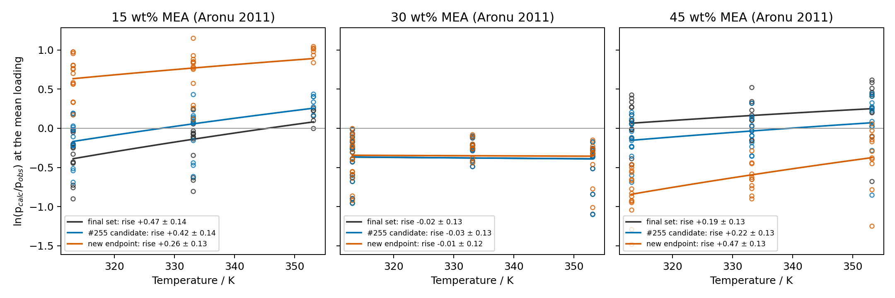

# Temperature-dependent MEACOO⁻–water and MEAH⁺–MEACOO⁻ interactions (issue 283): F1, F2 and F3 fail; not adopted

**Result.** The two reciprocal-temperature slopes do not remove the 353 K carbamate excess, and they do not remove the 15 wt% transfer temperature term.

The selected candidate is from start (b). Its largest Böttinger 2008 353.15 K carbamate excess is **25.35 %**, against the 10 % target (F1 fails). Its loading-controlled 313 → 353 K rise is:
- 15 wt%: **+0.257 ± 0.128**, against the 0.20 limit (F2 fails);
- 30 wt%: −0.012 ± 0.119;
- 45 wt%: **+0.467 ± 0.131**, outside ±0.30 (F2 fails).

Its 15 wt% transfer AARD is **128.4 %**, against the final set's 29.5 % (F3 fails). The #255 acceptance criteria 1–3 pass against the final set, with no descent at any enforced, offset or census state, and both slopes are interior.

The fitted slopes are:
- MEACOO⁻–water: **−164.6 ± 601.9 K**;
- MEAH⁺–MEACOO⁻: **+181.3 ± 644.5 K**.

These are conditional standard errors, so the 317 rows do not determine either slope. The MEACOO⁻–water slope correlates −0.953 with the MEAH⁺–water slope.

Nothing is adopted: `selected-current-best-parameters.json`, the Engine pin, `docs/scientific/latex/` and `analyses/_cse-manuscript.json` are unchanged.

The evidence is calibration and numerical verification. The Böttinger rows are fitted, so the carbamate result is a calibration result. The Aronu 2011 rows lie outside the fit but were accessed in #261 and #255, so they are not blind validation.

## Model and inputs

The design is the issue #283 body (readiness Ready). The relation is the Engine's `cross_dispersion_energy` reciprocal-temperature law, for pairs with $z_iz_j\le0$:

$$k_{ij}(T)=k_{ij}+b_{ij}\left(\frac1T-\frac1{313.15\ \mathrm K}\right).$$

- **Record entries.** Two `k_ij_reciprocal_temperature_slope` entries are added, for carbamate-anion/water and carbamate-anion/protonated-monoethanolamine. Each has value 0 K, reference temperature 313.15 K and provenance `issue-283-hypothesis` (`with_slopes` in the script).
- **Coordinates.** There are 19: the 16 #255 coordinates, the R4 enthalpy shift (pivot 313.15 K, scale 2500 J/mol, total ±10 000 J/mol) and the two slopes. Each slope starts at 0 K with bounds [−1000, 1000] K and scale 10 K. R5 keeps its original total-shift bounds.
- **Fitted rows.** The 307 #255 rows, plus the 10 Böttinger 2008 353.15 K NMR targets of #263's all-five case. Their residual is $(x_\mathrm{calc}-x_\mathrm{obs})/(0.1x_\mathrm{obs}+0.001)$, with weight 1. That makes 317 rows.
- **Stability requirement.** The #255 requirement applies at 1903 enforced states, with exterior penalty scale 3×10⁻³. The 576 offset states and the 162-state census are checked at each candidate.
- **Engine.** `bc7794731e94be961d16028d3f4880c6718a93ad`, wheel SHA-256 `8b9609d4c8908d9397833988158f525c92dd28e3bcf7333f4c3b33c48db99069`. It is installed only in this worktree, and every JSON result records it.

The script is [`ion_temperature_283.py`](../../scripts/ion_temperature_283.py), run from the repository root with the worktree `.venv` under `agent-heavy`. Its commands are `qualify | fit <a|b> | assess <a|b> | extras <a|b> | select | attribute | regress | evidence | compare | present`. It reuses the #255 driver [`stable_refit_255.py`](../../scripts/stable_refit_255.py) for the fit, retreat, acceptance, stability grids and census. It reuses [`candidate_evidence_255.py`](../../scripts/candidate_evidence_255.py) for the downstream rerun.

This issue changed the #255 driver in four ways; none changes a #255 result:
- `endpoint_mapping` reads untied parameter coordinates declared beyond a6, here the two slopes, in physical-vector order.
- `assess` treats a slope that the final set does not declare as 0.
- The retreat searches first the states that failed at the previous point, and rejects a point without the full grid while any of them still fails. The admissibility decision and the returned t are unchanged.
- Process pools and optimizer workers follow the `AGENT_HEAVY_CORES` cap.

## Qualification

[qualification/summary.json](qualification/summary.json) shows:
- The final set replays the #255 values exactly: 307-row cost 148.883260, maximum row difference 0.
- **Start (a)**, the #255 variant (b) endpoint, replays its 307 rows and its 10 Böttinger predictions with difference 0.
- **Start (b)**, the #255 primary candidate with the R4 shift at 0, does the same.
- Declaring both slopes at 0 K changes no prediction (difference 0, limit 10⁻¹²).
- The 317-row costs are 152.552599 for start (a) and 153.121363 for start (b). The latter equals the #255 variant (b) fit's initial cost, which confirms that a fit starts from the bound record.
- The direct evaluation of the 106 Aronu rows used by the linear regression equals the #255 downstream transfer and canonical rows, for both the final set and the #255 candidate (difference 0). It also equals this issue's own downstream rerun at the selected candidate (difference 0).

## Fits, retreat and selection

| Run | Stage status | 317-row cost: start → stage endpoint | Stage endpoint descent | Retreat t | Candidate 307 / 317 cost | Acceptance |
|---|---|---:|---|---:|---:|---|
| final set (reference) | — | — | 0 | — | 148.8833 / 153.6223 | — |
| (a) from #255 variant (b) | converged, 28 iterations, 1696 s | 152.5526 → 150.6675 | 4 states | **0.00031** | 148.2623 / 152.5519 | pass |
| **(b) from #255 primary (selected)** | **wall-time limit**, 38 iterations, 7836 s | 153.1214 → 150.9565 | 4 states | **0.98499** | **146.6187 / 151.0155** | pass |

The final set's 317-row cost adds its Böttinger cost, 4.7390, computed with the same residual from the #255 predictions in `stable-refit-255/joint-chemistry/extras.json`.

**Fit (a) retreated to its start.** The resolved descent at the stage endpoint is at two states at 313.15 K and loading 0.6: 35 wt% and the 30 wt% census node, each at both pressure ratios, with τ = −9.2×10⁻⁵ and −1.5×10⁻⁴. Along the segment from the start, τ at those states shrinks in proportion to t and reaches zero only at t → 0. The first admissible point is t = 0.0003125, so candidate (a) is effectively the #255 variant (b) endpoint: slopes −0.05 and +0.07 K. The scan log is [logs/fit-a.log](logs/fit-a.log). The first full-grid scan was stopped at t = 0.74 for CPU use and is kept in [logs/fit-a.full-grid-retreat.log](logs/fit-a.full-grid-retreat.log).

**Fit (b) is not converged.** Its stage stopped at the optimizer's 7200 s wall-time budget after 38 iterations. It ran with 4 optimizer workers, sized from free memory at launch, under the owner's 3-core cap (CPUQuota 300 %). Fit (a) ran with 32 workers before the cap. Worker count does not change the calculation. Its endpoint has descent at the same four states (τ down to −9.8×10⁻⁵). The retreat reaches the first admissible point at t = 0.98499. The stage was not rerun: its endpoint lies close to fit (a)'s endpoint, and the retreat decides the candidate.

| Coordinate | Fit (a) stage endpoint | Fit (b) stage endpoint |
|---|---:|---:|
| MEACOO⁻–water slope / K | −171.9 | −167.2 |
| MEAH⁺–MEACOO⁻ slope / K | +219.3 | +184.0 |
| MEAH⁺–water slope / K | +226.6 | +162.4 |

A machine reboot at about 14:42 interrupted the first fit (b) retreat. Its log is kept in [logs/fit-b.interrupted-retreat.log](logs/fit-b.interrupted-retreat.log), and the cached stage was reused for the retreat.

[primary.json](primary.json) applies the issue's rule, the lower 317-row cost, and selects (b).

## Assessment of the selected candidate (b)

**Stability.** There is no resolved descent at the 1903 enforced states, the 576 offset states or the 162 census states. The 5 excluded states have no descent: 4 are unavailable, as in #255, and 1 is available ([b/assessment.json](b/assessment.json)).

**#255 criteria against the final set (same wheel and inputs).**

| Group | n | Final set AARD % (within 2s) | Candidate | Rule |
|---|---:|---:|---:|---|
| fitted CO₂ partial pressure | 47 | 11.863 | 12.353 | rise ≤ 2 points: +0.49 |
| Kiepe pressure | 39 | 2.667 | 2.667 | +0.00 |
| fitted phase mole fraction | 94 | 7.103 | 6.896 | −0.21 |
| restored species | 7 | 9.002 | 8.648 | −0.35 |
| Jakobsen ratio | 6 | 17.514 | 19.131 | +1.62 |
| loaded density | 47 | 0.177 (44) | 0.145 (47) | AARD/RMSE ×0.82/×0.80 |
| CO₂-free density | 5 | 0.028 (5) | 0.027 (5) | ×0.97/×0.99 |
| fitted heat of absorption | 8 | 1.877 (8) | 1.974 (8) | ×1.05/×1.02 |
| heat capacity | 4 | 2.846 (3) | 2.565 (3) | ×0.90/×0.95 |

**Parameters.** The parameters that move, from the final set to the #255 primary to the candidate:

| Parameter | Final set | #255 primary | Candidate |
|---|---:|---:|---:|
| MEAH⁺ segment diameter / Å | 5.35 | 4.905 | 4.223 |
| carbamate segment diameter / Å | 4.866 | 5.32 | 5.793 |
| MEAH⁺ dispersion energy / K | 177.9 | 199.7 | 282.3 |
| carbamate dispersion energy / K | 207.2 | 183.0 | 126.3 |
| carbamate Born diameter / Å | 5.0 | 5.0 | 2.045 |
| MEAH⁺–water k | −0.5 | −0.5 | −0.218 |
| MEAH⁺–water slope / K | −41.6 | −35.3 | +159.4 |
| carbamate–water k | −0.0037 | −0.0130 | −0.1997 |
| R2 total enthalpy shift / J mol⁻¹ | −1364 | −621 | +9841 |
| R4 total enthalpy shift / J mol⁻¹ | 0 | 0 | +9850 |

**Coordinates on bounds** (within 10⁻⁶ of a scale): bicarbonate–water k (1.0), carbamate–MEAH⁺ k (−1), MEAH⁺ Born diameter (5 Å) and the R5 total shift (+10 000 J/mol). Within one scale of a bound: carbamate segment diameter 5.793 (bound 5.8), carbamate Born diameter 2.045 (bound 2.0), and the R2 and R4 total shifts, 9841 and 9850 J/mol (bound 10 000).

**Fitted slopes and k(T).** [b/extras.json](b/extras.json) `uncertainty`, from `refit.identifiability`, gives the covariance of the off-bound coordinates with the four on-bound coordinates held fixed. It uses 317 weighted rows, and the residual variance is 1.0001.

| Pair | Slope b / K | Conditional SE / K | Correlation with MEAH⁺–water slope | k(313.15 K) | k(293.15 K) → k(393.15 K) |
|---|---:|---:|---:|---:|---|
| MEACOO⁻–water | −164.6 | 601.9 | −0.953 | −0.1997 | −0.236 → −0.093 |
| MEAH⁺–MEACOO⁻ | +181.3 | 644.5 | +0.043 | −1.0 | −0.961 → −1.118 |
| MEAH⁺–water (existing) | +159.4 | 671.2 | 1 | −0.2185 | −0.184 → −0.322 |

1 − k(T) > 0 at both ends of 293.15–393.15 K for all three pairs, and k(T) is monotone in 1/T. The MEAH⁺–MEACOO⁻ value goes below the −1 coordinate bound above 313.15 K, which the design allows. The two new slopes correlate 0.003 with each other. The MEAH⁺–water slope differs between the starts as the design noted: +13.3 K at variant (b), −35.3 K at the #255 primary, +159.4 K here.

## The two tested outcomes

### F1. 353 K carbamate excess (primary): fail

Relative error, calculated over observed, at the five Böttinger 2008 states at 353.15 K ([b/extras.json](b/extras.json) `bottinger`). MEA + MEAH⁺ is the reported aggregate:

| State | Observed MEACOO⁻ | Final set | #255 primary | #255 variant (b) | **Candidate** |
|---|---:|---:|---:|---:|---:|
| 063 | 0.0068 | 6.27 % | 6.27 % | 5.71 % | 5.68 % |
| 064 | 0.0140 | 13.09 % | 13.02 % | 12.45 % | 12.47 % |
| 065 | 0.0224 | 21.49 % | 21.32 % | 20.71 % | 20.83 % |
| 066 | 0.0337 | 8.83 % | 8.56 % | 7.91 % | 8.15 % |
| 067 | 0.0336 | 26.33 % | 25.89 % | 24.94 % | **25.35 %** |

The largest excess is 25.35 %, against the < 10 % target, so F1 fails. Both stage endpoints are also above it: 25.83 % for (a) and 25.34 % for (b). The MEA + MEAH⁺ error at state 067 is −14.12 % (final set −14.50 %).

### F2. 15 wt% transfer temperature term: fail

The per-strength linear regression of $\ln(p_\mathrm{calc}/p_\mathrm{obs}) = c_0 + c_1/T + c_2\,\alpha$ over the 106 Aronu 2011 rows is retained in [regression.json](regression.json) (`regress`). Strengths come from `data/reference/MEA/manifests/grouped_split_manifest.csv`. The rise is $-c_1(1/313.15-1/353.15)$, given with ± 1 standard error.

Limits: absolute loading-controlled 313 → 353 K change: $|\Delta_{15}|\le0.20$ at 15 wt%, and $|\Delta|\le0.30$ at 30 and 45 wt%.

| Strength (rows) | Final set: rise; loading slope | #255 primary | **Candidate** | Limit |
|---|---:|---:|---:|---|
| 15 wt% (33) | +0.470 ± 0.135; −1.62 ± 0.33 | +0.424 ± 0.136; −1.67 ± 0.33 | **+0.257 ± 0.128**; −1.87 ± 0.31 | $\lvert\Delta_{15}\rvert\le0.20$: fail |
| 30 wt% (36) | −0.021 ± 0.125; −1.28 ± 0.35 | −0.026 ± 0.126; −1.30 ± 0.35 | −0.012 ± 0.119; −1.34 ± 0.33 | ±0.30: pass |
| 45 wt% (37) | +0.186 ± 0.128; −2.84 ± 0.35 | +0.224 ± 0.128; −2.85 ± 0.35 | **+0.467 ± 0.131**; −2.06 ± 0.35 | ±0.30: fail |

The plotted values are in [transfer-temperature-term-plotted-values.csv](transfer-temperature-term-plotted-values.csv).

Both slopes are interior, so under the design, slopes fitted to this calibration do not remove the 15 wt% term. That does not exclude these pairs under a fit that includes 15 wt% rows. A temperature term also appears at 45 wt%. Reported without a threshold: the 45 wt% loading slope is −2.06 ± 0.35, against −2.84 ± 0.35 for the final set.

**Concentration transfer.** The candidate also changes the concentration transfer. The mean ln(calc/obs) moves:
- 15 wt%: from −0.205 (final set) to +0.734, AARD 29.5 → 128.4 %;
- 45 wt%: from +0.149 to −0.630, AARD 56.0 → 47.6 %.

A comparably large concentration-transfer shift already occurs without the two new slopes: #255 variant (b) gives 15 wt% AARD 121.6%, mean ln(calc/obs) +0.710, and 45 wt% mean ln(calc/obs) −0.605. Candidate (a), whose new slopes remain near zero, reproduces those values. The selected candidate instead starts from the #255 primary, whose 15 wt% AARD is 33.9%, and jointly refits the existing parameters and the two new slopes. These comparisons show that the shift can occur without the new slopes; they do not uniquely attribute the selected candidate’s shift to the pre-existing parameters or the new slopes. Candidate (a)'s 45 wt% rise is +0.511 ± 0.133 ([a/extras.json](a/extras.json)). The 30 wt% Aronu rows are nearly unchanged (AARD 29.8 → 28.2 %).

### F3. Preservation and stability: fail

- #255 criteria 1–3 pass, with zero descent at the enforced, offset and census states.
- Both slopes are interior.
- Transfer AARD at 15 wt% is 128.4 %, above the final set's 29.5 %: **fail**.
- Transfer AARD at 45 wt% is 47.6 %, within the final set's 56.0 %.
- The 307-row cost is 146.6187, against 148.8833 for the final set. Cost is not a gate.

## Attribution: each slope set back to 0, other parameters fixed

[attribution.json](attribution.json):

| Case | 307-row cost | Largest carbamate excess | Rise 15 / 30 / 45 wt% | 15 wt% AARD |
|---|---:|---:|---|---:|
| candidate | 146.619 | 25.35 % | +0.257 / −0.012 / +0.467 | 128.4 % |
| MEACOO⁻–water slope = 0 | 227.782 | 18.52 % | +0.441 / +0.398 / +1.108 | 152.4 % |
| MEAH⁺–MEACOO⁻ slope = 0 | 147.791 | 24.60 % | +0.295 / +0.080 / +0.578 | 131.5 % |
| both slopes = 0 | 244.905 | 17.49 % | +0.477 / +0.485 / +1.211 | 156.0 % |

With the rest of the candidate held fixed, the MEACOO⁻–water slope carries most of the 307-row cost: zeroing it adds 81. It offsets the MEAH⁺–water slope (+159.4 K), with which it correlates −0.953. Removing it lowers the carbamate excess to 18.5 % but raises the calibration cost far more than the Böttinger term gains. In this fit, the calibration rows hold the 353 K carbamate excess near 25 %.

## Downstream rerun on the selected candidate

The #255 stage-3 producers were rerun on candidate (b) under [evidence/candidate/](evidence/candidate/): selected assessment and point data, model curves, Kim 2007, the #268 density comparison, the #264 heat capacity and the MDEA shared-value transfer.

The final-set outputs are #255's on the same wheel and inputs. [evidence/final](evidence/final) is a link to `../../stable-refit-255/evidence/final`, and the comparison asserts their model-curve reference replays. [evidence/comparison.csv](evidence/comparison.csv) lists the 345 same-input differences, including:

| Quantity | Final set | #255 candidate | #283 candidate |
|---|---:|---:|---:|
| canonical pressures (159), AARD | 20.55 % | 20.27 % | 20.72 % |
| packet pressures (79), AARD | 15.46 % | 15.00 % | 17.73 % |
| 15 wt% transfer (33): AARD; mean ln(calc/obs) | 29.49 %; −0.205 | 33.89 %; −0.002 | **128.40 %; +0.734** |
| 45 wt% transfer (37): AARD; mean ln(calc/obs) | 56.04 %; +0.149 | 44.53 %; −0.051 | 47.58 %; −0.630 |
| Wagner near 353 K (11), AARD | 22.19 % | 23.72 % | 22.27 % |
| Jou 1995 120 °C, AARD | 31.52 % | 30.90 % | 41.20 % |
| Arcis heats (14), RMSE | 8.12 kJ/mol | 8.09 kJ/mol | 7.74 kJ/mol |
| Kim 2007 semi-differential (53), RMSE | 6.12 kJ/mol | 6.30 kJ/mol | 6.54 kJ/mol |
| Han loaded density to 353 K (30), mean; RMSE | −2.70; 3.23 kg/m³ | −0.26; 5.15 kg/m³ | +2.71; 10.44 kg/m³ |
| Han loaded density above 353 K (20), mean | −8.84 kg/m³ | −6.02 kg/m³ | −1.73 kg/m³ |
| Hartono loading 0.50 (8), RMSE | 3.23 kg/m³ | 3.16 kg/m³ | 8.08 kg/m³ |
| #264 broad Cp (51), AARD | 2.443 % | 2.391 % | 2.300 % |
| Hilliard Cp, CO₂-free 318.15 K | +5.53 % | +5.43 % | +5.42 % |
| carbonate share, mean calc/obs (10 rows) | 0.073 | 0.021 | 0.027 |
| MDEA Xiao / Ermatchkov AARD, A3, k and R2 | 20.4 / 26.2 % | 52.9 / 52.5 % | 48.0 / 66.1 % |
| MDEA Xiao / Ermatchkov AARD, B1, k and R2 | 28.3 / 19.1 % | 58.6 / 42.0 % | 54.6 / 60.2 % |

The model curves change by at most:
- 13.2 % in pressure;
- 24.0 kg/m³ (2.2 %) in density;
- 0.52 kJ/mol in integral heat.

Species mole fractions change by less than 5.3×10⁻⁴ absolute.

MDEA shares the bicarbonate–water k (1.0 here, as for the #255 candidate) and the R2 law. With this candidate's R2 law (+9841 J/mol total shift), the Ermatchkov errors rise further. The MDEA heat at B1, 333.15 K stays unavailable under Engine #1073.

`generate_figure_data.py`, the #212 conditional uncertainty and the #214 phase-family export were not rerun; they belong to adoption.

## Conditional Engine request

The issue makes the Engine request for ion segment-diameter temperature laws conditional on F2 failing with interior slopes. That condition is met. Whether to file it is the orchestrator's decision.

## Limits

- **Local fits.** These are local fits from two starts. Fit (a) retreated to its start. Fit (b)'s stage stopped at the wall-time budget and is not converged.
- **Bounds.** Four coordinates are on bounds and four more are within one scale of a bound.
- **Slopes.** The slopes are empirical temperature corrections, and their conditional standard errors exceed their values. The MEAH⁺–MEACOO⁻ slope has no literature precedent.
- **Böttinger data.** Böttinger does not separate MEA from MEAH⁺.
- **Aronu rows and the regression.** The Aronu rows are previously accessed outside-fit comparisons. The linear regression is descriptive: it assumes linear loading dependence and independent residuals, and it rests on sparse isotherms (6 rows at 15 wt%, 353 K).
- **Stability.** Stability is a finite search at declared states.
- **Not tested.** The 45 wt% loading-slope mechanism is not claimed. Interaction with the bicarbonate-anchoring issue is not tested.

## Files not retained

[.gitignore](.gitignore) excludes, as in #255:
- regenerable solve caches;
- resume checkpoints (`*/stage-*/fit-native.json`, which the retained `fit.json` duplicates);
- the byte-identical selected-assessment input copies.
