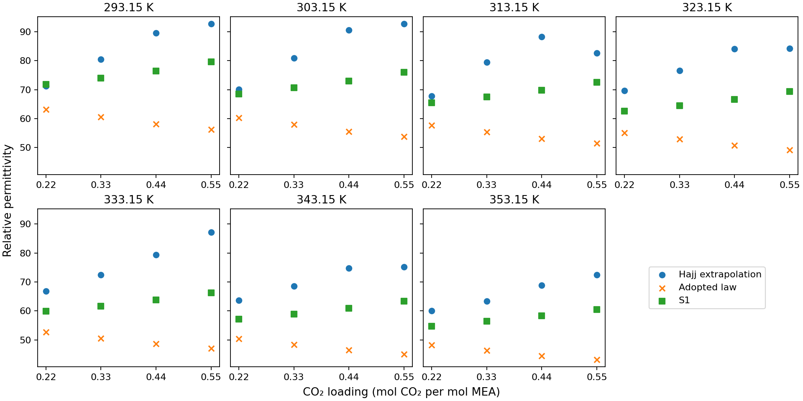

The lowest-cost fit reduced the Hajj contribution from 34.11773 to 7.06955 and increased the original Part I contribution from 150.76290 to 151.78733.
All three starts converged within the optimizer's tie tolerance, and checks C1–C5 passed.
The fitted law reproduced the direction of the loading trend over the seven temperature series, with a smaller rise than Hajj inferred at every temperature.
The fitted carbamate coefficient reached the parent-state lower bound in all three fits.
The grids returned witnesses at 461 states, including 251 with a converged witness away from the permittivity boundary.
The census admitted 108 of 162 parents, and the proposed penalized objective did not evaluate at S1.
Part I keeps the adopted record. The bound-limited S1 fit is retained as a negative result.

## Model, data and scope

The candidate law is $\varepsilon=1+(F-1)/D$, where $F$ is the adopted solvent density–temperature law and
$D=1+\beta_C x_{\rm carb}+\beta_B(x_{\rm HCO_3}+x_{\rm CO_3})$.
The mole fractions include all nine species.
The MEAH⁺, H₃O⁺ and OH⁻ coefficients are fixed at zero in the declared charge reference.
The two dimensionless coefficients describe ion pairs in this MEA model.
The 11 F2 coordinates, including the diameter ties, retained their bounds.
The upper coefficient bound of +15 covers the 14.02 pair value corresponding to Figiel et al. (2025), Eq. 11.

The objective retains the 307 Part I rows and adds 28 Hajj rows with weight $1/28$ each and scale 3.2 in relative permittivity.
The 30 wt% MEA stock is defined before loading.
The loaded rows span 293.15–353.15 K and 0.22–0.55 mol CO₂ per mol MEA, at a modeled pressure of 101325 Pa.
The Engine solves each liquid composition and density at its declared conditions.
Hajj, Pré and Curet (2024), Table 1, p. 9, inferred the static limit by fitting the Cole–Cole relation to 915–2450 MHz spectra.
The Table 1 relaxation frequencies range from 3.61 to 14.29 GHz.
The authors note that the band may contribute to the inferred rise at low temperature and high loading (§3.3.1).
The inferred static values have unquantified uncertainty.
The Table 3 smoothing polynomial gives an RMS discrepancy of 3.21960 and maximum absolute discrepancy of 9.12549 over those rows.
The RMS discrepancy motivates the objective scale.
This is calibration evidence and numerical verification.
Permittivities at other stock concentrations and above 353.15 K are extrapolations.

The adopted record is `ae17803e1bcb2ca0a1970e05c7cc235d615c4d8a3a349b5afef0b0401dedefed`.
The Engine wheel is built from `05e94210fa64cf69725e45babc0411d32139df5a` and has SHA-256
`c9fbf898b14d004f915f01ed77675867908dd30d77dc28544b2860e9195c80bb`.
[The study plan and its decision comments](https://github.com/tannerpolley/Amine-Thermodynamics/issues/396) specify the comparisons and limits.
The detached declaration and Table 1 inputs are in [declarations.toml](declarations.toml) and [hajj-table-1.csv](hajj-table-1.csv).

## Bounds and fitted endpoints

The maximum adopted-parent anion mole fraction, 0.202069344686, occurred in the liquid of census state 108 at 313.15 K, 3276.642 Pa and feed loading 0.40 mol CO₂ per mol MEA.
The enforced and offset grids reached a maximum of 0.115407036612.
The maximum over the full parent set gives $L=-4.94$ by rounding $-1/x_{\max}$ toward zero to two decimals.
The resulting negative start is $-2.474398087338$.
The [parent-state record](domain.json) retains the bound calculation and state compositions.

| Start | Initial pair values | Part I cost | Hajj cost | Total cost | Optimizer iterations | Fit wall time, s |
|---|---:|---:|---:|---:|---:|---:|
| S1 | 0.000000000 | 151.787333918 | 7.069552447 | 158.856886364 | 21 | 64.31 |
| S2 | -2.474398087 | 151.794287538 | 7.062630596 | 158.856918134 | 20 | 54.94 |
| S3 | 10.420000000 | 151.789828985 | 7.067080323 | 158.856909308 | 21 | 67.22 |

The series function tolerance is $10^{-6}$ relative.
The corresponding absolute cost difference is 0.000158857.
S1 has the lowest cost and is used for C3 and C4 and the Hajj comparison.
All endpoints were reached on the first attempt.
The three fits reached the lower bounds on the carbamate–MEAH⁺ interaction and on $\beta_C$.
Three of the 11 free coordinates at each endpoint have conditional standard errors larger than their absolute values.
The errors are conditional on the active bounds and the objective weights.
A dash marks an active bound with no free-coordinate standard error.

| Coordinate | Adopted start | S1 value ± SE | S2 value ± SE | S3 value ± SE |
|---|---:|---:|---:|---:|
| Carbamate–water $k_{ij}$ | -0.06612125 | -0.06928406 ± 0.4306 | -0.07244818 ± 0.4124 | -0.07027304 ± 0.4297 |
| MEAH⁺–water $k_{ij}$ | -0.3577254 | -0.2596018 ± 0.4389 | -0.2564771 ± 0.4209 | -0.2582607 ± 0.435 |
| Bicarbonate–water $k_{ij}$ | 0.765 | 0.7752113 ± 2.633 | 0.7616533 ± 2.559 | 0.7722957 ± 2.629 |
| Carbamate–MEAH⁺ $k_{ij}$ | -1 | -1 (lower bound, —) | -1 (lower bound, —) | -1 (lower bound, —) |
| MEAH⁺–water reciprocal-temperature slope (K) | 96.17469 | 90.25718 ± 20.99 | 90.36695 ± 21.11 | 89.97652 ± 20.84 |
| MEAH⁺ segment diameter (Å) | 4.85583 | 4.814533 ± 0.8974 | 4.809867 ± 0.8981 | 4.824568 ± 0.8897 |
| Carbamate segment diameter (Å) | 5.347991 | 5.406989 ± 0.7743 | 5.411191 ± 0.773 | 5.398191 ± 0.7727 |
| MEA–water $k_{ij}$ | -0.08892836 | -0.08876275 ± 0.002137 | -0.08874733 ± 0.002115 | -0.08876694 ± 0.002122 |
| MEA–water reciprocal-temperature slope (K) | -6.362738 | -6.050838 ± 2.785 | -6.032794 ± 2.763 | -6.056744 ± 2.77 |
| MEAH⁺ dispersion energy divided by $k_B$ (K) | 208.7356 | 284.6482 ± 153.6 | 285.2486 ± 155.5 | 284.2889 ± 152.3 |
| Carbamate dispersion energy divided by $k_B$ (K) | 179.8579 | 176.1757 ± 74.33 | 176.1318 ± 74.93 | 175.7765 ± 74.97 |
| $\beta_C$ | 0 | -4.94 (lower bound, —) | -4.94 (lower bound, —) | -4.94 (lower bound, —) |
| $\beta_B$ | 0 | -4.267119 ± 2.17 | -4.274048 ± 2.166 | -4.278272 ± 2.173 |

The [S1](S1/information.json), [S2](S2/information.json) and [S3](S3/information.json) records include the conditional correlation, individual standard errors, and weighted physical Jacobians.
The [S1](S1/attempt-0.json), [S2](S2/attempt-0.json) and [S3](S3/attempt-0.json) optimizer histories retain the initial and final costs, convergence messages, and parameter targets.

## Numerical checks

| Check | Result | Origin of criterion |
|---|---|---|
| C1 | 307 original predictions, their cost, and 28 Hajj predictions matched exactly at zero coefficients. The exact derivative evaluation took 7.39 s. | Replay limit of $10^{-10}$ relative for Part I predictions and cost from #340 and #297. |
| C2 | 162/162 census, 1,908/1,908 enforced and 576/576 offset states matched the same-wheel adopted classifications and completeness. There were no descents and no incomplete searches. The census classified 157 two-phase states and 5 single-liquid states. The pass took 201.38 s. | Zero-coefficient identity and charged-trial admission, Engine request B criterion 1. |
| C3 | At 353.15 K and loading 0.55, $D=0.7099968154$. The hand calculation gave 60.44344546287365 against 60.44344546287363 from the observation, a relative difference of $2.35\times10^{-16}$. | Native-versus-law comparison limit of $10^{-10}$ relative from #207. |
| C4 | All 335 rows stayed available at both shifts. Maximum relative differences were $8.91\times10^{-13}$ at $\lambda=1$ and $8.91\times10^{-13}$ at $\lambda=-4.267119174$. | Charge balance and Engine request C criterion 2, with the $10^{-10}$ replay limit. |
| C5 | All 335 rows replayed at each endpoint. Minimum $D$ over 479 solved phases was 0.669555, 0.669320 and 0.669217 for S1, S2 and S3. | Engine admission requires $D>0$ and an available observation. |

The values and cases are retained in [C1](C1.json), [C2](C2/identity.json), [C3](S1/C3.json), both charge shifts ([unit](S1/C4-unit.json), [bicarbonate](S1/C4-bicarbonate.json)), and the phase-domain records for [S1](S1/C5.json), [S2](S2/C5.json) and [S3](S3/C5.json).

## Comparisons

### 1. Fit and deviation by group

The root mean square scaled residual uses the row's declared residual and gives equal weight to rows for this deviation statistic.
Costs use the objective weights.
The adopted column uses the same pin and 335 rows.

| Fitted group | Rows | Adopted cost | S1 cost | S2 cost | S3 cost | Adopted RMS scaled residual | S1 RMS scaled residual |
|---|---:|---:|---:|---:|---:|---:|---:|
| common149 | 149 | 23.835763 | 24.364485 | 24.369835 | 24.363799 | 0.497104 | 0.506497 |
| restored species | 7 | 2.405564 | 2.478133 | 2.479030 | 2.477764 | 0.829038 | 0.841450 |
| Jakobsen | 6 | 12.745750 | 12.386814 | 12.390979 | 12.393325 | 2.061209 | 2.031979 |
| Kiepe | 39 | 0.000679 | 0.000679 | 0.000679 | 0.000679 | 0.036852 | 0.036852 |
| CO2-free density | 5 | 13.116766 | 13.400259 | 13.410805 | 13.392907 | 0.724342 | 0.732127 |
| Cai | 50 | 91.631289 | 91.597687 | 91.596590 | 91.598146 | 1.914485 | 1.914134 |
| loaded density | 47 | 0.378743 | 0.355861 | 0.354986 | 0.357644 | 0.870337 | 0.843637 |
| Cp | 4 | 6.648349 | 7.203415 | 7.191383 | 7.205565 | 1.823232 | 1.897816 |
| Hajj | 28 | 34.117726 | 7.069552 | 7.062631 | 7.067080 | 8.260475 | 3.760200 |

The adopted values in the parameter table are the common 11-coordinate starts and the zero-coefficient extension.
On the joint 335-row objective, the adopted record has one active bound among its 11 free-to-fit coordinates and three conditional standard errors larger than the absolute parameter values.
The [adopted conditional information](adopted/information.json) was evaluated against the same rows, with its law and coefficients fixed.

### 2. Hajj loading series



All symbols are evaluated at the four sampled loadings per temperature.
The 28 plotted rows and source relaxation frequencies appear in [hajj-comparison.csv](hajj-comparison.csv).
The following changes are from loading 0.22 to 0.55 on the 30 wt% stock.

| Temperature, K | Adopted change | S1 change | Hajj change |
|---:|---:|---:|---:|
| 293.15 | -6.864 | 7.798 | 21.400 |
| 303.15 | -6.526 | 7.446 | 22.600 |
| 313.15 | -6.206 | 7.102 | 14.900 |
| 323.15 | -5.902 | 6.763 | 14.500 |
| 333.15 | -5.614 | 6.423 | 20.400 |
| 343.15 | -5.339 | 6.075 | 11.600 |
| 353.15 | -5.076 | 5.712 | 12.300 |

At loading 0.55, the fitted relative permittivity is 13.130 below Hajj at 293.15 K and 11.957 below Hajj at 353.15 K.
The remaining discrepancy includes model error and potentially spectral extrapolation bias.
These data do not resolve their respective contributions.

### 3. Sensitivity to the Hajj weight

The two fits started from S1 and use the same bounds.
At weight ¼, the pair values are $(-4.94,-0.659662)$ and the optimizer took 59.07 s.
At weight 4, both values are at $-4.94$ and the optimizer took 34.17 s.
Every fitted observation remained available at both endpoints.
The minimum endpoint $D$ values were 0.751354 and 0.646547, respectively.
These runs leave the weight-1 selection in place.
The following Hajj costs include the stated weights, so division by the weight gives 9.85763, 7.06955 and 6.37960 on a common objective scale.

| Group | Total Hajj weight ¼ | Weight 1 | Weight 4 |
|---|---:|---:|---:|
| common149 | 23.329574 | 24.364485 | 24.897977 |
| restored species | 2.207312 | 2.478133 | 2.564850 |
| Jakobsen | 12.292318 | 12.386814 | 12.565196 |
| Kiepe | 0.000679 | 0.000679 | 0.000679 |
| CO2-free density | 12.934663 | 13.400259 | 13.778845 |
| Cai | 91.641610 | 91.597687 | 91.567478 |
| loaded density | 0.409695 | 0.355861 | 0.566459 |
| Cp | 7.460926 | 7.203415 | 6.953905 |
| Hajj | 2.464409 | 7.069552 | 25.518406 |
| Total | 152.741185 | 158.856886 | 178.413796 |

The records for [weight ¼](weight-0.25/information.json) and [weight 4](weight-4/information.json) give the full endpoints and their conditional errors.

### 4. Published fixed coefficients

Both fixed comparisons used the adopted record with the candidate law and all 335 observations available.
Zuber's general water coefficients give a 307-row cost of 547.37398 and a Hajj cost of 85.91600.
Figiel's 7.01 for every ion gives a 307-row cost of 794.57829 and a Hajj cost of 99.14064.
At 353.15 K, from loading 0.22 to 0.55, Zuber gives 38.49 to 27.24 and Figiel gives 36.06 to 24.51.
The source laws use an ion-free solvent numerator and were fitted in other systems.
Use those numbers as fixed-coefficient comparisons under the MEA law.
[All 28 values for each run](S1/permittivity-comparisons.json)

### 5. Unloaded permittivity

For the 14 Agieienko–Buchner points at 298.15 K, root mean square error in relative permittivity was 0.30218 adopted and 0.30231 for S1.
S1 gave 68.25293 at 293.15 K and 56.85978 at 333.15 K, compared to Hajj's unloaded values of 69.10 and 58.27.
The adopted record gives 68.25402 and 56.86027.
All 16 replays were at 101325 Pa, with composition declared from the unloaded stock data.
At zero ion mole fraction, the candidate changes these predictions through the equation-of-state density.
The fixed-coefficient runs and unloaded replays took 10.90 s together.

### 6. Stability and trial domain

| Grid | Parents | States with an in-domain witness | Complete, every trial determinate and in-domain, no descent found | Incomplete with no descent found | Returned optimized trials | Returned trials with $D\le0$ | Other unresolved trials |
|---|---:|---:|---:|---:|---:|---:|---:|
| Enforced | 1,908 | 361 | 23 | 1,524 | 24,804 | 343 | 1,669 |
| Offset | 576 | 100 | 9 | 467 | 7,488 | 108 | 476 |
| Total | 2,484 | 461 | 32 | 1,991 | 32,292 | 451 | 2,145 |

Of the 326 states previously described as complete without descent, 294 had an unavailable native stability value and at least one trial with $D\le0$.
Including states with both a witness and an unresolved or out-of-domain trial gives 1,885 incomplete enforced searches and 567 incomplete offset searches.
The 451 out-of-domain compositions do not establish a split.
The counts cover returned trial compositions. The Engine does not count every internal optimizer evaluation.
The same-wheel adopted-law comparison completed both grids and the census with zero descents.

| Optimizer outcome | Engine witnesses | States | Trial $D$ range | Trial TPD/$RT$ range |
|---|---:|---:|---:|---:|
| Converged | 431 | 251 | 0.6264 to 1.0000 | −0.06017 to $-3.19\times10^{-9}$ |
| Unconverged | 322 | 281, including 210 with only unconverged witnesses | $9.99\times10^{-16}$ to 0.1656 | −0.45883 to −0.0005421 |

All 753 reported witnesses came from liquid trial families.
For the unconverged group, the native finite-split criterion supplied a witness even though the optimizer did not converge.
The minimum TPD/$RT$ of −0.459 belongs to that group.
Below about $10^{-12}$, the sign of $D$ is unresolved in double precision. Two reported grid witnesses fall there.
The 251 states with converged witnesses were away from that boundary.
These are numerical descent results for the declared model and searched conditions.
They do not establish that the splits occur in physical MEA solutions.
[Per-state optimized trials and denominators](S1/stability/domains.json) and [grid summary](S1/stability/summary.json)

#### Census refusal diagnosis

At full S1 coefficients, the cold declared liquid–vapor solve returned `eval_g: invalid permittivity suppression denominator` at states 54 and 81 and refused the boundary density seed at 108.
With the 11 S1 equation-of-state coordinates fixed, liquid-only solves reached full S1 for all three feeds. Their maximum native convergence residual was $7.45\times10^{-14}$ against the $10^{-10}$ row tolerance.
Their pressures lie below the calculated S1 bubble pressures. The liquid-only results do not substitute for the census flashes.

| State | Temperature, K | Loading, mol CO₂/mol MEA | Census pressure, kPa | S1 bubble pressure, kPa | S1 liquid-only $D$ | Lowest traced S1 liquid–vapor pressure, kPa | Liquid $D$ there |
|---|---:|---:|---:|---:|---:|---:|---:|
| 54 | 313.15 | 0.200 | 3.20615 | 6.55989 | 0.88954 | 5.48998 | 0.60050 |
| 81 | 353.15 | 0.256 | 21.09029 | 42.75836 | 0.85913 | 35.95579 | 0.60139 |
| 108 | 313.15 | 0.400 | 3.27664 | 6.86645 | 0.77995 | 6.56943 | 0.64819 |

At each census pressure, coefficient continuation from zero followed the liquid–vapor branch up to about 0.45039, 0.40813 and 0.40486 of the S1 coefficients, respectively.
For states 54 and 81, continuing in the liquid carbamate mole fraction traced the branch back toward smaller coefficient fractions at positive $D$.
For state 108 the smallest $D$ on the coefficient path was 0.02067, at a coefficient fraction of 0.40486.
The earlier $D=0.0048$ used adopted speciation and does not locate a candidate root.
At full S1, pressure continuation from the bubble point followed and turned through in-domain pressure minima well above the census pressures.
The accepted continuation points met the same $10^{-10}$ native row tolerance.
Six starts with different phase allocations and three charge-reference shifts per state did not find a flash at the census pressures.
In the extended pressure trace, the branches from the bubble points at states 81 and 108 turned back above their census pressures. The traces ended near the $D\to0$ edge, with last accepted points at $D=4.34\times10^{-6}$ and 697 kPa, and $D=4.60\times10^{-6}$ and 59.1 kPa, respectively.
At state 54 the trace stalled at $D=0.054$ and 41.8 kPa, with no return toward the census pressure over the traced range. A disconnected branch remains unresolved.
The three target flashes remain unavailable.
For 45 other refused parents, the only diagnostic is the Engine's message. No continuation was performed for those parents.
The native solves and alternate starts took 28.61 s. The original trace with the Engine stationarity rows took 4.16 s.
[Native continuation, starts and conditions](S1/stability/diagnosis/census-parent-continuation.json.gz), [original fold calculations](S1/stability/diagnosis/census-flash-folds.json.gz), and [extended pressure trace from the re-review](S1/stability/diagnosis/census-flash-extended-pressure-trace.json.gz)

#### Candidate census

The census attempted all 162 states in 355.53 s on three workers and admitted 108 parents.
The other 54 gave 45 iteration-budget exhaustions, five boundary-seed refusals, three stalls and one vanished vapor phase.
All 54 diagnostics include an invalid permittivity suppression denominator.
The supplied registry had 6,874 entries before the census, including 753 grid witnesses. Of these, 645 have $D\le0$ and 6,229 have $D>0$ by the denominator screen.
Across 162 states, this is 104,490 outside-domain state–trial pairs, 672,732 evaluated in-domain pairs at admitted parents and 336,366 unavailable in-domain pairs at refused parents.
The supplied evaluations gave 45,745 negative TPD/$RT$ values on 84 states. Their trial-phase $D$ ranged from $8.9\times10^{-16}$ to 0.536, with 11,589 below $10^{-3}$.
Of the 84 states, 77 had a negative trial at $D>0.1$, 55 at $D>0.3$, and 13 at $D>0.5$.
Seven states (20, 23, 31, 34, 47, 71 and 89) had negatives only at $D<0.1$.
The supplied TPD/$RT$ ranged from −0.5189 to $-8.5\times10^{-6}$. The census minimum was therefore **−0.519**, from a supplied trial.
The per-state record pairs each negative supplied value in the raw census with its zero-based index in the registry.
The evaluation order is the positive-$D$ subset of the first 6,874 registry entries, in registry order.
The reported supplied-trial $D$ groups bicarbonate and carbonate mole fractions under their shared S1 coefficient. This gives the same admission list as the original calculation.

The 108 admitted parents returned 972 optimized trials, of which 18 were unresolved in the Engine report.
Of the 21 optimized trials with a computed $D\le0$, 12 were exactly zero, eight were negative within $4.4\times10^{-16}$ of zero, and one was at $D\approx-2.5\times10^{-4}$.
At $|D|<10^{-12}$ the sign is unresolved in double precision, which applies to 20 of the 21.

| Optimizer outcome | In-domain witnesses | States | Trial $D$ range | Trial TPD/$RT$ range |
|---|---:|---:|---:|---:|
| Converged | 7 | 6 | 0.678 to 0.791 | −0.0030 to $-4.5\times10^{-7}$ |
| Unconverged | 23 | 16 | $9.5\times10^{-7}$ to 0.037 | −0.402 to −0.045 |

Together the two groups returned 30 optimized witnesses on 21 distinct states.
Those witnesses were added to the registry, for 6,904 entries.
The adopted census evaluated all 991,602 original-registry state–trial pairs with zero unavailable and minimum TPD/$RT$ of $4.81548\times10^{-6}$.
The S1 census leaves 24 admitted states with no observed in-domain descent and incomplete searches.
[Per-state diagnostics, supplied descents and optimized witnesses](S1/stability/census-domains.json) and [registry](S1/stability/split-registry.json)

#### Penalty refit

The first #255 penalty scale is 0.01 in dimensionless TPD/$RT$ units.
The full-set attempt declared 335 fitted observations and all 2,646 stability parents, including the 162-state census.
This extends the penalty beyond #255 and #338, which penalized only the 1,903 enforced liquid parents. Their offset grid and 162-state census were used to trigger the penalty and to check the resulting record.
In 4.74 s, the Engine rejected the declaration with `observation declared liquid parent at fixed pressure`. It accepts only liquid phases in fixed-pressure stability observations, and the census includes parents with liquid and vapor.
There were zero residual and zero Jacobian evaluations.

A diagnostic declaration with the two grids (2,484 stability observations) reached one initial Jacobian request in 11.99 s.
It failed at the first stability observation, enforced state `dense|0.15|313.15|1e-05|1.05`.
An optimized trial exhausted 200 iterations and an intermediate evaluation returned `eval_g: invalid permittivity suppression denominator`.
The Engine classified the observation `CentralSolveUnavailable`. On the earlier grid search, 2,452 stability values had that same availability code.
Neither profile returned an initial cost or gradient, so the 21-iteration runtime is undefined for this objective. The reported native zero costs are placeholders.
The optimizer took zero iterations and returned no penalized endpoint.
No penalized fit on the enforced set was attempted from zero coefficients.
[Whole-set profile](S1/penalty-profile.json) and [grid-only diagnostic profile](S1/penalty-grid-profile.json)

### 7. Part I data excluded from fitting

AARD is average absolute relative deviation. RMSE is root mean square error.
The reference column is the retained adopted record from #341.
The Ma'mun rows are a subset of the six-source pressure rows at 393.15 K on a 30 wt% stock.
The 19 observed pressure values match source Table 2 after conversion from kPa to Pa.
The Kim intervals are the 53 admitted 313.15 and 353.15 K comparisons used by the existing assessment.
All displayed S1 cohorts replayed in full.
The assessment took 302.67 s including the existing comparison producers.

| Cohort | Rows | Adopted AARD, % | S1 AARD, % | Adopted RMSE | S1 RMSE | RMSE unit |
|---|---:|---:|---:|---:|---:|---|
| Six-source pressures | 112 | 24.8871 | 26.7489 | 83985 | 1.0798e+05 | Pa |
| Ma’mun pressures | 19 | 33.4660 | 39.0732 | 21523 | 27563 | Pa |
| Wagner pressures | 23 | 25.0328 | 30.7946 | 8505.5 | 11641 | Pa |
| transfer 15 wt% | 33 | 45.0796 | 46.7483 | 1663.9 | 1470 | Pa |
| transfer 45 wt% | 37 | 45.8589 | 54.0991 | 1540.9 | 2162 | Pa |
| Matin 19 pools | 19 | 67.5341 | 68.4167 | 0.0028869 | 0.0029395 | mol/mol |
| Arcis heats | 14 | 8.8616 | 8.8733 | 9.0263 | 8.9997 | kJ/mol CO2 |
| Han densities | 67 | 0.3507 | 0.3257 | 4.8965 | 4.9397 | kg/m³ |
| Kim heats | 53 | 7.0095 | 7.7140 | 7.612 | 8.6469 | kJ/mol CO2 |

[Per-cohort statistics](S1/not-fitted-comparisons.json) and [all 19 Ma'mun pressures](S1/mamun-pressure-rows.csv) retain the numerical comparisons.
These are fixed-record evaluations against previously accessed runs. [Raw comparison producer outputs](S1/not-fitted-evidence.tar.gz) preserve the replay tables, solve records, and receipts.

### 8. Solved-phase extrema

| State group | Minimum $D$ | Maximum relative permittivity |
|---|---:|---:|
| Fitted phases | 0.669555 | 79.57044 |
| Pressure, species, Arcis and Han comparison phases | 0.529695 | 78.95922 |
| Kim interval endpoint phases | 0.694751 | 73.35036 |
| Enforced-grid liquid parents | 0.453237 | 85.48505 |
| Offset-grid liquid parents | 0.546148 | 76.84980 |
| Candidate census phases (108 admitted parents) | 0.623869 | 73.84981 |
| Refused candidate census parents (54) | Unavailable | Unavailable |

The grid extrema exclude trial phases.
The most anion-rich grid liquid parent was at 313.15 K and 66.927 kPa, with a 45 wt% stock and loading 0.60 mol CO₂ per mol MEA.
Its anion mole fraction was 0.116075 and relative permittivity was 85.48505.
Across 209 admitted census phases, the liquid of state 64 had the largest anion mole fraction (0.076432), the minimum $D$ and relative permittivity 49.55561.
The maximum relative permittivity over those phases occurred in the liquid of state 146.
The minimum comparison $D$ was at transfer row `vle_obs_0084`, at 313.15 K and 7.531 kPa.
The highest comparison permittivity was at Matin state 019, at 293.15 K and 101.325 kPa.
The Kim extrema use the liquid root at the source-state modeled pressure and retained solved endpoint composition.
[Comparison phases](S1/comparison-domains.json) and [Kim interval phases](S1/kim-domains.json)

### 9. Restriction table

The seven calibrations are deferred under the 2026-11-17 owner decision until adoption.

## Conclusion

Part I keeps the adopted record `ae17803e…` under the question-tool answer of 2026-11-18. Issue #396 retains S1 as a negative result for the proposed fit. [Adoption gate record](https://github.com/tannerpolley/Amine-Thermodynamics/issues/396#issuecomment-6993857260)
S1 as fitted fails the single-liquid stability check, with descent evidence away from the permittivity boundary.
Hajj's static permittivities are extrapolations from 915–2450 MHz spectra. The S1 carbamate coefficient and carbamate–MEAH⁺ interaction are bound-limited, and the meaning of trials near $D=0$ remains unresolved.

## Reproduction

Use the hash-pinned Engine wheel and `agent-heavy` with the repository-root command below.
The available actions are `C1`, `C2`, `domain`, `S1`, `S2`, `S3`, `checks S1`, `weight 0.25`, `weight 4`, `comparisons`, `stability-probe`, `stability`, `stability-domains`, `not-fitted`, and `comparison-domains`.
Run `stability` for both grids and `stability-domains` to derive their trial counts and registry.
Run `census-probe` for the six-state timing sample and `census` for the 162-state calculation.
Use `penalty-profile` for the whole searched set and `penalty-profile grids-only` for the initial Jacobian probe.
Use `hajj-inputs` to reproduce the fit input, `hajj-comparison` to reproduce the table and figure, and `comparison-domains` to read the archived #341 comparison inputs and regenerate the domain and comparison tables.
The retained census gzip stream is split into two files so each part is below 100 MB.

```bash
agent-heavy timeout 1200s uv run --no-sync python -u \
  analyses/mea_parameter_bundle/scripts/permittivity_refit_396.py stability
```

From the results folder, package a fresh census or restore the raw gzip stream from the committed parts before replaying the whole-set penalty profile.

```bash
split -b 64M -d -a 1 S1/stability/census-raw.json.gz S1/stability/census-raw.json.gz.part
cat S1/stability/census-raw.json.gz.part[01] > S1/stability/census-raw.json.gz
```

The two diagnosis scripts are in [the census diagnosis folder](S1/stability/diagnosis/).
Run them from the repository root with `PYTHONPATH=analyses/mea_parameter_bundle/scripts`, the pinned wheel, `agent-heavy` and their respective JSON output paths.
The second script reads the first script's JSON.
Use a timeout above the measured 28.61 s and 4.16 s.
