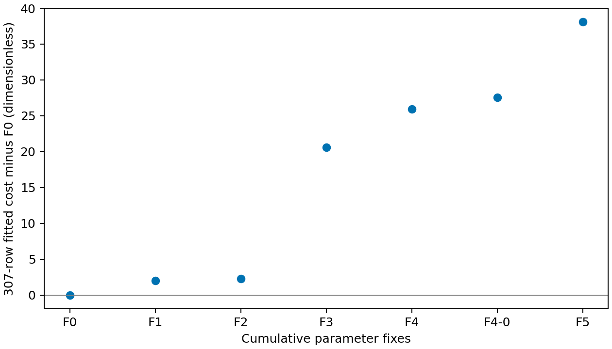

# Reduced MEA parameter fits, issue #338

The literature R2/R5 fit F1 has fitted cost **150.5320235704**, **2.0214779164 above F0**, while removing three fitted parameters. The cumulative eight-parameter F5 costs **186.6150920411**. Every prescribed start converged on an optimizer tolerance, and every fresh 1908 / 576 / 162-state finite search completed without finding a split. F4 reaches the MEAH⁺–HCO₃⁻ bound; the required F4-0 alternative is included. The Born-diameter ties are accepted by the pinned wheel. These are calibration and numerical-verification results for the owner's [#340](https://github.com/tannerpolley/Amine-Thermodynamics/issues/340) decision; no parameter record is adopted here.

## Cost and parameter reduction

| Fit | Fitted parameters | Cost | Change from F0 | On bound | Conditional SE > \|value\| |
|---|---|---|---|---|---|
| F0 | 16 | 148.5105 | 0 | 6 | 3 |
| F1 | 13 | 150.532 | 2.021478 | 2 | 3 |
| F2 | 11 | 150.7629 | 2.252357 | 1 | 3 |
| F3 | 9 | 169.1381 | 20.6276 | 1 | 1 |
| F4 | 9 | 174.4514 | 25.94085 | 2 | 0 |
| F4-0 | 8 | 176.0491 | 27.53852 | 1 | 0 |
| F5 | 8 | 186.6151 | 38.10455 | 3 | 0 |

[fit-comparison.csv](fit-comparison.csv) owns the unrounded comparison. Costs are dimensionless, half the sum of the 307 declared squared weighted residuals. F0 is a replay, without optimization. Fixes are cumulative: F1 replaces R2 and R5 in full by their source laws; F2 ties each amine ion's Born diameter to its segment diameter; F3 fixes carbamate–water interaction and the MEAH⁺–water reciprocal-temperature slope at zero; F4 fixes the two water–carbonate-ion laws from #282 and fits MEAH⁺–HCO₃⁻ instead; F5 fixes MEAH⁺–carbamate at zero. F4-0 separately fixes MEAH⁺–HCO₃⁻ at zero and does not supply F5's start.



## Optimizer and phase evidence

| Fit | Start | Native fitted cost | Optimizer end | Continuations | Attempt cost history | Split states grid / offset / census |
|---|---|---|---|---|---|---|
| F1 | previous | 150.532 | converged | 0 | 150.5320235703949 | 0/0/0 |
| F1 | current | 150.532 | converged | 0 | 150.53202543145156 | 0/0/0 |
| F2 | previous | 150.7629 | converged | 0 | 150.7629028795124 | 0/0/0 |
| F2 | current | 150.7667 | converged | 0 | 150.76671387450114 | 0/0/0 |
| F3 | previous | 169.1381 | converged | 0 | 169.1381491327744 | 0/0/0 |
| F3 | current | 169.1382 | converged | 0 | 169.1381643517022 | 0/0/0 |
| F4 | previous | 174.4514 | converged | 0 | 174.45139706357588 | 0/0/0 |
| F4 | current | 174.4514 | converged | 0 | 174.4514188404583 | 0/0/0 |
| F4-0 | previous | 176.0491 | converged | 0 | 176.04911587509815 | 0/0/0 |
| F4-0 | current | 176.0491 | converged | 0 | 176.04906333650396 | 0/0/0 |
| F5 | previous | 186.6151 | converged | 0 | 186.61509204114418 | 0/0/0 |
| F5 | current | 186.6151 | converged | 0 | 186.61509245429534 | 0/0/0 |

F1's previous start is F0 and its second start is #255's R2-held result, each with the literature laws substituted. Later previous starts use the preceding selected candidate and current starts use F0, each with the cumulative fixes substituted. F4-0 uses the same two prepared starts as F4. Both starts of every fit use the unchanged bounds, 307 observations, residual definitions, scales, weights and optimizer controls of the current record. Native stopping messages and full iteration histories are in each start's `unpenalized/attempt-0.json`. No continuation or enlarged iteration/time allowance was needed. The smallest fitted cost identifies the reported start; starts within the native relative function tolerance, 10⁻⁶ times cost, are reported as ties in [summary.json](summary.json). Ties occur for F1, F3, F4, F4-0, F5. Data outside the objective never select a start.

The dense block covers 15, 25, 35 and 45 wt% MEA, 313.15–393.15 K in 10 K steps, and loading 10⁻⁵ plus 0.025–0.6 mol CO₂/mol MEA, with 108 additional census-feed grid states. The offset block covers 20, 30 and 40 wt%, 318.15–388.15 K and loading 0.0125–0.5875. The single-liquid grid uses 1.05 and 3.0 times each record's own bubble pressure; offset states use 1.5 times bubble pressure. The 162-state liquid–vapor census retains #255's 30 wt% feed and reference pressures. Each search has 1908/1908 single-liquid grid states, 576/576 offset states and 162/162 liquid–vapor census states available. Supplied trials at the earlier recorded census split compositions are evaluated separately from the Full search; `split-trials.json` retains their compositions and original phase supports. Zero split states is a lower bound on discovered splits, not proof of global stability. No penalized refit or retreat is triggered for F1–F5 or F4-0: penalized split counts are **not run**, and the penalty evaluated on their searched states is zero. F0's same-wheel #297 search is retained evidence (1908/576/162, zero splits), not relabelled as a new fit.

The failure checks use actual historical unstable inputs. [supplied-trial-check.json](supplied-trial-check.json) retains state 38 with two Full-search descents and one separately evaluated supplied negative tangent-plane distance, −0.08481153988131496 RT. The supplied check does not replace search optimization. [retreat-no-endpoint-check/measured.json](retreat-no-endpoint-check/measured.json) has negative native stability measure −0.3883303218713934 at `dense|0.15|313.15|0.6|1.05`; the retreat writes no candidate when that unstable anchor has no endpoint.

## Agreement on identical inputs

The table reports average absolute relative deviation (AARD), in percent. The complete [agreement.csv](agreement.csv) gives **cost, AARD, root-mean-square error (RMSE), signed prediction-minus-observation bias**, and changes against F0 for every fitted group and every requested not-fitted cohort. It also reports the #255 numerical comparisons (AARD change in percentage points, RMSE ratio, and change in counts within twice row scale) without attaching a pass/fail or adoption decision.

| Dataset (number of quantities) | F0 | F1 | F2 | F3 | F4 | F4-0 | F5 |
|---|---|---|---|---|---|---|---|
| fitted: fitted CO2 partial pressure (47) | 11.78797 | 11.96191 | 11.64159 | 13.98204 | 15.45792 | 15.58623 | 20.09417 |
| fitted: Kiepe pressure (39) | 2.666524 | 2.666524 | 2.666524 | 2.666524 | 2.666524 | 2.666524 | 2.666524 |
| fitted: fitted phase mole fraction (94) | 7.114393 | 7.185592 | 7.079085 | 7.250426 | 7.449532 | 7.470753 | 7.538103 |
| fitted: restored species (7) | 8.962976 | 9.107622 | 8.928398 | 9.306548 | 9.697834 | 9.715558 | 10.00065 |
| fitted: Jakobsen ratio (6) | 17.03607 | 16.12337 | 17.06694 | 15.86569 | 18.42755 | 20.41875 | 22.94757 |
| fitted: loaded density (47) | 0.162021 | 0.1462684 | 0.1522558 | 0.2026876 | 0.2128705 | 0.2065017 | 0.2280743 |
| fitted: CO2-free density (5) | 0.02838647 | 0.03016944 | 0.03035823 | 0.02428522 | 0.02396264 | 0.02454045 | 0.02364643 |
| fitted: fitted heat of absorption (8) | 1.898684 | 1.665075 | 1.968941 | 8.018063 | 8.433912 | 8.512308 | 8.861275 |
| fitted: heat capacity (4) | 2.77119 | 2.656869 | 2.834827 | 3.340163 | 3.501676 | 3.39696 | 3.369359 |
| not fitted: six-source pressures (112) | 23.82475 | 24.1831 | 24.88715 | 33.16283 | 38.47676 | 38.5268 | 39.70391 |
| not fitted: Wagner pressures (23) | 16.15715 | 21.03384 | 25.03282 | 41.67382 | 48.70515 | 48.78852 | 49.73833 |
| not fitted: transfer 15 wt% (33) | 33.89263 | 44.47746 | 45.07964 | 38.2766 | 36.83722 | 37.24328 | 35.37971 |
| not fitted: transfer 45 wt% (37) | 44.52627 | 40.80565 | 45.85891 | 39.21821 | 39.68499 | 39.5594 | 43.12586 |
| not fitted: Matin 19 pools (19) | 67.77482 | 68.82106 | 67.53413 | 70.30146 | 74.80151 | 76.98548 | 80.29444 |
| not fitted: Arcis heats (14) | 7.715729 | 8.609291 | 8.861595 | 14.76598 | 15.19805 | 15.24389 | 15.4922 |
| not fitted: Kim heats (53) | 5.470179 | 6.357143 | 7.00948 | 11.58289 | 14.77454 | 14.85938 | 15.55772 |
| not fitted: Han densities (67) | 0.3711968 | 0.3424426 | 0.3507273 | 0.6178745 | 0.701025 | 0.6309649 | 0.7324944 |
| not fitted: broad heat capacities (51) | 2.391044 | 2.448885 | 2.539657 | 2.928857 | 2.961181 | 2.908692 | 2.895175 |
| not fitted: Bottinger 353 K (10) | 9.846265 | 9.640245 | 10.00377 | 10.99327 | 9.372711 | 9.920182 | 10.7801 |
| fitted: Cai temperature (25) | 0.368776 | 0.3692134 | 0.3694747 | 0.3682386 | 0.3686977 | 0.3679639 | 0.3679576 |
| fitted: Cai mole_fraction (25) | 2.591491 | 2.599972 | 2.60151 | 2.566371 | 2.567755 | 2.567224 | 2.564948 |

Pressure RMSE and bias use Pa. Fitted absorption heats use J/mol CO₂; Arcis and Kim comparisons use kJ/mol CO₂. Fitted heat capacities use J/(mol feed K), with feed basis in the original rows; the 51 broad heat capacities use kJ/(kg K). Densities use kg/m³, Cai temperatures K, species mole fractions and Jakobsen amount ratios dimensionless. Cai's 25 temperatures and 25 mole fractions are separated to avoid mixing units. The five Böttinger 353 K states contribute ten quantities (MEA + MEAH⁺ and carbamate); their exact predictions and target scales are retained per fit in `bottinger-353.json`.

The 307 fitted quantities and assigned uncertainties/scales are unchanged from the current declaration. [F0/replay.json](F0/replay.json) and each fit's `replay.json` retain observed values, residuals, weights and source locators. These scales include source measurement uncertainties and repository assignments; Kiepe uses an unscaled logarithmic residual, and density-group weights affect cost separately from row scales. The Han comparison reuses #268's 1 kg/m³ fallback scale; it is not a reported Han measurement uncertainty. All other not-fitted residual scales remain with the imported assessment producers and their row-level files. AARD is an error descriptor, not an uncertainty interval.

The same 112 six-source, 23 Wagner, 33/37 Aronu, 19 Matin, 14 Arcis, 53 Kim, 67 Han and 51 heat-capacity rows are used for each record. The 53 Kim identities are fixed to F0's requested 313.15/353.15 K comparison cohort; no candidate-dependent subset is selected. Not-fitted data were already seen in earlier studies and informed the owner's choice of fixes; they are not independent physical validation. Published-model same-row scores belong to [#339](https://github.com/tannerpolley/Amine-Thermodynamics/issues/339); at this delivery no qualified common-row score from that ongoing issue is available to include. The latest #339 owner decision accepts its translation qualification and authorizes scoring; qualification alone supplies no property score.

## Conditional parameter information

[parameter-details.csv](parameter-details.csv) gives each value, unit, bounds, scale, active-bound indication, conditional standard error (SE), and SE/absolute-value ratio beside F0. Active parameters have no estimated free-coordinate SE; a blank entry does not mean zero uncertainty. A bound is identified by #307's 10⁻⁶ times coordinate-scale distance rule. The #307 exact derivative and existing shared conditional-information producer are reused. The data-only Jacobian uses the same physical coordinate convention, including expanded diameter ties; no stability curvature is inserted.

| Fit | Variance factor | Free coordinates | Pairs with \|conditional correlation\| > 0.95 |
|---|---|---|---|
| F0 | 1.000071 | 10 | 4 |
| F1 | 1.017108 | 11 | 3 |
| F2 | 1.015238 | 10 | 4 |
| F3 | 1.131359 | 8 | 2 |
| F4 | 1.163009 | 7 | 2 |
| F4-0 | 1.17366 | 7 | 2 |
| F5 | 1.235862 | 5 | 0 |

F0's variance and correlations reuse the unchanged [#297 conditional information](../adoption-297/conditional-uncertainty.json). The complete high-correlation list is:

| Fit | Coordinate pair | Conditional correlation |
|---|---|---|
| F0 | `pair/carbamate-anion/water/k_ij` / `component/protonated-monoethanolamine/dispersion_energy_over_k` | -0.9753302 |
| F0 | `pair/carbamate-anion/water/k_ij` / `component/carbamate-anion/dispersion_energy_over_k` | 0.962877 |
| F0 | `pair/protonated-monoethanolamine/water/k_ij/reciprocal_temperature_slope` / `reaction:R2:enthalpy_shift` | 0.9639661 |
| F0 | `component/protonated-monoethanolamine/segment_diameter` / `component/carbamate-anion/segment_diameter` | -0.9985432 |
| F1 | `pair/carbamate-anion/water/k_ij` / `pair/protonated-monoethanolamine/water/k_ij` | -0.9660633 |
| F1 | `pair/protonated-monoethanolamine/water/k_ij` / `pair/bicarbonate-anion/water/k_ij` | -0.9638727 |
| F1 | `component/protonated-monoethanolamine/segment_diameter` / `component/carbamate-anion/segment_diameter` | -0.9974886 |
| F2 | `pair/carbamate-anion/water/k_ij` / `pair/protonated-monoethanolamine/water/k_ij` | -0.9881552 |
| F2 | `pair/carbamate-anion/water/k_ij` / `pair/bicarbonate-anion/water/k_ij` | 0.9600675 |
| F2 | `pair/protonated-monoethanolamine/water/k_ij` / `pair/bicarbonate-anion/water/k_ij` | -0.973911 |
| F2 | `component/protonated-monoethanolamine/segment_diameter` / `component/carbamate-anion/segment_diameter` | -0.9984152 |
| F3 | `pair/bicarbonate-anion/water/k_ij` / `component/carbamate-anion/dispersion_energy_over_k` | -0.9913105 |
| F3 | `component/protonated-monoethanolamine/segment_diameter` / `component/carbamate-anion/segment_diameter` | -0.9914059 |
| F4 | `pair/protonated-monoethanolamine/water/k_ij` / `component/protonated-monoethanolamine/dispersion_energy_over_k` | 0.9926633 |
| F4 | `component/protonated-monoethanolamine/segment_diameter` / `component/carbamate-anion/segment_diameter` | -0.9886303 |
| F4-0 | `pair/protonated-monoethanolamine/water/k_ij` / `component/protonated-monoethanolamine/dispersion_energy_over_k` | 0.9931949 |
| F4-0 | `component/protonated-monoethanolamine/segment_diameter` / `component/carbamate-anion/segment_diameter` | -0.9923925 |

These errors condition on the fixed source laws, fixed interactions, weights, active bounds and local linearization. They measure neither global parameter uniqueness nor physical prediction uncertainty. A smaller active set or smaller conditional error is not an adoption rule.

## Source-law and replay checks

The [F0 replay](F0-replay.json) returns all 307 predictions and cost 148.51054565397726 exactly: both maximum relative prediction difference and relative cost difference are zero (required 10⁻⁸). The [salt replay](salt-replay.json) returns NaHCO₃ AARD 0.16297888463729926% and Na₂CO₃ AARD 5.111329872572398%, with zero differences against #282 on all 90 predictions. Every fitted endpoint is written and reloaded; its `checks.json` verifies fitted-cost reproduction within 10⁻⁸ relative, exact fixed values, and unchanged other parameters.

R2 uses Austgen et al., Table V, p.547: ln K = 231.465 + 4.0165 − 12092.1/T − 36.7816 ln T, with the Part I Eq.(11) molality conversion. At reference 313.15 K the native coefficients are a = 24.109329984336796, b = −12092.1 K and c = −36.7816, without an enthalpy shift. R5 uses Bates and Pinching (1951), p.351, Eq.(10): pK = 2677.91/T + 0.3869 + 0.0004277 T. Its native law gives ln K(298.15 K) = −21.865746172917778, within one floating-point unit of the required value. [literature-law-check.json](literature-law-check.json) verifies both laws after binding the actual declaration.

The owner's [2026-11-13 correction](https://github.com/tannerpolley/Amine-Thermodynamics/issues/338#issuecomment-6865442193) replaces the impossible requirement that Eq.(10) reproduce measured Table 2 to printed digits. The exact algebraic conversion agrees with Eq.(10)'s own predictions within 1.7763568394002505×10⁻¹⁵ pK. Eq.(10)'s mean absolute residual against the 11 Table 2 measurements is 0.0009073164433412793 pK, beside the paper's stated 0.0010. At the source's 298.16 K, equation minus measurement is −0.002124056811377173 pK; that correlation residual decides nothing. [r5-table2-check.csv](r5-table2-check.csv) retains all rows. The original Zotero PDF attachment A9H4U73D was checked visually at p.351; SHA-256 `aff8621efd41dbce106bb189fd104840a1513d9d163f4f57dfb1abbf53a30db1`.

The requested R5 comparison is between Bates–Pinching Eq.(10) and the **law derived from Hamborg measurements in #263**, not coefficients claimed to be printed by Hamborg. No Hamborg-law fit is run here. Values are aqueous-molality ln K:

| Temperature / K | Bates–Pinching ln K5 | Hamborg-derived ln K5 | Bates minus Hamborg |
|---|---|---|---|
| 313.15 | -20.88988 | -20.79712 | -0.09276316 |
| 323.15 | -20.29039 | -20.20875 | -0.08163974 |
| 333.15 | -19.72749 | -19.65099 | -0.07650184 |
| 343.15 | -19.19796 | -19.12128 | -0.0766884 |
| 353.15 | -18.69899 | -18.61737 | -0.08162103 |

[born-tie-outcome.json](born-tie-outcome.json) retains the accepted two-ion segment/packing/Debye–Hückel/Born coordinate declaration and an Available native exact-derivative observation. All F2–F5 and F4-0 endpoints use the true tie, not fixed Born substitutes. No Engine capability request is needed.

## Values inherited by Part II and limits

[part-ii-inherited-values.json](part-ii-inherited-values.json) retains the completed native R1–R3 laws, standard-state identifiers and complete water–bicarbonate/water–carbonate pair nodes for every reduced record. These are alternative records for #340, not newly adopted Part II inputs. Each `information.json` also retains them beside the conditional calculations.

Only two starts are examined, so these are local optima. Each cumulative cost change is conditional on the earlier fixes, rather than an isolated estimate of one physical effect. Stability searches are finite and their split counts are lower bounds. F4, F4-0 and F5 condition on the two bound values inside the #282 salt fit, and extrapolate its linear water-ion laws from salt data at 278–318 K to MEA states up to 393 K. Fixed literature laws have their own measurement ranges; fitting other parameters does not validate their extrapolation. No physical split mechanism, new model, adoption, manuscript revision or independent physical validation is claimed.

## Reproduction, fingerprints and code ownership

One immutable Engine wheel is used: commit `391dfe5d64ede5036bf160bc6ae037ad5e14af32`, SHA-256 `0962e21d2fa7a8ba1ed4622f1110b3e8053bacd878fa41c999d85e8b9afab66b`. Imports use the wheel rather than an Engine source checkout. No Engine source, selected-current-best parameter document, Engine pin, manuscript source or manuscript registry is changed.

| Fit | Parameter document SHA-256 |
|---|---|
| F0 | `f8f64820b161377a0d97d1e4ad4f6cea764cd0558dc63231d58e2096988eef97` |
| F1 | `399c77c6a51df718c40c57e5c3f6b97610ba627823b960b37995ce8d97a5e6ff` |
| F2 | `ae17803e1bcb2ca0a1970e05c7cc235d615c4d8a3a349b5afef0b0401dedefed` |
| F3 | `d32d4fc44ceccad977f6a34878c5d6dda21bfc0732ff0e64950b682cf9a07c87` |
| F4 | `e13c4f7eab2822fd762b97d33e360b16854f82b3a1de0877c7de11087b8fea22` |
| F4-0 | `21ffa2b48932c7ca72d20824251171dbbeda0841fa48aad6f935dcfbc27fec24` |
| F5 | `76778d08c0cbed1699420e1d6d24aec8ef190e0aead58113c1e275edaf2def37` |

[input-fingerprints.json](input-fingerprints.json) binds the calculation declarations, salt-law inputs, #255 controls, source scripts and lockfile. Each start's declaration, native fit report, endpoint replay, and search diagnostics retain the numerical evidence. The same record is used for fitting-cost replay, all property assessments and conditional information.

Run from the repository root with the pinned wheel already installed through the frozen uv environment. Each heavy command runs in its own background shell with its log; `agent-heavy` supplies the core allowance. The existing fit and search producers size their workers from it, with OMP, OpenBLAS and MKL threads fixed at one.

```bash
agent-heavy uv run --no-sync python -u analyses/mea_parameter_bundle/scripts/reduced_refit_338.py laws
agent-heavy uv run --no-sync python -u analyses/mea_parameter_bundle/scripts/reduced_refit_338.py replay
agent-heavy uv run --no-sync python -u analyses/mea_parameter_bundle/scripts/reduced_refit_338.py salt
agent-heavy uv run --no-sync python -u analyses/mea_parameter_bundle/scripts/reduced_refit_338.py campaign
agent-heavy uv run --no-sync python -u analyses/mea_parameter_bundle/scripts/reduced_refit_338.py assess
agent-heavy uv run --no-sync python -u analyses/mea_parameter_bundle/scripts/reduced_refit_338.py present
```

The driver resumes retained attempts and searches; delete no result to force a different optimization. The numerical campaign initially ran before the final reduction fields were completed; the final command reuses its unchanged attempts and refreshes the summaries, exact endpoint checks and conditional information without choosing a new fit. An assessment shell received SIGTERM before F5 Kim results were written; [assessment-interruption.json](assessment-interruption.json) records the exact interruption, with no numerical exception. The assessment was resumed from its retained cache without repeating a fit or changing controls. Intermediate F1 diagnostic directories were moved to ignored scratch after their native attempts were copied into the two canonical start directories.

[code-accounting.json](code-accounting.json) counts **597 gross added executable lines** from `13bb6fb`, within the owner's amended 600-line ceiling. The #255 fit, search and retreat, #307 conditional-information calculation and adoption assessment producers are reused by import; no new numerical method or copied executable assessment producer is retained. Exact responsibility accounting:

| File / responsibility | Gross added executable lines |
|---|---|
| final_evidence.py / stability | 8 |
| final_evidence.py / phase_classification | 3 |
| stable_refit_255.py / _init | 3 |
| stable_refit_255.py / _measure | 19 |
| stable_refit_255.py / grid | 8 |
| stable_refit_255.py / descent | 1 |
| stable_refit_255.py / tally | 2 |
| stable_refit_255.py / coordinates | 8 |
| stable_refit_255.py / endpoint_mapping | 7 |
| stable_refit_255.py / _census | 15 |
| stable_refit_255.py / census | 4 |
| stable_refit_255.py / stage_fit | 5 |
| stable_refit_255.py / retreat | 5 |
| reduced_refit_338.py / module declarations and separators | 51 |
| reduced_refit_338.py / write | 2 |
| reduced_refit_338.py / table | 2 |
| reduced_refit_338.py / laws | 43 |
| reduced_refit_338.py / salt | 13 |
| reduced_refit_338.py / replay | 15 |
| reduced_refit_338.py / fit | 46 |
| reduced_refit_338.py / search | 35 |
| reduced_refit_338.py / information | 26 |
| reduced_refit_338.py / evidence | 28 |
| reduced_refit_338.py / candidate | 44 |
| reduced_refit_338.py / campaign | 105 |
| reduced_refit_338.py / scores | 43 |
| reduced_refit_338.py / assess_all | 20 |
| reduced_refit_338.py / check_retreat | 9 |
| reduced_refit_338.py / present | 27 |

Independent delivered review and notebook render are recorded separately in `delivery-checks.json`. Manuscript use still requires the owner's #340 adoption and notebook promotion.
