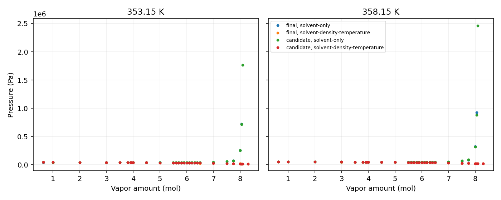

The sampled `solvent-only` pressure curves have a local minimum after the liquid
crosses 45 wt% apparent MEA. With the current `solvent-density-temperature`
formulation, pressure decreases over the sampled range; its lowest sampled
pressure is at the last vapor amount and is not a demonstrated minimum. These
are fixed-parameter model calculations and numerical verification, not physical
validation or evidence of global phase stability. They have not been
independently reviewed or promoted for manuscript use.

The feed is 0.358 mol CO₂, 1 mol MEA and 7.929776437398854 mol water. Temperature
is 353.15 or 358.15 K. The final parameter file and the unadopted #255 candidate
are evaluated with the repository-pinned Engine wheel. `solvent-only` uses the
MEA and water permittivity records from `effective-F3-A.json`, identical to the
Engine reference; `solvent-density-temperature` uses each parameter file's
current records. All other parameters and reaction laws remain fixed per set.
The two permittivity laws use different coefficients, so the comparison tests
formulations together with their retained inputs.

The domain uses the intersection of the calibration and enforced-grid ranges:
$w_{\rm MEA,app}\leq 0.45$ and $10^{-5}\leq\alpha\leq0.6$. Among all 307
calibration rows, the maximum mass fraction is 0.97710414 (Cai row 002); among
268 with MEA present, loading spans 0–0.668. The 39 CO₂–water rows contribute
zero mass fraction and have undefined loading. The #255 grid spans 0.15–0.45
mass fraction and $10^{-5}$–0.6 loading; 1903 of 1908 states were enforced.
This intersection is a project scope decision, not a continuous experimental
coverage or physical validity certificate.

Apparent MEA is free MEA + MEAH⁺ + carbamate; apparent CO₂ is free CO₂ +
carbamate + bicarbonate + carbonate. Apparent water follows oxygen balance:
water + bicarbonate + carbonate + hydronium + hydroxide. The mass fraction
uses apparent MEA and water only. The [calibration calculation](calibration.py)
and [summary](calibration.json) preserve the row counts and extrema.

| Parameter set | Rule | T (K) | Lowest sampled pressure (Pa) | Vapor (mol) | Boundary crossing bracket (mol vapor) |
|---|---|---:|---:|---:|---:|
| Final | solvent-only | 353.15 | 35908.12 | 6.1 | 3.90–3.95 |
| Final | solvent-density-temperature | 353.15 | 15090.94 | 8.3 | 3.95–4.00 |
| Candidate | solvent-only | 353.15 | 37838.13 | 5.8 | 3.90–3.95 |
| Candidate | solvent-density-temperature | 353.15 | 14124.07 | 8.3 | 3.95–4.00 |
| Final | solvent-only | 358.15 | 43579.34 | 6.2 | 3.90–3.95 |
| Final | solvent-density-temperature | 358.15 | 19544.25 | 8.3 | 3.95–4.00 |
| Candidate | solvent-only | 358.15 | 45926.43 | 5.8 | 3.90–3.95 |
| Candidate | solvent-density-temperature | 358.15 | 18416.98 | 8.3 | 3.95–4.00 |

Each boundary bracket contains the first sampled crossing of $w=0.45$; loading
remains inside its bounds there. The sampled solvent-only minima are bracketed
by higher neighboring pressures at the 0.1 mol grid spacing. They are grid
estimates, not optimized extrema. The density-dependent curves were sampled
only through 8.3 mol and no claim is made about a later turning point.

[Points and liquid compositions](points.csv), [crossing compositions](summary.txt),
[solver output including failures](solver.log) and [producer](probe.py) retain
the evidence. The maximum apparent-component balance error is below
$2\times10^{-13}$ mol. Each displayed point met the $10^{-10}$ Engine row
residual tolerance. Some solvent-only states at high vapor amount failed; they
are not interpolated or counted as physical absence. The scan does not prove
all branches were found. The domain and fold comparison do not qualify use in
water-depleted salt-rich liquid, and uncertainty from model form or parameter
estimation was not quantified.

The Engine wheel SHA-256 is
`0d08dff9be39fb8fc9018119c47612f53d823cd0e456914d7dd44c6941596804`.
The final and candidate parameter SHA-256 values are respectively
`00e77608a8489fc9e03a7d2a86c08cb5ff782bb441368a62fa6390b8bfe9cc91`
and `f8f64820b161377a0d97d1e4ad4f6cea764cd0558dc63231d58e2096988eef97`.
