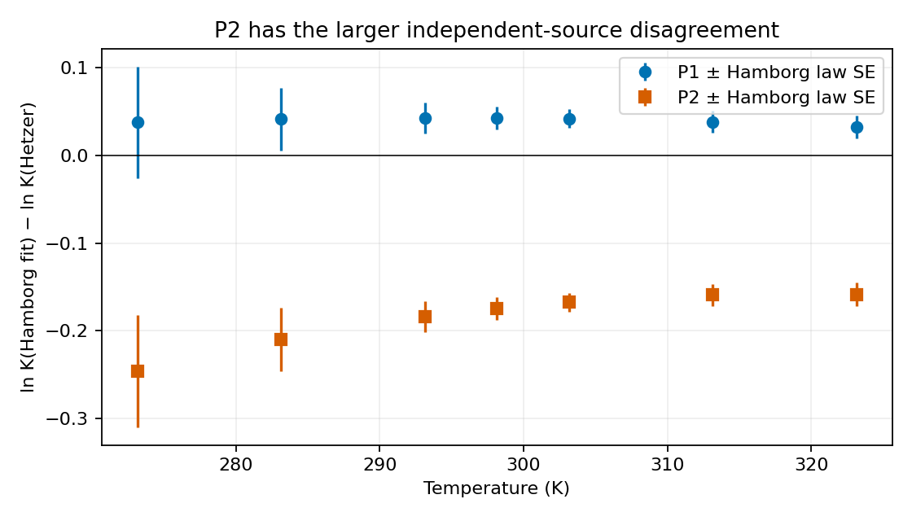
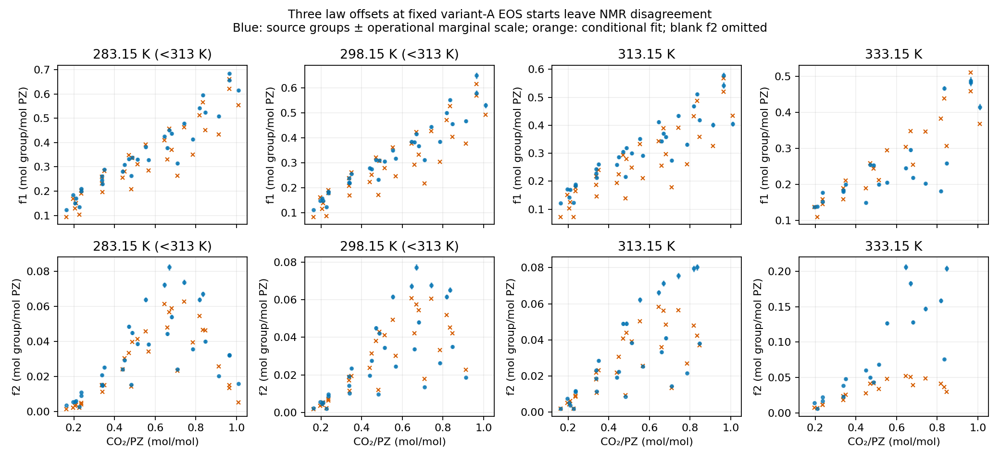

The PZ–water binary calibration converges reproducibly to two identifiable, interior interaction coordinates, but **does not reproduce Hartono vapor/liquid equilibrium or the separate aqueous-density observations on their stated scales**. All 23 calibration states pass the declared fluid-phase trials. The 393.15 K, 0.1 MPa Concepción comparison is a metastable-liquid density on this model. The owner decision of 11 November 2026 accepts the [stage-2 endpoint](#stage-2-two-start-calibration-and-independent-aqueous-comparisons) as the conditional working PZ–water set for stage 3, carrying these misfits and phase limitations. It is not a validated set. Stage 3 below retains protonation laws and a conditional NMR-offset diagnostic. The orchestrator accepted these as conditional working starts for a separately dispatched stage 4, carrying the fixed-variant-A NMR misfit and inherited limits.

## Pure-PZ energy refit

The limited pure-piperazine (PZ) refit removes **99.9745% of the temperature trend in relative pressure error** with Razavi's $m=2.6519$ and $\sigma=3.7136$ Å fixed. The eight Steele 1997 pressures at **417.997–460.477 K** determine three locally identifiable energy coordinates under the diagonal source-error model. The mean absolute relative error falls from **8.96865% to 0.00345189%**. Five points lie inside their printed error scales; three outside points are reported below without a new acceptance gate.

This is **calibration to one pressure campaign**, with numerical verification, rather than independent physical validation. Pure-liquid density remains unvalidated. The energy change shifts its prediction even though size parameters are fixed. The neutral aqueous interaction is fitted in stage 2 below; no reactive parameters have been fitted, and the owner subsequently adopted it as the working pure-PZ set for stage 2 (decision linked below). It has not been promoted for manuscript use.

## Question, authority and source basis

The [owner decision in #308](https://github.com/tannerpolley/Amine-Thermodynamics/issues/308#issuecomment-6808842683) authorizes fitting only $u/k_B$, $\epsilon_{AB}/k_B$ and/or $\kappa_{AB}$, chosen from identifiability, to Steele Table 7 with its propagated errors. Hartono is a supporting correlation only. The Stage 1 frozen-parameter check is retained in [pressure-residuals.csv](results/pressure-residuals.csv) and [summary.json](results/summary.json); its independent delivered review was Supported before merge `0a2fca9`.

Razavi et al. (2019), DOI [10.1021/acs.iecr.9b01429](https://doi.org/10.1021/acs.iecr.9b01429), Table 1 p.11040, supplies $m=2.6519$, $\sigma=3.7136$ Å, $\epsilon/k_B=274.10$ K, $\epsilon_{AB}/k_B=1923.25$ K and $\kappa_{AB}=0.07275$. Section 3.1 p.11046 specifies effective 2B association: one donor and one acceptor, each multiplicity one. Equation 7 p.11045 uses

$$\Delta_{AB}=g^{hs}(d)\,[\exp(1923.25/T)-1]\,\sigma^3\kappa_{AB}.$$

The pinned Engine uses this same $\sigma^3$ association convention (`engine/docs/equations.md`, `association_strength`, at merged Engine commit `391dfe5d64ede5036bf160bc6ae037ad5e14af32`). No diameter-volume conversion or doubling of sites is appropriate. No polar or electrolyte contribution is enabled for this neutral calculation. Parameters and topology are retained in [inputs/razavi.json](inputs/razavi.json).

Steele et al. (1997), DOI [10.1021/je9700986](https://doi.org/10.1021/je9700986), Table 7 p.1044, gives eight pressures measured by comparative ebulliometry with water as reference. The retained [transcription](inputs/steele-table7.csv) preserves temperatures, pressures, propagated errors, source correlation residuals and boiling–condensation temperature differences. Table 7's footnote p.1045 defines the propagated error from the temperature derivatives of sample and reference pressures. Its symbol $\sigma$ does not establish a confidence interval. Neither the source correlation residual $\Delta p$ nor the boiling–condensation difference $\Delta T$ is added to this error. Table 8 p.1045 gives melting at **384.6 K**; all eight reference points are liquid.

The original Zotero PDFs for Razavi, Steele and Hartono were read in their relevant methods, parameter, results and limitation passages. Steele Table 7 was also checked visually. All three PDF hashes matched the design's source identities on 11 November 2026; see [inputs/provenance.json](inputs/provenance.json). The task checkout has no local literature shelf; the canonical shelf index and original Zotero PDFs supplied the readings. Yaws/HYSYS fit grids remain unavailable, so this is not a reproduction of Razavi's reported 0.33% fit deviation.

The three original PDF hashes were checked again for this refit and matched [provenance.json](inputs/provenance.json). Relevant Razavi §3.1/Eq.8, Steele Table 7/footnote and melting passage, and Hartono §5/Tables 8 and 11 were read directly from the PDFs. No new source data were acquired. Razavi's original pressure/density fitting inputs remain unavailable.

## Fit, information and parameter uncertainty

The native Engine minimizes

$$\frac12\sum_{i=1}^{8}\left[\frac{p_{sat}(T_i;q)-p_i}{s_i}\right]^2,$$

where $s_i$ is Steele's printed propagated pressure error. No Hartono values or densities enter the objective. All seven nonempty subsets of the three allowed energy coordinates start at Razavi. Coordinates are affine, $q_j=q_{Razavi,j}(1+x_j)$, so the reported Jacobian is $J_{ij}=\partial[(p_{sat}-p_i)/s_i]/\partial x_j$. Fitting and exact derivatives are owned by the pinned Engine; NumPy supplies the singular-value decomposition and descriptive statistics.

| Quantity | Refit | Local standard error | Razavi (fixed baseline) |
|---|---:|---:|---:|
| $u/k_B$ (K) | 313.20598 | 0.34586 | 274.10 |
| $\epsilon_{AB}/k_B$ (K) | 1469.8201 | 11.1726 | 1923.25 |
| $\kappa_{AB}$ | 0.02722986 | 0.00154303 | 0.07275 |

The endpoint scaled-Jacobian singular values are **459994.32, 5292.19 and 45.3999**, giving numerical rank **3** and condition number about **10132**. Strong correlation is explicit, rather than evidence of independent molecular interpretation:

| Correlation | $u/k_B$ | $\epsilon_{AB}/k_B$ | $\kappa_{AB}$ |
|---|---:|---:|---:|
| $u/k_B$ | 1 | +0.998091 | −0.999584 |
| $\epsilon_{AB}/k_B$ | +0.998091 | 1 | −0.999456 |
| $\kappa_{AB}$ | −0.999584 | −0.999456 | 1 |

In the same physical parameter order (K, K, dimensionless), the local covariance is

$$C=\begin{pmatrix}0.11961953&3.85679583&-0.0005334498\\3.85679583&124.82779436&-0.0172302767\\-0.0005334498&-0.0172302767&0.000002380928\end{pmatrix}.$$

These standard errors come from $C_x=(J^T J)^{-1}$, transformed to physical coordinates, treating the printed source scales as independent standard deviations for this calculation only. Steele does not establish that statistical interpretation or supply campaign covariance. They are **conditional local errors**, not confidence intervals, independent validation, or total model uncertainty. Multiplying by $\sqrt{6.28024/5}$ to estimate residual variance instead gives standard errors **0.38762 K, 12.5216 K and 0.00172932**. Neither calculation covers source systematics, fixed size-parameter uncertainty, model discrepancy or extrapolation uncertainty.

**Why three coordinates:** the one-parameter fits leave source-scale squared residual sums above one million. The best two-parameter fit ($u$, $\epsilon_{AB}$) leaves **325.474**, whereas the third coordinate lowers this to **6.28024** for five residual degrees of freedom. Its smallest scaled singular value is finite and the local marginal errors are about **0.11%, 0.76%, and 5.67% of the fitted values**. Thus all three are locally resolved on the supplied error scale, despite nearly parallel sensitivities. No arbitrary condition-number or percentage gate is applied. This does not establish global uniqueness or transferability.

The first three-coordinate run stopped at 100 iterations with squared residual sum **9.66597**, while descending along the correlated valley. A bounded diagnostic continuation from that endpoint, using the same coordinates, tolerances and 100-iteration budget, converged in 25 iterations to **6.28024**. Both attempts and their iteration costs are retained; the limited attempt is not labeled converged. No physical parameter was added and no tolerance was relaxed.

## Pressure residuals and slope




Residuals are $(p_{fit}-p_{Steele})/s_i$; relative errors are $100(p_{fit}/p_{Steele}-1)$. Positive values in the final table column mean outside $p_i\pm s_i$. At **434.490 K**, the residual is **−1.00692**, a close near-miss only **0.00006924 kPa** outside the printed ±0.01 kPa scale. At **417.997 K**, **−1.23044** is **0.00092177 kPa** outside ±0.004 kPa, a modest near-miss. At **421.772 K**, **+1.87583** is **0.00437915 kPa** beyond ±0.005 kPa: almost twice the printed scale, a larger remaining discrepancy. No point is silently rounded into agreement. The relative-error range is **−0.00703% to +0.00926%**.

An unweighted linear regression of relative error on temperature over the eight source states changes from **+0.10097924 percentage points/K** (Razavi) to **−0.00002578 percentage points/K** (refit), removing **99.9745% of the absolute trend**. The endpoint relative-error difference changes from **+4.29205** to **+0.00615751 percentage points**. This is removal of a systematic temperature trend with small residual scatter, not exact reproduction of every source point. The fixed-size slope stop condition does not fire.

Hartono's Table 8/Table 11 method 3 uses $\log_{10}(p/\mathrm{kPa})=5.9832-1215.77/(T/\mathrm K-113.56)$. Its pure and binary parameters were fitted simultaneously (§5.1), with Steele among its sources; it is not independent confirmation. It exceeds Steele by about **7.34–11.53%** here. No coefficient covariance or explicit validity interval was supplied, so it is evaluated only over the verified liquid-measurement span and never used as refit data.

## Extrapolation and density limitation

| T (K) | Razavi pressure (kPa) | Refit pressure (kPa) | Change (%) | Razavi liquid density (kg/m³) | Refit liquid density (kg/m³) | Density change (%) |
|---:|---:|---:|---:|---:|---:|---:|
| 283 | 0.14365533 | 0.14274921 | −0.63076 | 900.4852 | 916.0664 | +1.73032 |
| 393 | 43.509814 | 41.650862 | −4.27249 | 815.2159 | 822.7370 | +0.92259 |

The [283–393 K comparison](results/refit-extrapolation.csv) is a pure-liquid branch extrapolation below the measured pressure span. Below **384.6 K** it is subcooled liquid, not stable-liquid or solid-vapor equilibrium. In this retained range the pressure shift is not assumed monotonic; the full CSV owns its interior variation. The largest sampled positive shift is **+0.50267% at 311 K**, with the negative extreme **−4.27249% at 393 K**. No physical validation or uncertainty band is available there.

**Pure-liquid density remains unvalidated.** The measured-span saturated-liquid density shifts upward by **0.6946–0.7937%** versus Razavi (roughly **5.24–6.30 kg/m³**), and at 283 K by **15.5813 kg/m³**. These compare each model at its own saturation pressure; they are not fixed-pressure density differences or a density-fit score. Changing energy parameters changes packing and cohesion even with $m$ and $\sigma$ fixed. No verified molten-PZ density measurement with usable phase, pressure basis and uncertainty was available. Subsequent aqueous-density comparisons cannot independently validate pure-liquid density.

## Reproduction and scientific status

```bash
agent-heavy env UV_NO_SYNC=1 uv run python analyses/pz_transfer/refit.py
agent-heavy env UV_NO_SYNC=1 uv run python analyses/pz_transfer/present.py
```

[refit.py](refit.py) is the current analysis Engine boundary and reuses Stage 1 wheel verification from [run.py](run.py). It requires Engine `391dfe5d64ede5036bf160bc6ae037ad5e14af32`, wheel SHA-256 `0962e21d2fa7a8ba1ed4622f1110b3e8053bacd878fa41c999d85e8b9afab66b`, and checks byte identity of installed Engine files. No source checkout imports are used. The full [fit record](results/refit-fits.json) owns covariance, singular vectors, correlations, starts, fit statuses and iteration traces. [The calibration candidate](results/refit-parameters.json) is retained separately from the unchanged Razavi input. [Row residuals](results/refit-residuals.csv), [continuous liquid curve](results/refit-liquid-curve.csv) and extrapolation retain the plotted quantities. All returned branches have distinct positive liquid/vapor densities and positive pressure-density derivatives. The maximum measured-state equilibrium residual is **2.05×10⁻¹⁴**. Tightening each measured-state solve from $10^{-10}$ to $10^{-12}$ changes the pressure by at most **5.68e-11 source-error units**.

Independent delivered cse:review returned **Supported**, with no required corrections, for scientific commit `da41fd04ce31754bdc1fe1bf746553215b6da7dc` against base `0a2fca9`. Both result and capability lenses passed. The reviewer independently reproduced all subset objectives and stopping states, the unchanged-tolerance continuation, covariance and singular values, all retained curve values, and numerical refinement. A central-difference check along the weakest Jacobian direction agreed with the native derivative within **0.0014%**. The verdict supports this limited pressure calibration and its stated model-to-model shifts only. See the [independent review](t3-thread://v2/df61a5ad-76a1-4901-b919-31ae81c8e67d/thread:delegated-task:command%3Amcp%3A8a0eddb3-c1a6-4c7e-8baf-13d3e51661af%3Adelegate-task%3A8715e3c4-1f8c-4272-a221-af6871e013a8). This notebook has not been promoted for manuscript use. Render directly with Quarto; the task prohibits changing the manuscript registry. Stages 2–5 remain outside this delivered result.


## Stage 2: two-start calibration and independent aqueous comparisons

**Two phase-admissible starts converge to the same conditional calibration endpoint, but source agreement remains poor.** The [owner adopted stage-1b pure-PZ set](https://github.com/tannerpolley/Amine-Thermodynamics/issues/308#issuecomment-6809015382) was used with the unchanged neutral water coefficients, diameter correlation and water self-association from the hash-bound #255/#297 record. The neutral binary projection omits inactive electrostatic coefficients; no water coefficient was refitted. PZ–water association uses the adopted Wolbach–Sandler rule with the two self-association edges. This calculation contains neutral PZ and water only, with no CO2 or explicit protonation; it follows Hartono 2013 §3's molecular binary approximation. It does not establish the adequacy of neglecting protonation at every temperature.

The design specifies $k(T)=k_0+k_1(T-353.15\,\mathrm K)$, with initial values zero, coordinate scales 0.05 and 0.001 K$^{-1}$ and bounds ±0.5 and ±0.005 K$^{-1}$. The pinned Engine native polynomial temperature-law declaration represents this law directly, without substituting the reciprocal-temperature coordinate used in earlier AMP work. The fit attempts 23 Hartono Table 6 rows as paired total pressure and vapor mole fraction observations. The designated 79.97 °C, $x=0.0472$ row is retained separately and excluded before the fit.

The original [zero-start fit attempt](results/binary-fit.json) stopped at its initial evaluation, before any optimization iteration. The first source row, $T=333.15$ K, $x_{PZ}=0.0324$, has liquid composition-stability eigenvalue **−0.2700101917**, compared with the Engine rounding band **−3.09011 × 10⁻¹⁴**. Although equation residuals are at most **8.90 × 10⁻¹⁴** and the solver reports SUCCESS, it returns no physical pressure or density endpoint because of local phase instability. A success flag is therefore not a usable bubble calculation.

The [bounded diagnosis](results/binary-phase-diagnosis.csv) evaluates all 23 rows, preserves each message and tests a tighter row tolerance. It also tests negative constant interaction values within the approved coordinate bounds, solely to locate the initialization problem:

| Diagnostic $k_0$ | $k_1$ (K$^{-1}$) | Rows returning bubble pressure | Rows reporting local phase instability |
|---:|---:|---:|---:|
| 0 | 0 | 1 | 22 |
| −0.05 | 0 | 17 | 6 |
| −0.10 | 0 | 23 | 0 |

At zero interaction, tightening the row tolerance from $10^{-10}$ to $10^{-12}$ preserves the 22 local-instability classifications. Direct liquid states at the observed pressures have positive pressure–density derivatives, so positive mechanical compressibility alone does not remove the composition instability. The owner subsequently authorized $k_0=-0.10$, $k_1=0$ and a second admissible start, with all other declarations and phase safeguards fixed. The starting value itself is neither a calibration endpoint nor a global tangent-plane or solid-stability certificate. With the stage-1b pure set and no interaction correction, the model predicts PZ–water liquid demixing at 22 of the 23 calibration states. This is model behavior, not an observed liquid–liquid separation. This is a numerical phase diagnosis of the specified starting model, not evidence that the fitted formulation cannot describe the measurements.

### Prepared observations, uncertainty and remaining work

The current Zotero PDFs were checked against the design hashes; identities are in [stage2-provenance.json](inputs/stage2-provenance.json). Read Hartono 2013 §§2–3 and Table 6 p.156, Concepción 2020 §2 and Table 2 p.3, Friis 2025 §2 and Table 3 p.4, and Hilliard Appendix D.2 (printed pp.911–912). The local literature shelf contains no corresponding PZ paper; these original PDFs supplied the readings. The tables were transcribed from their text layers. No new source acquisition or private material was used.

- [Hartono transcription](inputs/hartono-table6.csv): 24 rows, 23 for calibration and the designated outlier. Pressure scale 0.3 kPa and vapor scale $\sqrt{(0.01y)^2+(0.00005/\sqrt{3})^2}$ follow the approved operational scheme. The 1% term is an analog titration scale, with Hartono total titration accuracy unknown. Pairing $(P,y)$ avoids counting the shared pressure twice. Campaign-common pressure and input-temperature/composition sensitivities are retained separately below; the reported objective and conditional standard errors hold measured temperature and liquid composition fixed.
- [Hilliard D.2 transcription](inputs/hilliard-d2.csv): 46 rows spanning 305.872–336.561 K, with 10 PZ partial pressures below 2 Pa. Source uncertainty is not supplied here; these remain unscored comparison observations. Frozen-endpoint predictions, including the below-313 K subset, are retained below.
- [Aqueous density transcription](inputs/aqueous-density.csv): Concepción's six 0.1 MPa states at mass fraction 0.1001, with expanded uncertainty bound 0.7 kg/m³ ($k=2$); 50 measured Friis liquid states, with their printed ± values and 27 source-marked precipitates explicitly excluded. Friis water-only rows cite another source and are not treated as new Friis PZ measurements. Atmospheric pressure is represented as nominal 101325 Pa; no measured barometric value is inferred. Friis full propagated uncertainty and the statistical meaning of ± remain unknown. Density predictions and source-uncertainty residuals are retained below; no density fitting was attempted.

### Two-start endpoint, identifiability and residual diagnosis

Both starts returned bubble pressures at all 23 calibration states before optimization. Starting at $(-0.10,0)$ converged in eight iterations and $(-0.15,0)$ in six, using the unchanged native objective and tolerances. The endpoints differ by $5.05\times10^{-8}$ in $k_0$ and $1.76\times10^{-10}$ K$^{-1}$ in $k_1$. Their costs differ by $5.06\times10^{-8}$. Neither endpoint is on a bound. The first start supplies the fixed endpoint for all comparisons; agreement of the two starts supports local reproducibility, not a global optimum proof.

| Coordinate | Fitted value | Conditional local standard error |
|---|---:|---:|
| $k_0$ at 353.15 K | −0.1976454016 | 0.0002086636 |
| $k_1$ (K$^{-1}$) | 0.001125014785 | 0.000012982794 |

The [calibration record](results/binary-calibration.json) retains both initial and final scaled Jacobians, singular values, right vectors, covariance and correlation. At the first endpoint, the uncertainty-scaled Jacobian in optimizer coordinates has singular values **252.60369 and 76.62953**, numerical rank two and correlation **−0.301403**. Perturbing each optimizer coordinate with central steps $10^{-4}$ and $5\times10^{-5}$ reproduces the singular values; the maximum elementwise Jacobian differences from the native exact derivative are $2.39\times10^{-7}$ and $6.22\times10^{-8}$ ([derivative check](results/binary-derivative-check.json)). The local covariance in physical coordinates is

$$\operatorname{Cov}(k_0,k_1)=
\begin{pmatrix}
4.35405\times10^{-8} & -8.16511\times10^{-10}\;\mathrm{K^{-1}}\\
-8.16511\times10^{-10}\;\mathrm{K^{-1}} & 1.68553\times10^{-10}\;\mathrm{K^{-2}}
\end{pmatrix}.$$

These are conditional local errors under the declared diagonal pressure/vapor error model, with measured temperature and liquid composition held fixed. No residual-variance multiplier is applied. They exclude unknown Hartono titration accuracy, campaign-common calibration error, fixed pure-parameter uncertainty and model discrepancy; they are not defensible physical prediction intervals. The large residuals make the small local errors particularly unsuitable as an overall uncertainty claim. Temperature and liquid-composition effects below are sensitivity diagnostics, rather than incorporated covariance or reconciled inputs; full input uncertainty remains a limit on adoption.

The sum of squared source-scaled residuals is **5133.5335** for 46 observations and two coordinates. Total-pressure residuals have mean **−6.17255**, root-mean-square **7.78290**, and range **−18.85484 to −0.99728** in units of 0.3 kPa. Vapor-PZ residuals have mean **−5.28256**, root-mean-square **12.75239**, and range **−22.06429 to +22.98596** in the conditional vapor scale. Only one pressure and one vapor observation lie within their respective one-scale intervals. These descriptive comparisons impose no new percentage gate.

The pressure at row 9 is just inside its 0.3 kPa scale: residual −0.997280, a margin of 0.000816 kPa. The nearest outside pressure is row 19 at −1.329474 scales, 0.098842 kPa beyond its scale; this is reported as a modest outside discrepancy, rather than rounded into agreement. The designated outlier is separate: measured $y=0.0020$ versus predicted **0.0004314145**, residual **−44.6651** conditional scales; its pressure residual is **−5.02586** scales. It never enters optimization or identifiability.

The [row-level residuals](results/binary-calibration-residuals.csv) retain signed physical differences, relative differences, outside-scale distances, equation residuals and input sensitivities. Tightening equation tolerance to $10^{-12}$ changes predicted pressure by zero at retained precision. Finite-difference derivatives, two starts and the phase checks below argue against a numerical explanation of the pattern. A +0.05 K perturbation changes pressure by at most **0.58544** source units and vapor fraction by **0.13352** units. A positive liquid-composition perturbation using the conditional 1% analog plus printed rounding changes pressure by at most **0.71513** units in magnitude and vapor fraction by **3.03336** units. These probes do not establish total source uncertainty, but are too small to account for the largest discrepancies.

Refitting under campaign-common pressure shifts of ±0.3 kPa gives $k_0$ from **−0.197745975 to −0.197545478** and $k_1$ from **0.00112413595 to 0.00112588465 K$^{-1}$**. Both shifted fits converge and remain poor, with costs **2436.16 and 2720.10**, versus **2566.77** unshifted. No source role, parameter count, law, bound or shared coefficient was changed to improve agreement. An admissible start fixes the initialization failure, but does not fix the experimental misfit. The retained evidence cannot uniquely assign the discrepancy to pure-PZ properties, cross-association, dispersion mixing, neglect of protonation or unquantified source systematic errors; choosing a different representation requires an owner decision.

### Fluid-phase checks and separate comparisons

**All 23 calibration states pass the Full native liquid/vapor trial set at the first endpoint:** no resolved dense or gas descent, ambiguity or unresolved trial. The [complete phase record](results/binary-calibration-phases.json) includes every trial, status and numerical quantity. Classification uses the existing solvent-specification driver and its retained `phase_policy` in `analyses/solvent_specification_mdea/B1-declarations.toml` (packing threshold 0.1, ambiguity interval 0.05–0.35); these are existing classifier values, not new fit gates. The comparisons explicitly refuse to proceed if a calibration phase check fails or either fit ends on a bound. These finite fluid trials provide no solid-stability qualification or proof beyond their trial set.

The [Hilliard comparison](results/binary-hilliard.csv) is independent of the Hartono calibration. Across all 46 D.2 observations at **305.872–336.561 K**, mean signed PZ partial-pressure error is **−3.55478 Pa** and mean absolute relative error is **78.3271%**. For the 36 observations at or above 2 Pa, the corresponding values are **−4.21538 Pa and 73.7116%**. For the ten observations below 2 Pa, they are **−1.17661 Pa and 94.9428%**; the low-signal limitation remains explicit. The ten rows below 313.15 K have bias **−1.56513 Pa** and mean absolute relative error **90.8445%**. All 46 states pass the declared fluid trials. No uncertainty-normalized Hilliard score is claimed because its source uncertainty is unresolved here.

The endpoint was also evaluated at **283, 293.15, 298.15, 303.15 and 313.15 K**, at analytical molalities **0.9, 1.8, 2.5, 3.6 and 5 mol/kg water**, as [fluid-only extrapolation](results/binary-low-temperature.csv). All 25 declared fluid trial sets complete without a descent or unresolved trial. These are not new calibration observations or physical validation. Hartono data remain at 333–373 K; a literal binary calibration down to 283 K cannot be claimed from those rows. There is no qualified solid envelope or low-temperature uncertainty interval.

The [density comparison](results/binary-density.csv) uses neutral unloaded binary compositions, the first endpoint and the adopted masses 0.08613 and 0.01801528 kg/mol. Concepción's six states underpredict density by **7.0649–9.5909 kg/m³**, or **10.0928–13.7013 times** its reported 0.7 kg/m³ expanded uncertainty bound; mean signed difference is **−8.2596 kg/m³**, including the metastable state below. These are large discrepancies, not near-misses. A +$10^{-4}$ mass-fraction probe changes density by only **−0.00146 to −0.00446 kg/m³**, retained separately from the source's density uncertainty.

The **393.15 K, 0.1 MPa** Concepción state admits a numerically resolved vapor descent. Its predicted liquid density is retained as a **metastable-liquid calculation**, not an equilibrium-liquid validation result. A [bounded diagnosis](results/binary-density-phase-diagnosis.json) gives bubble pressure **192.69375 kPa** at its printed composition, above the source's 100 kPa state. At the same temperature and composition, the declared liquid passes the trials at **500 kPa**, a neighboring pressure present in the source table; the 100 kPa vapor descent persists at row tolerance $10^{-12}$. Thus the phase issue is thermodynamic on this model and is not cured by tighter equation convergence. No source row was relabeled, pressure substituted or density observation removed. The five other Concepción states pass the fluid trials.

All **50 Friis liquid states** pass the declared fluid trials. Density differences range from **−0.09738 to −65.15636 kg/m³**, mean **−21.19966 kg/m³**, and grow with PZ concentration. Differences divided by the printed ± values range from **−4.869 to −5159.262**. Those ratios are descriptive; the printed ± values are not promoted to full propagated standard uncertainties or confidence intervals. All 27 precipitate entries remain excluded.

At the same fitted interaction values, replacing the stage-1b pure energy set by the original Razavi set lowers calculated aqueous density by **0.63598–0.79872 kg/m³** at the six Concepción states and **0.12439–5.21886 kg/m³** across Friis. This isolates the numerical effect of the stage-1b change at fixed $k$, not a second calibrated model. The stage-1b shift moves predictions toward the measured aqueous densities but leaves substantial underprediction. Mixture density cannot independently validate molten pure-PZ density or identify which pure/mixture parameter requires revision.




### Decision and evidence limits

The result is **conditional calibration with numerical verification and separate comparisons to physical measurements**. It does not establish a transferable or physically validated PZ parameter bundle. Hartono titration accuracy, full input covariance, Hilliard source uncertainty, Friis uncertainty interpretation, pure molten-PZ density and solid stability remain unresolved. No Engine, shared species, data roles or extra coordinates were changed. The owner subsequently selected the endpoint as a conditional working set, as recorded below. No physical-validation or manuscript-use status follows from that selection.

The original zero-start diagnosis received independent cse:review **Supported** at `560c464` against `7b8cf21`. Independent cse:review returned **Supported for the conditional numerical calibration and negative property comparisons**, with no required defects, at scientific commit `f196746bd0cbe6a05856396ff7fb0b43778b5d94` against `7b8cf21`. The reviewer reproduced the complete calibration, endpoint files, calculated CSVs, derivatives, phase records, summaries and tables exactly, and checked the source identities, rendered notebook and figure. This verdict does not approve endpoint adoption, later reactive stages or manuscript use. The owner continuation decision is recorded below; the independent review establishes support for the reported evidence, while the owner supplies the authority for conditional use. The two coordinates are identifiable and interior to their bounds, and all calibration fluid trials pass; those facts do not remove the property disagreement. No new percentage acceptance criterion is proposed.


### Owner disposition — 11 November 2026

**Continue to stage 3 with limits.** The owner selects the stage-2 endpoint as the **working PZ–water set, not a validated set**:

$$k(T)=-0.1976454 + (1.125015\times10^{-3}\;\mathrm{K^{-1}})(T-353.15\;\mathrm K).$$

The full-precision numerical owner remains [binary-endpoint-0.10.json](results/binary-endpoint-0.10.json), obtained from the authorized first start and independently reproduced at scientific commit `f196746`. The rounded values above record the owner's stated working set; the existing full-precision endpoint is the input for later numerical work.

This conditional use carries the following demonstrated limits:

- Hartono pressure and vapor-PZ residual RMS values are **7.78 and 12.75 operational source scales**.
- Hilliard PZ partial pressures have **78% mean absolute relative error**.
- Aqueous densities are low: **Concepción by 7–10 kg/m³; Friis by up to 65 kg/m³**.
- The **Concepción 393.15 K / 0.1 MPa** state is a **metastable liquid on this model**, with predicted bubble pressure approximately **193 kPa**.

The owner permits stage 3 to use this conditional endpoint with these limits. This decision does not relabel the calibration as physical validation, remove the uncertainty and phase limits above, release additional parameters or promote results for manuscript use. **This delivery ends at stage 2.** The owner will merge draft PR #313 and dispatch stage 3 separately; no stage-3 calculation or implementation is authorized within this task.


## Stage 3: source laws and NMR offset diagnostic

**The source-law transcription and twelve-species Engine admission succeed. The three-offset NMR calibration at fixed variant-A property starts leaves a real misfit. The orchestrator accepted the laws as conditional working starts for stage 4, with this misfit and inherited limits retained; they are not validated laws.** This is conditional calibration and numerical verification, not physical validation. Variant B, representation selection, the seventeen-coordinate reactive fit, and pressure scoring have not been run. Ermatchkov 2006 remains untouched for stage 5.

The [accepted design](../pz_scoping/design-draft-pz.md) and [owner stage-2 continuation](https://github.com/tannerpolley/Amine-Thermodynamics/issues/308#issuecomment-6809529482) define this calculation. Shared species/pairs and R1–R3 are unchanged; pure PZ uses the stage-1b refit and PZ–water uses the full-precision stage-2 endpoint. Stage-2 limits remain: Hartono pressure/vapor-PZ RMS 7.78/12.75 operational scales; Hilliard partial-pressure error 78%; Concepción density 7–10 kg/m³ low and Friis up to 65 kg/m³ low; the 393.15 K/0.1 MPa Concepción liquid is metastable on the model. These defects are carried, not resolved by a reaction-law fit.

### Protonation laws and Hetzer comparison

Hamborg 2009 Eq.21 (p.1319), Table16 p.1326 supplies 24 runs per step, retained in [the transcription](inputs/hamborg-table16.csv). Table9/first block maps to P2 and Table10/second block to P1. We fit $\ln K=A/T+B+C\ln T$, with the approved independent ±0.04 ln K operational run scale, using a column-normalized singular-value decomposition. The scale is not asserted to be a Gaussian standard deviation. Conditional local standard errors below treat it as known variance; no residual-variance inflation is applied.

| Law | A (K) ± SE | B ± SE | C ± SE | RMS / 0.04 |
|---|---:|---:|---:|---:|
| P1 | -3123.533 ± 1645.529 | -50.5617 ± 34.74238 | 6.786961 ± 5.129918 | 0.50385 |
| P2 | -2824.703 ± 1652.124 | -23.28206 ± 34.8777 | 3.563322 ± 5.149806 | 0.76811 |

Both three-column Jacobians have numerical rank 3. Column scales, all singular vectors, covariance and correlations are in [protonation-laws.json](results/protonation-laws.json). Scaled singular values are 43.2781, 1.41702, 0.00444491 (P1) and 43.2782, 1.41351, 0.00442765 (P2). Coefficient correlations approach ±1 (B–C ≈ −0.999993): individual coefficients are weakly determined even though the in-range law is much better constrained. These are conditional source-fit uncertainties, excluding source systematic error, covariance between runs, temperature uncertainty and fixed-input uncertainty. All 48 run residuals are [retained](results/protonation-residuals.csv).

Hetzer 1968 Table III p.2084 and Eq.6 supply the independent cross-check, never extra calibration: P1 uses $pK=1656.59/T+6.1316-0.006556T$; P2 uses $pK=952.11/T+4.3919-0.007555T$. Its fitted pK standard deviations are 0.0031 and 0.0018 respectively. Hetzer discusses possible slight piperazine decomposition and between-series differences (pp.2083–2084); these are not independent replicate errors to combine into Hamborg's covariance.

| T (K) | P1 Hamborg − Hetzer (ln K) | P2 Hamborg − Hetzer (ln K) |
|---|---:|---:|
| 273.15 | +0.037828 | -0.245927 |
| 283.15 | +0.041569 | -0.210001 |
| 298.15 | +0.042715 | -0.174639 |
| 313.15 | +0.038421 | -0.159073 |
| 323.15 | +0.032531 | -0.158531 |



Hamborg is extrapolated below 293 K; Hetzer's source range is 273.15–323.15 K. The P2 discrepancy is larger than the run scale near ambient temperature; Hamborg Tables9–11 already identify this between-source disagreement. No new acceptance gate or refitting to Hetzer is applied. [The full comparison](results/hetzer-comparison.csv) includes law SE and separate extrapolation flags through 393.15 K. The coefficients map to Engine as $a=B+C\ln(313.15)$, $b=A$, $c=C$, because Engine uses $\ln(T/T_\mathrm{ref})$. No manual molality-to-mole-fraction shift is added: ReactionReference owns it once.

### Carbamate-law fit and residual diagnosis

Ermatchkov 2003 §3 pp.1286–1287, Eq.10 and Table5 define source formation laws, reversed here for hydrolysis: $\ln K=-\ln(10)(A+B/T)+\delta$. P3 uses (−3.750,1570.4 K); P4 uses (4.354,1517.0 K); P5 uses (−1.587,574.2 K). Slopes are fixed. All three offsets start at zero with unit scale and [−3,3] bounds. Only these three coefficients move; all variant-A EOS properties remain at their approved starts. This is a conditional law-offset diagnostic, not representation selection. The source laws were originally fitted to these same data with a Debye–Hückel-only model, so reproducing them is not an independent test of ePC-SAFT.

| Offset (natural ln K) | Value ± conditional local SE |
|---|---:|
| P3 | +0.62843781 ± 0.00672739 |
| P4 | +0.25371463 ± 0.00947087 |
| P5 | -0.42467379 ± 0.00406459 |

The start/end scaled-Jacobian ranks are 3/3; singular values are (350.274,134.814,66.3822) and (437.523,201.524,90.6738). Endpoint correlations are −0.730415 (P3/P4), −0.017733 (P3/P5), +0.495724 (P4/P5). No coordinate reaches a bound. [The fit record](results/nmr-fit.json) retains Jacobians, singular vectors and local covariance. These SEs are conditional on the assumed area errors and all fixed physics; substantial discrepancy prevents interpreting them as total parameter uncertainty.

[Ermatchkov Tables1–4](inputs/ermatchkov-nmr.csv) provide 121 liquid-source rows at 283.15/298.15/313.15/333.15 K, on 1 kg D2O with 0.1–1.5 mol analytical PZ and the printed CO2 charge. The owner accepts treating D2O as H2O; isotope bias remains unknown. This homogeneous-liquid diagnostic uses 0.1 MPa as a fixed calculation pressure (not a measured NMR pressure), no vapor amount, and 1/0.0180153 mol H2O. Total PZ is conserved. The area fractions use Ermatchkov Eqs.2–7 pp.1280–1281: f1=(PZCOO−+HPZCOO)/PZtotal; f2=PZ(COO)2²−/PZtotal. We score only f1/f2. The ten blank dicarbamate entries contribute f1 only, with scale q f1; they are not zeros, censored data, or inferred by closure. Each row retains its source table, isotope basis, phase decision and blank identity.

For complete rows, A1=A4=f1/2, A2=f0, A3=f2 reconstruct normalized areas for the approved uncertainty assumption. The normalization Jacobian propagates independent q=0.02 area scales into a correlated 2×2 group covariance. A native covariance-weighted Engine fit consumes the full block covariance. Source 2±1.9% is an area-consistency estimate, not measured independent standard deviations. q=0.039 uniformly rescales the objective and leaves the optimum unchanged; SEs multiply by 1.95. This is an exact sensitivity of this conditional error model, not a second source-validated uncertainty model.

The whitened residual RMS is **14.0185** at q=0.02 and **7.18897** at q=0.039. These are substantial misfits, not near-misses. The objective recomputed from retained predictions is 22796.1025384, matching the native fit. Per-row [residuals](results/nmr-residuals.csv) include mol group per 1 kg source solvent, signed differences, marginal scales, correlated whitened residuals, initial predictions and numerical refinement.

| T (K) | Below 313 K | f1 RMS (mol) | f2 RMS (mol) | f1 / f2 marginal-scale RMS |
|---|---|---:|---:|---:|
| 283.15 | yes | 0.0191068 | 0.0126711 | 7.276 / 13.693 |
| 298.15 | yes | 0.0177331 | 0.0090224 | 8.681 / 8.592 |
| 313.15 | no | 0.0264608 | 0.0139561 | 11.307 / 9.548 |
| 333.15 | no | 0.0656322 | 0.0767469 | 18.095 / 24.864 |



Residual signs and their concentration dependence persist; at 333.15 K the monocarbamate group is overpredicted on average while the dicarbamate group is underpredicted. The largest absolute differences are 0.2013 and 0.1936 mol per 1 kg source solvent. Refining the equilibrium tolerance from 1e−10 to 1e−12 changes any group fraction by at most 1.50e−14. Central differences in the weakest endpoint direction at steps 1e−3 and 1e−4 agree with the exact derivative column to relative norms 3.69e−8 and 4.70e−7. Source anchors, reaction reversal, explicit-water stoichiometry, charge/element balances and reference mapping were checked; no numerical or convention defect explains this scale of disagreement. The fixed EOS start hypotheses and fixed source-law slopes remain possible contributors; this diagnostic does not separate them. No extra coordinate, new data role or automatic rank reduction was introduced. See [diagnosis](results/nmr-diagnosis.json).

### Engine admission, limits and decision

Engine merged commit 391dfe5d64ede5036bf160bc6ae037ad5e14af32, wheel SHA-256 0962e21d2fa7a8ba1ed4622f1110b3e8053bacd878fa41c999d85e8b9afab66b, admits [the full variant-A starting parameter declaration](results/speciation-start-parameters.json) and [all eight reactions](results/speciation-reactions.json). It includes twelve liquid species, PZH2²+ and PZ(COO)2²−, and neutral, nonassociating HPZCOO. A 313.15 K, 0.1 MPa loaded state (1 mol PZ, 0.5 mol CO2, 55.5084 mol water) converges, with maximum raw equation residual 2.27e−13. [Admission evidence](results/speciation-admission.json) retains charges, composition and residuals. This is structural/numerical admission only; full liquid/vapor tangent-plane qualification is not established by this single-liquid diagnostic, and no endpoint is adopted. Variant-B qualification and full reactive fitting remain with stage 4 after the separately authorized stage-4 dispatch.

The common-molality reference uses a charge-neutral auxiliary composition (all solute ratios 1 except hydronium 4). The Engine owns the infinite-dilution reference, not this auxiliary composition as a physical feed. No P law is manually converted twice. [Reference anchors](results/speciation-source-anchors.json) retain Δν=+1 for every P law. The molality hydrolysis form retains explicit water activity and the adopted hydronium standard convention.

Temperature limits: Hamborg data span about 293–353 K, with source-law extrapolation at 283.15 K and above 353 K. Ermatchkov Tables1–4 run at 283.15–333.15 K; the source's rounded 283–333 K law interval is evaluated at the actual tabulated temperatures and extrapolated at 353/393 K. Shared R2 is extrapolated below 293.15 K. Binary k is extrapolated below Hartono's 333 K range and above 373 K. Pure-PZ pressure is extrapolated below Steele's 417.997 K lower measurement; below 384.6 K it is subcooled liquid. Pure-liquid density and solid stability remain unvalidated. Dielectric coefficients for PZ and HPZCOO remain the owner-approved MEA transfer assumption. None of these limits is removed by matching NMR.

The orchestrator disposition on 11 November 2026, returned through the native question tool under the owner’s standing pragmatic continuation preference, accepts the laws as conditional working starts for stage 4. This disposition retains **whitened NMR RMS 14.02 at q=0.02 and 7.19 at q=0.039**, applies to **fixed variant A only**, and carries all stage-1 and stage-2 limits stated above. It does not establish validated laws, representation selection or full phase qualification. The orchestrator will merge PR #314 and dispatch stage 4 separately; stage 4 is not started here. No pressure data have been scored, no law parameters promoted for validated or manuscript use, no Engine source edited, and the manuscript registry is untouched. Independent delivered cse:review returned **Supported**, with no required scientific correction, for scientific commit `f4ba4765b68615586f77f8501d775fdfb6efa54f` against `4de20a2`. The [independent review](t3-thread://v2/df61a5ad-76a1-4901-b919-31ae81c8e67d/thread:delegated-task:command%3Amcp%3A1c2e5d8b-b9a6-4c8b-b747-c95538e5a316%3Adelegate-task%3A7b13cc41-7c63-405b-946a-8c3c2b33570a) verified all 48 Hamborg and 121 Ermatchkov source rows, independently reproduced the protonation fits and all 232 retained NMR endpoint predictions, and checked the numerical refinement and weakest derivative direction. It supports the conditional fixed-property result only, not failure of the eventual stage-4 model or parameter adoption. This notebook is not promoted for manuscript use.

Delivery accounting against base `4de20a2` reports 744 gross added Python lines (including blanks/comments), zero removed, across four files: speciation.py 406 (source-law fit, balanced full declaration and admission); fit_speciation.py 172 (approved NMR covariance, native offset fit and information); diagnose_speciation.py 100 (source-unit residuals, numerical refinement and derivative check); present_speciation.py 66 (retained-data-only figures). These implement the stage-3 requirements; no prior PZ reactive implementation is superseded or removed. Existing wheel verification, CSV writing and immutable stage-2 inputs are reused. No EOS, equilibrium or optimizer mechanics are reimplemented. Source-law least squares and observation covariance belong to this application analysis. The accounting tool classifies retained CSV/JSON values and two figures as “other”; they contain no runtime code. No tests or dependencies were added. The installed code-surface skill requires an approved executable ceiling, absent from the accepted design/handoff. The orchestrator accepted the existing 744-line executable ceiling through the native question tool on 11 November 2026, resolving this procedural delivery gate. No executable changes followed the independent review.

Reproduce, in order:

```bash
agent-heavy uv run python analyses/pz_transfer/speciation.py
agent-heavy uv run python analyses/pz_transfer/fit_speciation.py
agent-heavy uv run python analyses/pz_transfer/diagnose_speciation.py
agent-heavy uv run python analyses/pz_transfer/present_speciation.py
agent-heavy quarto render analyses/pz_transfer/notebook.qmd --to html
```

[Source provenance](inputs/stage3-provenance.json) binds the three Zotero PDFs and input hashes. Original PDFs were read; their current hashes match the prior source assessment. The worktree has no local literature shelf; the main checkout's shelf index was consulted and these PZ PDFs were read directly from Zotero. No private-repository material was used. No manuscript promotion is requested.
