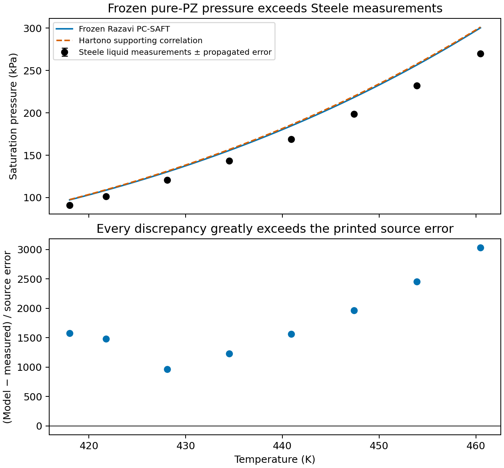
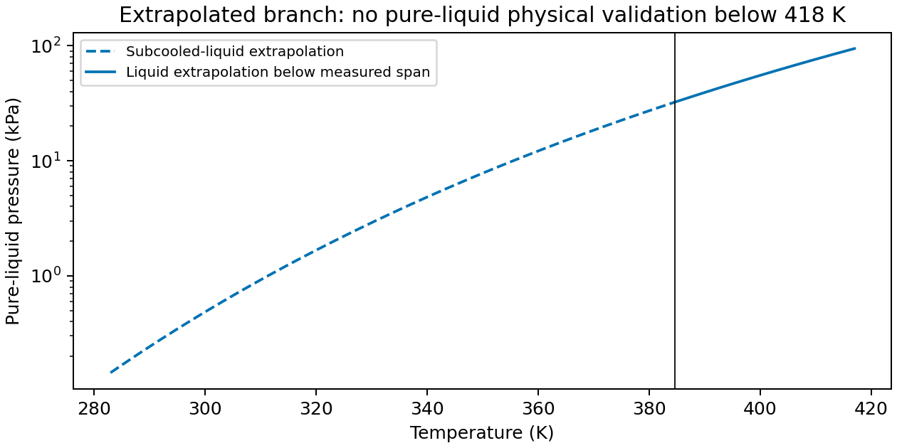

The frozen Razavi 2019 pure-piperazine (PZ) PC-SAFT parameters overpredict all eight Steele 1997 liquid vapor pressures at 417.997–460.477 K. The mean absolute relative deviation is **8.96865%**, with signed bias **+15.71875 kPa**. Relative errors grow from **+6.92532% to +11.21737%**. Discrepancies are **+961.09 to +3028.35 times the source propagated pressure error**. These are real source-scale disagreements, not near-misses. No parameter was fitted or adjusted.

This is a frozen-parameter prediction compared with measurements, together with numerical verification of the equilibrium calculation. It does not establish physical validation of the pure-liquid model. The owner must choose whether to refit pure PZ or continue with the stated pressure and domain limits before subsequent stages. No new percentage gate is applied.

## Question and basis

Stage 1 of the [accepted design](../pz_scoping/design-draft-pz.md) asks whether published pure-PZ parameters reproduce a verified liquid-pressure campaign at its reported error scale. It does not qualify aqueous PZ, reactive speciation, caloric properties, precipitation or absorber calculations. Stages 2–5 are outside this calculation.

Razavi et al. (2019), DOI [10.1021/acs.iecr.9b01429](https://doi.org/10.1021/acs.iecr.9b01429), Table 1 p.11040, supplies $m=2.6519$, $\sigma=3.7136$ Å, $\epsilon/k_B=274.10$ K, $\epsilon_{AB}/k_B=1923.25$ K and $\kappa_{AB}=0.07275$. Section 3.1 p.11046 specifies effective 2B association: one donor and one acceptor, each multiplicity one. Equation 7 p.11045 uses

$$\Delta_{AB}=g^{hs}(d)\,[\exp(1923.25/T)-1]\,\sigma^3\kappa_{AB}.$$

The pinned Engine uses this same $\sigma^3$ association convention (`engine/docs/equations.md`, `association_strength`, at merged Engine commit `391dfe5d64ede5036bf160bc6ae037ad5e14af32`). No diameter-volume conversion or doubling of sites is appropriate. No polar or electrolyte contribution is enabled for this neutral calculation. Parameters and topology are retained in [inputs/razavi.json](inputs/razavi.json).

Steele et al. (1997), DOI [10.1021/je9700986](https://doi.org/10.1021/je9700986), Table 7 p.1044, gives eight pressures measured by comparative ebulliometry with water as reference. The retained [transcription](inputs/steele-table7.csv) preserves temperatures, pressures, propagated errors, source correlation residuals and boiling–condensation temperature differences. Table 7's footnote p.1045 defines the propagated error from the temperature derivatives of sample and reference pressures. Its symbol $\sigma$ does not establish a confidence interval. Neither the source correlation residual $\Delta p$ nor the boiling–condensation difference $\Delta T$ is added to this error. Table 8 p.1045 gives melting at **384.6 K**; all eight reference points are liquid.

The original Zotero PDFs for Razavi, Steele and Hartono were read in their relevant methods, parameter, results and limitation passages. Steele Table 7 was also checked visually. All three PDF hashes matched the design's source identities on 11 November 2026; see [inputs/provenance.json](inputs/provenance.json). The task checkout has no local literature shelf; the canonical shelf index and original Zotero PDFs supplied the readings. Yaws/HYSYS fit grids remain unavailable, so this is not a reproduction of Razavi's reported 0.33% fit deviation.

## Liquid-pressure result



Define $\Delta p=p_{model}-p_{Steele}$, relative error $100\Delta p/p_{Steele}$, and source-scale residual $\Delta p/\sigma$. The [row-level output](results/pressure-residuals.csv) also retains $\ln(p_{model}/p_{Steele})$ and each distance outside the interval $p_{Steele}\pm\sigma$, $|\Delta p|-\sigma$. These are descriptive source-scale comparisons, not statistical rejection probabilities.



No point is a source-scale near-miss: the smallest absolute pressure excess is **6.30038 kPa** at 417.997 K, lying **6.29638 kPa beyond** its printed ±0.004 kPa scale. The smallest scaled discrepancy is **961.09** at 428.104 K, lying **9.60088 kPa beyond** its ±0.01 kPa scale. The relative excess rises smoothly with temperature; the nonmonotonic scaled residuals reflect changes in the printed error scale.

Hartono et al. (2021), DOI [10.1016/j.fluid.2021.112992](https://doi.org/10.1016/j.fluid.2021.112992), Table 8 row 3 and Table 11 method 3 p.7, gives

$$\log_{10}(p/\mathrm{kPa})=5.9832-\frac{1215.77}{T/\mathrm{K}-113.56}.$$

Table 8's explicit kPa form is used despite the general Pa label in Eq.1. Hartono's pure-pressure and binary parameters were fitted simultaneously (§5.1 p.6); Steele contributes to its pure-pressure data. Its curve therefore supplies no independent confirmation. The supporting correlation exceeds Steele by **7.34–11.53%** here and lies within **0.28–0.70%** of the frozen curve. That proximity is not a near-miss against Steele's uncertainty. No coefficient covariance or explicit validity interval was supplied; the comparison is restricted to the measured liquid span. The reported 8.8% fit deviation is not an uncertainty band.

## Diagnosis of the misfit

The retained calculation resolves well-separated liquid and vapor roots at every measured state. Liquid molar densities decrease from about 9218 to 8759 mol/m³ while vapor densities increase from 28.71 to 83.19 mol/m³. These are model outputs, not density validation.

The achieved maximum dimensionless equilibrium residual over the eight states is below $2\times10^{-14}$. Repeating all eight solves with row tolerance tightened from $10^{-10}$ to $10^{-12}$ changes pressure by at most **$3.98\times10^{-11}$ source-error units**. Direct EOS evaluations at the returned densities reproduce equal pressures and equal pure-component log fugacity coefficients; the retained row output gives both differences. At the measured pressures, the liquid-minus-vapor log fugacity coefficient is positive, about **0.06513–0.09965**, consistent with the higher saturation pressures returned by the model. Numerical convergence does not remove the discrepancy.

The diagnosis checked the original parameter digits, Å/K units, neutral 2B site multiplicities, $\sigma^3$ prefactor, pressure conversion Pa to kPa, reference-table columns and liquid classification. No transcription or convention correction was indicated. The tighter-tolerance calculation was the bounded numerical correction probe; it did not change the result at source resolution. The remaining discrepancy is the frozen parameter set versus this measured campaign. Razavi fitted compiled Yaws/HYSYS references rather than an identified Steele-only dataset; the unavailable fit inputs prevent attributing the discrepancy to a particular original correlation or fitting choice. Agreement with Hartono's fitted curve is descriptive, not proof of that cause. Refitting would change the accepted frozen hypothesis and requires the owner's decision.

## Low-temperature extrapolation and limits



At **283 K**, the model gives **0.143655 kPa (143.655 Pa)** on the **subcooled-liquid extrapolation**. The [retained extrapolation](results/extrapolation.csv) extends from 283 K toward the measured span, with the branch below 384.6 K labeled subcooled. Values from 384.6 to 417.997 K are also outside the measured pressure span, although above melting. This is neither solid-vapor pressure nor evidence of stable pure liquid at 283 K. No low-temperature Hartono references are scored. No uncertainty interval is available for the extrapolated model pressure.

**Pure-liquid density remains unvalidated.** No measured molten-PZ density with usable phase, pressure basis and uncertainty was recovered in the accepted source assessment. Steele Table 9 cell densities and Table 10's other-compound saturation densities cannot fill this gap. Aqueous-density checks belong after stage 2 and cannot independently validate pure-PZ density.

## Reproduction and scientific status

Run from the repository root with the pinned wheel at the path in `pyproject.toml`:

```bash
agent-heavy env UV_NO_SYNC=1 uv run python analyses/pz_transfer/run.py
agent-heavy env UV_NO_SYNC=1 uv run python analyses/pz_transfer/present.py
```

`run.py` is this analysis's Engine diagnostic boundary. It verifies the complete wheel SHA-256 `0962e21d2fa7a8ba1ed4622f1110b3e8053bacd878fa41c999d85e8b9afab66b` and byte identity of installed Engine package files, then calls native pure-component saturation and state evaluation. It imports no Engine source checkout. The model curve is evaluated at 61 temperatures; rendering consumes only retained CSVs. [summary.json](results/summary.json) retains aggregate results.

Independent delivered cse:review found **Supported**, with no required scientific corrections, for commit `5ee010b5613a3b83c4c60002bb8dfba74de2561c` against base `10ca8c447681a2d8f837a25df604f00beebe50a8`. The reviewer reproduced all eight comparison rows, 61 liquid-curve rows, 75 extrapolation rows and the summary exactly on the pinned wheel. The verdict supports the frozen-model disagreement and numerical diagnosis only; it does not validate aqueous or reactive use. See the [independent review](t3-thread://v2/df61a5ad-76a1-4901-b919-31ae81c8e67d/thread:delegated-task:command%3Amcp%3A10b158f4-2109-4fb2-a9bd-db3e90d04704%3Adelegate-task%3A0ca3ac1f-18d9-4cea-a5c2-e59879e5d1d9). This notebook has not been promoted for manuscript use. The manuscript registry is intentionally untouched under the task's explicit rule, so this page is rendered directly without adding it to the registered site membership. Pure-pressure refitting versus continuation with limits remains an owner decision.
