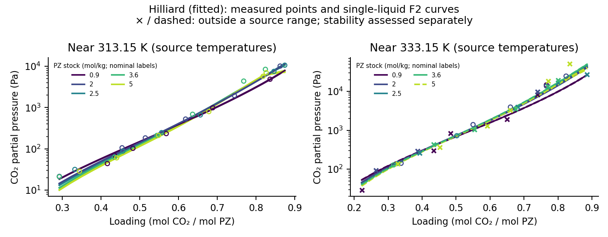
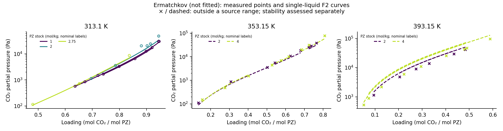
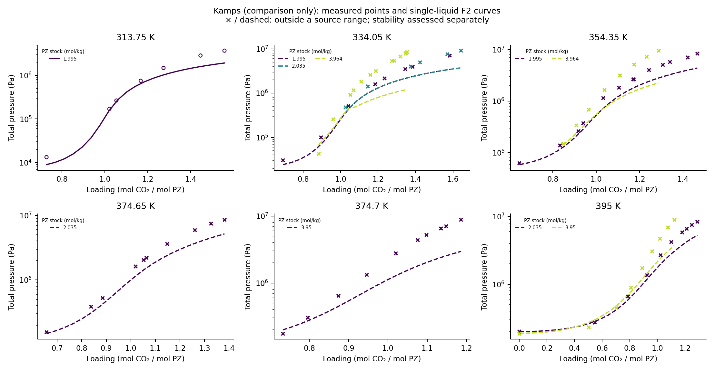
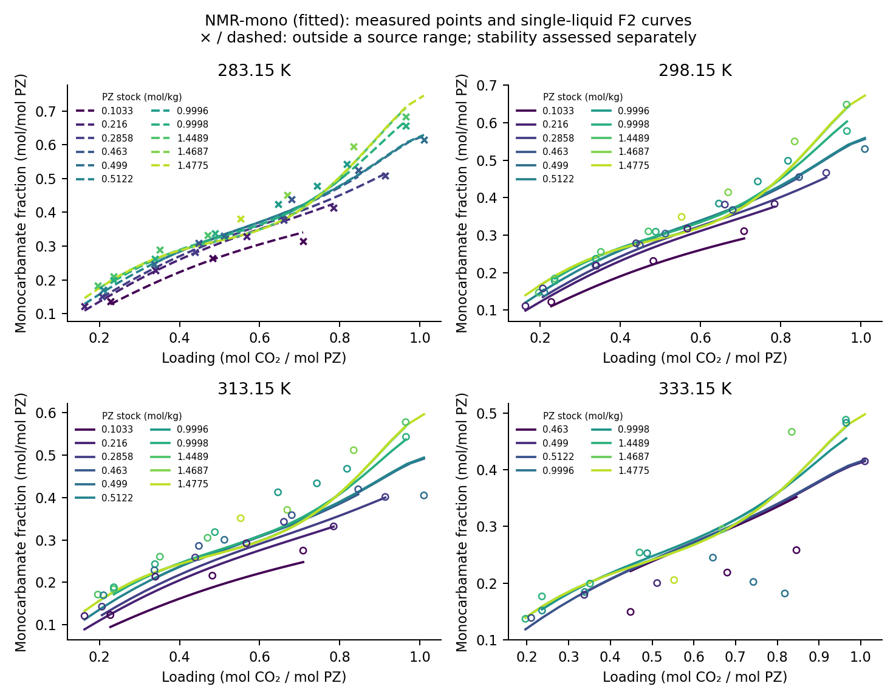
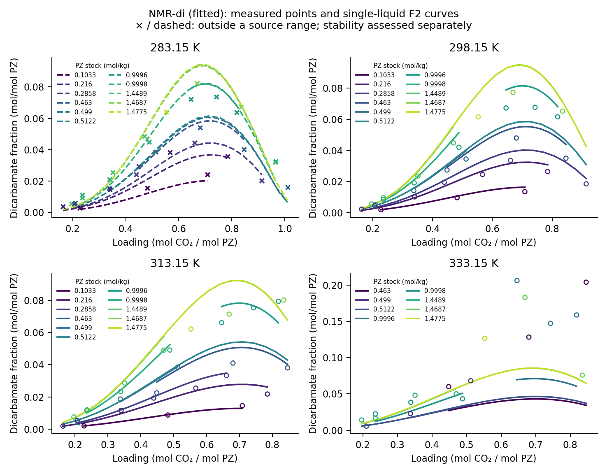

The F2 calibration reproduces the 62 fitted Hilliard CO₂ partial pressures with a mean absolute relative deviation of **19.0003%** and signed relative bias **−3.13936%**. On 52 Ermatchkov pressures that were not fitted, these quantities are **20.9653%** and **+6.04237%**. On 94 Kamps total pressures used for comparison only, they are **39.5608%** and **−37.3935%**. These are single-liquid calculations. Descent witnesses remain at measured and grid states, so the pressure deviations do not qualify this parameter set for stable-liquid process calculations. Nothing is adopted.

**Retained snapshot:** start 0, selected by the lowest fitted cost. Its native cost is **20610.12693643562**, and its written-and-reloaded cost is **20610.126936433648**. Both starts reach relative function tolerance; both old-set penalty attempts and the new compressed-set attempt stop before their first iteration. All tables and curves use the exact selected parameter file; its SHA-256 is recorded in [report-point.json](results/retransfer-345/report-point.json). The earlier Supported verdict at `3b5f1a6` is superseded by the owner’s independent Not supported review and this correction. Independent review of the corrected delivery is pending; the penalty acceptance item remains incomplete. This is not a parameter adoption or a manuscript promotion.

## Question and evidence

[Issue #345](https://github.com/tannerpolley/Amine-Thermodynamics/issues/345), under the owner decisions in [#337](https://github.com/tannerpolley/Amine-Thermodynamics/issues/337), asks how well piperazine-specific fitting transfers the model to the adopted F2 shared parameters, and whether the resulting model splits into two liquids. This is calibration, fixed-parameter prediction against measurements seen during development, and numerical verification. The Ermatchkov comparison is not an unseen validation campaign.

The shared water, CO₂ and inorganic-ion parameters and R1–R3 laws are fixed to [the adopted MEA shared-values record](../mea_parameter_bundle/results/adoption-340/part-ii-shared-values.json), SHA-256 `4c27d47ea7b6e018b0603efb8a29fc2f3fe3c6f8fdc12ccc12cb10bb4b315334`. Water–bicarbonate $k_{ij}=0.7650000233694618$ and water–carbonate $k_{ij}=-0.25$. The salt-law alternative is not used. Each charged piperazine species has its Born diameter tied to its segment diameter: the mono- and diprotonated ions share one size coordinate, and carbamate and dicarbamate share another. Neutral protonated piperazine carbamate has separate segment and energy coordinates. Historical F0 calculations remain frozen.

The immutable Engine is commit `391dfe5d`, wheel SHA-256 `0962e21d2fa7a8ba1ed4622f1110b3e8053bacd878fa41c999d85e8b9afab66b`. Installed module and native-library bytes were checked against that wheel. The original calculations used the merged shared implementation at `2e5b2d4`, including the reviewed completed-law coordinate correction and bounded-memory supplied-trial retention. No Engine source is changed.

## Observations, roles and covariance

| Source and quantity | Role | Observation entries | Reactive states |
|---|---|---:|---:|
| Ermatchkov 2003 NMR mono-carbamate group fraction | fitted | 121 | 121 |
| Ermatchkov 2003 NMR dicarbamate group fraction | fitted | 111 | shared with the 121 NMR states |
| Hilliard D.5 CO₂ partial pressure | fitted | 62 | 62 |
| Ermatchkov 2006 CO₂ partial pressure | not fitted | 52 | 52 |
| Kamps 2003 total pressure | comparison only | 94 | 94 |
| Total | | 440 | 329 |

The fitted vector contains 294 observations. The NMR mono group is $(n_{PC^-}+n_{HPC})/n_{PZ,total}$; the di group is $n_{DC^{2-}}/n_{PZ,total}$. Each denominator counts all six PZ-containing molecular species once. Thus the di fraction is not twice the dicarbamate molecular fraction.  NMR groups use the full normalized-area covariance exported in the exact original fitted-row order; Hilliard pressure variances follow those rows. With raw prediction-minus-observation vector $r$ and retained covariance $C$, the data cost is $\tfrac12 r^T C^{-1}r$. No diagonal replacement is made. The operational 2% normalized-area model induces correlation through the common normalization. It does not establish complete experimental uncertainty. Measured temperature and composition are held fixed. NMR D₂O is represented as H₂O; isotope effects are omitted. The existing source-marked precipitation exclusion is retained, with no temperature-based exclusion.

The fitted coordinates, complete starts, source-row identities, model specification, pressure conventions and covariance are in [inputs/part-ii-345/shared](inputs/part-ii-345/shared/README.md). The specification keeps the adopted species and reaction stoichiometry. NMR liquid states use the declared fixed pressure **100000 Pa**; the source does not supply a measured pressure uncertainty. Reactive bubble calculations retain the declared vapor species and omit N₂ according to the retained model variant.

## Temperature ranges and calculations outside them

All eight reaction constants use the single calculation interval **283.15–395.0 K**, covering every retained reactive data state. Calculation outside a source range remains an extrapolation; extending the calculation interval adds no measurement evidence.

| Laws | Source temperature interval (K) | Meaning |
|---|---|---|
| R1–R3 | 273.15–498.15 | Source-correlation interval |
| P1–P2, piperazine dissociation | 293.14–353.42 | Amine-specific measured interval retained in Part II |
| P3–P5, carbamate reactions | 283.15–333.15 | Amine-specific measured interval retained in Part II |

273.15–498.15 K is the source-correlation range stated by Austgen 1991 Table V p.547 (citing Edwards 1978), not verified measured coverage.

Ermatchkov et al. 2003, DOI [10.1016/S0021-9614(03)00076-4](https://doi.org/10.1016/S0021-9614(03)00076-4), §§3–5 and Table 5, supplies the NMR chemistry and its temperature coverage. The dissociation ranges follow the retained Part II source transcription. Relevant methods, parameter and limitation passages in these sources and Hamborg 2009 were read, with original PDF identities checked. No new interpretation of the printed intervals is inferred from a successful solve.

| Data states | P1–P2 inside / outside | P3–P5 inside / outside | Inside all P1–P5 / outside at least one |
|---|---:|---:|---:|
| NMR, fitted | 88 / 33 | 121 / 0 | 88 / 33 |
| Hilliard, fitted | 62 / 0 | 39 / 23 | 39 / 23 |
| Ermatchkov, not fitted | 37 / 15 | 19 / 33 | 19 / 33 |
| Kamps, comparison only | 34 / 60 | 7 / 87 | 7 / 87 |
| Total | 221 / 108 | 186 / 143 | **153 / 176** |

All 329 states lie in the R1–R3 source-correlation interval. This is not a claim that all 329 lie within measured coverage of those laws. The 283.15 K NMR states and the rows reaching 395.0 K are calculated and marked. [range-counts.json](results/retransfer-345/range-counts.json) counts physical source states once; the deviation tables count each observed group separately.

## Two starts, convergence and selection

The retained endpoint and retained second start use the same 12 coordinates, bounds and controls. Each fit has a 100-iteration and 3600 s limit, relative function tolerance $10^{-10}$, parameter tolerance $10^{-10}$ and gradient tolerance $10^{-8}$. Up to two identical-control continuations are allowed only after a limit. Both unpenalized starts reached relative function tolerance in their first attempt, so neither needed continuation.

| Start | Initial data cost | Final native data cost | Iterations | Stopping relative cost change | Fit elapsed (s) |
|---|---:|---:|---:|---:|---:|
| 0 | 22266.06010797958 | 20610.12693643562 | 43 | $4.875197\times10^{-11}$ | 194.9713 |
| 1 | 54588.63437792957 | 20610.126937095058 | 97 | $5.755861\times10^{-11}$ | 541.1913 |

The native cost difference is **$6.594382284674793\times10^{-7}$**, or **$3.1995835372643495\times10^{-11}$** relative to the lower cost. Following the owner's explicit decision, these starts are reported as tied at the optimizer's relative function tolerance. Start 0 is numerically lower. The shared selector separately compares an absolute difference with $10^{-10}$, for which only start 0 appears in its tie list. Both definitions and both differences are preserved in [unpenalized-start-cost-comparison.json](results/retransfer-345/unpenalized-start-cost-comparison.json); the selector is unchanged.

Complete native iteration histories, including rejected high-cost trial values, remain in [fit-histories.json](results/retransfer-345/fit-histories.json) and the start-specific `unpenalized/stage-0` fit records. Start 0 has 44 native history entries and start 1 has 98. The fitted costs are not reduced to an apparent monotonic trace. Reaching the same local cost from these two starts is evidence of numerical reproducibility at the declared controls, not proof of a global optimum.

## Finite phase searches and penalty attempt

The search covers all 440 data entries and an 8640-entry grid: 313.15–393.15 K in 10 K steps, each of the 48 fitted stock molalities, ten loadings from $10^{-5}$ to the data maximum 1.64226 mol CO₂/mol PZ, and pressures 1.05 and 3.0 times model bubble pressure. NMR siblings make 9080 Route-keyed entries rather than 9080 distinct physical states. All supplied trials are evaluated at supported states. Every negative evaluated supplied TPD makes its entry **not stable**, including when the Full search is unavailable. Unavailable searches are never counted as stable.

The initial PZ record contains 100 native resolved descents and two composition-only trials, with separate provenance and recovered packing fractions 0.4128283021108707 and 0.41196189417630624. No MEA registry is consumed. Earlier searches grew this to 3612 native witnesses plus two composition-only trials. Declared trial kind is not a resolved density branch.

### Archived searches and their missing branch fields

| Search | Point | Supplied trials | Available / unavailable entries | Witness entries; branch unresolved | Data / grid witness entries | Elapsed window (s) | Compressed detail bytes |
|---|---|---:|---:|---:|---:|---:|---:|
| 0 | start 0 | 102 | 9074 / 6 | 454 | 35 / 419 | 1993.714 | 172594538 |
| 1 | start 0, expanded record | 1862 | 9074 / 6 | 499 | 37 / 462 | 12761.706 | 2383682514 |
| 2 | start 1 | 1862 | 9075 / 5 | 499 | 37 / 462 | 12852.560 | 2384672170 |
| 3 | start 1, expanded record | 3614 | 9075 / 5 | 499 | 37 / 462 | 26301.780 | 4576340295 |

The archived writer omitted `density_side`. These are witness counts, not resolved liquid–liquid split counts. Search 0’s historical aggregate reports 451 entries; three unavailable NMR searches retain additional native witnesses, giving the 454-entry witness union. The old declared Liquid and Vapor reductions are preserved as historical label counts in [branch-classification.json](results/retransfer-345/branch-classification.json).

The elapsed windows include setup, calculation, reduction and writing, inferred from filesystem timestamps at approximately one-second resolution. They are observations, not performance guarantees. Search 0’s original 1509424661-byte JSON is retained losslessly in gzip parts, with round-trip SHA-256 verified. Later gzip details plus summaries total 2394183376, 2395170042 and 4586836804 bytes for searches 1–3. All 28788 moved files, totalling 11602535661 bytes, have matching before/after hashes in [the per-file checksum inventory](results/retransfer-345/archive-manifest.json). Detailed records reside in the main checkout’s ignored `analyses/pz_transfer/results/runs/345/`; search summaries and checksum inventories remain in Git.

The older SIGTERM-interrupted attempt retains 1542 complete files and 403226945 gzip bytes, separately from completed searches. Its approximately 2154-second partial window is not a completed-search duration, and the sender is unknown. A later branch-classification attempt was stopped after a superseded queued instruction; its partial records remain separately preserved. Neither partial attempt contributes completed-census counts.

### Selected start-0 search with native branch classification

The selected point was searched again through merged implementation `a6aebfa`, using 3614 supplied trials and the same 9080 entries. It completed in **23128.002 s** (6 h 25 min 28 s). Its retained output, including the checksum inventory, totals **4596334451 bytes**. This elapsed time covers one native search; subsequent pressure reporting is separate. The exact selected-point SHA-256 remains `b0310ca2b03027a6fde35fcaede754a2f91e40dc8fc506a2fce6ad012ba6dbd8`.

| Entries | Native liquid branch | Native vapor branch | Native mixed / unresolved | No native descent recorded | Supplied-negative, branch unknown |
|---|---:|---:|---:|---:|---:|
| Data | 29 | 3 | 0 / 0 | 408 | 37 |
| Grid | 405 | 0 | 0 / 0 | 8235 | 462 |
| Total | **434** | **3** | **0 / 0** | **8643** | **499** |

The native liquid–liquid descent count is a lower bound: 29 data entries and 405 grid entries. No native descent recorded does not establish stability. Overall searches comprise **9074 available and six unavailable** entries. Supplied evaluations comprise **32807892 available, 7228 unavailable and zero not applicable** ordered logical results. Three unavailable Full searches still have evaluated negative supplied trials. Two Kamps searches and one grid search remain unavailable for different native numerical reasons; none is counted stable. The PZ record now contains **5372 native witnesses plus two composition-only trials**.

All **499 supplied-negative entries are not stable** under the requested negative evaluated TPD rule, independent of Full-search availability. Their branch is **unknown** because the pinned wheel does not return `density_side` for evaluated supplied trials. No branch is inferred from a trial label. The [per-entry supplied-negative table](results/retransfer-345/classified-start-0-supplied-negative.json) retains the most negative logical trial index, TPD/RT, actual search pressure, model bubble pressure and source identity for every entry. There are 37 data entries and 462 grid entries, not 499 distinct physical states. Bubble pressures are reported for all 499: 462 from the declared pressure ratio, 34 from shared pressure-basis probes, and three from retained fixed-pressure diagnostics.

The most negative supplied distance is **−0.3298069899183247 RT**, with retained descent-error estimate **3.86×10⁻¹⁰ RT**, at 313.15 K and loading 1.64226 mol CO₂/mol PZ. It is logical trial index 343 (zero-based), at search pressure **1920010.1837 Pa** versus model bubble pressure **1828581.1273 Pa**, ratio 1.05. The error is a native numerical estimate, not experimental uncertainty. The [classified summary](results/retransfer-345/classified-start-0-summary.json), [complete search summary](results/retransfer-345/classified-start-0-search.json), [pressure probes](results/retransfer-345/classified-start-0-pressure-basis.json) and [file hashes](results/retransfer-345/classified-start-0-files.json) retain the evidence.

### Penalty on the amended compressed-liquid set

The amended #337 rule, implemented by #373 (PR #374, merged at `a6aebfa`), triggers a penalty only from native resolved liquid descents. The 434-entry native liquid result therefore **triggers** the penalty. Its set is compressed-liquid copies of every searched composition and temperature at **1.05 and 3.0 times model bubble pressure**, deduplicated by physical declaration. The shared method retained **9298 declarations with 18160 source links** covering all 9080 original entries.

The first scale, 0.01, returned **initial_evaluation_failed** after **1928.336 s**. It performed **zero optimizer iterations**, one Jacobian evaluation and zero residual evaluations; the cost history is empty. There is **no valid fitted cost and no endpoint**. Native zero-valued cost fields are placeholders. No continuation, second scale, retreat or post-penalty endpoint search follows from a nonexistent endpoint.

The first unavailable evaluation is absolute observation 838. The 294 fitted observations precede the penalty rows, so the corresponding compressed declaration is **544, `compressed:Kamps--46:problem:1.05`**. This source condition has **395.0 K** and **zero CO₂ loading**, with 1 mol PZ and 27.276842 mol water. Its effective search pressure is **210254.8273 Pa**, or 1.05 times model bubble pressure **200242.6926 Pa**. The fit payload’s pressure field contains the bubble reference; it is not the effective compressed pressure. It reports `CentralSolveUnavailable`, **failed final trial optimizer or undetermined evidence: 15**, and first numerical failure `Stop.left_domain`. Its unavailable raw TPD/RT minimum −149.251 is not counted as a confirmed descent. The original helper handoff misidentified declaration 838; subtracting the fitted-row prefix corrects that attribution. This is an evaluation on the new compressed set, distinct from the old NMR support-coincidence refusal. It is **not attributed to Engine #23**.

The [penalty outcome](results/retransfer-345/compressed-penalty-outcome.json), [full fit report](results/retransfer-345/compressed-penalty-fit.json) and [deduplicated declarations](results/retransfer-345/compressed-penalty-declarations.json) retain the stopping point and conditions. The compressed-liquid penalty item remains **incomplete because the initial evaluation is unavailable**. This is a numerical non-result, not an optimized fit that failed to remove splits.

The corrected fixed-point native calculation reproduces the unavailable prediction. **All 16 trial optimizers converge**, but all evidence records remain unresolved. Trial 15 converges in 21 iterations with maximum row residual **2.84×10⁻¹⁴**, and reports `negative_plane_without_positive_donor`, no donor and no finite-split checks. Its composition is almost entirely CO₂, with about 1.15×10⁻¹³ neutral protonated piperazine carbamate; the parent feed has no carbon to supply that trial. The resolved density side is not exposed and remains **unknown**. The disjunctive failure message reflects undetermined evidence rather than failure of the final trial optimizer. No raw negative plane from this unavailable prediction is promoted to a confirmed conserved descent. [The diagnostic](results/retransfer-345/compressed-penalty-diagnosis.json) and [native trial payload](results/retransfer-345/compressed-penalty-native-prediction.json) retain the result. Application changes that remove the carbon-free row, suppress a trial, alter conserved amounts or weaken a numerical safeguard are outside the agreed calculation; no such change was made. This is an unresolved Engine stability-evidence calculation, not physical validation or a failed optimized fit.

### Hilliard rows 55 and 56: supplied-trial reference

The retained reactive-A12s reference is evaluated at its original bubble-pressure basis (1.0 times bubble pressure), separately from the F2 campaign's 1.05 factor. Both Full native searches are unavailable, but all **102 supplied trials** are evaluated at each row. Minimum distances **−0.03090949057 and −0.04372673238 $RT$** reproduce the historical negative signs and approximate magnitudes (−0.0309 and −0.0437 $RT$). This does not claim both historical decimal values reproduce within their native error estimates. The focused source-case checks pass separately.

At the F2 start 0 point and 1.05 times bubble pressure, all **1862 supplied results** at each of rows 55 and 56 are available, with zero unavailable or not applicable. Their minima are **−0.02110737699 and −0.03016696503 $RT$**, with 5 and 8 negative supplied results. The change in point and pressure means these are not a direct same-state model difference from A12s. See [the F2 row records](results/retransfer-345/expanded-search-1-Hilliard-55-56.json) and [the historical reference check](results/retransfer-345-known-A12s/reference-check.json).

At the converged start 1 point, the two complete expanded-search state records each contain 3614 available supplied results, with zero unavailable or not applicable. Their minima are −0.02111301908 and −0.03017265058 $RT$, with 9 and 12 negative results. These are a different fitted point and a larger trial set than the start 0 check; [their records](results/retransfer-345/expanded-search-3-Hilliard-55-56.json) are reported separately from the whole-search completion counts.

The new classified start-0 census has 3614 available supplied results at each of rows 55 and 56, with zero unavailable or not applicable. Their minima remain **−0.02110737699 and −0.03016696503 RT**, with **9 and 12 negative logical results**, respectively. Actual search pressures are **12396.2269 and 12931.8893 Pa** versus model bubble pressures **11805.9304 and 12316.0851 Pa**. Both entries are **not stable**; their supplied-trial branches remain unknown. [The retained row checks](results/retransfer-345/classified-start-0-Hilliard-55-56.json) identify the complete archived records.

The refusal is a deliberate verification guard in the pinned Engine: `phase_stability.cpp:832–838`, together with `same_stationary_trial` at lines 148–152. At `Ermatchkov2003-T4-1-group1`, full-support and neutral-only stationary trials both have TPD/RT **−0.276000003756792**, maximum composition difference **1.46×10⁻¹²** and absolute log-volume difference **5.28×10⁻¹³**. Their different species-support arrays prevent their identification as the same stationary trial. Both resolve to `density_side = 1` (Vapor), with molar volume about **0.02758 m³/mol**. This refusal belongs to the **old fixed-pressure set**: its declared pressure is **100000 Pa**, below model bubble pressure **132055.855 Pa**. It is not a result of the new #373 compressed-liquid penalty set. The owner’s independent review reproduces the refusal with one fixed-point `predict` and no supplied trials, so the 9080-entry set, registry and parameter bounds do not cause this refusal. The local-derivative ambiguity belongs to the Engine; no support check or numerical safeguard is removed here. [penalty-diagnosis.json](results/retransfer-345/penalty-diagnosis.json) and [the retained probe output](results/retransfer-345/penalty-probe.log) preserve the evidence.

The open cross-support coincidence dependency is [Engine #23](https://github.com/tannerpolley/epcsaft/issues/23). It concerns the **old uncompressed** NMR penalty set: at 333.15 K and 100000 Pa, below model bubble pressure 132055.855 Pa, two coincident vapor-side stationary trials have different support arrays. The pinned guard refuses their local derivative identity. Shared compressed-liquid copies avoid this demonstrated state, where scoped owner probes give no descent and an available zero penalty. Engine #23 is therefore conditional and is **not the reported cause of the current compressed-grid refusal**. [Engine #10](https://github.com/tannerpolley/epcsaft/issues/10) concerns a separate finite-descent resolution mechanism; no identity with the present refusal is assumed. The old fixed-point diagnostic remains with [the old-set diagnosis](results/retransfer-345/penalty-diagnosis.json).

## Deviations and the previous model on the same rows

Mean absolute relative deviation is $100\langle|p_{model}/p_{obs}-1|\rangle$; signed relative bias is $100\langle p_{model}/p_{obs}-1\rangle$. Signed physical error is prediction minus observation. Positive bias means overprediction. NMR quantities are group fractions in mol/mol; pressure quantities retain Pa.

| Quantity | Role | Rows | F2 AARD / bias (%) | Previous F0 AARD / bias (%) |
|---|---|---:|---:|---:|
| Hilliard CO₂ partial pressure | fitted | 62 | 19.0003 / −3.13936 | 19.1646 / −3.23011 |
| Ermatchkov CO₂ partial pressure | not fitted | 52 | 20.9653 / +6.04237 | 21.9428 / +7.82441 |
| Kamps total pressure | comparison only | 94 | 39.5608 / −37.3935 | 42.5192 / −40.2595 |
| NMR mono-carbamate group | fitted | 121 | 9.45734 / −1.89921 | 9.39454 / −1.95212 |
| NMR dicarbamate group | fitted | 111 | 21.0626 / −7.69531 | 21.1797 / −7.80136 |

All 440 predictions are available at the selected start 0 point. The F0 replay uses its original independent Born diameters, its original shared values and the same full covariance, roles and rows; its cost is **20698.62019479619**. F2 changes the shared parameters and imposes the Part II Born ties, with piperazine coordinates refitted. The cost reduction alone cannot separate these contributions. Source-condition plots and the complete range-separated tables are prepared from retained predictions; no comparison row is refitted.

### Published comparisons and their data roles

Ermatchkov et al. 2006, DOI [10.1021/je0601917](https://doi.org/10.1021/je0601917), Table 5 p.1793, reports Pitzer set I on the same 52 partial pressures as **not fitted**: 18.4% AARD and 3.7 kPa mean absolute error. Set II uses these rows as **fitted**: 5.1% and 0.72 kPa. Signed bias is not reported. The F2 values are 20.9653% and 4.40667 kPa; previous F0 gives 21.9428%. These differing data roles prevent treating the set II score as an independent prediction comparison.

On corrected Kamps data with $p>0.2$ MPa and no solids, that table reports 3.0% AARD for both fitted Pitzer sets, and mean absolute errors 100 and 86 kPa. The published aggregate has its own selection, and its reprint changes one pressure from the original 5.063 to 5.062 MPa. It is not asserted to be byte-identical to the 94-row retained comparison. No published aggregate on the exact 62 Hilliard rows was identified.

The same paper reports numerical NMR comparisons. Its opening paragraph on p.1792 gives the earlier Debye–Hückel model’s amount deviations; the speciation paragraph below Figure 4 on p.1793 gives both Pitzer sets. The quantities are the amount of (piperazine carbamate + protonated piperazine carbamate) and the amount of piperazine dicarbamate in a solution based on 1 kg water.

| Published model | NMR data role in the model | Mono mean absolute relative deviation (%) | Di mean absolute relative deviation (%) | Mono mean absolute amount error (mol per 1 kg water) | Di mean absolute amount error (mol per 1 kg water) |
|---|---|---:|---:|---:|---:|
| Debye–Hückel, Ermatchkov 2003, quoted in 2006 p.1792 | fitted reaction constants | 9.9 | 25.5 | 0.024 | 0.014 |
| Pitzer set I, 2006 p.1793 | fitted through inherited NMR reaction constants | 14.6 | 24.5 | 0.036 | 0.014 |
| Pitzer set II, 2006 p.1793 | fitted through inherited NMR reaction constants | 11.4 | 25.8 | 0.031 | 0.014 |

Pages 1791–1792 explain that the carbamate reaction constants were determined from the earlier NMR speciation measurements with the modified Debye–Hückel term and zero interaction parameters, and adopted in the Pitzer models without re-evaluation. Set I’s interaction parameters use corrected high-loading gas-solubility data; set II uses low- and high-loading gas-solubility data. Neither interaction-parameter adjustment is a new fit to NMR, but both models retain NMR-fitted reaction constants. These NMR comparisons are therefore not independent validation.

The published percentages concern species-group amounts; this analysis reports group fractions per analytical PZ. The retained F2 mono/di fraction AARDs are 9.45734% / 21.0626%, and the previous F0 values are 9.39454% / 21.1797%, on 121 / 111 observations. The published passages do not identify the exact aggregate row selection or handling of missing/zero group values, so these are reported as available literature aggregates, not asserted to be identical-row reductions. Their absolute errors remain on the original mol per 1 kg water basis; they are not converted into fraction errors or compared numerically with the retained fraction MAEs. [published-models.json](results/retransfer-345/published-models.json) retains all six group/model records, their data-use qualifications, page locators and the verified source PDF hash.

## Parameter values and conditional uncertainty

Twelve reactive coordinates are fitted: nine piperazine-specific equation-of-state or interaction coordinates and three total P3–P5 log-equilibrium offsets. The piperazinium–water interaction is at its lower bound **−1**; the other eleven coordinates are interior. Its data-cost derivative is +138.362 per unit interaction coordinate, so the local descent direction points below the permitted bound. The result is a constrained fit; its function-tolerance stop does not claim a vanishing unconstrained gradient. The approved bounds are retained. P3–P5 offsets are reported relative to the unshifted source laws, not relative to the latest completed-law chart origin. Their values at start 0 are **+0.157844044, −0.008361679 and −0.257401828**.

Conditional standard errors use the full fitted covariance and native exact derivatives, with differentiation predictions checked against endpoint replay before inversion. With the active-bound coordinate fixed, residual variance is **145.6546073** for $294-11=283$ residual degrees of freedom. The information matrix is restricted to the eleven free coordinates and scaled by this residual variance. No finite standard error is supplied for the bound coordinate. The retained standard errors and correlation matrix are in [conditional-uncertainty.json](results/retransfer-345/conditional-uncertainty.json).

| Free quantity | Conditional standard error | Unit |
|---|---:|---|
| Piperazinium segment diameter | 0.385662 | Å |
| Piperazinium dispersion energy / $k_B$ | 21.1565 | K |
| Piperazinium–bicarbonate interaction | 1.11568 | dimensionless |
| Carbamate segment diameter | 0.417334 | Å |
| Carbamate dispersion energy / $k_B$ | 135.702 | K |
| Carbamate–water interaction | 0.0554798 | dimensionless |
| Neutral protonated carbamate segment diameter | 0.0927010 | Å |
| Neutral protonated carbamate dispersion energy / $k_B$ | 106.850 | K |
| P3 total log-equilibrium offset | 0.123057 | dimensionless |
| P4 total log-equilibrium offset | 0.133869 | dimensionless |
| P5 total log-equilibrium offset | 0.0601022 | dimensionless |

These are local, conditional parameter uncertainties under the supplied operational observation covariance, fixed active bound and chosen single-liquid model. They exclude fixed F2 and pure/binary parameter uncertainty, source systematic errors, temperature and composition uncertainty, isotope effects, model discrepancy and extrapolation uncertainty. The large interaction standard error is not evidence of an independently determined molecular interaction. No physical prediction interval follows from this table.

## Fixed pure-piperazine and water–piperazine inputs

The pure and neutral binary fits do not depend on the Part II shared reactive parameters and are retained unchanged. Pure PZ has $m=2.6519$ and $\sigma=3.7136$ Å fixed from Razavi et al. 2019 Table 1 p.11040, with energy-only refit $u/k_B=313.20598$ K, association energy $1469.8201$ K and association volume 0.02722986. On eight Steele 1997 pressures at **417.997–460.477 K**, its AARD is **0.00345189%**, compared with **8.96865%** for the original Razavi set. Historical conditional standard errors are 0.34586 K, 11.1726 K and 0.00154303, treating the printed source scales as independent standard deviations for that calculation only. Steele's propagated error is not a declared confidence interval. Pure-liquid density remains unvalidated; liquid calculations below melting at 384.6 K are subcooled-liquid extrapolations. See [the retained pure fit](results/refit-fits.json) and [row residuals](results/refit-residuals.csv).

The neutral PZ–water interaction is $k(T)=-0.19764540162608946+0.0011250147848721607(T-353.15)$, with $T$ in K. Two starts converged on 23 fitted Hartono states (46 pressure/vapor-fraction observations), but their source-scaled residuals remain large: pressure RMS **7.78290** in units of 0.3 kPa and vapor-fraction RMS **12.7524** in the retained operational scale. The historical local standard errors are 0.000208664 and $1.29828\times10^{-5}$ K$^{-1}$, conditional on the source-error model and fixed pure inputs. They do not cover the observed model discrepancy. Separate aqueous-density comparisons underpredict source values; the 393.15 K, 0.1 MPa Concepción liquid admits a vapor descent and is metastable on this model. These limits are inherited, not removed by the reactive refit. See [binary-calibration.json](results/binary-calibration.json), [binary row residuals](results/binary-calibration-residuals.csv) and [density comparisons](results/binary-density.csv).

## Curves, reproduction and limits

Curve values are native single-liquid calculations at 21 loading nodes for each exact source temperature and stock composition, retained separately from the observed points. Nominal Hilliard and Ermatchkov stock labels group colors only; the model calculations use actual source conditions. There are 3570 source-condition curve entries. Crosses and dashed lines mark states outside at least one declared source range. The source-condition curves add no phase-stability qualification; the finite phase searches are reported separately above.

The notebook does not run the model during rendering. [summary-row.json](results/retransfer-345/summary-row.json) supplies the compact Part II summary; [parameters.csv](results/retransfer-345/parameters.csv) and [fixed-pz-parameters.csv](results/retransfer-345/fixed-pz-parameters.csv) supply values and roles. The full declared fixed ion properties and ties remain in the selected point document. Historical pure/binary errors above are separate from the reactive conditional errors.



<details>
<summary>Complete same-row deviations for F2 and previous F0, inside and outside every reaction range</summary>



</details>

The corresponding [CSV](results/retransfer-345/deviations.csv) retains empty-range counts and physical signed errors. The R1–R3 partitions refer to the source-correlation interval, not verified measured coverage.











## Numerical checks and reproduction

[correctness-checks.json](results/retransfer-345/correctness-checks.json) records all four required checks. Frozen F0 cost and all 294 fitted predictions reproduce exactly. Shared-value SHA-256, six common components, twelve common pairs, shared correlations and association topology, R1–R3 coefficients and references, and four PZ Born ties pass identity checks. The selected endpoint’s cost recomputed independently from the full 294-by-294 covariance differs from native cost by $9.57012\times10^{-14}$ relative; maximum fitted-prediction difference is $3.49076\times10^{-12}$ relative. Both are below the $10^{-8}$ reproducibility limit specified by #345/#255, not a physical-agreement threshold. All 3520 data marks, 18312 nominal-curve marks and 28560 source-curve marks equal the declared interval comparisons. Two existing focused native reference-case checks also passed (15 unrelated cases deselected).

All fits and searches used `agent-heavy`, three workers from `AGENT_HEAVY_CORES`, and single-threaded numerical workers. The resumed campaign log is retained as [campaign.log.gz](results/retransfer-345/campaign.log.gz). Historical reproduction requires the pinned environment, immutable declarations and shared implementation at `2e5b2d4` for the commands below. Current main uses the amended #373 penalty set and is a different campaign; the newly authorized campaign uses that amended set.

```bash
OMP_NUM_THREADS=1 OPENBLAS_NUM_THREADS=1 agent-heavy uv run --no-sync python analyses/part_ii.py analyses/pz_transfer/inputs/part-ii-345/shared/campaign.json fit
OMP_NUM_THREADS=1 OPENBLAS_NUM_THREADS=1 agent-heavy uv run --no-sync python analyses/part_ii.py analyses/pz_transfer/inputs/part-ii-345/shared/campaign.json report
OMP_NUM_THREADS=1 OPENBLAS_NUM_THREADS=1 agent-heavy uv run --no-sync python analyses/pz_transfer/present_part_ii.py
```

The final figures read [3570 exact-source curve values](results/retransfer-345-source-curves/curve-data.json), produced by the shared `Route.curves` method with [source-curves.json](inputs/part-ii-345/shared/source-curves.json) and the selected mapping. The nominal 2289-row curve output is also retained, with separately checked range marks. Presentation code adds 167 gross lines, counting blanks; added test lines are zero. Shared implementation imported from reviewed main `2e5b2d4` is outside #345’s code contribution.

The scientific consequence is a converged calibration on F2 with modest changes in average pressure deviations and persistent descent-witness evidence whose resolved density branches are distinguished above. It does not establish stable equilibrium across the data or the declared grid. The original penalty attempt stopped at an Engine verification guard and produced no endpoint. The amended compressed-liquid penalty was triggered and attempted, but its initial evaluation was unavailable. The penalty acceptance item and constrained stable-liquid calibration remain incomplete. No solid–liquid equilibrium is qualified, no global optimum is proved, and no record is adopted or promoted to the manuscript. Comparisons seen during development, calculation outside source ranges and conditional local standard errors do not establish absorber-design uncertainty.
