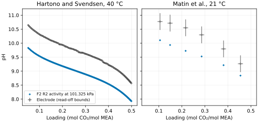

## Q1. AMP fixed-pressure supplement

Compare both fits at the same species-ordered feed, temperature and absolute pressure. A near-zero minimum without a resolved descent applies only to the finite trial set. At S14 the fixed-slope endpoint has a vapor-side descent at the free fit’s search pressure. The seeded liquid pair is confirmed only for the free fit. [Paired records](results/q1.json).

| State | Pressure basis | Pa | Free min. TPD/RT | Fixed min. TPD/RT | Free LL | Fixed LL |
| --- | --- | --- | --- | --- | --- | --- |
| AMP grid loading 0.7 | archived search pressure | 1,212,490.95 | -0.00369745 | -0.0198893 | confirmed | unconfirmed |
| AMP grid loading 0.3 | archived search pressure | 254,069.51 | -8.52651e-14 | -2.84217e-14 | unconfirmed | unconfirmed |
| AMP grid loading 0.4 | archived search pressure | 325,749.50 | -0.00228461 | 2.84217e-14 | confirmed | unconfirmed |
| hartono-2021:55 | archived search pressure | 267,803.08 | -0.00185198 | -2.84217e-14 | confirmed | unconfirmed |
| hartono-2021:56 | archived search pressure | 356,987.36 | -0.00206936 | -2.84217e-14 | confirmed | unconfirmed |
| hartono-2021:57 | archived search pressure | 466,034.17 | -0.00191729 | -1.13687e-13 | confirmed | unconfirmed |
| tong-2012:29 | archived search pressure | 198,672.43 | -0.00164532 | -2.84217e-14 | confirmed | unconfirmed |
| tong-2012:32 | archived search pressure | 860,932.52 | -0.000992669 | -5.68434e-14 | confirmed | unconfirmed |
| tong-2012:44 | archived search pressure | 358,178.88 | -0.00304713 | 0 | confirmed | unconfirmed |
| hartono-2021:55 | measured pressure | 406,500.00 | -0.00183961 | 0 | confirmed | unconfirmed |
| hartono-2021:56 | measured pressure | 510,000.00 | -0.00205613 | -2.84217e-14 | confirmed | unconfirmed |
| hartono-2021:57 | measured pressure | 640,500.00 | -0.00190317 | -5.68434e-14 | confirmed | unconfirmed |
| tong-2012:29 | measured pressure | 351,800.00 | -0.00163445 | 0 | confirmed | unconfirmed |
| tong-2012:32 | measured pressure | 983,500.00 | -0.000987294 | -8.52651e-14 | confirmed | unconfirmed |
| tong-2012:44 | measured pressure | 632,600.00 | -0.00302534 | -2.84217e-14 | confirmed | unconfirmed |

## Q2. AMP total pressure at 373–393 K

Report the matched, constrained single-liquid AARD and signed bias (prediction minus observation). Retain unstable parents in these scores. The pressure-specific search and comparison of feasible supports are in [the row records](results/q2.json). Global stability remains unverified.

| Source | Matched | Zero loading | Resolved descents at observed P | Free AARD / bias (%) | Fixed AARD / bias (%) |
| --- | --- | --- | --- | --- | --- |
| hartono-2021 | 18 | 0 | 7 | 28.0992 / -28.0992 | 28.3485 / -28.3485 |
| tong-2012 | 25 | 2 | 7 | 25.3004 / -25.3004 | 25.4653 / -25.4653 |

Hartono 55 measured 406,500 Pa. The free liquid parent gave -0.001840 minimum TPD/RT at that pressure. The lowest-G feasible assemblage found among the tested supports was L1+L2. The separate local two-liquid bubble was 252,535.6 Pa with liquid amounts 13.0812 and 1.44171 mol.

At Tong 28 (373.2 K, 291,500 Pa), the lowest-G feasible assemblage found was L1+L2. Its liquid amounts were 11.41035 and 1.13818 mol. The pair lowered G/RT by 0.000556998 mol against paired numerical error 3.13e-09 mol. The previous restart coalesced. [Earlier attempts](results/q2-prior-attempts.json).

The root readback check requires relative pressure error at or below 1e-10 on the matching branch.

| Observation | Observed total pressure (Pa) | Local LL bubble (Pa) | Numerical checks |
| --- | --- | --- | --- |
| hartono-2021:55 | 406,500 | 252,535.6 | Qualified |
| hartono-2021:56 | 510,000 | 338,419.7 | Qualified |
| hartono-2021:57 | 640,500 | 445,120.0 | Qualified |
| tong-2012:28 | 291,500 | 158,660.3 | Root readback missed |
| tong-2012:29 | 351,800 | 186,302.1 | Root readback missed |
| tong-2012:30 | 387,200 | 209,307.5 | Root readback missed |
| tong-2012:31 | 440,700 | 238,419.9 | Root readback missed |
| tong-2012:32 | 983,500 | Unavailable | phase L2 vanished: its amount reached at most PHASE_DISAPPEARANCE_AMOUNT of the feed; the declared split was rejected |
| tong-2012:44 | 632,600 | 329,092.5 | Qualified |

## Q3. MDEA Table 8 supplement

Gibbs decrease is parent minus pair, divided by $RT$, on the 1 mol MDEA feed basis. Both low-fit decreases reproduce within the original paired numerical errors. The other endpoints had converged parents, with rejected or exhausted seeded LL attempts. [Feeds, roots, and attempts](results/q3.json).

| Water–bicarbonate $k$ | K | Pa | CO₂ / H₂O mol | Gibbs decrease / RT (mol) |
| --- | --- | --- | --- | --- |
| 0.1325 | 288.71 | 1,121,000.000 | 0.5635 / 9.92176086 | 0.00193713 |
| 0.1325 | 373.15 | 203,126,858.897 | 1.3 / 1.79876854 | 0.000249499 |
| 0.765 | 288.71 | 1,121,000.000 | 0.5635 / 9.92176086 | Unavailable |
| 0.765 | 373.15 | 203,126,858.897 | 1.3 / 1.79876854 | Unavailable |
| 1 | 288.71 | 1,121,000.000 | 0.5635 / 9.92176086 | Unavailable |
| 1 | 373.15 | 203,126,858.897 | 1.3 / 1.79876854 | Unavailable |

## Q4. Eq. 8, nomenclature, and S15

R1–R3 aqueous references are evaluated at system pressure, including the solved pressure in a bubble calculation. R4–R5 use 100,000 Pa where present. Vinjarapu et al. (2024, apparatus p. 4 and discussion pp. 7–8) identifies 17.34 bar as the physical calorimeter back pressure. Austgen et al. (1991, Eq. 7 and Table V) gives the temperature laws on the mole-fraction basis. Keep S15’s five pressure entries and the 100,000 Pa ideal-gas caloric standard. Use the following common-molality R1/R3 log constants and pure fugacity contractions. [Readback](results/q4.json).

| Reaction | Common-molality ln K | Γ |
| --- | --- | --- |
| R1 | -31.175402 | -576.922841 |
| R3 | -23.536538 | -942.627622 |

| Case | Baseline pCO₂ (Pa) | Fixed-reference pCO₂ (Pa) | Δ bubble P (Pa) | Max. absolute liquid Δx |
| --- | --- | --- | --- | --- |
| canonical:vle_obs_0186 | 1.55876 | 1.56064 | 0.00195042 | 3.11751e-09 |
| canonical:vle_obs_0193 | 73205.6 | 73220.6 | 15.0396 | 4.45211e-07 |
| Bottinger2008_state_046 | Unavailable | Unavailable | Unavailable | 5.87345e-11 |
| 100 kPa control | Unavailable | Unavailable | Unavailable | 0 |

The S15 0→0.31 mol/mol addition at 313.15 K and 1.734 MPa changes from -81.552967 to -81.602690 kJ/mol added CO₂. The unloaded heat endpoint has undefined quotients for reactions requiring absent carbon species. The lightest canonical bubble and Böttinger 046 miss the separate relative EOS pressure readback threshold in both conventions while passing the native scaled equations. The matched fixed-pressure 100 kPa control has identical species mole fractions.

## Q5. MEA pH and carbonate diagnostic

At 30 wt% unloaded MEA, 313.15 K, 101,325 Pa and loading 0.30, R2 gives pH 8.887695 and raw R1 gives 10.632054. Use R2 common molality. Each electrode series is compared at its own temperature with figure read-off bounds. The pressure of the electrode measurements and the difference between electrode and EOS activity scales are unreported. This comparison cannot attribute the carbonate deficit to one term. [Matched pH, ion decompositions, and carbonate comparison](results/q5.json) · [Digitization](results/ph-digitization.json).

| Loading (mol/mol) | R2 pH | CO₃²⁻/(CO₃²⁻ + HCO₃⁻) |
| --- | --- | --- |
| 0.05 | 9.84152 | 0.0391746 |
| 0.1 | 9.53759 | 0.0243506 |
| 0.15 | 9.33938 | 0.0168898 |
| 0.2 | 9.17908 | 0.0120465 |
| 0.25 | 9.03318 | 0.00858732 |
| 0.3 | 8.88769 | 0.00599939 |
| 0.35 | 8.72941 | 0.00401609 |
| 0.4 | 8.53973 | 0.00248552 |
| 0.45 | 8.28609 | 0.00133356 |
| 0.5 | 7.92249 | 0.000570555 |

The loading-0.30 grid control gives carbonate-pool split 0.00599939. Its carbonate fraction of total absorbed carbon is 0.000216128. The Jakobsen comparisons use the retained carbonate-pool observable at 313.15 K and 101,325 Pa, with the source-modeled unloaded stock (27.14 wt% MEA) and loadings. [Tables A2 and 2 and modeled feeds](../mea_parameter_bundle/results/bicarbonate-carbonate-266/inputs.json).

| Jakobsen state | Loading (mol/mol) | Observed pool split | Calculated pool split |
| --- | --- | --- | --- |
| Jakobsen2005_state_017 | 0.09 | 0.5 | 0.0390141 |
| Jakobsen2005_state_018 | 0.21 | 0.574468 | 0.017073 |
| Jakobsen2005_state_019 | 0.27 | 0.571429 | 0.0114788 |
| Jakobsen2005_state_020 | 0.26 | 0.5 | 0.0122864 |
| Jakobsen2005_state_021 | 0.39 | 0.454545 | 0.00438532 |
| Jakobsen2005_state_022 | 0.59 | 0.05625 | 0.000184519 |
| Jakobsen2005_state_023 | 0.78 | 0.0196937 | 1.7466e-05 |
| Jakobsen2005_state_024 | 0.95 | 0.0155587 | 5.88605e-06 |

| Electrode data | Temperature (K) | Available / measured | Model minus electrode pH (range) |
| --- | --- | --- | --- |
| Hartono and Svendsen (2009), as plotted by Hessen et al. (2010), Fig. 6, p. 3644 | 313.15 | 197 / 197 | -0.81 to -0.64 |
| Matin et al. (2012), Fig. 1, p. 6616 | 294.15 | 6 / 6 | -0.82 to -0.42 |

| Ion at loading 0.30 | ln γ (molality) | DH | Born | Remainder |
| --- | --- | --- | --- | --- |
| protonated-monoethanolamine | 1.0404 | -0.67410 | -0.16011 | 1.87461 |
| carbamate-anion | -2.61097 | -0.64187 | -0.16039 | -1.80871 |
| bicarbonate-anion | -3.46285 | -0.85130 | -0.15823 | -2.45332 |
| carbonate-anion | -1.53642 | -3.66419 | 0.84117 | 1.28660 |
| hydronium-cation | -1.04809 | -0.79144 | -0.15103 | -0.10563 |
| hydroxide-anion | 1.22322 | -0.98281 | -0.15836 | 2.36439 |

## Q6. AMP S14 certificate

On the solved pair, the maximum absolute primitive chemical row is 1.82e-13 against 1e-10. The largest reaction and electrochemical residuals are 7.46e-13 and 1.11e-13, respectively. The minimum TPD/RT over all 5 starts was 0.03071759. That start ended at the water-rich liquid root (51,407.29 mol/m³). The 4 dilute-vapor-connected endpoints at 383.40 mol/m³ gave minimum TPD/RT 0.03816547. These minima apply to the sampled endpoints. [Primitive rows, contraction bounds, trial seeds and errors](results/q6.json).

## Q7. Empty-bank search recall

Native trials recovered 93/93 archived positives (0 missed, 0 unavailable). The replay searched 666/666 keys, including aliases, and detected 0 new descents among 573 archived negatives. The archived realized pressure matches for 609 keys. The archive lacks that field for 57 keys. [Counts and timing](results/q7-summary.json) · [Replay rows](results/q7-recall.json.gz).

## Q8. Retained manuscript statistics

DEA supplement. Start 0 cost 8.082968228315169 and start 1 cost 8.082968228354506. Both are within the absolute tie tolerance 1e-10. Use the start-1 vector `[-0.1883428940211149, -0.047729591869215104, 6.255442226771205, -968.4494869959896]` in declared order. No split found in the available searches; 1 searches unavailable. The MDEA unbounded half-sum of squared weighted residuals is 479.44283987005. Outside-fit alternative predictions are unavailable in the archive. [Vectors, deviations, and matched rows](results/q8.json).

| Fit and dataset | Fitted rows | AARD (%) | Signed bias (%) |
| --- | --- | --- | --- |
| DEA start 1 Lawson | 30 | 28.5121 | -0.653082 |
| DEA start 1 Carson | 50 | 0.942909 | -0.118566 |
| MDEA unbounded Kuranov | 66 | 20.4639 | 9.15755 |
| MDEA unbounded Kuranov-binary | 4 | 2.92263 | 2.92263 |
| MDEA unbounded Jakobsen | 16 | 13.7097 | 13.7097 |
| MDEA unbounded Carson | 40 | 5.84689 | -1.47511 |
| MDEA unbounded Merkley | 4 | 9.0844 | 9.0844 |
| MDEA unbounded Cp | 33 | 2.27885 | 0.178141 |
| MDEA unbounded loaded-density | 33 | 0.211331 | 0.0370498 |
| MDEA unbounded unloaded-density | 24 | 0.0675418 | 0.0217619 |
| MDEA unbounded Kim | 61 | 2.52508 | 1.16119 |

Water supplement. The five frozen water coefficients exactly match F2. [IAPWS-95 grid conditions, coefficient values and mean/maximum errors](results/q8.json).

| Frozen water coordinate | Value |
| --- | --- |
| association/water/a/water/b/energy_over_k | 1756.6497964509 |
| association/water/a/water/b/volume | 0.0376197279502706 |
| component/water/dispersion_energy_over_k | 432.378813093293 |
| component/water/segment_count | 1.25275383793441 |
| component/water/segment_diameter/constant-plus-sum-of-exponentials/constant | 2.78043261494296 |

| Candidate assessment grid | Property | Pressure basis | First T (K) / P (Pa) | Evaluated rows | Mean error (%) | Maximum error (%) |
| --- | --- | --- | --- | --- | --- | --- |
| primary | cp | imposed | 298.15 / 300,000.00 | 20 | 0.440033 | 1.48694 |
| primary | rho | imposed | 298.15 / 300,000.00 | 20 | 0.0373979 | 0.0954496 |
| primary | saturated_liquid_rho | IAPWS-95 saturation | 298.15 / 3,169.93 | 20 | 0.0362947 | 0.0984651 |
| primary | psat | IAPWS-95 saturation | 298.15 / 3,169.93 | 20 | 0.075413 | 0.170901 |
| staggered | cp | imposed | 300.65 / 300,000.00 | 19 | 0.415904 | 1.36132 |
| staggered | rho | imposed | 300.65 / 300,000.00 | 19 | 0.0354057 | 0.0745235 |
| staggered | saturated_liquid_rho | IAPWS-95 saturation | 300.65 / 3,674.21 | 19 | 0.0343298 | 0.0779572 |
| staggered | psat | IAPWS-95 saturation | 300.65 / 3,674.21 | 19 | 0.0700389 | 0.141053 |
| atmospheric-controls | cp | imposed | 298.15 / 101,325.00 | 3 | 0.78441 | 1.48453 |
| atmospheric-controls | rho | imposed | 298.15 / 101,325.00 | 3 | 0.0378209 | 0.0531249 |

Kuranov Table 2. 70 fitted and 12 outside-fit rows, including row 72 at 393.16 K and 1,205,300 Pa outside fit. Present-model AARD is 19.0905% fitted and 22.0884% outside fit.

MDEA measured states. 36 attempts across 18 of 27 states. 29 attempts converged, 24 to distinct roots across 16 states, each liquid plus dilute-vapor-connected. Confirmed two-liquid count 0.

AMP relative objectives. Degrees of freedom 149 / 150, conditional variance factors 0.822621 / 0.827535, descriptive F 1.89598. Interpret with the declared weights and active-bound coordinates.

Transplanted ion comparison. Use separate sodium laws and the common ionic reference at matched salt, temperature and molality. Negative charge-closure OH⁻ accounts for the mixed-salt refusals. The residuals constrain inorganic osmotic behavior. [Common-row statistics, refusals and historical wheel labels](results/q8.json).

| Sodium law / set | NaHCO₃ AARD (%) | Na₂CO₃ AARD (%) | Mixed AARD (%) |
| --- | --- | --- | --- |
| N1/Held | 0.420874 | 8.23035 | 3.94955 |
| N1/F2 | 2.17061 | 8.25284 | 6.19484 |
| N1/salt-fitted | 0.162979 | 5.11133 | 2.56143 |
| N2/Held | 6.01182 | 19.384 | 21.3416 |
| N2/F2 | 9.01152 | 19.414 | 24.0621 |
| N2/salt-fitted | 6.36441 | 15.6054 | 17.7947 |
