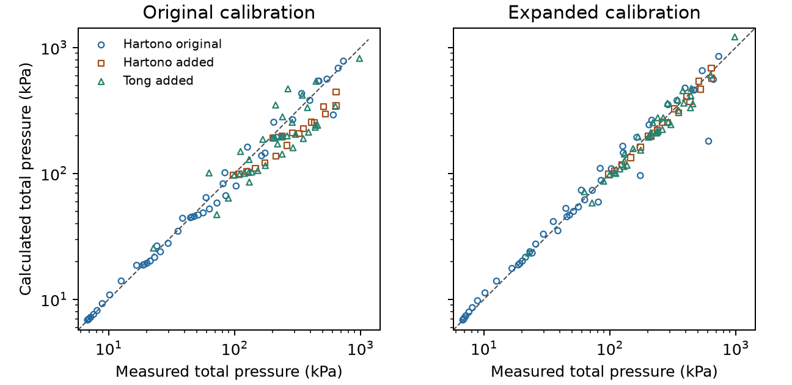

The calculations compare the effects of additional AMP measurements, the
aqueous reaction reference pressures, residual weighting, and neutral and
ionic molecular parameters. Feed amounts, units, observation identities,
and solver checks accompany each result. The finite searches and fitted
states concern the EOS used in the study. The high-temperature calculations
extend the same functions beyond their fitted temperature range.


