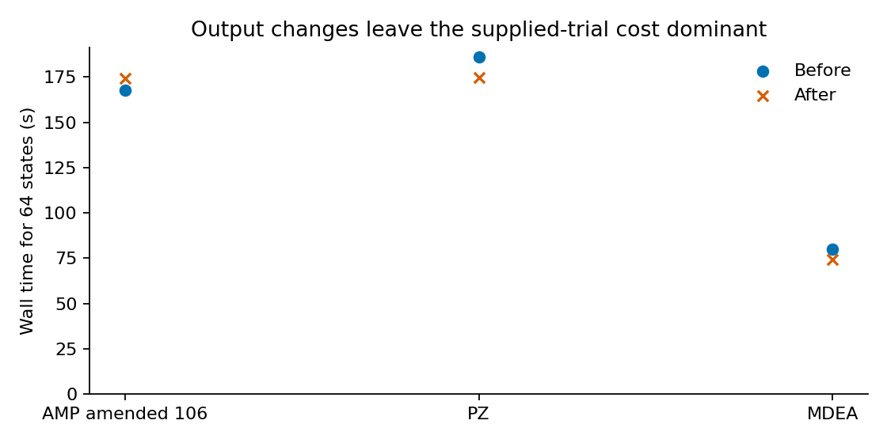

The pinned Engine supplied-trial route remains too expensive for the owner's 10-minute full-search and approximately two-hour campaign targets. Output changes reduce a small part of the cost. The owner-authorized retreat now uses a fixed base trial list and point-local closure, then bisection. No amine campaign was rerun.

## Cost evidence

The 52-state AMP amended search-66 profile contains 51 available states, 22 descents and one unavailable state. The total is 424.9148 worker-seconds (7.224–10.831 s/state), before output. This is amended campaign-373 numbering, distinct from historical search 66.

On an instrumented representative state: native Full search 0.2889 s, supplied evaluation 8.6057 s, parent solve 0.01376 s, compilation 0.00390 s, total 9.0106 s. Worker initialization and binding took 0.2721 s; imports took approximately 0.20 s. Five three-worker startup measurements, including fork, all initializers, dispatch and shutdown, took 0.2702–0.2927 s (median 0.2728 s), excluding parent setup. Timers can include nested calls; compilation must not be summed again into native work. A 15-second native CPU sample attributed about 12% to the phase_energy stack; unwinding was incomplete. A separate 100-call homogeneous-state proxy took 0.03025 s. This is not an isolated admitted-trial timing, and it cannot replace Engine stability diagnostics.

Serializing the 52 rows took 6.326 s. Five gzip runs at level 9 took 11.057–11.575 s (median 11.216), versus 1.387–1.435 s (median 1.410) at level 1. File size rose from 55.68 to 74.33 MB. The actual worker output path also avoids incremental writes through a text stream. Detailed files remain ignored.

## Matched subset wall times

| Amine | States | Before (s) | After (s) | Projected full search (h) | 21–44 search equivalents (h) |
|---|---:|---:|---:|---:|---:|
| amp106 | 64 | 167.93 | 174.32 | 1.44 | 30.3–63.5 |
| pz | 64 | 185.83 | 174.55 | 6.88 | 144.5–302.7 |
| mdea | 64 | 80.04 | 74.35 | 22.30 | 468.2–981.1 |

These are linear subset projections, not measured full searches or completed campaigns. The retained full AMP amended-106 search took 83.08 min; retained PZ and MDEA full-search costs were about 6.4 h and 21 h 46 min. Registry growth, changed parameters, unavailable rows, fits and host contention limit extrapolation. One pair does not establish a reproducible speedup; AMP was slower in this pair. New retreat work can require roughly 21–44 full-search evaluations including seeding, closure and final checks, before cache reuse; closure is not theoretically bounded to two passes. This range assumes at most one new native-witness closure pass per point, as expected from an unchanged deterministic native search. Complete campaign wall times remain unknown and may be larger. PZ's fitting memory issue is separately tracked by Engine #25.

DEA's 80-state verification subset took 3.51 s before and 4.38 s after, with no supplied trials. Its corresponding linear full-search projection is about 3.46 min. Its retained unpenalized result has no split, so a retreat is not indicated by that result. Campaign cost still includes fitting and its other required calculations.

## Trial inventory and sharing

Exact deduplication already lives in stable_refit_255._measure: identical kind, support, composition and packing are evaluated once and expanded to retain original multiplicity and ordering. AMP has 5,895 entries / 5,143 exact identities (752 redundant); PZ 5,374 / 3,614 (1,760 redundant); the sampled MDEA start-0 registry has 2,789 / 2,789. These savings belong to the baseline.

Rounding all composition entries and packing to 12 decimal places produces 3,309 AMP, 1,581 PZ and 2,300 MDEA identities. This is a redundancy diagnostic, not demonstrated tolerance-equivalence of admission, uncertainty or TPD. No rounded reduction was implemented.

Exact (T,P) sharing: AMP amended 106 has 1,844 known applicable rows, all at distinct pairs, plus 62 rows without supplied-pressure information. PZ has 8,852 pairs among 9,080 rows; MDEA has 63,990 among 65,197 known rows, with 3,902 unknown. The supplied pressure is used, preserving the existing route's pressure treatment. These results do not justify bypassing pressure admission. No prepared-trial stability API exists in the pinned wheel. Mixture.states batches homogeneous properties only.

## Verification and retreat method

AMP amended-106: 64 evenly spaced states, 365,490 available supplied outcomes and 11,790 not applicable, all 64 states available, no descent. DEA: all retained restricted rows plus an evenly spaced loaded-state sample, 80 states total, all available, no descent. The same supplied lists reproduce per-state availability, descent, unavailability, supplied-negative classification, resolved native branch, raw minimum and supplied minimum with maximum absolute TPD/RT error **0**. Older DEA rows missing a branch label derive it from their retained witness list; a matched baseline rerun additionally checks the current label. Engine native uncertainty is the comparison allowance; exact equality is stronger in these cases. PZ and MDEA's matched subsets also have zero TPD error and no classification changes; MDEA retains four unavailable states. This is numerical reproduction, not physical validation or a global stability proof.

The fixed retreat base is built after anchor and endpoint searches. At each t the base is copied, new native split compositions at that point are added, and full search repeats until no new witness appears. A local set never changes the global registry. Retained old-walk output is rejected explicitly; a new output directory is required for the changed method. Bisection assumes one admissibility crossing and reaches width at most 0.01/2^10 = 9.765625e-6. The selected point and upper bracket point are checked, and any observed inversion is recorded without an alternate search. This is a local check, not proof of global monotonicity. Identical-search reuse is bounded to four results within an immutable route invocation, with separate identity for point-local and global-registry searches.

The existing retreat regression test was extended: an analytic admissible interval t <= 0.875 returns t = 0.875, keeps optimizer cost 11 separate from retreat cost 10.875, closes newly discovered trials and detects cross-point carryover. All 19 Part II tests pass; the retreat test also passes after the final record-transport change. The shared non-Route seam reproduces a manufactured t = 0.875 interval using Part I’s lowercase census trial kinds and source-list metadata, without running a Part I calculation. An additional ignored probe confirms nonconsecutive identical search reuse and invalidation on changed states. Production additions: 60 gross lines, 30 removed, net 30, against 467f366; test changes reported separately.

An actual AMP one-state reference uses the endpoint’s most negative native state, with the retained anchor, endpoint and 5,895-entry initial catalog. The old walk returned t = 0.7115624999999999 in 327.897 s (40 checks); the new method returned t = 0.7115631103515625 in 279.554 s (21 checks). The difference is 6.103515626e-7, below the named resolution. The upper neighbour is 0.7115707397460938, a bracket width of 7.62939453125e-6. That upper search is unavailable, rather than evidence of a physical split; no sampled monotonicity inversion was recorded. This is one timing pair with one worker under the three-core quota, not a campaign speedup. The full new AMP retreat was not run: it is campaign work, and current full-search cost cannot meet the per-probe bound. Its full-grid t difference remains unknown. The old interrupted full-grid trace’s last passing point was 0.6624609375000001, not a completed retreat. Per-search amended-106 reproduction is exact.

## Part I and delivery limits

Part I's adopted F2 record (ae17803e...) comes from reduced-refit/F2/previous, with unpenalized cost 150.76290287953717, zero penalty and no descent on 1,908 grid / 576 offset / 162 census states. It did not enter retreat, so the adopted Part I numbers do not depend on the replaced walk and need no rerun for this change. No Part I calculation was run.

The numerical evidence is retained in ignored runs/385; the compact public summary is results/385-summary.json and exact plotted values are results/wall-times.csv. Pin: 391dfe5d, SHA-256 0962e21d2fa7a8ba1ed4622f1110b3e8053bacd878fa41c999d85e8b9afab66b. The auxiliary first profile completed all rows, then failed in its optional homogeneous-state proxy because Mixture lacks packing_fraction_coefficient; the corrected separate component probe supplies that measurement. No timing was taken from the failed auxiliary call.

See [the draft Engine use case](engine-use-case.md). It was not filed. The report has not been independently reviewed or promoted for manuscript use. The root manuscript manifest is untouched, so this notebook is not registered in the root site. Standalone rendering reads retained values only.
